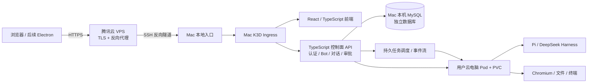

# Coke Grok Bot 像素级复刻技术方案

日期：2026-10-28

状态：调研与方案；尚未实现、发布或完成逐帧验收。

## 1. 目标与边界

在本目录建设 Coke Grok Bot，参考 xAI Grok Bot 的桌面产品，将界面、交互状态和可观察的产品行为逐项复刻，并提供公网访问。技术栈以 TypeScript、React、Node.js、MySQL 和 Mac 本机 K3D 为基础，最大程度复用 Coke Dots 的身份认证、租户云电脑、Agent 运行时与发布经验。

- **所有业务计算和数据留在 Mac**：控制面、任务调度、Agent、租户云电脑、数据库均在 Mac 或 Mac 上的 K3D。腾讯云 VPS 只负责 HTTPS 入口、反向代理和隧道转发。
- **目标是可运行的产品**：能创建持久 Bot、对话、实际运行任务、观察/接管云电脑、查看文件与结果；不能以静态截图或假执行代替真实能力。
- **桌面优先，公网可访问**：先完成可通过浏览器和公网访问的桌面版界面；同一前端后续用 Electron 包装成 Mac 应用。手机布局和原生移动端列为独立阶段，不把浏览器响应式模拟称为原生 App。
- **持续运行的现实边界**：任务在 Mac 及 Docker/K3D 保持运行时可脱离浏览器继续；Mac 休眠、关机或 Docker 停止时不具备官方云端的 24/7 运行保证。
- **视觉基准先固定版本**：官方产品仍在迭代，同一功能选择有时间、版本和来源的基准；当官方新旧资料冲突，分别记录，不拼成未观察过的流程。

## 2. 已核实的产品事实与待研究事项

| 范围 | 官方证据 | 已确认行为 | 尚需视觉核对 |
| --- | --- | --- | --- |
| Bot | [创建和管理 Bots](https://docs.x.ai/grok-bot/bots) | 侧栏 `+` 创建，输入名称并选择形状/颜色，创建后进入 Bot 聊天；Bot 有独立角色、聊天和记忆，可置顶、分组、隐藏 | 首次引导、弹层、头像形态、菜单、动画及各状态的像素和时序 |
| 聊天与协作 | [消息与协作](https://docs.x.ai/grok-bot/chat-and-collaboration) | 聊天中展示工具、电脑操作、文件和审批；可在执行时追加指令；支持多 Bot 群聊 | 消息气泡/流式状态、群聊和切换状态的具体样式及行为 |
| 持久电脑 | [电脑与应用](https://docs.x.ai/grok-bot/computer-and-apps) | 同一用户的 Bot 共享电脑、文件与登录态；每个 Bot 有自己的屏幕，每屏同一时间最多一个电脑操作任务 | 预览、打开电脑、接管/归还、等待和异常画面，及多屏交互 |
| 工作成果 | [文件与结果](https://docs.x.ai/grok-bot/files-and-results) | 聊天可附加文件并交付结果 | 文件卡片、预览、下载及大文件/错误状态 |
| 自动化 | [技能与例行任务](https://docs.x.ai/grok-bot/skills-routines-and-automations) | Skill 记录可复用的方法；Routine 可定时或由事件触发 | 列表、详情、创建/暂停/恢复及运行记录 |
| 连接与秘密 | [Vault](https://docs.x.ai/grok-bot/vault)、[官方 101 指南](https://x.ai/bot/guides/grok-bot-101) | 官方有安全登录、连接器、协作和审批概念 | 实际界面和授权流程；后续需单独证明 secret 不暴露给模型 |

重要架构区别：官方的电脑按**用户**而不是 Bot 归属；同一用户的多个屏幕不是安全隔离边界。Coke Dots 现有云电脑主要按租户工作区隔离，不能不经改造就把两者当成同一个模型。我们会保留租户权限边界，在租户内把个人电脑绑定到具体用户；个人 Bot 共用该用户电脑。团队共享 Bot 另建权限模型，不能默认继承个人浏览器登录态。

### 证据目录与状态

1. [官方产品介绍](https://x.ai/news/introducing-grok-bot)：产品目标与整体工作方式；属于官方介绍，并非每个交互细节的证据。
2. [官方产品文档](https://docs.x.ai/grok-bot/overview)：Bot、群聊、电脑、文件、Vault、Skill 和 Routine 的行为基准。
3. [官方 Grok Bot 101 文字指南](https://x.ai/bot/guides/grok-bot-101)：操作场景及截图入口；指南发布时间与当前文档可能不同，不能自动认定画面就是最新版。
4. [官方 YouTube：Introducing Grok Bot](https://www.youtube.com/watch?v=F1_0Lkp16Rc)：发布演示，需区分宣传片与真实操作。
5. [官方 YouTube：Grok Bot 101](https://www.youtube.com/watch?v=8xXhE25vJZY)：优先研究创建 Bot、消息、电脑、Skill 的操作路径。
6. [官方 YouTube：Grok Bot 201](https://www.youtube.com/watch?v=rOVomdnWhjQ)：优先研究多 Bot、Routine 和团队协作。

**当前证据限制**：已确认文档和上述视频来源；本次 YouTube 抓取遇到限制，尚未完成视频逐帧分析或真实官方客户端的截图比对。因此这里的视觉规格是研究与验收方法，不是已测得的官方尺寸或像素一致性结论。下一阶段要在可访问的官方客户端/视频中补齐原始画面；如果需要付费订阅、登录或权限，在具备访问条件后再记录对应证据。

## 3. Coke Dots 复用方案

本次只读核对了 `/Users/shangguan/Documents/home2026/coke-dots`。该主工作区存在未提交修改；其本地 `origin/main` 与远端 `main` 核对为 `4213e769e49da7a479ab2ad186584c77b721fa69`。实现时从新确认的 Coke Dots `origin/main` 提取明确范围，不复制未提交内容、配置或用户数据。

| 能力 | 参考位置 | 复用方式与必要改造 |
| --- | --- | --- |
| Google 登录 | `src/server/auth.ts` | 移植 Google OIDC、PKCE、state、nonce、ID token 和安全会话处理；新项目配置独立回调和会话，按新域名/路径验证 |
| 多租户 | `src/server/store.ts`、请求鉴权 | 移植身份与成员关系的设计；所有查询使用租户和成员授权，Bot 个人电脑额外按用户隔离 |
| 云电脑 | `src/server/linux-desktop-computer.ts`、`deploy/linux-desktop/` | 复用 Debian/Chromium/noVNC/Agent 镜像和 K3D 生命周期；改造资源标识、屏幕与租户/用户关系，保留 PVC、健康检查和接管仲裁 |
| Agent | `src/server/desktop-agent-kernels.ts`、`deploy/linux-desktop/agent-runtime.mjs` 等 | 提取 Pi 和 DeepSeek Harness 适配层；引入 Bot、会话、任务、权限和进度事件映射；真实验证模型与工具能力，不把“可选择”当作“可运行” |
| 文件交付 | `src/server/artifact-preview-ticket.ts` 等 | 复用授权预览和下载思路；限制租户、任务、文件路径与符号链接边界 |
| 像素研究 | `research/README.md`、`scripts/compare-reference.ts` | 复用来源登记、时间码、帧提取、裁切、叠图和差异报告流程；不把压缩视频上的像素误差说成精确匹配 |
| 桌面壳 | `electron/` | 后续复用 Electron 启动与登录衔接，服务器仍由 Mac/K3D 承载 |
| 数据库 | `src/server/store.ts` | Dots 当前为同步调用的 `node:sqlite`，不能直接声称已有 MySQL。重建异步持久化接口、调用链、事务、MySQL schema 与迁移，逐项移植业务语义 |

实例级模型配置与用户/租户数据分开；登录身份、模型凭据、第三方连接器凭据和云电脑浏览器登录态也分开管理。仅移植需要的代码及测试，记录来源版本，避免把 Dots 当前运行时与本项目绑定在一起。

## 4. 系统架构



- **MySQL**：优先使用用户已有的 Mac 本机 MySQL，创建本项目独立数据库、账号和最小权限；K3D 到宿主机使用明确、受限的连接地址。当前尚未验证 MySQL 服务、版本、配置或 Pod 可达性；如果已有服务无法满足需要，再评估在 Mac K3D 中单独运行 MySQL。不会复用 Dots 的数据表或改动其他数据库。
- **公网链路**：`公网 HTTPS → VPS 反代 → VPS 本地监听 → SSH 反向隧道 → Mac 本地 K3D 入口 → Web/API/WebSocket`。为本项目使用独立域名或路径和端口，实施前核对现有证书、OAuth 回调、VPS 反代与 Dots 隧道；不覆盖或抢占现有服务。
- **电脑连接**：noVNC/worker 不直接暴露公网；由已认证的控制面经 WebSocket 代理，短期授权绑定用户、租户和电脑。校验 Host、Origin、Cookie、会话和所有权。登录态与聊天记录不写入发布包。
- **网络出口**：云电脑访问 Google 等网站时单独验证 Pod 和受管 Chromium 的实际连通性；不能由 Mac 浏览器的网络正常推断 Pod 也正常。代理只在需要的进程或构建命令中配置，不改系统全局网络。
- **数据保护**：K3D namespace、ServiceAccount、NetworkPolicy、PVC 和资源配额按新项目独立设置。容器隔离不等同于官方硬件隔离；不宣传相同的硬件级安全保证。

### 4.1 Bot 与电脑

- 初始模型：一个个人用户在一个租户内拥有一台持久电脑；该用户的多个 Bot 共享电脑内的浏览器登录态和文件，但各 Bot 的聊天、角色、记忆及任务记录独立。
- 多 Bot 聊天和普通文本推理可并行。官方的“每 Bot 一屏、同一电脑多个屏幕并行”要作为明确的技术验收目标：研究共享文件与浏览器登录态下的多显示会话、电脑控制、截图和人机接管。不能用多个互相隔离的浏览器 profile 冒充共享登录态。
- 第一版复用 Dots 单屏时，电脑操作采用持久租约串行：有任务在操作时，其他任务显示排队；人接管时暂停 Agent 操作。界面和报告必须标明“单屏排队”，直至多屏能力完成，不能称作官方并发等价。
- 每个工作任务保留独立工作目录和原生 session；用户共享电脑文件与 Bot 会话分属不同范围。禁止路径穿越、跨任务或跨租户 session 恢复。

### 4.2 Agent、任务与事件

- **运行位置**：Pi/DeepSeek Harness 在所属用户的 Mac K3D 云电脑内运行；控制面只负责任务、权限、调度和审计。
- **持久状态**：消息、任务、工具事件、结果、审批、定时计划先写 MySQL；建议状态为 `queued → running → waiting_approval / completed / failed / canceled / unknown`，失败、取消和外部副作用不明确必须可区分。
- **恢复**：使用 MySQL 事务、任务租约、到期回收和有序事件游标；刷新/重连后根据已存状态还原。调度采取至少一次投递与去重设计，外部副作用不得假定天然恰好一次。
- **重试**：只对有明确定义的幂等步骤自动重试；外部写入或非幂等请求超时/5xx 后先检查已持久化进度，不重复发送。
- **审批**：需要外部发送、修改账户/第三方内容等操作时生成明确的待审批项，批准或拒绝后记录结果；审批有效性与操作授权需由服务端/工具网关执行，不能只靠提示词。
- **Skill / Routine**：Skill 保存方法、输入、输出和边界；Routine 保存时区、触发条件、下次运行、去重键及运行历史。事件来源必须具备对应授权；外部系统失败要真实显示。
- **群聊与委派**：持久记录参与 Bot、消息与交接来源、父子任务及结果，避免跨租户调用；需要单独验证多 Bot 协同，不能把多个虚拟回复冒充真正协作。

### 4.3 MySQL 主要数据模型

建立 `users / tenants / memberships / sessions`、`bots / bot_memories / bot_sections`、`conversations / participants / messages / attachments`、`runs / run_events / approvals`、`computers / computer_screens / computer_leases`、`skills / routines / routine_runs`、`artifacts / audit_events` 等表。实际 schema 依据官方可观察语义和 Dots 代码审查确定。

每条业务数据带相应租户/用户归属；关系及查询使用复合约束与索引，重要事件按事务提交。数据库迁移采用向前兼容的 expand/contract 策略，记录当前 schema 版本和最低可回退版本，确保回滚应用时不会直接丢弃新数据。

## 5. 像素级复刻和验证方法

### 5.1 来源与逐帧研究

沿用 Coke Dots 的研究流水线，在 `research/` 建立可追溯证据台账：

1. 记录官方文档、视频 URL、获取时间、产品版本、视频时长、分辨率、帧率和文件校验值；原视频和截图只保存在本机被忽略的研究目录。
2. 按操作路径观看完整片段，再对状态切换区间逐帧或按源帧率导出 PNG。记录真实视频时间码、操作、前后状态、动效时长和异常；不以视频目录、字幕或文件名代替画面验证。
3. 首批梳理：登录/首次进入 → 新建 Bot → Bot 名称和头像 → 主聊天/输入 → Bot 执行与进度 → 电脑预览/接管/归还 → 文件预览 → 侧栏切换 → 审批/失败 → Routine；后续补群聊、设置、技能、语音和手机。
4. 用可访问的官方客户端按固定窗口大小、缩放、DPR、主题与字体设置截图；视频画面只用于补充官方客户端难以捕获的动作。标注遮挡、压缩、未知字体和不可见的操作路径。
5. 对每个画面建立元素清单：窗口尺寸、主要区块边界、间距、字号、行高、字重、颜色、圆角、阴影、图标、悬停/焦点和动画帧；无清晰证据的部分明确写“待确认”。

### 5.2 比较与验收

- 在相同视口、DPR、字体、数据和交互状态下采集本项目截图，与官方参考裁切对齐，生成参考图、实现图、50% 叠图、差异热图、区域坐标和指标。
- 对无压缩的、尺度已确认的参考，初始质量目标为关键布局边界偏差不超过 2 CSS px、纯色区域 RGB 单通道偏差不超过 3；动画逐状态对齐并检查关键帧时序。每个画面实际阈值与例外应随可获得的原始参考校准，并以人工视觉验收为最终依据。
- 对 YouTube 压缩、缩放、遮挡或未知尺寸的参考，保留误差和不确定项；不得声称由数字差异率直接证明绝对像素一致。
- 分开验收视觉、交互、真实运行效果、跨用户隔离和公网行为。真实任务必须能展示实际进度与实际产物，不能只测假数据；本地模拟、真实模型、已登录公网 Chrome 各自标注证据。

## 6. 顺序实施与每一阶段的验收

以下是工作顺序；各阶段需要时可拆成更小功能，但**任何时刻只进行一个 feature 分支**。每个分支均从最新 `main` 创建，完成检查并合并后才开始下一分支。

| 顺序 | 交付 | 关键验收 |
| --- | --- | --- |
| 0 | 建立官方资料/视频证据台账、产品状态矩阵及基准画面；初始化仓库 `main` | 对关键流程有可追溯来源；已知/未知分开；完成第一批可对齐截图 |
| 1 | 项目骨架、MySQL、Google 登录、独立租户；桌面布局和基础侧栏 | Google 真登录及退出；两个用户数据隔离；刷新恢复；固定视口对图 |
| 2 | Bot 创建/头像/名称、聊天、流式进度和任务持久化 | 实际模型任务完成，刷新后历史一致；失败、取消和进行中状态真实可见；关键画面通过对图 |
| 3 | Mac K3D 用户云电脑与 Pi/DeepSeek Harness | 两种已配置的引擎分别完成真实任务；电脑可观察、接管、归还；PVC 重启后保留；单屏排队边界可见 |
| 4 | 文件、预览/下载、审批与租户隔离 | 文件路径/符号链接与跨用户拒绝测试；批准/拒绝对应真实副作用与审计；公网登录用户完成闭环 |
| 5 | Skill、Routine、记忆和任务恢复 | 定时运行、时区、暂停/恢复、重启恢复和重复触发去重；每个 Bot 记忆边界可验证 |
| 6 | 多 Bot 群聊、委派与共享电脑多屏 | 真实交接和结果；同用户共享文件/登录态；不同用户拒绝访问；每屏租约及用户接管独立验证 |
| 7 | 原生 Mac 包装、移动界面、语音与更多连接器 | 按官方参考分别逐项完成；移动浏览器、真实手机、真实语音与真实连接器分别验收 |

公网入口可在阶段 1 的独立环境建立，之后每个相关功能都经历本地测试与**已登录公网 Chrome 真实流程**。不把 HTTP 200、Pod Ready、本地 mock 或 Electron 能打开当作完整验收。

## 7. 分支、发布、Tag、检查点与回退

### 7.1 Git 规则

远端：<https://github.com/cokepoppy/coke-grok-bot.git>。本次只读查询未发现远端 refs，`main` 也未显示；实施时先再次检查远端状态，若仍为空则先建立最小 `main` 基线。

1. 开工前检查工作区、远端 `main` 和活动 feature 分支，从最新 `main` 建立唯一分支，例如 `feature/bot-chat`。
2. 做完该功能并通过适用的构建、功能、视觉、隔离和公网验收后，提交并推送；合并到 `main`，核对远端提交，切回 `main`。
3. 只有上一步完成后才能创建下一功能分支。若某功能仍等待用户验收或修复，保持当前分支，不能并行新建其他 feature 分支。
4. 较大功能经用户验收认可后，在**实际通过验收的 main 提交**创建并推送带注释的 `checkpoint/<功能>-<日期>` tag；记录提交、功能范围、验证结果、发布目录和回退方式，并按用户要求写一条不含秘密的 Codex 记忆。
5. Tag 只标记源代码状态；只有发布包、镜像、数据库兼容性和实际访问另行验证后，才称为可回退的发布检查点。

### 7.2 发布目录

每个用户认可的主要版本生成一个独立目录，例如 `releases/<checkpoint>/`。目录生成后不原地覆盖；如需更改则产生新版本。仓库中的构建脚本与发布清单受版本控制；体积较大的镜像和构建制品保留在本机发布目录，不把秘密、用户数据或大型二进制默认提交到 Git。

```text
releases/<checkpoint>/
  manifest.json                 # tag、commit、schema、镜像 digest、架构、依赖、验收范围
  SHA256SUMS                    # 包内文件校验
  source/                       # 对应源码归档或 git bundle、lockfile
  artifacts/                    # 前端、服务端和所需运行依赖的可复用构建产物
  images/                       # 精确版本 OCI 镜像归档，可导入本机 K3D
  deploy/                       # K3D 资源清单、非秘密配置模板
  scripts/                      # verify、install、upgrade、rollback、smoke
  docs/                         # 发布说明、数据库兼容性、操作和回退记录
```

发布包必须能从固定源代码和镜像恢复服务，不依赖后续可变 `latest` 标签或未记录的工作区。脚本执行前先校验文件哈希、镜像架构/digest、目标集群/命名空间、配置引用、数据库 schema 兼容性和当前正在执行的任务；执行后核对实际运行版本并跑真实登录/电脑/任务冒烟。先在隔离环境演练，再作为可用检查点。

### 7.3 数据与回退

- 发布文件夹不包含 OAuth、API key、SSH 私钥、浏览器 cookie、K3D Secret 或未经脱敏的用户数据。凭据放在独立受限的秘密管理位置，安装时由本机安全注入。
- 用户数据单独做受限备份：记录 MySQL 一致性备份及校验、备份时间、迁移版本；云电脑 PVC 需要单独的快照/备份和恢复验证。发布包本身不能冒充完整的数据灾难恢复包。
- 默认回退应用和镜像，保留当前 MySQL 和 PVC。先检查旧版兼容当前 schema；若不兼容，停止自动回退，给出前向修复或数据恢复方案。数据回滚可能覆盖新产生的对话/文件，必须先备份当前状态并明确选择恢复范围。
- 不修改 Dots 的运行目录、Pod、PVC、数据库或现有隧道；同时验证 Dots 和本项目各自仍可访问。

## 8. 当前环境核查与资源计划

- 目标目录在本次调研前为空，尚未初始化 Git；远端只读查询没有发现任何 refs。当前交付仅为方案文件。
- Coke Dots 主工作区有未提交改动，本次没有修改或切换它；后续复用以重新确认的远端 `main` 为来源。
- 2026-10-28 后续复查：Docker 与 `k3d-tp1121-sandbox-dev` 已可连接；节点内存约 3304 MiB / 8 GiB，现有 Dots 云电脑和其他项目工作负载正在运行。未发现可安全删除、且能实质释放内存的目标；没有清理 Pod、镜像或用户数据。
- 集群 `coke-auth` 内现有 MySQL Pod 正在运行，客户端版本为 8.4.10（aarch64）。其现有数据库、凭据与业务归属未检查；本项目独立 schema 和连接权限尚未建立，不得擅自更改现有数据。
- 重新启用现有环境后，先只读列出节点、namespace、工作负载、镜像、PVC、任务和资源占用，确认归属与活跃状态。仅处理确认无用、可重建且不影响回滚的具体对象；镜像占用主要是磁盘，运行 Pod/容器才占内存。不要批量 prune、删除 PVC、重启正在使用的服务或把其他项目的镜像误当垃圾。

## 9. 初次实施的最小验证清单

1. 冻结一版官方桌面基准，逐帧登记来源，做第一批登录、Bot 创建和聊天截图。
2. 复查 GitHub `main`、Docker/K3D、MySQL、现有隧道及占用；初始化项目基线后只创建一个 feature 分支。
3. 打通新项目的 TypeScript 前后端、独立 MySQL、真实 Google 登录，以及两个用户的隔离。
4. 在同一分支中完成对应功能测试、视觉对图和真实登录路径；合并到 `main` 后再开始下一分支。
5. 每个里程碑保留验证记录；待用户认可较大功能后创建 tag、发布包与记忆检查点。
