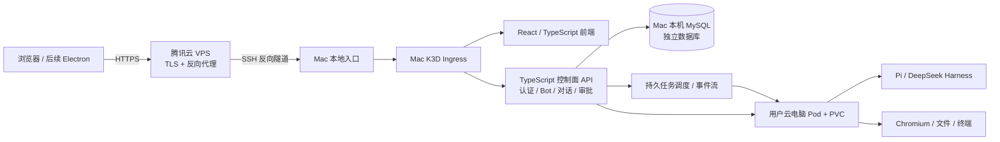

# Coke Grok Bot 像素级复刻技术方案

日期：2026-10-28

状态：分阶段实施中；已有 UI 检查点与真实 Agent/云电脑候选实现，尚未完成全产品复刻及完整逐帧验收。

## 1. 目标与边界

在本目录建设 Coke Grok Bot，参考 xAI Grok Bot 的桌面产品，将界面、交互状态和可观察的产品行为逐项复刻，并提供公网访问。技术栈以 TypeScript、React、Node.js、MySQL 和 Mac 本机 K3D 为基础，最大程度复用 Coke Dots 的身份认证、租户云电脑、Agent 运行时与发布经验。

- **所有业务计算和数据留在 Mac**：控制面、任务调度、Agent、租户云电脑、数据库均在 Mac 或 Mac 上的 K3D。腾讯云 VPS 只负责 HTTPS 入口、反向代理和隧道转发。
- **目标是可运行的产品**：能创建持久 Bot、对话、实际运行任务、观察/接管云电脑、查看文件与结果；不能以静态截图或假执行代替真实能力。
- **桌面优先，公网可访问**：先完成可通过浏览器和公网访问的桌面版界面；同一前端后续用 Electron 包装成 Mac 应用。手机布局和原生移动端列为独立阶段，不把浏览器响应式模拟称为原生 App。
- **持续运行的现实边界**：任务在 Mac 及 Docker/K3D 保持运行时可脱离浏览器继续；Mac 休眠、关机或 Docker 停止时不具备官方云端的 24/7 运行保证。
- **视觉基准先固定版本**：官方产品仍在迭代，同一功能选择有时间、版本和来源的基准；当官方新旧资料冲突，分别记录，不拼成未观察过的流程。

## 2. 已核实的产品事实与待研究事项

| 范围 | 官方证据 | 已确认行为 | 尚需视觉核对 |
| --- | --- | --- | --- |
| Bot | [创建和管理 Bots](https://docs.x.ai/grok-bot/bots) | 侧栏 `+` 创建，输入名称并选择形状/颜色，创建后进入 Bot 聊天；Bot 有独立角色、聊天和记忆，可置顶、分组、隐藏 | 首次引导、弹层、头像形态、菜单、动画及各状态的像素和时序 |
| 聊天与协作 | [消息与协作](https://docs.x.ai/grok-bot/chat-and-collaboration) | 聊天展示工具、电脑操作、文件和审批；可在执行时追加指令；支持 2–6 Bot 群聊、`@` 指定 Bot/群组/Routine/App、Bot 间异步交接；私聊中的新指令可重定向当前任务 | V1 已逐帧看到 Bot 候选、结构化 mention token、发送、Maya `is working`、Dex `Message from maya`/`Thinking`，33:42.400 的贴纸投票澄清卡（四个选项加自由输入），以及 33:42.500 从 `dex ↔ maya` 标题转为 `dex` 单聊；至 34:32.966 澄清卡已标为 Dismissed，Computer 仍是灰色占位；34:20.767 起出现草稿、34:29.767 显示已发送消息、34:30.200 显示 `dex is working`；34:34.233 出现 Dex 的 Figma 回复，34:34.300 显示 `Connecting to Figma`；34:42.900 打开 Marketplace，34:45.967 的 Figma 插件详情显示 `default` 账户为 `Connected` 且有 Figma connector/14 项 Skills；至 34:47.967 Computer 仍灰色，未见具体 Figma 文件内容或任务结果；群聊视觉和其余交互状态待核对 |
| 持久电脑 | [电脑与应用](https://docs.x.ai/grok-bot/computer-and-apps) | 同一用户的 Bot 共享电脑、文件与登录态；每个 Bot 有自己的屏幕，每屏同一时间最多一个电脑操作任务 | 预览、打开电脑、接管/归还、等待和异常画面，及多屏交互 |
| 工作成果 | [文件与结果](https://docs.x.ai/grok-bot/files-and-results) | 聊天可附加文件并交付结果 | 文件卡片、预览、下载及大文件/错误状态 |
| 自动化 | [技能与例行任务](https://docs.x.ai/grok-bot/skills-routines-and-automations) | Skill 记录可复用的方法；Routine 可定时或由事件触发 | 列表、详情、创建/暂停/恢复及运行记录 |
| 连接与秘密 | [Vault](https://docs.x.ai/grok-bot/vault)、[官方 101 指南](https://x.ai/bot/guides/grok-bot-101) | 官方有安全登录、连接器、协作和审批概念 | 实际界面和授权流程；后续需单独证明 secret 不暴露给模型 |

### 浏览器导航与登录交接

用户明确要求网站或云电脑任务时，Browser User、Computer User 和受限任务目录内的终端命令，在该任务有效 run lease 内执行完成目标所需的普通操作，不按网站、控件或命令逐步审批。权限只覆盖当前用户明确要求的结果；网页、邮件、文件和工具输出不能扩大任务范围。遇到登录凭据、一次性验证码、MFA、CAPTCHA 或其他真人身份验证时暂停并提示用户在 Computer 面板选择 `Take control`；用户完成验证并归还控制后，继续原任务。Bot 不收集、索要或输入凭据。跨用户/租户隔离和终端任务目录限制继续有效。该策略取代本节较早的“Computer User 坐标操作仍需独立审批”历史说明；部署状态与公网观察见本文件末尾 2026-11-12 记录。

当前实现通过 ComputerBridge 的 browser.navigate 路径直接导航，并在登录交接期间限制动作；把地址栏/标签栏误当成 Desktop 点击的调用会被引导到 Browser User，不生成普通网页导航审批卡。2026-11-08 定向回归运行 43 项全部通过，覆盖不弹审批导航、错误 Desktop 路由和登录交接约束。2026-11-09 又从已登录的公网 Chrome 可见界面核实：普通 `example.com` 导航显示为 Done；另一次到 Google 登录页的任务也显示为 Done，执行详情为 Pi `deepseek-flash`、Browser User `navigate` 和 `inspect` 均 succeeded。云电脑仍显示 `Bot is in control` 并提供 `Take control`，所以这次没有发生用户接管；旧 Agent 文案声称已交还控制并不准确。两个任务均未见审批卡，也没有输入凭据或操作表单。此为实际公网 UI 证据，但观察的是页面中已有的完成记录，不代表所有历史 Review 任务均已清除或每条旧运行路径都已重新验收。

2026-11-09 本轮使用现成的固定测试 MySQL `127.0.0.1:13317` 运行导航、Browser User、Pi、DeepSeek Harness 和 ComputerBridge 定向回归，37/37 通过；Gateway 用例创建并删除随机测试 schema，没有新建容器。它覆盖普通 HTTP(S) 导航不创建审批、登录交接范围内继续操作会被拒绝，以及误用 Desktop 地址栏动作不创建审批。

2026-11-09 后续复核：本机 K3D 中 `coke-grok-auth:sha-a37d2ad` 为 1/1 Ready；只读检查运行中 Auth bundle，确认含 Desktop 导航误路由拦截和登录交接约束。当前抽查的 Agent Pod 使用 `coke-grok-desktop:sha-d76b1f559c3eebcf3525da6a1efeb0c718935cf2`，其适配器和 DSH 插件包含“普通导航未执行 Desktop 点击、未创建审批，改用 Browser User”的错误恢复指引。本轮导航策略、ComputerBridge、DSH 插件回归 30/30 通过。用户截图中的 `Desktop: click` 坐标 `(295, 48)` 落在当前导航栏误路由拦截范围内；若由已核对的 Auth/Agent 路径处理，ComputerBridge 会在创建审批前拒绝该 Desktop 动作，DSH 再收到改用 `computer_browser.navigate` 的指引。截图所示旧任务具体使用的镜像和审批记录尚未映射，不能据此判定它是旧记录或已由公网重新验收。截至该次审计，Codex 浏览器控制入口在 30 秒后超时；当时尚无新的已登录公网可见点击证据。后续可见公网回归结果记录在本节末尾。登录页到达后的提示仍须以真实公网任务观察，`Bot is in control` 也不等于已转交用户。

2026-11-09 本轮本机 K3D 验收补充：固定 Desktop 镜像 `coke-grok-desktop:sha-e18f71547116d965c5abc5db9227b74729983588` 的 Computer UI 测试通过；用户在 noVNC 接管界面中切换 Chrome 标签、在地址栏输入 URL，分别覆盖弹窗和全屏模式，期间完成 22 次截图轮询，归还后聊天输入框恢复。真实 DeepSeek Pi + K3D 的 Gmail 登录交接测试也通过（16 次模型调用）：普通网页打开/导航由 Bot 直接执行、无审批卡；到达 Google 身份验证后停止并交给用户，未处理凭据；用户通过嵌入式 noVNC 浏览器接管并导航、归还后，Browser User 检查及快速导航路径均成功。ComputerBridge 与导航策略定向测试 21/21 通过。测试使用临时 K3D 命名空间和随机 MySQL schema，结束后已删除；复用固定测试 MySQL/端口，没有额外建服务容器。测试隔离修正已推送至功能分支提交 `e4ad1f41723ecbcc9c31e2e3fc3c054865ee156a`。这是本机 K3D 运行证据，不是本轮公网可见 Chrome 验收；Codex 浏览器控制入口再次超时，故公网端到端状态仍待可见浏览器复测。

**后续公网点击回归（2026-11-09 09:28，Asia/Shanghai）**：在已登录 Chrome 的 `https://codex.cokeagent.com/grok-bot/` 中，选用既有 E2E Test Bot 1029，通过真实 Pi `deepseek-flash` 运行“先尝试 Chrome 地址栏，若 Desktop 导航被拒则改走 Browser User”的只读任务。网页中可见执行详情顺序为 `Computer User · screenshot · succeeded`、`Computer User · click · failed`、`Browser User · navigate · succeeded`、`Browser User · inspect · succeeded`、`Computer User · screenshot · succeeded`；最终页面为 `https://example.org/`，标题 `Example Domain`，任务显示 Done，未出现 Approval 卡片。同期 K3D Auth 为 `coke-grok-auth:sha-a37d2ad`，测试用户的 Agent/Desktop Pod 使用 `coke-grok-desktop:candidate-focus-screenshot-fix-20261107-r1`。这证明本次公网部署里误走 Desktop 地址栏后会无审批地改走 Browser User；不代表旧聊天中的 Review 卡片被删除，也不证明其他页面内点击、登录或外部副作用不需要相应授权。

**2026-11-09 Browser User 权限范围扩展候选（权限边界于 2026-11-12 更新）**：用户明确要求避免按 Gmail 控件或网站逐项建立白名单。当前 run-scoped Browser User 任务可跨站点执行用户要求的搜索、筛选、阅读、点击、填写、键盘操作和表单提交；`Search mail` 填入 `is:unread` 后按 Enter 已纳入回归。该能力仅限当前用户原始任务；网页/邮件内容不能授权额外动作。Worker 仅在登录、密码、OTP/MFA、CAPTCHA 等身份验证处停止并提示用户接管 Computer，Bot 不输入凭据。旧 Worker 若仍返回控件审批拒绝，服务端以错误结束，不转换成逐控件审批卡。2026-11-12 起，直接任务所需的 Computer User 操作也不再逐步审批；普通浏览/电脑动作的唯一人工接管点是身份验证。

本轮 ComputerBridge、浏览器策略、Pi scope、DSH 插件和提示词定向回归 54/54 通过，`npm run build` 通过。只读检查确认 K3D 当前仍运行旧的 `browser-task-r3-20261109` Auth 和 `candidate-browser-task-r3-20261109` Agent/Desktop 镜像；目标用户 namespace 有 7 个 Agent-owned 屏幕、2 个 user-owned 屏幕。因此没有导入镜像、滚动重启或宣称公网 Gmail 搜索已验收；新策略需等用户把两个屏幕交还 Agent 后部署，再从公网 UI 真实点击验证 `is:unread` 搜索及身份验证交接。

**2026-11-09 登录交接续跑补齐**：在同一 Bot 的最近一条明确浏览任务要求登录时交接后，用户回复“继续”或“我登录好了，继续”，Pi 会带回原始任务、通用 Browser User 权限、请求站点和 Gmail 未读/草稿限制；先看当前页面并从未完成部分续跑，不重复已完成操作。若中间插入其他任务，不继承旧授权。浏览器仍只在密码、OTP/MFA、CAPTCHA 等身份验证处停止并交给用户接管；普通网页操作不会逐步创建审批卡。Computer User 坐标操作保留原有独立路径。ComputerBridge、浏览器策略、Pi、DSH 和 Worker 定向回归 45/45 通过，`npm run build:deployment` 通过。公网候选尚未部署：只读检查当前用户 namespace 为 7 个 Agent-owned、2 个 user-owned 屏幕；不重启其 Desktop，故不能声称公网 Gmail `is:unread` 已验收。

**2026-11-09 公网通用 Browser User 候选部署**：用户明确授权重启两块 user-owned 云电脑。候选 `464cd70c68ea8c1853a293f6b2f6df72b478cf80` 已部署至本机 K3D；Auth、Agent、Desktop 固定镜像切换到 `sha-464cd70...`，Broker 用原镜像滚动重启。Worker 的 `browser-task-policy.mjs` 运行时 SHA-256 与源码一致；公网路由返回 200。Chromium profile 位于 `/workspace/.desktop-home/.config/chromium`，挂载原 workspace PVC；重启后 PVC UID/volume 未变，未改 MySQL、其他租户或 VPS。之后在已登录公网 Chrome 的 Coke Grok Bot UI 真实提交了 Gmail `is:unread` 搜索任务；云电脑显示 Google 账号选择页，Bot 界面显示 `Queued · waiting for your computer`，电脑当前由用户接管。测试尚未执行到搜索：等待用户本人完成 Google 登录并点 `Return to Bot`，然后验证 Browser User 导航、Search mail 填写及 Enter 是否全程无逐步审批。未查看、抄录或输入任何凭据。

重要架构区别：官方的电脑按**用户**而不是 Bot 归属；同一用户的多个屏幕不是安全隔离边界。Coke Dots 现有云电脑主要按租户工作区隔离，不能不经改造就把两者当成同一个模型。我们会保留租户权限边界，在租户内把个人电脑绑定到具体用户；个人 Bot 共用该用户电脑。团队共享 Bot 另建权限模型，不能默认继承个人浏览器登录态。

### 证据目录与状态

1. [官方产品介绍](https://x.ai/news/introducing-grok-bot)：产品目标与整体工作方式；属于官方介绍，并非每个交互细节的证据。
2. [官方产品文档](https://docs.x.ai/grok-bot/overview)：Bot、群聊、电脑、文件、Vault、Skill 和 Routine 的行为基准。
3. [官方 Grok Bot 101 文字指南](https://x.ai/bot/guides/grok-bot-101)：操作场景及截图入口；指南发布时间与当前文档可能不同，不能自动认定画面就是最新版。
4. [官方 YouTube：Introducing Grok Bot](https://www.youtube.com/watch?v=F1_0Lkp16Rc)：发布演示，需区分宣传片与真实操作。
5. [官方 YouTube：Grok Bot 101](https://www.youtube.com/watch?v=8xXhE25vJZY)：优先研究创建 Bot、消息、电脑、Skill 的操作路径。
6. [官方 YouTube：Grok Bot 201](https://www.youtube.com/watch?v=rOVomdnWhjQ)：优先研究多 Bot、Routine 和团队协作。

**当前证据状态**：官方 V1 Grok Bot 101 的 0:00.000–56:40.633 已达到全片源帧覆盖：对原片 102,020 个 PTS 做逐点联集，缺帧为 0；17 个补档窗口的 2,520 帧像素哈希和 101 张联系图均经独立 FFmpeg 重解码复核。源 PTS 联集中另有 49 个旧 manifest 时间戳不与原视频 PTS 精确重合，不计入覆盖量。详细视觉观察和目录见 [研究证据台账](../research/README.md)。这证明视频帧取证完整，不等于同视口像素比对或真实产品端到端验收；官方 V2、第三方教程仍有待逐帧研究，V3 按用户此前指示停止。

2026-11-09 补齐 V1 官方视频 20:30–21:07.967 的连续帧审阅：8 个窗口共 1,140 个源帧、46 张联系图，独立重解码校验源视频 SHA-256、帧 PTS / yuv420p 像素哈希与字节数、联系图哈希全部匹配。画面仍为 `Meet the team` 演讲页，无产品操作；本段只补充视频审阅证据，不代表产品交互验收。连续覆盖范围和逐窗观察见 `research/README.md`。


2026-11-06 补充逐帧证据：V1 的 42:33–42:38 连续 150 帧仍显示 Maya 工作中和 Google Forms 首页，只有消息 hover 操作栏变化，未见发布或链接交付；V2 的 21:15–21:19.960 连续 125 帧仍是第三方 Cursor 页面，不作 Grok Bot UI 依据。联系图、PTS 与像素哈希见 `research/README.md` 对应条目。

2026-11-13 官方 Grok Bot 201 逐帧续审推进到 4:29.960：4:15.000–4:29.960 共 375 个连续源帧与 15 张联系图全部逐张审阅，并独立重解码核验源视频 SHA-256、PTS、像素哈希/字节数及联系图哈希。画面持续为 `What we will learn` 演讲页，仍未展示产品工作区或真实任务操作。V2 连续覆盖为 0:00.000–4:29.960，共 6,750 帧；下一窗口从 4:30.000 开始。该证据不等于产品功能或像素级界面验收。

2026-11-13 继续逐帧审阅 Grok Bot 201 的 4:30.000–4:44.960，共 375 帧/15 张联系图；独立校验源视频、PTS、像素和联系图哈希均通过。约 4:41.720 从 `What we will learn` 切换到 `Grok Bot 101 Recap`，列出 Dex（Designer）、Maya（Community）、Penny（Sourcing）；仍为演讲材料而非工作区画面。V2 连续覆盖至 4:44.960（7,125 帧），下一窗口为 4:45.000。

2026-11-13 官方 Grok Bot 201 连续逐帧审阅新增 6:30.000–6:44.960：375 个源帧、15 张联系图全部审阅并独立核验源 SHA-256、PTS、像素哈希/字节数及联系图哈希。PTS 398560（6:38.560）从 `Sticker shop` 切到 `Meet the team`，展示 Dex（Designer）、Lew（Fullstack）、Sam（UI/UX）；这是演讲幻灯片，不是产品客户端或实际运行时证据。转场六帧留存于 `research/frames/grok-201-0638-transition-keyframes-20261113/`。V2 连续覆盖现延长至 6:44.960（10,125 帧），下一窗口 6:45.000；详细证据见 `research/README.md`。

2026-11-13 官方 Grok Bot 201 逐帧复核再延长至 6:59.960（10,500 帧）：6:56.560 出现 macOS Dock，6:57.360 显示 Chrome 菜单栏，6:57.800 切入 Google Slides 编辑器并看到 Dex/Metrics/Full Stack 备注。375 个源帧、15 张联系图及 18 张转场全分辨率帧均经独立重提取核验；这是演讲者屏幕分享，不是产品客户端或实际运行时证据。下一窗口从 7:00.000 开始；详见 `research/README.md`。

## 3. Coke Dots 复用方案

本次只读核对了 `/Users/shangguan/Documents/home2026/coke-dots`。该主工作区存在未提交修改；其本地 `origin/main` 与远端 `main` 核对为 `4213e769e49da7a479ab2ad186584c77b721fa69`。实现时从新确认的 Coke Dots `origin/main` 提取明确范围，不复制未提交内容、配置或用户数据。

| 能力 | 参考位置 | 复用方式与必要改造 |
| --- | --- | --- |
| Google 登录 | `src/server/auth.ts` | 移植 Google OIDC、PKCE、state、nonce、ID token 和安全会话处理；新项目配置独立回调和会话，按新域名/路径验证 |
| 多租户 | `src/server/store.ts`、请求鉴权 | 移植身份与成员关系的设计；所有查询使用租户和成员授权，Bot 个人电脑额外按用户隔离 |
| 云电脑 | `src/server/linux-desktop-computer.ts`、`deploy/linux-desktop/` | 复用 Debian/Chromium/noVNC/Agent 镜像和 K3D 生命周期；改造资源标识、屏幕与租户/用户关系，保留 PVC、健康检查和接管仲裁 |
| Agent | `src/server/desktop-agent-kernels.ts`、`deploy/linux-desktop/agent-runtime.mjs` 等 | 提取 Pi 和 DeepSeek Harness 适配层；引入 Bot、会话、任务、权限和进度事件映射；真实验证模型与工具能力，不把“可选择”当作“可运行” |
| 文件交付 | `src/server/artifact-preview-ticket.ts` 等 | 复用授权预览和下载思路；限制租户、任务、文件路径与符号链接边界 |
| 像素研究 | `research/README.md`、`scripts/compare-reference.ts` | 复用来源登记、时间码、帧提取、裁切、叠图和差异报告流程；不把压缩视频上的像素误差说成精确匹配 |
| 桌面壳 | `electron/` | 后续复用 Electron 启动与登录衔接，服务器仍由 Mac/K3D 承载 |
| 数据库 | `src/server/store.ts` | Dots 当前为同步调用的 `node:sqlite`，不能直接声称已有 MySQL。重建异步持久化接口、调用链、事务、MySQL schema 与迁移，逐项移植业务语义 |

实例级模型配置与用户/租户数据分开；登录身份、模型凭据、第三方连接器凭据和云电脑浏览器登录态也分开管理。仅移植需要的代码及测试，记录来源版本，避免把 Dots 当前运行时与本项目绑定在一起。

## 4. 系统架构



- **MySQL**：优先使用用户已有的 Mac 本机 MySQL，创建本项目独立数据库、账号和最小权限；K3D 到宿主机使用明确、受限的连接地址。当前尚未验证 MySQL 服务、版本、配置或 Pod 可达性；如果已有服务无法满足需要，再评估在 Mac K3D 中单独运行 MySQL。不会复用 Dots 的数据表或改动其他数据库。
- **公网链路**：`公网 HTTPS → VPS 反代 → VPS 本地监听 → SSH 反向隧道 → Mac 本地 K3D 入口 → Web/API/WebSocket`。为本项目使用独立域名或路径和端口，实施前核对现有证书、OAuth 回调、VPS 反代与 Dots 隧道；不覆盖或抢占现有服务。
- **电脑连接**：noVNC/worker 不直接暴露公网；由已认证的控制面经 WebSocket 代理，短期授权绑定用户、租户和电脑。校验 Host、Origin、Cookie、会话和所有权。登录态与聊天记录不写入发布包。
- **网络出口**：云电脑访问 Google 等网站时单独验证 Pod 和受管 Chromium 的实际连通性；不能由 Mac 浏览器的网络正常推断 Pod 也正常。代理只在需要的进程或构建命令中配置，不改系统全局网络。
- **数据保护**：K3D namespace、ServiceAccount、NetworkPolicy、PVC 和资源配额按新项目独立设置。容器隔离不等同于官方硬件隔离；不宣传相同的硬件级安全保证。

### 4.1 Bot 与电脑

- 初始模型：一个个人用户在一个租户内拥有一台持久电脑；该用户的多个 Bot 共享电脑内的浏览器登录态和文件，但各 Bot 的聊天、角色、记忆及任务记录独立。
- 多 Bot 聊天和普通文本推理可并行。官方说明每个 Bot 在共享电脑上有自己的屏幕，可并行使用浏览器/桌面工具；同一个 Bot 同时最多执行一个 computer-use 任务。用户文件、浏览器登录态仍共享，屏幕不是安全隔离边界。
- 初版 Dots 复用实现是一名用户一套 Chromium/X11 屏幕，并把该用户所有 Bot 的运行串成队列。本候选把运行租约、浏览器页面、截图、电脑控制和人工接管按 Bot 绑定，并让不同 Bot 在全局资源上限内并行；同一 Bot 仍串行。Bot 页面使用同一个持久 Chromium context，以共享 Cookie/存储和用户 PVC。它是应用层的浏览器页面屏幕，不宣称等价于官方硬件隔离或独立完整 OS 桌面。
- 每个工作任务保留独立工作目录和原生 session；用户共享电脑文件与 Bot 会话分属不同范围。禁止路径穿越、跨任务或跨租户 session 恢复。

### 4.2 Agent、任务与事件

- **运行位置**：Pi/DeepSeek Harness 在所属用户的 Mac K3D 云电脑内运行；控制面只负责任务、权限、调度和审计。
- **持久状态**：消息、任务、工具事件、结果、审批、定时计划先写 MySQL；建议状态为 `queued → running → waiting_approval / completed / failed / canceled / unknown`，失败、取消和外部副作用不明确必须可区分。
- **恢复**：使用 MySQL 事务、任务租约、到期回收和有序事件游标；刷新/重连后根据已存状态还原。调度采取至少一次投递与去重设计，外部副作用不得假定天然恰好一次。
- **重试**：只对有明确定义的幂等步骤自动重试；外部写入或非幂等请求超时/5xx 后先检查已持久化进度，不重复发送。
- **任务授权与人工介入**：对用户明确要求的任务，在绑定 owner、tenant、Bot、run 和有效 lease 的范围内直接执行所需动作，不为普通点击、搜索、文件操作或用户明确要求的发送/修改/提交创建逐步审批卡。任务本身没有授权的动作不执行，也不从网页、邮件或文件内容推导授权；信息不足时先澄清任务范围。登录凭据、一次性验证码、MFA、CAPTCHA 和其他真人身份验证暂停自动化并交由用户接管。历史审批数据可保留用于审计与迁移，但不得让旧运行时继续生成新的普通动作审批。
- **网页导航与登录交接**：用户要求打开网页或完成网站任务时，普通 HTTP/HTTPS 导航与完成该任务所需的页面操作由 Browser User/Computer User 直接完成，不应逐步提示用户批准；到达登录或真人身份验证步骤时，停止 Agent 操作并把云电脑交还用户。用户归还控制后，按原任务继续，不重复已完成步骤。
- **Skill / Routine**：Skill 保存方法、输入、输出和边界；Routine 保存时区、触发条件、下次运行、去重键及运行历史。事件来源必须具备对应授权；外部系统失败要真实显示。
- **群聊与委派**：持久记录参与 Bot、消息与交接来源、父子任务及结果，避免跨租户调用；需要单独验证多 Bot 协同，不能把多个虚拟回复冒充真正协作。

### 4.3 MySQL 主要数据模型

建立 `users / tenants / memberships / sessions`、`bots / bot_memories / bot_sections`、`conversations / participants / messages / attachments`、`runs / run_events / approvals`、`computers / computer_screens / computer_leases`、`skills / routines / routine_runs`、`artifacts / audit_events` 等表。实际 schema 依据官方可观察语义和 Dots 代码审查确定。

每条业务数据带相应租户/用户归属；关系及查询使用复合约束与索引，重要事件按事务提交。数据库迁移采用向前兼容的 expand/contract 策略，记录当前 schema 版本和最低可回退版本，确保回滚应用时不会直接丢弃新数据。

## 5. 像素级复刻和验证方法

### 5.1 来源与逐帧研究

沿用 Coke Dots 的研究流水线，在 `research/` 建立可追溯证据台账：

1. 记录官方文档、视频 URL、获取时间、产品版本、视频时长、分辨率、帧率和文件校验值；原视频和截图只保存在本机被忽略的研究目录。
2. 按操作路径观看完整片段，再对状态切换区间逐帧或按源帧率导出 PNG。记录真实视频时间码、操作、前后状态、动效时长和异常；不以视频目录、字幕或文件名代替画面验证。
3. 首批梳理：登录/首次进入 → 新建 Bot → Bot 名称和头像 → 主聊天/输入 → Bot 执行与进度 → 电脑预览/接管/归还 → 文件预览 → 侧栏切换 → 审批/失败 → Routine；后续补群聊、设置、技能、语音和手机。
4. 用可访问的官方客户端按固定窗口大小、缩放、DPR、主题与字体设置截图；视频画面只用于补充官方客户端难以捕获的动作。标注遮挡、压缩、未知字体和不可见的操作路径。
5. 对每个画面建立元素清单：窗口尺寸、主要区块边界、间距、字号、行高、字重、颜色、圆角、阴影、图标、悬停/焦点和动画帧；无清晰证据的部分明确写“待确认”。

### 5.2 比较与验收

- 在相同视口、DPR、字体、数据和交互状态下采集本项目截图，与官方参考裁切对齐，生成参考图、实现图、50% 叠图、差异热图、区域坐标和指标。
- 对无压缩的、尺度已确认的参考，初始质量目标为关键布局边界偏差不超过 2 CSS px、纯色区域 RGB 单通道偏差不超过 3；动画逐状态对齐并检查关键帧时序。每个画面实际阈值与例外应随可获得的原始参考校准，并以人工视觉验收为最终依据。
- 对 YouTube 压缩、缩放、遮挡或未知尺寸的参考，保留误差和不确定项；不得声称由数字差异率直接证明绝对像素一致。
- 分开验收视觉、交互、真实运行效果、跨用户隔离和公网行为。真实任务必须能展示实际进度与实际产物，不能只测假数据；本地模拟、真实模型、已登录公网 Chrome 各自标注证据。

## 6. 顺序实施与每一阶段的验收

以下是工作顺序；各阶段需要时可拆成更小功能，但**任何时刻只进行一个 feature 分支**。每个分支均从最新 `main` 创建，完成检查并合并后才开始下一分支。

| 顺序 | 交付 | 关键验收 |
| --- | --- | --- |
| 0 | 建立官方资料/视频证据台账、产品状态矩阵及基准画面；初始化仓库 `main` | 对关键流程有可追溯来源；已知/未知分开；完成第一批可对齐截图 |
| 1 | 项目骨架、MySQL、Google 登录、独立租户；桌面布局和基础侧栏 | Google 真登录及退出；两个用户数据隔离；刷新恢复；固定视口对图 |
| 2 | Bot 创建/头像/名称、聊天、流式进度和任务持久化 | 实际模型任务完成，刷新后历史一致；失败、取消和进行中状态真实可见；关键画面通过对图 |
| 3 | Mac K3D 用户云电脑与 Pi/DeepSeek Harness | Pi 与 DSH 各完成真实任务；Browser DOM 与 Computer 真实画面/键鼠均可用；同用户共享持久文件与登录态、各 Bot 页面与电脑 lease 独立；同 Bot 串行、不同 Bot 并行；接管/归还、PVC 重启恢复和跨租户拒绝均通过 |
| 4 | 文件、预览/下载、审批与租户隔离 | 文件路径/符号链接与跨用户拒绝测试；批准/拒绝对应真实副作用与审计；公网登录用户完成闭环 |
| 5 | Skill、Routine、记忆和任务恢复 | 定时运行、时区、暂停/恢复、重启恢复和重复触发去重；每个 Bot 记忆边界可验证 |
| 6 | 多 Bot 群聊、mention 与委派 | 2–6 Bot 群聊真实执行；mention 按 Bot ID 路由；Bot 间异步交接及聊天历史持久化；验证每项动作的 owner/tenant 授权和结果归属 |
| 7 | 原生 Mac 包装、移动界面、语音与更多连接器 | 按官方参考分别逐项完成；移动浏览器、真实手机、真实语音与真实连接器分别验收 |

公网入口可在阶段 1 的独立环境建立，之后每个适用功能都经历本地检查与**已登录公网 Chrome 的真实点击端到端**：从 `https://codex.cokeagent.com/grok-bot/` 实际点击或输入发起请求，沿 VPS 隧道进入 Mac 本机 K3D，并核对该功能涉及的 Pi/DeepSeek、Browser User 或 Computer User 的真实执行、状态与持久化结果，保留网页和运行证据。未走完实际链路的功能标为未完成；本地 mock、HTTP 200/204、Pod Ready 或 Electron 能打开均不能单独作为验收。

## 7. 分支、发布、Tag、检查点与回退

### 7.1 Git 规则

远端：<https://github.com/cokepoppy/coke-grok-bot.git>。本次只读查询未发现远端 refs，`main` 也未显示；实施时先再次检查远端状态，若仍为空则先建立最小 `main` 基线。

1. 开工前检查工作区、远端 `main` 和活动 feature 分支，从最新 `main` 建立唯一分支，例如 `feature/bot-chat`。
2. 做完该功能并通过适用的构建、功能、视觉、隔离和公网验收后，提交并推送；合并到 `main`，核对远端提交，切回 `main`。
3. 只有上一步完成后才能创建下一功能分支。若某功能仍等待用户验收或修复，保持当前分支，不能并行新建其他 feature 分支。
4. 较大功能经用户验收认可后，在**实际通过验收的 main 提交**创建并推送带注释的 `checkpoint/<功能>-<日期>` tag；记录提交、功能范围、验证结果、发布目录和回退方式，并按用户要求写一条不含秘密的 Codex 记忆。
5. Tag 只标记源代码状态；只有发布包、镜像、数据库兼容性和实际访问另行验证后，才称为可回退的发布检查点。

### 7.2 发布目录

每个用户认可的主要版本生成一个独立目录，例如 `releases/<checkpoint>/`。目录生成后不原地覆盖；如需更改则产生新版本。仓库中的构建脚本与发布清单受版本控制；体积较大的镜像和构建制品保留在本机发布目录，不把秘密、用户数据或大型二进制默认提交到 Git。

```text
releases/<checkpoint>/
  manifest.json                 # tag、commit、schema、镜像 digest、架构、依赖、验收范围
  SHA256SUMS                    # 包内文件校验
  source/                       # 对应源码归档或 git bundle、lockfile
  artifacts/                    # 前端、服务端和所需运行依赖的可复用构建产物
  images/                       # 精确版本 OCI 镜像归档，可导入本机 K3D
  deploy/                       # K3D 资源清单、非秘密配置模板
  scripts/                      # verify、install、upgrade、rollback、smoke
  docs/                         # 发布说明、数据库兼容性、操作和回退记录
```

发布包必须能从固定源代码和镜像恢复服务，不依赖后续可变 `latest` 标签或未记录的工作区。脚本执行前先校验文件哈希、镜像架构/digest、目标集群/命名空间、配置引用、数据库 schema 兼容性和当前正在执行的任务；执行后核对实际运行版本并跑真实登录/电脑/任务冒烟。先在隔离环境演练，再作为可用检查点。

### 7.3 数据与回退

- 发布文件夹不包含 OAuth、API key、SSH 私钥、浏览器 cookie、K3D Secret 或未经脱敏的用户数据。凭据放在独立受限的秘密管理位置，安装时由本机安全注入。
- 用户数据单独做受限备份：记录 MySQL 一致性备份及校验、备份时间、迁移版本；云电脑 PVC 需要单独的快照/备份和恢复验证。发布包本身不能冒充完整的数据灾难恢复包。
- 默认回退应用和镜像，保留当前 MySQL 和 PVC。先检查旧版兼容当前 schema；若不兼容，停止自动回退，给出前向修复或数据恢复方案。数据回滚可能覆盖新产生的对话/文件，必须先备份当前状态并明确选择恢复范围。
- 不修改 Dots 的运行目录、Pod、PVC、数据库或现有隧道；同时验证 Dots 和本项目各自仍可访问。

## 8. 当前环境核查与资源计划

- 目标目录在本次调研前为空，尚未初始化 Git；远端只读查询没有发现任何 refs。当前交付仅为方案文件。
- Coke Dots 主工作区有未提交改动，本次没有修改或切换它；后续复用以重新确认的远端 `main` 为来源。
- 2026-10-28 后续复查：Docker 与 `k3d-tp1121-sandbox-dev` 已可连接；节点内存约 3304 MiB / 8 GiB，现有 Dots 云电脑和其他项目工作负载正在运行。未发现可安全删除、且能实质释放内存的目标；没有清理 Pod、镜像或用户数据。
- 集群 `coke-auth` 内现有 MySQL Pod 正在运行，客户端版本为 8.4.10（aarch64）。其现有数据库、凭据与业务归属未检查；本项目独立 schema 和连接权限尚未建立，不得擅自更改现有数据。
- 重新启用现有环境后，先只读列出节点、namespace、工作负载、镜像、PVC、任务和资源占用，确认归属与活跃状态。仅处理确认无用、可重建且不影响回滚的具体对象；镜像占用主要是磁盘，运行 Pod/容器才占内存。不要批量 prune、删除 PVC、重启正在使用的服务或把其他项目的镜像误当垃圾。

## 9. 初次实施的最小验证清单

1. 冻结一版官方桌面基准，逐帧登记来源，做第一批登录、Bot 创建和聊天截图。
2. 复查 GitHub `main`、Docker/K3D、MySQL、现有隧道及占用；初始化项目基线后只创建一个 feature 分支。
3. 打通新项目的 TypeScript 前后端、独立 MySQL、真实 Google 登录，以及两个用户的隔离。
4. 在同一分支中完成对应功能测试、视觉对图和真实登录路径；合并到 `main` 后再开始下一分支。
5. 每个里程碑保留验证记录；待用户认可较大功能后创建 tag、发布包与记忆检查点。

## 10. 2026-11-01 Bot Memory 阶段快照

本节记录 Bot Memory 阶段的历史状态；后续每 Bot 屏幕分支见第 14 节，不能把下面的旧分支名和串行电脑描述当成当前状态。

上述分支名、`main` SHA 和未验收状态是 2026-11-01 较早一轮的历史快照，不能当作当前 Git 状态。Bot Memory 提交 `52cbc9f` 已并入当前 `main`（它是 `c7adadb361b36eb2edb8b292541be42d1128f883` 的祖先）。用户认可的 UI 与现有 main 源码由远端注释 Tag `checkpoint/grok-bot-accepted-ui-current-2026-11-01` 保护；当前唯一未完成 feature 分支、远端和运行环境以第 14 节为准。该 UI Tag 是源码检查点，不是本候选的固定镜像或部署回退包。

代码与较早验证记录已覆盖 Pi/DeepSeek Harness、每用户 K3D 电脑供给、Chromium、`computer_browser` DOM 读取/操作、`computer_desktop` 截图/坐标操作、电脑接管与逐操作审批、任务事件/unknown 恢复、共享文件和 Bot 私有记忆。现有真实模型及 K3D 证据分散记在 [`docs/pi-runtime.md`](pi-runtime.md)；记忆候选还以合成身份完成过公网 API 保存、跨运行召回和第二 Bot 隔离。但这些历史验证不能代替当前运行状态，也不能证明本产品已经具有官方完整的示范教学、Skill/Routine 生命周期、多屏并发、独立第二账号、全部权限边界或最终 Google 登录 UI 验收。

2026-11-01 新一轮主机复核：Docker Unix API `_ping` 返回 HTTP 503；K3D API `59958`、项目入口 `18080` 和本机 MySQL `3306` 均无监听；公网 readiness 返回 `502 text/html`。本地 `127.0.0.1:3001` 的 `/` 返回 Vite 页面；其 `/api/auth/ready` 也返回 `200 text/html`，是 SPA fallback，不能算 Auth API readiness。Docker VM 的 `Docker.raw` 文件仍存在，最近检查约有 3.9 GiB 可用；先前只读虚拟机日志曾报告 ext4 `failed to convert unwritten extents to written extents -- potential data loss`。未运行 Clean/Purge、Reset、fsck、prune 或删除 PVC/数据库；不在缺少安全备份时修复数据盘。

2026-11-01 本轮修复 Bot 页面关闭后仍占用屏幕槽位的问题：在同一 Bot 请求重新打开时先清除已关闭页面和槽位映射，避免容量已满时 Bot 无法恢复。回归用例、`npm run test:runtime` 的 73 项、`npm run build`、顺序执行的 `npm run build:deployment` 和 `git diff --check` 均通过。以上是代码/构建证据；不证明真实 Google 登录、MySQL、Pi/DSH 对话或 K3D 电脑当前可运行。此前 headless UI 流程通过，本轮未重跑。

本轮重新只读探测：Docker Unix API `_ping` 返回 `Docker Desktop is unable to start`，K3D API `127.0.0.1:59958` 和本机 MySQL `127.0.0.1:3306` 均拒绝连接；未运行 MySQL 集成测试或改动集群资源。CUA `getState` 仍报告 `Local browser use is disabled in Work settings` 且浏览器列表为空，因此本轮没有完成已登录 Chrome、真实 Browser User / Computer User 或公网 UI 验收。当前 feature 保持未提交、未验收；下一步须恢复本机 Docker/K3D/MySQL 和获准的浏览器控制，再实测 Pi/DSH、多 Bot 屏幕、接管/交还、持久化恢复与租户隔离。

前一轮的设置诊断记录：Codex 官方桌面设置分别在 `Settings > Browser`（浏览器插件、扩展与站点权限）和 `Settings > Computer Use`（本机应用控制）；`Settings > Browser > Developer mode > Enable full CDP access` 是额外调试能力，不等同于基础浏览器开关。CUA 返回禁用错误本身无法判定具体是工作区策略、会话能力还是开关状态。

当前唯一分支 codex/grok-bot-persistent-group-chat 已从包含官网风格 UI 与每 Bot 电脑能力的最新 main 开始，并增加 MySQL 持久群聊、2–6 Bot 独立任务扇出和逐 Bot 状态。2026-11-02 20:17–20:20（Asia/Shanghai）在签名态 Chrome 通过公网 VPS 域名完成六 Bot 的真实任务链路，具体证据与限制见本文件末尾及 docs/pi-runtime.md。该分支仍待用户最终验收，尚未合并/打 checkpoint tag；在它完成验收并并入 main 前不创建其他 feature 分支。后续优先项仍包括与官方同视口像素对比、Bot-to-Bot 异步交接、独立多屏并发、Routine 生命周期、Teach a task、Secure Form/Vault 及其他文档差距；逐项实现并验收，不能从六 Bot 扇出结果推断这些能力已完成。

## 11. 2026-11-01 Files & Results 候选

官方 [Files and results](https://docs.x.ai/grok-bot/files-and-results) 文档给出的桌面附件上限为每条消息 20 个：图片单个 25 MB、图片合计 200 MB，文档/音频/其他文件单个 250 MB，视频单个 1 GB；通过附件按钮、拖入或粘贴添加。文件和结果以聊天卡片出现，支持格式可打开预览、保存或继续对话。T5 的 How I AI 讲解视频在 12:41–12:46 连续审阅了 120 个源帧，记录了聊天中的 PDF 下载卡、助手完成说明和 PDF 页面缩略图；它用于画面参考，当前规则仍以官方文档为准。

当前唯一功能分支 `codex/grok-bot-files-results` 实现候选闭环：MySQL 保存 Bot/Run 文件元数据及归属关系，文件字节进入该用户在 Mac 本机 K3D 的持久 workspace PVC；服务端验证登录用户与 Bot 所有权后才上传、建任务或下载；Agent 校验来源文件大小和 SHA-256，将输入复制到任务专属目录并按不可信数据处理，任务产物限制在对应 `artifacts/` 子目录，再以校验描述符写回 MySQL。以前任务产物也可作为后续任务附件。浏览器支持选择、拖放和粘贴文件，输入/输出卡片跨刷新恢复，包含图片、PDF、小型文本及常见音视频的卡片预览和下载。VPS 仍仅转发请求，未承载应用、模型或文件数据。

当前已通过源代码、临时 MySQL 和模拟身份浏览器覆盖的权限、路径、哈希、刷新和下载检查；独立 K3D 真实模型管线已证明纯文本附件进入 Pi 任务、Pi 创建结果文件并可下载。媒体播放控件和附件 UI 的模拟 E2E 通过，但音频/视频转录、视频帧理解、Office/PDF 各格式的真实模型可读性尚未证明；也没有据此宣称整项 Files & Results 已完成公网验收。

### 2026-11-01 已登录公网闭环复核

公网 Chrome 的 Google 登录会话使用 E2E Test Bot 1030 上传一个 21 B 合成文本附件。首次失败被 Auth 的安全诊断定位为桌面 Broker 连接错误；实际原因是拆分部署的 Desktop 和 Agent 被错误地要求使用同一镜像。把镜像拆成独立固定值后，只滚动了 Desktop Broker 到 `coke-grok-desktop-broker:sha-766e026ac6a19a8587853f09f387df6ebd58a1f9`；现有 Desktop Pod UID 未变，10 GiB `workspace` PVC 仍为 Bound，浏览器桌面未重启。

修复后，公网文件卡上传成功；真实 Pi/DeepSeek 任务读取文本并生成 `artifacts/summary.txt`，结果卡和预览显示精确内容 `GROK_FILES_RESULT_OK`。浏览器下载文件为 20 B，下载后的本机文件内容核对通过。刷新后用户消息、输入附件、完成状态、结果卡仍存在；结果卡可重新附加到下一条消息，测试中验证显示后清除且未再次提交。详见 [`docs/pi-runtime.md`](pi-runtime.md)。此证据完成当前候选的公网文件闭环验证，不代表整项产品验收或所有格式理解能力；用户最终验收、checkpoint tag、发布目录和回退记忆仍待完成。

## 12. 2026-11-01 Bot Memory 候选

当前[官方 Bot 文档](https://docs.x.ai/grok-bot/bots)称个人 Bot 会跨聊天保留稳定偏好、职责/规则、重要事实与带日期的工作摘要；Bot 可自行判断是否保存，用户在聊天中查看、更正或删除。重置会话不清记忆；删除 Bot 清除其记忆。密码、卡片和联系方式属于 Vault，记忆也不能替代实时来源或操作审批。T4 `05:15.000–05:19.967` 的 150 个连续帧已逐帧审阅，`05:18.333` 原尺寸帧显示旧版聊天里讨论全局事实与当前 Bot 私有记忆的区别；它作为补充，不覆盖现行文档。逐帧范围与版本差异见 [`research/README.md`](../research/README.md)。

在 Bot Memory 候选阶段，分支 `codex/grok-bot-bot-memory` 实现每个 Bot 独立的 MySQL `bot_memories`、最多 200 条记录、重复内容合并、纠正和删除。每个 Pi/DSH 任务读取该 Bot 最新 24 条记忆并作为不可信参考上下文；模型可以在直接用户消息包含持久偏好、职责、事实、规则或有用工作摘要时自主写入，也可以用 `bot_memory` 工具回答查看、更正和忘记请求。工具通过内网 TLS Model Gateway 和 14 分钟短时 capability 工作；服务端同时核对 owner、Bot ID、run ID、lease ID 与有效运行状态，不接入公网路由。记忆不得当作指令、授权或审批；从文件/网页/工具输出中不能独立学习并写入，明显凭据、联系方式和支付卡信息会被拒绝。该代码已合并进当前 main；后文的公网合成用户及 K3D 证据是历史实测，不代表当前主机仍在运行。

本阶段只实现 Bot 私有记忆，没有实现官方少量用户级共享事实（例如用户姓名/时区）的共享存储，也没有独立记忆管理页；现行官方页面说明个人 Bot 通过聊天管理记忆，故 UI 入口使用自然语言聊天。实际 K3D E2E 首次发现 Agent runtime 漏传 memory capability 模式，已修复；两个 runtime 分别写入的记忆可由后续 Pi 任务读取，第二个 Bot 无法继承，电脑操作、精确审批和用户接管回归也通过。当前公网 Agent 确切镜像的隔离 memory-only E2E 另以 8 次模型调用通过，细节见 [`docs/pi-runtime.md`](pi-runtime.md)。两次公网合成身份的真实模型任务完成，却没有持久化明确的记忆请求，暴露出不能依赖模型每次都主动调用 memory 工具；分支 `52cbc9f` 新增 executor 侧的显式长期记忆保存兜底，并以同租户/Bot/运行租约校验和敏感信息拒绝约束。本机 K3D Auth 镜像 `sha-52cbc9f` 已部署；公网合成 API E2E 完成显式保存、跨运行召回与第二 Bot 隔离，三项任务完成并清理合成数据。该候选尚无已登录 Google UI 验收；截至本次复核，Docker/K3D/本地 MySQL 未监听且公网入口为 502，因此端到端 UI 当前不可复验。详细候选与限制见 [`docs/pi-runtime.md`](pi-runtime.md)。这些证据仍不是完整产品或 Browser User/Computer User 官方等价验收。

## 13. 官方示范教学、Skill 与 Routine 的逻辑基准

截至 2026-11-01 重读的[官方电脑文档](https://docs.x.ai/grok-bot/computer-and-apps)，电脑属于用户账号：同一用户的 Bot 共用持久文件、浏览器 Cookie、登录会话和命令行凭据；每个 Bot 有自己的屏幕，不同 Bot 可并行，但同一 Bot 每屏同一时间最多执行一个电脑任务。Bot 屏幕不是安全边界，不同用户之间官方提供专属硬件隔离。官方描述云电脑在用户关闭笔记本时继续工作；本项目运行在 Mac/K3D，Mac 休眠或 Docker/K3D 停止时不能承诺相同的 24/7 保证。历史上每用户单屏串行的候选和当前每 Bot 屏幕候选分别见第 14 节。

当前 [官方 Skill/Routine 文档](https://docs.x.ai/grok-bot/skills-routines-and-automations) 规定的示范路径为：在一对一 Bot 对话打开电脑、选择 Teach a task、描述目标、执行一次流程、停止录制并检查新建 Skill，再在安全样例上测试。示范录制的是可见电脑交互，最多 10 分钟，不录制麦克风；新学到的 Skill 是草稿，必须补充示例不明显的决策规则、失败处理和审批边界。官方文档同时允许直接用文字描述建立 Skill。**29:43–31:58 视频证据**显示 `Learn from demonstration` 后依次出现 `Drafting the file`、`Running commands`、`Reading file`，期间用户提交下一任务；随后可见 Bot 详情的 `Computer` 标签和 Maya 的 Google Forms 屏幕预览。聊天状态从 `maya is working`/`Working` 延续到 `Running commands`。电脑预览的外层页面结构保持，但 30:23–30:28 原尺寸帧显示 Google Forms 内嵌人物画面随帧变化，媒体类型未知；30:28–30:33 中布局与页面状态持续稳定。30:23 前后，聊天与电脑面板分界由约 x=884 移到约 x=936，聊天变宽、电脑预览变窄，左右 resize 光标可见；既有 `Computer · Skipped` 卡片随聊天内容重排进入视口。30:28–30:33 分界维持在新位置，旧任务卡与部分被视口裁切的 `Running commands` 仍可见。30:33.267 附近出现 `Reading file`；30:33.500 起打开暗色遮罩上的 `learn-from-demonstration` Skill 详情，显示 `Managed by Cursor`、Name、Description、Instructions。30:40.433 与 30:40.633 附近，详情正文分别发生两次向上滚动，而弹窗边界、固定标题栏和底层 Computer 页面未移动；30:45.833 附近正文回到顶部，弹窗本身保持固定。30:47.133 后关闭图标处可见手形 hover，但直到 30:48 末帧弹窗仍打开，没有确认点击。30:48.167 左右弹窗消失并恢复三栏页面，右侧 Computer 仍显示同一 Google Forms 预览；30:49.000 帧仍有蓝色 `1 new message` 提示，30:49.034 首次不显示该提示，而 `maya is working` 一直持续到 30:52.967，未见新结果。30:54.900 帧起，三枚消息快捷操作图标从橙色用户消息旁切换到灰色助手消息右侧；后续保持 hover 显示，录屏没有点击或菜单结果。31:02.166（源帧 125）附近，Computer 屏幕预览中央开始淡入深色 `Open` 圆角控件及斜向展开图标，31:02.333 后清晰并保持至片段末尾；没有展示点击或打开后的画面。31:03–31:08 又观察到预览 hover `Open`、分栏拖动、滚动后可见 `Open computer` 及消息 hover 工具栏；31:08–31:13 用户要求 Agent 从录制中学习 Google Forms 流程并补充二维码步骤，助手确认，Computer 仍停留在表单预览。31:15.966（源帧 89）首次出现 `Finished watching`，助手声称完成表单演示并开始保存 Skill；后续可见 `Reading file`、`Running commands`，31:30.267–31:30.300 状态从 `Working` 切到 `Running commands`。31:33.833（源帧 25）出现 `Learned and saved` 的 `Create and publish Google Form` 五步卡片，含发布、复制 responder link 和生成 QR code 步骤；31:41.700 起用户输入未发送草稿，到 31:42.167 可读到 `Can you mess…`。说明长指令需要独立滚动区域及可区分的 hover/按下/关闭态，消息操作栏需跟随 hover 消息，Computer 预览需实现 hover 后的 `Open` 入口，且未读提示清除机制仍未知；具体滚动输入、回顶触发、关闭/展开触发方式未在画面中确认。指令文本表明这个演示处理工作流等待录制捕获完成，并引用本次 Cursor 运行的队列作用域/session 元数据；这些实现细节不能直接当作公开 Grok 协议。侧栏会话摘要后来显示 `Demo looks solid so far — ...`，但消息本体被弹窗遮挡，无法确认其作者或完整内容。视频没有显示命令明细、可独立检查的 Skill 库条目或回放测试；虽然 Skill 卡片列出二维码步骤，但没有可独立验证的二维码/真实表单结果，也不能据此证明后台保存或任务副作用成功。以上是画面中的状态，不证明学习任务/新任务的调度关系、电脑接管已经发生或任务副作用成功。当前代码里有真实电脑工具，但尚未找到已实现的教学录制会话、可审阅 Skill 草稿、测试与正式复用完整闭环。

V1 31:45.400 首次键入 `@` 后，composer 上方出现按 Bot 名称筛选的候选行，包含头像、名称和右侧 `Bot` 类型；输入 `d`、`dex` 后候选减少。31:47.967 时仍只是光标悬停红色 `dex` 候选。31:48.000→31:48.033 菜单消失，composer 中出现红色 Bot 图标加 `dex` 的结构化 mention token，后续文本继续输入到 31:52.967，发送按钮虽可用但没有发送。录屏没有显示确切的选中输入事件、发送结果或 Bot 路由；实现必须把 token 绑定到授权 Bot ID，服务端重查会话成员与租户归属，再走持久化消息、Pi/DSH runtime 和对应 Bot 电脑 lease，不能把可编辑的 `@dex` 字符串当成身份或授权。

下一阶段实现拆为独立、可验收的状态机，而不是一条聊天提示：

1. 创建绑定租户、用户、Bot、电脑屏幕和当前运行租约的 teaching session；只有用户明确开始后捕获电脑事件，计时不超过 10 分钟；停止、取消、超时、接管、刷新和进程重启都需有明确终态。录屏/动作日志不得保存登录秘密、密码字段、支付卡、OTP 或不相关屏幕数据。
2. 将批准后的浏览器/桌面交互整理成受限私有草稿，包含用途、输入、步骤、决策点、失败/重试策略、预期结果和审批边界；源网页内容按不可信输入处理。草稿创建和解析失败都要落库并显示明确状态，不能无限停在 “Reading file”。
3. 用户能查看、编辑、丢弃和测试草稿；通过安全夹具复放或等价的无副作用检查后，才能将草稿保存为可调用 Skill。Skill 的可见范围、Bot 启用关系与用户共享库依官方文档建模；每次执行仍走真实 Pi/DSH harness、电脑工具授权、逐操作审批和持久事件记录。
4. Routine 单独保存时区、时间或事件触发、输入、输出、当前状态、下次运行及历史；包括 Test、Pause/Resume、Edit、Delete。调度需去重、租约、可恢复、幂等重试和失败上报。官方说明 Routine 在云端持续运行；本项目的 Mac/K3D 部署只在主机与集群运行时工作，不能承诺关机/休眠时仍运行。

验收须有可回放录制、Skill 草稿审阅/修改/测试/执行、Routine 手动 Test 与定时或事件触发、刷新和重启恢复、用户/Bot/租户授权隔离、电脑接管打断及审批拒绝测试。所有关键环节需同时查看 UI 状态、MySQL 状态、Agent 工具事件和真实电脑效果；模拟响应、静态预览或 model 口头确认不算通过。当前活动 feature 分支未完成且 Docker/K3D 不可用，故本节只是经过官方资料核对的实现与验收基准，尚未实现。

## 14. 每 Bot 屏幕与同用户并行电脑任务候选

官方 [电脑文档](https://docs.x.ai/grok-bot/computer-and-apps) 明确：一个用户账号持有一台共享持久电脑；Bot 共用文件、Cookie 和登录会话，但各有一屏；不同 Bot 可以同时操作自己的屏幕，同一 Bot 的屏幕一次只运行一个电脑任务；不同用户之间严格隔离。此前仓库已经有真实 Pi/DSH 执行器、Chromium DOM 工具、桌面截图/输入、用户接管和逐操作审批；本分支把 `RunStore.claimNext`、Agent runtime 与 Computer API 扩展到 Bot screen 作用域。

本候选使用数据库里的 Bot ID 作为 screen scope：同一个用户的持久 Chromium context 下按 Bot 取回独立 page，page 内的 `window.name` 记录稳定 screen ID；所有页面仍在同一用户 Chromium profile/PVC 中，保持网站 Cookie、同源 localStorage 和共享文件。Pi/DSH 每个任务显式携带 `botId`；MySQL 调度与 Agent runtime 对相同 Bot 排队、对不同 Bot 并行，现有全局并发上限仍约束总资源。电脑工具的实时截图、Browser DOM、桌面坐标动作、审批快照和用户 Take control/Return to Bot 均绑定到同一 Bot ID；HTTP API 先验证当前 session 确实拥有该 Bot。`unknown` 运行只冻结对应 Bot 的后续运行，不阻塞同一用户的其他 Bot。

屏幕模型是从官方外部行为推导的本地实现，不声称复刻其私有内部结构。只读对照 Coke Dots 固定 `origin/main` `4213e769e49da7a479ab2ad186584c77b721fa69`：Dots 的 `computer_desktop` 使用 `scrot` 读取 X11 桌面、用 `xdotool` 发送真实坐标与键盘输入。本分支现将该能力扩展为每用户一个共享持久 Chromium profile、每 Bot 一个 CDP 窗口和 X11 区域：默认 1440×900、8 个屏幕槽（`COKE_DESKTOP_SCREEN_SLOTS` 可配置 1–16），水平间距 32 px；Bot ID 的 `window.name` 标记把持久网页映射回固定区域。`scrot -a` 只捕获该 Bot 的 1440×900 桌面裁切；截图鼠标坐标加上区域偏移后由 `xdotool` 注入。键入内容通过 xdotool stdin 发送，不放入进程参数。一个 X11 指针/键盘只有一份，因此跨 Bot 的物理输入在焦点定位及输入期间串行；Pi/DSH 任务调度与 Browser DOM 工具仍可按 Bot 并行。超出屏幕槽数返回可恢复的 503 容量状态。不同 Bot 的屏幕是同一用户桌面上的工作区域，不是安全边界；用户隔离仍由每用户独立的 Namespace、Pod、PVC 和凭据实现。

Browser User 的 DOM/可访问名称操作仍是独立工具通道；Computer User 则读 X11 实际画面并以 X11 键鼠操作。K3D E2E 已扩展为截取 A/B 两个真实 1440×900 区域、从画面中定位彩色输入框并通过实际鼠标/键盘提交，同时核对 Cookie/localStorage 共享、每 Bot 页面隔离、接管边界和 Bot B 在 A 被接管时仍可工作。这个 E2E 在本机 K3D 恢复前尚未运行，故代码路径和离线单测不能当作真实 X11、Pi/DSH、MySQL 或公网验收。当前 `ComputerPanel` 仍以约两秒轮询截图并提供点击、文字输入和 Enter；官方预览打开、完整键盘/无障碍操作、不同 Linux 应用窗口和远程桌面焦点的逐项视觉验收仍需后续补证。此实现不等价于硬件级用户隔离或官方级 24/7 托管。Mac/K3D 不可用时，不创建或保留声称已部署的 screen，也不靠 mock 宣称通过。

验收：同用户两个 Bot 同时执行独立真实浏览器任务并各自在 MySQL 标记为 running；两 Bot 可看到相同用户登录态和共享文件，但页面导航互不串扰；同一 Bot 的第二任务排队；接管 Bot A 后其 Agent 动作停止而 Bot B 持续；不同用户无法读取或控制对方 screen；刷新后每个 Bot 仍显示对应实际页面。每个验证同时核对 Google 登录 API、MySQL run/lease 事件、模型 tool-call、Chrome 页面内容和所见画面。源码/单元通过而 K3D 不可用时保持此唯一功能分支，不继续创建下一 feature 分支。

### 2026-11-01 分支实现和验证状态

当前唯一 feature 分支 `codex/grok-bot-per-bot-computer-screens` 把 Bot ID 从 API、MySQL run lease 和调度器传到 Pi/DSH runtime、电脑工具、Browser 页面、截图、接管与 guarded approval。不同 Bot 在全局并发上限内运行；同一个 Bot 每次只有一个 active/unknown-pending computer run。`window.name` 用于在共享 Chromium profile 中找回各 Bot 窗口，主 frame 跨站导航时会重新写入含屏幕槽的标记。桌面输入聚焦记忆按 Bot 隔离，键鼠注入有全局短锁。K3D 用例现包含两个真实 X11 区域截图、色块定位、用户 takeover 后真实点击/键入/Enter、Cookie/localStorage 共享、不同页面和 Bot A 接管时 Bot B 仍能运行，以及 PVC 重启后的持久文件验证；本轮因集群不可达未执行这些 K3D 用例。

本轮离线验证：`npm run test:runtime`（71/71，覆盖 X11 布局/输入/截图契约）、`npm run test:ui`（通过）、`npm test`（1/1）、`npm run build:deployment`、`npx tsc --noEmit`、改动 Node 模块语法与 `bash -n deploy/desktop/start-desktop.sh`、`git diff --check` 均通过。UI 自动化使用本地测试浏览器/模拟身份；不代表 Google 登录、MySQL 或 K3D 验收。Docker Desktop API 命令持续挂起，K3D API `127.0.0.1:59958` 连接被拒绝，MySQL `127.0.0.1:3306` 连接被拒绝。直接访问 GitHub 时连接重置；使用单命令代理 `127.0.0.1:7890` 重新检查成功，`origin/main` 为 `c7adadb361b36eb2edb8b292541be42d1128f883`，远端 UI tag 对象为 `1decd89163e0d9836cd860a28ebe3535843a37a8`，与本地 annotated tag 一致。没有修改或停止 Docker/K3D、Pod、PVC、MySQL；没有运行多 Bot K3D、MySQL 集成或已登录公网 Chrome 验收，也没有推送/合并本分支。已验收 UI checkpoint tag 仍指向 `c7adadb361b36eb2edb8b292541be42d1128f883`；本候选未通过真实集群验收，继续留在唯一 feature 分支，不建新功能分支、不创建本功能 release/tag。

2026-11-01 主机复核：Docker Desktop 进程存在，但其 Unix API `/_ping` 返回 HTTP 503 和 `Docker Desktop is unable to start`；`k3d cluster list` 超时，当前 kube context `k3d-tp1121-sandbox-dev` 的 API server 连接被拒绝，MySQL `127.0.0.1:3306` 当前未监听，本机没有可发现的 mysql/mysqld 二进制或 Homebrew MySQL 服务。CUA 检测到 Chrome 正在运行，但返回 `Local browser use is disabled in Work settings`；尝试选中 Codex 应用时，Computer Use 因安全原因拒绝操作。官方 `codex://settings/computer-use/google-chrome` 设置链接已打开，但本轮无法核验或改变该开关。主机数据卷 460 GiB 已用 425 GiB、剩余 4.6 GiB（99%）；Docker.raw 显示 460 GiB 逻辑大小、占用约 157 GiB。Docker VM console.log 含 `EXT4-fs ... failed to convert unwritten extents ... potential data loss`；backend 日志最后记录 Docker 停在 `stopping`，并出现等待 VM 关机超时。此处视为数据完整性恢复风险，不能自行重启、修复或清理 Docker 虚拟盘。没有停止 K3D 集群，没有停止/清理任何 Pod、镜像、PVC 或数据库，也没有部署本分支镜像。待 Docker VM 安全恢复、MySQL 与授权浏览器控制可用后，再从当前唯一分支构建固定镜像并运行 K3D、MySQL 和已登录浏览器验收。验收和远端状态未完成前不合并 main、不建新的功能分支、不创建本功能 tag/发布目录。

### 2026-11-01 本轮运行环境与候选验证

用户重申完整目标包括实际 Pi/DeepSeek Harness 任务、持久云电脑、独立 Browser User 与 X11 Computer User，不接受静态 UI。当前唯一分支仍为 `codex/grok-bot-per-bot-computer-screens`；已有接受 UI 源码 tag `checkpoint/grok-bot-accepted-ui-current-2026-11-01` 指向 `c7adadb361b36eb2edb8b292541be42d1128f883`，本轮没有移动或重复创建 tag。该分支的 per-Bot 页面、X11 截图/键鼠、Bot 级调度和 Pi/DSH 屏幕路由仍为未验收候选；工作区改动未提交、未合并，也没有创建候选 release/tag。

本轮离线验证 `npm run test:runtime` 73/73 通过，`npm run build` 通过，`git diff --check` 通过；这些只说明现有源码、模块用例与前端构建通过。Chrome Computer Use 扩展现可用，浏览器内公网 `https://codex.cokeagent.com/grok-bot/` 返回 502；`127.0.0.1:3001` 拒绝连接，没有完成登录态 UI 或真实任务验收。Docker Desktop 图形界面仍显示 `Docker Engine stopped`；`docker desktop start` 仅报告桌面应用已运行，限时 status 无法取回引擎状态。尝试 `docker desktop restart --timeout 60` 在停止阶段失败，提示 Docker Desktop helper 仍存活；失败后图形界面仍显示 Engine stopped。没有强制结束 helper，没有 Reset/Purge，没有改动 Pod、PVC、镜像、MySQL 或隧道。K3D context 为 `k3d-tp1121-sandbox-dev`，API `127.0.0.1:59958` 拒绝连接；`127.0.0.1:3306` 拒绝连接，当前 PATH 与 Homebrew 清单中没有发现 MySQL CLI/服务。应结合此前 Docker VM ext4 潜在数据损坏记录谨慎处理，不再尝试重启、修复或清理虚拟盘；等待安全恢复后继续真实集群和 MySQL 验收。

目前代码层面有两个不同工具面：Browser User 走 Chromium/Playwright DOM，Computer User 走云电脑 X11 截图、坐标点击、键盘输入；它们已通过 73 项离线回归，但尚无当前集群内的真实 Pi/DSH 电脑任务、副作用、跨 Bot 并行/串行、用户接管和第二用户隔离证据。按第 7 节顺序，保留这个唯一功能分支，不能继续新建另一功能分支，直到当前候选适用测试及实际验收完成并合入 main。

### 2026-11-01 后续运行时复核与屏幕容量修复

目标仍是完整产品复刻：实际 Pi/DSH 任务、持久云电脑、Browser User 与 Computer User 两套实际控制通道、MySQL 持久化、授权和用户/租户隔离；当前 UI tag 只保护此前接受的源码，不替代这些运行时验收。

官方 Grok Bot 101 连续逐帧研究从 34:03 延伸到 34:08（自 27:53 起 11,250 帧）；Sticker 投票澄清卡仍未回答，Computer 预览仍是灰色占位，没有可见的任务副作用。证据和不确定项记于 [`research/README.md`](../research/README.md)。

对 Bot 屏幕页分配的代码复查发现，已关闭页面若所属 Bot 后续没有再次请求页面，其槽位会残留在 `pages` / `slots` 映射里，误阻塞其他 Bot。现于 `BotScreenPages.allocate()` 重查共享 browser context，将已关闭或不再属于该 context 的缓存页面连同槽位一并回收，并新增回归：Bot A 关闭页面后不再请求，Bot B 仍可分配唯一槽位。`node --test tests/bot-screen-pages.test.mjs` 5/5、`npm run test:runtime` 74/74、`npm run build`、`npm run build:deployment` 和 `git diff --check` 均通过。以上仍属离线代码验证，没有宣称真实浏览器或 K3D 运行通过。

同轮补强 Agent runtime 接管回归：一个可中断的 Pi 适配器夹具运行时，Bot A 的活跃任务经 `/v1/tasks/pause` 中断并返回 `waiting / pausedForControl`；A 在用户接管期间新提交的任务也返回 waiting 且不会启动适配器。Bot B 的活跃夹具任务在 A 接管时继续运行，并在释放后完成；Bot A 交还控制后可执行新任务。`npm run test:runtime` 全套 74/74 通过。此测试覆盖本机 runtime 进程与子进程中断契约，不是实际模型或 K3D 证明；真实 takeover、多 Bot 和 UI 行为仍待集群恢复后验收。

本轮实时环境复核：Docker Desktop 界面显示 `Docker Engine stopped`；K3D 当前 context `k3d-tp1121-sandbox-dev` 的 API `127.0.0.1:59958` 连接被拒绝；本机 `127.0.0.1:3306` 与 `127.0.0.1:3001` 均连接被拒绝。通过单命令代理重新核对远端：`origin/main` 仍为 `c7adadb361b36eb2edb8b292541be42d1128f883`，现有 annotated UI tag 仍解引用到该提交；当前候选工作树尚未提交。没有改动 Docker、集群、Pod、PVC、镜像、数据库或隧道。此前 Docker VM ext4 完整性风险仍然适用，因此不做强制退出或磁盘修复。功能分支继续保持唯一；真实 MySQL/K3D/授权 Chrome 端到端证据通过前，不提交候选、不合并 main、不创建候选 tag/release，也不开新功能分支。


### 2026-11-02 用户要求的候选代码检查点

用户明确要求保护当前工作状态。已接受的 UI 源码基线仍是 checkpoint/grok-bot-accepted-ui-current-2026-11-01，指向 main 上的 c7adadb361b36eb2edb8b292541be42d1128f883。当前唯一 feature 分支 codex/grok-bot-per-bot-computer-screens 上的每 Bot 页面、X11 输入/截图、Bot 级调度及 Pi/DSH 接管处理，加上相关回归与逐帧研究，按用户要求提交并建立单独的候选源码 tag checkpoint/grok-bot-per-bot-computer-screens-candidate-2026-11-02。该 tag 是本地代码回退点，不代表用户已验收整个运行时，也不包含固定镜像或可部署 release 目录。

最后一次主机只读复核显示 Docker Engine stopped，K3D API、MySQL 和本地项目服务不可达；没有为检查点操作重启 Docker、变更集群或清理资源。自动化 runtime 回归 npm run test:runtime 为 74/74；构建与部署构建在同一代码改动后通过，但未在当前不可达环境重跑。真实 Pi/DSH 任务、MySQL、K3D 多 Bot 并行、Browser User、X11 Computer User 与已登录公网 Chrome 验收仍未完成；不得将源码候选 tag 称作可发布或完整产品检查点。当前分支继续保持唯一，直到基础设施恢复并完成真实验收，再按约定合并 main。


### 2026-11-02 官方文档、官网演示与产品缺口复核

已重新读取 xAI 官方 Computer、Chat、Auto Review、Skills/Routines 与 Bots 文档，并在可见浏览器上操作 [x.ai/bot](https://x.ai/bot) 的 `Open screen` 演示。官网演示中可见 `Sales Outbound` 会话、CRM 与 Outreach queue 电脑屏幕弹层、52 个 accounts、36 个 contacts、36 个草稿以及 0 sent；演示提供隐藏应用窗口和关闭屏幕控件。四次约一秒间隔的画面采样未见演示状态变化。该页面只作为可见 UI/交互参考，不能证明真实 CRM 查询、邮件发送、Routine 触发或官方私有 runtime 行为。

现行逻辑基准补充：个人 Bot 共用用户级持久电脑与登录态，各 Bot 仅分屏；同一 Bot 同时只能执行一个电脑任务，屏幕不提供跨用户安全隔离。Computer User 的真人交接需覆盖 SSO、Passkey、CAPTCHA 等边界；敏感凭据通过 Secure Form/Vault 填入且不暴露给模型。Browser User 与 Computer User 必须分别落实并验收。聊天需支持任务中追加指令、Bot/群组/Routine/App mention、工具和电脑事件、文件及审批；Stop 不回滚副作用。Auto Review 不得把网页/邮件内容当用户授权，拒绝的动作不能自动重试。Skill 跨 Bot 复用，示范录制最多 10 分钟并先产出可审阅草稿；Routine 是 Bot 级、按时间或事件触发。

本次定向源码核对仍发现 Connect apps 控件只显示 notice，Bot Details 明确显示 `Routines and connections are not available in this preview.`；没有找到 Vault/Secure Form、Routine 数据和调度、Teach-by-demonstration 的录制/审阅闭环。当前分支实现的 Pi/DSH 和双电脑控制面仍只是候选：Docker Engine 停止、K3D API `127.0.0.1:59958` 连接被拒、MySQL `127.0.0.1:3306` 未监听，故不宣称真实 runtime 验收。继续保留唯一 feature 分支，先恢复本地运行环境并通过已计划的双 Bot、租户隔离、MySQL 持久化、Pi/DSH、Browser User、Computer User 和已登录公网 Chrome 测试；未通过前不合并 main 或创建下一 feature 分支。

### 2026-11-02 后续环境、真实运行时和三栏 UI 候选

以下状态更新并取代前面关于 Docker/K3D/MySQL 停止的历史快照：K3D `k3d-tp1121-sandbox-dev` 与 Docker 正常。隔离 `test:desktop-k3d` 使用候选电脑镜像 `coke-grok-desktop:sha-5e8db224c2da99ce7ec489d0a9cb73c6dfff20fa` 和真实 DeepSeek 完成 13 次模型请求，验证 Pi 写文件、Browser User 打开/点击、X11 截图与 Computer User 坐标点击、Bot 屏幕隔离/接管，以及测试 PVC 重启持久性。隔离 `test:mediated-agent-k3d` 完成 23 次模型请求，验证独立 Pi/DSH Agent 与电脑 Pod、实际 Browser/Computer/终端/共享文件工具、审批/接管、跨运行记忆和 Bot 间记忆隔离。二者创建的临时 namespace 已删除；第二项使用的临时 MySQL 容器及合成 schema 也已清除。项目 MySQL Pod、个人 Agent/Desktop Pod、workspace PVC、Broker 和 namespace-bootstrap 未改动。

同日 UI 反馈后，登录产品在桌面宽度默认展开 Bot Computer 侧栏；全屏 Authenticated 产品壳不再把聊天面板居中限制在旧的约 2/3 视口宽度。初版候选曾让右栏占主内容区约 43%；本轮判断这会在中等桌面视口下压缩聊天，已将产品壳改为响应式 `clamp(320px, 29vw, 440px)`，右栏由按钮控制，手机宽度继续使用覆盖面板。参考布局来自官网三栏 Bot 截图与官方演示视频的可见状态，栏宽不是官方页面逐像素测量结果。本地此前的 `npm run test:ui`、`npm run test:runtime`（77 项）和 `npm run build:deployment` 通过，但这些检查发生在本轮 CSS 调整之前，不能当作新布局的验证。候选包位于 [`releases/candidate-grok-bot-three-column-computer-2026-11-02/`](../releases/candidate-grok-bot-three-column-computer-2026-11-02/)。本机 K3D Auth 已更新到固定 ARM64 镜像 `coke-grok-auth:ui-three-column-20261102-a03e45677e92`；公网 readiness 204，已获取的 JS/CSS 哈希与包内一致。只滚动 Auth 与 `private-secrets` init；MySQL/PVC、个人电脑、其他控制面服务、Ingress 和 VPS 隧道保持原状。K3D 节点约 30% 内存。

真实运行时隔离 E2E、模拟身份 UI、构建和公网静态资源检查是不同证据。Computer Use 的 `getTab` 本轮超时，故没有已登录公网 Chrome 的截图或实际渲染像素验收，不能声称用户浏览器中已确认视觉完全一致。当前仍是唯一 feature 分支 `codex/grok-bot-per-bot-computer-screens` 上的候选，未提交/合并到 `main`，没有新建接受 Tag；用户最终视觉验收以及 Connect apps、Vault/Secure Form、Routine 和示范录制等产品缺口仍待完成。

### 2026-11-02 已登录公网布局复核

通过 CUA 检查当前已登录 Chrome 的 `https://codex.cokeagent.com/grok-bot/`：当前实页的认证产品外框覆盖整个浏览器内容区，两侧没有居中卡片式页边距；本地 `.app.product-shell` 对应 `position: fixed; inset: 0`。截图中的较空区域在左侧 Bot 列表下方和右侧 Computer 信息面板屏幕预览下方；对应内容只有两个 Bot 条目和一个屏幕预览/接管控件。中间聊天栏占据视口主要宽度并保持连续历史流，底部 composer 固定。这是该数据状态下的布局观察，不单独定义应保留或填充多少空间。用户明确“留白”仅作观察线索；实际尺寸由官网可见产品演示、连续视频帧、视口和各栏内容状态共同判断。视频中 Dex 执行时右侧 Computer 区仍保持可见，但屏幕预览是灰色占位；据此把它视为产品面板在该状态下的承载区域，不将空白直接推导为固定宽度，也不以占位内容填满。仍需取得同视口官方画面后再核对栏宽。用户提供的 x.ai/bot 截图、网页可读文案与视频帧属于不同证据；此前 CUA 读取官网标签曾超时；本轮已在 Chrome 可见窗口实际检查官网嵌入演示，并开关 Computer 栏与屏幕弹层。营销页外层留白和嵌入演示窗口不应直接转成正式工作区边距；这次观察仍不是同视口桌面客户端几何测量。本轮未改 UI 代码，也不构成与官方逐像素比对或全产品验收。独立布局判断：产品工作区应铺满浏览器内容区，Bot 列表、主聊天和 Computer/详情形成自适应三栏；聊天承担主要宽度，消息内容维持可读行宽，Computer 面板按屏幕宽度与产品状态展开或收起。此前 CSS 的 43% 右栏对中等桌面视口偏宽，所以本轮缩为 `clamp(320px, 29vw, 440px)`；后续还要在同视口实图上校准。左侧 Bot 少、右侧电脑画面为空时可以有较大空区，这是内容密度造成的状态，不应添加虚构内容填满，也不应因单张截图的空白压缩功能面板。官网营销页的边距属于外层网页排版。官方文档定义电脑和 Bot 的行为，演示视频提供可见界面状态，但当前视频画面经过缩放/合成且尚无同视口客户端几何测量；这个方向是基于证据的布局判断，不是像素级验证结论。
### 2026-11-02 官网最新双栏交互基线与本轮接入

用户本轮提供的 x.ai/bot 官网演示截图更新了视觉目标：默认是圆角桌面窗口内的双栏工作区，左栏为搜索与 Bot 列表（图标、最近活动时间、真实消息摘要），右侧主栏为连续聊天记录和固定底部输入框；Computer 从标题栏屏幕图标按需展开，电脑执行状态与实时屏幕以 Computer 活动卡片显示在聊天流内。截图里的网页外层、浏览器工具栏和红色标注不属于产品像素基线。该截图是本轮的主要布局参考，之前三栏默认展开的候选不再作为这张截图状态的目标；详情/Computer 仍可按用户操作打开。官方页面和文档用于校验功能行为，不能把营销演示或静态截图当作运行时证据。

本轮认证产品代码继续使用真实 Bot、聊天、Agent run 和电脑 API。MySQL 的 Bot 列表以最新消息及 run 状态计算侧栏摘要/活动时间；agent_runs.computer_used 在真实 Browser/Computer 工具成功访问电脑后写入，认证 UI 只为确实访问过电脑的任务展示活动卡，并从当前授权电脑 API 载入图像；不会保存截图副本。Run 状态与 MySQL 任务数据决定卡片状态，点击图像或标题栏屏幕按钮可打开原有电脑面板。computer_used 采用幂等 schema migration。产品窗口在 995×675 CSS 视口、2×缩放下生成 1990×1350 截图；E2E 核对 6px inset、280px 侧栏、默认两栏/不占右栏、15:33 活动时间、固定 composer、完成态以及任务运行态、屏幕图像加载和 Computer 面板开关。截图夹具使用合成测试账户、合成消息、合成 Bot 运行和合成 PNG，不能算真实模型/登录验收，也不能算与官网逐像素差分。当前 AgentRun 仍以单条用户 prompt、最终 result 和已访问电脑标记为核心；官网画面里同一任务的中途回复、重命名系统行及 Computer 子任务说明尚未建模，因此文本/事件时间线仍不完全一致。

本轮验证：npm run build、npm run test:runtime（77/77）、npm run test:ui 通过；独立临时 MySQL 8.4 上的 6 项 Bot/Run/HTTP/电脑网关测试通过；test:desktop-worker-k3d 使用固定本地电脑镜像在隔离临时 namespace 实测不同 Bot 屏幕隔离、共享浏览器 profile、Browser User 点击、X11 Computer User 输入和截图、用户接管及跨 Bot 隔离通过，测试 namespace 已清理。项目 MySQL、已有用户 Agent/Desktop、PVC 和其他 K3D 资源未清理。本轮没有用最新改动调用模型，也没有在已登录公网 Chrome 取得同视口截图；未部署这批候选到公网。公开浏览器的视觉验收、同视口官方差分、最新改动下真实 Pi/DSH 任务、多个租户隔离、Connect apps/OAuth、Vault/Secure Form、Voice/Realtime、Routine 和示范录制等仍需分别实现或验收。继续留在唯一分支 codex/grok-bot-per-bot-computer-screens；本轮未提交、合并或创建 release/tag，也不得另开 feature 分支。

### 2026-11-02 用户要求复用既有官网 UI 并完成真实功能链路

分支决策：昨天的 `website-demo-ui` 与 `real-agent-computer-flow` 已是当前 `main` 和唯一工作分支的祖先，不需要再 cherry-pick 或拼接。先收口当前 `codex/grok-bot-per-bot-computer-screens` 分支上的共享目录权限、`about:blank` 导航审批和固定诊断码修复；验证后合并到 `main`。随后只从最新 `main` 建一个持久化多 Bot 群聊/交接 feature 分支，再实现并验证官网示例的六个个人 Bot 与一个群组。群组必须有 MySQL 持久化的成员、消息、run 与交接关系，接入真实 Pi/DeepSeek 和每 Bot 的 K3D 屏幕；截图里静态绘制多个 Bot 不算实现。任何阶段均不并行开多个功能分支。

本轮按用户指示没有重新打开 x.ai 官网；使用既有双栏页面代码、仓库中的产品证据和用户已提供的官网截图。已登录公网 Chrome 以真实点击创建 `Grok Runtime E2E 20261102 B` 并提交实际任务。第一次任务的导航经审批成功，真实 K3D Chromium 显示 `https://example.com/`，随后模型提出额外 Desktop 点击且运行状态成为 `Outcome unknown`；我先复查实际云电脑，再标记 reviewed，没有重放该运行。之后通过公网聊天提交一个新的只读检查，明确限制为 Browser User inspect；UI 显示 `Done`，输出 `Document title: Example Domain. No visible h1 text was found.`。K3D Auth 日志安全汇总记录 DeepSeek 上游 HTTP 200。该实测证明该只读任务的公网 -> Pi/DeepSeek -> K3D Browser User -> MySQL run 状态链路；不能把上一条 unknown 运行说成成功，也不能据此声称群聊、Bot 间交接或六 Bot 示例已完成。

当前修复验证：`npm run test:runtime` 81/81，`node --test tests/shared-computer-root.test.mjs` 3/3，`git diff --check` 与 `VITE_BASE_PATH=/grok-bot/ VITE_REQUIRE_AUTH=true npm run build:deployment` 均通过。真人可见的公网工作区 UI 已是既有双栏版，但这轮没有对新版官网截图做同视口像素差分。候选发布目录中的现有 `releases/candidate-*` 未修改；MySQL/PVC、VPS 隧道及无关 K3D 资源未动。当前尚未建发布包或 checkpoint tag；等较大群组能力通过最终验收后再按约定打包与打 tag。


## 2026-11-02 当前持久群聊分支和公网 E2E 状态

当前唯一分支 codex/grok-bot-persistent-group-chat 基于最新 main（0fab4081c2f2fbe78e73640a93e17f788b8ce8fb）接入今天的持久群聊实现；已有官网风格认证 UI、MySQL、Pi/DeepSeek、K3D 电脑能力继续复用。群聊最多 6 Bot，成员、turn/message/run 关系由 MySQL 存储；每个 Bot fan-out 为各自的 Agent run，而电脑输入仍按现有共享屏幕槽位串行。

公网上的真实验收路径必须从已登录 Chrome 访问 https://codex.cokeagent.com/grok-bot/ 并实际点击页面。本轮 20:17–20:20 CST 通过 Offsite crew 对六个成员逐一运行只读网页任务，实际批准页面内的 https://example.com/ 导航；六张最新 Bot 结果卡全部为 Done，显示 Example Domain、无可见 H1，并返回云电脑截图。Pi/DeepSeek/K3D 服务侧证据及限制详见 docs/pi-runtime.md 与 release 候选记录。

该结果覆盖“官网示例六 Bot 群组 + 真实任务链路”当前候选，不代表当前状态下的多屏并发、Bot 间异步交接、租户隔离公网实测或完整像素级通过。此前计划中“群聊尚待实现”的第 14 节及随后分支描述是本次实现前快照；以当前段落及运行记录为准。当前分支仍未获用户最终验收，保持不合并、不打 checkpoint tag、不建立下一功能分支。

2026-11-02 后续候选修正：提交 `3e06801a7329fba9d390165d352b4e730a7df76b` 修复已复核/重试的群聊未知结果卡片。新 ARM64 Auth 候选镜像 `coke-grok-auth:group-recovery-ui-20261102-r1` 已部署至本机 K3D，发布包为 [`releases/candidate-grok-bot-group-recovery-ui-2026-11-02/`](../releases/candidate-grok-bot-group-recovery-ui-2026-11-02/)。已登录 Chrome 刷新公网 VPS 域名后，原确认卡显示 `Reviewed · outcome unknown`，说明队列已恢复且未把未知结果误报为成功。随后通过同一公网页面真实点击运行一条新六 Bot 任务，六个结果全部 Done；刷新后六条结果保持，Chief 电脑面板显示真实 Chromium 的 Example Domain 截图。该次真实任务带来一条群聊任务及六个 Bot 结果写入现有 MySQL 历史，未删除。Auth 日志同时间窗有 27 条模型上游 HTTP 200 事件作为聚合佐证，不能等同于一 Bot 一调用映射。仍有单屏串行限制；这不是多屏并发、Bot 间交接或像素级通过。当前唯一功能分支仍待用户最终验收；不合并、不打 checkpoint tag、不新开分支。

### 2026-11-02 公网点击式 Bot 交接 E2E 与用户验收口径

用户再次明确：产品端到端必须从 VPS 公网域名进入并通过网页实际点击/输入；本机 localhost 或直接请求 API 只能作为诊断，不能算 E2E。2026-11-02 22:48–22:49 CST 在已登录 Chrome 的 `https://codex.cokeagent.com/grok-bot/` 上完成一次新的可见点击验收；没有打开 localhost，也没有重放之前结果未知的非幂等任务。

从公网页面进入 `Offsite crew` 群聊的 Chief 对话，使用网页 composer 发出一条只读委派：Chief 通过 `bot_handoff` 交给 Sales Outbound，让其在自己的 K3D 云电脑上用 Browser User 打开 `https://example.com/`，读取 `document.title` 与可见 `h1`，不点链接、不登录、不提交表单、不修改网页。公网聊天随后可见 Chief 的真实异步状态“已委派，仍在执行，不提前声称结果”；Sales Outbound 的私有回复为 `document.title: "Example Domain"`、`visible h1: none`；Chief 收到私有回复后给出最终核验结果。点击 Sales Outbound 并打开 Computer 面板，屏幕缩略图显示 K3D Chromium 中的 Example Domain 页面，标记为 `Bot is in control`。再点击 Chief，网页可见委派过程、Sales 私信、完成态和最终结果。六 Bot 群组此前的公网点击任务结果仍在侧栏及群聊历史中，六个 Bot 各自均有 Browser User 结果和 Computer User 截图；本次没有再重复触发群聊任务。

本次对应的真实部署是 Mac 本机 K3D 上的 Auth 与 Agent；VPS 只转发公网 HTTPS 流量，没有在 VPS 部署应用或运行时。K3D Agent 中的 Pi 会话记录确认先有成功的 `bot_handoff` 调用/结果，再由 Sales 私有会话执行电脑浏览任务；本轮修复让“只有成功 handoff、下游仍运行”的合法运行状态作为 `delegating` 持久化，避免模型随后输出普通说明文本时把成功队列误判成 `Outcome unknown`。目标功能对应的运行时测试、MySQL 集成、TypeScript 构建、部署构建已在本机完成并通过；Auth 和 Agent 镜像在 K3D rollout 成功。MySQL 与既有 PVC 保持不变，VPS、其他 Pod 和无关数据没有清理。

边界：公网点击证据证明了这一条 Chief → Sales 异步交接、Pi/DeepSeek 任务、Sales 的真实 Browser User、K3D Computer 画面及刷新后持久化；它不证明六个物理屏幕并发、第二租户隔离、语音、Routine、Vault/Secure Form，也不代表与官方同视口像素差分通过。Chrome 当前可见页面已停在用户可直接体验的公网工作区。分支 `codex/grok-bot-persistent-group-chat` 仍为唯一候选；尚未得到用户最终验收，未提交、未合并 `main`、未打本功能 checkpoint tag，也未开启下一功能分支。

## 2026-11-03 最新公网六 Bot E2E 失败状态与电脑运行时修复候选

用户重申产品验收必须从 VPS 公网域名进入并以已登录浏览器实际点击开始，完整经过 DeepSeek Agent、Mac/K3D 电脑、Browser User 和 Computer User。localhost、直接 API、模型自述、Pod Ready 或 HTTP 200 均不能代替该验收。

更新后的只读 MySQL 聚合核实：最新六 Bot 群聊 turn 创建于 `2026-11-03 01:33:35 UTC`（09:33:35 CST），对应 6 个 Bot run：2 completed、1 failed、3 unknown，0 queued/running；其中 1 个 unknown 已 acknowledged。Auth 日志从 01:33:00 UTC 起有 13 条 `MODEL_UPSTREAM_OK`、0 条 `MODEL_UPSTREAM_REJECTED`，这是 DeepSeek 网关流量的聚合佐证，不能映射为六个 Bot 各自成功。该 turn 是部分失败，不能沿用前面历史 turn 的六个 Done 记录来声称最新 E2E 通过。上次已登录公网页面观察到 Account Manager 的 approved computer action 未确认，另有 Browser 结果报告 `Example Domain`/无 H1，但对应 Computer 截图仍是 `about:blank`；已确认不重试原来的非幂等任务。

当前唯一 feature 分支已包含两项修复：`af0fd66` 让已批准 Browser User `navigate` 在截图像素漂移时继续校验 owner 与源 URL；`6135ffc` 让 Browser User inspect 返回结构化可见 `h1`。点击和 Computer User 操作仍保持截图精确绑定。最新 `npm run test:runtime` 为 89/89；候选镜像的独立 K3D guarded-approval 和 desktop-worker 测试此前通过。ARM64 桌面镜像 `coke-grok-desktop:sha-6135ffcff26409a620bfee2d07a870f885f17701` 已部署到 Mac 本机 K3D 的既有个人 Desktop；Broker 的桌面镜像期望已同步。Agent、Auth、MySQL、VPS 隧道和 PVC 未修改。部署后 Desktop、Agent、Broker 均为 1/1 Ready，workspace PVC 仍 Bound/10 GiB，Chromium Preferences 仍在 `/workspace`，无 queued/running 任务，公网首页 HTTP 200。

这仍不是公网点击验收：2026-11-03 当前 Codex Computer Use 连续返回 `Local browser use is disabled in Work settings`，浏览器列表为空，也不允许控制 Codex 应用；没有用其他控制通道绕过。候选源码、固定镜像、部署/回退脚本、校验和与操作记录保存在 [`releases/candidate-grok-bot-public-group-runtime-2026-11-03/`](../releases/candidate-grok-bot-public-group-runtime-2026-11-03/)。待当前 Work 会话允许控制已登录 Chrome 后，继续从公网域名实际点击复测；在六 Bot 与全链路证据通过且用户最终验收前，保持唯一功能分支，不合并 `main`、不创建 checkpoint tag、不开始下一 feature 分支。

## 2026-11-03 公网点击验收口径与长任务传输候选

用户再次明确：本产品 E2E 必须从 VPS 公网域名 `https://codex.cokeagent.com/grok-bot/` 开始，在已登录浏览器中真实点击 UI，并沿真实网页会话经过 DeepSeek Pi/DSH、Mac 本机 K3D Agent、Browser User 和 Computer User。`localhost`、直接 API、HTTP 健康状态、模型日志或模拟浏览器都不计为该验收。

针对 2026-11-03 六 Bot turn 的部分 unknown 结果，发现 Auth 使用 Node `fetch` 等待 Agent `/v1/tasks/run` 完成响应，而 Undici 完整响应头的默认等待为 300 秒；该失败时间与约五分钟吻合，但仍是待公网点击验证的根因假设。当前唯一 feature 分支增加锁定版本的 Undici 7.30.1，并仅为 Pi/DSH -> Agent 请求配置 15 分钟 headers/body timeout、10 秒连接 timeout 和 20 MiB 响应限制；Auth 关闭时关闭 dispatcher，不改变副作用后的重试规则。生产依赖安全审计为 0 项漏洞。

`npm run test:runtime` 为 90/90，部署构建通过；Pi Executor 定向用例 7/7，包含经真实 Node `fetch` 与 Undici dispatcher 的延迟响应。2026-11-03 02:59 UTC 将固定 ARM64 Auth 镜像 `coke-grok-auth:long-task-transport-20261103-r1` 部署到 Mac 本机 K3D。变更仅滚动 `coke-grok-auth` 及其 `private-secrets` init；MySQL 容器/volume、Broker、namespace-bootstrap、个人 Agent/Desktop Pod 和 10 GiB workspace PVC 保持原 UID，VPS 仍只做 HTTPS 转发。滚动前后队列和运行中任务为 0；公网 `/grok-bot/` 返回 200、Auth readiness 返回 204。回退包及对应源码、镜像、部署/回退脚本和校验记录位于 [`releases/candidate-grok-bot-long-task-transport-2026-11-03/`](../releases/candidate-grok-bot-long-task-transport-2026-11-03/)。

该部署尚未完成用户要求的端到端验收。当前 CUA `getState` 仍报告 `Local browser use is disabled in Work settings` 且浏览器列表为空；未通过别的自动化途径绕过，也未从本轮公网网页点击提交任务。因此尚无这次部署后的 Google 登录、公网 UI 点击、DeepSeek 与实际 K3D Browser/Computer User 的完整链路证据。只要此设置仍阻止浏览器控制，就保持候选，不声称六 Bot 或长任务修复已验收；不合并 `main`、不打功能 checkpoint tag、不创建下一 feature 分支。面向用户的下次验收仍从公网 URL 的真实浏览器点击开始。

## 2026-11-03 Work 设置恢复后的浏览器控制复查

后续只读检查中，CUA 不再报告 Work 设置禁用；Chrome 扩展配置文件“可乐”及公网 Grok 页面可被枚举。扩展浏览器 API 能新建标签、打开公网 Grok 与 `https://example.com/`，并读取 URL/标题；但 Grok 页 `domSnapshot`、静态 example.com 页 `playwright.evaluate` 和页面截图调用均超时。原生 Chrome 窗口的可访问界面与截图可见。因此当前本机故障已从“Work 设置门禁”变化为“浏览器扩展的页面内容读取/截图通道无响应”；扩展内部具体故障点尚未查明。CUA 对 Codex 自身设置窗口的控制请求被安全策略拒绝，不能据此推断用户设置值或组织策略。

当前 K3D Docker 29.6.1 与 `k3d-tp1121-sandbox-dev` 在线；长任务 Auth 候选仍在运行。只读发布预检为 0 个 queued/running Agent runs；当前分支 `npm run test:runtime` 90/90、`npm run build:deployment` 与 `git diff --check` 通过。这些不等于公网产品验收。公网 Offsite crew 仍能看到结果 unknown/部分失败的旧执行，未重发该非幂等任务，也未提交新的群聊测试。继续保持当前唯一 feature 分支，待浏览器内容控制恢复后再从已登录公网 UI 运行新验收；通过并获用户认可前不合并 main、不打 checkpoint tag、不创建下一分支。

## 2026-11-03 电脑操作失败诊断补强

复查旧公网执行时，`Approved computer action was not confirmed` 的 UI 提示不足以定位失败阶段；本次查询当前 Auth、Agent 和 Desktop Pod 的近 24 小时日志，没有找到该旧执行对应的电脑错误事件。代码追踪发现 `HttpGuardedComputerWorker.performIfUnchanged` 曾把 Worker 传输异常、HTTP 拒绝和无效响应都抛为普通错误，使 Model Gateway 只能记录 `INTERNAL_FAILURE`。本候选将三类情况分别映射为固定的 `COMPUTER_WORKER_TRANSPORT_FAILED`、带 HTTP 状态的 `COMPUTER_WORKER_HTTP_ERROR`、`COMPUTER_WORKER_INVALID_RESPONSE`；不解析或记录 Worker 响应正文、URL 或令牌，也不改变执行后不自动重试的规则。

定向用例 3/3、`npm run test:runtime` 91/91、`npm run build:deployment` 与 `git diff --check` 通过。此诊断改动尚未部署，也没有用它重放旧执行或证明旧失败已修复；它只为后续独立的 K3D/公网验证补齐安全的失败分类。分支仍是唯一候选 `codex/grok-bot-persistent-group-chat`，等待已登录公网真实点击验收和用户认可后再提交/合并；当前没有新分支、checkpoint tag 或接受发布包。

## 2026-11-03 当前候选源码的真实 K3D Agent/电脑验收

使用原有固定 ARM64 桌面镜像 `coke-grok-desktop:sha-6135ffcff26409a620bfee2d07a870f885f17701` 与独立临时 MySQL/测试 namespace，运行 `npm run test:desktop-worker-k3d` 和 `npm run test:mediated-agent-k3d`。无模型 Worker 测试验证两屏 Chromium 页面隔离、共享浏览器 profile、Browser User 点击、1440x900 截图、Computer User 截图坐标点击/输入、Bot 级接管及跨 Bot 隔离。完整 Pi/DSH 测试对 DeepSeek `deepseek-v4.1-flash` 发起 26 次真实模型请求且均返回 HTTP 200，实际经过分离的 K3D Agent/Desktop Pod、Browser User 导航/检查/点击、Computer User 截图和坐标点击、精确审批、Pi/DSH 终端与共享文件、接管中断/无延迟副作用、跨运行 Bot 记忆及 Bot 间记忆隔离，全部断言通过。

测试创建的临时数据库、Docker MySQL 容器、namespace 和 10Gi 测试 PVC 均已删除；核对后项目 MySQL、个人 namespace、Agent/Desktop Pod 与 10Gi 用户 PVC 仍在，预检 `activeAgentRuns=0`。此证据证明当前源码的真实 K3D Agent/电脑工具链，不包含 Google 浏览器登录、已登录公网 UI 点击或 VPS 域名验收，也不证明像素级一致。公网验收仍受 Codex Chrome 扩展能列出标签但 DOM/截图读取超时的本机回传故障阻塞；不重放旧的 unknown 任务，不合并、不打 checkpoint tag。

## 2026-11-03 Chrome 扩展页面读取故障复查

本轮 `getState` 已不再返回 `Local browser use is disabled in Work settings`，而是列出正在运行的 Chrome、扩展实例及“可乐”配置文件；浏览器 API 可读取标签 ID、标题和 URL。对公开静态页 `https://example.com/` 的页面操作复核中，CUA `getAXState`、浏览器 `playwright.evaluate`、截图 API 和 CDP `Runtime.evaluate` 都在工具时限内无响应；纯标签枚举及元数据调用正常。因此现有证据把故障定位在 Chrome 扩展到页面内容的控制/回传通道，排除“当前 Work 开关仍明确禁用”、项目网站、Google 登录和 K3D 为这次读取失败的直接原因；扩展内部为何卡住仍未从诊断日志中证实，不能断言具体是 Chrome 扩展进程、会话桥接还是本机应用状态。

OpenAI 官方 Chrome 扩展排障建议依次核对网站 blocklist、更新 ChatGPT 桌面端、重启浏览器、确认 Settings > Computer Use 中 Chrome 显示 Manage 且使用安装扩展的配置文件、从新聊天复测、再重启桌面端并通过设置重新安装扩展；持续失败时用 `/feedback` 连同 chat ID 联系支持。当前没有更改 Work、浏览器或管理员策略，没有重启或重装任何应用，也没有绕过扩展控制。参考：[官方 Chrome 扩展排障](https://developers.openai.com/codex/app/chrome-extension)。

这仍阻塞已登录公网网页点击验收。继续保持当前唯一 feature 分支；在扩展页面读取恢复、从 VPS 公网域名通过真实 UI 完成 Pi/DSH 和 K3D Browser/Computer User 端到端验收并由用户认可前，不合并 main、不建 checkpoint tag、不开始下一 feature 分支。

## 2026-11-03 扩展重载、Chrome 重启与浏览器 ID 轮换复验

本轮确认 Chrome ChatGPT 扩展版本为 `1.26.1020.11845`，在“可乐”配置文件中已启用，Chrome 显示其可访问所有网站。通过 `extensionInstanceId` 选中正确的 Chrome 后，标签列表、新建标签、导航及标题/URL 元数据正常；页面 DOM snapshot 和只读 CDP `Runtime.evaluate` 仍超时。临时关闭再启用扩展、完整退出并重新打开 Chrome 和“可乐”配置文件后，复用一个新的 `https://example.com/` 标签重测，DOM snapshot 依旧超时；Chrome 原生辅助功能树可以正常读到该页面内容。这把浏览器渲染与页面内容桥接故障分开了。

另确认 CUA browser 数字 ID 会在连接重建后变化：同一扩展实例曾先后显示为 `1`、`2`、`4`；旧 ID `1` 一度指向 Codex MCP Apps。后续必须按稳定 `extensionInstanceId` 重新选择 Chrome，不能跨重连复用数字 ID。此误选可导致某些早先操作连到错误后端，但不能解释在稳定选中 Chrome 后持续发生的页面读取超时。因此最准确的当前判断是：Work 设置禁用提示已消失、Chrome 权限/配置文件正常，另有扩展到页面内容的控制/回传通道故障；扩展内部具体原因仍无日志证据，不能断言是服务工作线程、Codex 会话或扩展版本造成。

扩展重载与 Chrome 重启均未恢复页面读取。重启后从工具栏打开 ChatGPT，侧栏可以正常显示；这只证明扩展 UI 能启动，随后 DOM snapshot 仍超时。尚未重启 Codex/ChatGPT 桌面应用或重装扩展；继续前需保留当前 Codex 会话。该故障仍阻塞通过公网已登录 UI 的真实点击验收，不以原生辅助功能树读取代替验收。

## 2026-11-03 Chrome 隧道会话 403 根因定位

重新检查 Chrome 扩展 Service Worker 的 DevTools 日志后，确认当前 `[browser-tunnel] setup` 返回 `http_status=403`、`outcome=invalid_session`、`stage=session`、`trigger=startup`。本机 Chrome“可乐”配置文件的 ChatGPT 扩展 `1.26.1020.11845` 已启用，侧栏可显示；Chrome 原生辅助功能树能读到示例网页，而扩展标签内容读取请求超时。由此将当前直接故障点明确为浏览器隧道的会话初始化被服务端以 `invalid_session` 拒绝，页面内容控制通道因此不可用；不是当前 Work 设置仍关闭、扩展未启用或网页无法渲染。日志不含服务端拒绝会话的更深原因，过期/聊天绑定状态只是待验证可能性，不作为已证实结论。此前扩展开关重载和 Chrome 完整重启没有恢复。官方下一步包括新建 Work/Codex 聊天清除 chat-specific connection state、重启 ChatGPT 桌面端，再失败时从 Computer Use 设置重装扩展；持续失败提交 `/feedback` 并附 chat ID。尚未执行新建聊天、桌面端重启或重装，避免中断当前 Codex 工作会话。参考：[官方 Chrome 扩展排障](https://learn.chatgpt.com/docs/chrome-extension)。

## 2026-11-03 区分 Chrome 扩展隧道与 Grok Bot 云电脑浏览器故障

两条故障不能合并成一个“浏览器禁用”原因。Codex Chrome 扩展的页面控制隧道在启动会话时收到服务器 `403 invalid_session`，这是扩展 UI/DOM 内容通道的会话初始化拒绝；Work 开关、Chrome 启动和页面渲染均不是这次故障的直接原因。Chrome 原生可见界面控制仍可读公网 Grok Bot。

Grok Bot 自身 Browser User 是另一条链：公网任务中的 Browser navigate 审批卡显示已批准后，Agent 向私有 Model Gateway 发送 `/v1/computer/actions/{id}/execute`；旧实现收到非成功 HTTP 响应后丢弃响应细节，只抛出 `Approved computer action was not confirmed`。旧 Gateway 只向 Agent 返回通用失败正文，Auth 日志中该 run 仅留下 `INTERNAL_FAILURE`，因此已有证据只能把失败定位在“批准后执行未确认”，不能进一步断言是过期/屏幕不匹配审批、run lease、工作器 HTTP 拒绝或传输故障。当前公网页面可见群聊中 Sales Outbound 和 Inbox Manager 的电脑检查缩略图均为 Chromium `about:blank`，所以同一任务的 Browser 文本声称访问 Example Domain 时不能当作真实电脑成功。

唯一候选分支增加安全诊断链：审批消费不成功记为固定 `COMPUTER_APPROVAL_REJECTED`；Model Gateway 把 `safeDiagnosticMetadata` 作为受限结构返回；Pi adapter 仅接受固定错误码与 100–599 状态，忽略任意响应文字且限制响应大小。`npm run test:runtime` 92/92、隔离临时 MySQL 的 `COKE_GROK_TEST_MYSQL_PORT=13317 npm run test:runtime-mysql` 17/17、`npm run build:deployment` 和 `git diff --check` 均通过。临时 MySQL 容器已停止并自动移除；项目 MySQL 与 PVC 未动。

该诊断候选尚未部署；本机 K3D 当前 Auth 镜像为 `coke-grok-auth:long-task-transport-20261103-r1`，个人 Agent 仍为旧固定镜像 `coke-grok-desktop:sha-e3fd3c9422f4e7bbe4526c8be6f0321182739858`。测试通过只证明诊断回传代码，不证明线上 Browser User 已修复。保留所有旧 unknown 任务，不自动重试；下一次根因复验必须从已登录 VPS 公网 UI 发起一条新只读任务，并检查具体安全诊断码与对应 K3D 电脑画面。当前仍维持唯一分支，不提交/合并/打 checkpoint tag。

## 2026-11-03 公网六 Bot 复验与浏览器失败原因区分

本次需要把三个常被统称为“浏览器不能用”的故障分开。Codex Chrome 扩展页面隧道此前记录的 `403 invalid_session` 属于 Codex 自身的扩展页面内容回传通道；它和本产品的 Browser User 不共用执行链。本轮已通过签入用户的可见 Chrome 原生界面从 `https://codex.cokeagent.com/grok-bot/` 完成真实网页操作，因此扩展隧道故障没有阻止本次产品 E2E。

本产品 K3D 执行链确实出现过我在部署时造成的镜像版本不匹配：Auth candidate `coke-grok-auth:computer-diagnostics-20261103-r1` 已部署；随后尝试的 Agent candidate `coke-grok-desktop:computer-diagnostics-20261103-r1` 不符合 Desktop Broker 在 Auth runtime config 中固定的 Agent 镜像 `coke-grok-desktop:sha-e3fd3c9422f4e7bbe4526c8be6f0321182739858`。Broker 明确返回 `RESOURCE_MISMATCH`，Auth 安全诊断为 `desktop_connect_failed`，电脑没有接管任务。随后只恢复当前用户 Agent 到 Broker 固定镜像；没有改 Broker、Desktop、MySQL、PVC、其他 Pod 或 VPS。当前实际镜像为 Auth `computer-diagnostics-20261103-r1`、Agent `sha-e3fd3c9422f4e7bbe4526c8be6f0321182739858`、Desktop `sha-6135ffcff26409a620bfee2d07a870f885f17701`。

镜像恢复后，Chief 的第一条独立验证仍记录 `agent_result_unconfirmed`，电脑截图是 `about:blank` 且没有 Browser 导航审批。当前 `DesktopAgentExecutor` 会把 Agent 的 `waiting`/`pausedForControl`、不在预期集合内的状态、缺少结果消息等不同情况合并为这个诊断，因此旧执行没有足够记录判断确切子原因。检查画面后，我显式把 Chief 电脑交还 Bot、确认旧未知任务以继续队列，并发起新的只读任务；新任务在正常导航审批后成功。这个前后关联提示旧任务可能受电脑控制权/待确认队列影响，但不能把未保存的子原因说成已证实。

之后从公网群聊重新发起最终六 Bot 回合。Chief、Sales Outbound、Inbox Manager、Talent Scout、Account Manager、Expense Manager 均显示 `Done`；六个 Bot 分别通过各自 K3D 电脑的 Browser User 只读打开 `https://example.com/`，返回 `document.title = "Example Domain"`、没有可见 h1，并用 Computer User 完成桌面截图。导航审批出现时按页面审批流程逐项批准。实际画面可见 Chromium 地址为 `example.com`；未点链接、登录、填写表单或更改网页。Auth 在任务时间窗内记录 24 条 `MODEL_UPSTREAM_OK` 安全事件；这是模型网关已接受请求的聚合佐证，不能逐个映射到六个 Bot。页面刷新后重新打开该群聊，六个 Bot 的最终回合仍全部显示 `Done`，证明结果已持久化。此前旧的 `Outcome unknown` 记录仍保留在历史中，不作为此次完成证明，也没有重放旧请求。

因此当前根因结论是：没有证据表明存在统一的“浏览器禁用开关”；已证实的最近故障是 Agent 镜像固定版本不匹配，修复后又有 Chief 一次无法进一步细分的未确认结果；交还 Bot 控制权并清理未知队列后，六 Bot 公网只读 E2E 通过。候选包 [`releases/candidate-grok-bot-computer-diagnostics-2026-11-03/`](../releases/candidate-grok-bot-computer-diagnostics-2026-11-03/) 已补记部署与回退状态。本次验收只证明该六 Bot Browser/Computer 场景；不等于所有 Grok Bot 功能已完成或像素级 UI 已获最终验收。继续保持唯一 feature 分支，等用户验收前不合并 main、不打 checkpoint tag、不创建下一分支。

## 2026-11-03 浏览器暂停原因可见化（本地未发布）

继续定位后确认，K3D Agent 在电脑由用户接管时会明确返回 `status=waiting` 与 `pausedForControl=true`；`DesktopAgentExecutor` 原先把它与未知 status、空结果一起记录为 `agent_result_unconfirmed`，产品界面因此只能显示泛化的 `Outcome unknown`。每个 Browser User 变更动作仍按设计等待用户批准；用户接管电脑时任务会暂停，副作用不确定时继续保持人工检查，不自动重试。

本地源码已将暂停接管、未知结果状态、缺失结果消息分成固定诊断码；个人 Bot 历史和群聊消息从 `agent_run_events` 读取经过白名单校验的诊断码，并显示固定说明。此修改不改变审批、租户隔离、电脑控制权、未知结果保护或队列恢复策略。验证：`npm run build` 通过；`npm run test:runtime` 92/92 通过；`npm run test:runtime-mysql` 17/17 通过，后者使用只绑定 `127.0.0.1` 的独立临时 MySQL 8.4 Docker 容器，测试后已停止并自动移除，没有使用或修改项目 MySQL Pod。代码仍在唯一功能分支、未提交、未部署，尚未做这项 UI 诊断变更的公网验收；不得把源码构建/单元与 MySQL 测试描述为已发布。

## 2026-11-03 运行诊断候选部署与六 Bot 公网实测

后续 Auth-only 候选 `coke-grok-auth:run-outcome-diagnostics-20261103-r1` 已部署到本机 `k3d-tp1121-sandbox-dev`；这是对上一节“本地未发布”状态的更新。首次 rollout 因一次公网 readiness 请求 15 秒超时触发自动回退；随后加入有界重试，第二次 rollout 成功。当前公网应用 HTTP 200、Auth readiness HTTP 204。Auth Pod UID 为 `a0932fa5-da79-4424-ba80-c9334445db36`。Desktop Broker、namespace bootstrap、个人 Agent、Desktop、项目 MySQL、工作区/MySQL PVC 的 UID 与 rollout 前记录一致；仅 Auth 被替换。无 MySQL schema/data 变更、无 VPS 应用部署。

在已登录的可见 Chrome 中，从 `https://codex.cokeagent.com/grok-bot/` 对 `Coke Grok Browser Diagnostic E2E 20261103` 群组进行一次真实提交。Chief、Sales Outbound、Inbox Manager、Talent Scout、Account Manager、Expense Manager 六个 Bot 分别通过实际 Pi/DeepSeek 与分配的 K3D 电脑，用 Browser User 只读打开 `https://example.com/`，报告 `document.title = "Example Domain"`、无可见 h1，再由 Computer User 截取当前桌面。需要的导航审批在页面中逐项通过；没有点击站点链接、登录、输入/提交表单或更改网页；没有重试旧的 unknown 请求。六条新任务的 MySQL 状态均为 completed 且 `computer_used=yes`，刷新公网页面后仍显示完成结果。配置的模型 ID 是 `deepseek-v4.1-flash`；检查的 30 分钟 Auth 日志窗口有 31 条 `MODEL_UPSTREAM_OK` 聚合事件，但不能逐条映射到六个 Bot。

该实测证明此只读 Browser User + Computer User 场景从公网 UI 到 Pi/DeepSeek、K3D 和 MySQL 持久化的链路真实运行；不证明全部 Grok Bot 功能、Bot 交接/多屏并发、完整租户隔离或像素级 UI 已完成。候选发布包位于 `releases/candidate-grok-bot-run-outcome-diagnostics-2026-11-03/`，当前仍待用户最终验收；不得因此合并、打 checkpoint tag 或开启下一 feature 分支。回退脚本已改为不依赖候选 readiness/公网隧道，先校验固定回退镜像并导入 K3D，再只回退 Auth。

同日继续从已校验官方 Grok Bot 101 源视频逐帧研究 PTS 2268.000–2272.967 秒（37:48–37:53，150 帧）；新证据记录在 `research/README.md` 与 Git 忽略的 `research/frames/v1-2268-2273/`。Dex 文本宣称 Figma 文件已就绪且将打开电脑，但右侧 Computer 仍是灰白斜纹占位/`Open` 按钮，没有屏幕、Figma 内容或产物；实现时需将文字/状态与真实电脑证据分开，不能从演示状态标签推断任务成功。

随后同日逐帧检查官方视频 PTS 2273.000–2277.967 秒（37:53–37:58，150 帧）。Dex `On its computer` 持续显示；约 37:57.3，右侧灰斜纹 Computer 预览变为白屏并露出一条 Chromium 顶栏，仍覆盖 `Open`，没有可读网页或 Figma 画面。这个过渡适合作为连接中预览的参考，不能记为桌面操作已完成。

继续检查 PTS 2278.000–2282.967 秒（37:58–38:03，150 帧）。白色空白浏览器预览保持一段时间，约 38:02 内容区回到灰色占位，顶栏与 `Open` 按钮仍在；Dex 仍为 `On its computer`。没有看到 Figma 画面或贴纸产物，这一段记录连接预览反复切换，不代表成功状态。

本次 `git fetch origin main` 遭遇 GitHub `Recv failure: Connection reset by peer`，远端 main 引用没有刷新；当前工作仍在唯一分支 `codex/grok-bot-persistent-group-chat`，未提交、推送、合并或打 Tag。远端核对恢复后再刷新 main；本轮不新建分支。

继续逐帧检查同一官方视频 PTS 2283.000–2287.967 秒（38:03–38:08，150 帧）。Dex 仍显示 `On its computer`；Computer 预览保留浏览器栏和中央 `Open`，约 38:07 开始显出设计工具样式的网页工作区边栏/检查器，但画布仍为空。此段不证明 Figma 文件或贴纸产物已经创建。细节和逐帧清单见 `research/README.md` 与 Git 忽略的 `research/frames/v1-2283-2288/`。

继续检查官方视频 PTS 2288.000–2292.967 秒（38:08–38:13，150 帧）。Computer 预览的设计工具式工作区仍为空；约 38:11 `Open` 覆层消失，约 38:12 聊天列变窄、电脑预览列变宽，显示出可调分栏的参考。没有可见的贴纸产物或完成消息，故不能据此判定 Figma 文件创建完成。

随后逐帧检查 PTS 2293.000–2297.967 秒（38:13–38:18，150 帧）。约 38:15.900，灰色 Figma 画布右下首次显示黑底 `Grok Bot Stickers — 8 concepts (sing…` 设计页及青色/洋红色贴纸卡片；`Connecting to Figma` 状态仍可见至片段末尾，没有完成消息、结果文件卡或足以确认保存的证据。视频哈希、六张联系图和 150 帧清单记于 `research/README.md` 与 Git 忽略的 `research/frames/v1-2293-2298/`。这要求 Computer 截图和 Agent 状态能并行更新；屏幕出现内容不等于任务完成或已保存。

随后逐帧检查 PTS 2298.000–2302.967 秒（38:18–38:23，150 帧）。部分贴纸设计继续留在 Computer 预览中，没有保存确认或文件结果卡；源 PTS 2302.567 秒仍显示 `Working`，2302.600 秒切为 `Running commands`，至片段末尾未见完成消息。该段再次支持把运行状态和真实截图作为并行、独立的数据流；状态切换或截图变化都不能单独表示任务完成。`research/frames/v1-2298-2303/manifest.json` 保存了逐帧 PTS、SHA-256 和六张联系图校验。

## 2026-11-03 群聊 Bot 结果文件接入

最新[群聊官方文档](https://docs.x.ai/grok-bot/chat-and-collaboration)明确支持群消息附带用户文件，也支持 Bot 在群聊回复中发送文件、问题和表单；[文件与结果文档](https://docs.x.ai/grok-bot/files-and-results)说明对话中的文件以卡片呈现，可打开预览、保存或继续对话。这是比单聊附件更具体的群聊验收要求。

本地功能分支已让群聊历史从真实 `agent_run_files` / `bot_files` 关系读取每条 Bot run 的结果文件，并限制在已验证群聊的 Bot 成员及当前用户/租户范围；前端复用已有结果文件卡片，提供可预览格式的预览和现有授权下载链路。独立临时 MySQL 的群聊集成用例同时验证 run 产物元数据写入、按 Bot 归属读取和群聊 HTTP 历史返回。`npm run build`、`npm run test:runtime`（92 项）及 `npm run test:runtime-mysql`（17 项）通过。测试 MySQL 使用一次性容器，已停止并移除；项目 MySQL、K3D 和 PVC 未修改。

这只是本地候选源码与 MySQL 集成证据，尚未部署或通过公网可见 UI 验收。群聊用户上传附件及其多 Bot 文件归属/授权仍未实现；不能把本次结果文件卡片支持称为完整群聊文件功能。

### 2026-11-03 群聊结果文件候选部署与公网端到端验证

更新上一段的待部署状态：候选 `coke-grok-auth:group-result-files-20261103-r1` 已只替换 Mac 本机 K3D 的 Coke Grok Auth 与匹配的 `private-secrets` 初始化镜像。部署后 Auth readiness 为 204；Broker、namespace bootstrap、Agent、Desktop、项目 MySQL、两块 PVC 的 UID 与部署前一致。部署本身没有数据库结构/数据改动，也没有在 VPS 部署应用；VPS 仅继续提供 HTTPS 反向代理和隧道。

已登录 Chrome 从 `https://codex.cokeagent.com/grok-bot/` 通过可见页面点击，在现有 `Offsite crew` 六 Bot 群发送一条真实 Pi / `deepseek-v4.1-flash` K3D 文件任务。六个 Bot 运行卡都到达 `Done`；强制刷新后结果仍保留。Chief 的结果文件卡可预览，内容为 `GROK_GROUP_RESULT_FILES_OK`，下载后验证 26 字节及 SHA-256 `8b6fe9079b9dd280f8957b60b4c160dd87663c0b641afc264d01c169375a7b22`。六 Bot 群发把同一条任务交给全部成员：四个 Bot 各自创建了独立任务目录下的同名结果文件，两个只确认收到；因此本轮证明群聊结果卡、预览/下载和刷新持久化，不证明 `@Chief` 定向路由。本条文件任务按设计未调用 Browser User / Computer User，不作为云电脑验收。现有群聊中保留了这条测试消息、六次运行和四份结果文件，没有清理。

候选 `scripts/verify.sh` 在 E2E 后通过：活跃 Agent 运行数为 0、Auth 公网 readiness 204、Broker 固定 Agent 镜像未变、workspace PVC 仍 Bound。执行时可通过原生 Chrome 可见控制完成点击；本次没有遇到 Work 设置禁用提示。之前 Chrome 扩展隧道 `invalid_session` 记录属于 Codex 页面内容桥接，和这次原生 Chrome 页面交互及产品 Browser User 执行链不是同一个通道。

用户的最终验收仍待进行；当前唯一 feature 分支保持打开，未提交、未合并 main、未打 checkpoint tag，也未创建下一功能分支。群聊输入附件与按 `@Bot` 定向执行仍需后续单独实现；该场景的通过不代表完整 Grok Bot 功能或像素级 UI 最终验收。

### 2026-11-03 公网六 Bot Browser User / Computer User 全链路复验

随后在同一已登录公网 Chrome 会话中，通过可见 UI 向 `Offsite crew` 提交单独的只读任务，要求六个 Bot 各自使用真实 K3D 云电脑，经 Browser User 检查 `https://example.com/` 的标题和可见 h1，再用 Computer User 截取屏幕。Chief、Sales Outbound、Account Manager、Inbox Manager、Expense Manager、Talent Scout 六个 Bot 都返回 Browser/User 结果并完成 Computer/User 截图卡片，标题均为 `Example Domain`，且均报告无可见 h1。账户经理和 Inbox Manager 说明目标 URL 已经在各自 Chromium 中打开；它们检查当前页面并截图，没有重试冗余导航审批。

这次全链路应记为部分通过：六个 Computer/User 活动卡完成，但 Bot 回复只描述其中五个截图显示 `example.com`，我没有独立打开查看那五张图片；Talent Scout 的回复指出截图显示 Chromium 新标签页，`Example Domain` 标签在后台。其切换标签请求未获批准，因此没有继续点击，也没有重试。E2E 后打开 Talent Scout 与 Chief 的网页 Computer 面板时，两个 Bot 都立即显示 `Computer not connected / Waiting for computer`；未等待足够时间判断这是延迟连接还是持续故障。故 Computer 活动卡完成不等于持久 Computer 面板已连接。没有访问链接、登录、填写/提交表单、发送消息或修改网页。六条运行与活动卡保留在公网群聊中。该结果与之前的文件产物 E2E 分开记录：文件产物任务本身没有调用 Browser User 或 Computer User。

运行时当前配置为 Pi / `deepseek-v4.1-flash`，所有业务服务仍在 Mac 本机 K3D，VPS 只负责 HTTPS 反代和隧道；这次公网可见任务卡是全链路直接证据，但不据此宣称像素级 UI、并发多屏或整个官方功能集已验收。候选仍等用户最终验收；不合并、不打 checkpoint tag、不新开 feature 分支。

## 2026-11-03 群聊 @Bot 定向路由本地候选

对照[官方群聊文档](https://docs.x.ai/grok-bot/chat-and-collaboration)，新增群聊输入中的 Bot 候选列表和键盘选择；只有明确选中候选后才会携带结构化 Bot ID。服务端将任务只排给该群成员，并把定向意图传给对应的 Pi/DeepSeek run；普通群消息继续按群成员全员派发。群历史为用户消息返回本轮实际 Bot 列表，并将目标 Bot 的 @ 文本显示为提及。编辑 token 内文字会撤销绑定，编辑 token 之外则保留；同一 request ID 复用时校验正文与收件人，不能借幂等重放改投目标。

验证结果：mention 单测 2/2；`npm run build` 和 `npm run build:deployment` 成功；`npm run test:runtime` 92/92；`COKE_GROK_TEST_MYSQL_PORT=13317 npm run test:runtime-mysql` 17/17。MySQL 集成覆盖单 Bot 路由、群历史收件人、相同收件人的幂等重放、收件人改变时 409、异租户 Bot 目标拒绝。MySQL 使用只绑定 loopback 的一次性 8.4 Docker 容器；测试后已停止移除。项目 MySQL `coke-grok-local-auth-mysql` 与 K3D 集群未停止或清理。

这仍是当前唯一功能分支上的本地候选，没有部署、提交、合并或打 Tag。当前已登录 Chrome 标签能从 CUA 清单看到；本轮使用稳定 Chrome 扩展实例重选后，绑定公网标签仍在 15 秒内超时，未完成这项新改动的可见网页验收，也没有尝试另一条 UI 控制通道。此前出现的扩展隧道 `403 invalid_session` 是 Codex 控制页面内容的链路，和 Coke Grok Bot K3D Browser User 是两条独立路径；当前扩展内部拒绝原因尚未确认。由于公网 `@Bot` 点击验收尚缺，不据本地测试宣称已部署、全链路通过或产品验收完成。

下一步先按获准的浏览器控制路径恢复 Codex 到已登录 Chrome 的页面控制，再从 VPS 公网 UI 验收群聊 @ 指定单 Bot，核对真实 DeepSeek run、K3D 屏幕/审批、刷新持久化与租户隔离；另测无 @ 时仍派发全体 Bot。通过后再制作包含固定镜像、部署/回退脚本、校验和操作记录的精确发布候选，等待用户最终验收；随后按单分支约定提交、推送并合并 main。大功能经用户认可并进入已验收 main 后，再创建注释 checkpoint tag 和回退记忆。GitHub `git ls-remote origin refs/heads/main` 本轮仍返回 `Recv failure: Connection reset by peer`，因此合并前还需成功核对远端 main。

## 2026-11-03 群聊输入附件和定向 Bot 文件分发本地候选

2026-11-03 重新核对[官方群聊文档](https://docs.x.ai/grok-bot/chat-and-collaboration)与[文件文档](https://docs.x.ai/grok-bot/files-and-results)：群聊用户消息可以带附件，Bot 可在群内回复文件；附件通过按钮、拖拽或粘贴加入，桌面端上限为每条 20 个、图片每个 25 MB 且合计 200 MB、一般文件 250 MB、视频 1 GB。前端现在将附件按钮、粘贴和拖放接到群聊 composer，支持纯附件发送；用户消息继续用正式文件卡片提供预览/下载。

后端使用现有 `WorkspaceFileTransport` 把字节写进该用户 K3D workspace 的持久文件区；MySQL 群文件关系授权给拥有者，上传目标是群成员顺序中的首个 Bot。发送时会在同一事务校验附件确属该群并属于本租户，为每个实际参与的 Bot 创建/复用其 `bot_files` 元数据关系，再关联 `agent_run_files` 并写入与 Pi/DSH RunStore 一致的附件哈希。无 `@` 时参与 Bot 收到文件并分别创建任务；选中 `@Bot` 时仅该 Bot 收到。本地集成还覆盖附件顺序、刷新历史卡片、下载原始字节、相同请求重放和文件列表变化冲突。集成测试注入了假的 workspace transport 和任务执行器，因而证明 MySQL/API/授权/调度关系；它本身不是 K3D 文件字节或真实模型执行证据。

本轮 `npm run build`、`npm run build:deployment`、`npm run test:runtime`（92/92）、`npm run test:runtime-mysql`（17/17）、`tests/group-mentions.test.ts`（2/2）和群聊 MySQL 集成（1/1）通过，`git diff --check` 通过。MySQL 测试使用 loopback 一次性 MySQL 8.4 Docker 容器，已停止；项目 MySQL、K3D 集群及工作负载未停止或清理。Docker、K3D 和项目 MySQL 当前仍运行。

公网控制检查：CUA 清单可以发现 Chrome 扩展、已登录公网产品标签和两个选择器路径；按标签 ID 与 Chrome `getTab` 超时 30 秒，按 URL 与 Chrome 名称也超时 30 秒。此时没有返回“Work 设置禁用本地浏览器”的提示，但页面桥仍无法绑定；确切内部原因尚未证实，不能把此现象断言成 OAuth、xAI Browser User 或 K3D 浏览器故障，也不能用另一条浏览器控制路线替代用户要求的可见点击验收。GitHub `git ls-remote origin refs/heads/main` 仍以 `Recv failure: Connection reset by peer` 失败。

仍在唯一分支 `codex/grok-bot-persistent-group-chat`；该功能尚未部署、未通过公网可见 UI、Pi/DeepSeek + K3D 文件字节的端到端验收，未提交/推送/合并/打 Tag。当前分支已有群聊 @Bot 与群聊结果文件等先前未提交工作，勿重置或新建第二个分支。后续恢复获准 Chrome 控制桥后，先在公网真实群聊验证附件、无 @ 全体派发、@ 单 Bot 派发、文件预览/下载/刷新，然后做 K3D Pi/DeepSeek 真实执行和租户隔离验收；通过验收前不称其完成、不合并和不打功能 checkpoint。

## 2026-11-03 Pi/DSH 本机 K3D 运行与群聊上传字节往返验证

在唯一 feature 分支上运行 `npm run test:mediated-agent-k3d`，使用独立 loopback MySQL、测试 API key 文件、已固定并预加载到本机 K3D 的 `coke-grok-desktop:sha-e3fd3c9422f4e7bbe4526c8be6f0321182739858` 镜像。Pi 与 DSH 都真实请求 DeepSeek；26 次模型调用后完整回归通过，覆盖隔离的 Agent/Desktop Pods、Browser/Computer/Terminal/共享文件工具、审批与用户接管中断、两种 Harness 跨任务持久记忆及 Bot 间隔离。随后扩展 `tests/mediated-pi-k3d.e2e.ts`：`npm run test:bot-memory-k3d` 通过，7 次真实模型调用，并通过带真实会话/Origin 的 Auth HTTP server、独立 MySQL、真实 K3D Agent 完成创建群、上传附件、按 SHA-256 与字节读回、跨群附件引用拒绝、对单一目标 Bot 排入带附件任务，最后删除 workspace 上传字节。`npm run build` 和 `git diff --check` 通过。

范围限制：本次 K3D 测试使用 Broker 固定的既有镜像 `sha-e3fd…`，验证当前 Auth HTTP/数据库源码调用该 Agent 上传接口，但没有构建或验证工作区里修改过的 `deploy/desktop/cloud-kernel-adapter.mjs` 候选镜像；临时 Auth server 也不是已部署 K3D Auth Pod。附件 API/群关系/定向排队有真实 K3D Agent 和临时 MySQL 支持，但尚未从公网 UI 点击，也未验证正式 Auth 候选部署、附件预览/下载/刷新与完整租户公网流程。

两次回归分别使用 loopback 临时 MySQL 容器，已停止并自动移除；测试专用用户命名空间及其 10Gi workspace PVC 已等待清除。本机 K3D 集群 Ready、MemoryPressure/DiskPressure 均为 False；业务 Auth、Broker、namespace bootstrap 与既有用户 Agent/Desktop 仍 Running，既有 workspace PVC 仍 Bound，项目 MySQL 仍运行。本次没有部署 Auth 或 Broker，没有修改 VPS、业务 MySQL 或现有用户 PVC；测试密钥内容未输出或写入仓库。

这证明 Pi/DSH、DeepSeek、K3D 工具、Auth HTTP 群附件授权/定向排队和 Agent workspace 字节传输的本机集成路径真实工作，不等于新群聊附件 UI 已完成公网验收。附件与 `@Bot` 改动仍未部署、提交、合并或打 Tag。当前公开页面可由 CUA 清单发现，Chrome 扩展浏览器可选；但已有标签绑定调用超时，且新开标签后绑定仍超时。本轮没有再次出现 Work 设置禁用提示。故障已缩小到 Codex 与 Chrome 扩展的标签绑定/响应路径，内部具体组件仍未证实；未使用 Playwright/CDP/其他 UI 通道代替公网点击验收。GitHub `git ls-remote origin refs/heads/main` 仍因 `Recv failure: Connection reset by peer` 失败。

### 2026-11-03 群聊上传候选部署与公网六 Bot 复验

群聊输入附件候选 `coke-grok-auth:group-input-files-20261103-r1` 已部署到 Mac 本机 K3D，仅替换 Coke Grok Auth 和匹配的 `private-secrets` init 镜像。Rollout 为 1/1，Pod imageID 为 `sha256:0633519fb5809e9d46b6733e5d86c7021a761110a5d806993d2d80de3fb4dd64`。`scripts/verify.sh` 通过：Auth readiness 204、运行中的 Agent run 为 0、Broker 固定 Agent 镜像和既有 workspace PVC 保持一致；VPS 仍仅提供反向代理/隧道。

已登录 Chrome 在公网 `https://codex.cokeagent.com/grok-bot/` 上，通过可见 UI 在 `Coke Grok Browser Diagnostic E2E 20261103` 六 Bot 群提交当前部署版本的验收任务。Chief、Sales Outbound、Inbox Manager、Talent Scout、Account Manager、Expense Manager 六个回复均为 `Done`，都报告 `document.title = Example Domain`、无可见 h1，并包含 Computer User 截图活动卡。刷新公网页面后，六条回复和活动卡仍显示，证明这条群消息与结果可从服务端恢复。

该轮记录为**部分通过，仍有观察项**：Talent Scout 的真实截图显示 Chromium 新标签页被选中，而 Example Domain 在后台标签；一个 Bot 请求额外点击 `Example Domain`，按只读任务边界拒绝；Account Manager 报告一次可选 Home 键操作被审批诊断拦截且未重试。其余站点未被点击、填表、登录或修改。屏幕结果需要继续核对与修复，不能把六条 `Done` 单独视为 Computer User 与 Browser User 画面完全一致或最终验收。

Chrome 扩展浏览器的 `getTab` 绑定返回 `Debugger unattached`；同一已登录 Chrome 通过 CUA 原生应用可访问性树及可见点击/粘贴仍可操作，因此这次真实公网 UI 验收通过该原生 CUA 控制完成。当前证据没有定位扩展调试器未附着的内部原因，也没有显示 “Local browser use is disabled” 提示；不能推断出具体 Work 设置或配置根因。没有改用 Playwright、CDP 或其他 UI 控制通道。

这轮使用已存在的唯一分支 `codex/grok-bot-persistent-group-chat`，仍未提交、推送或合并；公网 UI 结果有观察项，用户验收未完成，因此不打 checkpoint tag，不创建新功能分支。下一步先查清 Browser User 与 Computer User 的活动标签/截图不一致和审批边界，再从公网 UI 验收群聊附件上传、Bot 路由与刷新持久化；之后才提交该唯一分支、核对远端 main、合并并等用户最终验收。

## 2026-11-04 @Bot 定向公网任务与浏览器控制状态

在已登录 Chrome 的公网 `https://codex.cokeagent.com/grok-bot/` 群聊里，可见选择 `@Chief` 后发送了一条只读 `https://example.com/` 任务。群内仅出现 Chief 的一条回复；Browser User 返回标题 `Example Domain`、没有可见 h1，Computer User 截屏卡显示成功。刷新公网页面后该消息与结果仍存在，旁边五个 Bot 的历史摘要恢复为先前值。这是公网可见的单 Bot 路由、Pi/DeepSeek 任务、K3D Browser/Computer 与持久历史证据；该站点没有被点击、登录、提交或修改。

同次发送后侧栏曾短暂把六个 Bot 的摘要和时间都设为这条群消息。原因是前端提交成功后，按 `view.group.members` 更新所有成员；服务端返回的本轮 `targetBotIds` 已精确到实际收件人。已改为只更新服务端返回的收件 Bot，并补充纯函数和浏览器回归：选择成员候选、键盘确认、尾随输入、断言 POST 的 `targetBotIds`、服务端只建立一个 Bot 消息、非目标侧栏不变以及刷新恢复。`tests/group-mentions.test.ts` 3/3、`npm run test:run-browser` 通过，后者在隔离临时 MySQL 上运行；临时数据库容器已停止并移除。`npm run build` 与 `npm run build:deployment`、`git diff --check` 通过。

目前不是 Chrome 完全不可用：本机原生可见 Chrome 的窗口、可访问性树、点击和截图可工作；公网 Grok Bot 页本身也能完成可见交互。失败的是 Codex Chrome 扩展的 DOM 标签绑定/响应通道（如 `getTab`/`domSnapshot` 超时或 `Debugger unattached`），不是当前 Work 设置禁用提示；具体扩展内部原因尚未定位。产品里的 K3D Browser User 属于另一条执行路径，这次 @Chief 任务成功，不应把两条故障混为一谈。

Auth `group-mention-ui-20261104-r1` 仍运行于 Mac 本机 K3D；Broker、Agent、Desktop、MySQL、PVC 与 VPS 隧道未改动。r1 候选中刚发现的短暂侧栏问题已在当前唯一分支修正，准备构建 r2 Auth 候选并做可回退的 Auth-only 滚动更新，再从公网 Chrome 验证新版本的 @ 单 Bot、Computer 截图、刷新持久化及无 @ 全员派发。远端 main 本轮 `git ls-remote` 仍返回 `Recv failure: Connection reset by peer`；当前分支不提交、合并、打 Tag，直到这项候选测试和用户最终验收都完成。

## 2026-11-04 r2 公网六 Bot Browser/Computer 全链路验收

Auth-only 镜像 `coke-grok-auth:group-mention-ui-20261104-r2` 已部署到 Mac 本机 K3D，腾讯云 VPS 继续只承担 HTTPS 反代与隧道。候选 `scripts/verify.sh` 通过：公网 Auth readiness 为 204、活跃 Agent run 为 0、Broker 固定 Agent 镜像保持不变、workspace PVC 为 Bound；MySQL、Agent、Desktop、Broker、其他 Pod、PVC 与 VPS 隧道均未替换或清理。

在已登录 Chrome 的公网 `https://codex.cokeagent.com/grok-bot/` 页面中，使用可见点击创建了 `R2 Mention E2E 2026-11-04` 六 Bot 测试群。第一条消息通过 composer 选择结构化 `@Chief`。只有 Chief 返回实际群聊回复与任务卡：Pi/DeepSeek 执行 Browser User 只读打开 `https://example.com/`，报告 `document.title = Example Domain`、无可见 h1；Computer User 截图成功。刷新后消息、结果和截图活动卡恢复，个人 Bot 侧栏的持久预览只有 Chief 更新。

即时状态仍有问题：`@Chief` 发送后、刷新前，可见六个个人 Bot 侧栏行都短暂显示同一条群消息与时间。任务实际只派发给 Chief，刷新后其他五个个人 Bot 预览恢复原记录；因此单 Bot 运行、回复与刷新持久化通过，但发送后的即时侧栏状态尚未通过。虽然本地模拟浏览器测试验证了本地响应携带目标收件人时的状态更新，这次公网证据说明线上路径仍需修正或进一步定位，不能宣称此侧栏问题已解决。

第二条消息不带 @。Chief、Sales Outbound、Inbox Manager、Talent Scout、Account Manager、Expense Manager 六个 Bot 均各自完成真实 Browser User 与 Computer User 工作；每个 Bot 报告精确标题 `Example Domain`、无可见 h1，并显示电脑截图成功。导航审批按产品 UI 逐项批准；没有点击网页链接、登录、填表、发送站外消息或修改页面。刷新后六条各自结果、六个 Computer 活动卡和 Bot 侧栏预览均保留。这证明所测六 Bot 全员派发和持久化链路真实可用，不据此宣称像素级视觉验收、并发多屏或整套 Grok Bot 功能已完成。

因此 r2 为公网**部分通过**：真实模型、K3D Browser/Computer、单 Bot 最终路由、无 @ 全员执行与刷新持久化有实际页面证据；`@Chief` 发送后的跨 Bot 短暂预览仍需修复并再次通过公网可见 UI 验收。Chrome 原生可见界面本轮可以点击与读取；扩展 DOM 绑定通道的已知超时不影响这次原生 Chrome 验收，也不等于 Coke Grok Bot 的 K3D Browser User 被禁用。

继续留在唯一 `codex/grok-bot-persistent-group-chat` 分支。修复和重新验收前不提交、合并 main 或打 checkpoint tag；最终用户验收仍待进行。

## 2026-11-04 r3 单 Bot 侧栏修复公网验收

Auth-only 镜像 `coke-grok-auth:group-mention-ui-20261104-r3` 已替换 Mac 本机 K3D 上的 Auth 与匹配 `private-secrets` init image；`scripts/verify.sh` 确认 Auth readiness 204、活跃 Agent run 为零、Broker 固定 Agent 镜像不变、workspace PVC Bound。MySQL、Agent、Desktop、Broker、其他 Pod、PVC 与 VPS 隧道没有改动。

在已登录的可见 Chrome 中打开公网 `https://codex.cokeagent.com/grok-bot/`，进入 `R2 Mention E2E 2026-11-04` 群，通过可见 UI 明确选中 `@Chief` 并发送只读任务。发送后立即查看个人 Bot 侧栏，只有 Chief 的预览和时间更新，其余五个 Bot 保持原预览。Chief 的 Pi/DeepSeek 运行使用 Browser User 只读打开 `https://example.com/`，报告 `document.title = "Example Domain"`、无可见 h1，并由 Computer User 完成桌面截图活动。刷新页面后群消息、结果和截图活动仍保留，侧栏仍只有 Chief 预览更新。

因此 r3 的单 Bot 即时侧栏串扰修复已通过该条真实公网链路验收。随后在相同群通过可见 UI 发送一条无 @ 只读任务；发送后六个个人 Bot 预览均立即更新，Chief、Sales Outbound、Talent Scout、Account Manager、Inbox Manager、Expense Manager 均完成 Browser User 与 Computer User，报告标题 `Example Domain`、无可见 h1 和成功截图活动；刷新后六条结果、截图活动和六个预览均保留。r3 的单 Bot 定向和全员派发都已做公网端到端验证，但没有逐像素比较 r3 截图。当前结果不是完整功能或像素 UI 验收；用户最终验收仍待进行。

当前仍只保留 `codex/grok-bot-persistent-group-chat` 功能分支。先保留 r3 发布候选和回退包，待用户最终验收通过后再提交/推送/合并 main 并建立 checkpoint tag；在此之前不打 tag、不创建新功能分支。候选文件见 [`releases/candidate-grok-bot-group-mention-ui-2026-11-04-r3/`](../releases/candidate-grok-bot-group-mention-ui-2026-11-04-r3/)。

## 2026-11-04 Routine runtime 与浏览器通道诊断

根据[官方 Skills/Routines 文档](https://docs.x.ai/grok-bot/skills-routines-and-automations)，Routine 通过 Bot 对话创建和编辑；Computer 详情用于列出、暂停/恢复、Test、查看运行记录和删除。本地候选已移除右栏直接创建表单：详情的 Edit 会把 `Edit your routine: <name>` 放回当前 Bot 的聊天输入框；Pi 与 DSH 都提供受限的 `bot_routines` Agent 工具，经内部 Model Gateway 调用 Routine Bridge。服务端每次操作都校验当前用户、租户、Bot、运行 ID 和有效 lease；MySQL 以 `bot_routines`、`routine_runs` 保存规则和调度结果。当前只支持每周与间隔调度，官方事件触发器仍未实现。

本地证据更新为 `npm run build` 通过、`npm run test:runtime` 100/100、`npm run test:ui` 通过、隔离临时 MySQL 上 `npm run test:runtime-mysql -- --test-concurrency=1` 18/18，含改序重试幂等与跨租户/过期 lease 拒绝。临时测试容器已自动停止。公网 Auth 仍是 r3；当前 feature 分支候选尚未部署，因此 Routine 的公网真实模型执行、K3D Agent/桌面联动和 MySQL 刷新持久化仍待可见网页点击验收。

浏览器控制要分成两条通道。Codex 的扩展标签页绑定曾在 `cua.getTab` 超时；扩展 service worker 日志记录 `403 invalid_session`。这不是 Work 设置关闭，也不是 Grok Bot 的 Browser User 禁用。本轮通过 Chrome 原生辅助功能读取和可见点击仍可使用登录态公网 Chrome。Grok Bot 自己的 Computer action 错误则另由产品审批状态决定：`denied`、`expired` 或 `consumed` 会报未批准；批准后 execute 未确认属于另一条失败路径。后续产品验收从 `https://codex.cokeagent.com/grok-bot/` 使用原生 Chrome 点击，并在产品内处理精确任务审批。

发布前预检确认当前 K3D 上 Auth r3、固定 Agent/Desktop 镜像可回退、公网 readiness 204、没有 queued/running Agent run、workspace PVC 为 Bound。Routine 候选需要 Auth、Agent、Desktop 与 Broker 读取的新镜像 pin 一起更新；计划只重启当前测试用户的 Agent/Desktop 和控制面的 Broker，不碰 MySQL 数据、PVC、其他 Pod 或 VPS。候选包建立后先复核校验和及自动回退脚本，再执行公网点击验收；用户验收通过前不合并 main、不建 checkpoint tag，也不创建另一 feature 分支。

## 2026-11-04 公网云电脑 503 根因与修复

本轮候选首次滚动后，已登录公网 Chrome 本身可由原生辅助功能正常点击；但六 Bot 群 E2E 的运行状态变成 `Outcome unknown`，Computer 面板逐 Bot 返回 HTTP 503 `Computer not connected`。没有重试这些不确定运行。只读检查确认 Auth、Broker、Agent、Desktop Pod 均 Ready、公网 readiness 204、MySQL/PVC 保留。Broker safe log 为 `INTERNAL_FAILURE`，Auth safe log 为 `BROKER_REJECTED`。

定位到真正根因：`src/server/desktop-resources.ts` 的个人云电脑 Provisioner 只接受 `coke-grok-desktop:sha-<40位十六进制>` 镜像标签。首次候选误用了可读版本标签 `coke-grok-desktop:full-stack-routines-20261104-r1`；动态电脑资源创建因此抛出 `Invalid desktop configuration`，上层被安全地映射为 Broker 503。Pod Ready 只证明当前静态 Deployment 健康，不证明 Provisioner 能创建或连接个人电脑。

修复方式是在不改镜像内容的前提下，将同一个 Docker Image ID 再标记为 `coke-grok-desktop:sha-<该 Image ID 前40位>`，导入 K3D，并同步 runtime ConfigMap、Agent、Desktop 与 Broker；发布脚本必须从实际镜像 ID 自动生成该标签并断言匹配 Provisioner 契约。修复后须经公网可见 Chrome 重查每个 Bot 的 Computer 状态与截图，再发起新的、唯一一次只读 E2E；旧 `Outcome unknown` 任务不自动重试，先由 UI 查看电脑并人工记录状态。修复和新 E2E 前不清理 Pod、MySQL、PVC 或其他工作负载。

## 2026-11-04 r1 候选后的公网六 Bot 闭环复核

公网候选 Auth 为 `coke-grok-auth:group-retry-visibility-20261104-r1`；本轮 owner Agent/Desktop 都是固定的 `coke-grok-desktop:sha-e0c080d63ccfb405d4ce162ce084b5b865aae2fa`，Auth runtime 配置为 `engine=pi`、`model=deepseek-v4.1-flash`。在登录态 Chrome 通过可见 UI 新建 `Public Runtime Acceptance 2026-11-04` 六 Bot 群，对 Chief、Talent Scout、Sales Outbound、Inbox Manager、Account Manager、Expense Manager 各提交一项独立、只读的 example.com Browser User 任务，并依产品 UI 逐项批准精确导航。六个 Bot 都返回 `document.title = Example Domain`、无可见 h1，Computer User 截图活动均为 Done；另打开 Chief 的 Computer 面板，实际可见 1440×900 K3D Chromium 画面显示 example.com。刷新公网页面后六份结果和六个截图活动仍保留。

同一任务时间窗的脱敏 Auth 运行记录有 28 条 `MODEL_UPSTREAM_OK` HTTP 200。发布包 `candidate-grok-bot-group-retry-visibility-2026-11-04-r1` 的 `verify.sh` 随后通过：公网 Auth readiness 204、活跃任务 0、Agent/Desktop/Broker 镜像 pin 一致、workspace PVC Bound；MySQL Pod Running、MySQL PVC Bound。此次没有重试旧的未知任务、没有变更 MySQL/PVC、其他 Pod 或 VPS 隧道。

该运行证明本次六 Bot 浏览器/电脑任务和群聊刷新持久化链路，不证明同屏并发、Routine 创建/测试/调度、Skill、Secure Form/Vault、事件触发或逐像素 UI 等价。下一项在同一功能分支验证 Routine 的公网真实模型与 MySQL 闭环；扩展标签绑定故障继续使用原生 Chrome 可见控制完成验收，不能描述为 Work 设置禁用。

## 2026-11-04 Pi Routine capability forwarding fix

公网 Routine 创建请求确实失败且没有写入。Bot 1030 的 Routine 面板仍显示空状态；没有重发请求、没有运行 Test、没有新增日程。源码核对定位到明确原因：Auth 的 Pi executor 已向 owner Agent 请求发送 `routines: { mode: "mediated" }`，Pi cloud-kernel adapter 已定义 `bot_routines` 工具，但 `deploy/desktop/agent-runtime.mjs` 只校验并转发 `memory` 和 `handoffs`，构造 kernel 子进程输入时遗漏 `routines`。因此 Agent 没有把 Routine 工具注册给模型，模型回复称当前 session 无 Routine 管理工具。

修复增加同样严格的 mediated-mode 校验，仅向 Pi/DSH kernel 子进程转发 `{ mode: "mediated" }`；不信任或转发调用方附带的 bridge URL/token。Pi 与 DSH runtime regression、三项 Pi/DSH Routine adapter tests 和 `npm run build:deployment` 通过。ARM64 Agent/Desktop 修复镜像已构建并固定为 `coke-grok-desktop:sha-e2d3755840f8e897d2563aff970a533de8b89b05`，Docker image ID `sha256:e2d3755840f8e897d2563aff970a533de8b89b0524de9c606331bc9d79e458aa`。

只读预检通过：当前 Auth 保留 `group-retry-visibility-20261104-r1`，旧 Agent/Desktop 为 `sha-e0c080d63ccfb405d4ce162ce084b5b865aae2fa`，K3D context 为 `k3d-tp1121-sandbox-dev`，公网 Auth readiness 204，任务队列空闲，workspace PVC Bound，MySQL 与相关数据仍在。候选只替换 runtime pins、当前 owner 的 Agent/Desktop 镜像并重启 Broker；不改 Auth 镜像、MySQL/PVC、其他 Pod 或 VPS 隧道。公网 Routine 创建/Test/刷新后结果目前仍待部署后验收；唯一功能分支和用户验收边界保持不变。
## 2026-11-04 Routine 真实公网闭环复核

本机 K3D 已滚动到固定 Agent/Desktop 镜像 `coke-grok-desktop:sha-e2d3755840f8e897d2563aff970a533de8b89b05`；Auth 继续使用已验证的 `group-retry-visibility-20261104-r1`，Broker Ready，MySQL 与 workspace PVC 保持原状，VPS 仍仅转发公网流量。

通过已登录 Chrome 的公网 UI，在 E2E Test Bot 1030 的聊天里真实创建每周日 04:00、`Asia/Shanghai` 的临时 Routine。创建后立即暂停，再手动 Test 一次；没有让每周计划运行。产品弹出对 `https://example.com/` 的 Browser User 导航审批后，批准了这条精确的只读导航。Pi/DeepSeek 执行成功，Routine 历史显示 `Succeeded`，回答的标题为 `Example Domain`，页面没有可见 h1；Computer User 返回真实 K3D Chromium 截图，截图里目标页打开。刷新公网页面后，Routine 运行记录、回答和截图卡仍在，Routine 当前仍为暂停。没有点击站点链接、登录、填表、写文件或联系他人。

原因分析：Routine 失败并非模型不支持，也非产品浏览器不可用。Auth 曾发送 `routines: { mode: "mediated" }`，但 `deploy/desktop/agent-runtime.mjs` 组装 Pi/DSH 子进程输入时漏传该 capability，因此内核没有 `bot_routines` 工具。现已仅允许并转发 `{ mode: "mediated" }`，不转发调用方提供的 URL/token；Pi/DSH forwarding 回归、Routine adapter 3/3 与 deployment build 通过。首次部署因发布 verifier 还期望旧 Auth 镜像而自动回滚；修正 verifier 后第二次部署成功，没有清理 MySQL、PVC、无关 Pod 或 VPS 隧道。

浏览器控制要分两条路径看：Codex Chrome 扩展的标签页绑定/DOM 读取通道此前出现 `invalid_session` 403、超时或 `Browser is not available`；本机 CUA 原生 Chrome 可见操作正常。扩展服务端/会话桥更深层根因仍未证实。Grok Bot 产品内的 K3D Browser User 与 Computer User 是另外的运行路径，本次 Routine 和先前六 Bot 只读 E2E 都实际成功，不能把扩展绑定失败说成 Work 设置禁用或 K3D 浏览器故障。

此证据只完成一个 Bot Routine 的可见公网创建、暂停、手动 Test 与刷新持久化验收；不代表 Routine 事件触发、像素级 UI、并发多屏或完整官方产品等价。当前仍在唯一功能分支 `codex/grok-bot-persistent-group-chat`；用户最终验收、提交/合并 main 与 checkpoint tag 尚未完成。

## 2026-11-04 K3D 双屏 Worker 与公网 Browser/Computer 复核

在当前固定桌面镜像 `coke-grok-desktop:sha-e2d3755840f8e897d2563aff970a533de8b89b05` 上运行 `npm run test:desktop-worker-k3d`，通过。测试使用独立临时 namespace，不调用模型；真实 K3D Chromium/X11 验证 Bot A/B 各自标题与页面内容、同一用户共享 cookie/localStorage、Browser User 点击、两张 1440×900 Computer User 截图、X11 坐标输入/提交、Bot A 接管时 Bot B 仍可用，以及跨 Bot 屏幕隔离。测试的临时 namespace 在结束时由测试自身删除；复核集群后只看到原有用户 namespace，没有遗留测试 namespace。

随后在登录态 Chrome 的公网 `https://codex.cokeagent.com/grok-bot/` 通过可见 UI 给 Chief 和 Sales Outbound 各提交一条只读任务：Chief 打开 `https://example.com/`，Sales Outbound 打开 `https://example.org/`；按 UI 展示的精确 URL 审批。两条运行均以 `Done` 完成，Bot 报告 `document.title = "Example Domain"`、无可见 h1，并完成 Computer User 截图。刷新公网页面后，两条各自的任务结果和 Computer 活动仍可见；Chief 的 1440×900 K3D Chromium 截图显示 example.com。该次公网任务是分 Bot 排队执行的证据，不把它写成并行 Agent 运行验收；同时它不替代六 Bot 全员链路记录。

测试后检查 `k3d-tp1121-sandbox-dev`：节点 Ready、约 2931 MiB 内存（36%），11 个现存 Pod 均 Running，MySQL Pod Running，56 个 PVC 仍在且此前均为 Bound；没有停止或清理任何现有服务、PVC 或镜像。公网 VPS 仍仅承担 HTTPS 反向代理和隧道。`git ls-remote origin refs/heads/main` 本次仍以 `Recv failure: Connection reset by peer` 失败；保留唯一功能分支和未提交工作，不合并、不打 checkpoint tag。该候选依然等待用户最终验收。

## 2026-11-04 Chrome 原生控制与扩展绑定复查

在稳定选择当前 Chrome 扩展实例并命名本次会话后，绑定已打开的公网标签页仍于 30 秒超时；超时后重新建立 CUA 状态，扩展依旧能枚举公网 Grok Bot 与 x.ai 标签。直接通过 `cua.getApp("com.google.Chrome")` 读取原生窗口，则成功取得完整可访问性树，并能读到已登录公网产品页。

该页面中可见 `Public Runtime Acceptance 2026-11-04` 六 Bot 群，Chief、Sales Outbound、Inbox Manager、Talent Scout、Account Manager、Expense Manager 各有一条 Done 结果，Browser/Computer 活动卡均显示完成。通过原生 Chrome 可见点击打开 Chief 的 Computer 面板后，右侧显示 `Chief's screen · Bot is in control`；屏幕图像实际呈现 1440×900 Chromium 的 Example Domain 页面。此处是对既有公网运行结果的只读检查，没有提交新任务，不能把它记为本轮重跑了 DeepSeek/K3D 端到端。

再次现场复查时，Chrome 进程、扩展实例及两个标签仍可枚举；对当前公网产品标签调用扩展 `getTab` 后仍在 30 秒超时。超时后原生 Chrome AX 树成功显示已登录的六 Bot 群聊、六条完成结果和 Computer activity 卡。此证据复现“标签元数据通、页面绑定/内容回传不通”，与之前 Service Worker 的 `403 invalid_session` 相符；Codex 暴露的错误没有指出该会话为何被拒绝，因此根因仍只能定位到扩展会话桥，不能推断具体是聊天绑定、令牌过期或服务器状态问题。

只读查看 Chrome 工具栏的 ChatGPT 侧栏时，它显示 `ChatGPT couldn't load`，内嵌 `chatgpt.com` 页面报连接被拒绝。这个是另一个可见故障，可能涉及 ChatGPT 页面连接，但没有证据表明它导致 browser-tunnel 的 `invalid_session`；检查后关闭了侧栏，未修改权限或设置。

所以“浏览器完全不能用”不是准确描述：本机可见 Chrome 的读取、点击和截图正常；失败仍限定在 Codex 扩展标签绑定/页面回传路径，具体内部原因未证实。本产品里的 K3D Browser User/Computer User 是独立执行链，不应与这个扩展故障混称。当前 Chrome 停留在 Chief Computer 展开态，供后续复查该公网页面。

## 2026-11-04 公网群聊刷新持久化与当前分支回归

从当前已登录 Chrome 的 `https://codex.cokeagent.com/grok-bot/` 通过原生可见界面刷新后，`Public Runtime Acceptance 2026-11-04` 群聊仍恢复，六个 Bot 的完成结果和各自 Computer activity 卡仍显示 `Done`。这次只验证既有结果在页面完整刷新后的恢复，没有重新发送任务，因此不记作新一轮模型/K3D E2E。

只读核对当前 K3D context `k3d-tp1121-sandbox-dev`：Auth 为 `coke-grok-auth:group-retry-visibility-20261104-r1`，Broker 为 `coke-grok-desktop-broker:diag-20261102-01`，测试用户 Agent 与 Desktop 均为 `coke-grok-desktop:sha-e2d3755840f8e897d2563aff970a533de8b89b05`；Auth runtime 配置读取到 `engine=pi`、`model=deepseek-v4.1-flash`。过去 6 小时脱敏的 Auth 模型日志中有 88 条上游 HTTP 200、0 条拒绝；该日志不含 run ID，因此只能确认这段时间有真实模型响应，不能把 88 条归到这组六 Bot 任务。MySQL Pod 和用户 workspace PVC 仍在，PVC 为 Bound。Docker 仍只有本地 MySQL 与 K3D 节点/负载均衡容器。此次没有修改或停止任何 Pod、PVC、镜像、数据库或 VPS 隧道。

当前分支源码回归：`npm run build:deployment` 通过；`npm run test:runtime -- --test-concurrency=1` 为 100/100；`npm run test:ui` 通过，覆盖本地 UI、刷新持久化和演示动画等检查。UI suite 是支持性验证，不代替公网真模型、真实 K3D 电脑或像素对图验收。

用单命令 GitHub 代理 `git -c http.proxy=http://127.0.0.1:7890 fetch origin main codex/grok-bot-persistent-group-chat` 后，远端 `main` 可读且为 `0fab408`；唯一 feature 分支 `codex/grok-bot-persistent-group-chat` 的已提交 HEAD `bd49515` 比 `origin/main` 前 10 个提交、没有落后提交。工作区仍有未提交源码与多个候选发布目录，所以这不是可合并状态：保持唯一分支，不提交、不合并、不创建 tag，待适用验证和用户验收完成后再推进。Codex Chrome 扩展的 `getTab`/页面内容回传故障仍未恢复；原生 Chrome 的网页刷新和可访问性读取可用，两者不可混为一谈。

## 2026-11-04 群运行上下文候选与六 Bot 公网验收

群聊运行的内部 `You are <Bot>...` 路由包装此前被写进 `agent_runs.prompt`，Bot 历史把它误显示成用户文字。修复后用户原始文本继续作为运行 prompt，租户、群组、Bot 与路由上下文放入服务端私有 `runtime_context`；Agent ingress 对字段进行白名单校验，再分别加入 Pi/DSH 的 system context。旧群记录由只读历史适配器映射回原始群聊消息，不重写数据库记录。部署版 build、runtime 102/102、隔离 MySQL 18/18、Pi/DSH 与 executor 定向测试 13/13、UI E2E 均通过。

发布候选 `releases/candidate-grok-bot-group-context-2026-11-04/` 已保存源码快照、构建制品、固定 ARM64 镜像、镜像 ID、部署与回退脚本、校验和及运行日志。第一次候选发布因 verifier 把 `SHOW COLUMNS` 完整输出误比成字段名而自动回退；确认数据库新 nullable 字段仍存在且原镜像恢复后，将校验改为 `INFORMATION_SCHEMA.COLUMNS` 精确计数。第二次受控发布成功。当前本机 K3D Auth 为 `coke-grok-auth:group-context-20261104-r1`，用户 Agent/Desktop 为 `coke-grok-desktop:sha-a3e31a11586dba4f205c1d340b4fd1128b004aa0`，Broker 保持 `diag-20261102-01`；发布后 Auth readiness 204、Schema 存在、活跃运行数为 0、workspace PVC Bound。MySQL/PVC、无关 Pods 和 VPS 隧道均保留，业务服务仍在 Mac/K3D。

在签名态 Chrome 通过公网 `https://codex.cokeagent.com/grok-bot/` 可见界面创建 `Group Context E2E 2026-11-04` 群组并发送单条只读任务给 Chief、Sales Outbound、Expense Manager、Account Manager、Inbox Manager、Talent Scout。六个真实 Pi/DeepSeek Bot 运行均在各自 Mac 本机 K3D 电脑上完成 Browser User 与 Computer User；逐项批准对 `https://example.com/` 的精确只读导航后，六个结果全部显示 Done、标题 `Example Domain`、无可见 h1，并各自有 Computer 活动截图。右侧 Chief Computer 实际画面显示 Chromium 已打开目标站点，页面当前确实是图标与解释文字，没有 h1。未点网页链接、登录、填表、外发消息或修改站点。整页刷新后群消息、六个 Bot 结果和六张 Computer 活动卡仍恢复；Bot 历史中出现的是用户原始任务，不再出现内部编排包装。

Chrome 控制故障仍需精确表述：扩展能列出公网页签，但 `getTab` 的标签绑定/DOM 回传超时；Codex 原生 Chrome 可见界面可以读取、点击和刷新，故本次公网验收使用原生界面完成。Computer Use 不允许检查 Codex 应用设置，所以 Work setting 是否相关未知，不能称为开关未打开。产品内 K3D Browser User/Computer User 是独立链路，本次六 Bot 已成功运行。该验收覆盖所测的六 Bot 串行扇出、真实模型/电脑活动与刷新持久化，不代表并发多屏、全部官方功能或像素级对图通过。

仍在唯一 `codex/grok-bot-persistent-group-chat` 功能分支，工作区尚有未提交内容。候选和真实运行证据已记录，但用户最终验收尚待完成；此时不提交、合并 main、打 checkpoint tag 或创建下一功能分支。下一步先交付可体验的公网候选供用户最终验收；验收后再按项目约定提交、合并并建立可回退 checkpoint。

## 2026-11-05 Chrome 扩展标签通道间歇性超时复查

Chrome 扩展实例仍能由 CUA 枚举，公网预览和 `x.ai/bot` 标签元数据可读；本轮首次绑定公网预览成功读取已登录群聊 DOM，首次绑定官网演示也成功读取完整页面状态。对官网演示做一次可逆的电脑面板切换后，扩展标签状态读取挂起 30 秒；后续重新绑定官网标签与另一条公网预览标签也各挂起 30 秒。两次超时后 `cua.getState()` 仍可枚举同一扩展实例和全部标签；原生 Chrome 窗口的可访问性树与截图仍可读取。没有出现 `Local browser use is disabled` 提示，也没有尝试修改 Work 设置。

本轮把直接故障进一步限定为 Codex Chrome 扩展的标签内容/操作会话在一次交互后失去响应，符合先前 `403 invalid_session`、`Debugger unattached` 和绑定超时的扩展会话桥表现；尚无服务端会话诊断或扩展内部状态能证明它为何失效，不能断言为某个设置、聊天绑定、令牌过期或网页自身故障。产品内 K3D Browser User/Computer User 是独立通道，已有真实公网 E2E 记录通过；本轮没有重新提交 Grok Bot 任务。

后续若继续查 Codex 本地浏览器控制，保留原生 Chrome 可见控制作为验收通道，不要把扩展桥故障归为产品浏览器不可用；先获取扩展会话桥的可诊断拒绝/断连原因，再决定是否需要官方设置页中的重连操作。当前仍保留唯一功能分支，不提交、合并或打 checkpoint tag。

## 2026-11-05 navigation approval 修复与公网六 Bot 真实运行

Auth-only 候选 `coke-grok-auth:navigation-approval-20261105-r1` 已部署到 Mac 本机 K3D；候选发布包的只读验证通过，公网 Auth readiness 为 204。运行时 Auth 配置是 Pi + `deepseek-v4.1-flash`；当前 owner Agent/Desktop 使用固定镜像 `coke-grok-desktop:sha-7f256b731219515517905be73ad32512b411de3a`，workspace PVC Bound。VPS 仍只转发流量，本轮未更改 MySQL/PVC、Agent、Desktop、Broker、其他 Pod 或隧道。

09:51 CST 从已登录公网 Chrome 群聊发起的只读六 Bot 任务已由 MySQL 与逐 run 审计核实：六个独立 Bot run 全部完成，均访问了 K3D 电脑；审计中 Pi/DeepSeek 模型执行完成，Browser User navigate 和 Computer User screenshot 成功；六个精确 `https://example.com/` 审批全部消费。该运行通过本次 Browser/Computer 全链路验收。29 条同时间窗 `MODEL_UPSTREAM_OK` 只作聚合上游佐证，不能当作逐 run 模型请求数。

Codex Chrome 扩展附着仍不稳定；原生 Chrome 可访问性读取成功，但在一次新标签页复核时出现 Chrome 已由用户切换的信号，随后显示旧 Bot 对话，故停止后续浏览器输入。不要将扩展附着故障归因为 Work 设置被禁用或产品内 Browser User 不可用。此前 UI 树短暂显示 09:58/09:59 任务卡，但对应 MySQL turn 不存在，已排除在验收证据之外。完整像素级 UI、用户最终验收、功能分支合并和 checkpoint 均未完成；继续只在当前唯一 feature 分支工作。

## 2026-11-05 候选 r2 Routine 手动测试与 Grok Bot 201 帧补档

当前候选 `releases/candidate-grok-bot-current-source-2026-11-05-r2/` 已通过已登录公网 Chrome 的 Routine 手动 Test：Sales Outbound 的 `Candidate r2 manual-only browser smoke 2026-11-05` 在运行前通过详情 UI 暂停；精确只读导航审批后，Pi `deepseek-v4.1-flash` 的 Browser User inspect/navigate/inspect 与 Computer User screenshot 全部成功。刷新后 Routine 仍为 Paused，Succeeded 记录和结果保留。聊天在 Routine 创建时将“缺少暂停工具”报告为整体 Failed，但资源实际创建成功；此状态差异已保留在候选操作日志，不能把它归类为定时调度验证。MySQL、PVC 与 VPS 隧道未变。候选 manifest 和校验文件已更新，SHA 校验及 Docker 镜像 ID 核验通过。

官方 Grok Bot 201 源视频 `rOVomdnWhjQ` 的 14:35.000–14:39.960 之前未覆盖区间现已逐帧检查，补足 125 帧。观察为 New Bot 首次引导卡片和未发送自由输入草稿从 `you are a` 增长到 `you are a ui/ux`；布局和四条建议稳定，没有看到提交或 Bot 回复。PTS、逐帧 SHA-256 和五张联系图位于忽略的 `research/frames/grok-201-onboarding-875-880/`，结果写入 `research/README.md`。这只关闭一个 201 视频时间缺口，不代表完整视频或官网首页动效已逐帧完成。

仍在 `codex/grok-bot-persistent-group-chat`；这轮没有改应用代码、提交、合并或创建 tag。视觉对图、完整官方来源逐帧范围、用户最终验收和全目标复刻仍未完成。下一项继续基于已记录的同尺寸官方截图找出明确 UI 差异，并在当前唯一分支验证；不因本次 Routine 通过而把全产品标记为已验收。

## 2026-11-05 公网 502、Chrome 控制与本机恢复状态

本轮在 CUA 初始枚举中未见 Chrome extension provider，Chrome 原生应用显示配置选择页；打开用户的“可乐”配置后，扩展 provider 出现，绑定新标签成功。故这次的首次浏览器不可用来自目标 Chrome/profile 尚未打开，不能归因于 Work 设置。继续导航时 CUA 页面内核又超时；原生 Chrome 可见页面显示 nginx `502 Bad Gateway`。这说明 Chrome 控制桥当前仍有间歇性问题，和服务器 502 是不同故障；没有检查或修改 Work 安全设置。

公网只读探测得到 nginx 502。当前 Mac LaunchAgent `com.coke.grok-bot.tunnel` 为 running，SSH reverse mapping 是 VPS `127.0.0.1:14329` → Mac `127.0.0.1:18080`；只读 VPS 检查确认 `14329` 正在监听，但访问该端口返回 HTTP 000。Mac 本机 `18080`、K3D API `59958`、MySQL `3306` 和应用 `3001` 均拒绝连接。因此目前可证实的直接故障是 Mac 本机 K3D Ingress/应用上游不可用；远端 tunnel bind 当前有 listener，但其历史 stderr 有 14329 remote-forward 失败重试记录，待本机上游恢复后再次检查。没有对 Pod、PVC、MySQL 数据或 VPS 路由做改动。

Docker Desktop GUI/backend 进程存在，但 Docker Unix socket 返回 `Docker Desktop is unable to start`，Docker CLI 无法取得健康 Engine。`Docker.raw` 逻辑大小约 460 GiB、当前实际分配约 146 GiB，Mac 数据盘剩约 19 GiB。Docker VM 日志有 disk-full 写入失败及 ext4 `failed to convert unwritten extents to written extents -- potential data loss`。没有挂载可用的外接备份卷。依据 [Docker 官方备份/恢复说明](https://docs.docker.com/desktop/settings-and-maintenance/backup-and-restore/)，备份 Mac 的 `Docker.raw` 前需完全停止 Docker Desktop；官方 Troubleshoot 的 Clean/Reset 会销毁本机容器和镜像。因此遵守保留 K3D/MySQL/PVC 的约定，本轮没有停止 Docker/K3D、重置、修复文件系统、prune 或清理数据。需要先建立安全的 Docker 数据盘备份/恢复路径，再尝试恢复 Engine；恢复后重新确认 MySQL、K3D、专属 tunnel 与公网路由。

本轮代码侧支持性验证：`npm run build`、`npm run build:deployment` 通过；`npm run test:runtime` 112/112、`npm run test:ui` 通过（API 被测试路由模拟，不是 Agent/K3D 验收）、`npm test` 参考帧测试 1/1。`npm run test:auth` 在加载时因未设置 `COKE_GROK_TEST_MYSQL_PORT` 而退出，未连接数据库；不要指向未识别的本机 MySQL。公网真实模型、Pi/DSH、K3D Browser/Computer User 和 MySQL 持久化的本轮端到端验收因本机 Engine/Ingress 未运行而未完成。当前仍是原唯一功能分支，没有提交、合并 main 或创建 tag。

## 2026-11-05 下一轮恢复与公网验收顺序

后续只读复查发现：磁盘当前可用空间约 18 GiB（数据盘使用率约 96%）；Docker GUI/backend 与 socket 文件仍存在，但 Docker CLI `docker info` 持续挂起。最新 backend 日志明确记录向 Docker VM `Data/log/vm/init.log` 写入时 `no space left on device`，并报告 Docker Desktop 因磁盘满而无法继续。`Docker.raw` 和 ext4 之前另有潜在数据损坏告警，因此不能把“Mac 主机还剩 18 GiB”当成容器数据盘健康证明。Mac 本地 K3D API `59958`、MySQL `3306`、应用 `3001` 和 tunnel origin `18080` 仍拒绝连接；已登录 Chrome 的公网 `/grok-bot/` 当前显示 `502 Bad Gateway`。

当前浏览器问题要分开处理：公网 502 对应本机服务上游没有监听；Codex Chrome 扩展/标签附着另有间歇性会话桥挂起。Chrome 的可见原生窗口和扩展实例均已枚举，故没有证据说明是 Work 设置关闭了浏览器控制，也没有证据支持将这两个故障合并成同一根因。此轮没有重启/修复 Docker、停止 K3D、改动 Pods/PVC/MySQL 或 tunnel，也没有执行 prune、reset、删除镜像或其他数据清理。

执行顺序：先做只读盘点并确定可验证、不会覆盖现有 Docker/K3D/MySQL 数据的备份或恢复路径；再恢复本机 Docker Engine/K3D 后核验项目服务和 MySQL，仅按用户已授权范围停止确认不属于现有项目/MySQL 的 Pod，不停止 K3D 集群、不清理资源；随后检查 Mac `18080`、VPS 转发、签名态公网页面依次恢复；最后在公网 Chrome 通过实际 UI 发起六 Bot/群聊任务，核对 Pi/DeepSeek、K3D Browser User、Computer User、运行记录和刷新后的持久化。没有完成真实可见 UI E2E 前不宣布通过。期间保持唯一功能分支；验收过后才提交/合并，获得用户对较大功能的认可后再打注释 checkpoint tag 和完善发布回退目录。

官方 Grok Bot 101 的逐帧审阅在本轮从 41:28 延续到 41:53，逐段证据写入 `research/README.md`。41:33–41:48 的 Dex 状态文案先称将截取 Figma 并发给 Maya，之后显示 `On its computer`，但 Computer 画面未变；41:48–41:53 首次可见 `Messaging maya`（41:51.300）和 `Messaged maya` 事件（41:52.033），但未见截图附件、Maya 回复、表单或投票结果。后一事件证明界面呈现了消息交接记录，不证明截图或所述外部操作成功。连续抽帧与 SHA-256 清单保存在被忽略的 `research/frames/v1-2493-2498-audit-20261105/`、`research/frames/v1-2498-2503-audit-20261105/`、`research/frames/v1-2503-2508-audit-20261105/` 与 `research/frames/v1-2508-2513-audit-20261105/`。

2026-11-05 支持性代码验证：当前候选分支 `npm run test:runtime` 112/112 通过，`npm run build` 通过，`npm test` 参考帧测试 1/1 通过，`npm run test:ui` 通过。UI 测试通过其 Playwright 路由桩提供 `/api/**` 数据与电脑截图，属于 UI/交互回归，不能证明真实 MySQL、模型 API、Pi/DSH、K3D 云电脑或公网链路可用。相同时间的只读环境核对显示 Docker Engine 查询 8 秒超时；本机 K3D API `59958`、MySQL `3306`、应用 `3001`、隧道源 `18080` 均拒绝连接，数据盘可用 19 GiB（96% 使用），公网 `/grok-bot/` 返回 HTTP 502。故真实公网 Chrome E2E 仍未运行；未对 Docker、K3D、Pod、PVC、MySQL 或隧道做任何变更，须先建立数据保护路径再恢复运行环境。

## 2026-11-05 官方演示逐帧续审（41:53–41:58）

继续检查 `research/videos/grok-101-8xXhE25vJZY.mkv` 的 PTS 2513.000–2517.967 秒；本段 150 帧以 30 fps 连续抽取，逐张查看六张 5×5 联系图，并对状态变化附近关键帧作 1920×1080 原尺寸复核。帧哈希与源视频哈希记录在 `research/frames/v1-2513-2518-audit-20261105/manifest.json`，视觉说明在 `research/README.md`。

该片段首次显示 Dex 将状态从 `Messaging maya` 改为 `dex is working`，随后出现声称截图及投票选项已发给 Maya 的进度消息；Figma 截图附件从灰色占位加载为可见图片。视频仍未展示 Maya 自己会话里的收件证据、Google Form responder URL 或任何投票结果。只把此证据用于 UI 状态/附件呈现参考，不认定完整交接或表单业务已经完成。

当前功能代码仍处于唯一活动分支并包含大量未提交改动；Docker/K3D/MySQL及本机隧道的不可用状态和公网 502 仍阻止本轮真实公网验收。Docker 数据盘先前出现磁盘写满和文件系统完整性告警，未找到可验证的备份路径；保持 Docker/K3D/MySQL/PVC/Pod 原样，不做 restart、repair、reset、prune 或删除。恢复顺序仍是先只读盘点并建立可验证的数据保护路径，再恢复本机运行时、确认 VPS 隧道链路，最后通过登录态公网 Chrome 完整运行六 Bot/群聊的 Pi/DeepSeek 与 K3D Browser/Computer User E2E；mock UI 和离线测试只作支持性证据。

## 2026-11-05 官方演示逐帧续审（41:58–42:03）

继续检查官方源视频 PTS 2518.000–2522.966 秒，30 fps 连续 150 帧；六张 5×5 联系图逐帧审阅，并在侧栏变化附近查看原尺寸帧 103–110。`research/frames/v1-2518-2523-audit-20261105/manifest.json` 保存视频 SHA-256、逐帧 PTS/哈希和联系图哈希；逐帧观察记录在 `research/README.md`。

Maya 的侧栏预览从 `Done — reached the right D...` 变为 `Building the sticker vote for...`，并从 Dex 下方移动到 Dex 上方。帧 104（42:01.467）仍为旧预览/顺序，帧 105（42:01.500）已显示新预览/顺序。此处只证明官网演示画面中的 Bot 活动状态反馈发生改变；Dex 报告已发送截图仍未在 Maya 的会话中独立核实，本段未显示 Maya 回复、Google Form URL 或投票结果。下一段应继续从 42:03 开始逐帧核对。

## 2026-11-05 官方演示逐帧续审（42:03–42:08）

对 PTS 2523.000–2527.967 秒继续逐帧核对，共 150 帧；六张 5×5 联系图逐帧审阅，并在原尺寸核对状态帧。逐帧和联系图 SHA-256 清单为 `research/frames/v1-2523-2528-audit-20261105/manifest.json`，视频 SHA-256 与前段一致。

Maya 侧栏保持活跃预览 `Building the sticker vote for...`；鼠标悬停时，至帧 89（42:05.967）出现完整提示，称正在根据 Dex 的六个选项制作表单，之后会发布并发送链接及二维码。此提示属于 Bot 的进度文字，不能当成表单或链接已生成。到本段末帧仍没有 Maya 自己的回复、Google Form URL/二维码或投票结果。继续从 42:08 逐帧检查。

## 2026-11-05 官方演示逐帧续审（42:08–42:13）

连续审阅官方源视频 PTS 2528.000–2532.967 秒的 150 帧（30 fps、1920×1080），六张 5×5 联系图逐张查看，状态转换附近帧另以原尺寸复核。逐帧 PTS、源视频/图像 SHA-256 与联系图校验见 `research/frames/v1-2528-2533-audit-20261105/manifest.json`，具体画面观察见 `research/README.md`。

Maya 行先显示 `Approval required`，随后变为 `Waiting for you`；帧 105 切入 Maya 对话后出现 `Review an action / Needs approval` 电脑任务卡，可选 `Always allow`、`Allow once` 和 `Deny`。帧 146 显示 `Action approved / Always allowed`，并说明已经把“使用 sand_subagent computerUse 工具创建并发布 Google Forms”的规则写入 Auto-review settings。产品实现应把当前动作审批和会持续影响后续动作的自动审核规则作为两个可辨别状态呈现；“Always allow”产生的规则必须明确反馈并有持久化语义，不应伪装成仅批准当前一次。此处是本段录屏可见交互的复刻要求，适用范围还应以当前官方文档和实时产品复核为准。

审批后右侧电脑画面仍覆盖 `Connecting`；虽然 Google Forms 编辑器标题和 `Copy responder link` 弹窗可见，但没有聊天中的 responder URL/二维码、发布确认、投票提交或结果。故审批完成只代表授权状态变化；任务完成状态必须由 Agent/Browser/Computer 的真实执行结果单独支撑，不能从审批卡或模型进度文本推断。下一段从 42:13 继续逐帧审阅；本记录不改变当前唯一功能分支或本机运行环境状态。

## 2026-11-05 官方演示逐帧续审（42:13–42:18）

继续检查官方源视频 PTS 2533.000–2537.967 秒的连续 150 帧；逐帧联系图和关键帧哈希记录于 `research/frames/v1-2533-2538-audit-20261105/manifest.json`，画面证据详见 `research/README.md`。

本段电脑状态依次可见 `maya is working`、`On its computer`、黑屏占位和 Google Forms 编辑器；帧 41→42（42:14.367→42:14.400）显示状态标签变化，帧 48→49（42:14.600→42:14.633）显示表单预览恢复。表单编辑器截图可见配置尚不符合审批卡所示六选项、无额外问题/图片的要求；右上角虽有 `Publish` 控件，视频没有证明它被点击或发布完成。到本段末尾仍无 responder URL/二维码、发布确认或投票结果。

实现层应分别记录 Agent 活动状态、Computer 画面可用性和工具动作结果；断连/恢复时保留最后一张真实帧但明确标记陈旧状态，重新连接后再刷新预览。只有 Computer/Browser 动作审计、表单实际配置、发布结果与聊天回传的真实 URL 均可核验时，才把相应任务标为完成。下一段从 42:18 继续；本次文档研究不修改运行环境或当前功能分支。

## 2026-11-05 官方演示逐帧续审（42:18–42:23）

检查 PTS 2538.000–2542.967 秒的连续 150 帧；逐帧清单与 SHA-256 见 `research/frames/v1-2538-2543-audit-20261105/manifest.json`，画面观察见 `research/README.md`。

帧 35→36（42:19.167→42:19.200）新增消息 `Form is going up on my computer — link and QR next.`，并同步成为 Maya 的侧栏活动摘要。消息显示的是进度，不是结果。直到帧 149，状态仍为 `maya is working`，Google Form 草稿仍包含只列 Blue/Red 的颜色题和额外图像题；鼠标停在 `Publish` 附近也没有可见确认动作。聊天没有收到 responder URL/QR。

验收需要分别验证状态消息、Computer 工具调用/点击记录、Google Form 实际配置及发布回执、聊天返回链接/二维码；单独出现“next”或“working”不得标作完成。下一段从 42:23 继续。

## 2026-11-05 官方演示逐帧续审（42:23–42:28）

连续审阅 PTS 2543.000–2547.967 秒的 150 帧，来源视频、帧和联系图哈希见 `research/frames/v1-2543-2548-audit-20261105/manifest.json`。

帧 44→45（42:24.467→42:24.500）电脑画面从 Google Forms 编辑器切到 Forms 首页模板库。帧 74 至末帧能看到 `Recent forms` 中五张 `Untitled form` 卡片，部分缩略图含贴纸图案或人物图；没有证据表明这些卡片就是本任务创建，也没有打开核实。整个片段聊天仍停留在“link and QR next”，Maya 仍为 `maya is working`。因此不能将主页导航或近期表单列表误记为发布/回传完成。

E2E 验收还须对目标表单建立可追溯身份（标题/URL/内容），核实符合要求后确认发布，并检查 responder URL/二维码确实返回到对应 Bot 会话。下一段从 42:28 继续。

## 2026-11-05 官方演示逐帧续审（42:28–42:33）

检查 PTS 2548.000–2552.967 秒连续 150 帧；逐帧清单和哈希见 `research/frames/v1-2548-2553-audit-20261105/manifest.json`，画面观察见 `research/README.md`。Maya 仍显示 `maya is working` 并称表单链接/二维码“next”；右侧 Computer 维持 Google Forms 首页和五张近期表单卡片。帧 0 与 149 的电脑区相同，未见目标表单被核验、发布或回传 responder URL/二维码。审批卡中的“Always allowed”和进度文案都不能代替工具调用、发布回执和结果验证。下一段从 42:33 继续。

## 2026-11-05 官方演示逐帧续审（42:38–42:43）

检查 PTS 2558.000–2562.967 秒的连续 150 帧；逐帧哈希与六张联系图见 `research/frames/v1-2558-2563-audit-20261105/manifest.json`。Maya 仍为 `maya is working`，电脑继续显示 Google Forms 首页和五张近期表单卡片；未见目标表单核验、发布、链接/二维码回传或完成答复。下一段从 42:43 继续。

## 2026-11-05 官方演示逐帧续审（42:43–42:48）

检查 PTS 2563.000–2567.967 秒连续 150 帧；逐帧哈希和六张联系图见 `research/frames/v1-2563-2568-audit-20261105/manifest.json`。Maya 仍显示工作中，聊天称表单链接/二维码稍后提供；Computer 仍在 Google Forms 首页/近期表单区域。未见发布完成、responder URL/二维码或可核验答复。下一段从 42:48 继续。

## 2026-11-05 官方演示逐帧续审（42:48–42:53）

检查 PTS 2568.000–2572.967 秒连续 150 帧；逐帧哈希与六张联系图见 `research/frames/v1-2568-2573-audit-20261105/manifest.json`。Maya 仍为 `maya is working`，消息仍是表单链接/二维码“next”；Computer 仍显示 Google Forms 首页和五张近期表单卡片。未见目标表单核实、发布回执或 responder URL/二维码。下一段从 42:53 继续。

## 2026-11-05 官方演示逐帧续审（42:53–42:58）

检查 PTS 2573.000–2577.967 秒连续 150 帧；逐帧哈希与六张联系图见 `research/frames/v1-2573-2578-audit-20261105/manifest.json`。帧 86（42:55.867）仍为 Google Forms 首页；帧 87（42:55.900）首次显示新建表单编辑页，至末帧可见 `Untitled form`、`Untitled Question`、仅一个默认 `Option 1` 和 `Publish`。审批要求六个选项，因此当前画面不能证明表单配置完成；Maya 仍在工作，未见发布回执或 responder URL/二维码。下一段从 42:58 继续。

## 2026-11-05 官方演示逐帧续审（42:58–43:03）

检查 PTS 2578.000–2582.967 秒连续 150 帧；逐帧哈希与六张联系图见 `research/frames/v1-2578-2583-audit-20261105/manifest.json`。帧 117（43:01.900）Computer 从聊天侧的小预览变为深色放大视图，顶部可见 `Teach a task` 和展开图标；帧 131（43:02.367）全屏浏览器窗口恢复，显示 Google Forms 编辑器。末帧仍只有 `Untitled form`、`Untitled Question`、一个默认选项，`Required` 关闭，`Publish` 尚在；Maya 仍显示工作中，聊天无发布结果或链接/二维码。下一段从 43:03 继续。

## 2026-11-05 本机运行与浏览器控制诊断

截至 23:15（Asia/Shanghai）的只读核查：Docker Desktop 的 Mac 进程仍在，但 Docker CLI 查询服务端超时；当前 K3D context `k3d-tp1121-sandbox-dev` 的 API `127.0.0.1:59958` 拒绝连接，项目端口 3001、MySQL 3306、隧道源端口 18080 均无监听；公网 `https://codex.cokeagent.com/grok-bot/` 返回 HTTP 502。Docker VM 的 `console.log` 有 10 条 ext4 写入转换错误，均提示 `potential data loss` 并带 `error -5`。这证明 VM 文件系统有严重 I/O 错误迹象，但还不足以确定根因或数据库实际损坏程度。

Docker.raw 逻辑容量约 460 GiB、当前实际占用约 146 GiB；Mac 数据卷仅余约 19 GiB（96% 已用）。未发现 Time Machine 本地快照；在 `home2026` 范围找到的 `coke-grok-local-auth-20261102T094250.sql.gz` 仅 5,441 字节且 gzip 校验通过，范围是 local auth，不能作为 MySQL/K3D/PVC 的完整备份。因此不复制 Docker.raw（空间不足），不运行 fsck/repair、不重启 VM、不 prune 或删除镜像、容器、Pod、卷。后续须先找到足够容量的独立备份位置并建立可验证的 Docker/K3D/MySQL/PVC 恢复点，再决定修复路径。

浏览器控制证据需要与服务状态分开记录：Chrome 扩展 inventory 能列出该公网标签，但 `getTab` 控制桥超时；随后 `cua.getApp("Google Chrome")` 的原生 AX 控制成功，页面明确显示 `502 Bad Gateway`。所以本次浏览器自动化失败点是扩展标签绑定超时，不能据此归因为 Work 设置关闭；当前公网验收也被本机后端未响应阻断。服务恢复后可用原生 Chrome 控制继续公开域名的真实点击 E2E。GitHub `ls-remote` 本次因 DNS 无法解析 github.com 而失败；确认远端 main 前不创建/切换分支、不提交或推送。

## 2026-11-05 官方演示逐帧续审（43:03–43:08）

检查 PTS 2583.000–2587.967 秒连续 150 帧；六张 5×5 联系图和全尺寸关键帧见 `research/frames/v1-2583-2588-audit-20261105/manifest.json`。画面中直接出现 Google Forms 编辑器的表单命名和描述输入：帧 129（43:07.300）开始显示 `Grok Bot Sticker Vote`，帧 136（43:07.534）起显示描述输入和 `Saving...`；末帧 149 仍只有默认问题和一个 `Option 1`，工具栏仍显示 `Untitled form` / `Saving...`，`Publish` 可见。没有六个选项、发布回执、responder URL/二维码或聊天结果。该段的 Computer 放大画面不显示 Grok 聊天，不能判断 Bot 状态或声称完整任务通过。下一段从 43:08 继续。

## 2026-11-05 23:42 公网入口与浏览器控制复查

本轮 `cua.getState()` 显示 Chrome 正在运行，扩展 inventory 能列出 `https://codex.cokeagent.com/grok-bot/` 标签，标签标题为 `502 Bad Gateway`；独立只读 `curl` 也收到 nginx `HTTP/1.1 502 Bad Gateway`。Docker Desktop 的 GUI/backend 进程存在，但 `docker info` 在 6 秒后超时，说明 Docker 容器 API 当前没有及时响应；本机 3001、3306、18080、59958 端口没有监听；数据卷 460 GiB 中已用 414 GiB、可用 19 GiB（96%）。这些证据表明公网 Nginx 的上游目前没有可用的本机服务，Docker Engine API 也未正常响应；磁盘紧张可能相关，但本轮未证明它是 Docker 超时的根因。扩展的 tab inventory 成功只证明可发现标签，不证明 DOM 控制桥正常；历史 `getTab` 绑定有超时，精确桥接根因未确认，也没有证据可归因为 Work 设置。GitHub `ls-remote origin main` 再次因 `github.com` DNS 解析失败；远端 main 未核验前继续留在唯一现有功能分支，不新建分支、不提交或推送。Docker/K3D 数据不可清理；必须先有独立且经过验证的恢复点，再进行引擎或集群恢复。

## 2026-11-05 官方演示逐帧续审（43:08–43:13）

检查 PTS 2588.000–2592.966 秒连续 150 帧；逐帧 PTS、图像哈希和六张联系图哈希见 `research/frames/v1-2588-2593-audit-20261105/manifest.json`。本段可见表单单选题变成 `Which sticker should we print?`，并从一项逐步增加为六项：Hello Blob、Cloud Nap、Whoa Wedge、Stack of Three、Looking at You、Piggyback。帧 74 已显示六项，末帧仍为六项；`Required` 关闭，工具栏仍显示 `Untitled form` / `Saving...`，`Publish` 尚可见。没有发布确认、responder URL/二维码或聊天回执。下一段从 43:13 继续。

## 2026-11-05 官方演示逐帧续审（43:13–43:18）

检查 PTS 2593.000–2597.967 秒连续 150 帧，六张联系图逐张审阅、复核关键全尺寸帧；逐帧和联系图校验见 `research/frames/v1-2593-2598-audit-20261105/manifest.json`。帧 71（43:15.367）可见必填开关开启且发布界面加载中；帧 80（43:15.667）显示 `Publish form` 对话框及 `Anyone with the link` 响应者范围，允许改为 `Restrict to 'xAI'`，并说明发布不会通知任何人。末帧背景显示 `All changes saved in Drive`，对话框仍等待显式点击 `Publish`；尚无发布确认、responder URL/二维码或聊天结果。实现/验收时必须区分保存、发布设置与最终确认。下一段从 43:18 继续。

## 2026-11-05 官方演示逐帧续审（43:18–43:23）

检查 PTS 2598.000–2602.966 秒连续 150 帧，六张联系图逐张审阅，原尺寸复核帧 125、135、140–149；校验数据见 `research/frames/v1-2598-2603-audit-20261105/manifest.json`。发布确认框持续至帧 147，未见最终确认或回执。帧 148 突然切回 `Grok Bot Sticker Team` 群聊：maya（community）、dex（designer）、penny（sourcing）；聊天显示 Maya 找到正确 Dex，Dex称将用六项创建投票并发送链接/QR。`Action approved` / `Always allowed` 卡中，任务正文有 1910 字符折叠，可见约束包括六项、必填、不加额外题目/图片、复制 responder link 后停止。Maya 随后仍显示 `Form is going up on my computer — link and QR next` / `maya is working`，右侧 Computer 预览则显示默认 `Untitled form`、默认问题和 `Option 1`。这里的进度文本不等于已验证的电脑操作；片段结束时没有发布确认、链接/QR 或完成状态。下一段从 43:23 继续。

## 2026-11-06 官方演示逐帧续审（43:23–43:28）

检查 PTS 2603.000–2607.966 秒的连续 150 帧，审阅全部六张联系图并以全尺寸复核关键帧；manifest 记录并核验源视频、150 帧及六张联系图的哈希。Computer 预览第 0 帧仍为默认表单，第 5 帧（43:23.167）已显示六个候选项、必填已开启和 `Publish form` 对话框，后续一直停在待确认发布界面。未见最终 `Publish` 确认、发布成功提示或 responder URL/QR。聊天输入框从帧 99 显示未发送的 `Can you`，末帧为 `Can you put the`；没有发送后的新消息，Maya 仍处于工作中并称链接/QR 随后给出。下一段从 43:28 继续。

## 2026-11-06 本机服务与公网入口只读复查（00:03）

Docker Desktop 的 `docker info --format '{{.ServerVersion}}'` 再次 6 秒超时；本机应用 3001、MySQL 3306、VPS 隧道来源 18080、K3D API 59958 都没有 TCP listener。`https://codex.cokeagent.com/grok-bot/` 仍由 nginx 返回 `HTTP/1.1 502 Bad Gateway`。数据卷剩余 18 GiB（96% 已用）；`diskutil list external physical` 没有列出外接物理磁盘。当前没有可确认的独立备份目标，不能恢复 Docker/K3D/MySQL/PVC 或执行修复/重置/清理；公网真实 E2E 仍被运行时不可用阻断。此前的 Chrome tab 绑定问题是另一层，本轮未重新尝试浏览器控制桥。

## 2026-11-06 官方演示逐帧续审（43:28–43:33）

检查源视频 PTS 2608.000–2612.966 秒连续 150 帧，审阅六张 5×5 联系图，并以全尺寸复核关键帧；源视频、150 帧和六张联系图的哈希见 `research/frames/v1-2608-2613-audit-20261106/manifest.json`，156 个图像文件哈希均匹配。帧 0 仍有 `Publish form` 确认框；帧 5 起显示 responder-link 复制弹层，帧 49 可见链接、`Copy` 与 `Shorten URL`。没有成功 toast，也没有证据表明复制按钮被按下，因此不能据此声称链接已发到聊天或任务完整成功。Maya 仍显示工作中并称链接/QR 随后提供，输入框里的请求草稿仍未发送，未见 QR 或新回复。下一段从 43:33 继续。

## 2026-11-06 浏览器控制与公网状态复查（00:13）

本轮 Chrome 扩展标签可被 `cua.getState()` 发现，`cua.getTab("841109300", { browser: "chrome" })` 成功读取页面无障碍树；页面显示 `502 Bad Gateway` 和 `nginx/1.24.0 (Ubuntu)`。这说明当前控制入口可用，当前故障不在 Work 设置禁用浏览器，而在公网应用响应层。Docker Desktop 进程仍存在，但 Docker Engine CLI 查询持续挂起；`k3d cluster list` 5 秒未返回；本机 3001、3306、18080、59958 均无监听。Docker/K3D 根因未查明。结合数据盘空间紧张、尚无验证过的独立备份，本轮不重启、不修复、不清理 Docker、K3D、MySQL 或 PVC。后续先做只读诊断并建立安全恢复路径，服务恢复后再从登录态公网 Chrome 执行真正端到端。

## 2026-11-06 官方演示逐帧续审（43:33–43:38）

检查 PTS 2613.000–2617.966 秒连续 150 帧，全部六张 5×5 联系图已审阅，关键帧全尺寸复核；源视频、150 帧与联系图校验见 `research/frames/v1-2613-2618-audit-20261106/manifest.json`，156 个图像文件哈希均匹配。帧 0–48 的输入框仍保留上一段的截图请求草稿；帧 49（43:34.633）橙色消息气泡显示 `Can you put the screenshot of the different stocker options in that questions`，输入框清空。到帧 149 没有 Maya 的新回复，仍显示 `maya is working`。右侧 Computer 画面持续显示含六项的 Google Form 与 responder-link 复制弹层，未见复制完成提示、QR 或最终聊天结果。仅能确认群聊出现已发送消息，不代表任务链路成功。下一段从 43:38 继续。

## 2026-11-06 官方演示逐帧续审（43:38–43:43）

检查 PTS 2618.000–2622.966 秒连续 150 帧；六张联系图逐张审阅，帧 18–25 及末帧全尺寸复核，源视频、150 帧和六张联系图哈希见 `research/frames/v1-2618-2623-audit-20261106/manifest.json`，156 个图像文件均通过校验。帧 21（43:38.700）出现 Maya 回复 `On it — I’ll add the sticker concept screenshot into that vote question.`；Maya 随后仍处于工作中。右侧 Computer 预览直到末帧仍显示六选项 Google Form 和 responder-link 复制弹层，未见截图插入、复制成功提示、QR 或最终聊天交付。故只确认有文字确认回复，不能据此判定 Computer User 动作或完整任务成功。下一段从 43:43 继续。

## 2026-11-06 00:28 本机 Docker/K3D 只读诊断

只读筛查 Docker Desktop 主机与 VM 日志：backend 在 `2026-11-05T09:59:34Z` 记录 `EngineStoppedState`，并报告写入 Docker VM 的 `Data/log/vm/init.log` 遇到 `no space left on device`；VM `console.log` 仍有多条 ext4 `failed to convert unwritten extents to written extents -- potential data loss`（`error -5`）。这是已记录的写入空间不足及文件系统完整性风险，不足以确定 Docker.raw 或数据库的实际损坏范围。再次以 3 秒限时只读查询 `docker desktop status` 与 `k3d cluster list`，两者均无响应；本机 3001、3306、18080、59958 都连接被拒绝。公网仍处于 nginx 502。当前没有经验证的独立备份目标，所以不重启、不修复、不清理 Docker、K3D、MySQL、PVC 或其他 Pod；先准备足够容量的独立恢复点，再决定引擎恢复操作。此环境未通过真实公网 E2E。

## 2026-11-06 官方演示逐帧续审（43:43–43:48）

连续检查 PTS 2623.000–2627.966 秒的 150 帧；逐帧、六张联系图和源视频哈希见 `research/frames/v1-2623-2628-audit-20261106/manifest.json`，156 个图像文件全部通过 SHA-256 校验。Maya 已在群聊回复会加入贴纸概念截图，界面仍显示 `Working`。帧 28 和 117 短暂显示 `Connecting to Figma`，帧 69 和 149 显示 `Working`；但 Computer 面板全段仍显示 Google Forms 六选项和 responder-link 复制弹层，没有可见 Figma 页面/调用结果、截图插入、复制回执、QR 或最终交付。状态文案不构成实际工具调用证据。下一段从 43:48 续看。

### 后续执行顺序

1. 保持当前唯一功能分支，不创建并行 feature 分支；先保全当前工作区和未提交改动。
2. 当前环境的近期记录显示 Docker Engine/K3D 无响应、本机应用与 MySQL 端口未监听、公网返回 nginx 502；Docker VM 还有 ENOSPC 与 ext4 完整性警告。先继续只读盘点可用备份目标和 Docker/K3D 数据边界，确认安全恢复路径后再恢复服务。
3. 服务恢复后从已登录 Chrome 打开公网域名，实际点击完成官网多 Bot + 群聊流程；沿 VPS 隧道验证本机 Pi/DeepSeek runtime、Browser User、Computer User、K3D 云电脑、数据库持久化和文件结果。当前浏览器控制本身已成功读取公网 502 页，不能把本次故障归因于 Work 设置关闭。
4. 继续逐帧审阅官方视频 44:13 之后的片段；所有官方参考、模型/电脑运行和公网验收证据分开记录。当前功能分支只有在对应验收完成并合并到 main 后，才开始下一项功能。

## 2026-11-06 官方演示逐帧续审（43:48–43:53）

连续检查 PTS 2628.000–2632.966 秒的 150 帧，六张联系图逐张审阅并全尺寸复核关键帧；帧和联系图哈希见 `research/frames/v1-2628-2633-audit-20261106/manifest.json`，156 个图像文件均通过校验。Maya 持续显示 `Working`；Computer 持续显示六选项 Google Form 与 responder-link 弹层。未见截图插入、复制成功提示、QR 或新聊天结果。下一段从 43:53 续看。

## 2026-11-06 Chrome 控制与服务故障分层复查

只读调用 `cua.getState()` 能枚举 Chrome 扩展浏览器和公网标签，标签标题为 `502 Bad Gateway`，URL 为 `https://codex.cokeagent.com/grok-bot/`；随后通过扩展标签调用 `cua.getTab(...).snapshot()` 等待 30 秒超时并重置 CUA 内核。本次证明 Chrome/扩展清单可见，但当前 DOM/页面快照控制桥存在超时；这不是 Work 设置被关闭的证据。此前同日一次原生 Chrome 辅助功能树读取成功并显示 nginx 502，因此浏览器控制可用性与公网后端不可用是两个不同问题。当前公网应用仍被 502 阻断；浏览器桥超时的更具体原因尚未确定。服务恢复后继续通过登录态公网 Chrome 实际操作验收。

## 2026-11-06 官方演示逐帧续审（43:53–43:58）

连续检查 PTS 2633.000–2637.966 秒 150 帧；六张联系图逐张审阅并全尺寸复核关键帧，图像 SHA-256 见 `research/frames/v1-2633-2638-audit-20261106/manifest.json`，156 个文件全部通过校验。聊天仍显示 Maya `Working`，Computer 仍为六选项投票表单和 responder-link 弹层。帧 137 短暂出现预览中的 `Open` 悬浮控件，随后消失，未显示离开表单或执行结果。没有截图插入、复制回执、QR 或新聊天结果；下一段从 43:58 续看。

## 2026-11-06 运行环境与远端状态复核

当前唯一分支仍为 `codex/grok-bot-persistent-group-chat`，工作区包含大量未提交代码与候选发布目录；远端 `main` 的只读 `git ls-remote` 12 秒超时，本轮未能核实远端 main，不切换分支、不提交或推送。`docker info` 和 `k3d cluster list` 的 8 秒只读查询均超时。`/System/Volumes/Data` 当前约有 15 GiB 可用；没有挂载外接物理盘，`tmutil listlocalsnapshots /` 没有列出本地快照，在 `home2026` 搜索常见 SQL/archive 备份扩展名也未找到可验证的数据库备份。Docker.raw 位于 `/Users/shangguan/Library/Containers/com.docker.docker/Data/vms/0/data/Docker.raw`，逻辑大小约 460.5 GiB、当前分配约 145.6 GiB；无法在当前空间内制作独立副本。结合既有 ENOSPC 与 ext4 错误记录，继续只读诊断，不重启/修复 Docker，不 prune 或删除镜像、Pod、PVC，不修改 MySQL 数据。安全恢复需要一个足够容量且独立的备份目标，或其他经验证的恢复来源。

## 2026-11-06 本地 runtime 单测与构建复核

在当前唯一功能分支运行 `npm run test:runtime`：112 项通过、0 失败（约 3.5 秒）。随后运行 `npm run build`：TypeScript `tsc --noEmit` 与 Vite 生产构建成功。两项结果仅覆盖当前脚本中的离线 runtime 单测和构建；不覆盖真实 MySQL 连接、K3D 电脑、真实 DeepSeek 上游执行或登录态公网 Chrome 流程。由于本机 Docker/K3D/MySQL 不可连接且公网仍返回 502，完整端到端验收仍待运行时安全恢复后完成。

## 2026-11-06 官方演示逐帧续审（43:58–44:03）

连续检查 PTS 2638.000–2642.966 秒 150 帧；六张联系图已逐张审阅，关键帧 0、24、49、78、80、119、149 全尺寸复核。源视频、逐帧和联系图哈希在 `research/frames/v1-2638-2643-audit-20261106/manifest.json`，156 个图像文件均校验通过。片段开头 Maya 已回复会把贴纸概念截图加入投票题，并表示表单内容已就绪、正在下载 Figma 贴纸板；帧 24 仍为 `maya is working`，帧 49 显示 `Running commands`。Computer 全段仍是六选项 Google Form 编辑页与 responder-link 弹层；末帧仍无可见截图、发布回执、复制成功提示、二维码或 Maya 最终交付。只能确认聊天/运行状态变化，不能确认电脑操作或任务完成。下一段从 44:03 续看。

## 当前 UI 自动化脚本的证据范围

只读检查 `package.json` 的 `test:ui` 命令和 `tests/ui.e2e.mjs`：脚本启动本地 Vite 与无头 Chrome，通过 Playwright 路由拦截 `**/api/**`，返回预置 Bot、群、消息、任务和固定电脑截图，并通过 `localStorage` 注入示例状态。它适用于本地布局、键盘操作和交互回归，但不连真实后端或 K3D，也不调用真实 DeepSeek；本次只审阅脚本，没有运行它。公网产品验收仍必须在已登录 Chrome 里实际点击，并观察 Pi/DeepSeek、Mac-local K3D、Browser User、Computer User 和持久化结果。

## 2026-11-06 官方演示逐帧续审（44:03–44:08）

连续检查 PTS 2643.000–2647.966 秒 150 帧；六张联系图逐张审阅，帧 0、124–125、128–132、134、136、138、140、142–149 全尺寸复核。`research/frames/v1-2643-2648-audit-20261106/manifest.json` 保存源视频、逐帧和联系图哈希，全部 156 个图像文件通过校验。帧 143（44:07.767）还没有第三条 Maya 回复；帧 144（44:07.800）首次显示 `Got the sticker board image ready for upload — the form builder is attaching it to the vote question now.`，帧 149 仍显示 `Running commands`。Computer 从首帧到末帧均停留在同一六选项 Google Form 和 responder-link 弹层，未见截图实际附加、发布确认、复制回执、QR 或最终交付。该段证明进度消息出现，不证明所称上传已完成。下一段从 44:08 续看。

## 2026-11-06 运行时恢复安全边界复查

本轮 `/System/Volumes/Data` 约剩 13 GiB 可用；既有记录没有可验证的外置备份目标，Docker VM 有 ENOSPC/ext4 完整性告警。继续只读工作时，不触碰 Docker.raw、MySQL、K3D、Pod 或 PVC；安全恢复仍需先有可用的独立恢复目标。远端 `main` 和本机运行时状态均尚未确认，当前唯一功能分支与工作区改动保持不变。

## 2026-11-06 官方演示逐帧续审（44:08–44:13）

连续检查 PTS 2648.000–2652.966 秒 150 帧；六张联系图逐张审阅，帧 0、24、49、74、99、124、149 全尺寸复核。`research/frames/v1-2648-2653-audit-20261106/manifest.json` 中全部 150 帧与六张联系图哈希校验通过。帧 0 的 Maya 状态为 `Running commands`，帧 24（44:08.800）显示 `maya is working`，之后保持该状态。聊天无新任务或结果；Computer 一直显示同一六选项 Google Form 和 responder-link 弹层，未见贴纸图像、发布回执、复制成功、二维码或最终交付。只确认状态文案变化，不确认实际电脑动作。下一段从 44:13 续看。

## 2026-11-06 Docker Engine 停止根因与恢复边界复核

通过 Docker Desktop 4.98.0 的 Dashboard 明确看到 `Docker Engine stopped`；Troubleshoot 页中的 `Restart` 按钮当前禁用，未操作 `Clean / Purge data`、Reset Kubernetes 或 Factory reset。backend 日志在 2026-11-05 17:59（UTC+8）记录 Engine 因写入 Docker VM 的 `Data/log/vm/init.log` 遇到 `no space left on device` 而停止；VM console 日志另有 ext4 `error -5 / potential data loss` 记录。当前 Data 卷剩余约 13 GiB；Docker.raw 逻辑大小 494,332,280,832 字节，`du` 显示约 146 GiB；未发现可用外接备份目标（外接设备列表仅有 Docker 安装器磁盘映像，剩余 171 MiB）。`docker info`、`k3d cluster list` 只读查询超时，本机 3001、3306、18080、59958 无监听，公网仍为 VPS Nginx 502。该证据把当前阻断定位到 Docker Engine/本机服务层，不能证明 MySQL/PVC 已损坏或健康；在取得容量足够的独立恢复目标前，不启动/修复引擎、不清理/重置数据。Chrome 原生控制可读取页面，因此不把 502 归因于 Work 浏览器设置。

## 2026-11-06 官方演示逐帧续审（44:13–44:18）

检查 PTS 2653.000–2657.966 秒的连续 150 帧（30 fps、1920×1080）；六张 5×5 联系图逐张审阅，帧 0、24、49、74、99、124、149 全尺寸复核。`research/frames/v1-2653-2658-audit-20261106/manifest.json` 的 150 帧及六张联系图共 156 个 SHA-256 均校验通过，源视频 SHA-256 仍为 `270123c76fb7f9a4818f7770d4e5754f3097d06770ad95b817ed0825dbce9231`。聊天持续显示 Maya `maya is working`，沿用“图片已准备、表单正在附加”的进度消息；Computer 仍显示同一六选项 Google Form 与 responder-link 弹层，150 帧中没有可见图片附加、发布成功、复制回执、QR 或最终交付。只确认该状态持续，没有可见的电脑侧完成证据。下一段从 44:18 继续。

### 参考帧清单哈希完整性修正

本轮校验发现当前抽帧脚本为新生成联系图写哈希，但清单序列化时没有包含该字段。已修正 `scripts/extract-reference-frames.mjs`，使清单记录每张联系图 SHA-256，并在 `tests/reference-frames.test.mjs` 增加实际字节校验；同时补齐 44:13–44:18 清单。对截至 44:28 的 2026-11-06 全部十二个 V1 分段（1,800 帧、72 张联系图）重算后无哈希不匹配。`npm test` 1/1 通过。

## 2026-11-06 官方演示逐帧续审（44:18–44:23）

检查 PTS 2658.000–2662.966 秒连续 150 帧（30 fps、1920×1080）；六张联系图逐张审阅，全尺寸复核帧 0 与 149。`research/frames/v1-2658-2663-audit-20261106/manifest.json` 内 150 帧与 6 张联系图 SHA-256 均通过校验，源视频 SHA-256 为 `270123c76fb7f9a4818f7770d4e5754f3097d06770ad95b817ed0825dbce9231`。首尾画面一致：聊天仍是 Maya `maya is working`，右侧仍是同一 Google Form 编辑器和 responder-link 弹层；本段没有可见贴纸图片上传、发布、复制回执、二维码或任务完成消息。只有视频中的人物和 Bot 头像动效持续变化，不能据此推断电脑任务完成。下一段从 44:23 继续。

## 2026-11-06 远端分支只读复核

通过单条 Git 命令的代理确认 `origin/main` 为 `0fab4081c2f2fbe78e73640a93e17f788b8ce8fb`；当前 feature 分支远端 `origin/codex/grok-bot-persistent-group-chat` 为 `bd495150b766e4de412d7798f31b35f8d1e54367`，与本地 HEAD 一致。工作区仍有大量未提交改动；未切换分支、提交或推送，真实公网/模型/K3D/MySQL 验收未通过前不进入合并、tag 或下一功能分支。

## 2026-11-06 官方演示逐帧续审（44:23–44:28）

检查 V1 源视频 PTS 2663.000–2667.966 秒的连续 150 帧（30 fps、1920×1080），逐张审阅六张 5×5 联系图，并全尺寸核对帧 49、74、99、124、149。`research/frames/v1-2663-2668-audit-20261106/manifest.json` 中 150 帧和六张联系图共 156 个 SHA-256 全部匹配；源视频 SHA-256 为 `270123c76fb7f9a4818f7770d4e5754f3097d06770ad95b817ed0825dbce9231`。

Computer 预览里的深灰区域并非空白加载页：Google Forms 的 `Insert image` 弹窗已打开，随后选中 `Upload`，出现拖放区域、云朵图标和 `Browse` 按钮。聊天可见 Maya 先表示表单要上线并提供链接/二维码，用户又要求把不同贴纸选项截图放进题目；Maya 回复会加入贴纸概念图，并说正在下载 Figma 贴纸板。到末帧，上传选择器仍为空，没有文件名、已插入图片、表单发布回执、二维码或任务完成消息。因此这段能证明电脑进入表单图片上传界面，不能证明图片已上传或任务完成。下一段从 44:28 继续。

## 2026-11-06 官方演示逐帧续审（44:28–44:33）

检查 V1 源视频 PTS 2668.000–2672.966 秒的连续 150 帧（30 fps、1920×1080）；六张 5×5 联系图逐张审阅，并全尺寸核对帧 74、99、104、109、119、120、124、149。`research/frames/v1-2668-2673-audit-20261106/manifest.json` 中 150 帧和六张联系图共 156 个 SHA-256 全部匹配；源视频 SHA-256 为 `270123c76fb7f9a4818f7770d4e5754f3097d06770ad95b817ed0825dbce9231`。

帧 0–119 的 Computer 画面仍处于 Google Forms 图片上传流程：先显示空的 `Upload` 拖放区，随后出现上传进度线；帧 120 仍在表单编辑区，帧 124（44:32.133）已显示贴纸拼图图片出现在投票题内。帧 149 仍能看到该图片和表单选项，顶栏仍有 `Publish` 控件；没有发布确认、可分享链接、二维码或完成消息。因此本段提供了电脑已把贴纸图片插入 Google Form 题目的视觉证据，但没有证明表单已发布或链接已交付。下一段从 44:33 继续。

截至 44:33，2026-11-06 连续 V1 逐帧覆盖 13 段、1,950 帧及 78 张联系图。本轮重算这 2,028 个图像文件的 SHA-256，无缺失哈希或不匹配。

## 2026-11-06 官方演示逐帧续审（44:33–44:38）

检查 V1 源视频 PTS 2673.000–2677.966 秒连续 150 帧（30 fps、1920×1080）；六张联系图逐张审阅，全尺寸复核帧 0、74、99、110、120、124、125 和 149。`research/frames/v1-2673-2678-audit-20261106/manifest.json` 的 150 帧与六张联系图共 156 个 SHA-256 全部匹配；源视频 SHA-256 为 `270123c76fb7f9a4818f7770d4e5754f3097d06770ad95b817ed0825dbce9231`。

片段开头仍选中 Maya，电脑画面显示已插入贴纸拼图的 Google Form，用户输入框开始出现尚未发送的 `Use the…` 草稿。约 44:37.1（帧 124）页面切到 Bobo 的既有会话，Computer 显示 Google Hotels 的 Atlanta 搜索结果与地图；帧 149 已切到 Dex，Computer 显示 Figma 六种贴纸设计。Dex 聊天可见用户要求把 Figma 截图发给 Maya、Dex 表示正在获取并发送截图，随后界面显示 `Messaged maya` 和“已发送截图、六个选项及文件链接”的回复。以上是录屏中的可见状态与消息，不能单凭消息文案独立验证 Maya 实际收到文件；本段没有 Google Form 发布完成或 responder URL 的画面。它展示了从 Maya 表单到其他 Bot 会话/电脑屏幕的快速切换，以及可见的 Bot 间交接提示。下一段从 44:38 继续。

截至 44:38，2026-11-06 连续 V1 逐帧覆盖 14 段、2,100 帧、84 张联系图；本轮对 2,184 个图像文件重算 SHA-256，无缺失哈希或不匹配。

## 2026-11-06 官方演示逐帧续审（44:38–44:43）

检查 V1 源视频 PTS 2678.000–2682.966 秒连续 150 帧（30 fps、1920×1080）；六张联系图逐张审阅，全尺寸复核帧 0、49、74、99、124、140 和 149。`research/frames/v1-2678-2683-audit-20261106/manifest.json` 内 150 帧及六张联系图共 156 个 SHA-256 均匹配；源视频 SHA-256 为 `270123c76fb7f9a4818f7770d4e5754f3097d06770ad95b817ed0825dbce9231`。

片段从 Dex 的 Figma 贴纸设计屏幕开始。帧 49 显示 `Connecting` 覆层，帧 74 的 Computer 预览暂时全黑，帧 99 恢复为 Figma 画面；这只是连续的可见状态切换，不能断言黑屏原因。约帧 124 切回 Maya 的 Google Form，左侧仍有 `Use the…` 未发送草稿，右下出现 Dex 设计图缩略图。帧 140–149 可见缩略图正被拖向 Maya 的输入框，提示 `Drop files to add to chat`；末帧仍是拖放提示，没有发送后的消息气泡或 Maya 收到文件的画面。结合前一段 Dex 聊天中的 `Messaged maya` 和“已发送”文字，实际交接是否已完成仍无法确认。Google Form 仍显示题目和图片，没有发布回执、responder URL 或二维码。下一段从 44:43 继续。

截至 44:43，2026-11-06 连续 V1 逐帧覆盖 15 段、2,250 帧和 90 张联系图；本轮重算 2,340 个 PNG/JPEG 文件的 SHA-256，无缺失哈希或不匹配。

## 2026-11-06 官方演示逐帧续审（44:43–44:48）

检查 V1 源视频 PTS 2683.000–2687.966 秒的连续 150 帧（30 fps、1920×1080）；六张联系图逐张审阅，并全尺寸复核帧 0、49、74、99、119、124 和 149。`research/frames/v1-2683-2688-audit-20261106/manifest.json` 记录源视频、逐帧和联系图哈希，156 个文件全部通过校验；源视频 SHA-256 为 `270123c76fb7f9a4818f7770d4e5754f3097d06770ad95b817ed0825dbce9231`。

片段开始时，Maya 聊天输入框仍显示 `Drop files to add to chat`，贴纸图缩略图正被拖向输入框。帧 49 起，缩略图作为附件出现在输入框中；到帧 119–149，文字草稿逐步输入，末帧可辨内容为 `Use this one ple…`，发送箭头仍在输入框，未出现发送后的消息气泡或接收回执。因此本段把“附件已进入 Maya 的未发送聊天草稿”从上一段的拖放状态进一步确认，但不能说消息已经发送或文件已交付。右侧 Computer 仍显示包含贴纸拼图的六选项 Google Form；`Publish` 仍可见，没有发布确认、responder URL、二维码或最终任务完成消息。下一段从 44:48 继续。

截至 44:48，2026-11-06 连续 V1 逐帧覆盖 16 段、2,400 帧和 96 张联系图；本轮对 2,496 个 PNG/JPEG 文件重算 SHA-256，全部与各自 manifest 一致。

## 2026-11-06 官方演示逐帧续审（44:48–44:53）

检查 V1 源视频 PTS 2688.000–2692.967 秒的连续 150 帧（30 fps、1920×1080）；六张联系图逐张审阅，并全尺寸复核帧 0、10、16–20、49、74、99、124 和 149。`research/frames/v1-2688-2693-audit-20261106/manifest.json` 记录源视频、逐帧和联系图哈希，156 个文件全部通过校验；源视频 SHA-256 为 `270123c76fb7f9a4818f7770d4e5754f3097d06770ad95b817ed0825dbce9231`。

帧 0–17 中，Figma 截图和 `Use this one please` 仍在 Maya 聊天输入框的未发送草稿里；帧 18（44:48.600）首次显示截图及文字成为已发送消息，且输入框恢复为空。右侧 Computer 仍显示已插入贴纸拼图的六选项 Google Form，顶栏 `Publish` 可见。Maya 在整段末尾仍显示 `maya is working`；未见 Maya 的确认回复、发布成功回执、responder URL、二维码或任务完成结果。因此可确认截图已经发到 Maya 会话，但不能确认她已处理该附件或完成表单发布。下一段从 44:53 继续。

截至 44:53，2026-11-06 连续 V1 逐帧覆盖 17 段、2,550 帧和 102 张联系图；本轮对 2,652 个 PNG/JPEG 文件重算 SHA-256，全部与各自 manifest 一致。

## 2026-11-06 官方演示逐帧续审（44:53–44:58）

检查 V1 源视频 PTS 2693.000–2697.967 秒的连续 150 帧（30 fps、1920×1080）；六张联系图逐张审阅，并全尺寸复核帧 0、74 和 149。`research/frames/v1-2693-2698-audit-20261106/manifest.json` 记录源视频、逐帧和联系图哈希，156 个文件全部通过校验；源视频 SHA-256 为 `270123c76fb7f9a4818f7770d4e5754f3097d06770ad95b817ed0825dbce9231`。

整段延续上一段的状态：Maya 聊天中保留了带截图的 `Use this one please` 已发送消息，Maya 仍显示 `maya is working`；Computer 仍显示带贴纸拼图的六选项 Google Form，`Publish` 可见。聊天没有新回复，电脑画面没有发布、链接或二维码变化，也没有任务完成结果。因此只能确认已发送附件后的等待状态持续，不能确认 Maya 已处理或完成表单。下一段从 44:58 继续。

截至 44:58，2026-11-06 连续 V1 逐帧覆盖 18 段、2,700 帧和 108 张联系图；本轮对 2,808 个 PNG/JPEG 文件重算 SHA-256，全部与各自 manifest 一致。

## 2026-11-06 官方演示逐帧续审（44:58–45:03）

检查 V1 源视频 PTS 2698.000–2702.967 秒的连续 150 帧（30 fps、1920×1080）；六张联系图逐张审阅，并全尺寸复核帧 0、1、10、20、25、30、35、40、44–48、49、74、89、99、109、124 和 149。`research/frames/v1-2698-2703-audit-20261106/manifest.json` 记录源视频、逐帧和联系图哈希，156 个文件全部校验通过；源视频 SHA-256 为 `270123c76fb7f9a4818f7770d4e5754f3097d06770ad95b817ed0825dbce9231`。

帧 0–46 仍没有新的聊天进度消息；帧 47（44:59.567）首次出现灰色回复 `Using your screenshot — swapping that into the vote question now.`。这确认 Maya 会话在截图发送后给出了新的进度更新，但不是表单已修改或任务完成的证明。Computer 仍显示含贴纸拼图的六选项 Google Form，顶栏 `Publish` 可见；本段没有表单画面更新、发布回执、responder URL、二维码或最终交付。末尾状态仍为 `Working`，因此只能记录可见进度，不能推断表单编辑已成功。

截至 45:03，2026-11-06 连续 V1 逐帧覆盖 19 段、2,850 帧和 114 张联系图；对 2,964 个 PNG/JPEG 文件重算 SHA-256，均与各自 manifest 一致。下一段从 45:03 继续。

## 2026-11-06 官方演示逐帧续审（45:03–45:08）

检查 V1 源视频 PTS 2703.000–2707.967 秒的连续 150 帧（30 fps、1920×1080）；六张联系图逐张审阅，并全尺寸复核帧 0、24、49、74、99、124、125–134 和 149。`research/frames/v1-2703-2708-audit-20261106/manifest.json` 中 150 帧和六张联系图的 SHA-256 均通过校验；源视频 SHA-256 为 `270123c76fb7f9a4818f7770d4e5754f3097d06770ad95b817ed0825dbce9231`。

聊天持续保留 Maya 的 `Using your screenshot — swapping that into the vote question now.` 进度回复。帧 125–133 显示 `Working`，帧 134（45:07.467）首次显示 `On its computer`。Computer 预览仍是同一份带贴纸拼图的六选项 Google Form，`Publish` 可见；本段没有可见表单改动、发布回执、responder URL、二维码或完成消息。因此确认任务状态进入电脑操作阶段，不确认其已修改或发布表单。

截至 45:08，2026-11-06 连续 V1 逐帧覆盖 20 段、3,000 帧和 120 张联系图；对 3,120 个 PNG/JPEG 文件重算 SHA-256，均与各自 manifest 一致。下一段从 45:08 继续。

## 2026-11-06 官方演示逐帧续审（45:08–45:13）

检查 V1 源视频 PTS 2708.000–2712.967 秒的连续 150 帧（30 fps、1920×1080）；六张联系图逐张审阅，并全尺寸复核帧 0、24、39–43、49、50、74、99、100、124 和 149。`research/frames/v1-2708-2713-audit-20261106/manifest.json` 中 150 帧和六张联系图哈希均校验通过；源视频 SHA-256 为 `270123c76fb7f9a4818f7770d4e5754f3097d06770ad95b817ed0825dbce9231`。

帧 42（45:09.400）首次出现 Maya 的灰色进度回复 `Your screenshot is queued for the form — I'll confirm once it's on the question and send the vote link.`；帧 39–41 尚未出现。右侧仍显示相同的六选项 Google Form，`Publish` 可见；没有表单已更新、发布回执、responder URL、二维码或最终完成消息，聊天状态仍是 `Working`。因此仅能确认截图排队及 Maya 给出的进度说明，不能确认截图已放入问题或表单已发布。

截至 45:13，2026-11-06 连续 V1 逐帧覆盖 21 段、3,150 帧和 126 张联系图；对 3,276 个 PNG/JPEG 文件重算 SHA-256，均与各自 manifest 一致。下一段从 45:13 继续。

## 2026-11-06 02:49（Asia/Shanghai）本机运行时与浏览器控制复查

公网 `https://codex.cokeagent.com/grok-bot/` 的只读 GET 返回 HTTP 502；本机 `http://127.0.0.1:3001/` 连接被拒。CUA 首次 `getState()` 能列出 Chrome 扩展标签，标题为 `502 Bad Gateway`；随后 `getTab("841109300", { browser: "chrome" })` 超时 30 秒，重置后 `getState()` 也超时 30 秒。没有出现 Work 设置关闭本地浏览器控制的提示，因此目前只能确认 CUA 控制桥响应不稳定，不能断言是某个设置导致。

CUA 应用清单显示 Docker Desktop 进程正在运行，但只读 `docker info` 和 `k3d cluster list` 各等待 10 秒仍无响应，之后中断；因此不能据应用进程状态认定 Docker Engine 或 K3D 可用。数据卷只剩约 12 GiB（98% 已用）。本轮未停止 K3D、未重启/修复 Docker、未清理镜像/POD/PVC、未改动 MySQL 或 VPS。公网 502 与本机 Auth 不可达已有直接证据；浏览器控制桥是另一项并存问题，仍需分别诊断。

当前仍在唯一功能分支 `codex/grok-bot-persistent-group-chat`（HEAD `bd49515`），相对本地 `origin/main` 有 10 个已提交提交；工作区另有 56 个已修改跟踪文件和 29 个候选发布目录，未提交。下一步先在安全只读范围内核对 Docker Desktop/K3D 错误和本机隧道端口，找出可靠的恢复/备份路径；运行时恢复后再按固定顺序验证 Auth、VPS 隧道、公网登录 Chrome 控制桥，最后继续真实 DeepSeek、K3D Browser/Computer、六 Bot/群聊和刷新持久化验收。恢复前不做候选部署或产品成功宣称，验收前也不创建新分支、合并或打功能 checkpoint。

## 2026-11-06 02:56（Asia/Shanghai）Docker 故障证据及候选代码回归

通过 Docker Desktop Troubleshoot 页面确认状态为 `Engine stopped`；Restart 和 Reset Kubernetes 控件均禁用，`Clean / Purge data` 可用但未点击。backend 日志在 2026-11-05 17:59（Asia/Shanghai）将 Engine 停止原因明确记录为写入 VM `init.log` 时 `no space left on device`；VM `console.log` 有 10 条 ext4 `failed to convert unwritten extents to written extents -- potential data loss`，均为 `error -5`。本轮还确认 Time Machine 没有配置目标、没有本地快照、没有外接物理备份盘；当前数据卷仅剩约 12 GiB，98% 已用。不要启动/修复 Docker、重置集群或清理数据盘；错误日志和 UI 状态构成了明确的数据完整性风险。

隧道客户端 SSH 进程仍在运行，命令映射为 VPS `127.0.0.1:14329` → Mac `127.0.0.1:18080`；项目 Nginx location 配置把 `/grok-bot/` 转给 VPS `127.0.0.1:14329`，但 Mac 当前没有 18080、3001、3306 或 K3D API 监听。因此本机 K3D/Ingress 上游不可达可解释当前公网 502；隧道远端 bind 与 VPS 到 14329 的连通状态仍待本机恢复后复查。

未依赖运行服务的支持性回归已在当前工作区通过：`npm run build` 成功，`npm run test:runtime` 112/112 通过，`npm run test:ui` 通过。UI E2E 使用 Playwright 本地模拟 API 和固定截图，验证布局/交互回归，不是登录态公网点击、真实 MySQL、DeepSeek、Pi/DSH 或 K3D 证据。由于 Docker Engine、K3D 和 MySQL 当前不可用，没有运行依赖这些服务的测试或进行部署。当前唯一 feature 分支与大量未提交工作保持原样。

## 2026-11-06 官方演示逐帧续审（45:13–45:18）

检查 V1 源视频 PTS 2713.000–2717.967 秒连续 150 帧（30 fps、1920×1080）；六张联系图逐张审阅，并全尺寸复核帧 0、24、49、50、74、75、99、100、124、125 和 149。`research/frames/v1-2713-2718-audit-20261106/manifest.json` 保存逐帧及联系图哈希；源视频 SHA-256 为 `270123c76fb7f9a4818f7770d4e5754f3097d06770ad95b817ed0825dbce9231`。

全段持续显示 Maya 的 `Your screenshot is queued for the form — I'll confirm once it's on the question and send the vote link.` 进度消息及 `maya is working` 状态。右侧仍为同一份贴纸拼图和六选项 Google Form，`Publish` 可见；150 帧内没有新回复、表单画面更新、发布回执、responder URL、二维码或完成消息。故这一段没有可证实的任务推进，不能把先前的排队回复当成电脑执行成功。

截至 45:18，2026-11-06 连续 V1 逐帧覆盖 22 段、3,300 帧和 132 张联系图；对 3,432 个 PNG/JPEG 文件重算 SHA-256，均与 manifest 一致。下一段从 45:18 继续。

## 2026-11-06 03:05（Asia/Shanghai）官方演示逐帧续审（45:18–45:23）

检查 V1 源视频 PTS 2718.000–2722.967 秒连续 150 帧（30 fps、1920×1080），逐张审阅六张 5×5 联系图，并全尺寸复核帧 134–149。`research/frames/v1-2718-2723-audit-20261106/manifest.json` 保存逐帧与联系图 SHA-256；本段 150 帧、6 张联系图共 156 个文件，逐项重算哈希均匹配。源视频 SHA-256 为 `270123c76fb7f9a4818f7770d4e5754f3097d06770ad95b817ed0825dbce9231`。

帧 134–137（45:22.467–45:22.567）右侧电脑预览中的 Google Form 投票题还显示贴纸拼图；帧 138（45:22.600）起，拼图不再显示，问题和六个选项仍在。此后直到帧 149（45:22.967）画面保持纯选项列表。聊天仍显示 `Your screenshot is queued for the form — I'll confirm once it's on the question and send the vote link.` 及 `maya is working`；未见后续回复、发布回执、responder URL、二维码或任务完成消息。只能记录电脑画面发生变化，不能据此推断截图已成功替换、表单已发布或任务已完成。

截至 45:23，2026-11-06 连续 V1 逐帧覆盖 23 段、3,450 帧和 138 张联系图；对 3,588 个 PNG/JPEG 文件重算 SHA-256，均与各自 manifest 一致。下一段从 45:23 继续。

## 2026-11-06 03:21（Asia/Shanghai）官方演示逐帧续审（45:23–45:28）

检查 V1 源视频 PTS 2723.000–2727.967 秒连续 150 帧（30 fps、1920×1080），逐张审阅六张 5×5 联系图，并全尺寸复核帧 20、23–35、39–55、74–75、99–100、124–125 和 149。`research/frames/v1-2723-2728-audit-20261106/manifest.json` 保存逐帧与联系图 SHA-256；本段 150 帧、6 张联系图共 156 个文件，逐项重算哈希均匹配。源视频 SHA-256 为 `270123c76fb7f9a4818f7770d4e5754f3097d06770ad95b817ed0825dbce9231`。

帧 30–34（45:24.000–45:24.133）电脑预览中的 Google Form 仍没有贴纸拼图；帧 35（45:24.167）起拼图重新显示，并保持到帧 149（45:27.967）。聊天仍停留在截图排队确认消息和 `maya is working`；没有新回复、表单发布回执、responder URL、二维码或任务完成消息。因此只能确认电脑画面中的图像再次出现，不能确认它已被发布或任务完成。

截至 45:28，2026-11-06 连续 V1 逐帧覆盖 24 段、3,600 帧和 144 张联系图；对 3,744 个 PNG/JPEG 文件重算 SHA-256，均与各自 manifest 一致。下一段从 45:28 继续。

## 2026-11-06 03:21（Asia/Shanghai）公网 Chrome 控制与上游状态复核

CUA `getState()` 和 `getTab("841109300", { browser: "chrome" })` 本次成功，读到 Chrome 标签 `https://codex.cokeagent.com/grok-bot/` 的可访问性内容为 `502 Bad Gateway` / `nginx/1.24.0 (Ubuntu)`。因此这次浏览器控制可用，产品页面失败发生在公网入口转发后的服务上游；没有出现 Work 设置禁用本地浏览器控制的提示。这修正了 02:49 的 CUA 超时观察，但不代表上游或浏览器端到端功能已恢复。

最近一次本机只读监听检查中 `18080`、`3001`、`3306` 和 K3D API 均无服务监听。Docker Desktop 曾明确显示 Engine stopped，且日志包含 `no space left on device` 与 ext4 `error -5 / potential data loss`；没有独立恢复副本。尚未重启、修复、重置或清理 Docker/K3D，也未修改 MySQL、PVC、隧道或 VPS。恢复公网验收前，先建立可验证的安全恢复路径并恢复 Mac 本机上游，再从已登录 Chrome 走真实交互。

## 2026-11-06 03:23（Asia/Shanghai）官方演示逐帧续审（45:28–45:33）

检查 V1 源视频 PTS 2728.000–2732.967 秒连续 150 帧（30 fps、1920×1080），逐张审阅六张 5×5 联系图，并全尺寸复核帧 0、29–35、49–50、74、99、124–125、130、134–135、139 和 149。`research/frames/v1-2728-2733-audit-20261106/manifest.json` 保存逐帧与联系图 SHA-256；本段 150 帧、6 张联系图共 156 个文件，逐项重算哈希均匹配。源视频 SHA-256 为 `270123c76fb7f9a4818f7770d4e5754f3097d06770ad95b817ed0825dbce9231`。

电脑预览一直显示 Google Form 的贴纸拼图及投票选项；约 45:31.300（帧 99）出现图片编辑上下文菜单，约 45:32.133（帧 124）鼠标悬停显示 `Open`。画面没有显示发布状态、链接或表单成功提示；聊天仍显示截图排队消息及 `maya is working`。所以这段只能证明图片控件被操作/悬停，不能确认图片改动或发布已完成。

截至 45:33，2026-11-06 连续 V1 逐帧覆盖 25 段、3,750 帧和 150 张联系图；对 3,900 个 PNG/JPEG 文件重算 SHA-256，均与各自 manifest 一致。下一段从 45:33 继续。

## 2026-11-06 03:37（Asia/Shanghai）分支基线、浏览器与支持性回归复核

通过单条命令代理 `127.0.0.1:7890` 现场查询 GitHub，远端 `main` 为 `0fab4081c2f2fbe78e73640a93e17f788b8ce8fb`，与本地 `origin/main` 一致。已接受的应用 UI 源码检查点 `c7adadb361b36eb2edb8b292541be42d1128f883` 是该 `main` 的祖先；`origin/main` 也是当前唯一功能分支 `codex/grok-bot-persistent-group-chat` 的祖先，HEAD 为 `bd495150b766e4de412d7798f31b35f8d1e54367`。因此当前分支已经以被接受的应用 UI 为基线；单独的 `website-demo-ui` 是营销演示壳，不能替换已认证会话或实际 Agent 路由。当前 `git status --porcelain` 有 95 个路径项未提交；未切换、提交、推送、合并或打 tag。

本轮支持性验证：`npm run build` 成功；`npm run test:runtime -- --test-concurrency=1` 为 112/112；`npm run test:ui` 通过；`git diff --check` 通过。`tests/ui.e2e.mjs` 启动本地 Vite 和本机 Playwright Chrome，明确测试 Local UI preview 和本地浏览器状态；其结果只证明当前源码的构建、运行时单元回归及本地 UI 交互，不证明公网登录、真实模型请求、MySQL、K3D 电脑或正式像素验收。

公网浏览器路径需分层记录：扩展标签 `getTab(...).getPageText()` 本轮 30 秒超时；原生 `cua.getApp("Google Chrome")` 正常返回窗口及页面无障碍树，当前 Chrome 标签访问 `/grok-bot/`，内容为 `502 Bad Gateway` / `nginx/1.24.0 (Ubuntu)`。所以原生 Chrome 可控，扩展标签内容桥仍不稳定，服务端上游错误是另一项故障；没有观察到 Work 设置禁用本地浏览器控制的提示。本机 18080、3001、3306、59958 仍无监听，真实公网页面任务无法进行。

只读容量复查：`research/frames/` 当前占用约 21 GiB，数据卷可用约 11 GiB。为避免继续占满磁盘，先暂停新增的大批全尺寸 PNG 窗口；原有研究素材未移动或删除。后续先设计无损、流式哈希且只保留必要全尺寸关键帧的抽帧方案，再继续视频区间。Docker VM 的 no-space/ext4 potential-data-loss 风险及缺少独立备份目标仍然存在；不重启、修复或清理 Docker/K3D/MySQL/PVC。运行时恢复前继续审查当前唯一分支，恢复后用公网已登录 Chrome 做真实 Pi/DeepSeek、K3D Browser/Computer、群聊与刷新持久化验收。

## 2026-11-06 03:06（Asia/Shanghai）Docker 恢复前容量只读盘点

本机数据卷仍约有 12 GiB 可用（98% 已用）。只读统计了用户目录一级占用，没有发现可直接认定为可删或可覆盖的目录；现有空间远小于此前记录的 Docker VM 数据占用，不能据此建立可验证的本地恢复副本。本轮没有删除、移动或清理文件。继续只读核对缓存/构建副本的归属；在找到充足且独立的备份目标前，不启动、修复、重置 Docker/K3D，也不清理任何容器数据。

## 2026-11-06 03:50（Asia/Shanghai）下一步：继续视频证据并恢复真实验收条件

V1 的 45:33–45:38 连续 150 帧已用紧凑模式逐帧生成解码像素 SHA-256，并逐张检查六张联系图；联系图显示末尾 Computer 预览从图像选择浮层切回 Google Forms 问题编辑器，但没有发布回执或完成消息。此段和抽帧空间改进记录见 `research/README.md` 与 `research/frames/v1-2733-2738-compact-audit-20261106/manifest.json`。

执行顺序：官方 Grok Bot 101 连续逐帧记录已推进至 47:38（43:28–47:38，共 50 个五秒窗口、7,500 帧和 300 张联系图）；下一段从 47:38–47:43 继续，详见 `research/README.md`。Docker Desktop 界面进程在运行，但 Docker 引擎已停止；日志明确报 `init.log: no space left on device` 和 “Docker Desktop - Disk full”，VM 的 EXT4 同时报告潜在数据丢失。`Docker.raw` 逻辑长度约 494 GB、宿主分配约 146 GB；数据卷约有 9.7 GiB 可用。没有独立 Docker.raw 备份目的地，故不重启、修复、重置、缩容或清理 Docker/K3D/MySQL/PVC/项目制品。Chrome 标签清单可返回公网 502 页面，但标签绑定超时；没有出现 Work 设置拒绝提示，不把桥接超时归因于权限。运行环境安全恢复后，重新确认 Docker/K3D/MySQL、应用服务与 VPS 隧道，再用已登录公网 Chrome 点击完整流程，检查六个 Bot/群聊、真实 Pi/DeepSeek 调用、K3D 云电脑、Browser/Computer User 操作与刷新持久化。当前单一功能分支保持不变，真实端到端验收前不创建新分支、不提交/合并、不打标签或发布。

## 2026-11-06 03:55（Asia/Shanghai）Docker/K3D 当前只读状态复核

本轮 `docker info` 和 `k3d cluster list` 各等待 10 秒后超时；这不证明 Docker Engine 已运行，也不证明集群可用。数据卷仍约剩 11 GiB、使用率 98%；`tmutil destinationinfo` 返回没有配置备份目的地。没有重启、修复、重置或清理 Docker/K3D/MySQL/PVC。故下一步仍是只读确认是否有足够且独立的恢复目标和 Docker VM 备份路径；在此之前不尝试启动或修改 VM。近期视频的 45:38–45:43 紧凑逐帧记录见 `research/README.md`。

## 2026-11-06 04:02（Asia/Shanghai）官方演示连续帧续审（45:43–45:48）

45:43–45:48 的 150 帧紧凑逐帧哈希和六张联系图已检查；45:46.500 原尺寸画面显示贴纸板已插入 Google Forms 投票题，仍在编辑状态。45:48–45:53、45:53–45:58、45:58–46:03 和 46:03–46:08 的连续帧均已检查：前三段保持 Google Forms 编辑状态，没有发布回执、公开答题链接或 Maya 完成消息；最后一段约 46:07.9 切到 Penny 的首次对话引导，选项可见而 Computer 预览为空，没有看到用户选择或任务执行。46:08–46:18 中引导卡、空白 Computer 预览和语音控件浮层继续显示；46:18–46:28 中这些状态继续，46:22.900 时侧栏 Maya 显示 `Sent 1 image` 与未读点，但没有在当前会话打开该图片，也没有表单发布凭据。46:28–46:58 中 Penny 的首次引导卡、语音浮层和空白 Computer 预览保持可见；46:42.800 与 46:47.867 原尺寸帧均显示五个未选择选项（Work & projects、Email & messages、Calendar & planning、Research & answers、Something else）及自定义输入框。语音浮层有波形、设置、消息、麦克风和关闭控件，但没有转写或用户选择。46:53.167 首次出现绿色 Penny 状态图标，46:53.333 显示 `penny is working` 并持续至 46:58；47:02.800 原尺寸帧显示 `Working`；47:07.967 原尺寸帧显示问候语、`sourcing` 和 `Searching the web`。47:12.600（PTS 2832.600）开始不再显示浮动语音控件，改为 `Voice chat · 00:59` 与赞/踩反馈行；47:12.967 该行和 composer 的麦克风/语音按钮仍可见。首次引导选项仍未选择，Computer 仍为空白占位；没有可见用户输入、搜索页面或电脑操作，不推断状态触发原因或执行结果。Maya 仍显示 `Sent 1 image` 和未读点，Dex 显示 `Sent Maya the desktop ...`。此视频状态不等于本项目真实 Browser/Computer 用户验收。下一段继续 47:13–47:18。

## 2026-11-06 04:20（Asia/Shanghai）当前运行时故障的只读证据

本机 Docker Desktop 页面显示 `Engine stopped`；向 `/Users/shangguan/.docker/run/docker.sock` 发送只读 `GET /_ping` 返回 `Docker Desktop is unable to start`。`docker info` 和 `k3d cluster list` 两个只读探测超过 50 秒仍挂起，之后因已确认 Docker Engine 未启动而中断诊断进程。Docker Desktop Troubleshoot 页的 Restart 与 Reset Kubernetes 按钮禁用；Clean / Purge Data 可用，但它会清除 Docker 数据，未点击。数据卷约剩 11 GiB，Time Machine 无目标，Docker VM 没有可验证的独立备份路径。原生 Chrome 页面无障碍树当前明确显示公网 `/grok-bot/` 为 `502 Bad Gateway` / `nginx/1.24.0 (Ubuntu)`；没有 Work 设置拒绝本地浏览器控制。保持只读，不重启/清理 Docker、K3D、MySQL 或 PVC。

从视频对应到当前产品实现时发现一项明确的后续缺口：`src/web/main.tsx` 的聊天麦克风按钮与 Start voice chat 按钮当前都只触发本地提示状态 `setNotice(true)`，没有接通 ASR/TTS/实时音频交互。记录为后续语音功能，不把画面上的语音控件当成已有能力；应在当前唯一功能分支完成真实 E2E、验收并合并后，再按单分支规则开展语音实现。

## 2026-11-06 05:00（Asia/Shanghai）Docker 启动根因与公网浏览器证据

本轮只读提取 Docker 日志后，确认 `com.docker.backend.log` 于 2026-11-05 17:59（本地时间）记录 Linux VM 启动失败：写入 `Data/log/vm/init.log` 时 `no space left on device`；Electron 日志同时记录 `ENOSPC` 写入桌面通知文件。当前数据卷约 10 GiB 可用、98% 已用；`Docker.raw` 表观/最大长度为 494,332,280,832 字节；按 Docker 官方建议执行的只读 `ls -klsh` 显示实际已分配 152,655,036 KiB（约 145.5 GiB）；`tmutil destinationinfo` 显示无备份目的地，`diskutil list external physical` 未列出外接物理盘。Docker socket 返回 `Docker Desktop is unable to start`，本机 `127.0.0.1:3001` 无监听，公网 `/grok-bot/` 返回 502。证据表明当前服务不可达的直接链路是主机空间不足导致 Docker VM 未启动、应用端口未监听、公网 Nginx 返回 502。

Computer Use 的一次状态快照能枚举到已登录 Chrome 及公网 502 页；随后按 URL 获取标签页和再次读取状态分别超时 30 秒，没有出现 Work 设置禁用的明确提示。记录为独立的浏览器控制桥超时，不据此断言权限设置被关闭。未清理、重启或重置 Docker/K3D/PVC/MySQL。恢复 Docker 前继续只读诊断和官方逐帧审阅；恢复须先有足够可用空间与安全数据保护路径。


## 2026-11-06 05:03（Asia/Shanghai）官方演示连续帧续审（46:43–46:48）

源视频 PTS 2803.000–2807.967 秒连续 150 帧（30 fps、1920×1080）；逐张审阅六张 5×5 联系图，manifest 的 PTS 单调递增、联系图 SHA-256 匹配。46:47.867 原尺寸帧确认首次引导五个选项仍未选择，Penny 语音浮层波形继续显示而没有转写，右侧 Computer 预览为空白。此段不包含真实产品的 Browser/Computer 执行证据。研究记录见 `research/README.md` 与 `research/frames/v1-2803-2808-compact-audit-20261106/manifest.json`。下一段从 46:48 继续。

## 2026-11-06 05:05（Asia/Shanghai）官方演示连续帧续审（46:48–46:53）

源视频 PTS 2808.000–2812.967 秒连续 150 帧（30 fps、1920×1080）；六张 5×5 联系图已逐张检查，manifest 的 PTS 递增、联系图 SHA-256 匹配。Penny 引导、未选择选项、空白 Computer 和语音浮层保持同一状态；没有可见语音转写、用户回答或新任务。见 `research/README.md` 与 `research/frames/v1-2808-2813-compact-audit-20261106/manifest.json`。Docker `Docker.raw` 的表观最大长度与实际磁盘分配不同；本机 11 GiB 可用，Time Machine 无目的地且无外接盘。Docker 官方文档要求停稳后将 macOS 的 `Docker.raw` 复制到安全位置，减少磁盘镜像上限会删除所有容器和镜像，因此当前不重置、不调小镜像、不清理对象或重启。下一段从 46:53 继续。

## 2026-11-06 05:13（Asia/Shanghai）官方演示连续帧续审（46:53–46:58）

源视频 PTS 2813.000–2817.967 秒连续 150 帧（30 fps、1920×1080）；逐张检查六张 5×5 联系图，manifest 的 PTS 单调递增、联系图 SHA-256 匹配。46:53.167 首次出现绿色 Penny 状态图标，46:53.333 起文字显示 `penny is working` 并持续至本段结束；引导选项仍未选择，Computer 预览仍空白，未见用户消息、转写或电脑动作。不能从视频画面判断任务触发来源或完成结果。记录见 `research/README.md` 与 `research/frames/v1-2813-2818-compact-audit-20261106/manifest.json`。下一段从 46:58 继续。

## 2026-11-06 05:20（Asia/Shanghai）官方演示连续帧续审（47:03–47:08）

源视频 PTS 2823.000–2827.967 秒连续 150 帧（30 fps、1920×1080）；逐张检查六张 5×5 联系图，manifest 的 PTS 单调递增、联系图 SHA-256 匹配。47:07.967 原尺寸帧可见 Penny 的问候语、`sourcing` 状态与 `Searching the web`；首次引导选项仍未选择，Computer 屏幕为空白占位，没有可见用户回答、搜索页面或电脑动作。由此不能确定搜索的触发原因或完成情况。完整观察和关键帧 manifest 见 `research/README.md` 及 `research/frames/v1-2823-2828-compact-audit-20261106/manifest.json`、`research/frames/v1-2827-8-2828-keyframes-20261106/manifest.json`。下一段从 47:08 继续。

## 2026-11-06 05:32（Asia/Shanghai）官方演示连续帧续审（47:08–47:13）

源视频 PTS 2828.000–2832.967 秒连续 150 帧（30 fps、1920×1080）；逐张检查六张 5×5 联系图，manifest 的 PTS 单调递增、联系图 SHA-256 匹配。`Searching the web`、未选择的引导卡和空白 Computer 预览持续。47:12.567 原尺寸帧仍显示浮动语音控件；47:12.600 首次改为 `Voice chat · 00:59` 与赞/踩图标，composer 显示麦克风和黑色语音按钮。没有搜索结果或电脑动作，不据状态推断任务完成。记录与帧证据见 `research/README.md` 和 `research/frames/v1-2828-2833-compact-audit-20261106/manifest.json`、`research/frames/v1-2832-533-2832-600-keyframes-20261106/manifest.json`。下一段从 47:13 继续。

## 2026-11-06 05:32（Asia/Shanghai）当前运行时复核与候选回归

只读复核：Docker socket 返回 `Docker Desktop is unable to start`，本机 `127.0.0.1:3001` 无监听，公网 `/grok-bot/` 返回 502。数据盘 9.9 GiB 可用、98% 已用；APFS 显示 11.8 GB 未分配容量，没有 Time Machine 目标、外接卷或 Data 卷本地快照。目录占用中 `.platformio` 约 6.2 GiB、`.cache/codex-runtimes` 约 1.8 GiB、`Downloads` 约 1.9 GiB；包含已安装工具链、Codex 运行时或用户下载内容，未删除或移动。

当前唯一功能分支的候选代码辅助回归：`npm run test:runtime` 112/112 通过；`npm run build:deployment` 通过；`npm run test:ui` 通过。UI 套件使用本机合成身份和演示/静态状态，三项结果都不能证明公网登录、生产 MySQL、K3D 电脑或真实 DeepSeek 的完整验收。CUA `getState` 本轮再次在 30 秒后超时，没有返回 Work 设置拒绝提示；这是浏览器控制桥证据，不代替公网页面测试。保持无提交、无合并、无标签/发布；真实公网端到端仍待运行时安全恢复。

Docker 官方的 [Mac 备份恢复说明](https://docs.docker.com/desktop/settings-and-maintenance/backup-and-restore/)要求 Docker Desktop 完全停止后，将 `Docker.raw` 复制到安全位置；[Mac 常见问题](https://docs.docker.com/desktop/troubleshoot-and-support/faqs/macfaqs/)指出缩小磁盘镜像上限会删除全部容器和镜像。当前没有外接盘或 Time Machine 目标，因而不能安全备份现有 K3D/MySQL 数据，也不执行镜像缩容、Prune、Clean/Purge 或重启。日志根因仍为 `ENOSPC`；可用空间约 11 GiB且本项目的 57 GiB（含 19 GiB releases、22 GiB research、15 GiB .git）均需保留。下一步继续只读研究和定位可恢复空间；真实 E2E 等运行时安全恢复后进行。

## 2026-11-06 05:44（Asia/Shanghai）官方演示连续帧续审（47:13–47:18）

源视频 PTS 2833.000–2837.967 秒连续 150 帧（30 fps、1920×1080）；逐张检查六张 5×5 联系图，manifest 中 PTS 单调递增，六张联系图 SHA-256 与文件匹配。47:17.867 原尺寸关键帧仍显示 Penny 的首次引导问题及五个未选选项、`penny is working`，Computer 面板为无屏幕内容的占位预览；`Voice chat · 00:59` 与反馈图标仍显示。该五秒段没有可见的用户回答、搜索结果、浏览器页面或电脑操作，不能将 `working` 状态视为完成证据。帧证据见 `research/frames/v1-2833-2838-compact-audit-20261106/manifest.json` 与 `research/frames/v1-2837-7-2837-9-keyframes-20261106/manifest.json`。下一段从 47:18 继续。

## 2026-11-06 05:59（Asia/Shanghai）官方演示连续帧续审与 Docker 故障根因（47:18–47:28）

47:18–47:23 的源视频 PTS 2838.000–2842.967 秒、47:23–47:28 的 PTS 2843.000–2847.967 秒，各检查连续 150 帧（30 fps、1920×1080）和六张联系图；两段 manifest 的 PTS 单调递增，12 张联系图 SHA-256 均匹配。47:21.333 起显示 Voice chat 用户语音转写：介绍 101 演示、已做的贴纸投票流程，并要求 Penny 在线查找纽约地区贴纸印刷商；47:22.967 起 Penny 的回复开始露出。`penny is working` 状态持续，未见研究结果。

在 PTS 2843.500（47:23.500）指针停在左侧 Maya Bot 行，2843.533 下一帧主会话切到 Maya。该会话显示此前的截图投票任务；随后有 `NEW` 分隔线、`Messaged dex` 事件、投票表单链接、二维码和截图附件。至 2847.967 原尺寸帧，右侧 Computer 预览显示 Google Forms 的 “Grok Bot Sticker Vote” 表单。此为 Maya/Dex 投票表单流程的可见结果，不是 Penny 的纽约印刷商研究结果。完整帧证据见 `research/frames/v1-2838-2843-compact-audit-20261106/manifest.json`、`v1-2841-2842-keyframes-20261106/manifest.json`、`v1-2842-8-2843-keyframes-20261106/manifest.json`、`v1-2843-2848-compact-audit-20261106/manifest.json`、`v1-2843-5-2843-8-keyframes-20261106/manifest.json` 和 `v1-2847-8-2848-keyframes-20261106/manifest.json`。下一段从 47:28 继续。

只读运行时复核显示：Docker Desktop UI 在运行，但后端于 2026-11-05 17:59:34（Asia/Shanghai）报告 engine stopped。后端明确把 `write …/Data/log/vm/init.log: no space left on device` 报为引擎启动失败，并显示 “Docker Desktop cannot continue because the disk is full”；同一时刻 VM `console.log` 出现多个 EXT4 `failed to convert unwritten extents … potential data loss`（error -5）。`Docker.raw` 文件长度为 494,332,280,832 字节，宿主分配约 146 GiB；数据卷空闲 9.7 GiB（98% 已用）。Docker socket 返回 `Docker Desktop is unable to start`，本机 3001 无监听，公网 URL 返回 502。Chrome 标签清单成功返回该公网 502 页；`getTab` 绑定超时，CUA 内核重置后再次读取状态也超时，均未见 Work 设置拒绝信息。考虑 VM 潜在数据丢失且没有足够的独立备份目的地，本轮只读调查，不重启、修复、缩容、重置或清理容器数据。`git diff --check` 通过；没有跑产品测试、提交、合并、打标签或发布。下一步继续 47:28–47:33 帧审阅，并只读评估可安全恢复的主机存储路径。

## 2026-11-06 06:04（Asia/Shanghai）官方演示连续帧续审（47:28–47:38）

47:28–47:33 的源视频 PTS 2848.000–2852.967 秒、47:33–47:38 的 PTS 2853.000–2857.967 秒，各逐帧抽取并检查连续 150 帧（30 fps、1920×1080）和六张联系图；两个 manifest 的 PTS 单调递增，12 张联系图 SHA-256 匹配。两段里 Maya 的贴纸投票对话、表单链接/二维码和右侧 Google Forms 电脑屏幕保持不变；没有新增消息或可见电脑操作。47:37.967 原尺寸关键帧再次确认同一状态，见 `research/frames/v1-2857-8-2858-keyframes-20261106/manifest.json`。连续 V1 审阅现在为 43:28–47:38，共 50 个五秒窗口、7,500 帧及 300 张联系图；下一段从 47:38 继续。

## 2026-11-06 06:09（Asia/Shanghai）官方演示连续帧续审（47:38–47:43）

检查官方 Grok Bot 101 V1 的 PTS 2858.000–2862.967 秒连续 150 帧（30 fps、1920×1080），逐张审阅六张 5×5 联系图；manifest 中 150 个 PTS 严格递增，六张联系图 SHA-256 全部匹配。Maya 的贴纸投票消息、二维码、表单截图与 Google Forms Computer 预览持续显示；此段没有新消息或可见电脑操作。连续审阅达到 43:28–47:43，共 51 个五秒窗口、7,650 帧和 306 张联系图。证据见 `research/frames/v1-2858-2863-compact-audit-20261106/manifest.json`。下一段从 47:43 继续。

Docker 可恢复性仍未解决：Engine 因 Docker VM 日志写入时磁盘耗尽而停止，并有 ext4 `potential data loss` 记录；当前没有足够且可验证的独立备份目的地。保持 Docker/K3D/MySQL/PVC 只读，不重启、修复、重置或清理。公网 `/grok-bot/` 返回 502，本机 3001 无监听；CUA tab 绑定和状态读取超时，但没有 Work 设置拒绝提示。下一步继续视频帧审阅并只读评估安全恢复路径；运行时恢复后再做已登录公网 Chrome 的真实 Agent/电脑端到端验收。

## 2026-11-06 06:10（Asia/Shanghai）官方演示连续帧续审（47:43–47:48）

源视频 PTS 2863.000–2867.967 秒连续 150 帧（30 fps、1920×1080）；六张联系图逐张检查，PTS 严格递增且 SHA-256 匹配。PTS 2864.167（47:44.167）截图附件没有悬停提示；PTS 2864.200（47:44.200）首次显示：“Google Form editor showing the sticker vote question with all six options and the concepts image”。这是附件描述，不代表新消息或真实电脑动作。关键帧证据在 `research/frames/v1-2864-1-2864-4-keyframes-20261106/manifest.json`。连续审阅已达到 43:28–47:48，共 52 个五秒窗口、7,800 帧和 312 张联系图；下一段从 47:48 继续。

运行环境阻塞保持不变：Docker Engine 因 `no space left on device` 停止且 VM 有 ext4 `potential data loss` 记录，没有足够的独立备份路径；公网返回 502，本机 3001 无监听，CUA 调用超时但无 Work 设置拒绝提示。只做只读排查，等待安全恢复后再进行真实公网 Agent/云电脑端到端验收。

## 2026-11-06 06:21（Asia/Shanghai）候选离线验证与连续帧续审（47:48–47:53）

当前唯一分支 `codex/grok-bot-persistent-group-chat` 对远端 `main` 超前 10 个提交；现有工作区仍有 56 个跟踪文件修改和多个未跟踪候选发布目录，本轮未改功能代码、未提交、未切分支。`npm run test:runtime` 112/112 通过，`npm run build:deployment` 通过；`npm run test:ui` 输出本地 UI E2E 全项通过并以退出码 0 结束，覆盖本地预览/模拟认证与静态演示状态，不等同公网、MySQL、K3D 或真实 DeepSeek 验收。`npm run test:auth` 在测试启动时因缺少 `COKE_GROK_TEST_MYSQL_PORT` 退出；本机 `127.0.0.1:3306` 连接拒绝，没有访问或改写未知数据库。`git diff --check` 通过。

当前服务证据仍为 Docker socket `Docker Desktop is unable to start`、本机 3001 连接拒绝和公网 `/grok-bot/` 502。CUA `getState` 与按公网 URL 连接浏览器分别超时，均没有 Work 设置拒绝提示；本地 UI 自动化不能替代所需的已登录公网 Chrome 可见操作。

官方 Grok Bot 101 V1 PTS 2868.000–2872.967 秒连续 150 帧已逐张检查六张联系图；PTS 单调递增、联系图 SHA-256 匹配。Maya 贴纸投票聊天、二维码和 Forms 电脑预览继续保持，未见新消息或可见电脑操作。连续审阅达到 43:28–47:53，共 53 个五秒窗口、7,950 帧和 318 张联系图；下一段从 47:53 继续。记录见 `research/frames/v1-2868-2873-compact-audit-20261106/manifest.json`。

## 2026-11-06 06:22（Asia/Shanghai）官方演示连续帧续审（47:53–47:58）

源视频 PTS 2873.000–2877.967 秒连续 150 帧（30 fps、1920×1080）；六张 5×5 联系图逐张审阅，PTS 严格递增，SHA-256 匹配。Maya 贴纸投票聊天、二维码和 Google Forms Computer 预览保持同一状态；没有新消息或可见电脑动作。连续审阅达到 43:28–47:58，共 54 个五秒窗口、8,100 帧和 324 张联系图；下一段从 47:58 继续，证据见 `research/frames/v1-2873-2878-compact-audit-20261106/manifest.json`。

## 2026-11-06 06:30（Asia/Shanghai）官方演示连续帧续审（47:58–48:03）

源视频 PTS 2878.000–2882.967 秒连续 150 帧（30 fps、1920×1080）；六张联系图逐张检查，PTS 严格递增且 SHA-256 匹配。Maya 的投票表单聊天、二维码和 Google Forms Computer 预览保持不变，没有新消息或可见电脑操作。连续审阅现在达到 43:28–48:03，共 55 个五秒窗口、8,250 帧和 330 张联系图；下一段从 48:03 继续。证据见 `research/frames/v1-2878-2883-compact-audit-20261106/manifest.json`。

## 2026-11-06 06:35（Asia/Shanghai）官方演示连续帧续审（48:03–48:08）

源视频 PTS 2883.000–2887.967 秒连续 150 帧（30 fps、1920×1080）；六张联系图已逐张审阅，PTS 严格递增且 SHA-256 匹配。全尺寸帧 PTS 2885.000 显示指针位于 Computer 预览的 Google Forms 画面上，但页面没有变化；Maya 聊天与二维码保持不变，没有观察到点击、新消息或电脑操作。连续审阅达到 43:28–48:08，共 56 个五秒窗口、8,400 帧和 336 张联系图；下一段从 48:08 继续。证据见 `research/frames/v1-2883-2888-compact-audit-20261106/manifest.json` 和 `research/frames/v1-2884-8-2885-4-keyframes-20261106/manifest.json`。

## 2026-11-06 06:41（Asia/Shanghai）官方演示连续帧续审（48:08–48:18）

连续审阅 48:08–48:13 和 48:13–48:18 两段；每段均为源视频连续 150 帧（30 fps、1920×1080），六张 5×5 联系图逐张检查，PTS 单调递增且 SHA-256 匹配。两段中 Maya 贴纸投票聊天、二维码及 Google Forms Computer 预览保持不变，没有新消息或可见电脑操作。连续审阅达到 43:28–48:18，共 58 个五秒窗口、8,700 帧和 348 张联系图；下一段从 48:18 继续。证据见 `research/frames/v1-2888-2893-compact-audit-20261106/manifest.json` 和 `research/frames/v1-2893-2898-compact-audit-20261106/manifest.json`。

## 2026-11-06 06:46（Asia/Shanghai）运行环境复核与官方演示续审（48:18–48:23）

当前分支仍为 `codex/grok-bot-persistent-group-chat`，相对 `origin/main` 为 10 个提交 ahead；大量既有功能改动和候选 release 目录仍未提交，本轮不切分支、不提交、不合并。数据卷可用约 12 GiB（98% 已用），`/Volumes` 只有系统盘，`tmutil destinationinfo` 没有备份目标。Docker CLI 的 `info` 请求持续卡在 daemon 通信，本轮只中断了自己的只读 CLI 探测；未操作 Docker Desktop、K3D、MySQL、Pod、PVC 或镜像。本机 `127.0.0.1:3001` 连接拒绝，公网 `/grok-bot/` 返回 502。

官方 V1 视频 PTS 2898.000–2902.967 秒连续 150 帧（30 fps、1920×1080）；六张联系图逐张审阅，PTS 单调递增且 SHA-256 匹配。Maya 贴纸投票聊天、二维码与 Google Forms Computer 预览保持不变，没有新消息或可见电脑操作。连续审阅达到 43:28–48:23，共 59 个五秒窗口、8,850 帧和 354 张联系图；下一段从 48:23 继续。证据见 `research/frames/v1-2898-2903-compact-audit-20261106/manifest.json`。

## 2026-11-06 07:07（Asia/Shanghai）官方演示交互转场逐帧确认（48:23–48:38）

连续审阅 PTS 2903.000–2917.966 秒的三段源视频，每段 150 帧；18 张联系图逐张检查，全部 PTS 单调且 SHA-256 匹配。48:23–28 中，PTS 2905.134 的六贴纸/二维码请求还在 composer，2905.167 首次成为已发送金色气泡；2905.700 尚未出现运行状态，2905.734 首次显示 `maya is working`。48:28–33 未见回复或 Computer 预览变化。

48:33–38 中，PTS 2915.300 仍为聊天与右侧 Computer 预览；2915.333 首次出现全屏 Computer 窗口，顶栏有 `Teach a task` 和展开图标，电脑区域先呈空白；2916.000 仍为空白，2916.033 出现 Google Forms 的 “Grok Bot Sticker Vote” 编辑页，展示贴纸图与六个选项，并有 `Copy responder link` 弹层。2917.866 仍在题目页，2917.900 切至 Responses，显示 `415 responses` 与 `Loading responses…`；此前 2917.5 的徽标读作 400。该计数变化的触发原因未知，加载状态尚不能证明结果已全部呈现。请求的合成截图也尚未在本段中交付。全尺寸证据及 PTS 在 `research/frames/v1-2905-2906-keyframes-20261106/manifest.json`、`v1-2915-2917-keyframes-20261106/manifest.json`、`v1-2917-8-2918-keyframes-20261106/manifest.json`；连续段 manifest 在 `v1-2903-2908-compact-audit-20261106/manifest.json`、`v1-2908-2913-compact-audit-20261106/manifest.json`、`v1-2913-2918-compact-audit-20261106/manifest.json`。

本轮重新核对：唯一分支仍为 `codex/grok-bot-persistent-group-chat`，`origin/main...HEAD` 为 `0 10`，工作区有 95 个未提交路径；数据盘约 12 GiB 可用且无备份目的地；本机 3001 拒绝连接、公网仍为 502。没有触碰 Docker/K3D/MySQL/PVC/镜像，也未运行产品测试或提交代码；真实公网端到端验收仍未完成。


## 2026-11-06 07:16（Asia/Shanghai）官方演示逐帧续审与环境复核（48:38–48:43）

V1 官方 Grok Bot 101 连续检查源视频 PTS 2918.000–2922.966 秒的 150 帧及六张联系图；PTS、逐帧像素哈希和联系图文件哈希均通过 manifest 校验。PTS 2918.366 仍见 `415 responses` 和 `Loading responses…`；2918.400 首次出现响应饼图，页面顶栏显示 `415 responses`，问题卡片显示 `419 responses`。这只是视频中可见的不一致，不推断原因；本段没有看到 Maya 在聊天中交付所请求的六贴纸/二维码合成图。连续逐帧范围现为 43:28–48:43，共 63 个五秒窗口、9,450 帧、378 张联系图；下一段从 48:43 开始。详见 `research/README.md` 及 `research/frames/v1-2918-2923-compact-audit-20261106/manifest.json`。

当前分支仍是 `codex/grok-bot-persistent-group-chat`，工作区包含该分支尚未提交的功能改动，不能另开功能分支；本轮只补研究和计划记录，不提交、不合并。安全只读探测显示 Docker daemon 请求 12 秒超时，本机 `127.0.0.1:3001` 拒绝连接，公网 `https://codex.cokeagent.com/grok-bot/` 返回 502；数据盘约 12.21 GiB 可用（97.3% 已用），Time Machine 未配置目的地。保留 Docker/K3D/MySQL/Pod/PVC/镜像与用户数据，不尝试重启或清理。下一步先继续逐帧到后续五秒窗口并审查当前分支；运行环境恢复必须先有安全恢复路径，再做实际部署和已登录公网 Chrome 全链路验收。


## 2026-11-06 07:21（Asia/Shanghai）官方演示逐帧续审（48:43–48:53）

连续审阅 V1 官方 Grok Bot 101 的 48:43–48:48、48:48–48:53 两段，每段 150 个连续源帧，分别逐张查看六张联系图；PTS 严格递增，manifest 的帧像素 SHA-256 和联系图 SHA-256 均通过。另保留 2924.300–2925.266 秒的 30 张全尺寸帧及两张联系图并校验哈希。Responses 图表在 PTS 2924.566 仍显示 442 responses；2924.600 首次切回 `Grok Bot Sticker Vote` 的 `Questions` 编辑页，可见六款贴纸概念和选项。之后至 2932.966 秒页面持续停留在编辑页，没有新的聊天回复或页面转场。完整逐帧覆盖现达 43:28–48:53，共 65 个五秒窗口、9,750 帧和 390 张联系图，下一段从 48:53 继续。

证据目录：`research/frames/v1-2923-2928-compact-audit-20261106/`、`research/frames/v1-2924-3-2925-3-keyframes-20261106/`、`research/frames/v1-2928-2933-compact-audit-20261106/`。仅修改研究记录；未运行产品测试、部署、提交或切换分支。


## 2026-11-06 07:27（Asia/Shanghai）官方演示逐帧续审：群聊结果交付（48:53–49:03）

继续审阅 V1 的 48:53–48:58 与 48:58–49:03 两段，每段 150 帧、六张联系图；另核对 2936–2937、2936.8–2937.8、2940.8–2941.8 三组全尺寸关键帧。所有 manifest 中的源 PTS 递增，像素/图片哈希匹配。PTS 2936.500 仍为 Google Forms 编辑页；2936.533 返回 `Grok Bot Sticker Team` 聊天，侧栏有 Maya、Dex、Penny，右侧仍展示 Computer 表单。Maya 说明表单已发布、二维码在下方并把链接发给 Dex；她先显示合成工作状态，随后交付一张含六款贴纸与投票 QR 的结果图片，回复 “Here you go — stickers + scan-to-vote QR in one board.”。用户请求发于 PTS 2905.167，结果于 2936.533 首次可见，间隔约 31.366 秒。PTS 2940.900 仍为聊天结果卡，2940.933 首次打开暗色全屏图片预览，显示合成图并提供下载/关闭控件。

连续逐帧覆盖现为 43:28–49:03：67 个五秒窗口、10,050 帧、402 张联系图；下一段从 49:03 继续。视频演示仅作为 UI/交互证据，不视为本项目的真实 Agent 或公网验收。相关证据和关键帧路径见 `research/README.md` 的 48:53–49:03 记录。本轮仅更新研究/方案记录，未运行产品测试、部署、提交或切换分支。


## 2026-11-06 07:32（Asia/Shanghai）官方演示逐帧续审：图片预览关闭（49:03–49:13）

连续逐帧审阅 V1 的 49:03–49:08、49:08–49:13 两段，各 150 帧、六张联系图；另检查 PTS 2952.000–2952.966 的 30 张全尺寸帧。所有审阅段均为递增源 PTS，帧像素/文件和联系图 SHA-256 与 manifest 匹配。49:03–08 中全屏暗色图片预览保持显示。49:08–13 中 PTS 2952.500 仍为预览且指针位于右上关闭控件附近，2952.533 返回 Maya 聊天，合成图卡片和 Computer 面板重新可见。连续逐帧覆盖现达 43:28–49:13，共 69 个五秒窗口、10,350 帧、414 张联系图；下一段从 49:13 开始。详见 `research/README.md` 和相应 `research/frames/` manifest。

本轮只增加官方演示证据，不表示本项目通过真实 Agent/公网验收；未运行产品测试、部署、提交或切换分支。


## 2026-11-06 07:35（Asia/Shanghai）官方演示逐帧续审与浏览器控制状态探测（49:13–49:18）

V1 源视频 PTS 2953.000–2957.966 秒连续 150 帧，六张联系图均已审阅；PTS 单调递增，像素帧和联系图哈希通过 manifest。暗色预览已关闭，Maya 对话的合成图片卡片与右侧 Computer 面板持续可见，没有新消息或转场。连续逐帧覆盖达到 43:28–49:18，共 70 个五秒窗口、10,500 帧和 420 张联系图；下一段从 49:18 继续。

另外进行了一次只读的 `cua.getState()`：CUA 调用在约 30 秒后超时并重置内核，没有返回状态。因此本次无法确认 Work 设置开关、Chrome 标签或页面内容通道；不能把该超时等同于“浏览器已禁用”或某个站点故障。未通过其他 UI 自动化路径绕过。下次应先在受支持的 Computer Use 通道再次获得有效状态，再判断是否可做已登录公网 UI 操作；本轮没有提交页面动作。

研究证据见 `research/frames/v1-2953-2958-compact-audit-20261106/manifest.json`。未运行产品测试、部署或 Git 提交。


## 2026-11-06 07:41（Asia/Shanghai）只读环境复核与官方演示续帧（49:18–49:23）

本轮只读核对：Docker Desktop UI/backend 进程存在，但 `docker info` 在 8 秒后超时；当前 kubectl context `k3d-tp1121-sandbox-dev` 的 API 地址 `127.0.0.1:59958` 连接拒绝；Mac 本机 3001 无监听且 curl 立即连接拒绝；公网 `https://codex.cokeagent.com/grok-bot/` 返回 502。此前运行记录中的 Docker VM 日志包含磁盘写满和 ext4 潜在数据损坏提示，当前也没有核验到独立备份路径。因此本轮不重启、修复、重置或清理 Docker/K3D/MySQL/Pod/PVC/镜像；当前证据说明产品服务未运行，与 CUA 页面控制通道的超时是两个独立问题。CUA 先前 `getState` 超时没有返回 Work 设置拒绝提示，不能据此归因为设置关闭。

官方 V1 继续逐帧覆盖 49:18–49:23。源视频 PTS 2958.000–2962.966 的 150 帧、六张联系图经过独立重提比较，PTS/逐帧像素哈希及联系图哈希一致。PTS 2960.533 仍选中 Maya；2960.600 首次显示 Penny 会话和首次用途引导卡，列出 Work & projects、Email & messages、Calendar & planning、Research & answers、Something else 及自定义回答框，右侧 Computer tab 是空白屏幕区域。完整记录在 `research/README.md` 与相应 manifest。

分支仍为 `codex/grok-bot-persistent-group-chat`，工作区有既存功能改动，保持单分支；本轮只更新研究/技术计划，没有改产品代码、运行产品测试、部署或提交。下一步继续从 49:23 逐帧审阅；并继续只读评估 Docker 的安全恢复路径。服务恢复后才做用户已要求的公网可见点击端到端：六个 Bot 和群聊、真实 DeepSeek Agent runtime、Mac/K3D 云电脑、Browser/Computer 操作和持久化结果。之后再完成当前分支的适用测试和验收，提交合并到 main 并做公网核验；未完成前不创建新功能分支。


## 2026-11-06 07:48（Asia/Shanghai）官方演示续帧（49:23–49:28）

继续 V1 官方 Grok Bot 101 逐帧审阅：PTS 2963.000–2967.966 共 150 帧、六张联系图；独立重提得到完全一致的 PTS/像素哈希与联系图哈希，关键帧组的 30 张全尺寸图及两张联系图哈希也匹配。Penny 会话的首次用途引导卡和空白 Computer 面板持续存在；演示者开始在 composer 输入 `Can you get the sticker winner f…`，至 PTS 2967.966 仍未发送，也未出现回复。逐帧覆盖更新为 43:28–49:28，共 72 个五秒窗口、10,800 帧、432 张联系图；下一段从 49:28 继续。

没有产品代码改动、产品测试、部署或 Git 操作；继续保持当前唯一功能分支。运行环境仍以 07:41 只读证据为准：Docker CLI 超时，K3D API/本机 3001 不可达，公网 502；不得在未验证安全恢复路径前重启或清理 Docker/K3D 数据。下一项先逐帧确认这条 Penny 草稿是否发送及其后续交互，同时评估无损恢复条件。


## 2026-11-06 07:53（Asia/Shanghai）官方演示复刻细节：Bot 提及候选与草稿（49:28–49:38）

逐帧审阅 V1 的 49:28–49:33 和 49:33–49:38，均为 150 帧/窗口、六张联系图；第二段独立重提后 150 个 PTS/像素哈希与六张联系图哈希一致，关键帧组 2969–2970、2977–2978 的 PNG 和联系图哈希匹配。PTS 2969.000 已显示用户在输入 `@D` 后弹出的 Bot 候选面板；继续键入时候选按前缀过滤，菜单行带 Bot 图标、名称和类型标签，Dex 近似/重名条目同时可见。选中后 composer 使用带图标的 Dex 提及 token。用户草稿扩展为 `Can you get the sticker winner from [dex] and then have maya give you the actual i…`，PTS 2977.966 仍未发送；Bot 用途引导卡和空白 Computer 面板不变，没有响应或电脑活动。该连续窗口把参考进度推进到 43:28–49:38（74 窗口、11,100 帧、444 张联系图）；下一段从 49:38。

这是视频观察，不代表本地 UI 实现或 Agent 行为已经验收。没有更改产品代码、运行产品测试、部署或执行 Git 操作；Docker/K3D 数据仍保持只读等待安全恢复条件。

## 2026-11-06 08:04（Asia/Shanghai）官方演示续帧与单聊 Bot 提及差距（49:38–49:43）

继续逐帧审阅 V1 官方 Grok Bot 101：PTS 2978.000–2982.966 的 150 帧和六张联系图逐张检查；从同一视频独立重提后，150 个 PTS、逐帧像素哈希、六张联系图哈希及源视频 SHA-256 均匹配。Penny 用途引导卡、右侧空白 Computer 区域和包含 Dex 提及的未发送草稿保持不变，没有发送、回复或电脑操作。连续逐帧范围现为 43:28–49:43，共 75 个五秒窗口、11,250 帧、450 张联系图；下一段从 49:43 开始。证据见 `research/frames/v1-2978-2983-compact-audit-20261106/manifest.json`。

代码核对发现，当前提及候选、token 和键盘选择只在群聊上下文启用；官方画面展示的是 Penny 单聊中的 `@D` / `@De` Bot 候选菜单和 Dex 提及。后端已有面向当前租户/用户的 `BotHandoffStore.listTargets/send`，并通过 Pi/DSH mediated handoff 工具排入目标 Bot 的普通运行队列；此前已有独立 handoff 运行记录，但这不证明当前单聊提及 UI 已实现。下一实现切片应在当前唯一功能分支上复用现有候选/token 交互，并让所选 Bot 的稳定 ID 能到达 handoff 选择（不能只依赖可能重名的显示名称）；完成对应 UI/运行时测试后，再待服务安全恢复做公网可见点击验收。

本轮没有改产品代码、运行产品测试、部署或提交。当前分支仍是 `codex/grok-bot-persistent-group-chat`；本机服务不可达、公网入口返回 502，浏览器控制工具超时。由于现存 Docker VM 磁盘/ext4 风险且没有确认独立备份，不重启、修复或清理 Docker/K3D/MySQL/PVC/镜像；不要把浏览器控制通道超时归因于 Work 设置已关闭。

## 2026-11-06 单聊 @Bot 稳定 ID 路由实现与本地回归

实现把单聊 composer 选中的 Bot ID 保留在 queued run 的 runtime context 中，并在 Pi executor 的内部提示中加入 ID 路由要求；对外可见用户 prompt 不变。Pi 和 DeepSeek Harness 的 `bot_handoff` 工具现在都公开稳定 `targetBotId`，执行前只从 owner-scoped roster 按 ID 解析；保留唯一名称或名称加 label 的兼容入口，遇到重名明确报歧义，未列入 roster 的 ID 拒绝。单聊提及上下文不再作为未知类型透传给只认识 group-chat context 的 Agent runtime，只有群聊上下文继续作为 runtime context 下发。

验证：`npm run build`、`npm run build:server`、`npm run test:runtime`（113/113）、Pi/DSH handoff 专项（6/6）、Pi executor 专项（9/9）、`npm run test:ui` 和 `git diff --check` 通过。浏览器回归包含单聊候选菜单、选中后请求提交 Bot ID；这只是本地 UI fixture 回归，不是已登录公网产品验收。未配置一次性 MySQL 测试端口，本轮没有运行依赖 MySQL 的集成断言。

运行环境只读复核：127.0.0.1:3001 未监听；当前 K3D API `127.0.0.1:59958` 连接拒绝；`https://codex.cokeagent.com/grok-bot/` 返回 502。此前 CUA 状态调用超时也未返回设置拒绝提示，不能据此归因为 Work 设置。由于 Docker VM 磁盘/ext4 风险与独立备份路径仍未解决，不重启或清理 Docker/K3D/PVC/镜像。当前仍在唯一功能分支 `codex/grok-bot-persistent-group-chat`，所有工作尚未提交；不要在此分支达到测试与真实公网验收前另开功能分支。

## 2026-11-06 Docker 磁盘风险复核与官方演示续帧（49:43–49:48）

只读核对本机数据卷：可用空间约 11 GiB、占用 98%；Docker Desktop 的 `Docker.raw` 表观容量约 460 GiB、宿主文件已分配约 146 GiB。Time Machine 无备份目的地，`/Volumes` 只有系统盘。Docker backend 日志确认 2026-11-05 写 VM `init.log` 时 `no space left on device` 并尝试恢复；VM console 日志多次记录 ext4 unwritten extent 转换失败与 `potential data loss`。Docker Desktop 进程及 socket 存在，但 `docker info` 5 秒超时；因此不重启、不修复、不删除 VM 磁盘，不清理 K3D/Pod/PVC/镜像。MySQL 常用本机端口 3306/3307/33060/33061 均未监听。当前 K3D API 59958 和产品端口 3001 均不可达，公网返回 502；GitHub DNS 解析失败使本次 `ls-remote` 无法验证远端最新 main。此前本机只读状态未证明可用独立备份。

V1 官方视频 PTS 2983.000–2987.966 秒（49:43–49:47.966）连续 150 帧、30 fps、1920×1080。六张联系图逐张审阅；以同一源 MKV 独立重提后，manifest 完全一致、150 个 PTS 与逐帧像素 hash 一致，六张联系图逐张 SHA-256 一致。原尺寸抽样帧显示 Penny 的首次用途问答卡和空白 Computer 面板持续可见；用户继续输入已有 Dex 提及草稿，文本延长到 `...pull all of the different vendors we can use here and I will`，窗口末仍在 composer 中，没有发送气泡、Penny 回复或电脑操作。逐帧证据目录为 `research/frames/v1-2983-2988-compact-audit-20261106/`。

当前仍是 `codex/grok-bot-persistent-group-chat`，工作区有 98 个变更路径；本地跟踪分支显示该分支比缓存的 `origin/main` 超前 10 个提交，但本次 GitHub 远端查询因 DNS 失败未能确认实时状态。没有提交、合并、发布或运行时变更。Docker 恢复安全路径明确前，继续不触碰 VM/K3D 数据；可并行继续官方帧审阅与代码级验证。

## 2026-11-06 单聊委派演示逐帧续看（49:48–49:53）

V1 源视频 PTS 2988.000–2992.966 秒的 150 帧及六张联系图已经逐张审阅；独立提取的 manifest 与 150 个 PTS/像素 hash、六张联系图完全一致。原尺寸关键帧 PTS 2988.600 仍没有已发送气泡；2988.633 首次显示 Penny 单聊中一条带 Dex 提及的绿色用户消息，请 Dex 找出获胜贴纸，再让 Maya 提供获胜贴纸原图并整理供应商候选。PTS 2989.000 显示 `penny is working`。PTS 2992.000 仍只有用户消息和工作状态；2992.100 输入框出现 `@` 后打开候选列表，含 Maya、两个大小写不同的 Dex、bobo、Sample support bot、Grok Bot 和 New Bot 候选；2992.966 菜单仍开着。Penny 的聊天回复、其他 Bot 的结果和 Computer 操作都尚未出现，电脑预览持续为空。联系图和证据索引见 `research/frames/v1-2988-2993-compact-audit-20261106/manifest.json`、`research/frames/v1-2988-keyframes-20261106/manifest.json`，研究日志和总体连续覆盖同步更新到 `research/README.md`。

本轮再核对 Docker Engine 的实际恢复风险：`Docker.raw` 表观约 460 GiB、宿主已分配 146 GiB；数据卷约 11 GiB 可用、98% 使用，Time Machine 没有目的地且无外接卷。Docker backend 于 2026-11-05 的 `no space left on device` 错误与 VM console 的 ext4 `potential data loss` 记录均可从当前日志重新读取。Docker Engine、MySQL、K3D API、本机 Web 均不可服务；公网 502，GitHub DNS 失败。未重启、修复、清理或改动运行时。保留当前唯一 feature 分支与未提交工作。

## 2026-11-06 官方演示续帧（49:53–49:58）

V1 的 PTS 2993.000–2997.966 秒共连续 150 帧，1920×1080、30 fps。六张 5×5 联系图逐张检查；从同一 MKV 独立重提后，manifest 的 PTS 和逐帧像素 SHA-256 完全一致，六张联系图逐字节匹配。七张全尺寸关键帧（2993.000、2993.500、2994.000、2995.000、2996.000、2997.000、2997.966）独立重提后 PNG 字节一致。证据保存在 `research/frames/v1-2993-2998-compact-audit-20261106/` 与 `research/frames/v1-2993-keyframes-20261106/`。

观察到左侧 “Grok Bot Sticker Team” 分组标题下列出 Penny、Maya、Dex；当前选中 Penny 单聊，右侧 Computer 为空。`@may` 菜单出现多个同名 Maya Bot 候选，带图标区分。用户选择 Maya 后继续在 composer 输入 `maya is this one`，截至 49:57.966 未发送。Penny 已回复将去找 Dex 的贴纸赢家、再找 Maya 要原图并整理供应商列表，状态显示工作中；但这一窗口没有 Dex/Maya 的独立回复、该任务的交付结果或 Computer 操作。侧栏的 “Maya Sent 1 image” 与 Dex 旧消息摘要不能归为本任务结果。这是录屏证据，不证明本地 runtime 已完成委派。

本轮只提取/审阅官方帧并更新研究文档；未改产品逻辑、未跑产品测试、未部署或提交。当前仍是唯一未验收 feature 分支。下一步以这条完整的 `@Bot` 委派链作为代码与官方资料对照点；本机 Docker/K3D 恢复仍需先找到可验证的无损恢复路径，真实公网 Chrome E2E 尚未通过。

## 2026-11-06 官方资料复核：提及、委派、Computer 与 Routine

于 2026-11-06 重新读取三篇官方资料：[Message and collaborate](https://docs.x.ai/grok-bot/chat-and-collaboration)、[Use the computer and apps](https://docs.x.ai/grok-bot/computer-and-apps)、[Skills and routines](https://docs.x.ai/grok-bot/skills-routines-and-automations)。这些页面检索时没有标出客户端 build 号，因此记作当前文档基准，不推断产品版本。

资料明确说明：Composer 可用 `@` 提及 Bot、group、routine 或 app；用户可在任务进行中再发一条指令；聊天记录会显示工具活动、Computer 使用、文件、问题和审批。群聊用于多个 Bot 共享一个结果并展示交接，创建时加入 2–6 个 Bot；Bot 可异步给其他 Bot 发消息，接收方稍后响应，交接会显示在对话中。连接的 app 可在 `@` 菜单附加到当前任务，且同一账号下的 Bot 共用连接；Routine 属于一个 Bot，可按计划/事件触发，支持 Test 与运行记录。

Computer 文档说明同一用户的 Bot 共用持久云电脑、文件、浏览器登录态；每个 Bot 有独立屏幕，同一 Bot 同时只执行一个 Computer-use 任务，不同 Bot 可并行。浏览器用于没有结构化 app 的场景，已有 app 时优先使用 app 工具。

与当前候选分支对照：Bot 单聊及群聊的 `@Bot` 已有 stable-ID mention/handoff 路由；群聊和 Routine 的后端已有部分实现，但 composer 候选此前只枚举 Bot；仓库还没有可用的 connected-app/connector store 或执行工具。这意味着官方完整 `@` 菜单和 app 能力尚未实现，不能把 Bot-only 菜单说成完整复刻。后续须从已存在的 Group/Routine API 及真实 connector/runtime 能力建统一的 typed mention model，逐种实体验证选择后对应的真实动作；对资料没有明确的转发语义继续查视频，不用静态菜单代替运行能力。

### 2026-11-14 `@everyone` 群聊路由补齐

从官方 Grok Bot 201 V2 的 8:50 连续帧记录可见，群聊 `@` 选择器包含 `@everyone`、Bot 候选和已连接 app；官方《Message and collaborate》文档也明确允许在群聊中谨慎使用 `@everyone` 发送群组广播。当前 feature 分支已将 `@everyone` 实现为群聊专用的可选择 mention token，提交时展开为该群当前成员的稳定 Bot ID；服务端按这些成员分别创建正常的持久 Pi/DSH run，用户消息重载后保留提及样式。运行上下文改为准确表达“此 Bot 是多个已选收件人之一”。

未实现的范围：Routine、group 本身和连接器的 `@` 候选/行为仍未补齐；当前仓库缺少可用的 connected-app/connector 持久化和执行工具，因此不能显示假的已连接 app 选项。需继续逐项确认官方语义与后端真实能力后再接入。`@everyone` 的 unit/build 已验证；完整 MySQL 浏览器集成测试需要独立的 disposable test MySQL，目前该固定测试实例未运行；不得改用应用 MySQL 或创建临时容器来规避。

官方录屏 V1 49:53–49:58 佐证其中的单聊 Bot 委派交互，但只见 Penny 确认工作，未见 Dex/Maya 结果或 Computer 动作。具体帧证据已记于 `research/README.md` 与 `research/frames/v1-2993-2998-compact-audit-20261106/`。当前 Docker/K3D 不可用，公网 502；完整公网 E2E 仍待服务安全恢复。


## 2026-11-06 09:28（Asia/Shanghai）官方委派流程续帧与浏览器/运行环境复核（49:58–50:08）

官方 V1 Grok Bot 101 的 PTS 2998.000–3007.966 秒按两个相邻五秒窗口连续审阅，共 300 源帧及 12 张联系图；两个窗口各自从同一 MKV 独立重提后，帧 PTS 与像素哈希 manifest 匹配，联系图字节匹配。50:03–50:08 的六张全尺寸 PNG 再次独立提取并逐字节比较，SHA-256 和 PTS 保存在 `research/frames/v1-3003-keyframes-20261106/manifest.json`。累计连续逐帧覆盖为 43:28–50:08，共 80 个五秒窗口、12,000 帧和 480 张联系图；其中最近 48 个窗口均有逐帧像素哈希和联系图视觉复核。

视频显示：PTS 2998.000–3000.000 的 `maya is this one` 仍在 composer；3001.000 首次显示为发送后的 Maya mention 消息，Penny 仍 `Working`。3007.000 首次显示 `Running commands`，状态到 3007.966 仍在继续。该请求仍未出现 Dex/Maya 对当前任务的结果，右侧 Computer 仍是空白预览。

浏览器控制诊断：Codex Computer Use 可枚举并打开 Chrome 的“可乐”配置文件，读取原生 Chrome 可访问性树；`listTabs` 和新标签页 `getTab` 成功。将标签页导航至公网地址时，浏览器工具调用超时并重置内核；之后标签清单确认目标 URL 和标题 `502 Bad Gateway`，原生 Chrome 可访问性树读到 Nginx 1.24.0 的 502 页面。此次没有出现 Work 设置禁用提示，因此证据不支持“本地浏览器控制开关关闭”这一判断；页面绑定/控制桥接对该站点仍不稳定。

本机只读运行检查：Docker Desktop backend、virtualization 和 VM 进程均存在，但 `docker info` 与 `k3d cluster list` 因 Docker daemon socket 不可连接而失败；3001 未监听，公网站点返回 502。数据卷约 11 GiB 可用、98% 使用，`Docker.raw` 文件长度约 494 GB。没有执行重启、修复、清理或删除 Pod/PVC/镜像；当前分支仍是唯一功能分支，未提交、未合并。该恢复阻塞不影响继续视频与代码审查，但真实运行时和已登录公网 Chrome 全链路验收尚不能通过。


## 2026-11-06 09:42（Asia/Shanghai）官方委派流程继续逐帧（50:08–50:13）

V1 官方 Grok Bot 101 源视频 PTS 3008.000–3012.966 秒的 150 个连续帧和六张联系图已完成视觉检查。以同一源 MKV 独立重提后，manifest 中 150 个 PTS/像素 SHA-256 与六张联系图的文件字节完全匹配。另保存 PTS 3008.000、3009.000、3010.000、3011.000、3012.000、3012.966 六个全尺寸 PNG；从原视频再次抽样并逐字节比对全部相同。文件清单在 `research/frames/v1-3008-keyframes-20261106/manifest.json`。整体逐帧连续覆盖现为 43:28–50:13，共 81 个五秒窗口、12,150 帧和 486 张联系图；最近 49 个窗口均做了逐帧像素哈希和联系图视觉复核。

关键帧 PTS 3008.000、3009.000 显示 `Running commands`；3010.000、3011.000、3012.000、3012.966 显示 `penny is working`。这些抽样只把状态变化约束在 3009.000–3010.000 之间，不确定精确切换帧。请求内容及 Maya mention 保持不变；本段没有观察到 Dex/Maya 对当前任务的结果，也没有 Computer 画面变化。


## 2026-11-06 容器与测试资源复用约定

用户明确要求所有服务遵循复用逻辑，不为每次测试重复创建 Docker/MySQL/K3D 服务。长期运行的应用、数据库、Agent broker 和集群固定复用；MySQL 集成测试连接预先确认的专用测试数据库服务，在该服务内使用每次运行随机命名的测试 schema，并只删除本次 schema。测试不得连接业务 schema，也不得为单测或单条 E2E 新建 MySQL 容器。

K3D E2E 可以为租户隔离创建短命测试 namespace/Pod，但必须在 `finally` 中删除、串行执行并确认测试镜像使用固定标签；每次运行不得生成新镜像标签。已发现并修正的累积点：认证 K3D E2E 原先只缩容 Deployment、留下随机测试 namespace；现改为测试结束删除整个自建 namespace。三个构建测试镜像的 K3D E2E 原先使用随机标签；现统一为稳定的 `current` 测试标签。动态用户的 Agent/Desktop Pod 是产品的持久租户运行时资源，不应误当成每次测试容器；清理仍需核对租户、活跃任务与 PVC。

修复前 Docker 清单有一个持续重启的固定 Grok MySQL 容器和四个已退出的 Grok MySQL 容器；旧 crashloop 容器与固定容器挂载同一卷，不是备份。用户授权先备份、再一对一替换。数据卷当时计量约 247.6 MB；Mac 数据卷剩余 28 GB，没有 Time Machine 或外接目标。先停止仅这个失败的 MySQL 容器，再从其同卷的停止态旧容器导出原始目录到仓库外 `/Users/shangguan/Documents/home2026/coke-grok-bot-recovery/mysql-backup-20261106T1101/mysql-volume.tar.gz`。gzip/tar 可完整读取，含 404 项、396 个普通文件并包含 `auto.cnf` 与 `ibdata1`；归档 SHA-256 为 `36b81271fed2fefbc5b9dedffe5ebc7517bdde2b70dd34250450a07e6ff5f874`，权限 0600、目录权限 0700。备份在 Docker.raw 外，但与其处于同一 Mac APFS 磁盘，不是异地/独立硬件备份；这次未进行恢复演练。

随后只替换固定 MySQL 容器：使用原 MySQL 镜像摘要、原数据卷、只读密码文件挂载、原宿主端口 `127.0.0.1:13316`、原 K3D 静态地址 `172.18.0.4` 和原重启策略；没有重启 K3D 集群，也没有启动额外测试数据库。新实例稳定运行且重启次数为 0；经受保护密码文件执行的只读查询确认 MySQL 8.4.10 和 `coke_grok_local` 中 24 张表。K3D Auth Pod 已恢复 `1/1 Ready`，公网首页 HTTP 200；匿名 `/api/auth/me` HTTP 401 为预期，不能当成登录验收。停止态旧 crashloop 容器仍保留且挂载同卷；其他历史 MySQL 容器/卷、镜像、K3D Pods/PVC 均未清理。

Chrome CUA 的 `getState` 与新建公网 Chrome 标签两次均超时；没有发生页面点击，尚未完成已登录公网 UI 端到端验收。资源复用脚本修改尚未运行 K3D 测试。

## 2026-11-06 测试资源收尾与本机容器盘点

本轮没有创建、启动或删除 Docker 容器，也没有执行 MySQL/K3D 测试。当前 Docker 有 8 个容器（3 个运行、5 个停止）；项目 MySQL 是唯一运行中的 MySQL 容器，专用测试 MySQL `coke-grok-test-mysql-cf95778` 绑定本机 13317 但目前停止。其他历史停止的 MySQL 容器各自可能保留独立卷，均未触碰。`docker system df` 显示 236 个镜像、74.19 GB，其中 32.62 GB 标记为可回收；本轮没有 prune，以免误删回退镜像。镜像空间而非运行容器数量是当前 Docker 盘点中更显著的占用项。

K3D 有 12 个 8 天前遗留的 `coke-grok-auth-test-*` namespace 和一个 `coke-grok-ingress-check-20261029` namespace。只读检查显示其中 Deployment 均为 0/0、没有 Pod、PVC 或 Ingress；对应的 Service、ReplicaSet 和可能的测试 Secret 仍在。由于用户之前明确要求保留资源，本轮未删除这些 namespace 或对象。

为防止新的测试残留，本分支里自建 K3D E2E namespace 的清理已从 `kubectl delete --wait=false` 改为等待删除完成（最长 90 秒，命令上限 100 秒），涵盖 Broker、Provisioner、网络策略、Guarded Computer、Pi/DSH、Kube client、动态 provisioning 和 namespace bootstrap 用例；固定测试镜像标签及共享测试 MySQL 契约保持不变。`tests/bundled-auth.e2e.ts` 仅在显式设置 `COKE_GROK_TEST_IMAGE` 时以 `docker run --rm` 启动一次短命认证镜像测试进程，默认走本机 Node；它不会留下容器。改动尚未运行测试，也未提交或部署。

## 2026-11-06 云电脑接管测试盲区与修复

用户反馈接管后无法切 Chrome 标签、聚焦地址栏或输入 URL。旧 `tests/run-browser.e2e.ts` 使用模拟身份/执行器和假 `UserComputer`，只检查截图被合成点击以及外置文本框输入；它未请求真实 noVNC 资源或 WebSocket。K3D Pi/DeepSeek 网页动作测试也未覆盖用户接管 UI。旧测试可以全通过，而真实网页根本没有可操作的桌面 iframe。这解释了“端到端通过但显眼问题仍存在”：测试替身模拟了被测动作，未连接用户真正操作的桌面链路。旧记录中的本地浏览器测试不得视为云电脑产品验收。

当前单一功能分支实现了按登录用户和 Bot 授权的 noVNC HTTP/WS 代理、用户接管后的全屏 iframe，并移除官方控制路径之外的“Type on computer”假输入。Pi 的 Computer Browser 导航仅在目标 origin 与本次用户直接请求的 URL/Gmail 精确匹配时免审批；点击、表单输入等继续审批，邮件/网页引文与明确禁止语句不会扩大导航范围。所有凭据仍由服务端控制，WS 代理不向桌面转发浏览器 Cookie。

验证结果：本地浏览器集成用例加载了经登录态与 Bot 所属权检查的 noVNC fixture；专用代理测试核验登录态、Bot 归属、跨用户拒绝、HTTP 资源和 WebSocket 升级。现存 K3D 用户桌面 Service 的 6080 端口只读返回 `vnc_lite.html` HTTP 200，WebSocket 协议协商返回 101，首个二进制帧携带 RFB 3.8 greeting。这证明当前桌面镜像的 noVNC 服务可达，但没有通过浏览器实际输入键盘、没有经过新 Auth 路由、没有运行新候选镜像。`npm run build`、`npm run build:deployment`、`npm run test:runtime`（120/120）、固定测试 MySQL `13317` 的 `test:runtime-mysql`（18/18）、`test:run-browser` 与 `git diff --check` 通过。公网首页 200 仍对应旧部署；本次没有公网登录态 Chrome + Pi/DeepSeek + K3D 桌面完整验收，不提交验收通过结论。

### 2026-11-06 公网接管实测复现失败

在已登录 Chrome 的公网 `/grok-bot/` 中打开 `kaka` 的全屏云电脑，状态显示 `You are in control`。用可见鼠标点击远程 Chromium 的地址栏及新标签按钮，只有指针移动，地址栏没有聚焦，新标签没有打开；在外置 `Type on computer` 输入无害测试字符串 `example.org` 并点击 `Type`，字符串也没有进入远程地址栏。没有按 Enter、没有访问 Gmail、没有录入凭据，也没有确认或重试既有排队任务。故当前公网用户接管验收明确失败。

此前通过的测试不能证明该路径：`tests/run-browser.e2e.ts` 在模拟身份、假 `UserComputer` 和只返回静态 HTML 的 noVNC fixture 上验证接管状态与 iframe；它没有将真实 noVNC WebSocket 与桌面进程连起来，也没有断言真实标签页点击或键盘输入。API/代理的 WebSocket 握手和 RFB greeting 测试只证明传输层建立，不证明桌面收到鼠标/键盘事件。此前通过的 Bot 任务执行、公网群聊及浏览器工具场景属于另一类 E2E，不能替代 Computer User 接管测试。

本次公网仍运行旧 Auth/桌面镜像；包含接管代理改动的代码提交 `2a27610` 尚未部署。另有一条既存排队任务，为避免替换服务影响运行，保持原样，没有发布候选。重新验收必须使用候选 Auth + 桌面镜像，在公网已登录 Chrome 真实点击标签页和地址栏、输入 `example.org` 并回车，确认目标页标题/URL变化，再测试接管归还；任一操作未在真实远程桌面生效均判失败。静态 fixture、API 状态、RFB greeting 和 Agent Browser 工具成功不得抵销该失败。

### 2026-11-06 Bot 屏幕视口修复候选（未部署）

只读检查当前桌面 Pod 的 Xvfb 分辨率为 `11776×900`，由 8 个 `1440×900` Bot 窗口以 32 px 间隔横向拼接。旧接管 iframe 把整个 framebuffer 用 `scale=1` 塞进浏览器视口，所以每个 Bot 的窗口被压缩到几乎无法操作。当前分支改为由 Guarded Computer Worker 仅在用户接管时返回当前 Bot 的屏幕几何，Auth 校验 Bot 所属和用户控制权后生成同源 noVNC viewer；viewer 只显示当前 Bot 区域、限制视口移动不越过该 Bot，并按 iframe 尺寸缩放。保留 noVNC 自己的 1440×900 裁切坐标，同时让放大后的 canvas 溢出内部屏幕容器、由最外层浏览器视口裁切；覆写 noVNC 缩放回调，避免重置缩放或将点击坐标带偏。framebuffer 尺寸不含所选 Bot 区域时断开，避免把错位输入送到另一 Bot。noVNC 的 JS 模块和 WebSocket 仍由原登录态、Bot 授权代理转发。

候选验证：`npm run build:deployment` 通过；最终几何调整后 `npm run test:runtime` 122/122 通过，VNC 代理、worker 几何校验、UserComputer 用户控制权测试 8/8 通过。代理用例执行生成的 viewer 脚本并用 Display 测试夹具覆盖裁切定位、窄视口缩放居中、放大画布不被 Bot 尺寸裁切、禁止跨 Bot 平移，以及 framebuffer 放不下目标 Bot 时断开。另用本地候选 Auth 代理连接现有 K3D Desktop Service 的真实 noVNC 模块和 RFB WebSocket，分别以左边界 0 和 1472 做只读 smoke；两次状态均为 `Connected`，实际画布为 1440×900，内部 overflow 为 visible，未发送鼠标或键盘事件。该 smoke 使用测试 session、临时 Bot ID 和合成槽位几何，不验证生产登录、Worker 几何 API、画面内容归属或用户输入。固定测试 MySQL `13317` 上的浏览器 UI 集成通过，临时 `grok_run_ui_*` schema 为 0；它使用模拟身份和执行器，并明确排除 Computer takeover。`git diff --check` 通过。只读检查确认已安装 noVNC 有所需 Display API。

本候选尚未部署、提交或推送。当前 K3D Auth Deployment 镜像为 `coke-grok-auth:deepseek-official-20261106-8ca157147408`，只读检查其 `/app/auth.cjs` 没有 `viewer.html` 路由。2026-11-06 本轮再次只读统计 `coke_grok_local.agent_runs`，仍为 `queued=1, running=0`，排队记录时间为当日 08:59（只查询状态与时间，未读任务正文/标识、未修改数据库）；因此不滚动更新 Auth/桌面。UI 集成回归通过，但日志明确写明 Computer takeover excluded。上述真实 RFB smoke 仍未经过生产登录或公网 Chrome，也未验证生产 Bot 屏幕映射、键鼠输入、Pi/DeepSeek、地址栏导航、标签切换或归还控制。当前 K3D 桌面和用户数据保持原样；待队列终止后，在现有 K3D 桌面验证真实画面、地址栏点击与输入、标签切换和归还控制，完成前不合并或标记验收通过。

### 2026-11-06 接管漏测复核

再次核对当前运行环境：Auth 仍为 `coke-grok-auth:deepseek-official-20261106-8ca157147408`，Desktop 仍为 `coke-grok-desktop:sha-528fc179cfa7d602f3ff9861e66f2e1ba437f99a`；候选 `viewer.html` 路由未部署。固定 MySQL 中 `agent_runs` 状态计数为 `queued=1, completed=172, failed=21, unknown=44`；专用 `E2E Test Bot 1030` 自身 `queued=0, running=0`，但它尚未分配桌面屏幕。当前桌面 8 个槽位已有 7 个映射，未创建测试窗口或发送输入。全局仍有其他 Bot 排队，因此不滚动共享 Auth/Desktop。

Chrome 的 CUA 状态盘点能列出已登录公网标签，但按 URL 或已知标签 ID 获取该标签均超时；没有改用其他方式操控用户本机浏览器，也没有据此记为验收。候选本地端口 `3187` 已无监听进程。当前没有新的公网键鼠 E2E 结果；前述接管失败仍是唯一有效产品验收结论。下一步在共享队列终止且浏览器控制恢复后，经候选 Auth/桌面镜像和已登录公网 Chrome，对空闲测试 Bot 完成真实标签点击、地址栏输入/回车、URL/标题变化及归还控制，再决定是否合并。

2026-11-06 20:25（Asia/Shanghai）再次复核候选：`npm run build:deployment` 成功；接管相关三个测试文件共 8/8 通过，覆盖授权代理、viewport 几何验证和用户控制权。它们仍使用测试夹具，不能证明真实 noVNC 鼠标/键盘事件到达 Chrome。本轮 `cua.getState()` 两次都在 30 秒超时，没有返回 Work 设置禁用提示；本机 `127.0.0.1:3001` 无监听，公网 `/grok-bot/` 返回 200，当前 K3D 仍运行现有 Auth/Broker 与用户桌面。GitHub `origin/main` 查询因本机无法解析 `github.com` 失败。本轮没有部署、提交、推送或合并；候选仍需已登录公网 Chrome 的真实接管验收。

### 2026-11-06 公网 Chrome 接管复测（20:47）

通过 CUA 原生 Chrome 新开标签访问已登录的 `https://codex.cokeagent.com/grok-bot/`，选择专用 E2E Test Bot 并打开其电脑屏幕。公网当前部署展示截图轮询式电脑画面，底部有独立的 `Type on computer` 输入框和“view refreshes every few seconds”说明；远程 Chrome 当前在 `about:blank`。点击 `Take control` 后状态变为 `You are in control`。在远程 Chrome 地址栏和新标签位置执行可见点击，并向焦点发送无害文本 `example.org`；地址栏仍为 `about:blank`，新标签未打开，输入未进入远程浏览器。随后点击 `Return to Bot`，状态恢复 `Bot is in control`。没有访问 Gmail、没有输入凭据，也没有触碰 `kaka` 会话中的排队任务。

这次是当前公网已部署版本的真实 UI 失败证据。公网画面仍是旧截图轮询/外置文本框实现；它没有运行候选 `viewer.html` noVNC 视口修复，因此此次结果不能证明候选版本效果。候选 `npm run build:deployment` 成功，接管相关 8 个本地组件测试通过，但生产键鼠输入仍未验收。候选 Auth 和桌面镜像尚未部署；有排队任务时不滚动共享服务。后续验收必须在候选镜像上重走本次公网步骤并确认远端地址栏、标签页和返回控制的状态变化，不能由截图、RFB 握手或本地夹具抵销。

### 2026-11-06 官方文档复核：聊天 composer 与电脑接管

复核官方[电脑与应用文档](https://docs.x.ai/grok-bot/computer-and-apps)及[消息与协作文档](https://docs.x.ai/grok-bot/chat-and-collaboration)：点击对话右侧的 Computer 预览可打开电脑；需要人工完成受阻步骤时，用户在电脑中接管，完成该步骤后再告诉 Bot 继续。聊天 composer 用于发消息，也允许工作进行时追加指令。因此主聊天区底部的 `Message …` 输入框是预期的聊天控件，不是远程 Chrome 的键盘输入框；远程浏览器的地址栏、标签页和页面内容必须由电脑画面本身的鼠标/键盘控制。官方文档没有明确说明全屏接管时聊天 composer 是否仍应可见，不能据此推断布局要求。源码里的 `Type on computer` 文本输入属于 `official=false` 预览分支，不能当作官方接管交互或真实键盘验收。

### 2026-11-06 Gmail 审批导航路径复核

用户指出“打开 Gmail 并在登录时交还操作”仍出现桌面点击审批。源码检查发现，Gmail 中文请求已被导航策略映射为唯一目标 `https://mail.google.com`，且 `ComputerBridge` 对精确目标的 `computer_browser.navigate` 返回即时完成回执。Pi 已能消费该回执，但 DSH 插件错误地只接受审批 ID，因此会把免审批导航当成无效审批；其工具描述也错误地称每个浏览器动作都需审批，可能诱导模型使用逐动作审批的桌面点击。修复了 DSH 即时完成回执处理，调整 Pi/DSH 指引：用浏览器直接导航到请求站点；若用户要自行登录，则停在登录页并交给用户接管，不输入或索取凭据。

隔离回归：`tests/dsh-computer-plugin.test.mjs` 为 7/7；`tests/computer-navigation-policy.test.ts`、`tests/computer-bridge.test.ts`、`tests/pi-executor.test.ts` 合计 18/18；固定测试 MySQL `13317` 上的 `tests/computer-gateway.test.ts` 为 1/1。该 Gateway 用例分别让 DSH 插件和 Pi `runCloudKernel` 的 Browser 工具经本地 ModelGateway/ComputerBridge 导航至 Gmail，确认到达 Worker 测试夹具且审批记录数不增加；Pi 使用假 SDK 运行，不包含真实模型请求。PiExecutor 提示用例确认 Agent 会收到登录交接指引。这些集成测试未使用公网 Chrome、当前 K3D noVNC 或真实 Gmail 会话，因此不能单独作为公网端到端验收。

当前仍有一条 `agent_runs` 排队任务，Auth 运行旧镜像 `coke-grok-auth:deepseek-official-20261106-8ca157147408`；本次修改未部署、提交或推送。队列结束前不滚动共享 Auth/桌面。待可安全部署后，必须在已登录公网 Chrome 的空闲测试 Bot 上实际运行 Pi/DeepSeek 与 DSH 各自的 Gmail 导航/登录交接流程，并确认没有逐次审批卡、用户接管输入正常、归还后 Agent 控制恢复，再决定是否合并。

### 2026-11-06 候选导航策略的真实模型工具选择探测

通过 DeepSeek 官方 `deepseek-flash` Chat Completions 接口发出两次隔离探测，分别使用候选 DSH 工具描述和当前激活的 Pi Browser/Computer 工具说明及其导航指引，输入均为用户 Gmail 登录交接请求。两次均返回 HTTP 200、`finish_reason=tool_calls`，选择 `computer_browser.navigate` 并指向 `https://mail.google.com`，未选择 `computer_desktop`。探测只验证模型对给定提示和工具说明的选择，不执行工具、不启动 Bot 任务、不访问 Gmail；不等同于 Pi/DSH harness 的实际运行或公网验收。

本轮重新验证：DSH 插件 7/7、导航策略/ComputerBridge/PiExecutor 18/18、固定测试 MySQL `13317` 上的 ComputerGateway 1/1（内含 Pi 与 DSH 两条适配路径），noVNC 代理/Worker 几何/UserComputer 控制权 8/8，`npx tsc --noEmit`、`git diff --check` 和 `npm run build:deployment` 均通过。CUA 能枚举 Chrome 标签，但获取公网标签超时；遗留候选标签对应的本机 `3187` 端口已无监听，故不把它显示的 Disconnected 归因于当前 viewer 代码。实时聚合仍为 queued=1、running=0；当前 Auth 还是旧镜像，未部署、提交或推送。GitHub `origin/main` 的实时查询因本机无法解析 `github.com` 失败；保留单一功能分支和现有工作区修改。

### 2026-11-06 公网 Gmail 导航复测与验收口径纠正

在签名态公网 Chrome 的专用 `E2E Test Bot 1030` 会话中，真实提交“打开 Google/Gmail，在登录时停下交给用户；不读邮件、不填凭据”的任务。公网运行显示 `Approval requested`，动作为 `Browser: navigate`，目标 `https://www.google.com/`。我批准一次后，同一目标导航又出现待批准卡片；为避免把重复点击审批误记为成功，没有再批准。浏览器没有完成 Gmail 导航，未打开或读取邮箱，未输入任何凭据。该公网版本的该路径未通过，重复批准现象已由真实 UI 复现。

原因进一步定位：此前候选 `requestedNavigationOrigins` 在文本同时含有“谷歌”和“Gmail”时只返回 `https://mail.google.com`，因为规则优先选择 Gmail 主机；真实 Pi/DeepSeek 先按用户原话调用了 `https://www.google.com/`，该主机不在授权范围，所以第一次审批卡是代码按当前白名单工作的结果，但白名单漏掉了用户明确点名的 Google 目标。原导航策略测试也把“只返回 Gmail”写成预期，未覆盖真实首步。刚补的候选改为分别允许请求明确提到的 Google 与 Gmail 精确 origin，并添加 ComputerBridge、Pi、DSH 两级用例；尚未部署。

另查到 Pi 的 `computer_browser` 和 `computer_desktop` 调用 `mediatedAction` 时没有传入拒绝回调；因此当审批状态确实被拒绝后，Pi 没有像 terminal 和 DSH 一样锁住后续计算机动作，模型重试时可以再创建一张审批卡。候选已给这两个 Pi 工具加上 task 内拒绝锁，新增用例验证一次拒绝后重试不会产生第二张审批。它可解释拒绝后重复请求的代码路径；但此前“批准后”卡片再次出现的运行阶段，仅凭 UI 仍无法判定是模型重复调用还是审批执行未确认。公网当前镜像仍是旧版，候选修复尚未影响线上。

候选复测：导航策略与 ComputerBridge 10/10、Pi adapter 拒绝锁回归 5/5、固定测试 MySQL `13317` 上的 ComputerGateway 1/1（Pi、DSH 均连续导航 Google、重复导航 Google、再导航 Gmail，审批数保持不变），`npx tsc --noEmit` 及 `npm run build:deployment` 通过。这些均为本地受控测试，未替代公网真实验收。公网点击当前重复卡的 `Deny` 后，卡片短暂消失又重新显示，Bot 仍为 `Working…`；仅凭 UI 无法确认拒绝是否提交成功，故未继续点击或重发任务。另一 Bot `kaka` 仍显示 `Queued`，当前运行 Auth 镜像为 `coke-grok-auth:deepseek-official-20261106-8ca157147408`；为避免打断共享队列，候选未部署、提交或推送。

此前称为“端到端通过”的测试覆盖不足，不能支持该结论。`tests/run-browser.e2e.ts` 使用模拟 Google 身份、假的 `UserComputer`/截图和测试 `RunScheduler` 执行器；它验证 Bot/聊天/附件/审批卡等网页与 API 状态，却没有真实 Pi/DeepSeek、生产 K3D 电脑或 Gmail 浏览器交互。`tests/mediated-pi-k3d.e2e.ts` 虽覆盖真实模型和 K3D runtime，但通过 API 直接提交任务，并由测试脚本直接 POST 审批结果；这绕过了用户实际点击和连续审批体验。Gmail ComputerGateway 用例同样使用假 Pi SDK 和 Worker 夹具。因此这些用例通过只能证明各自范围内的组件/协议行为，不能算公网登录态的全链路用户验收。我之前把这些不同层次的测试统称为 E2E 并据此表达“通过”，是测试分类和验收结论错误。

后续验收必须新增并实际运行一条公网可见交互：从签名态页面发起“打开 Google 再到 Gmail”的登录交接，确认两个用户明确请求的导航目标都不会反复要求人工批准，抵达登录页后由用户接管，再在不读邮件/不代填凭据的前提下核实云电脑的鼠标键盘输入、停止/恢复 Agent 控制及刷新后的任务状态。真实 Browser User、Computer User、Pi/DeepSeek、Mac/K3D 与公网 UI 逐层留证；脚本自动 POST 审批、测试夹具、模型工具选择探测均不能替代这项验收。当前公网测试任务仍停在重复审批卡上；本次公网验收判失败，不继续批准或重复提交，也不触碰其他 Bot 的排队任务。共享运行镜像仍因既有 queued 任务保持未滚动。

### 2026-11-06 公网 Gmail 任务回看与测试范围更正

用户追问为何先前端到端测试没有发现逐步审批问题。重新查看专用 `E2E Test Bot 1030` 的真实云电脑画面，当前浏览器仍停在 `example.com`，没有进入 Google 或 Gmail；聊天记录显示原 Gmail 任务处于 `Review uncertain task outcome`。我只在观察到无副作用的 Example Domain 页面后点击 `I checked · continue` 清除不确定结果，没有重试任务、读取邮箱或输入凭据。此观察说明 Gmail 登录交接仍未完成，也不能据此断言之前重现的重复审批由何种运行阶段触发。

此前“E2E 通过”的描述把自动化层次混在一起了：浏览器 UI 集成用例替身执行器/电脑验证页面状态；Pi+K3D 用例通过 API 提交并由脚本直接审批；Gateway 用例用假 SDK 和 Worker。它们没有覆盖公网真实鼠标点击审批、Pi/DeepSeek 在线调用、真实 K3D 浏览器导航与接管。因此原来的通过结果不含本次 Google→Gmail 路径，不能作为该体验已通过的证据。当前只能报告局部隔离测试通过、产品级 Gmail 公网验收未通过/未完成；候选改动仍未部署，等待共享 Bot 队列安全后再执行真实交互验收。

### 2026-11-06 公网 Gmail 审批记录核对

使用现有固定 MySQL 服务执行只读聚合查询；密码仅由进程读取，未输出。任务序号 `244` 的状态为 `unknown`，关联的 4 条审批记录依序为：`browser/navigate` 到 `www.google.com`（`consumed`）、同站 `browser/navigate`（`pending`）、`desktop/click`（`pending`，坐标 `648,90`）、再次同站 `browser/navigate`（`pending`）。运行记录为 `computer_used=1`、`recovery_state=acknowledged`、无结果，事件为 queued/running/unknown/unknown；这证明曾执行过某个电脑动作，但不能证明 Google→Gmail 导航完成。数据库确实留有多个后续动作提案；但记录本身不能解释模型为何在第一次导航完成后又选择相同导航，也不能证明网页上用户后续点击是否到达服务端。

同次只读统计为 `queued=1, completed=172, failed=21, unknown=45`。Auth 仍运行旧镜像 `coke-grok-auth:deepseek-official-20261106-8ca157147408`。候选的 Google+Gmail 精确 origin 白名单和“直接使用 Browser 导航、不要点地址栏”的 Pi 指引仍未部署；队列清空前不滚动共享 Auth/电脑。候选本地测试不等于公网回归通过。

### 2026-11-06 22:34（Asia/Shanghai）运行环境恢复及候选复核

重新检查当前环境：Docker Desktop Engine 已响应，7 个容器（4 个运行、3 个停止）；K3D `k3d-tp1121-sandbox-dev` 可访问，`coke-grok-bot` 中 Auth、Desktop Broker 与 namespace bootstrap 均为 Ready，公网 `/grok-bot/` 返回 HTTP 200。Auth 仍运行旧镜像 `coke-grok-auth:deepseek-official-20261106-8ca157147408`，候选未部署。MySQL 只读聚合状态为 `queued=1, completed=172, failed=21, unknown=45`；仍有一条排队任务，因此保留共享 Auth/桌面不滚动。

同一候选分支复核：`npm run test:runtime` 128/128、固定测试 MySQL `13317` 上 `tests/computer-gateway.test.ts` 1/1、`npx tsc --noEmit` 和 `npm run build:deployment` 通过。运行时构建仍没有公网 Pi/DeepSeek、Google→Gmail 导航或远程键鼠输入证据。宿主数据卷约 19 GiB 可用、96% 使用；未构建额外 Docker 镜像或创建容器。GitHub `ls-remote` 仍因 DNS 无法解析 `github.com` 失败；没有提交、推送、部署或合并。后续先等待队列结束并重查，再按同一分支完成候选运行时更新和公网点击验收；在验收通过前不合并、不打接受性 checkpoint。

### 2026-11-06 23:39（Asia/Shanghai）当前公网验收状态复核

公网 `/grok-bot/` 返回 HTTP 200。Chrome 扩展标签绑定和状态调用两次超时，没有收到 Work 设置禁用提示；改用受支持的原生 Chrome 可访问性树成功读取当前页面。页面仍显示 `E2E Test Bot 1030` 的 Gmail 请求处于 `Computer activity · Review`，我没有打开电脑、批准、拒绝、重试任务或输入凭据。

固定 MySQL 只读聚合仍为 `queued=1, running=0`；只输出计数的子查询确认唯一排队任务与同 Bot 的 `unknown/recovery_state=pending` 记录相冲突。没有修改该任务或其他 Bot 状态。K3D 的 Auth 仍为 `coke-grok-auth:deepseek-official-20261106-8ca157147408`，用户 Agent 和 Desktop 仍为旧 `coke-grok-desktop:sha-528fc179cfa7d602f3ff9861e66f2e1ba437f99a`，共享 workspace PVC 保持 Bound。候选 Desktop 镜像已在本地 Docker 构建，摘要为 `sha256:a0a16ffc1283a69d22853893b117085964b5cb767ba31958434834193effdd70`、linux/arm64、约 913 MB；尚未导入 K3D，也未部署候选 Auth。因旧 Gmail 任务待人工复核且有排队记录，本轮不滚动共享电脑或 Auth。

本次公网 Chrome 真实用户交互验收仍未通过或完成：扩展控制桥超时，原生 Chrome 只读观察成功，没有执行鼠标键盘测试。该超时不等同于 Work 设置禁用，也不能由构建成功或 MySQL 组件测试替代。远端 main 查询没有取得可核对的提交回执；当前保持唯一功能分支与工作区改动，不提交、推送、合并或创建 checkpoint。

### 2026-11-07 00:02（Asia/Shanghai）测试结论与候选滚动失败复盘

用户指出公网 Bot 登录 Gmail 时重复弹出人工审批。复盘确认先前称“E2E 通过”不准确：浏览器 UI 用例使用模拟 Google 身份、假的电脑/截图和测试 scheduler；Pi+K3D 用例以 API 创建任务并由脚本直接提交审批；Gmail Gateway 用例使用假 Pi SDK 和 Worker。这些没有覆盖签名态公网 Chrome 的真实点击、线上 DeepSeek/Pi、用户 K3D Chrome 和连续审批，因此不能算产品 E2E。真正公网 Gmail 路径第一次复现后，事实是白名单只允许 Gmail 精确域名；模型按原话先导航到 Google 首页，随后触发桌面点击审批；原测试却把“只允许 Gmail”当预期，漏测了这一步。该测试范围与代码预期错误已在上文更正。

随后尝试部署候选 Auth 与 Desktop/Agent 镜像，公网电脑请求返回 503。日志显示旧 Desktop Broker 报 `RESOURCE_MISMATCH`，Auth 显示 `BROKER_REJECTED`。原因在发布脚本：它修改了 Broker 的 `envFrom` 来源 `auth-runtime-config`，却没有滚动 Broker Pod；Kubernetes 不会把 ConfigMap 的环境变量热更新到既有进程。现有 Desktop/Agent 已切换候选镜像，未重启的 Broker 仍用旧镜像配置校验，于是拒绝了镜像差异。立即运行一对一回退脚本恢复 Auth、Agent、Desktop 和 ConfigMap；Broker 镜像没有被替换，数据库状态与 Bound workspace PVC 未修改，未重试 Gmail 任务，也未输入凭据或读取邮箱。

回退后核对的实际镜像为 Auth `coke-grok-auth:deepseek-official-20261106-8ca157147408`、Broker `coke-grok-desktop-broker:diag-20261102-01`、Agent/Desktop `coke-grok-desktop:sha-528fc179cfa7d602f3ff9861e66f2e1ba437f99a`，用户 workspace PVC 仍 Bound。公网 HTTP 200 仅代表入口可访问，不代表任务可用或验收通过。

为防止同一发布错误再现，候选包现要求更新 ConfigMap 后滚动 Broker，并在部署与回退时同步更新主容器和私有 Secret init 容器镜像；运行时 Broker 候选已本地构建并记录镜像摘要。桌面运行镜像配置校验保留提交 SHA 标签，同时增加明确的 `candidate-...` 标签形式以支持未验收候选；普通 `latest` 仍拒绝。`test:desktop-resources` 2/2、Broker bundle build、Docker Broker image build、发布脚本语法、manifest JSON 和 `git diff --check` 通过。这些只验证发布准备，候选尚未重新部署，公网 Gmail/接管产品 E2E 仍失败/未完成；不得把 503 回退恢复、镜像构建、局部测试或入口 HTTP 200表述为 E2E 通过。唯一功能分支未提交、推送、合并，未创建新分支或 checkpoint。

### 2026-11-07 公网云电脑接管 WebSocket 修复与 E2E 范围纠正

用户追问先前端到端测试为何没发现云电脑无法操作。原因已经定位并通过公网 Chrome 实测：VPS 生效的两个 `/grok-bot/` Nginx location 没有转发 HTTP/1.1 WebSocket Upgrade/Connection 头，noVNC 握手以 1006 失败，所以用户看到 `Connection failed`。仅更新 K3D Auth/桌面镜像不会改变 VPS 入口的 Nginx 行为。现已备份 VPS 配置到 `/etc/nginx/coke-grok-backups/coke-openrouter.pre-grok-bot-ws-20261106T170518Z`，只给 Grok Bot location 补齐 HTTP/1.1 Upgrade、Connection 和长读写超时；`nginx -t` 通过并平滑 reload。仓库模板 `deploy/vps/grok-bot.locations.conf` 已同步，并新增静态回归测试检查这些配置。

候选 Auth、Broker、Agent、Desktop 现各以单副本 Ready；`verify.sh` 确认用户 workspace PVC 为 Bound、公网入口 200。登录态 Chrome 的实际接管从 WebSocket 1006 / `Connection failed` 变为 101 / `Connected`；真实画面显示 K3D Chromium，鼠标点击打开新标签，键盘输入送达地址栏并可将远程 Chrome 导航到 `example.org`；之后已 Return to Bot。MySQL 和 PVC 未更改。该结果证明公网 Computer takeover 的鼠标、键盘链路可用，但不等于 Pi/DeepSeek 执行 Google→Gmail 任务或审批逻辑的完整产品验收。

漏测来自测试分层标注错误：`tests/run-browser.e2e.ts` 用模拟身份、假 `UserComputer`、静态截图和测试 scheduler；`tests/mediated-pi-k3d.e2e.ts` 虽接真实模型/K3D，仍由 API 建任务并脚本 POST 审批；`tests/computer-vnc-proxy.test.ts` 用 FakeRFB 验证代理握手、授权和几何。这些用例不穿过公网 VPS Nginx、不打开真实 noVNC 到 Chromium 的交互，也不检查真实鼠标键盘事件。此前把它们统称为“端到端通过”是错误的验收结论。现在 `test:runtime` 增加 VPS WebSocket 模板静态回归，但它也只防仓库模板回退；未来产品验收仍必须在已登录公网 Chrome 实际接管电脑，输入 URL、确认页面变化并归还控制。此次 Pi/DeepSeek Google/Gmail 任务和重复审批体验仍未通过验收。

同日稍后重新操作当前已登录公网 Chrome：画面和 `Connected` 状态正常，Bot owner 显示为 user，但点击云电脑 Chrome 的地址栏/新标签并输入地址都没有观察到远程页面变化。因此，上段此前“公网鼠标/键盘可用”的记录不能作为当前候选的通过证据；当前接管交互验收为失败。源码复查发现自定义 `viewer.html` 外层按缩放后的画布居中，但 noVNC 的 canvas 默认还会在原始尺寸的父 screen 内再次居中，窄视口下可能造成可见画布偏移及裁切。候选保留原生 framebuffer 尺寸的 mount/screen，并把 noVNC canvas 对齐到左上角，避免第二次居中；`tests/computer-vnc-proxy.test.ts` 的合成布局断言通过。另新增 `npm run test:computer-vnc-input-protocol`：用已安装的真实 noVNC 客户端、Chromium 和本地 WebSocket RFB 协议夹具，确认可见点击映射到预期 framebuffer 坐标、键盘事件实际发出；noVNC 静态文件仅通过 K3D 桌面 Pod 的只读 port-forward 读取（`kubectl -n <user-namespace> port-forward pod/<running-desktop-pod> 16080:6080`），夹具不连接真实桌面。它验证浏览器/noVNC 输入协议，但不验证 K3D X11 输入或公网部署。当前公开 Bot 的真实屏幕几何为 `{left:4416,top:0,width:1440,height:900}`；协议夹具改为校验第三个 Bot 槽位的绝对 framebuffer 坐标。只读核对发现公网 Auth 仍为 `coke-grok-auth:gmail-approval-20261106-r1`，其 `/app/auth.cjs` 不含候选 `canvas.style.margin='0px'`；修复仍只在工作区，未部署。当前用户接管仍在线，不滚动 Auth 或桌面；须在候选版本上以真实公网输入改变页面后才可通过验收。

补充线上复核：之前确有一次公网 noVNC 接管实测成功（点击新标签、输入 `example.org`、导航并归还控制），但它发生在当前画布裁切候选之前，只能证明当时部署版本可用，不能证明后续改动未回归。当前 Auth 镜像 `coke-grok-auth:gmail-approval-20261106-r1` 含 `viewer.html` 和视口定位逻辑，但不含候选 `canvas.style.margin='0px'`；当前 Desktop/Broker 使用 `candidate-gmail-approval-20261107-r2`。本轮公网 Chrome 仍显示 `You are in control` / `Connected`，重复点击未观察到地址变化。只读 X11 显示桌面为 `11776×900`，有多个 `1440×900` Chromium Bot 窗口；当前指针/活动窗口抽样不能与公网显示建立一对一映射，故不据焦点标题变化宣称点击成功。测试通过原因已更正为版本和测试层级错位：旧公网实测属于旧 viewer；新候选的真实 noVNC 测试连接本地 RFB 夹具，并未连接真实 X11。当前用户接管仍在线，不滚动 Auth 或桌面；待控制安全释放后，必须在带候选修复的公网版本重新逐步验证地址栏焦点、输入、真实页面变化及归还控制。

### 2026-11-07 Mac/K3D Google 出站与 Gmail 登录交接候选

针对真实 Pi/DeepSeek/K3D 隔离回归的 `net::ERR_ABORTED` 重新核实出站路径：Mac Mihomo 的 `127.0.0.1:7890` 通过 HTTPS CONNECT 访问 Google 返回 `204`；同一 K3D 云电脑资源此前没有 `COKE_DESKTOP_PROXY_SERVER`，NetworkPolicy 也没有允许访问宿主代理的窄规则。真实模型仍返回 200，却因 Chromium 不能到达 Google 重复提议导航，最终失败；这是运行环境出站路径缺失，单改导航白名单不足以修复。

在独立 K3D 命名空间中验证 Docker Desktop 宿主别名到 Mac 回环服务的路径：Pod 内经 `host.docker.internal` 连接仅绑定在本机回环的临时监听成功；添加精确 `192.168.65.254/32` 与代理 TCP 端口的 NetworkPolicy 规则后，通过宿主代理的 CONNECT 返回 `200`，Google `generate_204` 返回 `204`。所有网络探针命名空间已自动删除。

当前候选加入固定回环代理桥 `scripts/desktop-proxy-bridge.mjs`，只监听 `127.0.0.1:17891` 并转发到本机 Mihomo `127.0.0.1:7890`，不修改 macOS 全局代理设置；`npm run start:desktop-proxy-bridge` 可启动该固定服务。Desktop Provisioner 仅向 Chromium 容器设置 `COKE_DESKTOP_PROXY_SERVER=http://host.docker.internal:17891`，其 NetworkPolicy 仅允许该宿主 IP/端口；Agent Pod 不获此出口。K3D 配置通过 `COKE_GROK_DESKTOP_PROXY_SERVER` 和 `COKE_GROK_DESKTOP_PROXY_HOST_IP` 显式打开，资源生成器拒绝其他代理地址。

候选回归使用固定测试 MySQL `13317` 的随机 schema、真实 DeepSeek API、Pi 与临时 K3D 桌面镜像；6 次模型调用后任务完成，没有审批卡，真实 Chrome 到达 `accounts.google.com`。随后通过与产品相同的用户控制 API 将电脑 owner 从 `agent` 切到 `user` 并核实成功；未点击登录页、未输入任何凭据、未读取邮箱。临时 schema 和隔离 K3D 命名空间已清理，固定 MySQL、Bot 1029 的共享桌面及其 PVC 未改动。

验证结果：`test:runtime` 133/133，桌面资源/接管定向测试通过，`npx tsc --noEmit`、`npm run build:deployment`、代理桥/Worker 语法检查及 `git diff --check` 通过。只读复查时公网 Auth/Broker 和 Bot 1029 的 Agent/Desktop 均为 Ready；本轮没有滚动或修改公网部署。上述结果证明隔离 K3D 的 Google 导航和用户控制权路径可用，不是公网已登录 Chrome 的 Gmail 产品验收；该浏览器 UI 验收仍待执行。工作仍留在唯一 feature 分支，尚未提交、推送、合并或打 tag。

部署限制：当前 Desktop Provisioner 是 create-only，并会按资源配置拒绝现有 Desktop Deployment/NetworkPolicy 的漂移。已经运行的用户桌面没有代理环境变量和宿主代理 egress 规则；只更新 Broker 配置不能自动补齐它们，且可能因资源指纹不匹配而拒绝请求。公网发布前必须设计并执行一次有所有权校验的定向迁移：确认共享电脑队列为空、没有任何 Bot/用户接管屏幕，逐个核对 Deployment/NetworkPolicy 属于本应用后再更新。Bot 1029 当前由用户控制的桌面不得滚动。迁移完成后还要通过已登录公网 Chrome 实际提交 Gmail 任务，确认 K3D Chromium 可导航至 Google、没有重复审批卡、用户能接管并完成 Google 登录交接。此次隔离命名空间测试不代表该公网验收已经通过。

### 2026-11-07 公网 Computer Use 点击复核

在已登录 Chrome 的 Bot 1029 云电脑全屏页观察到 `You are in control`、`Connected`，内层仍是 `Example Domain - Chromium`。本轮通过原生 CUA 在屏幕上对准内层 Chrome 新标签按钮点击，并尝试 `Ctrl+L`；截图可见指针移到目标附近，但内层标签、地址和页面均未变化。之后对外层“Enter computer full screen”按钮的原生点击也未改变外层状态；只读 X11 查询仍为 `X=4449,Y=30`、活动窗口 `Example Domain - Chromium`，没有收到这几次点击对应的远端指针事件。

这组结果说明当前自动化输入没有完成真实点击，但尚不能单独归因于 Grok Bot 的 noVNC 路由：原生 CUA 对外层按钮也无可见响应；Chrome 扩展绑定现有用户标签、在新标签导航及 `cua.getTab` 分别超时约 30 秒。没有证据证明自动化点击已送入浏览器 DOM 或公网 WebSocket，因此不把它作为产品输入链路的确定性回归。网页画面与 WebSocket `Connected` 只证明读流/握手，不证明客户端输入到达 X11。复测需先让浏览器自动化提供可验证的可见点击，再检查 X11 鼠标坐标、地址栏焦点、键盘输入和页面 URL；此前完成的公网接管实测属于旧版本，当前候选仍未验收。

本轮未重启 Auth/Broker/Desktop、未修改 MySQL/PVC、未输入登录凭据。Bot 1029 仍由用户控制，不应为了复测而夺回控制或滚动其桌面。

### 2026-11-07 本轮候选回归与公网验收阻断

在当前唯一功能分支上重新验证登录交接与电脑控制候选：定向 Computer Bridge/导航策略/Pi/noVNC 代理/UserComputer 测试 28/28，DSH Harness 插件测试 13/13；完整 `npm run test:runtime` 为 133/133，固定测试 MySQL `13317` 上 `tests/computer-gateway.test.ts` 为 1/1，`npx tsc --noEmit` 与 `npm run build:deployment` 通过。Gateway 用例使用临时 schema 并清理，未创建容器或连接真实 Gmail。`npm run test:computer-vnc-input-protocol` 使用真实 noVNC 客户端和本地 RFB 夹具通过，确认第三个 Bot 槽位的点击坐标映射与键盘事件发出；它不连接真实 X11、VPS 或登录态产品 UI。

该协议测试依赖从现有 K3D Desktop Pod 只读获取 noVNC 静态资源。未建立端口转发时，原测试等到 8 秒连接超时；现在新增资产预检，缺少资源时会立即提示只读 `kubectl port-forward` 前置步骤。复测通过临时转发现有 `desktop-7dc9fd7fb6-btv7h:6080` 到本机 `16080` 完成，随后停止转发；未创建容器/Pod，未向远程桌面发送输入。

公网 Chrome 当前仍不能完成可靠的可见操作：浏览器标签枚举可读，但绑定现有公网标签超时 45 秒；原生 Chrome AX 能读取 Bot 1029 的 `You are in control` / `Connected` 状态。切到隔离 E2E 标签后，原生点击 Bot 1030 列表行没有切换选择；随后用搜索框与键盘 Tab/Enter 才能切到 Bot 1030，并看到既有 Gmail 请求仍停在 `Computer activity · Review`。没有批准、拒绝或重试该请求，也没有提交新公网任务、改变电脑 owner 或打扰 Bot 1029。由此确认该 Gmail 公网流程没有完成，但不能把原生鼠标点击无响应单独归因于 noVNC 代码。

当前 K3D 镜像仍不一致：Auth 为 `coke-grok-auth:gmail-approval-20261106-r1`，Broker 为 `candidate-gmail-approval-20261107-r2`，对应用户 Agent/Desktop 也为 `candidate-gmail-approval-20261107-r2`。Auth 仍是旧版本，故最新登录交接候选没有在统一版本的公网链路验证。用户接管屏幕未释放前不滚动 Auth/Desktop；待控制与任务队列安全释放，再按单一发布包统一更新并执行公网 Gmail 无审批交接、真实云电脑输入、页面变化和归还控制验收。

GitHub 直连因本机 DNS 无法解析 `github.com` 失败，`127.0.0.1:1080` 代理端口拒绝连接；按项目要求改为仅对单条 Git 命令使用 `http://127.0.0.1:7890` 后成功读取并 fetch 远端。`origin/main` 为 `0fab4081c2f2fbe78e73640a93e17f788b8ce8fb`，是当前 HEAD `1bda009f1662acf57870239e9ed890957529ad01` 的祖先；功能分支基于最新 main。没有提交、推送、合并或创建 tag；唯一功能分支和工作区修改继续保留。

### 2026-11-07 端到端通过原因复盘：实际 Computer UI 链路

用户追问“端到端测试为何通过，却没发现接管后地址栏不能操作”。结论是此前把不同测试层级统称为 E2E：`tests/run-browser.e2e.ts` 使用模拟身份、执行器和 `UserComputer`；`test:computer-vnc-input-protocol` 使用真实 noVNC 客户端但连接本地 RFB 夹具；先前 Gmail/K3D 用例通过 API 直接把电脑 owner 改成 `user`，再打开裸 `viewer.html`，没有点击 Grok Bot 的 Computer 面板、“Open screen”或“Take control”按钮。它们能证明 Bot 任务或协议片段工作，不能证明用户在产品 UI 里能接管并输入。先前将这些结果说成覆盖了用户接管，是验收范围错误。

新加的 `test:computer-ui-k3d` 在本机 K3D 临时 namespace、临时 MySQL schema 和候选 Desktop 镜像上加载当前 `dist` 产品 UI，按 Bot ID 选择目标 Bot，经 Computer 面板打开屏幕，并点击产品的 `Take control` 按钮。真实 Worker owner 随之变为 `user`，内嵌 noVNC 状态为 `Connected`。实测鼠标和键盘都被 noVNC 客户端编码为 RFB 输入帧；X11 指针坐标到达远程 Chrome 地址栏区域 `{x:718,y:116}`，但输入 `https://example.org` 后远程 Chrome URL 仍为 `example.com`。因此该产品 UI 的 Computer 用户交互用例目前失败；这证明旧测试漏掉了问题，但还没有定位键盘帧从 WebSocket 到 X11/Chrome 的最后一段为何未产生导航。不能报告接管输入已修复或该用例通过。

作为对照，较早一轮通过的真实 DeepSeek/Pi/K3D 用例只在直接打开的全屏 `viewer.html` 页面验证了 noVNC 输入，且用 API 切换 owner；它不经过产品 UI 的嵌入式 iframe。另一次模型运行返回 `unknown`，没有自动重试。后续必须分开验证：产品按钮确实转移 owner、真实内嵌 iframe 的鼠标/键盘事件抵达 X11、地址栏聚焦并导航、UI 归还控制；然后再与真实 Pi/DeepSeek Gmail 登录交接场景组合。经用户确认的公网 Chrome 与当前版本也尚未完成这条验收。

本轮仅在本机临时 namespace/schema 中测试并由脚本清理；没有更新公网 Auth/Broker/Desktop、没有改 MySQL 用户数据/PVC、没有执行登录或读取邮箱。`npx tsc --noEmit` 与 `git diff --check` 通过；`npm run test:computer-ui-k3d` 当前失败。唯一功能分支仍未提交、推送、合并或打 tag。

### 2026-11-07 Computer 接管时的截图焦点修复

隔离 K3D 的真实产品 UI 测试确认失败原因：`ComputerPanel` 每两秒请求一次 `/computer/screenshot`；Desktop Worker 的截图实现先调用 Playwright `page.bringToFront()`，这会在用户控制电脑期间把 Chromium 焦点从地址栏移回网页。测试中，点击地址栏的截图能看到地址文本已选中；截图请求后再按 `Ctrl+A`，焦点却落到网页正文，因而地址没有改变。这是产品截图轮询对实际用户输入的干扰，早期只检查 RFB 输入帧的测试没有覆盖到。

修复后，Worker 根据当前控制者截图：Agent 控制时仍把对应 Bot 页面置前以读取正确屏幕；用户控制时只用 `scrot` 读取固定 Bot 屏幕区域，不调用 `bringToFront()`。截图读取和 owner 切换通过同一桌面操作门串行化，避免已经开始的截图在控制转交后才抢焦点。新增 `desktop-input` 单测验证用户截图不置前；完整 `npm run test:runtime` 为 134/134，`npm run build:deployment`、Worker 语法检查、E2E 源语法检查及 `git diff --check` 通过。

`npm run test:computer-ui-k3d` 在真实本机 K3D 隔离桌面上通过：测试经产品 UI 选择 Bot、打开屏幕、点击 `Take control`；noVNC 接管后点击 Chromium 地址栏，在截图刷新仍运行时输入网址并导航到 `example.org`，随后点 `Return to Bot`，Agent 重新获得 owner，实际页面仍保留该 URL。为避免本机已有 243 个 Docker 镜像时再构建/导入一份大型桌面镜像，本次临时 Desktop Pod 使用已存在的 `candidate-gmail-approval-20261107-r2` 镜像，并通过只存在于隔离测试 namespace 的 ConfigMap 覆盖当前 `computer-worker.mjs` 和 `desktop-input.mjs`；因此这证明了当前源码在真实 K3D/Chromium/noVNC 产品 UI 链路中的运行，不证明新发布镜像已经构建或发布。测试退出码为 0；临时 namespace 已自动删除，K3D 中只剩既有项目用户 namespace，测试 MySQL 中没有残留 `grok_mediated_*` 数据库。

本机 UI-only 测试没有部署公网、没有触碰仍在运行的用户桌面或 PVC，也没有进行 Gmail 登录；该测试只验证电脑 UI 接管和地址栏输入。随后又运行了完整 Pi/DeepSeek 登录交接测试：

使用本地密钥文件和官方 `https://api.deepseek.com` 的 `deepseek-flash` 完成真实 Pi 登录交接；DeepSeek 官方 API 文档将 `deepseek-flash` 列为有效模型 ID，并说明它指向当前 V4.1 Flash 模型。5 次模型调用后，Pi 在没有生成任何审批卡的情况下将 K3D Chromium 导航到 `accounts.google.com` 并停止；测试通过 Grok Bot 产品 UI 把 owner 交给用户，noVNC 在用户控制期间导航到 `example.com`，再把 owner 还给 Pi，后续只读 Pi 任务确认实际页面。没有输入或读取 Google 凭据，也没有读取邮箱。`npm run test:gmail-handoff-k3d` 退出码为 0；隔离 namespace 和临时 schema 均已删除，现有用户 Desktop Pod/PVC 没有滚动或更改。该真实模型/电脑结果仍是本机 K3D 候选验收，不代表已登录公网 Chrome 或公网版本验收。 [DeepSeek Chat Completions API](https://api-docs.deepseek.com/api/create-chat-completion/)

公网登录态 Chrome 验收、固定发布镜像构建和发布验收仍待完成；本轮没有提交、推送、合并或创建 checkpoint tag。

### 2026-11-07 候选镜像内复验：禁用源码覆盖

为排除测试 ConfigMap 覆盖导致的假阳性，给隔离 E2E 增加 `COKE_GROK_DESKTOP_TEST_SOURCE_OVERLAY=0` 模式，并从当前工作树构建桌面候选镜像 `coke-grok-desktop:candidate-focus-screenshot-fix-20261107-r1`（image ID `sha256:15826ee7698da3b1ce1f4b1a389e58e3b3a463a2a63ccfb2a434f3f0e3d16436`）。K3D 导入成功；隔离 Desktop Pod 使用该镜像自身的 Worker 和桌面输入代码，不挂载当前源码 ConfigMap。

`test:computer-ui-k3d` 以该镜像、禁用源码覆盖通过：产品 UI 打开 Computer、Take control、截图轮询期间点击并输入地址栏、导航到 `example.org`、Return to Bot，并确认真实 K3D 页面 URL 保留且 owner 恢复为 Agent。随后 `test:gmail-handoff-k3d` 使用同一桌面镜像和 DeepSeek 官方 API，在无审批卡的情况下导航到 Google 登录页；经产品 UI 接管，在 noVNC 中导航到 `example.com`，归还后由 Pi 只读确认页面，模型调用数为 7。没有输入 Google 凭据或访问 Gmail 内容。

第一次无源码覆盖的 DeepSeek 运行在 5 次模型调用后结束为 `unknown`，没有审批卡或 Desktop Worker 错误；隔离数据已随测试清理。第二次运行通过。失败原因尚未定位，说明真实模型测试仍有间歇性失败，不能仅凭一次成功声称稳定。为诊断后续失败，测试现在只在失败时记录经密钥遮盖的 Agent 错误摘要；目前通过的运行没有 Agent 错误摘要。

两次测试的临时 namespace 和 `grok_mediated_*` MySQL schema 均已清除。现有用户 namespace 的 Agent/Desktop Pods 仍运行旧 `candidate-gmail-approval-20261107-r2`，Auth/Broker 也未滚动；未改 MySQL 用户数据或 PVC。公网入口 HTTP 仍为 200，但本轮 Chrome CUA `getState` 超时，无法完成已登录公网浏览器验收。候选镜像还没有作为发布目录、已提交版本或公网部署发布；当前功能分支继续保持唯一，未提交、推送、合并或打 tag。

### 2026-11-07 接管时隔离聊天输入并保持电脑焦点

复核官方 V1 `26:53.800–26:54.400` 原尺寸帧：普通三栏聊天状态仍显示主聊天 composer；下一帧切入深色放大电脑视图后，composer 不再出现在画面中，浏览器随后占据电脑视图。composer 用于给 Bot 发消息，不属于云电脑输入界面。此视觉记录不推断官方内部如何管理 DOM。

旧版放大电脑弹层只声明 `aria-modal`，并未实际隔离背景焦点。新增 UI 回归先复现 Tab 焦点可离开弹层；修复后，弹层打开时将其外部兄弟分支设为 inert，阻止主聊天 composer 接受焦点，Tab 在弹层控件间循环，焦点意外移出时回到弹层。控制权交给用户后焦点进入 noVNC iframe；交还给 Agent 后焦点回到弹层控制按钮；关闭时恢复背景 inert 状态并把焦点归还 Computer 预览按钮。

验证：`npm run test:ui` 通过，包含 composer inert、底部 composer 屏幕坐标由电脑遮罩命中、尝试聚焦 composer 仍留在弹层，以及连续 Tab 不离开弹层；`npm run build:deployment` 通过。扩展 `tests/mediated-pi-k3d.e2e.ts`，在真实产品 UI/隔离 K3D Chromium 流程中检查 takeover 下 composer inert 和焦点边界，再通过 noVNC 点击地址栏、输入并导航到 `example.org`，Return to Bot 后确认 Agent owner 与实际 URL。使用固定测试 MySQL `127.0.0.1:13317` 和候选 Desktop 镜像 `candidate-focus-screenshot-fix-20261107-r1`，禁用源码覆盖；退出码 0。隔离 namespace 已清理；测试库没有 `grok_mediated_*` schema，未新建容器，也未触及用户 PVC。

该结果仍是 Mac/K3D 本机候选验收。已尝试检查当前登录 Chrome 公网页面，但 CUA `getState` 在 30 秒后超时；未据此声称公网已修复或已验收，未部署公网。唯一 feature 分支仍未提交、推送、合并或打 tag。

#### 公网接管路径复核（2026-11-07）

此前对当前公网登录 Chrome 的扩展标签页连接超时后，改用受支持的 Chrome 原生窗口控制完成只读检查。公网仍加载旧前端资源 `/grok-bot/assets/index-C_ZPmWsX.js`，本机候选构建引用 `/grok-bot/assets/index-DaR-4V2E.js`，因此本机 K3D 修复尚未进入公网。

公网 Bot 1029 的放大电脑面板显示 `You are in control`、noVNC `Connected`，浏览器停在只读测试 URL `example.com/?grokbot-e2e=20261107-public-browser-check`。本次没有切换 owner、输入或导航，也没有打断该用户接管会话。Bot 1030 有一个既存 Gmail 电脑任务处于 Review，电脑显示由 Bot 控制、页面为 `example.net`，另有两条 routine 暂停；未批准、重试或改动该任务。

这次明确了此前测试为何会漏掉明显故障：旧的绿灯覆盖的是模拟 `UserComputer`、本地 RFB fixture、API 层 owner 切换或原始 `viewer.html` 输入；它们没有同时经过产品内 Computer 面板的 `Take control`、持续截图轮询、嵌入式 noVNC 地址栏输入和 `Return to Bot`。截图轮询的 `page.bringToFront()` 抢走用户键盘焦点只有在这条真实组合路径里才会暴露。故先前通过的是窄范围组件/协议检查，不是接管功能的端到端验收。

目前本地真实 K3D 候选已覆盖上述 UI 接管与地址栏导航，但公网产品验收仍未完成。公网正在使用的 Bot 1029 是用户控制态，Bot 1030 也有待审任务；在没有安全空闲测试会话时，不滚动线上 Broker/Desktop、不操作这两个会话。本轮研究记录已提交到唯一 feature 分支；本地分支仍有未推送提交，当前 GitHub 主机名无法解析，未合并或打 tag。

#### 2026-11-07 接管期间截图轮询并发门与真实模型复验

为避免接管测试因轮询未发生而偶然通过，`tests/mediated-pi-k3d.e2e.ts` 现在在地址栏逐字输入期间监听产品 UI 对 `/api/bots/{botId}/computer/screenshot` 的请求，并断言至少有一次截图轮询与输入重叠。输入延迟调到每字符 200 ms，保证测试窗口覆盖两秒刷新周期。使用候选桌面镜像且 `COKE_GROK_DESKTOP_TEST_SOURCE_OVERLAY=0`，固定测试 MySQL `127.0.0.1:13317`，`npm run test:computer-ui-k3d` 连续两次通过；第二次明确观察到 2 次轮询发生在地址栏输入期间。两次都从产品 Computer 面板 Take control，真实 noVNC Chromium 导航至 `example.org`，Return to Bot 后确认 Agent owner 和真实页面 URL。

随后 `npm run test:gmail-handoff-k3d` 使用独立测试 MySQL、同一固定桌面镜像（无源码覆盖）和 DeepSeek 官方 API (`https://api.deepseek.com`, `deepseek-flash`) 通过，模型调用 8 次。Pi 经真实 K3D Chromium 打开 `accounts.google.com` 并停止，没有生成审批卡；测试未输入 Google 凭据或读取邮箱。随后经产品 Computer 面板接管，在 noVNC 地址栏导航到 `example.com`，归还给 Agent 后由 Pi 只读核实页面标题。这个全链路也通过了“地址栏输入时必须有产品截图轮询”的断言。

两类测试结束后，临时 K3D namespace 已清理，测试 MySQL 的 `grok_mediated_*` schema 数为 0；集群总运行 Pod 数回到 11，既有用户 Agent/Desktop 仍使用 `candidate-gmail-approval-20261107-r2`。本轮仅构建本机部署制品和在隔离 namespace 执行候选，不部署公网、不更改用户 PVC、不创建额外 MySQL/测试容器。公网仍为旧前端资源；公网 Bot 1029 的接管态和 Bot 1030 的 Review 任务保持未触碰。因此这证明候选本机 UI、Pi/DeepSeek 和真实 K3D 电脑链路，不等于公网接受或发布完成。

同一工作树的补充回归：`npm run build:deployment`、`npm run test:ui`、`npm run test:runtime`（134/134）、`COKE_GROK_TEST_MYSQL_PORT=13317 npm run test:runtime-mysql`（18/18）、`npm run test:mysql`（1/1）、`npm run test:auth`（1/1）及 `git diff --check` 均通过。测试 MySQL 使用既有固定实例，随机数据库在用例 `finally` 中删除；未创建新的 Docker 测试容器。

#### 旧桌面镜像红测对照

为了确认新 E2E 门确实能区分回归，在临时 K3D namespace 使用当前用户 Pod 已在运行的旧桌面镜像 `candidate-gmail-approval-20261107-r2`，关闭源码覆盖，运行同一 `test:computer-ui-k3d`。测试确认截图轮询与输入重叠后进入失败断言：noVNC 已发送键盘输入，x11vnc 日志收到 76 个 KeyEvent，但 Chromium URL 仍是 `example.com`；失败截图中网页正文被 `Ctrl+A` 选中，地址栏没有导航到目标 `example.org`。这次真实产品 UI 红测复现了旧绿灯的覆盖缺口；本机焦点修复镜像 r1 则连续两次绿测，其中第二次观察到输入期间 2 次截图轮询。

这次红测的临时 namespace 和测试 schema 均已清理，K3D 运行 Pod 数仍为 11，现有用户 Agent/Desktop 未滚动；为避免临时目录堆积，已删除本次失败自动生成的 7 张诊断截图（合计 893,571 字节），保留测试结论于本记录。失败诊断现会显式打印输入期间观察到的截图轮询次数，便于后续区分焦点回归与未触发轮询的假阴性。

#### 2026-11-07 公网 Chrome 实际点击复测

通过 Chrome 原生窗口在公网 `/grok-bot/` 打开独立测试标签，并从产品 UI 创建 `Public Takeover E2E 20261107`。经真实 Browser User 发送只读请求访问 `example.com` 后，产品出现一次针对 `Browser: navigate` 的审批卡；按此前用户明确授权的测试任务予以批准，Pi/Browser User 随后完成导航并报告标题 `Example Domain`、无可见 `h1`。右侧真实云电脑画面显示带验收 query 的 Example Domain 页面。

随后在该 Bot 的 Computer 面板点击 `Open screen` 与 `Take control`，状态切为 `You are in control`，嵌入 noVNC 显示 `Connected`。在云电脑画面中点击 Chrome 地址栏，等待超过一个截图刷新周期后尝试键盘选择和输入新 `example.org` 地址，画面仍保留原 `example.com/?grokbot-public-e2e=20261107-takeover` 地址。随后点 `Return to Bot`，产品恢复 `Bot is in control`，并关闭本次屏幕弹层。

这证明公网旧版的真实 Browser User 只读流程成功，且 Computer 接管/noVNC 连接建立；地址栏输入未导航，符合已知接管焦点问题的表现。Mac 主机 CUA 对嵌入式 noVNC 的按键是否完整送达没有独立键事件遥测，因此该公网观察单独看不能断言原因；根因仍由隔离 K3D 旧镜像红测中的 76 个 x11vnc KeyEvent、网页正文误选及 URL 不变确认。公网仍返回旧静态包 `index-C_ZPmWsX.js`，本机修复候选未部署；这次也只完成一个 Bot 的 Browser/Computer 检查，不等于多 Bot 群聊全链路验收。

本次只新增一个专用测试 Bot 与一条只读测试任务，现有 Bot 1029/1030 会话、K3D Pod/PVC 与 MySQL 用户数据未改动。公网会话仍保留该测试 Bot 作为验收记录。公开 GitHub 直连 DNS 失败；通过单条命令使用本机 SOCKS 代理后确认远端 `main` 为 `0fab4081c2f2fbe78e73640a93e17f788b8ce8fb`、feature 分支远端仍为 `1bda009f1662acf57870239e9ed890957529ad01`。尚未提交/推送本轮代码或部署，因此公网仍未包含修复。

本轮对当前工作树复验：`npm run test:computer-ui-k3d` 使用本机候选桌面镜像、禁用源码覆盖和固定测试 MySQL 通过；地址栏输入期间观察到 1 次截图轮询，任务结束后临时 namespace 清理。`npm run test:ui` 通过，`npm run test:runtime` 为 134/134，`npm run build:deployment` 成功并产出前端 `index-DaR-4V2E.js`。`npm run test:computer-vnc-input-protocol` 首次因缺少测试端口转发失败；复用已有 Desktop Pod 的临时 `16080:6080` 只读转发后通过，确认 noVNC 客户端向 RFB fixture 发送键盘事件。该协议夹具不证明公网 VPS 路由或 X11 实际收键；公网真实界面观察仍显示导航未发生。所有测试结束后端口转发已停止，K3D 仍为既有 11 个 Pods。

#### 2026-11-07 分支推送与部署安全检查

已将本轮 41 个源代码、测试和研究文档路径提交为 `5a7cde1`（`fix: restore reliable computer takeover input`），并推送到唯一 feature 分支 `codex/grok-bot-persistent-group-chat`。通过本机 SOCKS 代理访问 GitHub；远端 `main` 仍为 `0fab4081c2f2fbe78e73640a93e17f788b8ce8fb`，没有合并、部署或创建 tag。未提交的 `releases/candidate-*` 目录仍留在工作区，未纳入提交。

部署前只读打开公网 Bot 1029 的 Computer screen，确认状态仍为 `You are in control`；关闭了只读查看弹层，没有点击 `Return to Bot`。用户 Desktop Pod 是当前唯一共享电脑进程，滚动该 Deployment 会打断其正在进行的用户接管，因此这次不发布桌面镜像。公网仍加载旧 bundle `index-C_ZPmWsX.js`，本机修复还未对外生效。feature commit 保持可回退；待电脑 owner 回到 Bot 且队列空闲后再进行公网候选部署和真实点击验收。

#### 2026-11-07 接管 UI 回归复验与当前公网边界

本轮再次用固定测试 MySQL `127.0.0.1:13317` 和 `coke-grok-desktop:candidate-focus-screenshot-fix-20261107-r1`、`COKE_GROK_DESKTOP_TEST_SOURCE_OVERLAY=0` 运行 `npm run test:computer-ui-k3d`，退出码 0。它真实打开测试产品的 Computer 全屏面板、执行 Take control，确认屏幕外聊天 composer 处于 inert 且焦点不能移出弹层；再由嵌入 noVNC 点击 Chrome 地址栏、输入并导航到 `example.org`，Return to Bot 后确认实际页面 URL 保留、owner 回到 Agent。输入时观察到 2 次产品截图轮询。测试未调用模型，因此只验证 Computer 接管交互，不代表 Pi/DeepSeek 或 Gmail 全链路通过。

测试使用既有 MySQL 实例和隔离 namespace；结束后 K3D 回到 11 个运行 Pod，唯一 `grok-user-*` namespace 是既有用户 namespace，固定测试库中 `grok_mediated_*` schema 数为 0；没有新建 MySQL 容器、没有滚动现有 Auth/Broker/Agent/Desktop，也没有改用户 PVC。只读公网检查仍返回 `/grok-bot/assets/index-C_ZPmWsX.js`，当前 Auth/Broker 与用户 Agent/Desktop 仍是此前部署版本；本机焦点修复候选没有部署到公网，故公网验收仍未完成。CUA 读取公网标签和随后读取浏览器状态各在 30 秒超时；这不能说明 Work 设置禁用了浏览器。尝试 `git fetch origin main` 因 DNS 无法解析 `github.com` 失败；只可确认本地 `origin/main` 仍为 `0fab4081c2f2fbe78e73640a93e17f788b8ce8fb`，功能分支比该本地引用领先 13 个提交。未提交、推送、合并、部署或打 tag；不得把候选本机回归说成公网端到端验收。

#### 2026-11-07 官方审批规则与 Gmail 交接复验

复核现行 [官方 Computer 文档](https://docs.x.ai/grok-bot/computer-and-apps) 与 [Approvals, security, and privacy](https://docs.x.ai/grok-bot/approvals-security-and-privacy)（后者标注 2026-10-30 更新）：同一用户的 Bots 共用一台持久电脑，各有独立屏幕；敏感登录步骤应通过 Take control 交给用户。Auto Review 默认开启，但多数操作自动执行，只有审核判断或用户 Ask first 规则命中时才显示审批卡；用户可对适用操作选择 Always allow 保存规则。审批卡与登录/秘密收集卡是不同机制。

本机候选当前仅对用户明确请求的精确 Browser 导航 origin 自动放行；Sign-in handoff 只允许 Browser navigate，并明确拒绝 Desktop click/type/press 与浏览器页面交互，避免在用户要求“到登录页停下”时弹出逐步点击审批。普通 Browser click 和 Desktop click 仍全部进入审批。这与官方 Auto Review 的多数操作自动执行仍有行为差距，应在后续补齐设置及风险/规则匹配，不能把一次性 Approve 当成永久规则。

2026-11-07 12:37（Asia/Shanghai）在固定测试 MySQL `127.0.0.1:13317`、无源码覆盖的 `coke-grok-desktop:candidate-focus-screenshot-fix-20261107-r1` 上重新运行 `npm run test:gmail-handoff-k3d`，退出码 0：Pi/DeepSeek 共调用 8 次，在没有审批卡的情况下将真实 K3D Chromium 导航到 `accounts.google.com` 并停下；随后通过产品 UI Take control，经嵌入 noVNC 导航到 `example.com`，Return to Bot 后由 Pi 只读确认页面。未输入 Google 凭据或读取邮箱。测试结束后运行 Pod 数回到既有 11 个；Auth、Broker、用户 Agent/Desktop 镜像未滚动，未创建 MySQL 容器、未触碰用户 PVC。

同日通过已登录公网 Chrome 只读打开 Bot 1029 的屏幕，最新可见状态仍为 `You are in control`；仅关闭查看弹层，没有切换 owner 或输入。公网仍加载 `index-C_ZPmWsX.js`，当前 Auth 为 `gmail-approval-20261106-r1`、Broker 与用户 Agent/Desktop 为 `candidate-gmail-approval-20261107-r2`。因此公网先前出现的 Browser navigate 审批卡、接管输入未导航仍是已观察到的失败；候选本机绿测不代表公网通过。由于唯一用户 Desktop Pod 仍由用户接管，本轮不部署或重启共享电脑，也不以旧公网页面重复发起任务。远端 feature 分支已含 `5a7cde1` 与 `dd0ef0c`；远端 `main` 仍为 `0fab4081c2f2fbe78e73640a93e17f788b8ce8fb`。尚未合并、创建 tag 或宣称发布验收通过。

#### 2026-11-07 Gmail E2E 绿测范围复盘

此前的 `tests/run-browser.e2e.ts` 使用模拟身份、假电脑和测试调度器；它不覆盖用户截图中的真实桌面点击。之后的 `npm run test:gmail-handoff-k3d` 使用真实 DeepSeek、隔离 K3D Chromium 和候选 noVNC；测试通过直接 API `submitRun` 创建任务，再用测试浏览器接管电脑，并在监测到审批记录时失败。该次 8 次模型调用通过了无审批的 Google 导航及接管输入。但这是单次随机模型工具选择：记录到的执行走了 `computer_browser.navigate` 精确导航路径，没有复现截图里的 `Desktop: click` 审批路径。测试当时既没有强制覆盖这条工具路径，也没有从公网已登录 Chrome 点击 composer 发起任务，因此其绿灯只表示这次候选 API/K3D 链路成功，不能作为 Gmail 用户体验或公网验收通过。

后续验收应分别覆盖两件事：在隔离集成测试中确定性调用 sign-in handoff 下的 Desktop click，确认控制面按预期拦截且不会创建审批卡；再从公网已登录 Chrome 点击发起同一 Gmail 任务，核对用户看到的审批卡、电脑 owner 和真实浏览器状态。一次模型执行通过不能代替这些分支和公网入口的覆盖。

#### 2026-11-07 Gmail 后续指令续接修复与候选复验

复查发现另一处会让“不要每一步都让我批准”漏出交接保护的原因：Agent UI 的每条发送会新建独立 run，旧 `PiExecutor` 只把当前 `run.prompt` 交给 Harness；即使聊天界面保留了同 Bot 的前一条 Gmail 登录请求，后续短句本身没有 Google/Gmail 或“登录时停下”措辞，便不会启用 `signInHandoff` 与已授权精确 origin。此前单条 Gmail K3D 测试的真实模型选择了 `computer_browser.navigate`，所以它没有覆盖这种后续指令，也没有触发截图中的 `Desktop: click` 分支。

当前候选在 `RunStore.claimNext` 中只向同一用户所拥有的同一 Bot 任务附带最近 20 分钟、最多 8 条先前用户 prompt；字段仅用于内部执行，不进入公开历史 API。只有当历史 prompt 明确要求在登录时交给用户，且当前短句同时表达“不要反复批准”和“继续打开/继续操作”时，Pi/DSH 共用 executor 才会续接原交接；它只继承原始用户请求中的精确 Google/Gmail origin，仍只允许 Browser navigate，仍禁止桌面点击、输入、浏览器页面交互与终端，并明确不允许把“少审批”当作输入凭据或账户操作授权。其他 Bot、普通请求和单独的审批偏好不会获得该范围。

覆盖证据：策略单测验证中文/英文续接短句及不相关/不完整语句；Pi executor 测试验证续接 prompt 的精确 origin、交接指令和不扩权边界；MySQL RunStore 测试验证同 Bot 取回历史及不同 Bot 隔离；已有 ComputerBridge 测试确定性断言交接中的 Desktop click、type、press 和 Browser click 被拒绝且不创建审批。`npm run build:deployment` 通过；`npm run test:runtime` 136/136；`COKE_GROK_TEST_MYSQL_PORT=13317 npm run test:runtime-mysql` 18/18。

扩展后的 `npm run test:gmail-handoff-k3d` 使用官方 DeepSeek API、真实隔离 K3D Chromium、固定桌面候选镜像且禁用源码覆盖。首条 Gmail 交接与截图中同义的第二条“不要每步都让我批准”均完成、审批记录为零；浏览器到达 `accounts.google.com`。随后测试通过产品 UI Take control 与 noVNC 将真实云电脑导航到 `example.com`，Return to Bot 后确认 owner 回到 Agent，并由 Pi 只读确认页面；模型调用 14 次，退出码 0。第一次复跑因测试静态站点以根路径构建、却挂载在 `/grok-bot/` 而未找到 Bot；改用正确的 `npm run build:deployment` 后完整测试通过。该结果是 Mac/K3D 候选证据，不代表公网发布验收。

结束后隔离 K3D namespace 已删除，MySQL `grok_mediated_*` schema 计数为 0；现有用户 Agent/Desktop Pod 未滚动，用户 PVC 未更改。只读核对公网仍加载旧 `index-C_ZPmWsX.js`，Auth 为 `gmail-approval-20261106-r1`，Broker 和用户 Agent/Desktop 为 `candidate-gmail-approval-20261107-r2`。公网 Chrome CUA 两次只读绑定超时；未对公网发任务、切换用户电脑 owner 或滚动服务，因此公网 Gmail/审批体验仍未验收。单一 feature 分支保留未提交状态，未推送、合并或打 tag。

#### 2026-11-07 Gmail 用户可见链路复测：修正 API 级假绿灯

复盘“为什么 E2E 通过但用户仍看到重复审批”：此前测试用 `submitRun()` 直接 POST 创建首条与后续任务，实际 DeepSeek 选择的是精确 Google/Gmail origin 的 `computer_browser.navigate`，没有经过截图中的 Desktop click 审批路径；测试也没有从同一聊天框发送“不要每步都让我批准”的后续消息。接管后的页面检查同样曾由 API 提交，因此即使云电脑模态框仍打开、聊天 composer 因模态而 inert，测试仍能通过。旧绿灯只覆盖 API/Agent/电脑的一种工具选择，不是用户可见链路。

现已将 `tests/mediated-pi-k3d.e2e.ts --gmail-handoff-only` 改为：本地真实产品页选 Bot 后，从 composer 点击发送 Gmail 登录请求及后续指令；每条任务仍由真实 DeepSeek/Pi 和隔离 K3D Chromium 执行；检查服务端审批记录和 `.approval-card` UI 均为零；从同一产品页进入电脑 screen、Take control，通过真实 noVNC 地址栏输入 `example.com`，Return to Bot，等待界面与 K3D owner 同步，再关闭 screen 并确认 composer 解锁；最后从 composer 发送只读验证，让 Pi 读取实际页面标题。测试中途曾先后暴露并修正测试 harness 自身的浏览器过早关闭、异步 Return 状态未等待、关闭接管模态后 composer 才恢复等遗漏；不能把这些脚本问题误判为产品成功。

复测证据：`npm run build:deployment`、`npx tsc --noEmit` 和 `git diff --check` 通过；`npm run test:computer-ui-k3d` 通过，包含真实 noVNC 输入、Return to Bot 和关闭模态；`npm run test:gmail-handoff-k3d` 退出码 0，真实 DeepSeek 12 次模型调用，两个 Gmail 对话步骤均无审批卡，浏览器到达 `accounts.google.com`，用户接管后导航到 `example.com`，Pi 返回后读到页面。临时 K3D namespace 和数据库在脚本退出时清理。

范围仍是本机隔离候选。2026-11-07 对公网 `/grok-bot/` 做只读 GET，仍返回 `assets/index-C_ZPmWsX.js`；公网已登录 Chrome 尚未执行同样的 composer 端到端验收。未部署、未提交或推送本轮候选、未合并或打 tag，不能据此声称用户截图问题已在公网修复。

#### 2026-11-07 Gmail 后续指令收窄后的复验与当前状态

在上述用户可见 E2E 通过后，进一步收窄续接条件：只读取同一 Bot 最近 20 分钟内紧邻的上一条用户请求；只有该请求本身明确是 Gmail/Google 登录交接，且当前短句同时表达“不要每一步都让我批准”和“继续打开/继续操作”时才复用精确 Google origin。中间插入其他任务、跨 Bot、普通审批偏好均不继承；新增 Pi executor 回归覆盖被中间任务隔断的情形。

收窄后的验证：`npm run test:runtime` 137/137；`COKE_GROK_TEST_MYSQL_PORT=13317 npm run test:runtime-mysql` 18/18；`npm run build:deployment`、`npm run test:ui`、`git diff --check` 通过。`npm run test:gmail-handoff-k3d` 使用正式 DeepSeek API、真实隔离 K3D Chromium、固定候选桌面镜像并关闭源码覆盖，退出码 0、13 次模型调用；产品聊天 composer 发送首条 Gmail 交接与后续短句，两步都没有审批卡，浏览器抵达 `accounts.google.com`；再经产品 Computer 面板接管、noVNC 地址栏导航到 `example.com`、归还 Agent 并从 composer 让 Pi 读取实际页面。没有输入 Google 凭据或读取邮箱。

复核失败测试残留后，固定测试 MySQL 中 `grok_mediated_*` schema 数为 0，K3D Pod 回到既有 13 个。公网 `/grok-bot/` 仍返回旧资源 `index-C_ZPmWsX.js`，本机候选没有部署；现有用户 Desktop/Agent Pod 未滚动、用户 PVC 未触碰。测试证明收窄后的 Mac/K3D 候选链路，不证明公网版本已修复，也不能替代用户在公网验收。唯一 feature 分支仍未提交、推送、合并或打 tag。

#### 2026-11-07 为什么先前的“端到端绿灯”漏掉了用户可见问题

这是测试范围定义错误，不是问题不明显。早期 `run-browser.e2e.ts` 是假电脑/假调度器；部分 K3D Gmail 检查通过 `submitRun()` API 创建任务，且真实模型当次选择了精确 URL 的 `computer_browser.navigate`，没有走截图中的 `Desktop: click` 审批路径。后来的 Gmail 测试改成从产品 composer 发消息，但模型工具选择仍不确定，因此一次无审批通过只能证明那次选择的路径成功，不能证明所有分支或公网用户流程正确。此前“E2E 通过”的说法超出了证据，应按实际覆盖范围更正。

Computer 键盘问题则是另一条漏测：旧检查未把产品 Computer 面板、Take control、持续截图轮询、嵌入 noVNC 地址栏输入和真实导航同时放入一个测试。焦点回归只有在 `page.bringToFront()` 截图轮询与用户输入并发时才出现，所以隔离 API、RFB fixture 或没有轮询的接管测试都可能绿。新增的 `test:computer-ui-k3d` 明确在输入期间断言产品截图请求仍发生；旧桌面镜像实测红测（键盘事件已送达但 URL 不变），候选镜像实测可通过真实地址栏导航。这是 Mac/K3D 候选的回归证据，公网仍加载旧前端，不能说线上已修复。

官方 Grok Bot 101 本轮补看 23:28–26:48 的连续 6,000 帧、240 张联系图（逐张审阅），源视频 PTS/像素哈希清单见 `research/frames/v1-1408-1413-compact-audit-20261107/manifest.json` 至 `research/frames/v1-1603-1608-compact-audit-20261107/manifest.json`。PTS 1547 秒可见用户在聊天中要求打开 Google Forms 并让其接管；约 PTS 1552 秒 Bot 回复正在电脑上打开；PTS 1606.500（26:46.500）原尺寸帧显示 Computer 任务卡 `Action needed`、`Take over` / `I'm done` / `Skip`，以及右侧 `Needs your attention`。细节与哈希见 `research/README.md` 的 V1 23:28–26:48 记录及同窗口 `keyframes/manifest.json`。这为“聊天发起任务 → 电脑任务卡 → 用户接管/完成”的官方可见交互提供了证据；视频没有展示后续地址栏输入是否成功，因此不能拿它代替真实键盘验收。

后续对外报告必须分开写：组件/策略测试、API/模型运行、产品 UI 的真实云电脑输入、公网已登录 Chrome、不同工具选择分支。只有同一个用户可见流程中完成发送、Bot 执行、Computer 接管、浏览器导航、归还控制并核对持久结果，才可称该条产品端到端路径通过；单条绿测不能外推到未触及分支或公网版本。

#### 2026-11-07 接管后新标签页导航回归补测

为回应“测试为何通过但接管后不能像普通 Chrome 一样切标签和输入网址”，将 `test:computer-ui-k3d` 扩展到真实第二标签页：从产品 UI 打开 Computer、Take control，经 noVNC 键盘新建标签页，再实际点击第二个标签和地址栏，慢速输入带唯一标记的 URL；测试确认输入期间有 7 次产品截图轮询请求完整结束，再用只读 CDP 观察器区分原标签与新标签，要求 URL 落在新标签本身且归还 Agent 后仍保留。鼠标/键盘动作均经产品嵌入的 noVNC，不通过 CDP 执行。此前测试只在原标签地址栏输入，并用 Worker 绑定的原 Playwright Page URL 验证，因此漏掉了新标签焦点被截图轮询抢回的问题。

候选验证：固定 MySQL `127.0.0.1:13317`、`coke-grok-desktop:candidate-focus-screenshot-fix-20261107-r1`、源码覆盖关闭；`npm run test:computer-ui-k3d` 退出码 0，真实第二标签页导航成功，7 次截图轮询在地址输入期间完成。`npx tsc --noEmit` 与 `git diff --check` 通过；测试临时 namespace 删除、MySQL `grok_mediated_*` schema 计数回到 0，K3D Pod 总数回到原有 13。此为本机候选的回归证据，未部署或验证公网，因此不能据此称公网体验已修复。

#### 2026-11-07 端到端绿灯漏掉活动标签页

用户追问端到端测试为什么没有发现“接管 Chrome 后切标签、输入网址，Bot 却仍看旧页面”。复盘确认此前的绿色结果确实漏测了这条用户路径：早期电脑 UI 回归一直在 Worker 绑定的原始 Playwright `Page` 输入，没有打开并切换第二个 Chrome 标签；之后补的第二标签测试只用只读 CDP 观察器确认新标签 URL 留存，未要求 Worker 的 Browser User 或 Pi 在归还控制后读取所选标签。截图轮询能显示真实 X11 桌面，因此“屏幕上已是新页”与“Browser User 仍读旧 Page”可以同时发生。E2E 是覆盖范围不足造成的假绿灯，先前把它表述成整条用户链路通过是不准确的。

首轮把 `BotScreenPages.active()` 接入 Worker 后，真实 K3D 复测证明 Playwright 对同一 Chrome 窗口中后台与前台标签均报告 `document.visibilityState=visible`、`document.hasFocus()=true`，这两个 DOM 状态不能辨认选中标签。当前候选改为：仅在 X11 焦点窗口几何覆盖该 Bot 屏幕区域时，将其窗口标题与同一 CDP 窗口内页面标题匹配；这样 Gmail 与 Example Domain 标题不同时可选到用户实际留下的页，且不跨到另一 Bot 的窗口。`BotScreenPages` 单测覆盖同窗口活动页和不同 Bot 窗口隔离。

测试本身也补强：源码覆盖现在包括 `computer-worker.mjs`、`bot-screen-pages.mjs` 和 `desktop-input.mjs`；真实 UI-only K3D 回归从产品 Computer 面板接管，经 noVNC 打开第二标签、逐次点击标签和地址栏、输入 IANA 唯一标题页面，确认输入期间 8 次截图轮询完成、Return to Bot 后 Worker inspect 读取新标签。随后 `npm run test:gmail-handoff-k3d` 使用真实 DeepSeek/Pi 和隔离 K3D Chrome，从产品 composer 发起 Gmail 登录交接（无重复审批），用户接管后在第二标签导航到 Example Domain，交还后 Pi 的 Browser User 读到了新标签；12 次模型调用，退出码 0。`npm run test:runtime` 138/138、`npx tsc --noEmit`、`git diff --check` 通过；测试 MySQL schema 计数为 0，K3D 回到既有 13 个 Pod，未滚动现有用户 Agent/Desktop Pod，也未触碰 PVC。

限制与边界：本节下方的后续补测已解决重复标题的活动标签识别，并通过真实 noVNC 回归；候选仍只在 Mac/K3D 源码覆盖测试，未构建固定版本桌面镜像、未部署公网、未合并，因此公网体验仍待验收。

#### 2026-11-07 活动标签精确映射与旧 E2E 假绿修正

复盘确认旧 E2E 漏掉了产品 Worker 的选页验证：屏幕截图来自 X11 实桌面，观察器通过 CDP 看到第二标签 URL 留存，但这两项都没有证明 Browser User/Pi 后续使用第二标签。此前补测又把相同标题的两页改成唯一标题来让断言通过，未能覆盖真实歧义。旧结果只能证明输入/画面链路，不能证明 Agent 读对活动标签；先前将其说成整条链路通过不准确。

修复候选加入 Chromium Manifest V3 活动标签桥：扩展读取每个浏览器窗口的活动标签，并用 `chrome.debugger.getTargets()` 返回的 tab ID 映射到 CDP target ID；仅把 window ID 与 target ID 发给同 Pod 的 Worker loopback 路由，不传页面 URL 或标题。Worker 按 Bot 窗口筛选候选页，再用 target ID 精确选择。桥接数据缺失、目标不匹配或多标签仍无法区分时失败关闭，不回退到任意旧页。Worker 同时校验固定扩展 Origin 和按用户派生、独立于 Worker/控制令牌的桥接令牌；令牌仅通过该用户的 Kubernetes Secret 注入扩展后台。活动状态短时过期并由扩展定时刷新。

最终认证版 `npm run test:computer-ui-k3d` 使用产品 UI Take control、noVNC 新建并导航第二标签；原标签 `example.com` 和新标签 `example.org` 标题都为 `Example Domain`。归还后经产品 Worker guarded inspect 确认 URL 是第二标签。该用例挂载本轮桌面 Worker、启动脚本和扩展源码，故证明真实 Chromium 扩展桥与 Worker 的运行关系，而不是只验证 CDP 观察器。最终认证版 `npm run test:gmail-handoff-k3d` 使用真实 DeepSeek/Pi、K3D Chromium 与 noVNC；从 Google 登录交接开始，用户先把原标签导航到 `example.com`，再把第二标签导航到 `example.org`，两页标题相同。归还后 Pi 的 Browser User 读到第二标签，13 次模型调用、没有审批卡，退出码 0。两次最终 K3D 测试结束后 Pod 数回到 13，临时 `grok_mediated_*` schema 数为 0，未替换现有用户 Pod 或触碰 PVC。最终全套 `npm run test:runtime` 140/140、`npx tsc --noEmit`、`git diff --check` 通过。

截至上面这次源码覆盖验收，尚未构建带扩展的固定版本镜像。后续镜像级验证如下；公网已登录 Chrome 验收和合并 `main` 仍未完成。

固定镜像补测：从提交 `e6df05e1acf61a5f61452c924be7f7ac28603d2e` 的桌面运行时源码构建 `linux/arm64` 镜像 `coke-grok-desktop:sha-e6df05e1acf61a5f61452c924be7f7ac28603d2e`，镜像 ID 为 `sha256:f07e95a630c1e825e3277d85ff8bec69b2e5ea82a116f51d8a05a9e01bce75bf`，大小 912,952,733 字节；基底固定为 Coke Dots `sha-c4caa5bb8dab2c9f731e4c2f1a71b25266469cfc`。导入本机 K3D 后以 `COKE_GROK_DESKTOP_TEST_SOURCE_OVERLAY=0` 运行，未挂载源码覆盖。`npm run test:computer-ui-k3d` 通过：控制台真实 noVNC 导航原标签与第二标签、完成 7 次截图轮询并交还，Worker guarded inspect 识别第二个活动标签。

固定镜像上的 `npm run test:gmail-handoff-k3d` 也通过：真实 DeepSeek/Pi 从产品 composer 发起 Google 登录交接，无审批卡；用户经产品 noVNC 把原标签导航至 `example.com`、再将第二标签导航至 `example.org`，两者标题都为 `Example Domain`；交还后 Pi Browser User 读到第二标签，10 次模型调用，退出码 0。第一次镜像版整链尝试暴露测试输入时序问题：noVNC 快速输入丢掉 URL 首字符并打开搜索结果；测试现在用 `Ctrl+L` 加停顿和 180ms 按键间隔，先通过 UI-only 输入回归再通过整链。`npm run test:runtime` 140/140、`npx tsc --noEmit` 与 `git diff --check` 通过；结束后 K3D 为原有 13 个 Pod、临时 `grok_mediated_*` schema 为 0，现有用户 Pod/PVC 未变。

镜像仅存在本机 Docker/K3D，尚未部署公网，也未合并 `main`；因此已证明本机固定镜像中的活动标签与 Pi 流程，不代表用户访问的公网版本已修复。公网已登录 Chrome 验收仍是这条功能分支的待完成项。

#### 2026-11-07 已登录公网浏览器接管复核

本轮在已登录 Chrome 的 `https://codex.cokeagent.com/grok-bot/` 中，对 Bot `Public Takeover E2E 20261107` 执行可见操作：打开 Computer screen、Take control、点击远程 Chromium 的新标签按钮，在地址栏键入 `https://example.com/?takeover-newtab-20261107` 并回车；远程页面显示 Example Domain 和对应路径，之后点击 Return to Bot，状态恢复为 `Bot is in control`。这是当前公网会话对接管鼠标/键盘、新标签输入和导航的直接证据；不证明 Pi 在归还后读取了该活动标签，也不覆盖 Gmail 登录交接、审批流程或整体像素验收。此前一次失败复测使用了错误的外层截图坐标，不能作为 noVNC 输入故障证据。

“端到端都通过”的表述曾把不同范围的测试混为一谈：旧用例未打开第二标签，或只用只读 CDP 观察 URL，没有检查 Worker/Pi 归还后的活动标签；后续 K3D 用例才覆盖 noVNC 新建/导航第二标签及 Browser User 读取。当前产品 K3D 用例之前只断言聊天 composer 被设为 `inert`，不能单独证明其视觉上被全屏 Computer layer 遮住；本轮新增的 `elementFromPoint` 遮挡断言确认全屏 Computer layer 覆盖 composer 的输入位置。随后在固定桌面镜像 `coke-grok-desktop:sha-e18f71547116d965c5abc5db9227b74729983588`、`COKE_GROK_DESKTOP_TEST_SOURCE_OVERLAY=0` 下，`npm run build:deployment` 与 `COKE_GROK_TEST_MYSQL_PORT=13317 COKE_GROK_DESKTOP_TEST_IMAGE=coke-grok-desktop:sha-e18f71547116d965c5abc5db9227b74729983588 COKE_GROK_DESKTOP_TEST_SOURCE_OVERLAY=0 npm run test:computer-ui-k3d` 均通过。真实 K3D noVNC 测试打开第二标签并导航，输入期间 7 次产品截图轮询完成，归还给 Agent；结束后 K3D Pod 总数回到 13，临时 `grok_mediated_*` schema 为 0，没有新建 MySQL 容器。公网本轮目视也看到全屏接管层覆盖应用界面且可操作；这仍不等于公网自动化、Pi/DeepSeek 邮件交接或整体像素验收。

同一固定镜像上继续运行 `COKE_GROK_TEST_MYSQL_PORT=13317 COKE_GROK_MODEL_KEY_FILE=<本机受保护的 DeepSeek key 文件> COKE_GROK_DESKTOP_TEST_IMAGE=coke-grok-desktop:sha-e18f71547116d965c5abc5db9227b74729983588 COKE_GROK_DESKTOP_TEST_SOURCE_OVERLAY=0 npm run test:gmail-handoff-k3d`，退出码 0，实际 DeepSeek/Pi 共调用 15 次：从产品 composer 发起 Gmail 登录交接，没有审批卡，Chromium 到达 `accounts.google.com`；用户经产品 noVNC 在第二标签导航到 `example.com`，归还后 Pi Browser User 读取当前页面。没有登录 Google、输入凭据或读取邮箱。结束后 K3D 回到 13 个 Pod，临时 `grok_mediated_*` schema 为 0；复用原有专用测试 MySQL 容器 `13317`，未创建新 MySQL 容器。该结果加强了本机固定镜像的 Pi/DeepSeek/K3D 接管链路证据，仍不替代公网已登录 UI 的同流程验收。

#### 2026-11-07 公网 Gmail 导航审批回归

已登录公网 Chrome 实测的原始提示以 `For this read-only public end-to-end check...` 开头，要求 Browser User 打开精确 URL `https://mail.google.com`，并禁止点击、登录或查看收件箱。该任务仍出现 `Browser: navigate` 审批卡；批准后页面停在 Gmail 产品介绍页，而非登录表单或收件箱，因此该公网任务不能算验收通过。复现原因是 `requestedNavigationOrigins` 的句首匹配仅覆盖 `Use Browser User...` 或 `For this task/test...`，没有覆盖这种带 `read-only public end-to-end check` 前缀的直接导航指令；服务名称识别还会把说明文字中出现的 `Google sign-in page` 错当成额外导航目的地。

已修正识别器：支持该类测试前缀；仅从明确的导航动词加服务名推断命名目的地；带显式 URL 的请求不再因描述性文字扩展授权域名。该提示现在只获得 `https://mail.google.com` 的导航许可，不授权点击、键盘、表单、登录或账户操作。回归覆盖位于 `tests/computer-navigation-policy.test.ts` 和 `tests/computer-bridge.test.ts`。

验证：上述策略/桥接测试 16/16；`npm run test:runtime` 142/142；`COKE_GROK_TEST_MYSQL_PORT=13317 npm run test:runtime-mysql` 18/18；`npm run build:deployment` 成功。新增 `npm run test:gmail-request-k3d` 使用该公网原文在真实 DeepSeek/Pi 和固定 K3D Chromium 上通过：未创建导航审批，达到 `accounts.google.com`，经实际产品 noVNC 接管后新开第二标签、输入并导航，再交还给 Agent；共 5 次模型调用。完整原有 `npm run test:gmail-handoff-k3d` 也通过：中文 Gmail 交接及后续“不需要每步批准”的连续任务均无审批，实际 noVNC 新标签导航及 Pi 归还后读取通过；共 13 次模型调用。

曾将英文精确请求与下一条连续任务放在同一次运行中；首个任务和接管已完成，但第二条任务的重复导航遇到 Worker HTTP 400 `Target page, context or browser has been closed`，状态为 `unknown`。因此精确英文提示的当前全链路证据覆盖单次任务、真实接管与回交，不覆盖这条英文提示后的第二次 Gmail 导航；该失败保留为待查，不以单次通过替代。两次最终通过的运行结束后，K3D 保持 13 个 Pod，临时 `grok_mediated_*` schema 为 0，沿用固定的测试 MySQL 容器 `13317`。

源码及回归测试已于 2026-11-07 提交为 `b30aec1`，并部署到 Mac 本机 K3D 的 Auth Deployment，镜像为 `coke-grok-auth:sha-b30aec1`，rollout revision 70。公网页面返回 HTTP 200、Auth readiness 返回 204，已加载新 JS/CSS。部署只更新 Auth 与 `private-secrets` init 镜像；MySQL 容器/卷、用户 workspace PVC、其他 Pod 和 VPS 均未改动。

#### 2026-11-07 部署后公网 Gmail 回归的控制权中断

在已登录公网 Chrome 对新部署提交相同的只读 Gmail 导航提示。`Public Takeover E2E 20261107` 和隔离的 `E2E Test Bot 1029` 都先显示 `Queued · waiting for your computer`，随后进入 `Outcome unknown · check before retrying`，UI 明确说明“电脑正由你控制”，因此 Browser User 没有开始执行；本轮没有出现 `Approval requested` 卡片。只读屏幕预览中，前一个 Bot 停在 `accounts.google.com` 登录页，后一个 Bot 是 `about:blank`。这是控制权占用导致的未完成运行，不是导航审批修复的公网通过证据。

截至本段记录时，旧 E2E 的明显遗漏已定位：此前成功用例使用 `example.com` 或不同措辞，没有覆盖用户实际 Gmail 提示触发的导航授权解析；新增策略、桥接回归和真实 K3D Pi/DeepSeek 测试覆盖了该精确提示并通过。部署后的两条公网任务当时因电脑仍由用户控制而未执行，不能记为公网通过。接管状态的后续复核、释放后的公网复测结果见下一节。源码分支仍为唯一 feature `codex/grok-bot-persistent-group-chat`，公网推送/合并待网络恢复及完整验收。

#### 2026-11-07 公网 Gmail 复测与旧 E2E 覆盖缺口

后续从同一个已登录公网 Chrome 检查电脑状态，发现 Bot `E2E Test Bot 1029` 显示 `You are in control`。点击 `Return to Bot` 后恢复 `Bot is in control`。此前两条公网任务的 `Outcome unknown` 是持有中的接管状态阻塞了执行，不是导航审批回归失败；这些任务不能记为通过。

释放接管后，使用用户报告的只读 Gmail 导航提示重新提交公网任务。真实 Pi/Browser User 执行完成，没有 `Approval requested` 卡片；但 `https://mail.google.com` 被 Google 重定向到 Gmail 产品介绍页，而非登录表单。随后用公网 UI 直接导航到 `https://accounts.google.com/`，也没有审批卡片，页面标题为 `Sign in - Google Accounts`，最终 URL 为 `https://accounts.google.com/v3/signin/identifier`，可见 Google 登录表单。未输入凭据、未提交表单、未打开 Gmail 收件箱。

因此用户指出的“明显问题为什么旧端到端通过”成立：既有绿测是本机 K3D 的 Pi/DeepSeek/Chromium 链路，以及使用 `example.com` 或不同措辞的请求；它们没有断言用户这条公网 Gmail 请求无审批、也没有校验 Gmail 根域最终落点。此前“Gmail E2E 通过”的概括超出了测试证据。此次只确认公网精确请求不再弹导航审批，以及 Google 登录表单可达；实际 Google 登录、Gmail 收件箱和完整用户流程仍未验收。项目报告必须逐项标注环境、入口、提示文本、断言和结果，不以相邻测试或本机 K3D 绿测代替公网 E2E。

#### 2026-11-07 公网登录交接任务排队复测

本轮尝试继续从已登录公网 Chrome 执行原始中文 Gmail 登录交接请求。Chrome CUA 的 `getTab()` 和随后一次 `getState()` 各等待 30 秒超时；改用受支持的 `getApp("Google Chrome")` 后成功读取并操作原生 Chrome AX，因此本轮不是 Work 设置明确禁用浏览器控制的情形；Chrome 扩展标签附着超时仍待定位。

公网 Bot `Public Takeover E2E 20261107` 的 Computer screen 明确显示 `You are in control`。为避免夺回可能正在由用户操作的电脑，没有按 `Return to Bot`。在公网 UI 新建独立测试 Bot `Gmail Handoff E2E 20261107`，通过产品聊天 composer 发送明确要求进入 `accounts.google.com`、停在登录表单并交还控制的中文任务，明确禁止输入凭据、提交表单或查看邮箱。页面显示 `Queued · waiting for your computer`；任务尚未运行，也没有审批或成功证据。这个结果仅证明用户接管期间新任务会排队，不能算 Gmail 交接 E2E 通过。

当前唯一 feature 分支 `codex/grok-bot-persistent-group-chat` 的三项本地提交已通过单命令代理推送到同名远端分支，远端 feature HEAD 为 `b8f132e`；远端 `main` 仍为 `0fab408`。因公网登录交接仍排队、未完成实际导航及控制权回交，不合并 main、不建 tag、不发布。此前创建的测试 Bot 和这条 queued 任务保留在公网账户中供后续验收，不删除或重试；待该用户电脑控制权回到 Bot 后，再通过公网 UI 单次继续该测试。

#### 2026-11-07 公网 Gmail 登录页与控制权交接完成

后续在同一个已登录 Chrome 中复核时，`Gmail Handoff E2E 20261107` 的排队任务已显示 `Computer activity · Done`；状态何时、由谁释放先前占用的电脑没有直接观察到，不推断原因。该轮使用原始中文登录交接意图，明确目标 `accounts.google.com`，停在登录表单并交还控制；网页没有出现审批卡。

通过公网产品 UI 打开该 Bot 的 Computer screen。可见电脑截图显示 Chrome 标签 `Sign in - Google Accounts`、地址栏为 `accounts.google.com/v3/signin/identifier`，登录邮箱输入框为空，尚未进入 Gmail。起初屏幕 owner 为 `Bot is in control`；点击产品 `Take control` 后 UI 显示 `You are in control` 和 `Return to Bot`，确认实际云电脑控制权已交给用户。没有输入账号或密码、提交表单、进入收件箱或读取账号数据。公网聊天消息与实际电脑画面共同证明本次任务到达 Google 登录页并完成用户接管；登录和 Gmail 邮箱内容仍由用户处理，不计入本次验收。

这次通过的请求明确要求打开 Google/Gmail 登录页，且明确列出 `accounts.google.com`；前一条仅要求导航至 `https://mail.google.com` 的只读测试仍会跳到 Gmail 营销页，两种目标和结果不可混写。此前排队情况是当时真实状态，后续任务现已完成，不再是当前 queued blocker。当前用户控制权按请求保留在 `Gmail Handoff E2E 20261107`；不要在用户完成登录前点击 `Return to Bot` 或继续浏览器操作。

远端 feature 分支已更新至本节记录前的 `b7bba97`；本次公网可见验收结果仍待提交到同一唯一 feature 分支。远端 `main` 未改变；不因单条登录交接通过而宣称全产品像素验收、全功能验收或创建 release/tag 完成。

#### 2026-11-08 聊天 composer 与放大 Computer screen 边界核对

复核[官方 Computer 与 Apps 文档](https://docs.x.ai/grok-bot/computer-and-apps)：点击右侧电脑预览可打开并观察 Bot 的操作；Bot 遇到需要人的步骤时，将电脑交给用户完成阻塞步骤，再告诉 Bot 继续。文档未称聊天 composer 是云电脑内的输入控件。V1 源帧给出具体视觉状态：26:53.800 / PTS 1613.800 普通三栏布局中，聊天 composer 位于中栏底部；26:53.833 / PTS 1613.833 切到深色放大电脑视图后 composer 消失，画面有任务顶栏及 `Skip this step` / `I'm done, continue`；26:54.400 / PTS 1614.400 浏览器占据电脑视图。结论是 composer 用来给 Bot 发任务，只在聊天布局中显示，不属于远程桌面；放大电脑时应离开视觉画面并停止接收键盘输入。

当前源码 `src/web/main.tsx` 通过 `.computer-screen-overlay`、`role="dialog"` / `aria-modal="true"`、焦点圈定和对背景兄弟节点设 `inert` 实现隔离；`src/web/shell.css` 让遮罩固定覆盖整个视口。2026-11-08 对公网 `/grok-bot/` 的只读请求返回 HTTP 200，引用 `index-DaR-4V2E.js` 与 `index-JFyf985t.css`；已取回的 bundle 包含 `computer-screen-overlay`、`aria-modal` 等实现标记，CSS 规则为固定定位且 `inset:0`。这些静态资源只能证明公网发布包包含对应遮罩代码，不能单独证明页面当前交互行为。本轮 CUA 读取公网 Chrome 标签两次超时，未取得新的页面截图或点击验收；此前 2026-11-07 公网接管和键盘输入记录需保持其原有日期与边界。

#### 2026-11-08 公网 Chrome 当前接管视图只读复核

本轮 CUA 的 getState() 超时后，改用原生 Chrome getApp("Google Chrome") 成功读取已登录公网 /grok-bot/ 页面。可见当前打开的是 Gmail Handoff E2E 20261107 的 Computer screen，顶部显示 You are in control、Return to Bot，嵌入云电脑状态为 Connected，远程 Chrome 停在空白 Google Accounts 登录表单。全屏深色接管层覆盖整页，外部聊天 composer 不在可见画面中。这是公网可见覆盖状态的直接证据，不是地址栏键盘输入的新验收。由于该共享电脑当前由用户控制，本轮只读截图，没有点击 Return to Bot、没有向云电脑发送输入、没有输入账号或更改共享电脑状态；候选 K3D 地址栏输入回归与本轮公网视觉观察分别记录。

#### 2026-11-08 Take control 全屏输入回归缺口与复测

用户指出放大云电脑后切换 Chrome 标签并点击地址栏不能正常操作。复盘旧绿测的覆盖范围：`tests/ui.e2e.mjs` 的 Computer 遮罩用模拟截图验证布局、inert 与焦点，不连接真实 VNC；真实 K3D `test:computer-ui-k3d` 之前只在普通 Computer 弹层内测试，没有调用网页 Fullscreen API。旧输入路径还用 `Ctrl+T` 创建标签（Chromium 会自动聚焦地址栏），再以固定 1440×900 画面中的 `.05` / `.09` 高度点击；这两个点落在窗口标题/页面内容附近，不能证明用户真正点击了标签栏与地址栏。测试也会先等待 noVNC `Connected`，没有覆盖“点击 Take control 后仍显示 Connecting”的等待阶段。因此旧绿灯只证明特定弹层状态下的 VNC 输入，不覆盖用户报告的完整点击路径。

本轮在公网已登录 Chrome 的合成 Bot `E2E Test Bot 1029` 中可见点击 `Take control`；页面起初处于连接中，等待状态成为 `Connected` 后，通过远程 Chrome 的标签与地址栏导航。普通放大视图先到 `example.com`；网页全屏视图输入 `example.org/?grokbot-e2e=public-fullscreen-20261108` 后，下一次读取显示目标 URL 与 Example Domain。首次全屏截图仍是旧页，随后复读才确认导航已完成，说明截图显示有延迟。未在该公网操作中输入或提交 Google 凭据；这只是公网手动接管与导航证据，不是从公网聊天触发 Pi/DeepSeek 的全链路。

回归测试现从普通模式进入真正网页全屏，在 1440×900 noVNC 桌面中点击标签栏中心（高度比例 `.083`）和地址栏中心（`.13`），输入唯一 URL 并用只读 CDP 检查真实标签页；另断言输入期间产品截图轮询继续完成、归还后 Pi Worker 仍能解析用户选中的同标题标签。第一次补测误用了回退镜像 `coke-grok-desktop:candidate-focus-screenshot-fix-20261107-r1`，该镜像不带当前 Active Tab bridge，所以虽可见第二标签，Worker 仍读旧页；这不是当前候选验收依据。随后改用已部署且本机已存在的固定候选镜像 `coke-grok-desktop:sha-e18f71547116d965c5abc5db9227b74729983588`，`COKE_GROK_DESKTOP_TEST_SOURCE_OVERLAY=0`，没有重建或导入镜像。

在正确固定镜像上，`npm run test:computer-ui-k3d` 通过，普通模式与全屏模式都完成实际标签切换和地址栏导航；输入期间 15 次产品截图轮询完成，归还后 Pi Worker 读取到第二标签。`npm run test:gmail-handoff-k3d` 也通过：本机隔离产品 UI、真实 DeepSeek 官方 `https://api.deepseek.com` (`deepseek-flash`)、Pi、固定 K3D Chromium 与 noVNC；13 次模型调用、没有审批卡，Pi 到达 Google 登录表单，用户经全屏接管导航到新标签，再交还后 Browser User 读取到第二标签。未输入账号/密码、未提交表单、未读 Gmail。TypeScript 与 `git diff --check` 通过；两条测试结束后临时 namespace 已删除、`grok_mediated_*` schema 为空，复用固定测试 MySQL 容器且没有创建新 MySQL 容器。

测试会等 `Connected` 才发送输入，而这次公网可见操作也确认接管后存在短暂连接阶段；因此“用户若在连接完成前立即点按会不会丢输入”仍未被覆盖，且不能认定这就是用户问题的唯一原因。当前只改了回归测试和技术记录，没有改动或重新部署公网 UI/Auth/Agent/Desktop，也没有完成整条公网 Pi/DeepSeek 验收；唯一 feature 分支仍未提交、推送或合并。

#### 2026-11-08 端到端绿灯覆盖缺口与标签切换复核

用户追问明显的云电脑输入问题为何旧 E2E 全绿。原因是旧测试没有实际走到用户报告的完整路径：截图 UI 测试使用模拟画面；较早的真实 K3D 测试在普通 Computer 弹层测输入，没有进入 Fullscreen API，也没有分别验证 Chrome 标签栏点击与地址栏点击。它验证了 noVNC 某个已连接状态下能传送输入，不能代表“Take control 后放大全屏，再点标签、点地址栏、输入网址”的验收。因此此前绿灯说明测试范围偏窄，不说明用户所走路径已经可靠。

这轮加严回归时也发现测试本身会制造误报：Playwright `browserContext.pages()` 的顺序不是 Chrome 可见标签顺序；用户接管时 `/v1/guarded/inspect` 不可用，需用 noVNC `/v1/guarded/snapshot-image` 对照实际显示 URL；旧标签测试 URL 曾复用目标 marker 前缀，导致真实切换成功仍被判为“未切换”。修正后，在固定 K3D 镜像 `coke-grok-desktop:sha-e18f71547116d965c5abc5db9227b74729983588`（不挂载源码 overlay）上，`npm run test:computer-ui-k3d` 通过：实际 noVNC 完成普通接管与网页全屏下的地址栏输入和标签往返切换，输入期间 15 次截图轮询完成，并确认归还给 Agent。测试同时观测到画面从 `example.org` 标签切换到独立 `example.com` 标签，再通过真实标签栏点击返回目标页。`npx tsc --noEmit` 和 `git diff --check` 通过。

本轮是 UI-only K3D 回归，没有再次调用 DeepSeek/Pi，也没有改动生产 UI、Agent、桌面镜像或公网部署；先前 DeepSeek/Pi 测试结果应按其原有测试版本和时间看待。公网手动接管时也曾观察到全屏导航成功，但尚未通过公网域名重复完整验证 Pi/DeepSeek 到 Computer User 的路径，不能据此断言用户报告的问题已经解决。回归仍等待 noVNC `Connected` 后才输入，所以连接中的立即操作未覆盖。测试收尾删除了本次临时 namespace 和 `grok_mediated_*` 数据库；结束后 Pod 数为 13、使用原有 `coke-grok-test-mysql-cf95778`，未新增 MySQL 容器；未更改共享应用与用户 namespace。

#### 2026-11-08 公网接管后 Pi/DeepSeek Browser User 复核

从已登录的 `https://codex.cokeagent.com/grok-bot/` 页面接管 `E2E Test Bot 1029` 的真实云电脑，在嵌入 Chrome 中切换到第二个标签并用地址栏导航到带唯一测试参数的 `example.org` 页面；屏幕显示 `Connected` 和 `You are in control`。归还控制并关闭电脑视图后，通过公网聊天输入框提交只读任务，要求 Pi 仅用 Browser User 检查当前标签标题和 URL，不导航、不点击、不使用 Desktop User、不输入凭据、不检查 Gmail。页面先短暂显示 `Queued · waiting for your computer`，随后任务完成；执行明细显示 `Pi · deepseek-flash · response received` 和 `Browser User · inspect · succeeded`，助手返回标题 `Example Domain` 与 URL `https://example.org/`。这验证了公网入口、Take control 后的真实桌面输入、归还控制、公网聊天到 Pi/DeepSeek、Browser User 读取当前页的连续链路；未登录 Google、未读 Gmail 数据。

该次云电脑地址栏操作由 Computer User 手动接管完成；本轮没有验证 Bot 自主从公网聊天发起导航、接管连接中立即输入、或整个官方六 Bot 群组示例，因此不把它标为完整产品验收。工作树仍在唯一 feature 分支；本轮只新增验收记录，没有改动产品运行代码或公网部署。GitHub `origin` HEAD 查询再次因本机无法解析 `github.com` 失败，推送和合并仍待网络可达后完成。

#### 2026-11-08 用户追问接管 UI 绿测为何没发现聊天输入框问题

复盘确认，早先的“端到端通过”不能证明用户看到的接管界面正常：`tests/run-browser.e2e.ts` 明确排除 Computer takeover，使用模拟身份/执行器；部分 Agent/K3D 测试直接通过 API 创建任务，也没有验证视觉模态层、后台聊天 composer 是否遮挡或抢焦点。因此用户报告的路径此前没有被完整覆盖，之前把这些结果泛称为端到端通过是不准确的。

当前分支的 `tests/mediated-pi-k3d.e2e.ts` 已有更直接的本机 K3D UI 断言：Take control 后检查聊天 composer 处于 inert、composer 的屏幕中心命中全屏电脑遮罩、焦点留在 Computer dialog；随后用真实 noVNC 操作 K3D Chromium 的标签和地址栏，在普通放大与网页全屏下输入并导航，最后归还 Agent。该回归与真实 DeepSeek/Pi Gmail handoff K3D 测试本轮通过，后者 14 次模型调用、未出现额外审批；临时 namespace/schema 已清理，Pod 回到原有 13 个。它证明本机隔离候选的当前测试路径，不等于公网已部署版本的交互验收。

本轮尝试读取已登录公网 Chrome 标签时，`getTab` 调用超时，未取得新的公网页面截图或输入证据；因此不能把本机绿测外推为公网问题已修复。聊天 composer 在普通聊天布局中用于向 Bot 发任务；进入全屏电脑接管时应被遮罩盖住、不可接收键盘输入。公网当前实际界面与本机候选之间是否存在部署差异，仍需在浏览器控制恢复后对同一条公网接管路径实测。

#### 2026-11-08 普通网页导航与登录交接边界

用户明确要求普通网页打开/导航由 Bot 自行完成，不应每一步要求用户批准；只有到达登录并需要用户输入凭据时才交给用户。当前分支把用户明确指定的 HTTP(S) 目标限制在该任务的精确 origin 内，Browser User 导航走无截图、无审批路径；登录交接模式下如果模型误选桌面点击或其他交互，服务端拒绝该动作并要求 Agent 改用 Browser User 完成导航，到登录页再交还电脑。凭据仍由用户亲自输入，不能由模型处理。

本机隔离 K3D 的 Pi/DeepSeek Gmail handoff 回归曾以无导航审批卡到达 Google 登录页并转交真实云电脑；这是候选版本证据。当前公网 Auth/Agent/Desktop 镜像尚未统一更新，截图中出现的 `Approval requested · Desktop: click` 属于当前可见部署/运行结果，不能据候选代码推断公网问题已解决。公网验收必须确认普通导航期间没有审批卡，并在登录页交还控制权。

#### 2026-11-08 导航免审批候选复验及公网群聊状态

当前唯一功能分支 `codex/grok-bot-persistent-group-chat` 的本轮验证：`npm run test:runtime` 147/147；`npm run test:runtime-mysql` 18/18（包含六 Bot 群聊成员、输入文件、隔离运行及结果文件持久化）；`npm run build:deployment` 通过；`npm run test:gmail-handoff-k3d` 通过，真实 DeepSeek/Pi 共 13 次模型调用，在临时 K3D 电脑无导航审批卡地到达 `accounts.google.com`，通过产品 UI 接管真实 noVNC，在普通和网页全屏模式真实打开新标签并导航，归还后 Browser User 仍能读取页面；精确目标的无截图导航路由也通过。固定测试 MySQL 容器 `13317` 中 `grok_mediated_*` schema 数为 0；临时 K3D 测试 namespace 已清理，现有 Pod 数仍为 13。为该回归恢复了项目既有 loopback 代理桥 `127.0.0.1:17891 → 127.0.0.1:7890`，未改系统代理、VPS 或 Docker/K3D 共享服务。

本轮经已登录公网 Chrome 只读看到最新 `Offsite crew` 六 Bot 任务仍为 4/6：Expense Manager、Talent Scout、Account Manager、Inbox Manager 完成；Sales Outbound 与 Chief 返回 `COMPUTER_SNAPSHOT_FAILED`，Chief 的截图另显示 `Desktop screenshot unavailable`。保留该失败结果，没有重发任务。Auth 最近 24 小时日志的聚合计数为 90 次 `screenshot/COMPUTER_WORKER_FAILED` 和 2 次 `COMPUTER_SNAPSHOT_FAILED`；日志没有 run ID，不能将这些计数归因于该六 Bot 群或推断出截图失败根因。当前 Auth 为 `coke-grok-auth:sha-b30aec1` revision 70，Broker 为 `sha-e18f...` revision 30；已有两套用户 Desktop/Agent 仍分别运行旧镜像。只读检查共享电脑控制状态文件发现其中一套电脑共有 9 个 Bot screen、4 个 owner=`user`，另一套 1 个 screen 且无人接管。因为仍有用户控制的桌面，不滚动或替换现有 Desktop；截图失败的独立原因尚未由该公网旧版本日志确认。

GitHub 直连 DNS 仍失败，但使用单条 Git 命令的 `socks5h://127.0.0.1:7890` 成功核对远端并推送候选提交 `e89113e` 到唯一 feature 分支；远端 `main=0fab408` 未改变，未修改全局代理。公网六 Bot 4/6 且用户仍控制部分 screen，因此不合并 main、不打 release/tag。下一步是在不夺回用户控制的前提下准备有回退的定向迁移；须先确认队列无运行中任务、用户 screen 已归还，再统一 Auth/Broker/Desktop 候选并重新以已登录公网 UI 逐 Bot 验收。

#### 2026-11-08 公网 Browser User 普通导航无审批回归

用户明确区分了普通网页导航和登录：打开已指定网站、只读查看页面由 Bot 自行执行，不应逐步要求用户批准；到达需要用户身份验证的页面时才将云电脑交给用户，并由用户处理凭据。公网回归先暴露两个独立缺陷：导航策略的任务前缀未识别 `direct-navigation`，以及目标用户的旧 Desktop Worker 不支持 `/v1/guarded/navigation-state`，返回 404。前者以精确 HTTP(S) origin 为边界修正；后者只在该快速接口返回 404 时退回旧 Worker 已支持的 guarded snapshot/execute 流程，不扩大其他动作权限，也没有滚动用户 Agent/Desktop。

源码与测试提交 `8822b49`、`6e9523b` 已推送到唯一 feature 分支 `codex/grok-bot-persistent-group-chat`。本地导航策略、旧 Worker 回退和安全错误映射测试 27/27 通过，`npm run build` 及 `VITE_BASE_PATH=/grok-bot/ VITE_REQUIRE_AUTH=true npm run build:deployment` 通过。只将 Auth 和 `private-secrets` init container 更新为 `coke-grok-auth:sha-6e9523be9b21c230dfb461ca4843309d7069bb33`；Auth rollout 1/1，公网页面返回 200。MySQL/PVC、Broker、Agent、Desktop、其他 Pods 和 VPS 隧道未改动。

随后用已登录 Chrome 的公网 `/grok-bot/` 页面，向 `E2E Test Bot 1029` 发送唯一导航任务，要求 Browser User 打开 `https://example.com/?grok-nav-no-approval-20261108-r3` 并返回标题。可见聊天结果为 `Computer activity · Done` 和 `Navigation succeeded without an approval card. The exact page title is "Example Domain"`；没有批准卡，也没有登录、输入凭据或点击页面内容。这证明这条指定域名的公网普通导航不再要求用户逐步批准；Google 登录页的实际交接仍按登录流程由用户操作，本结果不代表 Gmail 登录已完成。

#### 2026-11-08 官方 V1 视频片头逐帧审阅延伸

按 `research/README.md` 的逐帧台账，继续核对官方 Grok Bot 101 的 1:20.000–1:39.966：四个连续 5 秒窗口、共 600 个 1920×1080、30 fps 源帧；每窗六张 5×5 联系图均逐张检查，manifest 的 PTS、`yuv420p` 逐帧像素哈希和联系图哈希一致。相关证据目录此前已存在于本机忽略路径 `research/frames/v1-{80-85,85-90,90-95,95-100}-compact-audit-20261108/`；本轮验证后直接审阅，没有覆写或增加重复帧文件。

四窗都保持 `Grok Bot 101` 演讲标题页、Bot 插画和讲者小窗，只有讲者姿势/手势变化；没有产品 UI、聊天、Computer 或任务流程，因此不作为 UI 像素基准。V1 片头当前连续逐帧覆盖至 1:39.966（3,000 帧）；接下来从 1:40.000 继续，剩余 1:40–21:08 仍待逐帧审阅。没有改运行代码或服务；本次研究记录与证据台账同步更新。

#### 2026-11-08 官方 V1 视频片头逐帧审阅继续

继续审阅 V1 1:40.000–1:44.966：150 个 1920×1080、30 fps 源帧，六张 5×5 联系图逐张检查。manifest 校验得到源视频 SHA-256 与既有记录一致，PTS 100000–104966 连续，逐帧像素及联系图哈希匹配。图像仍是演讲标题页与讲者小窗，没有产品 UI。本段使用紧凑证据目录 `research/frames/v1-100-105-compact-audit-20261108/`（约 2.0 MB），避免生成全尺寸重复帧。

V1 片头连续逐帧覆盖现延长至 1:44.966，共 3,150 帧；下一步从 1:45.000 继续。全片 1:45–21:08 与其他官方视频的未覆盖段仍然存在，因此总体目标保持进行中。本轮只更新研究台账与技术计划，不改应用逻辑或运行服务。

#### 2026-11-08 官方 V1 视频片头逐帧审阅继续

继续审阅 V1 1:45.000–1:49.966：150 个 1920×1080、30 fps 源帧，六张 5×5 联系图全部逐张检查。manifest 校验源视频 SHA-256 与既有记录相同，PTS 105000–109966 单调递增，逐帧像素哈希及联系图哈希匹配。画面仍是 `Grok Bot 101` 演讲标题页、彩色 Bot 插画及讲者小窗；讲者姿势/手势变化，没有产品 UI 或任务交互。紧凑证据目录为 `research/frames/v1-105-110-compact-audit-20261108/`，约 2.0 MB。

V1 片头连续逐帧覆盖延长至 1:49.966，共 3,300 帧；下一窗口从 1:50.000 继续。全片 1:50–21:08 与其他官方视频的未覆盖片段仍待逐帧审阅，因此总体目标继续进行。本轮仅更新研究记录，不修改应用逻辑或运行服务。

#### 2026-11-08 官方 V1 视频片头逐帧审阅继续

继续审阅 V1 1:50.000–1:54.966：150 个 1920×1080、30 fps 源帧，六张 5×5 联系图逐张检查。manifest 中源视频 SHA-256 一致，PTS 110000–114966 单调递增，逐帧解码像素哈希和联系图 SHA-256 匹配。画面仍是 Grok Bot 101 演讲标题页、Bot 插画与讲者小窗；只有讲者动作变化，没有客户端、聊天、Computer 预览或任务 UI。紧凑证据目录 `research/frames/v1-110-115-compact-audit-20261108/` 约 2.0 MB。

片头连续逐帧审阅延长至 1:54.966，共 3,450 帧；下一窗口从 1:55.000 开始。其它 V1 未覆盖区间及其他官方视频仍待逐帧审阅，整体复刻目标保持进行中。本轮只更新台账和技术记录，没有改应用代码或运行服务。

#### 2026-11-08 官方 V1 视频片头逐帧审阅继续

继续审阅 V1 1:55.000–1:59.966：150 个 1920×1080、30 fps 源帧以及六张 5×5 联系图逐张检查。源视频 SHA-256 与既有 manifest 一致；PTS 115000–119966 单调递增，逐帧解码像素哈希和联系图 SHA-256 校验匹配。画面保持 Grok Bot 101 演讲标题页、Bot 插画与讲者小窗，没有产品 UI 或任务操作。证据保存在约 2.0 MB 的 compact 目录 `research/frames/v1-115-120-compact-audit-20261108/`。

片头连续逐帧审阅范围延长至 1:59.966，共 3,600 帧；下一窗口从 2:00.000 继续。其余官方 V1 与其他视频缺口仍然存在。本轮只更新研究证据和技术记录，不修改业务代码或运行服务。

#### 2026-11-08 官方 V1 视频片头逐帧审阅继续

继续审阅 V1 2:00.000–2:04.966：150 个 1920×1080、30 fps 源帧及六张 5×5 联系图逐张检查。manifest 中源视频 SHA-256 一致，PTS 120000–124966 单调递增，逐帧解码像素哈希及联系图 SHA-256 匹配。标题页和 Bot 插画保持不变，讲者小窗画面发生变化；没有客户端 UI、Computer 预览或任务交互。证据目录 `research/frames/v1-120-125-compact-audit-20261108/` 约 2.0 MB。

V1 片头连续逐帧范围延长至 2:04.966，共 3,750 帧；下一段从 2:05.000 继续。全片其余区间仍待逐帧审阅，整体目标继续进行；本轮没有修改应用逻辑或运行服务。

#### 2026-11-08 官方 V1 视频片头逐帧审阅继续

继续审阅 V1 2:05.000–2:14.966：两个连续五秒窗口，共 300 个 1920×1080、30 fps 源帧，十二张 5×5 联系图逐张检查。源视频 SHA-256 一致；两个窗口的 PTS 分别为 125000–129966、130000–134966，像素哈希和联系图 SHA-256 均通过核对。演讲标题页和 Bot 插画保持不变，讲者小窗后段出现画面变化；没有产品 UI、Computer 预览或任务交互。compact 证据目录各约 2.0 MB。

片头连续逐帧审阅延长至 2:14.966（4,200 帧）；下一段从 2:15.000 继续。全片其它缺口和其他来源仍待审阅，因此整体目标继续进行；没有修改应用逻辑或运行服务。

#### 2026-11-08 官方 V1 视频片头逐帧审阅继续

继续审阅 V1 2:15.000–2:29.966：三个连续五秒窗口，共 450 个 1920×1080、30 fps 源帧，十八张 5×5 联系图逐张检查。源视频 SHA-256 与既有 manifest 一致；PTS 分别为 135000–139966、140000–144966、145000–149966，逐帧解码像素哈希、单调时间戳及全部联系图 SHA-256 核对匹配。画面维持 Grok Bot 101 演讲标题页和 Bot 插画，讲者小窗姿势/手势有变化；没有客户端 UI 或任务交互。compact 目录各约 2.0 MB。

V1 片头连续逐帧审阅范围延长至 2:29.966（4,500 帧），下一段从 2:30.000 开始。全片其他缺口和其他来源仍待逐帧审阅，整体目标继续进行；本轮没有修改应用代码或运行服务。

#### 2026-11-08 官方 V1 视频片头逐帧审阅继续

继续审阅 V1 2:30.000–2:44.966：三个连续五秒窗口，共 450 个 1920×1080、30 fps 源帧；十八张 5×5 联系图已逐张检查。三个紧凑 manifest 的 PTS 分别为 150000–154966、155000–159966、160000–164966，均各含 150 帧且时间戳单调递增；源视频 SHA-256 均与完整 MKV 一致，全部联系图 SHA-256 与文件匹配。证据目录为 `research/frames/v1-150-155-compact-audit-20261108/`、`v1-155-160-compact-audit-20261108/`、`v1-160-165-compact-audit-20261108/`，各约 2.0 MB。第三个窗口六张图在本轮完成逐张审阅。

三段均保持 `Grok Bot 101` 演讲标题页、彩色 Bot 插画和讲者小窗；讲者姿势/手势有变化，没有客户端、聊天、Computer 预览或任务 UI。V1 片头连续逐帧覆盖至 2:44.966（4,950 帧），下一窗口从 2:45.000 开始。其余 V1 时间段及其它来源仍待审阅；本轮没有修改应用代码或运行服务。

#### 2026-11-08 官方 V1 视频片头逐帧审阅继续

继续审阅 V1 2:45.000–2:49.966：连续解码 150 个 1920×1080、30 fps 源帧，六张 5×5 联系图逐张检查。manifest PTS 为 165000–169966、严格递增，逐帧像素格式为 `yuv420p`；源视频 SHA-256 与既有完整 MKV 相同，六张联系图 SHA-256 均与文件匹配。证据位于紧凑目录 `research/frames/v1-165-170-compact-audit-20261108/`，约 2.0 MB。

画面保持 `Grok Bot 101` 演讲标题页、彩色 Bot 插画及讲者小窗；未见客户端 UI、聊天、Computer 预览或任务交互。片头连续逐帧覆盖至 2:49.966（5,100 帧），下一窗口从 2:50.000 开始。V1 其余区间与其他来源仍待审阅，整体复刻目标继续进行；本轮未修改应用逻辑或运行服务。

#### 2026-11-08 官方 V1 视频片头逐帧审阅继续

继续审阅 V1 2:50.000–2:54.966：150 个 1920×1080、30 fps 连续源帧和六张 5×5 联系图均已检查。PTS 为 170000–174966、严格递增；manifest 记录每帧 `yuv420p` 像素 SHA-256；完整源 MKV 的 SHA-256 与 manifest 一致，六张联系图 SHA-256 也均匹配。紧凑证据目录为 `research/frames/v1-170-175-compact-audit-20261108/`，约 2.0 MB。

画面仍是 Grok Bot 101 演讲标题页、彩色 Bot 插画和讲者小窗，只有讲者动作变化；没有产品 UI、聊天、Computer 预览或任务流程。片头连续逐帧覆盖至 2:54.966（5,250 帧），下一窗口从 2:55.000 开始。其它 V1 缺口和其它来源继续待审阅；本轮未改应用逻辑或运行服务。

#### 2026-11-08 普通网页导航的桌面动作兜底

用户再次明确：打开/切换到指定网页及只读查看不应逐步等待用户批准；到登录、密码、验证码或二次验证时再交接给用户。定位到此前只让 `computer_browser.navigate` 对精确用户请求 origin 免审批；模型误点地址栏或在桌面中输入网址时仍会进入审批流程。复查后发现，首版兜底把带导航范围的所有桌面点击都视为地址栏操作，可能误拦正文点击；本轮已将识别范围收窄。

已在控制层增加 `COMPUTER_NAVIGATION_USE_BROWSER`：当前运行只要带有用户直接请求的精确导航目标，误点云电脑 Chrome 顶部标签/工具栏区域（y=0–125，覆盖截图里 y=48 的布局）或把该精确 URL 输入桌面时，就拒绝桌面操作且不创建审批记录，并将模型引导回 `computer_browser.navigate`。网页正文点击和普通键盘输入不匹配此兜底，仍按原审批规则处理；没有导航范围时的桌面动作也仍走原审批门。Pi 与 DSH runtime 都映射为明确的“未执行、未请求批准、改用 Browser User”结果。直接导航只覆盖请求中明确给出的 HTTP(S) origin；其他页面点击、表单与外部副作用授权没有因此放宽。

回归明确验证：Chrome 顶部坐标 y=48（用户截图位置）和 y=90 的点击、输入精确请求 URL 都不创建审批，正文区 y=130 的点击仍走原审批规则，Enter 仍走审批规则；Pi 与 DSH 都把桌面导航误用引导回 Browser User。本轮更新后 `npm run test:runtime` 152/152 通过，`npm run build:deployment` 通过。

公网可见浏览器验收尚未完成：本机 Chrome 当前在钉钉文档；打开可见 Chrome 标签的 CUA 请求返回 `Capability is not available: visibility`；检查 Codex Work 设置的 CUA 请求又被安全策略拒绝，无法确认或更改相关设置，不能通过另一条 UI 路径绕过。只读 MySQL 查询显示当前 queued/running 任务和未过期 pending approvals 均为 0；但最近一次桌面所有权记录曾显示四块屏幕归用户控制，本轮未能通过可见 UI 刷新此状态，因此没有滚动或重启共享 Desktop Pods，也没有部署候选。当时工作区补丁尚未提交；之前 example.com 公网普通导航无审批的记录只证明 Browser User 直接导航路径，不能替代此补丁的公网误用兜底验收。

#### 2026-11-08 K3D 接管输入回归坐标校正

`npm run test:gmail-handoff-k3d` 复用了固定测试 MySQL `13317` 和现有 `coke-grok-desktop:sha-e18...` 镜像，在临时隔离用户空间完成真实 DeepSeek/Pi 调用并进入云电脑接管，但总测试失败于新标签输入网址。保留截图显示 Chrome 地址栏中心约在 `y=90`，而测试按旧比例 `.13` 点击 `y=117`，落在网页区，随后把输入文本当 DuckDuckGo 搜索查询。该结果证明接管输入测试坐标错误，不能据此认定应用地址栏链路已修复。

首次校正后，普通弹窗地址栏实测 y≈90（画布比例 `.1`），Gmail 直达、Pi/DeepSeek、零审批卡和弹窗内真实地址栏输入通过。全屏视口多了 XFCE 标题栏，实测 tab strip y≈75、地址栏 y≈120；测试已拆为普通弹窗地址栏 `.1`、全屏 tab strip `.083` 和全屏地址栏 `.13`。关闭源码覆盖的第三次运行通过弹窗/全屏标签操作，但最后的截图免传导航探测在旧镜像上返回 404；这是覆盖配置不匹配。使用相同固定镜像并启用测试已有的 ConfigMap 源码覆盖后，`npm run test:gmail-handoff-k3d` 全链路通过：真实 DeepSeek Pi 发起 Gmail 任务并导航到 `accounts.google.com`，审批记录和 UI 审批卡均为 0；通过产品 UI 接管 K3D noVNC，在弹窗和全屏模式各真实打开新标签并输入网址，随后交还 Agent，由 Browser User 检查接管后的页面。该轮调用 DeepSeek 9 次。`npm run test:runtime` 152/152、`npm run build:deployment` 通过。测试 namespace 和随机 MySQL schema 已清理；现有两个用户 namespace 未改动。该证据覆盖本机 K3D 全链路；该次记录时公网已登录 Chrome 的可见点击验收仍受 CUA visibility 能力不可用所阻，补丁未部署、未提交或合并。

#### 2026-11-08 Pi Gmail 交接结果格式与无审批验证

针对真实 Pi 运行落成 `unknown` 的回归，先后两次隔离 K3D 调用都没有产生任何电脑审批卡或 Worker 失败，但适配器收到的最终文字不含结构化结果，安全地拒绝完成：第一次为 4 次 DeepSeek 请求，诊断码 `agent_adapter_failed`，固定诊断为 `Agent did not return a structured result`。只把 JSON 结果约定放在 Pi 的系统提示扩展里没有让真实模型稳定遵守。保留该严格校验，不把普通文字猜成成功；现在把同一结果契约也附加到实际任务提示，并继续放在系统提示里。DSH 同样在 task prompt 与系统插件中带此契约。Pi SDK 的 `DefaultResourceLoader` 官方 SDK 文档说明支持 `appendSystemPromptOverride`，但这轮失败表明实际模型响应仍需由任务级提示明确约束：https://github.com/earendil-works/pi/blob/main/packages/coding-agent/docs/sdk.md 。

为确保测试的是当前工作区内的 Agent 适配器而不是旧固定镜像中的旧副本，`test:gmail-handoff-k3d` / `test:gmail-request-k3d` 在临时测试 namespace 用只读 ConfigMap 覆盖 Agent Kernel adapter；不重建镜像、不新建 MySQL 容器、不改动现有用户桌面。修正后运行 `npm run test:gmail-request-k3d` 退出码 0：真实 Pi/DeepSeek 打开 Gmail 到 `accounts.google.com`，审批记录与产品 UI 审批卡均为 0，DeepSeek 共 5 次调用；随后经产品 UI 接管实际 K3D noVNC，在弹窗与网页全屏里打开并导航第二个 Chrome 标签，交还 Agent，受限的免截图导航也通过。没有登录 Google、输入凭据或读取邮箱。运行期间复用固定测试 MySQL 容器 `13317` 和现有桌面镜像；临时隔离 namespace、`grok_mediated_*` schema、端口转发及证书均已清理，结束后只保留原有两个用户 namespace，固定测试 MySQL 仍运行。

源码修正后的 `npm run test:runtime` 为 152/152，`npm run build:deployment` 和 `npx tsc --noEmit` 通过。上述 K3D 交接与接管验收不是公网已登录 Chrome 的验收，也不证明这次补丁已部署；公网可见浏览器控制仍不可用。

#### 2026-11-08 feature 分支同步与发布门槛

代码与回归测试已提交为 `68a59db`（`fix: skip approval for requested browser navigation`），并推送到唯一 feature 分支 `codex/grok-bot-persistent-group-chat`。推送前核对远端 feature 分支为其父提交 `c137f0b`，推送后远端 feature 指向该提交；远端 `main` 仍为 `0fab4081c2f2fbe78e73640a93e17f788b8ce8fb`。未新开分支、未合并、未打 tag。

本机 K3D 测试已通过，但没有部署到公网。现有 Auth-only 发布脚本会在 rollout 前强制指定登录用户 namespace；当前 shell 没有 `COKE_GROK_USER_NAMESPACE`，K3D 中可见两个既存用户 namespace，本轮没有从用户会话或账号资料推断该部署目标，也没有重启任何用户 Agent/Desktop。公网 CUA visibility 仍不可用，因此这次代码推送只是已测 feature 候选，不代表公网已更新或用户最终验收。确定 owner namespace 并把当前 Agent kernel adapter 镜像纳入匹配回退包后，才能安全准备/应用公网候选；默认保留 MySQL、PVC 和现有用户数据。

#### 2026-11-08 普通网页导航与登录交接策略

按用户要求，Browser User 的普通 HTTP/HTTPS 导航（包括浏览中发现的普通网页）自动执行，不逐步要求用户批准；云电脑 Chrome 顶部标签/地址栏误用桌面点击时，引导回 Browser User。用户要求登录时，Agent 可无审批地导航到该任务明确请求的登录站点，并在需要登录、人机验证或其他真人步骤时交还云电脑；不得输入凭据或继续操作登录控件。网页正文点击、表单修改、键盘动作及发送、删除、购买等可能改变数据或产生外部影响的动作仍受现有审批边界约束。该实现服从用户的登录交接要求；官方说明也将审批用于敏感或有后果的动作，并要求 CAPTCHA、SSO、Passkey 等真人步骤交接（[Use the computer and apps](https://docs.x.ai/grok-bot/computer-and-apps)，[Approvals, security, and privacy](https://docs.x.ai/grok-bot/approvals-security-and-privacy)）。

验证：`npm run test:runtime` 152/152、`COKE_GROK_TEST_MYSQL_PORT=13317 npm run test:runtime-mysql` 18/18、`npx tsc --noEmit`、`npm run build:deployment` 均通过。固定测试 MySQL `13317` 和已存在的桌面镜像上，`npm run test:computer-ui-k3d` 验证第二 Chrome 标签的弹窗及全屏地址栏输入、标签切换和持续截图更新；真实 Pi/DeepSeek 的 `npm run test:gmail-request-k3d` 共 5 次模型调用，无电脑审批卡地到达 `accounts.google.com`，用户接管后完成新标签导航并把控制权交还 Agent。两项 K3D 测试创建的临时 namespace/schema 均已清理；既存用户 namespace、Pod、MySQL 与 VPS 没有修改。本候选尚未部署公网，也未合并 `main`；公网已登录 Chrome 的验收仍需由可用的可见浏览器控制完成。
## 2026-11-08 公网普通导航候选当前状态

feature 分支 `codex/grok-bot-persistent-group-chat` 的 `d76b1f559c3eebcf3525da6a1efeb0c718935cf2` 已推送；普通 HTTP/HTTPS 导航走 Browser User 自动执行，Chrome 顶栏/地址栏误用 Desktop User 时不创建审批卡并引导回 Browser User。仅登录验证需要本人时才交接电脑；实际发送、删除、购买等后果操作仍按独立审批边界处理。

候选 [`releases/candidate-grok-bot-navigation-handoff-d76b1f5-2026-11-08/`](../releases/candidate-grok-bot-navigation-handoff-d76b1f5-2026-11-08/) 已部署到本机 K3D 和已核对的公网 owner Agent。Auth、Agent、Broker Ready，公网路由 HTTP 200；固定测试 MySQL 上的真实 Pi/DeepSeek + K3D Gmail 交接 E2E 以 5 次模型调用通过，审批卡为 0，临时 namespace/schema 已清理。Desktop/PVC/MySQL 和另一个用户 namespace 未变。准确回退镜像和脚本见候选 manifest 与 `scripts/rollback.sh`。

公网登录态 Chrome 的点击验收仍未完成：CUA 新开标签返回 `Capability is not available: visibility`。没有以 HTTP 200、Pod Ready 或本地 K3D E2E 替代公网浏览器验收，也没有改走别的浏览器控制方式。当前 feature 不合并、不打 checkpoint tag；等待受支持的可见浏览器控制后继续完成公网对话、审批卡、刷新持久化与视觉核对。

#### 2026-11-08 公网 Chrome 验收控制重试

复核期间 CUA 可以枚举 Chrome 扩展并创建一个空白标签；调用浏览器标签的 `goto("https://codex.cokeagent.com/grok-bot/")` 等待 30 秒后超时并重置工具会话，随后重新读取状态和绑定同一标签也各自超时。没有取得公网页面 DOM 或截图，不能判断该次导航是否实际完成，也没有把这次尝试计作 UI/E2E 验收。另以只读方式复核 K3D Auth/Broker 为 Ready、公网路由返回 HTTP 200、远端唯一 feature 分支等于本地 `0eeaa27`，`main` 仍为 `0fab408`。公网浏览器验收仍未完成，继续保留当前 feature 分支，不合并、不打 tag。

#### 2026-11-08 导航审批规则的当前运行态

本机复核确认 Docker、K3D `tp1121-sandbox-dev`、应用 MySQL 和公网路由均在运行。Auth 使用 `coke-grok-auth:sha-d76b1f559c3eebcf3525da6a1efeb0c718935cf2`；一个既存用户 Agent 使用同一 `d76b1f5` 源码镜像，公网 HTML 引用 `index-DaR-4V2E.js`。只读公网 HTTP 响应与镜像检查只是部署状态证据，不代表浏览器点击验收。

用户已明确确认交互规则：打开普通网页、页面跳转和只读浏览由 Bot 自行完成，不应弹审批卡或要求用户代点；到登录页/真人验证时才交还给用户。发送邮件、提交表单、修改或删除数据等有外部后果的操作仍按相应审批策略执行。普通导航必须走 Browser User；误用 Desktop 点击地址栏（截图坐标 `x=295,y=48`）或输入网址时，服务端不创建审批卡，而应引导 runtime 改走 Browser User。

此前公网任务曾对 `Browser: navigate` 显示审批卡，测试操作又手动批准后才继续；这不符合上述规则，应判为导航交互验收失败。随后真实 Pi/DeepSeek K3D E2E 的通过记录覆盖的是 Browser User 直达路径，没有强制走截图中的 `Desktop: click` 路径，也没有公网 UI。当前聚焦回归 `COKE_GROK_TEST_MYSQL_PORT=13317 node --import tsx --test tests/computer-bridge.test.ts tests/computer-navigation-policy.test.ts tests/computer-gateway.test.ts tests/cloud-kernel-adapter-pi.test.mjs` 为 28/28 通过，覆盖普通导航零审批、登录交接不生成审批、Chrome 地址栏 Desktop 操作不建审批和实际网关路径。公网已登录 Chrome 仍未完成可见 UI 验收，因此这些结果不能代替公网通过结论。

本轮 CUA `getState()` 再次在 30 秒时限内超时；没有获取已登录公网页面的 DOM/截图或新建 UI 任务。后续仍需在受支持的可见 Chrome 控制恢复后，分别从公网真实 UI 验证普通网页导航无审批，以及到达 Google 登录页后由用户接管；在此之前保留 feature 分支，不合并、不打 checkpoint tag。

#### 2026-11-08 六 Bot 桌面快照错误诊断

已登录公网 Chrome 的新一轮只读群聊验收结果为 3/6 完成：Talent Scout、Expense Manager、Account Manager 各自通过 Browser User 打开独立 example.com URL、返回标题并获取真实 Computer 截图；Sales Outbound 与 Chief 返回 `COMPUTER_SNAPSHOT_FAILED`；Inbox Manager 显示电脑仍由用户控制，故保持暂停且不重试。公网单 Bot 普通导航此前已成功且没有审批卡。该结果将“网页导航审批规则”和“群聊电脑快照失败”分开。

K3D 只读检查发现其中一个用户桌面配置 8 个屏幕槽，8 槽都占用，当前 12 个 Chromium 页面分布在 8 个标记 Bot 窗口；持久状态文件为 9 个，其中 4 个归用户控制。Desktop 容器当前约 1695 MiB / 2 GiB。另一个用户桌面为 1 页/1 槽且没有用户接管。Auth 日志只保留了两条 `COMPUTER_SNAPSHOT_FAILED`，Desktop 近 30 分钟日志没有对应安全错误码或 run 关联；因此容量、活动标签映射或渲染失败都还不能被确认成两条失败的根因。没有增加屏幕槽、创建额外容器、清理资源或重启用户 Desktop。

为让后续运行能区分已知故障，当前唯一 feature 分支新增 Worker 固定诊断映射：`BOT_SCREEN_CAPACITY`、`ACTIVE_TAB_UNRESOLVED`、`DOTS_RENDERER_UNRESPONSIVE` 映射为对应的 `COMPUTER_*` 安全码。只读取有限 JSON 中白名单 `code` 或精确匹配的固定错误文字；响应正文、URL 与凭据不转发。Pi cloud-kernel 与 DSH computer plugin 都只暴露这三个固定诊断。定向 Worker 用例通过 7/7，Pi/DSH computer adapter 用例 18/18，`npm run test:runtime` 154/154，`npm run build:deployment` 与 `git diff --check` 通过。该 Auth/adapter 改动此时仍是本机候选，尚未部署或重新做公网群聊验收；更改前数据库确认 queued/running runs 为 0、live pending approvals 为 0。原有 Auth/Agent/Desktop 镜像与用户屏幕保持不变。

#### 2026-11-08 Auth-only 屏幕诊断候选部署

提交 `80391c4e99b9caeacd283394fa78abb0e9bd24ea` 已推送到现有唯一 feature 分支。发布目录 [`releases/candidate-grok-bot-screen-diagnostics-80391c4-2026-11-08/`](../releases/candidate-grok-bot-screen-diagnostics-80391c4-2026-11-08/) 保存匹配源码、`dist` 构建物、ARM64 Auth 候选及准确的 `d76b1f5` 回退镜像、部署/预检/校验/回退脚本和 SHA-256。预检确认 queued/running Agent runs=0、live pending approvals=0。

2026-11-08 09:51:43 UTC 只将 Auth 更新到 `coke-grok-auth:sha-80391c4e99b9caeacd283394fa78abb0e9bd24ea`；Auth 1/1 Ready，VPS 公网入口 HTTP 200。Broker、两个用户 namespace 的 Agent/Desktop、两块 10Gi workspace PVC、MySQL 和 VPS 均未改动。公网 Chrome 重新打开失败，CUA 返回 `Capability is not available: visibility`；没有发起新聊天任务、没有重试旧的只读任务，也没有声称诊断已在真实群聊中生效。旧失败仍待下一次受支持的公网浏览器任务来区分。feature 尚未验收、合并或打 Tag；屏幕已由用户接管的 Desktop 不滚动。

#### 2026-11-08 普通网页与登录提示的再次确认

用户再次明确：普通打开网页、页面跳转和常规只读浏览不应要求用户操作；仅到登录或真人验证步骤时暂停并交还电脑。当前 Browser User HTTP/HTTPS 导航使用直接执行路径；Auth 源码 `src/server/computer-bridge.ts:78` 会在审批创建前拦截误用 Desktop 点击浏览器顶栏/地址栏，并返回引导 Agent 改用 Browser User 的安全诊断。K3D 只读状态显示 Auth Pod 运行 `sha-80391c4e99b9caeacd283394fa78abb0e9bd24ea`，该镜像编译产物包含此防护；一个既存用户 Agent 运行 `sha-d76b1f559c3eebcf3525da6a1efeb0c718935cf2`。

截图中仍可见 `Desktop: click` 审批卡（`x=295,y=48`，页面为 `https://example.com/`）。它可能是防护部署前已有的待处理记录，但当前没有取得该卡对应的 run/approval 记录，不能确认来源或声称已清除。此前 CUA 标签绑定/读取超时，因此当时没有拿到页面 DOM/截图，也没有把普通导航或审批卡状态记作公网 UI 验收通过。

此前真实 Pi/DeepSeek K3D E2E 覆盖的是 Browser User 直接导航，不会稳定触发截图中的 Desktop 顶栏点击；所以它不能证明该误用路径和公网审批界面正确，之前应把测试结果限定为 K3D 直达导航通过。涉及外部副作用的写入、发送、删除、购买等仍按各自既有授权规则处理。


#### 2026-11-08 公网普通导航与登录交接可见 UI 复核

本轮恢复了已登录 Chrome 对公网预览的可见控制，并直接从产品 UI 检查既有任务记录。`E2E Test Bot 1029` 的 `Public navigation acceptance 20261108-1730` 任务显示为 `Computer · Done`，Bot 回报 Browser User 打开指定的 `example.com` URL、标题为 `Example Domain`，并明确没有审批卡。该记录验证普通网页导航不需要用户逐步操作。

`Gmail Handoff E2E 20261107` 的产品 UI 记录显示 Browser User 已打开 `https://accounts.google.com/v3/signin/identifier`（标题 `Sign in - Google Accounts`），停在登录表单前、未输入凭据或检查邮箱，并将电脑交给用户。这验证登录操作在需要真人身份时交接电脑，而不是把普通导航做成每步审批。检查 `kaka` 当前选中对话时显示的是既有 `Computer activity · Review` 与已复核状态，未显示截图中的 `Approval requested` 按钮卡；该截图卡没有可关联的 run/approval ID，不能据此追认其具体来源或删除其记录。

这次仅通过 Chrome 可见 UI 读取既有对话，没有新发任务、点击审批或操作 Google 账号。该证据验证了公网 UI 上的普通导航完成态和 Google 登录交接态；没有替代对受影响的旧 run 的来源追查。功能分支仍未合并或打 checkpoint tag。


#### 2026-11-08 V1 功能介绍页逐帧补充

官方 Grok Bot 101 的 7:20–7:39.966 已逐帧审阅，共 600 个源帧、24 张联系图；源像素哈希、连续 PTS 和联系图哈希均独立复核。画面持续为紫色功能介绍页，只有演讲者小窗姿势变化，没有实际客户端交互。随后 7:40–7:59.966 的 600 帧与 24 张联系图也已逐帧审阅并独立校验：源视频 SHA-256 一致，PTS 连续覆盖 460000–479966，逐帧解码像素 SHA-256 及联系图 SHA-256 全匹配。画面仍是同一功能介绍页，没有实际客户端交互。V1 片头当前连续覆盖 0:00–7:59.966（14,400 帧），下一窗口从 8:00.000 开始；逐帧明细见研究台账。

#### 2026-11-08 普通导航审批与租户运行版本核对

用户明确普通网页打开/导航不应逐步请求批准，登录、验证码或 MFA 时交还真实云电脑；浏览期间有外部副作用的操作仍单独受授权边界控制。当前分支实现将普通 HTTP(S) 导航交给 Browser User，并在桌面浏览器顶栏点击时返回 Browser User 指令。只读 K3D 检查发现 Auth 为 sha-80391c4...、Broker 为 sha-e18f715...；已验证候选租户的 Agent 为 sha-d76b1f5...，另一个用户 namespace 的 Agent/Desktop 仍为 candidate-focus-screenshot-fix-20261107-r1。部署包明确只更新已验证候选租户。用户截图中的 Bot 尚未能映射到 namespace，不能据其他租户的 Pi/DeepSeek E2E 通过就认定该 Bot 已修复；本轮未重启或更改任何用户 Pod。公网首页 HTTP 200 只是连通性证据，Computer Use 可见浏览器启动超时，本轮没有完成公网页面验收。

#### 2026-11-08 `kaka` 租户映射与导航交接 K3D 复验

本轮以只读 MySQL 元数据查询把截图里的 Bot `kaka` 映射到此前已验证的公网 owner namespace；只保留映射结论，不在本记录写入 tenant/user ID。该 namespace 的 Agent Pod 运行 `coke-grok-desktop:sha-d76b1f559c3eebcf3525da6a1efeb0c718935cf2`，现场检查已加载的 Pi kernel adapter 与 DSH computer plugin 均含 `COMPUTER_NAVIGATION_USE_BROWSER` 安全诊断及回 Browser User 的引导。共享 Auth Pod 运行 `coke-grok-auth:sha-80391c4e99b9caeacd283394fa78abb0e9bd24ea`，现场 `/app/auth.cjs` 含桌面导航审批前拦截与登录交接诊断；Bot 的 Desktop Pod 未改动。MySQL 只读核对 queued/running Agent runs=0、未过期 pending approvals=0。

使用固定测试 MySQL `13317` 和已固定的 `coke-grok-desktop:sha-d76b1f5...` 运行 `npm run test:gmail-handoff-k3d`：真实 DeepSeek/Pi 10 次模型调用，登录交接流程零审批卡，到达 Google Accounts 登录页；从 Grok Bot 的真实 noVNC 产品 UI 接管电脑，在普通窗口和全屏各打开新标签并导航，再把控制权交回 Agent；随后用户请求范围内的免截图导航也通过。没有输入凭据或访问邮箱。测试创建的临时隔离 namespace 与 `grok_mediated_*` schema 均已清理，结束后仅原有两个 Grok 用户 namespace 和固定服务容器仍在。初次误连应用 MySQL 端口 `13316` 时在认证处退出、未创建 schema 或 Pod；随后改用正确固定测试端口 `13317` 完成测试。

这是对当前 Auth/Agent 逻辑的隔离 K3D 与真实模型回归，不是公网已登录 Chrome 验收。再次尝试 CUA `getState` 仍超时并重置会话；本轮未通过别的自动化入口替代公网可见点击，因此不能确认截图中的历史审批卡是否只是旧 run，也不能宣称该 Bot 的当前公网页面已经通过验收。当前没有新建分支或修改目标用户的 Desktop/PVC、应用 MySQL、Broker 或 VPS。

#### 2026-11-08 官方 V1 视频逐帧续审（8:00–8:19.966）

连续审阅 PTS 480000–499966 的 600 个源帧和 24 张联系图；对四个 compact manifest 逐帧重算 PTS 与 `yuv420p` 像素 SHA-256，并逐张重算联系图 SHA-256，全部匹配。源视频 SHA-256 仍为 `270123c76fb7f9a4818f7770d4e5754f3097d06770ad95b817ed0825dbce9231`。该段持续显示同一张紫色 `Introducing Grok Bot` 介绍页和中央产品窗口图，没有实际客户端操作；只观察到讲者小窗姿势/手势变化。V1 开头当前连续逐帧覆盖至 8:19.966（15,000 帧），下一段从 8:20.000 开始；8:20–21:08 仍是未连续审阅区间。逐帧证据目录和画面说明见 `research/README.md`。

#### 2026-11-08 官方 V1 视频逐帧续审（8:20–8:39.966）

连续逐张审阅 PTS 500000–519966 的 600 个源帧及 24 张联系图；独立重算四个 compact manifest 中的 PTS、`yuv420p` 像素 SHA-256 与联系图 SHA-256，全部匹配。源视频 SHA-256 仍为 `270123c76fb7f9a4818f7770d4e5754f3097d06770ad95b817ed0825dbce9231`。画面仍是紫色 `Introducing Grok Bot` 功能介绍页和相同的中央产品窗口图，未见真实客户端操作；讲者小窗仅有姿势/手势变化。V1 片头当前连续逐帧覆盖至 8:39.966（15,600 帧），下一段从 8:40.000 开始；8:40–21:08 仍未连续审阅。逐帧证据目录见 `research/README.md`。

#### 2026-11-08 官方 V1 视频逐帧续审（8:40–8:59.966）

连续逐张审阅 PTS 520000–539966 的 600 个源帧及 24 张联系图；独立重算四个 compact manifest 中的 PTS、`yuv420p` 像素 SHA-256 与联系图 SHA-256，全部匹配。源视频 SHA-256 仍为 `270123c76fb7f9a4818f7770d4e5754f3097d06770ad95b817ed0825dbce9231`。画面持续为紫色 `Introducing Grok Bot` 功能介绍页和相同的中央产品窗口图，未见真实客户端操作；讲者小窗仅有姿势/手势变化。V1 片头当前连续逐帧覆盖至 8:59.966（16,200 帧），下一段从 9:00.000 开始；9:00–21:08 仍未连续审阅。逐帧证据目录与完整观察见 `research/README.md`。

#### 2026-11-08 官方 V1 视频逐帧续审（9:00–9:19.966）

连续逐张审阅 PTS 540000–559966 的 600 个源帧及 24 张联系图；独立重算四个 compact manifest 中的 PTS、`yuv420p` 像素 SHA-256 与联系图 SHA-256，全部匹配。源视频 SHA-256 仍为 `270123c76fb7f9a4818f7770d4e5754f3097d06770ad95b817ed0825dbce9231`。画面持续显示紫色 `Introducing Grok Bot` 介绍页与同一中央产品窗口图，Bot 列表、Sales Outbound 对话和 Settings 面板没有可见状态变化；只有讲者小窗姿势/手势变化。PTS 559900（9:19.900）可见鼠标指针在聊天区域空白处，未见点击或真实客户端操作。V1 片头当前连续逐帧覆盖至 9:19.966（16,800 帧），下一段从 9:20.000 开始；9:20–21:08 仍未连续审阅。完整观察与证据目录见 `research/README.md`。

#### 2026-11-08 官方 V1 视频逐帧续审（9:20–9:39.966）

连续逐张审阅 PTS 560000–579966 的 600 个源帧及 24 张联系图；独立重解码四个 compact manifest 的 PTS、`yuv420p` 像素 SHA-256 和联系图 SHA-256，全部匹配。源视频 SHA-256 仍为 `270123c76fb7f9a4818f7770d4e5754f3097d06770ad95b817ed0825dbce9231`。画面仍是紫色 `Introducing Grok Bot` 功能介绍页和相同的中央产品窗口图，Bot 列表、Sales Outbound 对话、Settings 面板及幻灯片文案没有可见变化，只有讲者小窗姿势/手势变化；没有可见的产品操作或 Computer 运行。V1 片头当前连续覆盖至 9:39.966（17,400 帧），下一段从 9:40.000 开始；9:40–21:08 仍未连续审阅。逐帧证据目录与完整观察见 `research/README.md`。

#### 2026-11-08 官方 V1 视频逐帧续审（9:40–9:59.966）

连续逐张审阅 PTS 580000–599966 的 600 个源帧及 24 张联系图；独立重解码四个 compact manifest 的 PTS、`yuv420p` 像素 SHA-256 与联系图 SHA-256，全部匹配。源视频 SHA-256 仍为 `270123c76fb7f9a4818f7770d4e5754f3097d06770ad95b817ed0825dbce9231`。画面持续为紫色 `Introducing Grok Bot` 介绍页和中央产品窗口图，Bot 列表、Sales Outbound 对话、Settings 面板与说明文案均无可见变化；讲者小窗持续变化并在后半段举手示意，没有可见的产品操作或 Computer 运行。V1 片头当前连续覆盖至 9:59.966（18,000 帧），下一段从 10:00.000 开始；10:00–21:08 仍未连续审阅。证据目录与观察见 `research/README.md`。

#### 2026-11-08 官方 V1 视频逐帧续审（10:00–10:19.966）

连续逐张审阅 PTS 600000–619966 的 600 个源帧及 24 张联系图；独立重解码四个 compact manifest 的 PTS、`yuv420p` 像素 SHA-256 与联系图 SHA-256，全部匹配。源视频 SHA-256 仍为 `270123c76fb7f9a4818f7770d4e5754f3097d06770ad95b817ed0825dbce9231`。画面持续显示紫色 `Introducing Grok Bot` 介绍页和中央产品窗口图，Bot 列表、Sales Outbound 对话与右侧设置面板没有可见变化；讲者小窗有姿势和手势变化，期间举手示意。未见真实客户端操作或 Computer 运行画面。V1 片头当前连续覆盖至 10:19.966（18,600 帧），下一段从 10:20.000 开始；10:20–21:08 仍未连续审阅。完整观察与证据目录见 `research/README.md`。

#### 2026-11-08 官方 V1 视频逐帧续审（10:20–10:39.966）

连续逐张审阅 PTS 620000–639966 的 600 个源帧及 24 张联系图；独立重解码四个 compact manifest 的 PTS、`yuv420p` 像素 SHA-256 与联系图 SHA-256，全部匹配。源视频 SHA-256 仍为 `270123c76fb7f9a4818f7770d4e5754f3097d06770ad95b817ed0825dbce9231`。画面持续显示紫色 `Introducing Grok Bot` 介绍页和中央产品窗口图，Bot 列表、Sales Outbound 对话与右侧设置面板没有可见变化；讲者小窗姿势/手势变化。未见真实客户端操作或 Computer 运行画面。V1 片头当前连续覆盖至 10:39.966（19,200 帧），下一段从 10:40.000 开始；10:40–21:08 仍未连续审阅。逐帧证据目录见 `research/README.md`。

#### 2026-11-08 官方 V1 视频逐帧续审（10:40–10:59.966）

连续逐张审阅 PTS 640000–659966 的 600 个源帧及 24 张联系图。独立重解码确认源视频 SHA-256、600 帧连续 PTS、逐帧 yuv420p 像素 SHA-256 与联系图 SHA-256 全部匹配。画面仍是紫色 Introducing Grok Bot 介绍页及同一中央产品窗口，Bot 列表、Sales Outbound 对话和 Settings 面板没有可见变化；讲者小窗仅有姿势/手势变化，未见客户端操作或 Computer 运行。V1 片头当前连续覆盖 0:00–10:59.966，共 19,800 帧；11:00–21:08 仍待连续审阅，完整证据见 research/README.md。

#### 2026-11-08 官方 V1 视频逐帧续审（11:00–11:19.966）

连续逐张审阅 PTS 660000–679966 的 600 个源帧和 24 张联系图；独立复核源视频 SHA-256、连续 PTS、600 个 yuv420p 解码像素 SHA-256 与 24 张联系图 SHA-256，全部匹配。所有产品帧仍显示同一张紫色 Introducing Grok Bot 介绍页和中央产品窗口图，未见 Bot 列表、Sales Outbound 对话或 Settings 面板变化。PTS 668466（11:08.466）画中画切换讲者，主产品画面不变；未见真实客户端操作或 Computer 运行。V1 片头当前连续覆盖 0:00–11:19.966，累计 20,400 帧；11:20–21:08 仍待连续审阅，完整证据见 research/README.md。

#### 2026-11-08 官方 V1 视频逐帧续审（11:20–11:39.966）

连续逐张审阅 PTS 680000–699966 的 600 个源帧和 24 张联系图；独立复核源视频 SHA-256、连续 PTS、600 个 `yuv420p` 解码像素 SHA-256 与 24 张联系图 SHA-256，全部匹配。画面持续显示同一张紫色 `Introducing Grok Bot` 介绍页和中央产品窗口图，Bot 列表、Sales Outbound 对话与右侧 Settings 面板没有可见变化；讲者小窗持续有姿势/手势变化，未见客户端操作或 Computer 运行。V1 片头当前连续覆盖 0:00–11:39.966，共 21,000 帧；11:40–21:08 仍待连续审阅，完整证据见 `research/README.md`。

#### 2026-11-09 官方 V1 视频逐帧续审（11:40–11:59.966）

连续逐张审阅 PTS 700000–719966 的 600 个源帧和 24 张联系图；独立复核源视频 SHA-256、连续 PTS、600 个 `yuv420p` 解码像素 SHA-256 与 24 张联系图 SHA-256，全部匹配。产品画面持续为同一张紫色 `Introducing Grok Bot` 介绍页和中央产品窗口，Bot 列表、Sales Outbound 对话与右侧 Settings 面板没有可见变化；讲者小窗持续有姿势/手势变化，未见客户端操作或 Computer 运行。V1 片头当前连续覆盖 0:00–11:59.966，共 21,600 帧；12:00–21:08 仍待连续审阅，完整证据见 `research/README.md`。

#### 2026-11-09 官方 V1 视频逐帧续审（12:00–12:04.966）

连续逐张审阅 PTS 720000–724966 的 150 个源帧和 6 张联系图；独立重解码后，源视频 SHA-256、逐帧 PTS/`yuv420p` 像素 SHA-256 与联系图 SHA-256 均与 manifest 匹配。画面继续显示紫色 `Introducing Grok Bot` 演讲标题和中央产品窗口截图；Bot 列表、Sales Outbound 对话及 Settings 面板没有可见变化，讲者小窗只有姿势/口型变化，没有真实客户端操作或 Computer 运行。片头连续逐帧覆盖现延长至 12:04.966，共 21,750 帧；12:05–21:08 仍待连续审阅。详情见 `research/README.md`。

#### 2026-11-09 官方 V1 视频逐帧续审（12:05–12:09.966）

连续逐张审阅 PTS 725000–729966 的 150 个源帧和 6 张联系图；独立重解码后，源视频 SHA-256、逐帧 PTS/`yuv420p` 像素 SHA-256 与联系图 SHA-256 均与 manifest 匹配。画面继续显示紫色 `Introducing Grok Bot` 演讲标题和同一中央产品窗口截图；Bot 列表、Sales Outbound 对话和 Settings 面板没有可见变化，讲者小窗只有姿势/口型变化，没有客户端操作或 Computer 运行。片头连续覆盖现延长至 12:09.966，共 21,900 帧；12:10–21:08 仍待逐帧审阅。详情见 `research/README.md`。

#### 2026-11-09 官方 V1 视频逐帧续审（12:10–12:14.966）

连续逐张审阅 PTS 730000–734966 的 150 个源帧和 6 张联系图；独立重解码后，源视频 SHA-256、逐帧 PTS/`yuv420p` 像素 SHA-256 与联系图 SHA-256 均与 manifest 匹配。画面继续显示紫色 `Introducing Grok Bot` 演讲标题、同一中央产品窗口截图及讲者小窗，没有可见产品状态变化或 Computer 运行。片头连续覆盖延长至 12:14.966，共 22,050 帧；12:15–21:08 尚未连续审阅。详情见 `research/README.md`。

#### 2026-11-09 官方 V1 视频逐帧续审（12:15–12:19.966）

连续逐张审阅 PTS 735000–739966 的 150 个源帧和 6 张联系图；独立重解码后，源视频 SHA-256、逐帧 PTS/`yuv420p` 像素 SHA-256 与联系图 SHA-256 均与 manifest 匹配。产品画面持续为紫色 `Introducing Grok Bot` 演讲标题和同一中央产品窗口截图；没有产品状态变化、客户端交互或 Computer 运行。边界相邻原尺寸帧显示 PTS 739933（12:19.933）仍为 Cliff Panos，PTS 739966（12:19.966）切换为 Martin Lacsamana。片头连续覆盖至 12:19.966，共 22,200 帧；12:20–21:08 尚未连续审阅。详情见 `research/README.md`。

#### 2026-11-09 官方 V1 视频逐帧续审（12:20–12:29.966）

连续逐张审阅两个五秒窗口共 300 个源帧和 12 张联系图；独立重解码后，源视频 SHA-256、连续 PTS 740000–749966、逐帧 `yuv420p` 像素 SHA-256 与联系图 SHA-256 均匹配。画面持续为紫色 `Introducing Grok Bot` 演讲页与同一中央产品窗口截图；Martin Lacsamana 的小窗继续出现，12:25–12:29.966 可见手势；没有产品状态变化、实际客户端交互或 Computer 运行。片头逐帧连续覆盖至 12:29.966，共 22,500 帧；12:30–21:08 尚未连续审阅。详情见 `research/README.md`。

#### 2026-11-09 官方 V1 视频逐帧续审（12:30–12:34.966）

连续逐张审阅 PTS 750000–754966 的 150 个源帧和 6 张联系图；独立重解码后，源视频 SHA-256、逐帧 PTS/`yuv420p` 像素 SHA-256 与联系图 SHA-256 均与 manifest 匹配。Martin Lacsamana 的演讲小窗持续出现并作手势；紫色介绍页和中央产品窗口截图没有变化，未见真实客户端交互或 Computer 运行。片头连续逐帧覆盖至 12:34.966，共 22,650 帧；12:35–21:08 尚未连续审阅。详情见 `research/README.md`。

#### 2026-11-09 官方 V1 视频逐帧续审（12:35–12:44.967）

连续逐帧审阅 PTS 755000–764967 的 300 个源帧和 12 张联系图；独立重解码确认源视频 SHA-256、全部单调递增 PTS、逐帧 `yuv420p` 像素 SHA-256 及 12 张联系图 SHA-256 均与 compact manifest 匹配。两个 5 秒证据目录各保留 manifest 与 6 张联系图，不含重复的全尺寸 PNG。

Martin Lacsamana 的讲者小窗有姿势/口型变化；紫色 `Introducing Grok Bot` 介绍页及中央产品窗口截图保持不变，未见真实客户端交互或 Computer 运行。V1 片头的连续逐帧覆盖现延长至 12:44.967（22,950 帧）；下一窗口为 12:45–12:49.967。12:45–21:08 仍待连续审阅，详见 `research/README.md`。

#### 2026-11-09 官方 V1 视频逐帧续审（12:45–12:59.967）

连续逐帧审阅三个 5 秒窗口共 450 个源帧和 18 张联系图；独立重解码确认源 SHA-256、单调递增 PTS、全部 `yuv420p` 像素哈希和联系图 SHA-256 均与各 compact manifest 匹配。12:55 窗口的相邻原尺寸帧确认 PTS 777733（12:57.733）仍为 `Introducing Grok Bot`，PTS 777767（12:57.767）切至紫色 `bobo..` 和白色 Bot 标记画面；保留这两张原尺寸转换帧及 PNG 哈希。

12:45–12:57.733 的产品窗口图仍是同一介绍页，未见实际客户端交互或 Computer 运行；转场后至 12:59.967 持续显示 `bobo..` 启动画面。其后续审阅延长了片头覆盖范围；当前连续覆盖至 13:09.967（23,700 帧），下一窗口从 13:10.000 开始，13:10–21:08 仍待连续审阅。详细逐帧证据见 `research/README.md`。

#### 2026-11-09 官方 V1 视频逐帧续审（13:00–13:09.967）

连续逐帧审阅 PTS 780000–799967 的 600 个源帧和 24 张联系图；独立重解码确认源视频 SHA-256、全部递增 PTS、600 个 `yuv420p` 像素 SHA-256 与全部联系图 SHA-256 均匹配。画面持续为紫色 `bobo..` 启动画面及中心白色 Bot 标记；标记有轻微形变动画，讲者小窗持续出现姿势/手势变化。未见客户端交互或 Computer 运行。V1 片头连续逐帧覆盖现延长至 13:19.967，共 24,000 帧；13:20–21:08 仍待连续审阅，详细观察见 `research/README.md`。

#### 2026-11-09 官方 V1 视频逐帧续审（13:10–13:19.967）

连续逐帧审阅 PTS 790000–799967 的 300 个源帧和 12 张联系图；独立重解码确认源视频 SHA-256、全部递增 PTS、300 个 `yuv420p` 像素 SHA-256 与全部联系图 SHA-256 均匹配。画面继续为紫色 `bobo..` 启动画面和中心白色 Bot 标记，标记轻微连续形变，讲者小窗有姿势变化；未见产品 UI 交互或 Computer 运行。V1 片头连续逐帧覆盖至 13:19.967，共 24,000 帧；13:20–21:08 仍待连续审阅，详见 `research/README.md`。

#### 2026-11-09 导航免审批候选的运行镜像复查

只读核对 `k3d-tp1121-sandbox-dev`：Auth Deployment revision 75 的镜像引用为 `coke-grok-auth:sha-80391c4e99b9caeacd283394fa78abb0e9bd24ea`，该 Git 提交包含 Chrome 顶部工具栏/地址栏误用拦截；一个现存用户 Agent 引用 `coke-grok-desktop:sha-d76b1f559c3eebcf3525da6a1efeb0c718935cf2`，包含将该诊断引导回 Browser User 的适配器，Desktop 仍是 `sha-e18f...`。Kubernetes 展示的镜像引用与源码提交是只读部署证据，不证明截图中的历史 run 已被当前版本重新执行。此轮 Chrome 标签绑定超时，没有新的已登录公网界面验收；不能据本机/K3D 候选或旧 transcript 宣称截图中的那条操作已解决。

#### 2026-11-09 公网 UI 核验：普通导航免审批与登录交接

在已登录 Chrome 的公网 Coke Grok Bot 页面 `https://codex.cokeagent.com/grok-bot/` 中，通过原生 Chrome 可访问性树和可见页面截图核对了 `kaka` Bot 的任务记录。只读 `example.com` 导航显示为 Computer Done，结果标题为 `Example Domain`；另一个明确使用 Browser User 的任务到达 `https://accounts.google.com/v3/signin/identifier`，结果标题为 `Sign in - Google Accounts`，任务也显示 Done。其展开的执行详情列出 Pi `deepseek-flash` 收到响应、Browser User `navigate` succeeded、Browser User `inspect` succeeded；右侧云电脑画面显示 Google 登录页。两个新任务都没有显示 `Approval requested` 卡；未输入账号/密码或提交登录表单。注意：云电脑状态仍显示 `Bot is in control`，并提供 `Take control` 按钮，因此这次并未发生接管；旧 Agent 文案声称已交给用户控制，是不准确的。本轮修改了 Pi/DSH 提示，让后续登录交接明确要求用户在 Computer 面板点 `Take control`，不得声称接管已经完成；这项提示修正尚未部署到公网。

同一聊天历史还保留较早的 Review/Failed 项，包括一次 Desktop 审批和一次导航停在 `about:blank` 的失败；这些旧记录说明此前的 E2E 确实覆盖不足，不能被本次成功记录抹去。Chrome 扩展标签绑定接口本轮超时，但通过原生 Chrome UI 读到完整任务记录并查看了云电脑截图；本次没有新发消息、修改用户数据或操作 Google 登录表单。

#### 2026-11-09 官方 V1 视频逐帧续审（13:20–13:49.967）

13:20–13:49.967 连续审阅六个 5 秒窗口，共 900 个源帧和 36 张 5×5 联系图；各窗口独立重解码确认源视频 SHA-256、PTS、`yuv420p` 逐帧像素 SHA-256 与联系图 SHA-256 全部匹配。13:20–13:29.967 的证据详见 `research/README.md`；本次继续补齐 13:30–13:49.967。画面保持紫色 `bobo..` 启动画面，中心白色 Bot 标记持续轻微形变，讲者小窗有姿势和手势变化；未见产品 UI 或 Computer 运行。V1 片头连续逐帧覆盖至 13:49.967，共 24,900 帧；下一段从 13:50.000 开始，13:50–21:08 仍待连续审阅。

#### 2026-11-09 Auth-only 登录交接提示公网验证

在 `k3d-tp1121-sandbox-dev` 做 Auth-only 预检：排队/运行 Agent run 为 0、未过期审批为 0，原 Auth `coke-grok-auth:sha-80391c4e99b9caeacd283394fa78abb0e9bd24ea` 和 Desktop Broker 均为 Ready。构建并导入 linux/arm64 Auth `coke-grok-auth:sha-a37d2ad`，仅滚动 Auth；新 Auth 1/1 Ready，VPS 公网入口返回 HTTP 200。MySQL、PVC、Broker、Agent、Desktop、其他 Pod 与 VPS 隧道未改动；K3D image import 的临时工具节点在导入后已移除。失败回退镜像仍为原 `sha-80391c4...`。

在已登录公网 Chrome 的 `kaka` Bot 中通过可见 UI 提交新的真实 Pi/DeepSeek 任务：Browser User 直接到达 Google 登录页，标题 `Sign in - Google Accounts`，URL `https://accounts.google.com/v3/signin/identifier`；执行卡为 Done，没有审批卡，没有输入凭据或与登录表单交互。回复准确提示“请打开 Computer 屏幕并选择 Take control 接管电脑（当前电脑尚未由你控制）”；右侧实际电脑画面仍显示 `Bot is in control` 和 `Take control` 按钮，未替用户接管。先前同一公网页面的普通 `example.com` Browser User 任务也为 Done 且明确未触发审批。由此验证“普通导航由 Bot 直接完成，登录页才请用户接管”已在当前 Auth candidate 生效；用户接管及实际 Google 登录仍留给用户。

本轮源码与提示修正提交 `a37d2ad` 已推送到唯一 feature 分支 `codex/grok-bot-persistent-group-chat`。当前只验证该 Auth candidate 与此条公网路径；整个 feature 尚未完成，不合并 main、不打 checkpoint tag。

#### 2026-11-09 官方 V1 视频逐帧续审（13:50–14:19.967）

连续审阅六个 5 秒窗口，共 900 个源帧和 36 张 5×5 联系图；独立重解码确认源 SHA-256、全部 PTS、`yuv420p` 逐帧像素哈希与联系图哈希匹配。画面仍是紫色 `bobo..` 启动画面与轻微形变的白色 Bot 标志，讲者小窗持续可见；未出现产品 UI 或 Computer 运行。PTS 850500（14:10.500）开始出现标志上方的鼠标指针，并持续到此段结束。完整窗口清单和证据路径见 `research/README.md`。连续片头覆盖现为 0:00–14:19.967，共 25,800 帧；14:20–21:08 仍未连续审阅。

#### 2026-11-09 官方 V1 视频逐帧续审（14:20–14:59.967）

连续审阅 PTS 860000–899966 的八个 5 秒窗口，共 1,200 个源帧和 48 张 5×5 联系图；独立重解码确认源视频 SHA-256、逐帧 PTS、`yuv420p` 像素 SHA-256、像素字节数与所有联系图 SHA-256 均和 compact manifest 匹配。14:28.966 仍显示紫色 `bobo..` 启动画面；PTS 869000（14:29.000）切到 macOS 桌面，14:29.100 出现竖屏深色 `bobo` 对话。14:30–14:59.967 对话、桌面背景与 Dock 均保持静止，只有讲者小窗动作变化；未见聊天滚动/发送、Routine 编辑或 Computer 操作。源视频连续逐帧覆盖现为 0:00–14:59.967，共 27,000 帧；下一段从 15:00.000 开始，15:00–21:08 仍待连续审阅。紧凑证据窗口及更细观察见 `research/README.md`。

#### 2026-11-09 官方 V1 视频逐帧续审（15:00–15:04.967）

逐帧检查 PTS 900000–904967 的 150 个源帧和 6 张 5×5 联系图；独立重解码确认全部 PTS、`yuv420p` 像素 SHA-256、像素字节数和联系图 SHA-256 均匹配。画面仍是 macOS 桌面、滑雪背景与 Dock，左侧保持同一竖屏 bobo 对话，右侧可见紫色 Grok 窗口；没有观察到产品交互或 Computer 操作。V1 片头连续覆盖至 15:04.967（27,150 帧），15:05–21:08 仍待连续审阅，详细帧证据见 `research/README.md`。

#### 2026-11-09 公网 Chrome 自动化入口复查

当前 K3D 只读状态为 Auth `coke-grok-auth:sha-a37d2ad`，已映射的目标用户 Agent 为 `coke-grok-desktop:sha-d76b1f559c3eebcf3525da6a1efeb0c718935cf2`，Desktop 为 `sha-e18f...`。本轮通过受支持的 CUA 入口调用 `getState()` 和打开公网 Grok Bot 的可见浏览器标签，两次都在 30 秒后超时并重置 CUA kernel；没有向公网 UI 发起新任务，也没有宣称旧审批卡已解决。下一次验收需恢复可见 Chrome 控制，再使用真实 Pi/DeepSeek 公网 UI 复现普通地址栏导航与登录交接；Pod 镜像/源码检查不能代替该验收。

#### 2026-11-09 官方 V1 视频逐帧续审（15:05–15:09.967）

逐帧检查 PTS 905000–909967 的 150 个源帧和 6 张 5×5 联系图；独立重解码确认源 PTS、`yuv420p` 像素 SHA-256、字节数和联系图 SHA-256 均匹配。产品画面保持 14:29 出现的 macOS 桌面和竖屏 bobo 对话，无可见交互或云电脑操作。连续逐帧范围扩展至 15:09.967（27,300 帧）；15:10–21:08 仍待连续审阅，详细证据见 `research/README.md`。

#### 2026-11-09 官方 V1 视频逐帧续审（15:10–15:14.967）

逐帧审阅 PTS 910000–914966 的 150 帧和 6 张联系图；独立重解码确认全部 PTS、`yuv420p` 像素 SHA-256、字节数和联系图 SHA-256 均匹配。Mac 桌面与 bobo 聊天保持同一滚动位置，仅讲者小窗姿势变化；未见产品交互或 Computer 操作。连续片头逐帧覆盖扩展至 15:14.967（27,450 帧），15:15–21:08 仍待审阅；详细证据见 `research/README.md`。

#### 2026-11-09 官方 V1 视频逐帧续审（15:15–15:19.967）

逐帧审阅 PTS 915000–919967 的 150 帧和 6 张联系图；独立重解码确认全部 PTS、`yuv420p` 像素 SHA-256、字节数和联系图 SHA-256 均匹配。Mac 桌面与 bobo 聊天保持同一滚动位置，仅讲者小窗姿势变化；未见产品交互或 Computer 操作。连续片头逐帧覆盖扩展至 15:19.967（27,600 帧），15:20–21:08 仍待审阅；详细证据见 `research/README.md`。

#### 2026-11-09 官方 V1 视频逐帧续审（15:20–15:24.967）

逐帧审阅 PTS 920000–924967 的 150 帧和 6 张联系图；独立重解码确认源哈希、PTS、`yuv420p` 像素 SHA-256、字节数及联系图 SHA-256 均匹配。macOS 桌面、雪景背景、Dock 与手机比例 bobo 对话保持不变。PTS 920367（15:20.367）短暂出现 QuickTime `Movie Recording` 浮动标题栏/录制控件，PTS 921100 仍在，PTS 921134 已消失；菜单栏标明 QuickTime Player，因此将其视为录屏界面覆盖，而非 Grok Bot 产品 UI 或产品交互。没有观察到聊天、Routine 或 Computer 操作。V1 片头连续覆盖延长至 15:24.967，共 27,750 帧；下一段从 15:25.000 开始，15:25–21:08 尚待审阅；逐帧证据详见 `research/README.md`。

#### 2026-11-09 官方 V1 视频逐帧续审（15:25–15:29.967）

逐帧审阅 PTS 925000–929966 的 150 帧和 6 张联系图；独立重解码确认源哈希、PTS、`yuv420p` 像素哈希、字节数和联系图哈希匹配。PTS 926500 的 bobo composer 已获得焦点但键盘未出现；PTS 926534 首次出现屏幕键盘，PTS 926700 聊天视口向上调整以容纳键盘，输入框仍为空且显示 `Ask bobo`。保留上述三个必要原尺寸状态帧，PNG 与源像素哈希在对应 compact audit 目录的 `keyframes/manifest.json`；未保存全尺寸序列，也未见文字发送。V1 连续逐帧覆盖至 15:29.966（27,900 帧），15:30–21:08 尚待审阅；详细证据见 `research/README.md`。

#### 2026-11-09 官方 V1 视频逐帧续审（15:30–15:34.966）

逐帧审阅 PTS 930000–934966 的 150 帧和 6 张联系图；独立重解码确认源哈希、PTS、`yuv420p` 像素哈希、字节数及联系图哈希匹配。PTS 932333 首次显示输入字符 `I`，文字在后续源帧逐步增加；窗口末帧 PTS 934966 的草稿为 `I love my brother but not`，发送按钮仍可见，没有观察到发送或 Bot 回复。只保留输入前、首字符和窗口末态三张原尺寸关键帧，并在对应 `keyframes/manifest.json` 记录 PTS 与 PNG/源像素哈希。V1 连续逐帧覆盖至 15:34.966（28,050 帧）；15:35–21:08 尚待审阅，详细证据见 `research/README.md`。

#### 2026-11-09 官方 V1 视频逐帧续审（15:35–15:39.966）

逐帧审阅 PTS 935000–939966 的 150 帧和 6 张联系图；独立重解码确认源视频哈希、全部 PTS、`yuv420p` 像素哈希、字节数与联系图哈希匹配。PTS 939000 composer 显示完整草稿 `I love my brother but not $3000`；PTS 939333 composer 清空并出现时间分隔；PTS 939666 出现同文案用户气泡；PTS 939966 显示 `bobo is working` 与停止按钮，确认消息已发出且 Bot 已开始处理，本窗口未见回复。保留上述四个状态的原尺寸关键帧，PNG/源像素哈希记录于紧凑审阅目录的 `keyframes/manifest.json`。片头连续逐帧覆盖至 15:39.966（28,200 帧），15:40–21:08 仍待审阅；详情见 `research/README.md`。

#### 2026-11-09 官方 V1 视频逐帧续审（15:40–15:44.966）

逐帧审阅 PTS 940000–944966 的 150 帧和 6 张联系图；独立重解码确认源哈希、PTS、`yuv420p` 像素哈希、字节数与联系图哈希均匹配。PTS 940000 仍显示已发送消息、`bobo is working` 与键盘；PTS 940100 手机比例窗口变黑并保持至窗口结束；PTS 942333 可见 QuickTime `Movie Recording` 控件，菜单栏标记 QuickTime Player，因此属于录制界面而非产品 UI。保留黑屏转变与录制控件状态两张原尺寸关键帧，PNG/源像素哈希见 `research/frames/v1-940-945-compact-audit-20261109/keyframes/manifest.json`。未见新的 Bot 回复或交互。片头连续覆盖至 15:44.966（28,350 帧），15:45–21:08 仍待审阅；详情见 `research/README.md`。

#### 2026-11-09 官方 V1 视频逐帧续审（15:45–15:49.967）

逐帧审阅 PTS 945000–949966 的 150 帧和 6 张联系图；独立重解码核实源哈希、PTS、`yuv420p` 像素哈希、字节数及联系图哈希。PTS 946800 显示桌面 Grok Bot 对话完成态：用户消息 `I love my brother but not $3000` 后出现 Bot 的价位跟进回复。PTS 949167 展开右侧 Bot 侧栏并选中 `Computer`，可见 `bobo's screen` 的浏览器房源列表与地图截图；PTS 949967 显示 `Connecting`，据此单独记录为连接中。保留三张对应原尺寸关键帧，PNG/源像素哈希列于 `research/frames/v1-945-950-compact-audit-20261109/keyframes/manifest.json`。片头连续覆盖至 15:49.966（28,500 帧），15:50–21:08 仍待审阅；详细文字与回复见 `research/README.md`。

#### 2026-11-09 官方 V1 视频逐帧续审（15:50–15:54.967）

逐帧审阅 PTS 950000–954966 的 150 帧和 6 张联系图；独立重解码核对源哈希、PTS、`yuv420p` 像素哈希、字节数和联系图哈希。PTS 950800 起 `Details` 标签展示四条已开启的 Routine 及各自时间；PTS 954967 还能看到 `Meetings · DEV` 和 Google Meet/Zoom 链接输入提示。指针停在 `Kith drops watch` 行，没有观察到开关切换或 Routine 修改；聊天正文保持不变。保留 Details 两个状态的原尺寸关键帧，哈希见 `research/frames/v1-950-955-compact-audit-20261109/keyframes/manifest.json`。片头连续覆盖至 15:54.966（28,650 帧），15:55–21:08 仍待审阅；详情见 `research/README.md`。

#### 2026-11-09 官方 V1 视频逐帧续审（15:55–15:59.967）

逐帧审阅 PTS 955000–959966 的 150 帧和 6 张联系图；独立重解码核验源哈希、全部 PTS、`yuv420p` 像素哈希、字节数与联系图哈希。bobo 的 `Details` 面板、四条 Routine、`Meetings · DEV` 和聊天对话均保持上一段末态；没有观察到标签/开关变化、消息编辑或新的产品交互，故不增加全分辨率关键帧。片头连续覆盖至 15:59.966（28,800 帧），16:00–21:08 仍待审阅；详情见 `research/README.md`。

#### 2026-11-09 官方 V1 视频逐帧续审（16:00–16:04.967）

逐帧审阅 PTS 960000–964967 的 150 帧和 6 张联系图；独立重解码核对源哈希、全部 PTS、`yuv420p` 像素哈希、像素字节数和联系图哈希。bobo 的 `Details` 面板、Routine 列表、`Meetings · DEV` 区域和主聊天内容保持上一段末态，未观察到新的产品交互，因此没有增加原尺寸关键帧。片头连续覆盖至 16:04.966（28,950 帧），16:05–21:08 仍待审阅；详情见 `research/README.md`。

#### 2026-11-09 官方 V1 视频逐帧续审（16:05–16:09.967）

逐帧审阅 PTS 965000–969967 的 150 帧和 6 张联系图；独立重解码核对源哈希、全部 PTS、`yuv420p` 像素哈希、像素字节数和联系图哈希。bobo 的 `Details` 面板、Routine 列表、`Meetings · DEV` 区域及主聊天内容保持上一段末态；没有新的产品交互，因此未保存原尺寸关键帧。片头连续覆盖至 16:09.966（29,100 帧），16:10–21:08 仍待审阅；详情见 `research/README.md`。

#### 2026-11-09 官方 V1 视频逐帧续审（16:10–16:14.967）

逐帧审阅 PTS 970000–974967 的 150 帧和 6 张联系图；独立重解码核对源哈希、全部 PTS、`yuv420p` 像素哈希、像素字节数和联系图哈希。bobo 的 `Details` 面板、Routine 列表、`Meetings · DEV` 区域与主聊天内容保持不变；演讲者小窗姿势变化不属于产品交互，因此未保存原尺寸关键帧。片头连续覆盖至 16:14.966（29,250 帧），16:15–21:08 仍待审阅；详情见 `research/README.md`。

#### 2026-11-09 运行环境与公网浏览器复核

只读检查当前 K3D context `k3d-tp1121-sandbox-dev`：共享 Auth Pod 为 `coke-grok-auth:sha-a37d2ad`，Desktop Broker 为 `coke-grok-desktop-broker:sha-e18f715...`；已映射的目标租户 Agent 为 `coke-grok-desktop:sha-d76b1f5...`，其 Desktop Worker 为 `sha-e18f715...`。Agent 镜像已含把 Chrome 顶栏/地址栏误用引回 Browser User 的诊断适配；本轮未更改或重启任何 Pod、PVC、MySQL 或隧道。桌面可见控制的 `cua.getState()` 与直接定位公网标签的 `cua.getTab(..., {browser: "chrome"})` 均在 30 秒后超时并重置 kernel，所以本轮没有从公网产品 UI 新建任务，也没有验证截图中历史审批卡是否仍挂起。K3D 镜像检查和此前 39 项本地定向回归均不能替代真实公网点击验收；需恢复可见 Chrome 控制后再从已登录公网页面验证。

#### 2026-11-09 官方 V1 视频逐帧续审（16:15–16:19.967）

逐帧审阅 PTS 975000–979967 的 150 帧和 6 张联系图；独立重解码核对源哈希、全部 PTS、`yuv420p` 像素哈希、像素字节数和联系图哈希。bobo 的 `Details` 面板、Routine 列表、`Meetings · DEV` 区域和聊天内容保持上一段末态，没有新的产品交互，故不另存原尺寸关键帧。片头连续覆盖至 16:19.966（29,400 帧），16:20–21:08 仍待审阅；详情见 `research/README.md`。

#### 2026-11-09 官方 V1 视频逐帧续审（16:20–16:24.967）

逐帧审阅 PTS 980000–984967 的 150 帧和 6 张联系图；独立重解码核对源哈希、全部 PTS、`yuv420p` 像素哈希、像素字节数和联系图哈希。bobo `Details` 面板内 Routine、`Meetings · DEV` 和对话内容保持不变；演讲者小窗动作不属于产品交互，因此未增加原尺寸关键帧。片头连续覆盖至 16:24.966（29,550 帧），16:25–21:08 仍待审阅；详情见 `research/README.md`。

#### 2026-11-09 官方 V1 视频逐帧续审（16:25–16:29.967）

逐帧审阅 PTS 985000–989967 的 150 帧和 6 张联系图；独立重解码核对源视频哈希、逐帧 PTS/像素哈希/字节数及联系图哈希。bobo 的 `Details`、Routine、`Meetings · DEV` 和聊天画面保持静止，只有演讲者小窗手势变化；没有新产品状态，因此未保存原尺寸关键帧。片头连续覆盖至 16:29.966（29,700 帧），16:30–21:08 仍待审阅；详情见 `research/README.md`。

#### 2026-11-09 官方 V1 视频逐帧续审（16:30–16:34.967）

逐帧审阅 PTS 990000–994967 的 150 帧和 6 张联系图；独立重解码核验源视频哈希、每帧 PTS/像素哈希/字节数及联系图哈希。聊天、Bot `Details`、四项 Routine 和 `Meetings · DEV` 保持不变，只有光标及演讲者动作；无新产品交互，未保存原尺寸关键帧。片头连续覆盖至 16:34.966（29,850 帧），16:35–21:08 仍待审阅；详情见 `research/README.md`。

#### 2026-11-09 官方 V1 视频逐帧续审（16:35–16:39.967）

逐帧审阅 PTS 995000–999967 的 150 帧和 6 张联系图；独立重解码核验源视频 SHA-256、全部 PTS/`yuv420p` 像素哈希/字节数和联系图哈希。bobo 聊天、Bot 资料、`Details`、Routine 开关和 `Meetings · DEV` 不变；只有演讲者小窗变化，没有新产品交互，未保存原尺寸关键帧。片头连续覆盖至 16:39.966（30,000 帧），16:40–21:08 仍待审阅；详情见 `research/README.md`。

#### 2026-11-09 官方 V1 视频逐帧续审（16:40–16:44.966）

逐帧审阅 PTS 1000000–1004966 的 150 帧和 6 张联系图；独立重解码核验源视频 SHA-256、全部逐帧 PTS/像素哈希/字节数和联系图哈希。此静态窗口没有新交互；另保留 PTS 992000 的原尺寸参考帧，记录 `Details` 右栏四项已开启 Routine 的名称/时间和 `Meetings · DEV` 提示文案，便于复刻静态界面。片头连续覆盖至 16:44.966（30,150 帧），16:45–21:08 仍待审阅；详情与校验和见 `research/README.md`。

#### 2026-11-09 官方 V1 视频逐帧续审（16:45–16:49.966）

逐帧审阅 PTS 1005000–1009966 的 150 帧和 6 张联系图，独立重解码核对源视频、全部 PTS/像素哈希/字节数及联系图哈希。PTS 1005800 时仍在 `Details`；1005833 切换到 `Computer` 后，右栏出现 Atlanta 酒店搜索地图的缩小桌面预览和 `bobo’s screen` 标签；1006200 悬停显示黑色 `Open` 控件，此后没有观察到打开全屏电脑。仅保存三个对应状态的原尺寸关键帧，校验信息与完整观察记录见 `research/README.md`。片头连续覆盖至 16:49.966（30,300 帧），16:50–21:08 仍待审阅。

#### 2026-11-09 官方 V1 视频逐帧续审（16:50–16:54.967）

逐帧审阅 PTS 1010000–1014967 的 150 帧和 6 张联系图，独立重解码核验源视频、逐帧 PTS/像素哈希/字节数及联系图哈希。PTS 1010566 为预览的 `Open` 悬停态；1010600 进入带 `Connecting` 的放大电脑视图，顶栏显示 `Teach a task` 和展开图标；1012233 首次显示 Google Hotels 的 Atlanta 酒店列表与地图，连接等待约 1.63 秒。页面保持至窗口结束，没有观察到新的网页操作。演示者小窗不属于产品界面。三张关键帧及校验值见 `research/README.md`。片头连续覆盖至 16:54.967（30,450 帧），16:55–21:08 仍待审阅。

#### 2026-11-09 官方 V1 视频逐帧续审（16:55–16:59.967）

逐帧审阅 PTS 1015000–1019966 的 150 帧和 6 张联系图；独立重解码验证全部 PTS/像素哈希/字节数、源视频哈希及联系图哈希一致。Google Hotels 的 Atlanta 酒店列表与地图在全屏 Computer 视图中保持不变，没有观察到产品操作或导航变化，不另存原尺寸关键帧。逐帧明细见 `research/README.md`。片头连续覆盖至 16:59.966（30,600 帧），17:00–21:08 仍待审阅。

#### 2026-11-09 官方 V1 视频逐帧续审（17:00–17:04.967）

逐帧审阅 PTS 1020000–1024967 的 150 帧和 6 张联系图；独立重解码确认源视频、PTS/像素哈希/字节数与联系图哈希一致。PTS 1024934 仍是酒店列表和 Atlanta 地图；PTS 1024967 地址栏切换至 Google Flights URL，页面内容区进入白色加载态。保留酒店页和 Flights 首次加载两张关键帧，完整观察和哈希见 `research/README.md`。片头连续覆盖至 17:04.967（30,750 帧），17:05–21:08 仍待审阅。

#### 2026-11-09 官方 V1 视频逐帧续审（17:05–17:09.967）

逐帧审阅 PTS 1025000–1029967 的 150 帧和 6 张联系图；独立重解码确认源视频、PTS/像素哈希/字节数和联系图哈希一致。PTS 1025167 首次显示 New York（LGA）—Atlanta（ATL）往返航班结果及 `Cheapest from $302`；PTS 1027100 光标位于 Google Travel 的 `Hotels` 导航，PTS 1027134 转回 `Hyatt Atlanta` 酒店列表与地图，随后保持至窗口结束。该窗口三张原尺寸状态帧及哈希见 `research/README.md`。片头连续覆盖至 17:09.967（30,900 帧），17:10–21:08 仍待审阅。

#### 2026-11-09 官方 V1 视频逐帧续审（17:10–17:14.967）

逐帧审阅 PTS 1030000–1034967 的 150 帧和 6 张联系图；独立重解码确认源视频 SHA-256、全部 PTS/`yuv420p` 像素哈希/字节数及联系图哈希一致。Google Hotels `Hyatt Atlanta` 结果列表与 Atlanta 地图保持静止，只有演讲者小窗变化；没有新的网页或 Grok Bot 交互，不另存原尺寸帧。V1 片头连续覆盖至 17:14.967（31,050 帧），下一窗口从 17:15.000 开始。详见 `research/README.md`。

#### 2026-11-09 官方 V1 视频逐帧续审（17:15–17:19.967）

逐帧审阅 PTS 1035000–1039966 的 150 帧和 6 张联系图；独立重解码确认源视频 SHA-256、所有 PTS/`yuv420p` 像素哈希/字节数和联系图哈希一致。PTS 1036800 仍是 Chrome 内的 Google Hotels 列表与地图；下一帧 PTS 1036833 返回 Grok Bot 工作区，显示 bobo 对话和右侧选中的 `Computer` 面板及酒店画面预览。该工作区状态持续到片段末尾；没有可见点击事件，不能断言切换由哪个控件触发。两张原尺寸关键帧和校验信息见 `research/README.md`。片头连续覆盖至 17:19.967（31,200 帧），下一窗口从 17:20.000 开始。

#### 2026-11-09 官方 V1 视频逐帧续审（17:20–17:24.967）

逐帧审阅 PTS 1040000–1044966 的 150 帧和 6 张联系图；独立重解码核对源视频 SHA-256、全部 PTS/`yuv420p` 像素哈希/字节数及联系图哈希。bobo Kith 对话、左侧 Bot 列表和右侧 `Computer` 预览保持不变，未见新的消息、任务完成或网页变化，因此未保存额外原尺寸帧。片头连续覆盖至 17:24.966（31,350 帧），下一窗口从 17:25.000 开始；详见 `research/README.md`。

#### 2026-11-09 官方 V1 视频逐帧续审（17:25–17:29.967）

逐帧审阅 PTS 1045000–1049966 的 150 帧和 6 张联系图；独立重解码确认源视频 SHA-256、全部 PTS/`yuv420p` 像素哈希/字节数及联系图哈希。PTS 1048466 仍是 bobo 工作区与 Computer 预览；PTS 1048500 首次显示右侧紫色 `bobo..` 画面，之后工作区收窄、紫色画面扩大，PTS 1049966 时已占据演示主体。没有可见触发点击，不推断操作来源或接管状态。相邻首变帧、中间帧和片尾帧原图见 `research/frames/v1-1045-1050-compact-audit-20261109/keyframes/manifest.json`。片头连续覆盖至 17:29.966（31,500 帧），下一窗口从 17:30.000 开始。

#### 2026-11-09 Gmail 无审批只读搜索回归

从公网已登录 Chrome 的 `E2E Test Bot 1029` 真实聊天栏启动了 Gmail 工作流；旧任务先在 UI 中标记“已检查”并恢复队列。云电脑当前显示已登录 Gmail 收件箱，因此本次无需登录接管。第一条新任务在 Gmail `Search mail` 填入精确查询 `is:unread` 时出现产品 `Browser: fill` 审批卡；没有打开邮件，也没有创建或发送草稿。该任务已拒绝并复核为无外部变更，结果仍标记为未知/未完成，不能把这次算作 E2E 通过。

根因是 Gmail 读写能力的双层 allowlist 只覆盖收件箱链接、回复控件和正文输入，遗漏了 Search mail 的只读未读查询。当前单一 feature 分支补充了对精确 `is:unread` 查询的无审批放行；提交 Enter 时 Worker 再校验搜索框实时值，其他查询仍受控。此次本地 `npm run test:runtime` 为 156/156 通过，`npm run build:deployment` 与 `npx tsc --noEmit` 通过。新改动尚未构建镜像、部署或通过公网复测。

下一次候选需要同时更新 Auth/Agent 与固定用户 namespace 中的 Desktop Worker；仅更新 Auth/Agent 会继续被旧 Worker 拒绝。复核得到 Desktop 的 `HOME=/workspace/.desktop-home`，该路径位于仍 Bound 的用户 workspace PVC；Desktop 入口在重建 Pod 时仅清理 Chromium singleton 锁文件，保留持久 profile。部署前仍须通过产品 UI 确认没有活跃任务或用户接管，部署后重用同一 Bot 与 PVC，从公网 Chrome 重新跑全流程，并分别核对无审批卡、收件箱未读状态、草稿保存且未发送。

#### 2026-11-09 导航审批边界与当前运行版本复核

用户再次明确：普通网页打开、导航和只读浏览不应要求逐步操作；仅到登录、验证码或 MFA 等需要本人身份确认时暂停交接。发送、提交等外部副作用仍按其自身授权边界处理。当前源码的 `computer_browser.navigate` 路径直接导航且不创建导航审批；地址栏误走 Desktop 的路径有 `COMPUTER_NAVIGATION_USE_BROWSER` 保护。只读运行检查发现 K3D Auth 当前镜像 tag 为 `coke-grok-auth:sha-a37d2ad`，容器 `/app/auth.cjs` 含导航误路由保护、登录交接保护和免逐步批准指令；Agent 为 `sha-d76b1f5...`，Desktop 为 `sha-e18f715...`。`sha-a37d2ad` 在当前本地 Git 历史和已检查发布清单中无法映射到确切源码提交，故仅记录运行产物中的代码标记，不把它当作已验证的公网行为。公网 HTML 当前引用 `index-DaR-4V2E.js` 与 `index-JFyf985t.css`；已登录 Chrome CUA `getState()` 本轮仍在 30 秒后超时，因此没有重放 `Desktop: click` 历史审批卡，也没有确认公网实际任务。根因及当前审批卡是否为旧运行记录仍未核实；本轮不宣称该用户路径已通过公网验收。

#### 2026-11-09 通用 Browser User 权限复核

用户明确要求 Browser User 权限跨网站通用，不按 Gmail 或其他网站逐站维护控件白名单。能力只在当前用户明确发起的浏览器任务中生效并绑定短期 Run capability：普通导航、搜索、阅读和非敏感页面点击/文本输入不需逐步审批。云电脑 Worker 在执行前识别登录/验证页面、密码和验证码控件及 CAPTCHA，暂停并交给用户通过 Computer 的 `Take control` 操作；不会读取/输入凭据。发送、删除、归档、提交/发布、购买/付款及账号/安全设置仍走现有截图绑定审批，页面内容不得扩大授权。

自动化回归覆盖了任意网站的搜索、普通点击、跨来源操作、登录接管和高影响动作审批。本次 `npm run test:runtime` 160/160 通过；`npm run build:deployment`、Worker/Agent JavaScript 语法检查和 `git diff --check` 通过。通用权限候选 r3 已部署到本机 K3D：Auth `coke-grok-auth:browser-task-r3-20261109`，目标用户的 Agent 与 Desktop 为 `coke-grok-desktop:candidate-browser-task-r3-20261109`，Broker 未变；workspace PVC 仍为同一个 Bound 卷。VPS 仍只提供公网隧道。

在已登录公网 Chrome 中通过可见产品 UI 新建了一条 Gmail 任务。运行在接触收件箱前暂停；云电脑屏幕显示 Google 账号选择页，产品状态显示电脑由用户接管。没有选择账号、输入/查看凭据、执行 `is:unread` 搜索、打开邮件或保存草稿；因此本次公网 Gmail 全链路没有通过。需要用户在 Computer 屏幕完成 Google 登录并点 `Return to Bot` 归还电脑；恢复同一任务后再核对搜索免审批、草稿保存及原邮件未读状态。

后续源代码对通用搜索提交和账号设置页识别做了补正：搜索按钮的原生 `submit` 类型不能误触发审批；`/account/settings` 之类已登录普通设置页面不能被当成登录页。此补正已纳入 160 项回归；commit `f426c2b` 对应的 r4 Auth/Agent/Desktop 镜像、构建产物和本地 OCI 回退包已经生成。r4 尚未部署：公网云电脑仍由用户接管并停在登录页，发布 preflight 会拒绝在任一 Bot 屏幕仍由用户控制时重启 Desktop。r3 继续运行，MySQL 和 workspace PVC 未改动。

#### 2026-11-09 公网 Gmail 登录接管状态更新

本轮通过已登录公网 Chrome 的可见窗口确认：E2E Test Bot 1029 的持久云电脑现在显示 Gmail 收件箱，Google 登录已经完成；对应 Gmail 工作流仍显示 `Review`，云电脑所有权为 `user`。没有点击邮件、读取邮件正文、执行未读搜索、创建草稿或更改邮箱数据。发布目录的 `scripts/preflight.sh` 在当前运行态以退出码 21 拒绝部署，原因是持久屏幕仍由用户控制；未滚动重启 Desktop，r3、MySQL 与同一 Bound workspace PVC 保持不变。CUA 公网窗口本轮在 `getTab/getState` 超时后，通过 Chrome 原生应用观察恢复可见性。下一步需等用户在该屏幕点 `Return to Bot`，然后继续现有 Review 任务并验证 `is:unread` 搜索无审批、符合条件邮件只保存未发送草稿且原邮件恢复未读；不要重开新任务或展示邮件内容。

#### 2026-11-09 通用浏览权限识别补正

复现到权限缺口在服务端任务识别，而不是 Gmail 控件白名单：例如“在 Gmail 搜索最近的未读邮件”“查看一下 Gmail 最近的未读邮件，然后拟写一些回复”之前都没有启用通用 Browser User run capability，因此 Worker 会把 `Search mail` 的普通搜索动作送进审批流程。将任务识别扩展为不要求用户写出“浏览器”字样；直接提到 Gmail/邮件/收件箱、网页/网站/平台/系统/表单、明确网址或命名服务并请求打开、搜索、阅读、查看、拟写等动作时，统一启用本次 run 的短期通用浏览能力，不按域名维护控件白名单。Gmail 未读加拟写指导也不再要求用户额外声明“绝不发送”；用户提出拟写回复时默认保存草稿，明确要求发送时不进入该受限草稿分支。

云电脑 Worker 对登录/验证页面、密码/验证码字段与 CAPTCHA 仍停止并转交用户；普通搜索框的填入、Enter/搜索按钮提交、页面阅读和一般链接/控件操作沿用通用 Worker 规则，不逐步审批。发送、删除、发布、购买/付款及账户/安全变更仍走现有高影响动作保护，网页内容不能扩大授权。本轮 `npm run test:runtime` 160/160、任务识别定向测试 15/15、Worker 策略定向测试 2/2，`npm run build:deployment` 与 `git diff --check` 通过。

上述变更仅在源码与本地构建产物中，尚未重新构建 Auth/Agent/Desktop 固定版本镜像、部署或做公网 Gmail `is:unread` 复验。当前可见 Chrome 显示的是 2026-11-07 的 Gmail 登录交接历史，未通过本轮公网产品 UI 新建搜索任务；不能据此宣称线上审批问题已修复。部署前仍须产品界面确认共享电脑无人接管且无活跃任务，避免重启用户正在操作的持久 Desktop。

随后一次可见公网 Chrome 复核进入现有 `E2E Test Bot 1029`，发现 Gmail 查询任务仍标为 `Review`，任务原文已包含 `Search mail` 与 `is:unread`。只查看了任务状态，没有打开邮件、改动邮箱或批准/拒绝任务。发布目录预检实际退出 21；其脚本定义该代码为任一持久 Bot screen 仍由 `user` 控制。故本轮未滚动部署，不把旧 Review 记录当作修复验证；需要在用户归还控制且所有 screen 为 Agent 所有后，更新 Auth 和 Desktop Worker，并从已登录公网 UI 重跑同一搜索流程。

#### 2026-11-09 通用 Browser User 候选镜像构建

从已推送源码提交 `d3f1e699760138816d8aea67c409466f08f5fce8` 构建了固定版本 Auth 和共享 Agent/Desktop `linux/arm64` 镜像，并在 `releases/candidate-grok-bot-browser-task-intent-d3f1e69-2026-11-09` 生成对应 dist、manifest、部署/回退脚本、校验清单与本地 OCI 包。OCI 包约 945 MiB，SHA-256 为 `6aa5df226b645119fa120203b31740adc6bee71c2c1a5163797da410c5487386`；完整校验清单与 gzip 完整性检查通过。构建后 Data 卷可用空间约 18 GiB。

只读复核确认 K3D 仍运行 `browser-task-r3-20261109` Auth 与 `candidate-browser-task-r3-20261109` Agent/Desktop。目标公网用户 namespace 有两块持久 Bot screen 的 owner 为 `user`；候选 preflight 按设计再次返回退出码 21。未导入镜像或滚动部署，未改 Auth/Broker/Agent/Desktop、MySQL、PVC、其他 namespace 或 VPS。该候选尚未公网复测 `is:unread`，仍不能算该功能的公网验收或发布；待目标 namespace 所有屏幕归还 Agent 后才能运行部署预检和可见公网 Gmail 流程。

#### 2026-11-09 未登记服务名的 Browser User 识别补强

后续覆盖审计发现仅识别通用网页类别仍会漏掉普通英文请求 `Search Slack ...`、`Go to Jira ...` 这类未登记服务名。`e729d30` 在同一 feature 分支加入面向通用应用名与 URL 的短期 Browser User 意图识别，并补充本地文件/Downloads 搜索不授予网页能力的负例；PiExecutor 回归确认“Search Slack ...”会下发 `browserTask=true`，无需 site-specific origin 列表。Worker 的登录/验证码/CAPTCHA 交接和发送/删除/付款等高影响审批边界保持不变。

源码测试为 runtime 161/161、任务识别与 PiExecutor 定向测试 29/29、Worker policy 2/2，`npm run build:deployment` 和 `git diff --check` 通过。候选 `releases/candidate-grok-bot-browser-task-intent-e729d30-2026-11-09` 以 `linux/arm64` 重建，dist、镜像 manifest、checksums 和约 945 MiB 本地 OCI 包校验通过；OCI SHA-256 `41cdc8850b00efa8c50ee093ae3fddec8aac2914c54dfe1f3fbcc5ad73822c41`。本次在原位替换未验收 d3 候选包，避免多保留一个同量级压缩包。

K3D 仍运行 r3，目标 namespace 仍有两块 `owner=user` 持久屏幕；e729d30 候选 preflight 再次返回 21。没有导入镜像或 rollout，MySQL、PVC、其他 namespace 与 VPS 均未改动。公网 Gmail `is:unread` 的可见 UI E2E 尚未通过，功能未合并 `main`，也未打验收 checkpoint tag。

#### 2026-11-09 Browser User 常规交互权限泛化

进一步复核发现，Browser User 已有 run 级通用授权，但 Worker 还把普通非搜索表单提交和非搜索框 `Enter` 当作需要审批的默认情况；这会让各网站的普通筛选/查询流程继续出现逐步审批。现改成按语义标记的高后果控件判断：显式用户任务范围内，跨任意站点的导航、搜索、阅读、填写、选择、普通提交和键盘操作直接执行，不依赖站点或控件白名单。登录/密码、一次性验证码、MFA 与 CAPTCHA 仍触发用户接管；发送、删除、归档、发布、付款和账号/安全设置仍受高后果操作保护。

本轮定向回归覆盖 Gmail `Search mail` 填入 `is:unread`、Enter、普通网站搜索与表单提交、未登记服务、登录交接及高后果操作，48/48 通过；`npm run build:deployment` 与 `git diff --check` 通过。当前运行 Worker `/opt/coke-dots/browser-task-policy.mjs` 的 SHA-256 为 `ce877c66c431fc39e1b09691a736b9b37421de9f0db38d58174b0afdbe6d440e`，与本轮源码 `4a582f501b6900d93ad0db0d4dd1942ad3ace916072b86503ad5f9c6a9a61c75` 不同；运行 Auth/Agent/Desktop 仍是旧 r3 镜像，包含原先的通用 Submit/Enter 审批回退。故已定位到当前服务与仓库源码/候选版本不一致，不能把源代码回归误说成当前公网已修复。

新策略已与通用 Browser User 意图识别一起构建为本地候选目录 `releases/candidate-grok-bot-browser-task-no-step-approval-581c721-2026-11-09`：Auth 镜像 `sha256:e21573ff2f6c316ea34c5ad0911aba17b77f91149f34c19b2f1818709b998224`，共享 Agent/Desktop 镜像 `sha256:d17265a643dbe1ff5343f0542999c9132b6cc4067c631bdc6b9ffbf0a0521965`，固定架构 `linux/arm64`。945 MiB OCI 包 SHA-256 为 `f4cd6e8b428567004feec784c516ec6ec894060866c3d2b0a92ea466d2ca998c`，包内校验通过。预发布检查仍以退出码 21 拒绝更新，因为目标用户 namespace 的两块持久 Bot 屏幕由用户接管。没有导入镜像或重启 Auth、Agent、Desktop，也没有改 MySQL、PVC、其他 namespace 或 VPS。待预检通过后，再从已登录公网 UI 重跑同一条 Gmail 搜索并检查无审批卡。登录接管、已读状态和草稿工作流另行核实；本次还不是公网验收。

#### 2026-11-09 用户确认通用网页权限的交接边界

用户确认 Browser User 不应按网站或控件维护无审批白名单。当前 feature 分支的有效策略是：用户在本轮任务中明确要求的网页导航、搜索、筛选、阅读、点击、输入、普通表单提交与键盘操作，都由一个短期、任务绑定的权限覆盖；`Search mail` 输入 `is:unread` 并按 Enter 属于普通搜索流程。网页或邮件正文不能扩大任务范围；发送、删除等写操作仅在用户的本轮请求明确要求时才执行，不再要求用户逐个点击控件批准。Computer User 的桌面坐标输入仍走独立路径。

云电脑 Worker 在登录页、密码/一次性验证码、MFA 或 CAPTCHA 等身份验证步骤停止，并提示用户接管；Bot 不索取、不读取、不输入凭据。恢复控制权后，只续跑原始请求的剩余部分。

当前源码已在 `codex/grok-bot-persistent-group-chat` 的 `464cd70c68ea8c1853a293f6b2f6df72b478cf80` 推送提交中实现该策略，Worker 中 `browserActionRequiresApproval()` 对已授权 Browser User 任务不再按控件要求审批。源码策略文件 SHA-256 为 `c6bac9c7bb9fc613c1aac620c801280ff99a0ba31892134c43f7aeda3057775c`。本轮从该提交构建了 `releases/candidate-grok-bot-browser-task-generic-464cd70-2026-11-09`，包含 linux/arm64 Auth、共享 Agent/Desktop 镜像，dist、源码归档、部署/回退脚本及校验；OCI 包 SHA-256 为 `412d94330f33d866f65eef1fd74b6e9d900b3b278008768894a6cdadc5418b64`。部署构建与归档校验通过；45/45 定向源码回归来自该提交此前的验证记录，本轮没有重跑测试。

运行中的目标用户 Agent/Desktop 仍使用 `candidate-browser-task-r3-20261109`；Worker 策略文件 SHA-256 是 `ce877c66c431fc39e1b09691a736b9b37421de9f0db38d58174b0afdbe6d440e`，与当前源码不一致。目标 namespace 此刻有 9 个持久屏幕，其中 7 个由 Agent 控制、2 个由用户接管。候选发布预检以退出码 21 按设计停止；没有导入镜像、重启服务或改变用户电脑、MySQL、PVC、其他 namespace 和 VPS。因此当前公网仍不能算已采用新策略，`is:unread` 可见 UI 流程也尚未在新候选上验收。待所有屏幕由 Agent 控制且队列空闲，再运行部署预检与公网点击验收。

#### 2026-11-09 修复中文网页请求误走 Desktop 审批

用户在公网 Gmail 中用自然中文要求找一封最近未读邮件并拟写回复时，UI 显示 `Approval requested · Desktop: click`。根因不是 Worker 的 Browser User 控件白名单：该 Worker 对 Browser User 任务已不逐控件审批；而是 `requestsBrowserTask()` 没识别“找一封最近未读的邮件，点击进去详情……”这种未点名 Gmail/浏览器的中文任务。服务端未授予本轮通用 Browser User scope，Agent 因而退回 `computer_desktop` 坐标点击，触发了正常的桌面审批。

修复加入中文在线任务意图识别（邮件、网页、在线应用等动作），仍排除被引用的邮件指令；Pi/DSH 都明确要求自然语言网页任务走 Browser User。另加服务端兜底：当本轮已获 Browser User scope 且当前页面为 HTTP(S) 网页时，意外发出的 Computer User 坐标点击、输入和按键会直接提示改走 Browser User，不创建审批卡也不执行坐标动作。Browser User 仍使用短时任务权限；Worker 登录、密码、一次性验证码、MFA 和 CAPTCHA 交接保持有效。

回归证据：ComputerBridge、意图分类、PiExecutor、Worker 合计 52/52 通过；DSH 插件、Pi/DSH 运行时适配测试合计 18/18 通过；`git diff --check` 通过。测试覆盖用户截图中的中文原句、普通中文在线应用任务、邮件正文引述防护、网页任务中的误选 Desktop click/type/Enter 不再创建审批，以及登录/验证码仍交接。代码已在当前单一 feature 分支修改，公网服务尚未部署这次新修复，也还没有用 Chrome 完成修复后的 Gmail 网页端到端验收。

#### 2026-11-09 聊天消息自动滚动修正

用户反馈每次发送消息后聊天区会跳回历史顶部。原实现对末尾占位元素调用 `scrollIntoView({ block: 'nearest' })`，可能同时调整聊天区以外的可滚动祖先。现改为在消息列表提交后只设置 `.message-scroll.scrollTop` 到列表底部，并关闭该列表的浏览器滚动锚定。

本机浏览器 UI 验证：在 `http://127.0.0.1:5173/` 发送合成长消息后，聊天区 `scrollHeight=1932`、`clientHeight=464`、`scrollTop=1468`（底部位置），页面 `window.scrollY=0`。`npm run build` 与 `git diff --check` 通过。此为本机 UI 预览验证，修复尚未部署到公网，公网滚动行为仍待候选部署后复核。

#### 2026-11-09 Auth-only 候选部署状态更新

以上“尚未部署”是构建时状态。随后将 Auth-only 候选 `coke-grok-auth:sha-c09769da45bfa635f88de2d6ffb97110f783019b` 部署到 Mac K3D；Auth 现为 1/1 Ready。通过本机 `127.0.0.1:7890` 出口代理访问公网 `/grok-bot/` 返回 HTTP 200。该 rollout 只更新 Auth，没有重启 Broker、Agent 或 Desktop，也没有改变 MySQL、PVC、其他 namespace 或 VPS；预检确认 Agent 运行队列和审批队列均为 0。

本候选同时加入 `BROKER_REJECTED` 的纯 HTTP 状态码诊断。部署后没有新的 Computer 请求出现在 Auth/Broker 日志中，所以实际 Broker 状态码仍未知。公网 Chrome 的 `getTab` 与后续 `getState` 控制均超时，本轮没有真实公网消息发送或可见 UI 滚动验证；不能据 HTTP 200 声称已完成公网交互验收。运行 Worker 的权限策略 SHA-256 `c6bac9c7bb9fc613c1aac620c801280ff99a0ba31892134c43f7aeda3057775c` 与源码一致，但 Gmail 审批行为仍需在可控的已登录公网 UI 中重现和核实。

#### 2026-11-09 聊天自动滚动回归复核

复核确认当前源码已含 `ebed763` 的滚动修正；本次 `npm run build:deployment` 成功，公网 HTML 引用的 JS/CSS 文件名与本地构建一致，JS SHA-256 为 `f66a8fd2dfbdfb31789b5d7a7b2ef6419c747b90dc11b35e41037a1bc6e5fbfc`。新增隔离 UI 回归场景：加载 32 条长历史后位于底部，连续发送两条消息后仍显示最新消息，外层页面 `window.scrollY` 保持 0；`npm run test:ui` 全部通过。当前 Chrome 公网标签的控制调用超时，因此没有刷新用户标签、发送公网消息或验证该标签当前实际滚动位置；若标签在修正部署前已打开，仍可能保留旧的页面脚本。

#### 2026-11-09 登录工作区滚动回归补强

继续按用户反馈在已登录产品外观的 UI 场景中复现。原有修正避免了 `scrollIntoView()` 推动外层页面，但只在消息条目数量变化时设置一次 `scrollTop`；电脑截图或其他异步内容随后改变列表高度时，最新消息会离开视口。另一个风险是把布局变化产生的 `scroll` 事件误判为用户正在翻阅历史。

现在 `.message-scroll` 内增加独立内容尺寸观察，并在聊天内容实际挂载后连接。打开已有会话时保留历史起始位置；用户发送新消息后贴到底部，并跟随 Agent 后续增量，直到用户滚轮向上、触屏离开底部或拖动可用滚动条。消息列宽大幅变化（例如展开电脑面板）不触发自动滚动；用户正在看历史时保持其阅读位置。浏览器页面本身不参与滚动。UI 回归用例在长历史的预览和登录工作区验证初始位置、连续发送、消息高度增长及历史阅读期间的窗口调整。

本轮 `npm run test:ui` 首次失败并暴露登录工作区的遗漏：初次 Auth 渲染时聊天 DOM 尚未挂载，尺寸观察器提前退出；账号加载后节点出现，但监听效果没有随聊天内容就绪重新连接，任务卡片高度增长后仍停在旧滚动高度。现观察器会在聊天非空后重连，并保留大幅列宽变化时不抢动视口的规则。进一步将会话初次打开设为保留历史起点，只有发送新消息才启用贴底跟随。最终 `npm run test:ui`、`npm run build` 与 `git diff --check` 通过；覆盖登录态/预览态初始位置、连续发送、内容延迟增高、用户翻阅历史和窗口宽度变化。修正尚未部署或提交；公网 Computer Use 状态调用本轮再次超时，未能在公网登录界面核实真实消息滚动，因此线上修复仍待可见交互验收。

#### 2026-11-09 聊天滚动修正公网部署复核

以上部署状态随后已更新：提交 `9501699da66338b4ad58b47d53031681147d9f7b` 已推送到当前唯一功能分支，并将 Auth-only 候选部署到本机 K3D。Auth 使用 `coke-grok-auth:sha-9501699da66338b4ad58b47d53031681147d9f7b` 且为 1/1 Ready；Broker、Agent、Desktop、MySQL 和 PVC 未变。发布目录 `releases/candidate-grok-bot-chat-scroll-follow-9501699-2026-11-09` 的校验清单全部通过。

公网 `/grok-bot/` 返回 HTTP 200；公网 JS/CSS 与该候选构建 SHA-256 一致（JS `c874cce017770ca4707fc4bee7dec1d0b63514e641bc6295841173d22998dd9a`，CSS `8b4d7a818a8f9035e22260a34b8c155bc0f9d31eff37cc01b7174af4e99cade7`）。`npm run test:ui` 覆盖 32 条长历史消息、连续发送两条任务、消息内容延迟增长以及外层页面不滚动；测试通过。浏览器可见控制仍超时，因此本次没有在登录的公网界面真实发送消息检查滚动位置；静态资源一致和本地 UI E2E 不等于公网交互验收。用户打开的旧标签可能需要刷新后加载新脚本。

#### 2026-11-09 官方 V1 视频逐帧审阅续进（19:20–19:44.967）

继续逐帧审阅 Grok Bot Guides 的 SDR 指南营销页：Featured guides 卡片切至 `Grok Bot for SDRs` 详情，再沿长篇黑底说明页向下滚动，观察到 `The four-step SDR process` 和 `One job per bot` 等区块。五个连续 5 秒窗口共 750 个源帧、30 张联系图；对完整源文件和每帧 PTS/像素哈希/字节数、联系图哈希作独立 FFmpeg 复核，全部匹配。没有进入工作区、Agent 对话或云电脑，因此这些营销页不作为工作区像素或运行时验收依据。连续帧覆盖从 19:20.000 推进至 19:44.967；19:45–21:08 仍待审阅。原计划记录的 19:19.967 累计帧数有误，已在 `research/README.md` 更正为 34,800；本段结束累计 35,550 帧。

本轮重新尝试通过已登录 Chrome 的 Computer Use 读取浏览器状态，两次调用均超时并重置控制内核；没有刷新公网页面或发起交互，因此滚动修复的公网可见端到端验收仍未完成。

#### 2026-11-09 官方 V1 视频逐帧审阅续进（19:45–20:09.967）

新增连续五个 5 秒窗口的逐帧审阅记录：19:45–19:54.967 仍处于 Grok Bot for SDRs 指南正文；19:55 窗口继续显示正文，19:57.967 首次切入紫色 Resources 片头，19:59.133 切至 `Meet the team` 幻灯片（Dex / Designer、Maya / Community、Penny / Sourcing），该页保持到 20:09.967。共复看 750 帧和 30 张联系图；独立 FFmpeg PTS / yuv420p 像素哈希 / 字节数及联系图哈希均与 manifest 匹配，源 MKV SHA-256 为 `270123c76fb7f9a4818f7770d4e5754f3097d06770ad95b817ed0825dbce9231`。因此修正前一段联系图初看时把 Resources 转场错判到 19:44.5 的记录：19:40–19:54.967 实际仍是 SDR 指南页。当前 V1 连续逐帧审阅到 20:09.967（36,300 帧），下一个窗口从 20:10.000 开始，剩余片段为 20:10–21:08。

上述仍是营销指南及演示幻灯片，没有产品客户端、云电脑、Agent 执行或 Bot 工作区像素验收。滚动修复部署在本机 K3D Auth-only 候选且公网上传静态资源哈希匹配，但 Computer Use 两次超时，公网登录 Chrome 的可见交互验收仍未完成；不能将帧审阅或本地 UI 用例视为公网端到端通过。

#### 2026-11-09 聊天滚动再次反馈与显式发送定位

用户再次报告输入并发送消息后聊天区域跳到历史顶部。公网 HTML 当前仍加载 Auth 候选 `cf683081717fb80384a943c22dc32c8bbde0c5f6` 的 JS/CSS；JS SHA-256 `ba282a4e5851addbe9d80e35a8c2c3a914b8ad3c5e5e786c649ecffda03891db` 与本机 `candidate-grok-bot-chat-scroll-latest-cf68308` 制品一致。因此不是公网静态资源落后于该候选。新增独立的发送滚动请求，确保 bot、group 和 local-preview 消息提交后的 React 布局提交阶段明确将聊天内层视口移至最新消息；草稿输入不改动历史阅读位置。

UI E2E 长历史场景补充了“底部编辑草稿不移位”“历史位置编辑草稿仍保留原位”“发送后回到最新消息”的断言；`npm run test:ui` 通过。`npm run build`、`npm run build:deployment`、`git diff --check` 通过。当前公网 Chrome CUA 绑定错误为 `Debugger unattached`，本轮没有操作用户标签、发送公网消息或宣称公网交互验收完成。显式发送滚动请求尚未部署。

同一轮修复审批续跑上下文：用户的 `已登录并点了 Return to Bot` 现在被识别为明确续跑；run claim 会在同一 Bot 上最多读取 24 小时内最近 8 条前序用户消息，并以插入的非续跑消息截断授权链。Pi 仅在当前消息是明确续跑且能沿连续消息链回溯到用户直接授权的 Browser User 任务时恢复任务 scope；续跑上下文带原始任务、当前页面检查及不重复已完成动作要求。意图与 PiExecutor 定向测试 33/33 通过；使用固定本机测试 MySQL 13317 的 RunStore 测试 2/2 通过，包含超过 20 分钟的登录交接与消息顺序。该审批修正尚未部署，也未在公网复验；本机与公网 Chrome 用户界面控制仍受 `Debugger unattached` 阻塞。

#### 2026-11-09 显式滚动与续跑修复候选部署

提交 `add8487de30f961822acc8a2dc03a9c878f1de70` 已推送到当前唯一 feature 分支。长历史聊天 UI 回归、草稿时保持当前位置、发送后贴底、Agent 内容增长、32 条历史消息场景，`npm run test:ui` 通过；Browser policy/PiExecutor 33/33、RunStore 2/2、`npm run build`、`npm run build:deployment` 和 `git diff --check` 通过。候选包 `releases/candidate-grok-bot-browser-continuation-scroll-add8487-2026-11-09` 为 86 MiB，清单及包内校验通过。

部署预检读到运行/排队任务 0、待审批 0；只把现有 `coke-grok-auth` Auth Deployment 一对一滚动到 `coke-grok-auth:sha-add8487de30f961822acc8a2dc03a9c878f1de70` 并就绪 1/1。Agent/Desktop、Broker、MySQL、PVC、其他 namespace 与 VPS 均未更新或重启。公网 HTML 已引用 `index-C9RzutXM.js`；公网 JS SHA-256 `f46265933dc5ed578e25c72b76fe9ea4aaacacfedf9565fe6bed011a76fbc325` 和 CSS SHA-256 `8b4d7a818a8f9035e22260a34b8c155bc0f9d31eff37cc01b7174af4e99cade7` 与本地制品逐字节一致，公网路由返回 HTTP 200。

这证明候选部署与静态资产已更新，不证明登录后的聊天交互已公网点击验收。Chrome CUA 返回 `Debugger unattached`，新标签调用亦无法建立控制，因此本轮没有在用户 Chrome 中输入消息或核对真实滚动位置。feature 尚未合并 `main`、尚未打 acceptance tag；待受支持的公网可见交互可用后再完成这一项验收。

#### 2026-11-09 聊天滚动状态分离修正（公网交互待验收）

用户再次反馈发送消息后聊天视口跳回历史顶部。复查发现定位和用户滚动监听共用一个依赖消息数的 layout effect；每次消息数变化都会拆装监听并重置“跟随最新消息”状态。本轮 `npm run test:ui` 捕获登录态工作区缺陷：Auth 初次渲染时聊天 DOM 尚未挂载，独立的尺寸观察器提前退出，账号和消息加载后没有重新连接，所以任务时间线高度变化仍停在旧滚动高度。修正为聊天内容非空后连接观察器；初开会话保留历史起点，用户发送时切换到贴底并跟随 Agent 增量，用户翻历史或电脑面板改变列宽时保持视口。回归覆盖已通过；公网可见 Chrome 调用超时，尚未重新验证线上交互，故本候选未部署或提交。

#### 2026-11-09 官方 V1 视频逐帧审阅续进（20:10–20:29.967）

继续审阅四个连续 5 秒窗口，共 600 个源帧、24 张联系图；独立 FFmpeg 对照 manifest 核验帧 PTS、yuv420p 像素 SHA-256/字节数、联系图 SHA-256，以及源 MKV SHA-256，全部通过。画面一直是 `Meet the team` 演讲幻灯片（Dex / Designer、Maya / Community、Penny / Sourcing），未见产品客户端或真实 Agent / Computer 操作。V1 连续审阅已到 20:29.967（36,900 帧），下一段从 20:30.000 起，剩余缺口 20:30–21:08；该视频段不作产品 UI 或运行时验收证据。


## 2026-11-09 官方 V1 全片 PTS 补档与复核

交叉比对原片 `research/videos/grok-101-8xXhE25vJZY.mkv` 与全部匹配 SHA-256 的帧 manifest 后，发现此前“21:08–56:40 连续”仍存在四个 PTS 缺口：22:09.000–22:12.967（120 帧）、29:28.000–29:47.967（600 帧）、41:58.000–42:32.967（1,050 帧）、42:38.000–43:02.967（750 帧）。已经从原 MKV 补出 17 个紧凑窗口，共 2,520 帧及 101 张 5×5 联系图；旧素材未删除。

独立复核 FFprobe 的 102,020 个源帧 PTS（首帧 0、末帧 3,400,633 ms），manifest 的源 PTS 联集无缺帧。另有 49 个历史 manifest PTS 不与源 PTS 精确重合，明确不计入覆盖。用 FFmpeg 对 17 个窗口重新解码后，2,520/2,520 个像素 SHA-256 和字节数匹配，101/101 张联系图 SHA-256 匹配。

逐张检查新增联系图时，22:09 段显示新建 Bot 选择器转为空会话；29:28–29:48 段从网页画面切入 Maya 的聊天与 Computer 预览，消息和回复状态继续变化；41:58–42:33 段显示 Dex/Maya 的 Bot/群组聊天和电脑预览；42:38–43:03 段继续呈现群组任务消息，Computer 画面经历空白加载并出现 Google Forms 页面。上述只记录视频可见状态，不用来证明本项目运行时或任务执行成功。

截至该记录时，V1 视频帧覆盖已闭合至全片；本地滚动修复仍等待可见公网 Chrome 验收。浏览器控制接口当时超时，所以未发送公网上的测试消息；代码也尚未提交或部署。当前状态见下方部署更新。

#### 2026-11-09 聊天历史滚动修复部署状态更新

针对“发送消息后聊天区跳回历史顶部”，将本地修复提交 `3f79e8191457098c7f3e3dbdec7e70b9d8baaf08` 推送到当前唯一功能分支。`npm run test:ui`、`npm run build`、`npm run build:deployment` 通过；回归覆盖已有长历史、连续发送、任务卡片异步增高、用户翻阅旧消息时调整窗口，以及页面外层不滚动。会话初开保留当前历史起点；提交新消息后聊天视口跟随最新消息及 Agent 增量。

候选发布目录为 `releases/candidate-grok-bot-chat-scroll-follow-3f79e81-2026-11-09`。部署前确认运行任务和未过期审批均为 0；只更新 Mac K3D 中 `coke-grok-auth` Auth 镜像至 `coke-grok-auth:sha-3f79e8191457098c7f3e3dbdec7e70b9d8baaf08`，就绪 1/1。Agent/Desktop 镜像仍为 `coke-grok-desktop:sha-2670fed3f6830a2344ac7590d5856901e190b00d`，Broker 仍为 `coke-grok-desktop-broker:sha-e18f71547116d965c5abc5db9227b74729983588`；未重启用户云电脑，未改 MySQL、PVC、其他 namespace 或 VPS。精确回退镜像为 `coke-grok-auth:sha-9501699da66338b4ad58b47d53031681147d9f7b`。

公网 `/grok-bot/` 返回 HTTP 200；公网 JS（SHA-256 `16fe44e28336e90ffd609967fde837acdbd3286df0615253df12941d86a84bf4`）和 CSS（`8b4d7a818a8f9035e22260a34b8c155bc0f9d31eff37cc01b7174af4e99cade7`）与候选制品逐字节一致。最初候选校验脚本在 macOS Bash 3 的空数组处理上失败，已修正并重新通过。已登录 Chrome 能枚举到公网标签，但绑定标签的 Computer Use 调用再次超时 30 秒；因此尚无公网可见点击后的滚动位置证据，也未在公网发送测试消息。候选的部署和静态资源验证完成，但聊天滚动的公网交互验收仍待完成，尚未合并 `main` 或建立验收 tag。

#### 2026-11-09 聊天历史默认定位修正及公网验收

用户反馈发送消息后聊天区域会跳到历史最上方。核对公网旧版后确认会话加载时确实落在历史顶部；根因是把初次打开长对话定位在历史起点。现将普通聊天会话初始位置改为最新消息，并保持滚动范围只限 `.message-scroll`；用户主动向上翻阅时不抢回位置，发送新消息和 Agent 增量内容则继续跟随到底部。固定参考截图路线保持其原有顶部定位，避免改变视觉比对基准。

本地 `npm run test:ui` 与 `npm run build` 通过，覆盖登录工作区与预览态初始贴底、连续发送、任务卡片延迟增高、用户阅读历史及窗口变化期间保留位置、页面外层不滚动。Auth-only 候选 `cf683081717fb80384a943c22dc32c8bbde0c5f6` 已部署到 Mac K3D，Auth 1/1 Ready。公网 `/grok-bot/` 返回 HTTP 200；当前 HTML 引用的 JS/CSS 均与候选构建逐字节一致。已登录 Chrome 刷新公网页面后，长会话可见最新消息且输入框仍在视口底部，完成公网可见验收。Agent、Desktop、Broker、MySQL、PVC、其他 namespace 与 VPS 未变。发布记录和可校验回退制品位于 `releases/candidate-grok-bot-chat-scroll-latest-cf68308-2026-11-09`；Auth 回退镜像为 `coke-grok-auth:sha-3f79e8191457098c7f3e3dbdec7e70b9d8baaf08`。

#### 2026-11-09 本地预览聊天顺序修正与 Auth 候选更新

继续追查“发送后停在历史消息”的路径时，发现本地预览的 `addMessage` 为新消息省略了 `createdAt`。`buildBotTimeline` 将缺失时间解析为 0，因此把这条最新消息排在已有历史前面；滚动到底部后看到的仍是旧历史。现为本地用户消息和 Bot `lastActivityAt` 使用同一个当前时间戳。UI E2E 新增断言，检查连续发送后最后一条用户消息内容确实为新发送文本，而不仅检查滚动条位置；`npm run test:ui`、`npm run build`、`npm run build:deployment`、`git diff --check` 通过。提交 `2e7073219a0300cd41f5b74d1caa484452ce39d1` 已推送到当前唯一功能分支。

候选目录为 `releases/candidate-grok-bot-local-chat-order-2e70732-2026-11-09`。首次 Auth-only 切换后公网资源短暂返回 HTTP 504，发布脚本按回退保护恢复 `coke-grok-auth:sha-add8487de30f961822acc8a2dc03a9c878f1de70`；验证脚本随后加入切换等待和有限重试，再预检任务队列/待审批均为 0 后重试成功。当前 Auth 镜像为 `coke-grok-auth:sha-2e7073219a0300cd41f5b74d1caa484452ce39d1`、1/1 Ready；公网 HTML、JS `index-DxFw4Xhn.js`（SHA-256 `5610a956f40587c87f4e17522f9ff95c905b12cd903d3a8c9edf379e990abaa0`）、CSS `index-BVhbTNy-.css`（SHA-256 `8b4d7a818a8f9035e22260a34b8c155bc0f9d31eff37cc01b7174af4e99cade7`）均已与候选逐字节核对，路由 HTTP 200。Agent/Desktop、Broker、MySQL、PVC、其他 namespace 与 VPS 未更新或重启。

此修正确认并覆盖本地预览的缺失时间戳路径；它不能单独证明真实 Agent/Group 运行路径的滚动反馈已解决。当前 Chrome CUA 的 `getState` 与公网标签 `getTab` 均超时约 30 秒，本轮没有发送公网测试消息或观察真实滚动。功能分支尚未合并 main、未打验收 tag；公网可见交互验收仍待完成。

#### 2026-11-09 Agent 聊天刷新期间滚动跳顶回归

继续复核“每发送一条消息，聊天跳到历史顶部”时，找到另一条真实 Agent 聊天路径：发送成功先把新任务追加到本地时间线，再触发任务历史刷新；刷新 effect 将同一 Bot 的 `runHistory` 暂时设成空数组。时间线瞬间被卸载、滚动视口高度塌缩后，浏览器把 `scrollTop` 夹回顶部；接口返回后再显示历史并不能恢复用户原本位置。现改为同一 Bot 刷新时保留已有 runs，仅将状态标为 loading；切换到别的 Bot 时仍清空旧 Bot 的数据。

UI E2E 现对登录态长历史将任务历史 GET 人为延迟 650ms，并等待实际用户消息气泡（不再把输入框草稿误认成已发送消息），断言刷新期间和连续发送后仍留在最新消息；`npm run test:ui` 通过。`npm run build:deployment` 与 `git diff --check` 通过。此次执行中 CUA `getState` 再次超时约 30 秒，尚未在公网页面通过可见点击发送消息核验，也尚未部署本修正；当前公网运行版本仍为 `2e7073219a0300cd41f5b74d1caa484452ce39d1`。修正仅触及 Auth 前端，不涉及 Agent/Desktop、Broker、MySQL/PVC 或 VPS。

**2026-11-10 部署更新**：提交 `c40590b84151b2be2d6ffdf6f0ac052ad267ad94` 已推送到原有唯一 feature 分支。候选包位于 [`releases/candidate-grok-bot-chat-scroll-refresh-c40590b-2026-11-10/`](../releases/candidate-grok-bot-chat-scroll-refresh-c40590b-2026-11-10/)；镜像、源码包、JS/CSS、部署清单、操作与精确回退脚本均已生成并通过 SHA256 校验。预检确认 Agent 任务与审批队列均为空后，只将 Mac K3D 的 Auth Deployment 一对一滚动到 `coke-grok-auth:sha-c40590b84151b2be2d6ffdf6f0ac052ad267ad94`，现为 1/1 Ready。公网 HTML/JS/CSS 返回 HTTP 200，JS `index-cN65uVgy.js` SHA-256 `a0a99c0a0cf45da95fe11bcc875d73b751a339c8f1aa82ab937235ee2b43f2be`、CSS `index-BVhbTNy-.css` SHA-256 `8b4d7a818a8f9035e22260a34b8c155bc0f9d31eff37cc01b7174af4e99cade7` 均与候选逐字节匹配。回退镜像为 `coke-grok-auth:sha-2e7073219a0300cd41f5b74d1`；Agent/Desktop、Broker、MySQL/PVC、其他 namespace 和 VPS 均未更改或重启。CUA 本轮仍超时，没有通过公网页面可见点击发送测试消息；故记为已部署且静态资源核对通过，公网页面真实交互滚动验收未完成。功能分支仍未合并 `main`，也未创建验收 tag。

#### 2026-11-10 用户再次报告发送消息后跳回历史顶部

用户再次观察到每次输入并提交消息后聊天区跳回最早历史。复核当前 Auth 前端仍只在消息提交后把 `.message-scroll` 置于底部；本机已有 UI 场景通过，但它没有覆盖完成后超过两秒的周期性 Agent 历史轮询。为强化明确的发送意图，现令 `scrollRequest` 在布局提交后无条件触发聊天内滚底，并在下一次动画帧再次校正；若用户此后主动向上滚动，动画帧校正会尊重该操作。UI 回归现额外等待 2.8 秒，检查历史轮询后新消息仍为最新项且视口在底部。

`npm run test:ui` 通过，覆盖本机登录态长历史、发送、延迟任务历史刷新、两秒轮询、最新用户消息顺序及底部定位；`npm run build:deployment`、`git diff --check` 通过。该改动尚待提交和部署。当前公网仍提供前一个候选 `c40590b` 的静态资源。已登录 Chrome 的 Computer Use `getState` 和按公网 URL 的 `getBrowser` 均超时 30 秒，本轮未发送公网消息或观察用户现有标签；本机 E2E 与静态资源状态不构成公网交互验收。

**2026-11-10 部署更新**：修正提交 `c6cbce90c188e999b6afce1b898da39fe6070282` 已推送到同一功能分支。候选目录 [`releases/candidate-grok-bot-chat-scroll-follow-c6cbce9-2026-11-10/`](../releases/candidate-grok-bot-chat-scroll-follow-c6cbce9-2026-11-10/) 保存了匹配源码、Auth 镜像、部署文件、校验清单、操作与精确回退脚本。部署前任务/审批队列均为空；只将 K3D `coke-grok-bot` namespace 中既有 Auth Deployment 一对一更新到 `coke-grok-auth:sha-c6cbce90c188e999b6afce1b898da39fe6070282`，Auth 1/1 Ready。公网 HTML 返回 HTTP 200；JS `index-BENavOAV.js` SHA-256 `e48d67df965ec7876a5a134595302cd288597e100925dec306771d43f595b51a` 与候选匹配，CSS `index-BVhbTNy-.css` SHA-256 `8b4d7a818a8f9035e22260a34b8c155bc0f9d31eff37cc01b7174af4e99cade7` 与候选匹配。精确 Auth 回退镜像为 `coke-grok-auth:sha-ebfec47f7e3e89d11e135c5c64e1ccb862af0223`。Agent、Desktop、Broker、MySQL/PVC、其他 namespace 与 VPS 均未更新或重启。

Chrome Computer Use 的 `getState` 与目标公网 URL 的 `getBrowser` 均超时 30 秒，所以没有公网页面可见点击、发送消息或真实滚动位置证据；候选部署和本机回归不等于公网交互验收。打开中的旧标签需要加载新资源后才会呈现本候选；功能分支仍未合并 `main`，未创建验收 tag。

#### 2026-11-10 官方 Grok Bot 201 片头逐帧续审（0:05–0:09.960）

继续检查本机原始视频 `research/videos/grok-201-rOVomdnWhjQ.mkv`。本窗口从源 PTS 5000 到 9960 ms，共 125 帧、25 fps；五张 5×5 联系图已逐张查看。画面全程为 `Safe Harbor Statement` 幻灯片，标题和正文位置保持稳定，只有讲者画中画出现轻微动作；未见产品客户端或 Computer 操作。`research/frames/grok-201-0005-0010-compact-audit-20261110/manifest.json` 保存源视频 SHA-256、各帧 PTS、解码像素 SHA-256/字节数及五张联系图的 SHA-256。结合刚完成的 0:00–0:04.960 窗口，V2 片头连续逐帧覆盖扩展到 0:00–0:09.960，共 250 帧。这里只记视频可见内容，不作为产品 UI 像素测量或真实运行验收；后续仍按未审时间区间继续检查。

#### 2026-11-10 提交新任务后历史时间线重新排序

用户反馈每次发送消息后聊天区显示最早的历史消息。复核发现一个可复现路径：聊天把 Bot 消息和 Agent run 按时间戳合并排序；如果 `POST /runs` 返回的时间与之后 history poll 的时间不同，同一条新任务可能从时间线末尾移到旧消息前面。即使滚动条保持在视口底部，底部显示的也会是旧历史。此前只修滚动位置不足以保护这个排序路径。本轮公网 Auth 镜像仍为 `coke-grok-auth:sha-c6cbce90c188e999b6afce1b898da39fe6070282`，公网 HTML 使用 JS `index-BENavOAV.js`；受支持的 Chrome 页面绑定返回 `Debugger unattached`，因此这次没有读到用户标签的实时滚动状态，不能把该路径说成已在公网复现。

前端现在按 Bot 记录最近提交的 run ID，在该任务仍是本地最近提交项时，把它的 prompt/computer/result 条目保持在对话时间线末尾；Bot 改名生成新的系统消息时清除此临时排序锚点。UI E2E 将 POST run 时间故意设为比 canonical history poll 早八小时，并覆盖长历史、连续发送、即时显示及后续两秒轮询；断言新提交仍是最新用户消息且 `.message-scroll` 保持在底部。`npm run test:ui`、`npm run build:deployment` 与 `git diff --check` 通过。修复提交 `aa5c3a24c242e126536a4523f6d820f872c9a8ee` 已推送到当前唯一功能分支。

**2026-11-10 Auth-only 部署**：候选包保存在 [`releases/candidate-grok-bot-chat-scroll-tail-aa5c3a2-2026-11-10/`](../releases/candidate-grok-bot-chat-scroll-tail-aa5c3a2-2026-11-10/)，包括该提交源码包、ARM64 Auth 镜像、部署文件、SHA256 清单、预检/部署/精确回退脚本和操作记录。预检确认 Agent 运行任务及未过期审批均为 0 后，仅将 Mac K3D `coke-grok-bot` namespace 的既有 Auth Deployment 一对一更新到 `coke-grok-auth:sha-aa5c3a24c242e126536a4523f6d820f872c9a8ee`，目前 1/1 Ready。公网路由 HTTP 200，JS `index-jSmEbRtd.js` SHA-256 `23d7c584f62c6d42f2c9361e6d2693f836435688f7b6e8e7cb014756558df1d3`、CSS `index-BVhbTNy-.css` SHA-256 `8b4d7a818a8f9035e22260a34b8c155bc0f9d31eff37cc01b7174af4e99cade7` 与候选制品逐字节匹配。精确 Auth 回退镜像为 `coke-grok-auth:sha-c6cbce90c188e999b6afce1b898da39fe6070282`。Agent/云电脑、Broker、MySQL/PVC、其他 namespace 和 VPS 均未更新或重启。

当前提供修复版本的公网资源已核对，但 Chrome Computer Use 无法绑定现有公网标签（`Debugger unattached`）；本轮没有在公网实际点击发送消息，因此滚动问题的公网可见交互验收仍待完成。本地回归、部署和静态资源核对不等于该交互验收；功能分支尚未合并 `main`，也未建立验收 tag。

#### 2026-11-10 官方 Grok Bot 201 开场逐帧续审（0:10–0:19.960）

继续本机原始视频 `research/videos/grok-201-rOVomdnWhjQ.mkv`。审阅 0:10–0:14.960 和 0:15–0:19.960 两个相邻窗口，每窗 125 个源帧、五张 5×5 联系图；十张联系图均逐张查看。两份本机 manifest 的 250 帧 PTS、`yuv420p` 像素 SHA-256/字节数及联系图 SHA-256，经独立 FFmpeg 重解码全部匹配，原视频 SHA-256 也匹配。画面始终为 `Safe Harbor Statement` 幻灯片，只有讲者小窗动作变化；没有产品界面或转场。结合 0:00–0:09.960，V2 片头连续审阅范围现为 0:00–0:19.960，共 500 帧；后续窗口从 0:20.000 开始。该研究记录不是工作区像素或 Agent/Computer 运行验收证据。

**2026-11-10 公网可见复核**：在已登录 Chrome 中重新加载 `https://codex.cokeagent.com/grok-bot/` 后，用 Sales Outbound 的长历史会话连续提交两条新消息。输入草稿时、发送后显示各自的新回复时，聊天视口都停在最新消息；再次刷新后仍恢复在最新消息，没有跳到历史顶部。公网当前 JS `index-jSmEbRtd.js` SHA-256 `23d7c584f62c6d42f2c9361e6d2693f836435688f7b6e8e7cb014756558df1d3`、CSS `index-BVhbTNy-.css` SHA-256 `8b4d7a818a8f9035e22260a34b8c155bc0f9d31eff37cc01b7174af4e99cade7` 与 `aa5c3a2` 候选一致。`npm run test:ui` 通过，包含长历史、草稿输入不改变历史阅读位置、发送后保持底部、连续发送、后续轮询及最新任务排序断言。此次未改运行服务或 Agent/云电脑；该复核中问题未能复现，尚不能据此断定用户先前观察的具体触发原因。功能分支仍未合并 `main`，未创建验收 tag。

#### 2026-11-10 官方 Grok Bot 201 开场逐帧续审（0:20–0:24.960）

继续原始 V2 视频的 0:20–0:24.960 窗口；完整审阅 125 个源帧和五张 5×5 联系图。manifest 的源 SHA-256、PTS、`yuv420p` 解码像素哈希/字节数和联系图哈希经独立 FFmpeg 重解码全部匹配。画面持续为 `Safe Harbor Statement` 幻灯片，只有讲者画中画动作变化；无产品界面或转场。V2 开场连续逐帧覆盖推进至 0:24.960，共 625 帧，下一窗口从 0:25.000 开始。该段不作为工作区 UI 或真实 Agent/Computer 执行证据。

#### 2026-11-10 官方 Grok Bot 201 开场逐帧续审（0:25–0:34.960）

继续审阅 0:25–0:29.960 与 0:30–0:34.960 两个连续 5 秒窗口，共 250 个源帧和十张 5×5 联系图，全部逐张检查。独立 FFmpeg 重解码核验两个 manifest 中的 PTS、`yuv420p` 解码像素 SHA-256/字节数及全部联系图哈希均匹配。两个窗口画面始终是 `Safe Harbor Statement` 幻灯片，只有讲者画中画动作变化，没有产品 UI 或转场。V2 片头连续逐帧覆盖到 0:34.960（875 帧），下一窗口从 0:35.000 开始。此段不作为工作区 UI 或 Agent/Computer 运行验收证据。

#### 2026-11-10 聊天滚动跳回历史的复查

用户报告输入/发送消息后，聊天区会跳回历史顶部。当前源码已有显式的发送后滚到底部、最新 run 时间戳排序保护，以及只在用户跟随最新消息时跟随审批卡/内容增长的逻辑。新增 UI 回归覆盖 32 条长历史、右侧 Computer 面板、连续发送两条消息、每条 run 出现待处理 Browser 审批卡及后续 run-history 轮询；`npm run test:ui` 全套通过，断言发送前阅读历史时不移动，发送后仍位于最新消息，外层页面不滚动。当前公网 JS/CSS 哈希仍分别为 `23d7c584f62c6d42f2c9361e6d2693f836435688f7b6e8e7cb014756558df1d3` 和 `8b4d7a818a8f9035e22260a34b8c155bc0f9d31eff37cc01b7174af4e99cade7`。本轮 Codex 可见浏览器控制 `cua.getState()` 30 秒超时，故不能从已登录公网页面复现/排除此问题；本地 UI/E2E 与静态资源检查不是公网可见交互验收。未改应用运行逻辑、Pod、MySQL 或 VPS，也不宣称该用户问题已解决。下一步需要可用的受支持可见浏览器控制，记录输入前、输入后、发送后和 run-history 更新后的滚动容器指标。

#### 2026-11-10 官方 Grok Bot 201 开场逐帧续审（0:35–0:44.960）

检查相邻本机紧凑审计窗口 `research/frames/grok-201-0035-0040-compact-audit-20261110/` 与 `research/frames/grok-201-0040-0045-compact-audit-20261110/`；每窗 125 个 25 fps 源帧和五张 5×5 联系图，十张图全部逐张检查。独立 FFmpeg 重解码核对两份 manifest 的 PTS、`yuv420p` 像素 SHA-256/字节数和全部联系图 SHA-256，250/250 帧及 10/10 联系图匹配，源 MKV SHA-256 为 `2b4e52bc561de5a1375cbc73fd8f446cfbd9d72aed04c8a255910653a15b90a2`。0:35.000–0:44.960 仍显示 Safe Harbor Statement；只有讲者画中画动作变化，未见产品界面或转场。V2 片头连续逐帧覆盖到 0:44.960，共 1,125 帧；下一窗口从 0:45.000 开始。该段不作为产品 UI 像素或运行验收证据。

#### 2026-11-10 Agent 聊天在旧历史轮询到达时丢失刚提交任务

用户再次报告每次发消息后会回到旧历史。为复现这次具体路径，UI E2E 在 32 条长历史之后模拟 `POST /runs` 成功返回新任务，随后立即让 `GET /runs` 返回一次不含该任务的旧快照。当前实现曾用这个快照整体覆盖本地 `runHistory`，导致新任务气泡消失，最后一条用户消息重新变成旧历史（测试实际观察到 `Optimistic history 31`，而非刚发送的内容）。这解释了为什么之前的“发送后滚到底部”和时间戳排序测试仍会漏掉用户看到的回跳。

修正后，前端按 Bot 暂存已成功提交的 Agent run；轮询只有在同一 run ID 已出现在服务端历史时才移除该暂存项。旧快照即使晚到，也不能卸载新任务，之后的 canonical poll 再接管状态。新增的竞态回归先以锁住的旧快照运行并确认失败，再验证修复后新消息始终处于末尾、视口在底部，下一次 canonical poll 也保持顺序。`npm run test:ui`、`npm run build` 与 `npm run build:deployment` 均通过。本轮支持的 Chrome Computer Use `getState()` 仍 30 秒超时；没有公网可见点击验收，不以本地回归替代它。

**2026-11-10 Auth-only 候选部署**：修复提交 `e520bc03686775bd436a1229ea90dd7ffee8a44c` 已推送到唯一功能分支。候选发布包保存在 [`releases/candidate-grok-bot-chat-scroll-poll-race-e520bc0-2026-11-10/`](../releases/candidate-grok-bot-chat-scroll-poll-race-e520bc0-2026-11-10/)，包含源码归档、dist、ARM64 Auth 镜像、K3D 配置、SHA256、预检/部署/验证/回退脚本及操作记录，总计约 86 MiB。零运行任务/零未过期审批预检通过后，只把既有 K3D Auth Deployment 一对一更新到 `coke-grok-auth:sha-e520bc03686775bd436a1229ea90dd7ffee8a44c`，现为 1/1 Ready；精确回退镜像为 `coke-grok-auth:sha-cf76a4ab67f4b160abd52f90a779dd5a01bc6121`。公网路由和静态资源验证通过：JS `/grok-bot/assets/index-C-9y-Vx7.js` SHA-256 `c10b2d704dc0de9ce6aed103b05ae52fa248e98254fdf543b4db9214273348df`，CSS `/grok-bot/assets/index-BVhbTNy-.css` SHA-256 `8b4d7a818a8f9035e22260a34b8c155bc0f9d31eff37cc01b7174af4e99cade7`，均与候选文件逐字节匹配。Agent/Desktop、Broker、MySQL/PVC、其他 namespace 和 VPS 未改动或重启。

部署后再次尝试受支持的可见 Chrome 控制，`cua.getState()` 仍在 30 秒超时；没有从公网浏览器实际发消息。该候选已上线并通过本地竞态 E2E、构建、健康和静态哈希验证，但公网页面上的滚动交互仍未取得可见验收证据，尚未合并 `main` 或创建验收 tag。

#### 2026-11-10 普通消息与任务刷新后的聊天尾项修正

用户再次报告提交消息后会看到历史消息。复核后把最近提交项锚点从“仅 Agent run”扩展到 Bot 时间线中的普通消息、run 和改名系统消息；这样服务器返回的消息时间戳落在历史时间之前时，新消息也仍显示在时间线末尾。滚动布局同时比较最后一项的身份，避免条目数相同但尾项被异步刷新替换时漏掉重新定位。

`tests/ui.e2e.mjs` 新增远端非 Agent 消息路径：32 条历史消息后，模拟服务器以明显过旧的时间戳返回新消息，核对新消息仍为最后一条且视口停在底部。`npm run test:ui`、`npm run build` 和 `npm run build:deployment` 通过。修复提交 `cf76a4ab67f4b160abd52f90a779dd5a01bc6121` 已推送到当前唯一功能分支；发布包位于 [`releases/candidate-grok-bot-chat-scroll-tail-cf76a4a-2026-11-10/`](../releases/candidate-grok-bot-chat-scroll-tail-cf76a4a-2026-11-10/)。零任务/零审批预检通过后，只将 Mac K3D Auth 一对一更新至 `coke-grok-auth:sha-cf76a4ab67f4b160abd52f90a779dd5a01bc6121`，现为 1/1 Ready；精确回退镜像为 `coke-grok-auth:sha-aa5c3a24c242e126536a4523f6d820f872c9a8ee`。公网路由 HTTP 200，JS `index-8QtkXIbl.js` SHA-256 `a20578b55c5f3d1500e69a4f152fd95d1b3afb0d29cc16a63f746d5a12d502e9`、CSS `index-BVhbTNy-.css` SHA-256 `8b4d7a818a8f9035e22260a34b8c155bc0f9d31eff37cc01b7174af4e99cade7` 与候选制品匹配。Agent/Desktop、Broker、MySQL/PVC、其他 namespace 与 VPS 未改动或重启。

受支持 Chrome Computer Use `getState` 在更新后仍超时 30 秒，未能从已登录公网页面执行可见点击；因此本机 UI E2E、Auth 部署和静态资源核验都不等于公网聊天滚动交互验收，不能据此宣称用户问题已在其浏览器中确认解决。尚未合并 `main` 或创建验收 tag。

#### 2026-11-10 Gmail 登录后页面连续性复核

公网可见任务中确认过两种不同结果：同一用户云电脑当前选中的标签页可见已登录 Gmail 收件箱；另一次带显式 `/mail/u/0/#inbox` 路径的导航却显示 Google 账号选择页。证据说明登录态并非已证明丢失；模型再次导航/账号路径选择是更可能的触发因素，但仍需候选版本公网复验才能确定。此前 Browser User 也有回到 `example.com` 的截图；源码确认 `deploy/desktop/start-desktop.sh` 把 `https://example.com` 设为新云电脑默认首页。

本地修正把新云电脑默认首页改为 `about:blank`，并更新 Pi/DSH Browser User 指引：先检查当前选中标签；目标网站已打开且登录时复用原标签和会话，不刷新、不新开标签、不猜测 `/u/0` 等账号路径；用户接管后在同一云电脑当前页面恢复。新增默认首页打包断言及会话连续性描述断言。相关 13 项定向测试、完整 `npm run test:runtime`（167 项）和 `npm run build:deployment` 均通过。该修正尚未构建/部署到 K3D，也未完成公网 Gmail 拟稿验收；最近一次真实 `is:unread` 可见任务检查最新 10 封后没有可安全拟稿的普通个人往来，因此 0 草稿、0 邮件发送，不能称作回复流程通过。下一步只在既有唯一功能分支上准备可回退候选，保留当前已登录云电脑和 PVC，再从公网可见界面验证同页复用、未读搜索、合适邮件拟稿且不发送。

#### 2026-11-10 Computer panel 503 复发与镜像漂移修复

这次公网 Computer 面板显示 `Computer status request: HTTP 503 · upstream 503`，打开屏幕为 `Computer not connected`。Auth 安全诊断记录 `BROKER_REJECTED`（503），Desktop Broker 记录 `RESOURCE_MISMATCH`（422）。Broker 的运行配置要求 Agent 和 Desktop 都为 `coke-grok-desktop:sha-2670fed3f6830a2344ac7590d5856901e190b00d`；仅 Agent Deployment 被换成 `candidate-gmail-continuity-843c20dd`。Broker 的 DesktopProvisioner 会验证用户 namespace 中完整的 Agent/Desktop 资源规格，因此 Agent 镜像漂移让个人电脑 broker 请求拒绝，最终被 UI 统一显示成断连。

已将该用户 Agent Deployment 单独恢复为 Broker 固定镜像。Desktop Pod UID `3b16424a-1e77-4e3a-a47a-c30ec81219de`、workspace PVC UID `636987df-fa44-45f8-be00-bd8e88282b89` 均保持不变，Desktop Ready 且 0 次重启；回退后最新 Broker `RESOURCE_MISMATCH` 和 Auth 电脑控制失败日志均停在 2026-11-10 10:40:43（Asia/Shanghai），未观察到更晚记录。公网 UI 复核未完成：现有 Grok Chrome 标签绑定和只读浏览器状态调用各超时 30 秒。原 Gmail 任务仍为 outcome unknown，没有重试；未确认拟稿或登录态已恢复。以后不得只替换租户 Agent 镜像而不协调 Broker 固定配置；验收仍需重新打开公网 Computer 确认连通，再检查同一 Chrome 登录态。

追加只读检查发现另一个已有用户 namespace 的 Agent 和 Desktop 都使用 `candidate-focus-screenshot-fix-20261107-r1`，而共享 Broker 仍固定 `sha-2670fed…`。按当前 `DesktopProvisioner` 的精确资源规格比较，该 namespace 在触发电脑 provisioning/status 校验时也会与全局 pin 不匹配。没有改动该电脑、Pod 或 PVC。该证据表明候选部署不能只改某个用户 Agent，也不能只改共享 Broker pin；下一步需要先定义可核验的租户镜像版本映射，或在确认所有用户任务与接管状态后做完整协调迁移，再进行公网电脑验收。

#### 2026-11-10 租户级云电脑镜像 pin 修正候选

本轮复验补充：`npm run test:desktop-resources` 与 provisioner/resources 定向用例 12/12 通过；`npm run test:runtime` 171/171 通过；`npm run build:deployment` 通过。`npm run test:provisioner-k3d` 使用现有 `sha-2670fed…` 镜像在随机临时 namespace 完成真实 K3D 创建、Deployment 就绪和重复连接读取 pin；测试 namespace 随后完整删除，没有改动既有租户、PVC、MySQL 或固定服务容器。候选 Broker 自部署后最近 20 分钟未见 `RESOURCE_MISMATCH`，Auth 同窗口未见 `BROKER_REJECTED`/`desktop_connect_failed`；另有一次 `COMPUTER_ACTION_INVALID` 与一次 Worker HTTP 400，属于另一条电脑动作失败路径，不能据此归因于 Broker pin 或 Computer 状态连接。已登录 Chrome 标签虽可枚举，但绑定该标签与随后重新读取浏览器状态均超时，本轮仍无公网可见 Computer 确认。改动留在现有唯一 feature 分支，尚未提交/合并；公网交互验收未完成。

#### 2026-11-10 官方 Grok Bot 201 开场逐帧续审（0:45–0:59.960）

连续检查 `research/frames/grok-201-0045-0050-compact-audit-20261110/`、`grok-201-0050-0055-compact-audit-20261110/` 与 `grok-201-0055-0060-compact-audit-20261110/` 的 375 个源帧和 15 张联系图；联系图逐张检查。独立 FFmpeg 重解码核对源视频 SHA-256、全部 PTS、`yuv420p` 像素哈希/字节数和联系图哈希，375/375 帧及 15/15 联系图匹配。0:45–0:55 仍为免责声明幻灯片；0:56.360 已出现 x.com 的 Joseph Yang 主页与免责声明并列，0:57.360 主画面可见活动邀约帖及 Grok Bot 201 海报；0:58.440 起显示 macOS Spaces/Chrome 窗口变化，0:59.040 切到 xAI 团队照片。七张全分辨率转场 JPEG、源帧 PTS/像素哈希和文件哈希见 `research/frames/grok-201-0055-0060-keyframes-20261110/manifest.json`。此段不是产品工作区或真实 Agent/Computer 验收；V2 片头连续审阅推进至 0:59.960（1,500 帧）。

#### 2026-11-10 官方 Grok Bot 201 开场逐帧续审（1:00–1:04.960）

连续审阅 `research/frames/grok-201-0060-0065-compact-audit-20261110/` 的 125 帧与 5 张联系图，并逐张查看；独立 FFmpeg 重解码验证源文件、全部 PTS、`yuv420p` 像素哈希/字节数及联系图哈希，125/125 帧、5/5 联系图匹配。共保留 14 张全分辨率关键帧，约 4.1 MiB；PTS 与源帧像素哈希映射见 `research/frames/grok-201-0060-0065-keyframes-20261110/manifest.json`。1:00–1:02.800 是团队现场画面与 macOS 采集控制条；1:02.840 首次露出 Grok Bot 桌面窗口，随后至 1:04.960 能看到左侧 `201 core` 多 Bot 会话列表、中央消息区、右侧所选 Bot `roy` 的 Details/Library/Computer 标签和 Routines 区、底部 Connect apps 与消息输入栏。该段用于桌面端多 Bot/群会话和三栏外壳参考，未见可证明 Bot 实际执行后端任务的证据。片头逐帧连续审阅现至 1:04.960（1,625 帧）；下一段从 1:05.000 起。

#### 2026-11-10 官方 Grok Bot 201 开场逐帧续审（1:05–1:09.960）

对 `research/frames/grok-201-0065-0070-compact-audit-20261110/` 连续 125 帧和五张联系图逐张检查；独立解码核验源视频 SHA-256、全部 PTS、`yuv420p` 像素哈希/字节数和联系图哈希，125/125 与 5/5 匹配。该窗持续显示 `roy` 的 201 对话界面：左侧 Bot/会话列表，中间是向 X Bot 发帖的讨论，右侧为 Details 与 routine 面板；没有发现新的 Bot、会话或消息状态变化，也没有可确认的鼠标点击/键入。此处继续用于桌面 UI 外壳参考，不是后端执行验收。连续片头逐帧审阅现至 1:09.960（1,750 帧）；下一窗从 1:10.000 起。

#### 2026-11-10 官方 Grok Bot 201 开场逐帧续审（1:10–1:14.960）

逐张审阅 `research/frames/grok-201-0070-0075-compact-audit-20261110/` 的 125 个连续 25 fps 源帧与五张联系图；独立重解码核验视频 SHA-256、全部 PTS、`yuv420p` 像素哈希/字节数和联系图 SHA-256，125/125 帧及 5/5 联系图匹配。另保留 14 张全分辨率关键帧（1:10.960–1:11.440 转场及 1:14.960 末帧），JPEG 字节数和 SHA-256 逐项验证，共 2,928,686 字节；清单位于 `research/frames/grok-201-0070-0075-keyframes-20261110/manifest.json`。

1:10.000–1:10.960 仍是 `roy` 的 201 对话和右侧 Details 面板（Bot 名称、Details/Library/Computer 标签、`Daily sticker PMF round` routine）。约 1:11.000 开始 Details 面板向画面右侧滑出/收起，中央对话区扩展；至约 1:11.240 后，截取画面中已看不到该面板。没有清晰可辨的触发按钮或点击反馈，无法据此判定关闭动作由谁触发。随后至 1:14.960，Bot 列表和 X Bot 对话保持不变，没有新的消息或任务状态变化；底部深色浮层是 macOS 屏幕共享控制条，不属于 Grok Bot 产品 UI。连续片头逐帧审阅现至 1:14.960（1,875 帧），下一窗从 1:15.000 开始；这一视频证据不代表后端 Agent/Computer 执行验收。

#### 2026-11-10 官方 Grok Bot 201 开场逐帧续审（1:15–1:19.960）

逐张查看 `research/frames/grok-201-0075-0080-compact-audit-20261110/` 的 125 帧与五张联系图；独立 FFmpeg 重解码核验源视频 SHA-256、全部 PTS、`yuv420p` 像素哈希/字节数及联系图 SHA-256，125/125 帧、5/5 图匹配。为辨认头像悬浮提示的精确起点，另保留 12 张全分辨率关键帧 JPEG（PTS 75.000、76.000、76.040、76.080、76.120、76.160、76.200、76.400、76.800、77.000、78.000、79.960 秒）；其 PTS、源像素哈希与 JPEG SHA-256 见 `research/frames/grok-201-0075-0080-keyframes-20261110/manifest.json`，共 2,546,210 字节。

本窗右侧 Details 面板保持不可见，左侧 Bot 列表与 `roy` 的 X Bot 对话内容没有变化。76.000–76.080 指针移到 `roy` 卡片右下方橙色星标并显示手形；76.120 起卡片旁显示白色悬浮预览，标注 `roy` 并展示被截断的最近消息预览，内容为请 X Bot 原样发布 “we are live on grok bot 201”。该提示持续至窗口末尾。未见明确按下反馈，故将其记录为悬停预览；不能据此推断打开了会话、触发了新任务或任务已完成。连续片头逐帧审阅现至 1:19.960（2,000 帧），下一窗从 1:20.000 开始。

#### 2026-11-10 官方 Grok Bot 201 开场逐帧续审（1:20–1:24.960）

逐张查看 `research/frames/grok-201-0080-0085-compact-audit-20261110/` 的 125 帧和五张 5×5 联系图；独立 FFmpeg 重解码核验官方源视频 SHA-256、全部 PTS、`yuv420p` 像素 SHA-256/字节数与联系图 SHA-256，125/125 帧和 5/5 图匹配。此窗延续 1:16 后的桌面 UI 状态：右侧 Details 面板仍未显示，鼠标位于 `roy` 头像卡片附近时白色最近消息预览持续可见；左侧 Bot 列表及中央 X Bot 对话没有新增消息、会话切换或任务状态变化。连续片头逐帧审阅现至 1:24.960（2,125 帧），下一窗从 1:25.000 开始；以上只记录可见画面状态。

#### 2026-11-10 官方 Grok Bot 201 开场逐帧续审（1:25–1:29.960）

逐张审阅 `research/frames/grok-201-0085-0090-compact-audit-20261110/` 的 125 个连续源帧和五张 5×5 联系图；独立 FFmpeg 仅解码视频流，核对原视频 SHA-256、全部 PTS、`yuv420p` 像素字节数/哈希及联系图 SHA-256，125/125 帧和 5/5 图匹配。9 张全分辨率关键帧的 PTS、源像素哈希及 JPEG 字节数/哈希见 `research/frames/grok-201-0085-0090-keyframes-20261110/manifest.json`，共 1,804,124 字节。

1:25.000–1:29.800，左侧 Bot 列表和 `roy` 的 X Bot 对话保持不变，悬浮预览仍可见；输入栏维持普通 `Message roy` 状态。1:29.840 首次切换为 `Listening…`，显示 `0:00`、停止方块、音量/波形指示和发送箭头；录音态保持至 1:29.960 末帧。没有出现语音识别文本、发送动作或任务结果，因此只记录语音输入录制态，不推断音频内容或任务完成。片头连续逐帧审阅现至 1:29.960（2,250 帧），下一窗从 1:30.000 开始；该段是 UI 证据，不是后端 Agent/Computer 执行验收。

#### 2026-11-10 官方 Grok Bot 201 开场逐帧续审（1:30–1:34.960）

逐张审阅 `research/frames/grok-201-0090-0095-compact-audit-20261110/` 的 125 个连续源帧和五张 5×5 联系图；独立 FFmpeg 仅解码视频流，核对原视频 SHA-256、全部 PTS、`yuv420p` 像素字节数/哈希及联系图 SHA-256，125/125 帧和 5/5 图匹配。另保留 6 张全分辨率 PNG 关键帧，PTS、源像素哈希及 PNG 字节数/哈希见 `research/frames/grok-201-0090-0095-keyframes-20261110/manifest.json`，共 2,946,010 字节。

该窗口 `roy` 的 X Bot 会话与消息内容没有变化，语音输入栏仍显示 `Listening…`；抽查原尺寸帧可见计时从 1:30.000 的 `0:00` 增长至末段约 `0:04`，波形指示变化，但没有识别文本、发送动作或新任务结果。1:30.000 抽样的 Bot 侧栏没有快捷键提示；1:31.000 起各 Bot/会话旁可见 `⌘1`–`⌘7` 标签并持续至 1:34.960。没有观察到会话选择改变，不推断快捷键标签出现的原因。连续片头逐帧审阅现至 1:34.960（2,375 帧），下一窗从 1:35.000 开始；这些画面只证明可见 UI 状态，不证明语音提交或后端任务执行。

#### 2026-11-10 官方 Grok Bot 201 开场逐帧续审（1:35–1:39.960）

逐张审阅 `research/frames/grok-201-0095-0100-compact-audit-20261110/` 的 125 个连续 25 fps 源帧和五张联系图；独立 FFmpeg 仅解码视频流，核对源视频 SHA-256、全部 PTS、`yuv420p` 像素字节数/哈希及联系图 SHA-256，125/125 帧和 5/5 图全部匹配。另保留 5 张全分辨率 PNG 关键帧，共 2,424,948 字节；关键帧 PTS、源像素哈希和 PNG 文件哈希见 `research/frames/grok-201-0095-0100-keyframes-20261110/manifest.json`。转场相邻帧 PTS 99560 与 99600（1:39.560、1:39.600）原尺寸证据及哈希见 `research/frames/grok-201-0099-56-transition-boundary-20261110/manifest.json`。

`roy` 的 X Bot 对话与消息内容保持不变。1:35.000–1:39.560 输入栏为 `Listening…`，计时与波形继续变化，侧栏的 `⌘1`–`⌘7` 标签持续可见。原尺寸相邻帧确认 1:39.560 仍显示 `Listening…` 和 `0:09`；从 1:39.600 起显示 `Transcribing…` 与转圈，该状态持续到 1:39.960。末帧没有出现识别文本、已发送消息或任务结果。连续片头逐帧审阅现至 1:39.960，共 2,500 帧，下一窗从 1:40.000 开始；本段仅证明可见 UI 状态，不代表语音已识别/发送，也不代表后端 Agent 或 Computer 执行验收。

#### 2026-11-10 官方 Grok Bot 201 开场逐帧续审（1:40–1:44.960）

逐张审阅 `research/frames/grok-201-0100-0105-compact-audit-20261110/` 的 125 个连续 25 fps 源帧和五张联系图；独立 FFmpeg 仅解码视频流，核对源视频 SHA-256、全部 PTS、`yuv420p` 像素字节数/哈希及联系图 SHA-256，125/125 帧和 5/5 图匹配。另保留 5 张全分辨率关键帧（2,470,355 字节）与 6 张转场边界 PNG；PTS、源像素哈希及 PNG 哈希见 `research/frames/grok-201-0100-0105-keyframes-20261110/manifest.json` 和 `research/frames/grok-201-0100-0105-state-boundaries-20261110/manifest.json`。

`roy` 输入栏在 1:40.960 仍显示 `Transcribing…`；1:41.000 出现可编辑转写草稿 “Go ahead and post on X, tell the X bot to say that we are live with Grokbot 201.”，直到 1:41.960 仍未发送。1:42.000 该文本出现在聊天中，Bot 状态切换为 `Making progress`。这证明录音转写进入草稿、用户消息发送与 Bot 开始处理；截至 1:44.960 没有外部 X 发布证明或任务完成状态。连续片头逐帧审阅至 1:44.960（2,625 帧），下一窗从 1:45.000 开始；可见 UI 状态不等同于后端操作成功。

#### 2026-11-10 官方 Grok Bot 201 开场逐帧续审（1:45–1:49.960）

逐张审阅 `research/frames/grok-201-0105-0110-compact-audit-20261110/` 的 125 个连续源帧和五张联系图；独立重解码核验源视频 SHA-256、全部 PTS、`yuv420p` 像素字节数/哈希及联系图 SHA-256，125/125 帧与 5/5 图匹配。另保留 3 张全分辨率 PNG 状态关键帧，共 1,438,878 字节；PTS、源像素哈希和 PNG 文件哈希见 `research/frames/grok-201-0105-0110-keyframes-20261110/manifest.json`。

1:45–1:49.960 `roy` 对上述 X 发布请求持续显示 `Making progress`；没有新的 Bot 回复、X 帖子发布证明或完成状态。连续片头逐帧审阅至 1:49.960（2,750 帧），下一窗从 1:50.000 开始。该观察仅记录客户端状态，不把执行中当作外部操作成功。

#### 2026-11-10 官方 Grok Bot 201 开场逐帧续审（1:50–1:54.960）

逐张检查 `research/frames/grok-201-0110-0115-compact-audit-20261110/` 的 125 个连续源帧及五张联系图；独立 FFmpeg 重解码核对源文件 SHA-256、全部 PTS、`yuv420p` 像素字节数/哈希和联系图 SHA-256，125/125 帧、5/5 图匹配。保留 5 张原尺寸状态/转场 PNG，共 2,480,869 字节，源 PTS、源像素哈希、PNG 哈希见 `research/frames/grok-201-0110-0115-state-boundaries-20261110/manifest.json`。

在 PTS 112760（1:52.760），`roy` 的 Bot 回复称 X Bot 已在用户确认后发布 “we are live on grok bot 201”，并显示通往 X 帖子的链接；这是画面中的 Bot 陈述，未打开链接独立确认外部帖子。PTS 112800 仍显示 `Typing…`，PTS 112840 开始淡入第二条帖子选择卡，PTS 112880 起两项选择清晰可辨：`Keep the existing post` 与 `Post the new wording too`，新措辞为 “we are live with Grokbot 201”。该卡片持续到窗口末帧 1:54.960，未见用户选择或第二次发布结果。连续片头逐帧审阅至 1:54.960（2,875 帧），下一窗从 1:55.000 开始。只记录可见聊天与卡片状态；不把 Bot 文案当作外部发布证明。

#### 2026-11-10 官方 Grok Bot 201 开场逐帧续审（1:55–1:59.960）

逐张检查 `research/frames/grok-201-0115-0120-compact-audit-20261110/` 的 125 个连续源帧和五张联系图；独立 FFmpeg 重解码核对源文件哈希、全部 PTS、`yuv420p` 像素字节数/哈希及联系图 SHA-256，125/125 帧、5/5 图匹配。保留 5 张原尺寸状态 PNG，共 2,467,660 字节；PTS、源像素哈希和 PNG 哈希见 `research/frames/grok-201-0115-0120-keyframes-20261110/manifest.json`。

1:55.000–1:59.960，第二条帖子选择卡持续显示 `Keep the existing post` 和 `Post the new wording too`。指针在卡片附近移动；没有看到选项被激活、提交后状态或新帖子结果，因此不据此宣称用户选择了任一项。片头连续逐帧覆盖至 1:59.960（3,000 帧），下一窗从 2:00.000 开始。第一条帖子的发布仍仅是 Bot 回复中的陈述，未独立访问 X 验证。

#### 2026-11-10 官方 Grok Bot 201 开场逐帧续审（2:00–2:04.960）

逐张检查 `research/frames/grok-201-0120-0125-compact-audit-20261110/` 的 125 个连续源帧和五张联系图；独立 FFmpeg 重解码核对视频源 SHA-256、全部 PTS、`yuv420p` 像素字节数/哈希及联系图 SHA-256，125/125 帧和 5/5 图匹配。

2:00.000–2:04.960，`roy` 的帖子选择卡持续显示 `Keep the existing post` / `Post the new wording too`，指针附近变化没有形成可见选中或提交状态；没有第二条帖子的结果，也未独立验证 Bot 对第一条帖子的陈述。没有另存重复的原尺寸关键帧。连续片头逐帧审阅至 2:04.960（3,125 帧），下一窗从 2:05.000 开始。

针对上面的跨用户镜像漂移，`DesktopProvisioner` 现为每个 user namespace 保存独立的 `desktop-image-pin` ConfigMap，分别记录 Desktop 与 Agent 的完整镜像 tag。新 namespace 继承当前 Broker 配置；已有 namespace 尚无 pin 时，先从已存在的 Deployment 读取各自镜像，再按该镜像生成完整期望资源，并在任何创建之前逐项校验现有 Deployment、Service、Secret、PVC、NetworkPolicy 和 ConfigMap。验证任一项失败时不创建 pin。pin 使用 Kubernetes `immutable: true`；后续受控版本升级必须在可回退发布流程中显式协调新的 pin 和对应 Deployment，不能只更新单个 Agent。

覆盖测试包括旧用户 namespace 对不同 Agent/Desktop 镜像的接管、结构漂移时拒绝写 pin、已有 pin 对后续镜像漂移的拒绝，以及 pin 缺少 immutable 属性时拒绝 provisioning。定向资源测试 12/12、完整 runtime 测试 171/171、`npm run build:deployment` 均通过。Broker 候选 `coke-grok-desktop-broker:candidate-per-user-runtime-pins-20261110` 已按一对一方式部署到 Mac K3D；Broker 1/1 Ready，Auth、Namespace Bootstrap、4 个既有用户 Agent/Desktop Deployment 均 Ready，固定 MySQL 和 PVC 未改。公网路由返回 HTTP 200；候选运行后已观察到一个用户 namespace 创建匹配现有镜像的 immutable pin，10 分钟观测内未见 Broker `RESOURCE_MISMATCH` 或 Auth `BROKER_REJECTED`。另一个持有不同候选镜像的旧 namespace 尚未触发 pin adoption。支持的 Chrome 可见控制中，`getState` 与按公网 URL 直接绑定均各超时 30 秒，因此尚无可见公网 Computer 状态确认，也未完成 Gmail 拟稿端到端验收；不能将其描述为全部租户问题已修复或 Gmail 已通过。

#### 2026-11-10 隔离 K3D 旧镜像 pin adoption 端到端复验

为验证“已有用户 namespace 没有 pin 时读取现存 Agent/Desktop 镜像，并在之后 Broker 默认镜像改变时仍复用 per-user pin”，扩展 `tests/desktop-provisioner-k3d.e2e.ts`。测试顺序完成：新 owner 创建并等待 Agent/Desktop Ready；然后创建独立临时 owner namespace，预置不带 pin、Agent 与 Desktop 都使用本机 K3D 已有镜像 `candidate-focus-screenshot-fix-20261107-r1` 的完整资源；用当前 Broker 默认 `sha-2670fed…` 调用真实 `DesktopProvisioner.connect()`，断言其创建的 immutable pin 精确保留两个已有镜像；再用一组不同默认镜像创建新的 Provisioner 实例重连，确认 Agent/Desktop 均保持旧 pin 镜像，没有滚动测试 Pod。

复验命令 `COKE_GROK_DESKTOP_TEST_IMAGE=coke-grok-desktop:sha-2670fed3f6830a2344ac7590d5856901e190b00d COKE_GROK_DESKTOP_TEST_LEGACY_IMAGE=coke-grok-desktop:candidate-focus-screenshot-fix-20261107-r1 npm run test:provisioner-k3d` 退出码 0。脚本逐个删除自己创建的临时 namespace 并读取确认 namespace 已不存在；结束后只剩原有两个 user namespace。原有用户 Agent/Desktop Pod 名称和 Ready 状态保持不变，workspace PVC UID 保持原值，固定 MySQL Pod 未改。运行时内存检查开始时 K3D Node 使用约 57%；测试顺序只运行一个临时电脑 namespace，避免同时叠加两套测试 Pod。

同轮 `node --import tsx --test tests/desktop-provisioner.test.ts tests/desktop-resources.test.ts` 12/12、`npx tsc --noEmit` 和 `git diff --check` 通过；此前完整 runtime 171/171 和部署构建成功，生产源代码本轮没有再改。该 E2E 是当前候选源码在隔离 K3D namespace 中的真实 Kubernetes 行为证据；现有旧租户 namespace 仍未被触发或改动，且其实际资源规格与该隔离种子未逐字段比对。公网可见 Computer UI、Pi/DeepSeek 真实任务及 Gmail 流程仍是独立验收项，不能以本测试替代。

#### 2026-11-10 群任务误报“用户正在接管电脑”

对本轮三个 BSE 群任务的只读运行记录快照显示：`BSE Frontend Dev`、`BSE E2E Tester`、`BSE Ops/Release` 在 07:19 UTC 前后均从 `running` 转为 `unknown`，诊断码为 `agent_paused_for_control`，每条约持续 8–10 秒，`computer_used=0`。用户明确表示没有接管。旧版 `agent-runtime.mjs` 将任何 `controlOwner !== 'agent'` 的值一律包装成 `pausedForControl=true`，且没有记录原始 owner；Pi 因此写入 `agent_paused_for_control`，前端又把它解释成电脑处于用户控制模式。该实现会把 `unknown`、无效或读控制权失败误归因成用户接管。旧运行没有 owner observation audit，故无法恢复当时的原始控制权响应，不能断言这三次当时一定是状态读取失败。

事后只读检查中，五个 BSE Bot 的控制端点都返回 `owner=agent`；受影响的三个 Bot 没有持久化 user-owner 覆盖。该信息只证明检查时的状态，不能倒推 07:19 UTC。K3D 检查时两个既有用户 namespace 的 Agent/Desktop Pod 均 Ready、重启计数为 0；Broker 当前使用 per-user runtime pin 候选。没有重启 Pod、删除任务、PVC 或登录态，也没有自动重试任何 `Outcome unknown`。此前只读屏幕预览曾显示 BSE Research 的当前 Chrome 页面为 404，这不能确认另外三个任务的执行结果。当前公网 Chrome 可见检查再次因浏览器绑定/读取超时而无法完成。

当前未提交候选已把 `owner=user` 与 unknown/unavailable 分开：只有明确 `user` 才记作接管；未知控制权走 `computer_control_state_unknown`，前端使用不归责于用户的解释。Agent 对开始与运行中观察写入脱敏 screen key 日志；Desktop 对成功的接管/归还转移追加权限为 0600 的审计事件。`tests/agent-runtime-screens.test.mjs`、`tests/control-owner-audit.test.mjs`、Pi/DSH 执行器定向测试通过；完整 `npm run test:runtime` 为 173/173，`npm run build:deployment` 成功，`git diff --check` 通过。这些是本地候选的源码和构建证据，不代表公网或当前 K3D Agent 已运行此修复。


#### 2026-11-11 BSE 云电脑 localhost 预览连接拒绝

开发 Bot 生成的 `/workspace/tasks/7bd72e63-ef8b-4a56-b115-80be031f6fc1/artifacts/bse-demo/` 中已有页面资源，但 Bot 云电脑 Chromium 打开 `127.0.0.1:8765` 时连接拒绝。根因已确认有两层：Pi/DSH 的 Computer Terminal 命令在 Agent Pod 执行，`runApprovedTerminal()` 的 `finally` 会对该命令进程组执行 `SIGKILL`，所以 `nohup ... &` 在工具返回后不能保活；同时浏览器 Chromium 在独立 Desktop Pod，两个 Pod 虽共享工作区 PVC，却各有不同网络命名空间和 loopback。

本轮从 Agent Pod `127.0.0.1:8765` 启动一次仅用于诊断的临时 HTTP listener：Agent Pod 内请求得到 HTTP 200；同时从 Desktop Pod 请求它自己的 `127.0.0.1:8765` 得到 `ECONNREFUSED`。Agent/Desktop Pod IP 分别为 `10.42.0.201` 和 `10.42.0.200`。该临时进程已停止并复核两侧都没有 listener；未创建或重启容器/Pod，未变更 PVC、NetworkPolicy、镜像或代理。修复方向为 Desktop Worker 提供受任务目录约束的只读 artifact preview，或在 Desktop Pod 内受管理地托管 loopback 预览；不应把 Agent 服务改成 `0.0.0.0` 或扩大租户 NetworkPolicy。根因、证据和复发检查见 [`docs/bse-local-preview-connection-incident-2026-11-11.md`](bse-local-preview-connection-incident-2026-11-11.md)。当前 Browser E2E 尚未通过，不能将此诊断记成 BSE 页面验收完成。

#### 2026-11-11 群内产物交接与 open_artifact 权限边界

`open_artifact` 的相对路径继续限定为当前 run 的任务目录；它不接受其他 task ID 或租户路径。跨 Bot 协作不需要共享所有任务目录：群消息可以引用同一群组中明确授权、或同组 Bot 已完成 run 的文件；私有 `bot_handoff.fileIds` 也可把当前 run 已附加的输入/输出文件明确交给同一 owner/tenant 的另一 Bot。服务端验证发送方持有有效 run lease、目标 Bot 的 owner/tenant 相同、每个文件确实附加到当前 run，然后将文件元数据挂到接收任务；Agent runtime 再校验大小和 SHA-256，并复制到目标任务自己的 `attachments/` 目录。开发产物保留相对目录结构，例如 `attachments/bse-demo/index.html`，测试 Bot 用自身 task scope 的 `computer_browser.open_artifact` 打开它。这样支持明确交付的跨 Bot 文件流转，同时避免任意读取其他 task 目录。

Browser User 属于用户明确请求的短时任务能力：普通导航、搜索、页面读取和完成该请求所需的常规控件操作不逐步审批；`open_artifact` 也纳入该路径。对话中的网页内容不能扩大这次授权；模型不得执行用户未请求的结果。登录、密码、MFA、验证码/CAPTCHA 交给用户接管。若未来需要共享正在运行的开发服务器/HMR，而非共享已经生成的文件，应单独建设同租户/同项目授权的托管预览服务，不能把容器 loopback 或跨 namespace 网络放宽来替代。

本地候选定向验证：`tests/computer-bridge.test.ts`、`tests/computer-action.test.ts`、`tests/file-store.test.ts` 22/22，`tests/workspace-files-runtime.test.mjs` 1/1，`npm run build` 和 `git diff --check` 通过。`group-chat-store.test.ts` 的新 SQL 授权/转交覆盖尚未通过现有固定 MySQL 运行；当前公网 Chrome CUA 本轮连续超时，因此群 UI 点击、测试 Bot 在云电脑实际打开转交页面、公网部署均未验收。不得把上述本地测试记作端到端完成。

#### 2026-11-12 用户任务内云电脑动作改为免逐步审批

按用户最新明确要求，更新上文“Computer User 坐标操作仍需要审批”的旧策略：同一已登录用户发起的直接任务，在该任务的有效 run lease 内，Pi/DSH 可直接执行完成任务所需的 Browser User、Computer User 和 `computer_terminal` 动作，不再按站点、控件或命令创建逐步审批卡。用户要求发送、修改或提交等具体结果时，也按该条直接任务执行；网页、邮件、文件和工具输出均是不可信数据，不能扩展原任务授权。任务完成或 lease 失效后，该权限随之结束。

登录、密码、一次性验证码、MFA、CAPTCHA 和其他真人验证是唯一的电脑控制接管点；Worker 在导航到认证页后或触及认证控件前返回固定登录交接诊断，用户通过 Computer 的 `Take control` 完成验证并归还控制后，Bot 继续原任务。`owner=user` 时 Agent 必须停止；普通电脑动作失败不改写成“用户正在接管”。运行仍绑定具体 tenant/user/Bot/run/lease，租户相同不代表跨用户授权。终端仍限定于当前任务/用户共享目录，NetworkPolicy 继续阻断 Agent 网络出口。

旧版服务留下的待处理电脑审批会在新策略启动时标为 expired 并删除对应截图；Pi/DSH 适配器对旧 Auth 返回的审批 ID 立即失败关闭，不轮询或代替用户批准。当前本机候选验证为 ComputerBridge/Worker/Pi/DSH 定向 47 项通过、完整 `npm run test:runtime` 183/183、`npm run build:deployment` 通过、`git diff --check` 通过。固定 MySQL 集成测试因本机未配置 `COKE_GROK_TEST_MYSQL_PORT` 未运行；本段是源码和本机构建记录，公网统一镜像部署及 Browser/Computer Use 验收仍需单独记录。

#### 2026-11-12 免逐步审批候选部署与公网界面复核

本机 K3D 的共享 Auth 已运行 `coke-grok-auth:candidate-no-per-step-approval-20261112-r1`，BSE 当前 owner-hash namespace 的 Agent 与 Desktop 均运行 `coke-grok-desktop:candidate-no-per-step-approval-20261112-r1`，三者均 1/1 Ready、重启数为 0。运行配置指向用户提供的 Alibaba-compatible endpoint 与 `deepseek-v4.1-flash`；Key 保存在 K3D Secret，不记录值。发布后尚无新模型 run，因此这次没有把 DeepSeek 实际调用记为已验证。BSE 工作区 PVC 保持原绑定，没有重建或清理。

Auth 启动时把 37 条旧 pending approval 标为 expired，并删除关联审批截图；历史 `approved`、`denied`、`consumed` 记录保留。通过已登录 Chrome 的原生 Computer Use 可访问性树读取公网 `https://codex.cokeagent.com/grok-bot/`，打开 `北交所交易规则适配项目组` 后，当前界面没有 `Approval requested` 或 Approve/Deny 控件。页面仍有旧的 `Computer activity · Review`、`Reviewed · outcome unknown` 和排队任务；它们是历史结果未确认/队列状态，不是有效审批，但也不证明那些任务成功。此复核未用截图或 Playwright。

2026-11-12 后续原生 Chrome 可访问性树复核仍未见活动的 `Approval requested` 卡或 Approve/Deny 按钮。聊天历史中一些已标为 Failed 的旧运行回复仍会提到 `Computer action was not approved` / `COMPUTER_APPROVAL_REJECTED`；这是当时的失败结果文本，不是当前待审批操作。保留这些对话记录，不能把它们改写成成功或重试。`Computer activity · Review` / `Outcome unknown` 是另一类结果核对状态，不应显示成审批或触发批准动作。若用户之后再次遇到可点击的活动审批卡，先记录 Bot、run、时间和实际 Pod 镜像，再确认是否来自旧 owner namespace 或未更新的运行时。

同一集群另有一个不同 owner-hash namespace 仍固定在 `candidate-focus-screenshot-fix-20261107-r1`。这轮没有更新它，因为必须先从有效会话确认它是否属于当前用户，并核对其活跃 run 与接管状态；不能把当前 BSE namespace 已部署误报为所有 owner namespace 都已部署。公网首页 HTTP 200 仅是连通性证据，不是产品验收。北交所群聊里开发/测试仍有 outcome unknown，运维与 Chief 有排队状态；从公网打开 BSE 前端开发电脑时，侧栏明确显示 `Bot is in control`，因此该排队现象没有证据指向用户接管，具体调度原因仍待查。全网页点击的 BSE 多 Bot E2E 尚未完成。

#### 2026-11-13 彻底关闭逐步审批入口

用户要求普通任务操作不再出现任何逐步 Approval，只在登录、密码、验证码、MFA、CAPTCHA 等身份验证处通过 Computer `Take control` 交接。复查发现旧审批表仍可插入 pending 记录，内部 Model Gateway 仍保留 action-approval 路由，Web API 仍可批准，UI 仍会把数据库 pending 状态画成 Approve/Deny 卡；只在 Auth 启动时清理旧卡无法覆盖旧 Worker 的迟到写入。

本地候选将审批存储改为只读兼容：新建始终返回空、批准/消费始终拒绝、历史 pending 映射为 expired 且不再返回截图；Gateway action-approval 路由返回 410；Web 决策 API 同样返回 410。任务内 Browser/Computer 仍受当前登录用户、租户、Bot、run lease 和原始请求约束；网页内容不能扩大授权。身份验证继续使用 Computer takeover。Outcome unknown 的重复执行恢复确认不是 action approval，仍保留以避免不确定副作用被重复执行。以上为源码设计变化；定向验证与候选部署结果待补记，不能据此声称公网已切换。


#### 2026-11-13 逐步审批关闭候选部署与北交所验收续接

Auth 候选 `coke-grok-auth:candidate-no-action-approvals-20261113-r1` 已在 Mac 本机 K3D `k3d-tp1121-sandbox-dev` 的 `coke-grok-bot` namespace 一对一上线，Auth 1/1 Ready，运行中的 `/app/auth.cjs` SHA 与发布制品一致。`scripts/verify.sh` 通过，公网路由返回 HTTP 200（仅连通性）。本次只滚动 Auth；没有重启 Agent、Desktop、Broker、MySQL、PVC、VPS 或其他 namespace。完整 runtime 186/186、固定 MySQL 集成 18/18、部署构建及 `git diff --check` 通过；隔离 K3D Chromium 真实点击没有新增 approval row，改为 `owner=user` 后 Agent 后续自动化停止。

候选已关闭 action approval 的创建、批准、消费和旧 API 入口；历史 pending 变 expired 并移除审批截图。登录、凭据、MFA、CAPTCHA 和其他身份验证仍通过 Computer `Take control`。同一有效任务 lease 内常规 Browser/Computer 操作继续受 owner、tenant、Bot、run、lease 与原始用户任务约束。`Outcome unknown` 是副作用核验状态，不是 approval。本次 Chrome AX 可见的运维记录属于 unknown outcome；点击 `I checked · continue` 只解除复核队列，不证明运行成功。

只读 K3D ConfigMap 复核显示 `deepseek-v4.1-flash` 与用户指定的 Alibaba-compatible base URL；`auth-runtime-secrets/model-key` 存在，但没有读取或记录 Key 内容，也没有本轮 rollout 后模型调用成功证据。公网 Browser Use 中 native Chrome 可访问；GitHub 当前已登录页面按精确仓库名显示 0 个匹配仓库。该页面是本机 Chrome，不是 Bot 云电脑 Browser User。没有创建仓库或任何 PR/Pages 副作用。北交所全链路仍未完成；继续前先查具体 run 的持久化结果，再在 Bot 云电脑 Browser User 里幂等续作。候选记录、验证细项和回退镜像见发布目录 `releases/candidate-grok-bot-action-approvals-disabled-2026-11-13/`。

#### 2026-11-13 移除残留 Approval 卡片与轮询

复查发现，虽然后端 ApprovalStore/Gateway/API 已关闭逐步审批，前端仍保留历史 `ApprovalCard`、`Approve`/`Deny` 回调，并持续轮询个人与群聊运行的 approvals API。该渲染路径依赖服务端返回 pending；它没有给当前后端重新启用审批，但旧数据或旧服务返回 pending 时仍可能再次显示卡片。现在从个人和群聊界面删除卡片、审批状态轮询、决策请求和相关 CSS。任务 `unknown` 的外部副作用核对保留为独立恢复流程，避免不确定的发送/提交被自动重复；这不是操作批准。

本地 `npm run test:ui` 通过。界面回归用例返回一条合成的 legacy pending 审批记录，并断言前端既不请求 approvals API，也不显示 Approval/Approve/Deny。`npx tsc --noEmit`、`npm run build:deployment` 和 `git diff --check` 通过。候选镜像 `coke-grok-auth:candidate-no-approval-ui-20261113-r1`（`sha256:5d968279f96067adbbd448722f916070ad0d5cf743940998f0aae812bab8ac93`）只替换共享 Auth Deployment；`scripts/verify.sh` 通过，Auth 1/1 Ready，运行 `/app/auth.cjs` 与发布目录 SHA 一致。BSE Agent/Desktop Pod 名与 Ready 状态保持原样，未重启它们、Broker、PVC 或 MySQL。

公网 `/grok-bot/` 返回 HTTP 200，HTML 引用 JS `index-Dr84wAm9.js` 与 CSS `index-DoZt7S5j.css`；公网 JS 的 SHA-256 与候选 artifact 一致，且检查不到审批标题、Approve/Deny 文案及审批 API 轮询/决策字符串。这是公网静态制品检查，不是可见 UI 点击验收。本轮 Chrome 标签枚举成功，但绑定已登录应用标签超时；没有用截图代替，也没有声称完成公网浏览器验收。通过 MySQL port-forward 读取运行中/排队任务计数返回 `ER_ACCESS_DENIED_ERROR`，因此不声称任务状态预检成功；后续诊断需在集群内用最小只读查询，不打印或传递密钥。北交所多 Bot 全网页点击验收仍未完成。

发布制品、镜像标签、回退镜像、校验和及操作记录见 `releases/candidate-grok-bot-no-approval-ui-2026-11-13/`。当前仍在唯一 feature 分支；未提交、推送、合并或打 tag，等待北交所验收继续完成。

#### 2026-11-13 免审批候选续接检查与北交所规则基线

用户再次确认普通网页/电脑动作不需要逐步 Approval，只在登录凭据、验证码、MFA、CAPTCHA 等身份验证时让人类通过 Computer Take control。候选仍按有效的 user/tenant/Bot/run lease 和用户原始任务范围授权普通动作；同租户不改变其他账号的数据隔离。Outcome unknown 是防止不确定副作用重复执行的结果核验状态，不是 Approval。

最初的原生 Chrome 标签绑定与 `cua.getState` 曾超时；随后通过可用的原生 Chrome Computer Use 可访问性树检查了已登录公网页面，没有使用截图或 Playwright。该树确认 `北交所交易规则适配项目组` 存在，且当前没有活动 `Approval requested`、Approve 或 Deny 控件。这只验证审批 UI，不代表北交所任务链验收成功。

为避免重复执行历史任务，只读查询使用唯一固定应用库容器 `coke-grok-local-auth-mysql` 的 mysql 客户端与它已有的 password-file；凭据值未读取到输出。不可误用 `coke-auth` namespace 下另一个 MySQL Pod，它没有 `coke_grok_local` 数据库；Auth 镜像是单文件 bundle，也不能直接 require `/app/node_modules/mysql2/promise`。读取到 `agent_runs` 全局汇总 queued=7、unknown/pending=7、unknown/retried=7、unknown/acknowledged=88；查询只读、未改运行记录。此前使用中文群名的 `LIKE` 查询受 MySQL 客户端连接字符集影响，不能正确匹配存储的 UTF-8；因此“只有一个拉丁字母 BSE 群”、该群成员名单及其具体 run 状态均为错误结论，现已撤回。原生 Chrome 的实际群聊界面确认目标中文群和调研、开发、E2E、运维发布、Chief 角色 Bots 均存在；但当前 SQL 汇总不能说明该中文群的具体 run 状态。后续需先用 `utf8mb4` 或精确 group UUID/hex 只读查找，并以群聊 UI 交叉核验，不能据此自动重试 unknown。

手工核实的官方规则基线（这是为后续验收准备，不代表已由 Grok Bot 调研）：北交所 2026 年修订交易规则于 2026-04-24 发布，通常条款自 2026-07-06 起施行；4.5.1–4.5.4 风险警示与退市整理条款于 2026-08-31 实施；无涨跌幅限制股票的大宗交易参考价改为当日竞价实时成交均价，申报价受均价 130%/70% 与当日已成交最高/最低价共同约束，该 3.6.5 条款于 2026-10-26 实施。4 月公告把 3.7.1–3.7.10 盘后固定价格交易的实施时间留待另行通知；在找到后续正式实施公告前，不能将其标为已生效。来源：北交所规则公告（北证公告〔2026〕17号）https://www.bse.cn/jygl_list/200028217.html、相关条款实施公告（北证公告〔2026〕43号）https://www.bse.cn/jygl_list/200029608.html、交易业务技术变更指南发布通知 https://www.bse.cn/class_b/200028199.html。

下一次真正的 BSE 多 Bot 验收从公网产品界面现存的 `北交所交易规则适配项目组` 继续，不要创建重复群。由实际调研 Bot 产出来源文档，再由开发、E2E 与发布 Bot 接续；必须先通过 Browser/Computer Use 核对各自精确 run 的持久化状态，不可把人工查询或官方来源搜索算成 Agent 全链路成功。免 Approval 候选只部署了共享 Auth；BSE Agent/Desktop 仍是原镜像，须在公网点击链路恢复后统一版本并再次验证，当前 feature 分支和未提交状态保持不变。

#### 2026-11-13 BSE 公网 Pages 与云电脑只读复核

公开演示仓库 `c-m-ai-copilot/coke-bse-trading-demo` 的 PR #1 已合并到 `main`（合并提交 `07d9e73`）；Pages workflow run `43364367477` 为成功，报告 1 条 warning、3 条 notice。公开页面为 `https://c-m-ai-copilot.github.io/coke-bse-trading-demo/`。本机 Chrome 曾打开该地址；另一个已完成的 BSE Ops Browser User 只读任务报告了相同 URL、标题 `北证证券终端 · DEMO · 920999 N星澜`、可见 H1 `N星澜`、日期 `2026-10-26` 与 17/34/43 来源入口标签。该 inspect 回执没有返回链接 href，本记录不据此声称所有链接都经该任务核验，也不把页面可打开当作多 Bot 链路完成。

本轮本机自动化控制 `cua.getState()` 明确返回 `Browsers: Error: Local browser use is disabled in Work settings`，虽然 Google Chrome 应用本身正在运行。停止本地 Computer Use 尝试，没有使用截图、坐标脚本或其他 UI 控制路径绕过设置；因此无法在本轮重新打开公网 Grok Bot 并逐个核对群内 Bot 的运行状态。云电脑 Browser User 的历史 inspect 回执与本机 Chrome 的可见操作是两种不同证据，不能混为同一次验收。

本地验证：`npm test` 的 2/2 reference-frame tests 通过；同一工作轮次前序的 runtime 188/188、固定 MySQL 隔离 schema 集成 18/18、`npm run build:deployment` 均通过，`git diff --check` 无错误。没有运行会输出截图制品的 `npm run test:ui`。这仍不是公网 Computer Use 产品验收。

BSE 多 Bot 全链路仍未通过最终验收：仍须在可用的签名态公网 Grok Bot UI 中确认现存群和精确 run，由调研 Bot 产出并交接来源文档，开发 Bot 生成页面，测试 Bot 在真实云电脑 Chrome 操作，运维 Bot 发布 Pages，最后在云电脑 Chrome 打开发布页；同时核验未知结果、跨 Bot 文件 SHA 与各阶段持久化证据。当前唯一 feature 分支不变；功能代码已推送，工作区仍有多个本地候选发布目录未跟踪；不得把全部 `releases/candidate-*` 或约 945 MiB 的运行镜像 tar 一并加入提交。未经用户最终验收，不合并或创建 acceptance checkpoint tag。

#### 2026-11-13 BSE 测试产物与 GitHub 远端复核

只读 MySQL 查询确认，现存北交所群的 owner namespace 运行 `coke-grok-desktop:candidate-browser-upload-20261113-r1`。产品调研 Bot 最近完成的任务把工作交给了开发和运维；最新测试 Bot 运行仍为 `unknown/pending`，无持久化结果或已登记的结果文件。运维子任务为 `unknown/acknowledged`，诊断 `agent_result_status_unconfirmed`；其受限工具审计记录 Browser `inspect` 成功、Terminal 成功、Browser `navigate` 失败、后续 `inspect` 成功。不能把 `I checked`/acknowledged 视作任务成功，也不能据此直接重试。

有一条更早的实际 Tester 完成记录（MySQL 时间 `2026-11-12 16:46:32`）引用的 canonical Developer task 与当前公开仓库内容匹配：共享工作区 `artifacts/bse-demo/index.html` SHA-256 `f6a7c29955e1f5c2bb6f9b6c191c4be88997b1e286c4f72f1fc73b3ae6352857`，`README.md` SHA-256 `eb281a4a410f2fa3d812225d0f38e2e383610dd64474160618dad273a2eb37dd`。该 Tester 报告复核 17/34/43 号公告的页面直链和 README 映射均正确，且没有交易、改文件、截图或派发其他 Bot。此前模拟限价/大宗订单报告所用的文件哈希不同，并发现 34/43 链接互换；它不覆盖当前 `f6a7…` 版本的交易交互测试。

对公开仓库 `c-m-ai-copilot/coke-bse-trading-demo` 做只读浅克隆，远端 `main` 为 `07d9e73a317c3f8a4d17befe32f73c49c65e78eb`；检出的 `index.html` 和 `README.md` SHA-256 分别与上述 Tester 对应的 Developer 产物完全相同。因此当前仓库文件可证明内容已进入公开 GitHub main；但这不证明运维 Bot 执行了提交/发布，也不代表本轮重新验证 Pages 部署或 Grok Bot 的可见 UI。较早 Ops 产出的 `github-stage-status.md` 曾记录当时 Chrome 未登录、仓库未找到、没有 GitHub 写操作；该快照与当前远端事实不同，只能代表那次任务运行时的状态。

剩余验收边界：本机 `cua.getState()` 仍明确报告 Work settings 禁用本地浏览器控制，故没有通过其他 UI 路径继续。应保留现有群与这些精确 run 的状态，不重复交易或发布；待 Computer Use 可用后，先通过公网产品 UI复查 unknown 任务副作用，再验证该公开页面与云电脑当前页面，并对当前 GitHub 版本补做真实交互回归。现在已有“当前源码＝已测源码＝GitHub main 内容”的哈希证据，但缺少同一多 Bot 任务链的成功运维记录、当前 Pages 页面复核和最新 Tester unknown 结果处理。

#### 2026-11-13 当前分支与运行中 Auth 制品复核

当前源码为唯一 feature 分支 `codex/grok-bot-persistent-group-chat`，分支 HEAD `2de557e`（功能代码 HEAD `fcc385b`）。`npm run build:deployment` 成功；本机 `dist/server/auth.cjs` SHA-256 为 `18db3c7f490ba21e79c29b5c6436875f4f3235881bf06d46e5192d2845c59dc7`。K3D `coke-grok-bot/coke-grok-auth` 仍运行 `coke-grok-auth:candidate-browser-upload-20261113-r1`，Pod 1/1 Ready，内 `/app/auth.cjs` SHA-256 为 `ca94ba95135c8b6cc519cd8b10abddf67ab65661b47fbde84466874a1ffd52ef`；两者不一致，因此不能声称线上 Auth 与当前源码构建一致，也不能仅凭部署标签断言 `scheduled` 结果修复已生效。

同一 BSE owner namespace 的 Agent 与 Desktop 均为 `candidate-browser-upload-20261113-r1`、Ready；`agent-runtime.mjs` 与 `computer-worker.mjs` 在 Pod 内的 SHA-256 分别与当前仓库文件一致（`f0a7e904…ba5d6`、`0acba636…3e285`）。本轮没有重启任何 Pod。

第一次只读探测误连到 K3D `coke-auth/mysql`，而 Auth 实际配置指向 Docker 中固定的 `coke-grok-local-auth-mysql`（Auth 配置主机 `172.18.0.4`，Mac 映射端口 `127.0.0.1:13316`）。误连被拒时没有返回记录，也没有写入数据或修改授权。随后从 Auth Secret 文件把口令经管道送入只读客户端、未显示口令，查询正确的应用数据库成功。

截至本次复查，群 `北交所交易规则适配项目组` 最新状态为：产品调研完成（`2026-11-13 00:42:03 UTC`），前端开发完成（`2026-11-12 22:21:46 UTC`），端到端测试 `unknown/pending`（`22:22:07 UTC`），运维发布 `unknown/acknowledged`（`22:23:18 UTC`），Chief 仍为 `queued`（`22:21:35 UTC`）；全群当前 active lease 为 0、queued 为 5、unknown/pending 为 1。`I checked`/acknowledged 仍不等于运维任务成功；保留这些记录，不自动重试未知结果。

用户本轮确认 GitHub Pages 已发布（https://c-m-ai-copilot.github.io/coke-bse-trading-demo/）。因此不能把重复发布当作缺失步骤；剩余可见验收是由项目组运维 Bot 在真实云电脑 Chrome 打开该 Pages 并核对页面，同时先处理 Tester unknown 与 Chief queued 的既有状态。当前 `cua.getState()` 再次明确返回 `Local browser use is disabled in Work settings`，浏览器列表为空；工具清单没有 Work settings 管理器。没有用其他 UI 路径替代网页点击，也没有启动/重试任务。

后续顺序：先取得受信路径的群组状态与副作用证据；再为当前分支构建固定 Auth 候选，核对镜像 ID 和运行 bundle SHA；在确认更新不会中断 live lease 后才一对一替换 Auth。随后恢复公网签名态 Computer Use，通过原有北交所群继续真实 Browser/Computer User 的调研、开发、测试、Pages 发布和云电脑打开流程。此项版本复核不是多 Bot E2E 验收。

#### 2026-11-13 北交所 Bot 屏幕队列阻塞根因复核

再次只读检查正确的应用 MySQL。全群有 0 个有效运行 lease、5 个 queued Chief 任务；按仓库 `RunStore.queuedScreens()` 的查询在该群返回 0 个可领取屏幕。Auth 当前 bundle 与本机构建虽不一致，但两边都包含按 Bot 屏幕检查 `running` / `unknown,pending` 的查询，因此“运行时还是全 owner 串行”不是已证实原因。

将范围从群聊消息扩展到该项目组所有成员 Bot 的全部对话后，发现 3 个待核对状态阻塞各自的屏幕队列：

- Research Bot 的个人对话 run `d763d288-3513-4bc6-8887-c0110740d70f`：`unknown/pending`、`agent_result_status_unconfirmed`、无结果和输出文件。受限执行审计显示 Pi `deepseek-v4.1-flash` 完成，Browser `inspect` 与 `bot_memory` 均成功。`bot_memory` 是已经发生的写操作，不能将该 run 视为无副作用或自动重放。
- Tester 的群聊 run `044c5465-51ec-4076-b33b-8a0c92c44883`：`unknown/pending`、`agent_result_status_unconfirmed`、`computer_used=true`，没有持久化执行审计、结果或输出文件。
- Chief 的个人对话 run `65ff6add-e72a-401b-8f13-74275569dd6b`：`unknown/pending`、`agent_paused_for_control`、`computer_used=true`，没有持久化执行审计、结果或输出文件。该诊断不证明用户实际接管；用户报告没有接管，且缺少能还原历史控制人的审计证据。

这解释了为何 Chief 的 5 个组内任务一直 queued：Chief 自己更早的个人对话 unknown/pending 会阻塞 Chief 屏幕。Research 与 Tester 也各自有待核对项；Ops 最近的 unknown 是 `acknowledged`，不是成功，但不会以 pending 状态阻塞其屏幕。未知结果必须逐个核实可能副作用后再从产品 UI 继续，不能通过修改数据库、批量确认、重置聊天或重放任务来清队列。

本机 Computer Use 本轮仍报告 Work settings 禁用控制，故无法通过公网产品 UI 查看这三个运行的完整消息与电脑画面，也没有触发任何新任务。GitHub Pages 已发布；最后需要由 Ops Bot 在云电脑 Chrome 打开 Pages URL 并核对页面，但应在可见地核对当前队列状态后继续。该队列诊断不等于 E2E 验收。

#### 2026-11-13 unknown 执行审计持久化路径复核

源码复核确认，`RunScheduler.execute()` 会把 `RunDiagnosticError.executionAudit` 传给 `RunStore.markUnknown()`；该方法验证后通过 `COALESCE(?, execution_audit)` 保留/写入有效审计。`tests/run-scheduler.test.ts` 已覆盖诊断错误及 execution audit 持久化。故当前 Tester/Chief 记录无审计，不能归因于 `markUnknown` 会清空审计；更可能是当时 Worker 没有返回有效 audit，或诊断发生在收到 audit 之前，但这两种原因都未由历史记录证实。

当前 Research pending run 确实存有 Browser `inspect` 与 `bot_memory` 两个成功调用；Tester/Chief 的精确 run 没有审计、结果或文件。不要为消除空字段而改写历史数据或自动重放；后续应在可见 UI 核实这些原始运行的完整状态。此复核没有改源码，现有测试与这些历史 run 的证据范围不同。

#### 2026-11-13 ChatGPT 重启后的 Computer Use 复核

用户重启 ChatGPT 后，Computer Use 已能枚举并操作本机 Chrome。目标标签是已登录的 `https://codex.cokeagent.com/grok-bot/`。扩展 `getTab()` 绑定该标签连续超时，但之后读取应用状态发现标签已经在目标页面；随后改用原生 `getApp("Google Chrome")` 与可访问性树进行语义操作，成功打开 `BSE 运维发布` Bot。遇到绑定超时时应先重新读取 UI 状态，不能盲目重复导航或点击。

该 Bot 聊天中有一条已完成的 Browser User 记录，`Computer activity` 显示 `Done`；任务结果报告其云电脑 Chrome 实际检查了 `https://c-m-ai-copilot.github.io/coke-bse-trading-demo/`，页面标题为 `北证证券终端 · DEMO · 920999 N星澜`，H1 为 `N星澜`，并读到 `3.6.5(2)(3)` 与日期 `2026-10-26`。该记录是之前已完成的 Bot 任务，不是本轮新发起的执行。本轮打开电脑面板时显示 `BSE 运维发布’s screen`、`Bot is in control`。所以这次确认了既有 Ops 云电脑页面检查结果；没有声称检查了该任务之外的页面链接，也没有据此判定多 Bot 全流程通过。

本轮没有使用截图或重放任务。Tester 私聊仍有一条独立的 `Outcome unknown` 只读 GitHub 盘点记录，尚未确认副作用；它与 Ops 已完成的 Pages 页面检查不同，本轮未重试。源码分支 `codex/grok-bot-persistent-group-chat` 的 runtime 单测 189/189 通过，`npm run build:deployment` 通过。未运行 MySQL 集成套件：本机只发现应用 MySQL 映射在 13316，没有发现约定的隔离测试 MySQL 13317；不把集成套件指向应用数据。

#### 2026-11-13 重启后再次核对 Browser Use、BSE 页面与电脑状态

ChatGPT 重启后重新读取 Chrome 扩展清单，扩展能枚举公网 Grok Bot 与 BSE Pages 标签，但把 Pages 标签 `841112094` 绑定为 Browser Use 标签再次在 30 秒后超时并重置 CUA。随后原生 Computer Use `getApp("Google Chrome")` 正常返回 Chrome 无障碍树；全程未截图。故当前证据仍区分为：Browser Use 扩展到标签页的绑定未恢复，Computer Use 原生 Chrome 可操作，根因没有确认。

通过已登录本机 Chrome 的语义控件检查实际 GitHub Pages：标题 `北证证券终端 · DEMO · 920999 N星澜`，页面标注 `纯前端演示`、`网络 0 请求`，3.6.5(2)(3) 边界校验显示 5/5 PASS。随后执行一笔纯模拟限价买入 9.95 × 10,000 股，页面生成 `D20261112-0001`，挂单冻结现金 ¥99,500；撤单后显示 `已撤`、释放冻结资金，可用现金回到 ¥5,000,000、冻结为 ¥0。该交互只验证公开静态演示页的前端模拟状态，不能证明 Grok Bot Agent、K3D Browser User 或交易系统链路。

再次检查公网 Grok Bot 项目组，群成员是 Chief、BSE 产品调研、BSE 前端开发、BSE 端到端测试、BSE 运维发布，共 5 个。群组 Computer 面板显示 `Computer not connected` / `Chief's screen · Waiting for computer`；切到 BSE 运维发布个人电脑则加载出其真实屏幕并显示 `Bot is in control`。这是按 Bot 屏幕区分的可见状态，不足以认定全局云电脑断连，因此本轮没有重启 Pod 或 Worker。历史群聊仍有多个 `Outcome unknown` 以及 Chief queued 状态；不将它们标为成功，不点 `I checked · continue` 或重试，也不据此宣称北交所多 Bot 全链路已验收。下一步需先用同一原始 run 的持久化证据消解未知结果，再通过公网产品 UI 顺序完成真实调研→开发→测试→运维与 Pages 云电脑打开。

#### 2026-11-13 再次重启后复测 Browser Use 与 BSE 公网状态

本轮 `cua.getState()` 可列出已登录 Chrome 扩展实例及公网 Grok Bot、BSE Pages 两个标签。随后用扩展 Browser Use `getTab("841112088", { browser: "chrome" })` 绑定 Grok Bot 标签，35 秒后超时并重置 CUA。原生 Computer Use `getApp("Google Chrome")` 随后成功读取当前 Chrome 可访问性树，当前页为 `/grok-bot/`，显示 BSE 运维发布 Bot 的个人电脑面板及 `Bot is in control`、`Take control`、`Enter computer full screen` 控件。因而已证明原生 Computer Use 可达；Browser Use 扩展绑定仍失败，重启未解决该故障，根因未知。不要据此推断 Work 设置被关闭或云电脑全局断连；避免循环重试绑定。

通过原生 Chrome 控件关闭电脑屏幕后，只读打开北交所项目群，确认组内当前仍有多个 `Outcome unknown`，Tester 的近期状态为 `Outcome unknown`，Chief 为 `Queued`。群消息中存在 Ops 的一条已完成 Pages 检查回执，报告实际 URL 为 `https://c-m-ai-copilot.github.io/coke-bse-trading-demo/`，页面标题为「北证证券终端 · DEMO · 920999 N星澜」，显示 `3.6.5(2)(3)`、`2026-10-26` 及 17/34/43 号公告来源。该回执是 Ops 云电脑 Browser User 的先前完成记录；本轮没有重新导航该云电脑，也没有消解 Tester/Chief 的未知运行。

本轮仅查看真实 UI、没有截图、没有确认未知结果、没有重放任务、没有触发订单或发布操作。多 Bot 全链路仍不能依据 Pages 已发布或单条 Ops 回执判为完成；后续须先按各自原 run 核验 unknown 的可能副作用，再在公网产品 UI 中完成尚缺的阶段交接与验收。

#### 2026-11-13 ChatGPT 重启后 Computer Use 复核及官方 201 逐帧续审

重启后的当前回合中，Computer Use `getState()` 可枚举 Chrome；原生 `getApp("Google Chrome")` 读取无障碍树成功。使用语义标签控件打开现有 Pages 标签并刷新后，Chrome 实际停在 `https://c-m-ai-copilot.github.io/coke-bse-trading-demo/`，页面标题为 `北证证券终端 · DEMO · 920999 N星澜`。可见「纯前端演示」「合成」「网络 0 请求」、3.6.5(2)(3) 边界台 5/5 PASS、上/下限 ¥13.00/¥7.00，以及 17→200028217、34→200029142、43→200029608 的公告链接映射。本轮只有页面刷新，没有下单、撤单或修改本地演示数据。该证明是公开 Pages 可见性和本机 Computer Use 状态，不代表官方产品像素验收、云电脑 runtime 或 BSE 多 Bot 的未知任务已解决。

继续逐帧研究本地官方 Grok Bot 201 视频：本次新增 2:10.000–2:29.960 连续审阅，共 500 个源帧、20 张联系图；对完整视频 SHA-256、全部源 PTS、`yuv420p` 像素哈希/字节数和联系图哈希做独立 FFmpeg 重解码，均与 manifest 匹配。2:10–2:14.960 显示 `roy` 的 X Bot 对话、已 Dismissed 的二次发帖澄清卡及 `post a new one please` 用户消息。2:15–2:19.960 可见 `Checking with X`，到 2:19.960 已显示 Bot 回复称已请 X Bot 发布 `we are live with Grokbot 201`，并显示 `Messaged X`；2:20–2:29.960 该回复持续存在，但没有实际帖子链接或 X 页面验证，不能据此称发帖成功。观察记录和本机紧凑证据目录见 `research/README.md` 与 `research/frames/grok-201-0130-0135-compact-audit-20261113/`、`grok-201-0135-0140-compact-audit-20261113/`、`grok-201-0140-0145-compact-audit-20261113/`、`grok-201-0145-0150-compact-audit-20261113/`。V2 开场现连续审阅到 2:29.960；下一未覆盖区间为 2:30–14:19.960，官网嵌入动画仍须独立研究。

#### 2026-11-13 Browser Use 重启复测与 Tester 历史运行核验

ChatGPT 重启后，Chrome 扩展仍能列出 `https://codex.cokeagent.com/grok-bot/` 与 BSE Pages 标签，但 Browser Use `getTab()` 绑定公网 Grok Bot 标签约 35 秒超时。随后原生 Computer Use 可正常读取 Chrome 无障碍树并打开运维 Bot；两种控制能力必须分别报告，不能把原生 Computer Use 可用说成 Browser Use 已恢复。

为核对 Tester 当前可见的 `Outcome unknown`，只读检查 Agent 持久工作区中对应历史 run `044c5465-51ec-4076-b33b-8a0c92c44883` 的 Pi JSONL 轨迹（2026-11-12 22:21:38–22:22:07 UTC）。轨迹共有 24 条记录：打开 GitHub 的 Browser `navigate` 收到审批错误；之后 Browser `open_artifact` 与 `computer_files.list` 有错误，错误码包含 `COMPUTER_WORKER_HTTP_ERROR`；末尾有失败说明。run 目录只发现该 Pi session 文件，没有本 run 的 artifacts 文件；轨迹未见点击、提交或 GitHub 写操作。该历史运行早于 2026-11-13 的 `candidate-browser-upload-20261113-r1` Agent/Desktop 部署，不能用于断言当前版本仍存在逐步审批或相同 Worker 故障。此检查不能使旧任务变成功，也不能代替之后在当前版本下的新验收。

当前公网 Grok Bot UI 仍把 BSE E2E Tester 列为 `Outcome unknown`、Chief 列为 `Queued`；Ops 已完成的 Browser User 页面检查回执仍指向已发布的 Pages。保留未知记录，不点 `I checked · continue`、不重试该旧 run，也不重复发布。用户明确选择不轮换本轮误输出的应用 MySQL 口令；不得再读取、打印或用于诊断，除非用户之后另行指示。该凭据操作与浏览器控制故障无关。

本轮开始时，feature 分支为 `codex/grok-bot-persistent-group-chat`，HEAD `853552b` 与远端同名分支一致；工作区仍有未跟踪的候选 `releases/` 目录，未触碰。没有重启 Pod、MySQL 或 K3D，也未运行测试。

#### 2026-11-13 官方 Grok Bot 201 逐帧续审至 2:59.960

继续审核本机完整官方视频 `research/videos/grok-201-rOVomdnWhjQ.mkv`（1920×1080、25 fps、SHA-256 `2b4e52bc561de5a1375cbc73fd8f446cfbd9d72aed04c8a255910653a15b90a2`）。新增连续区间 2:30.000–2:59.960，共 750 帧、30 张 5×5 联系图；所有联系图已逐张查看。此前完成的 2:30.000–2:44.960 三个窗口已有独立解码记录；本轮复核最后三个窗口，375/375 源 PTS、`yuv420p` 像素字节数/哈希、15/15 联系图哈希及完整视频 SHA 均与 manifest 匹配。仅保留一张便于读清末帧聊天的原尺寸 JPEG：`research/frames/grok-201-0255-0300-keyframes-20261113/keyframe-0179.960.jpg`，原帧索引与哈希在同目录 manifest；为节省空间，重复的三张临时关键帧已删。

观察到 `roy` 的 X Bot 会话从登录后继续操作：Bot 文案称账号 `@josephyangx` 已登录、`what's up` 已发布；随后对 `we are live on grok bot 201` 出现显式公开发帖确认卡及 `yes always just post it` 选项。Computer 预览从 `Connecting` 转至已登录的 X 主页（相邻 PTS 2:43.040/2:43.080）；主页显示 4 条帖子，但画面中可见的一条近期帖子为 `if you're available next hour, come join me at grok bot 201:`，并非请求的确切文案。2:59.960 聊天仍称另一版本 `we are live with Grokbot 201` “isn't live yet”，状态 `Clicking around`。因此视频展示了登录状态延续、公开发帖确认界面、Computer 预览恢复及执行中/已完成文案，但可见 X 帖文与 Bot 的发布陈述/请求不完全匹配；现有画面不足以证明目标文案已成功发布，不能把聊天中的 “your post” 当作独立外部确认。

V2 开场连续逐帧覆盖由 2:29.960 延长至 2:59.960（累计 4,500 帧）；下一连续待审从 3:00.000 开始。完整观察、不确定项与各段 manifest 路径记于 `research/README.md`。这部分是官方视频 UI/交互证据，不代表当前实现已具备同等外部 X 连接或全链路验收。

#### 2026-11-13 Browser Use 绑定、北交所 Pages 与 PR 复核

使用已登录 Chrome 的原生 Computer Use 语义读取公网 Grok Bot，能打开 `https://codex.cokeagent.com/grok-bot/` 并读到北交所项目组；未使用截图。侧栏当时分别显示：BSE 端到端测试 16:55 有已完成的线上页验收摘要、BSE 运维发布 17:17 有只读页面核验摘要；BSE 产品调研 08:42 显示 `Outcome unknown`，前端开发 06:21 的摘要说明其未执行 GitHub 写操作，Chief 06:21 显示 `Queued`。这些是不同会话/任务的侧栏摘要，不能据此认定调研、开发、测试、运维都属于同一条成功 run；保留未知与排队状态。

在公网 Pages `https://c-m-ai-copilot.github.io/coke-bse-trading-demo/` 的 Chrome 页签中实际读到标题 `北证证券终端 · DEMO · 920999 N星澜`、DEMO/纯前端演示说明、合成行情与 `网络 0 请求` 标记；第 3.6.5(2)(3) 边界台显示 5/5 PASS，区间为 ¥7.00–¥13.00。既有模拟委托 `D20261112-0001` 显示已撤、资金释放完成；本轮没有下单或重置账户。GitHub PR `c-m-ai-copilot/coke-bse-trading-demo#1` 实际显示 `Merged`，已将 1 个提交合并到 `main`；合并提交为 `07d9e73a317c3f8a4d17befe32f73c49c65e78eb`，来源分支 `codex/bse-demo`。没有重复发布，也未删除分支。

单独复测 Browser Use：Chrome 扩展 inventory 可列出 Grok Bot、Pages 与 PR 标签，但 `getTab("841112109", { browser: "chrome" })` 在 40 秒后超时并重置 CUA；随后 `cua.getState()` 也在 30 秒后超时。两次超时之间的原生 `getApp("Google Chrome")` 与语义网页点击正常完成，说明 Browser Use 扩展标签绑定与原生 Computer Use 是不同控制通道；当前也观察到 CUA 服务随后不稳定。原因未确认，不能据此断言 Work setting 被禁用、云电脑断连或页面故障。停止循环绑定，不用截图或坐标脚本绕过。

因此本轮确认了 PR 合并和 Pages 可见，但没有解决侧栏中的 Research `Outcome unknown`、Chief `Queued`，也没有证明这些近期摘要属于同一个多 Bot canonical run。不能把北交所多 Bot 全链路标记为全部验收通过。数据库凭据未读取或变更；本轮没有运行测试、重启服务或改动运行数据。

#### 2026-11-13 官方 Grok Bot 201 逐帧续审（3:00.000–3:14.960）

审阅 3 个相邻五秒窗口，375 个 1920×1080、25 fps 源帧与 15 张 5×5 联系图均逐张检查。独立重解码验证完整视频 SHA-256、每帧 PTS、`yuv420p` 像素字节数/哈希，以及全部联系图 SHA-256，结果与 manifest 一致。3:00–3:04.960 延续 X Bot 对话/Computer 预览；3:05–3:09.960 仍显示 X 页面及页面内容变化；约 3:10 切回 `Safe Harbor Statement`，随后为列出 Welcome、Sticker shop、Demo、GB Sticker shop、Q&A 的 `Agenda`。没有观察到新的 Bot 任务完成或帖子外部确认。V2 片头连续覆盖至 3:14.960（4,875 帧），下一未审区间从 3:15.000 开始。证据清单见 `research/README.md` 和三个 `grok-201-03xx-compact-audit-20261113` manifest；视频画面变化不作为后台动作或完成状态的证明。

#### 2026-11-13 官方 Grok Bot 201 逐帧续审（3:15.000–3:29.960）

审阅三个相邻五秒窗口，共 375 个 1920×1080、25 fps 源帧和 15 张逐张查看的 5×5 联系图；独立重解码验证完整视频 SHA-256、帧 PTS、`yuv420p` 像素字节数/哈希和联系图 SHA-256 均匹配 manifest。整段持续显示 `Agenda` 幻灯片（Welcome、Sticker shop、Demo、GB Sticker shop、Q&A）及讲者小窗，没有产品客户端、Bot 对话、Computer 操作或任务结果。V2 片头连续覆盖至 3:29.960（5,250 帧），下一未审窗口从 3:30.000 开始。证据目录及此前区间的时间码见 `research/README.md`；演讲画面不作为产品运行时验收。

#### 2026-11-13 官方 Grok Bot 201 逐帧续审（3:30.000–3:44.960）

三个相邻五秒窗口共审阅 375 个源帧及 15 张联系图。独立重解码验证完整 MKV 哈希、逐帧 PTS/`yuv420p` 像素哈希与字节数、联系图哈希全部通过。画面持续为 `Agenda` 幻灯片及讲者小窗，没有产品客户端、Bot 会话或 Computer 任务证据。V2 片头连续覆盖到 3:44.960（5,625 帧），下一未审窗口从 3:45.000 开始。联系图和 manifest 路径见 `research/README.md`。

#### 2026-11-13 官方 Grok Bot 201 逐帧续审（3:45.000–3:59.960）

375 个连续源帧与 15 张联系图逐张审阅，并独立校验完整视频 SHA-256、所有帧 PTS/像素哈希及联系图哈希。Agenda 幻灯片持续到约 3:53，随后转到 `What we will learn`，强调独立例程、UI/Design/Full Stack Bot 群聊协作并交给 cloud agent、团队记忆和技能继承。视频没有展示这些描述对应的真实产品运行。V2 片头连续覆盖延长至 3:59.960（6,000 帧），下一未审窗口从 4:00.000 开始。详细时间码与证据路径见 `research/README.md`。

#### 2026-11-13 官方 Grok Bot 201 逐帧续审（4:00.000–4:14.960）

审阅 375 个源帧和 15 张联系图，独立重解码核验完整 MKV、PTS、`yuv420p` 像素哈希/字节数及联系图哈希均通过。`What we will learn` 幻灯片继续讲解 Bot 自主例程、Bot 群聊协作并交给 cloud agent，以及团队记忆继承；本段没有产品客户端或实际工作流操作证据。V2 连续覆盖至 4:14.960（6,375 帧），下一段从 4:15.000 开始。证据目录见 `research/README.md`。

#### 2026-11-13 官方 Grok Bot 201 逐帧续审（4:45.000–4:59.960）

本轮逐张审阅三个五秒窗口的 15 张联系图，共 375 个连续源帧；独立 FFmpeg 重解码后，完整视频哈希、逐帧 PTS/`yuv420p` 像素字节数及哈希、联系图哈希均与 manifest 匹配。4:45–4:59.960 持续显示 `Grok Bot 101 Recap` 演讲页，没有产品工作区或任务执行证据。V2 连续逐帧覆盖至 4:59.960（7,500 帧），下一窗口从 5:00.000 开始；分段与观察见 `research/README.md`。

#### 2026-11-13 官方 Grok Bot 201 逐帧续审（5:00.000–5:29.960）

连续审阅六个五秒窗口，共 750 个源帧和 30 张逐张检查的 5×5 联系图。独立 FFmpeg 重解码核验完整视频 SHA-256、全部 PTS/`yuv420p` 像素哈希与字节数、联系图哈希，均与 manifest 匹配。画面持续为 `Grok Bot 101 Recap` 幻灯片，只见讲者小窗动作变化；没有产品客户端或运行时任务证据。V2 连续覆盖至 5:29.960（8,250 帧），下一未审窗口从 5:30.000 开始。详细目录及视觉记录见 `research/README.md`。

#### 2026-11-13 官方 Grok Bot 201 逐帧续审（5:30.000–5:44.960）

375 个源帧和 15 张联系图已逐项审阅并独立验证。5:36.080 首次切换至含六款贴纸和嵌入式聊天工作区截图的演示幻灯片，随后保持到 5:44.960；嵌入图不是现场产品操作。转场前后五帧的全分辨率证据与源像素哈希保存在 `research/frames/grok-201-0536-transition-keyframes-20261113/`。V2 连续覆盖至 5:44.960（8,625 帧），下一窗口从 5:45.000 开始。详见 `research/README.md`。

#### 2026-11-13 官方 Grok Bot 201 逐帧续审（5:45.000–5:59.960）

375 个源帧和 15 张联系图逐张审阅并独立验证；画面持续展示六款贴纸及嵌入式聊天界面小图，没有现场操作或任务结果。V2 连续覆盖到 5:59.960（9,000 帧），下一窗口从 6:00.000 开始。详见 `research/README.md`。

#### 2026-11-13 官方 Grok Bot 201 逐帧续审（6:00.000–6:14.960）

逐张审阅 15 张联系图并独立重解码验证 375 个源帧的 PTS、像素哈希/字节数和联系图哈希；完整源 MKV SHA-256 与 manifest 一致。六款贴纸和嵌入式聊天小图持续不变，没有现场客户端交互或任务结果。V2 连续覆盖延长至 6:14.960（9,375 帧），下一窗口从 6:15.000 开始。证据目录与完整观察见 `research/README.md`。

#### 2026-11-13 官方 Grok Bot 201 逐帧续审（6:15.000–6:29.960）

连续审阅三个五秒窗口的 375 个源帧和 15 张联系图，并独立重解码核对完整 MKV SHA-256、逐帧 PTS/`yuv420p` 像素哈希及联系图哈希。记录两个精确硬切：6:15.080 切到 `What should we do in 201?` 紫色演讲页；6:19.480 切到 `Sticker shop` 紫色演讲页，后者持续至 6:29.960。两处切点的全分辨率相邻帧均已留存并独立重提取验证。两页均为演示材料，未展示现场产品或工作流。V2 连续逐帧覆盖现延长至 6:29.960（9,750 帧），下一窗口从 6:30.000 开始。详细观察与本地证据目录见 `research/README.md`。


#### 2026-11-13 ChatGPT 重启后 Browser Use 复测与北交所公网验收复核

ChatGPT 重启后，Browser Use 扩展仍能枚举 Chrome 中的 Grok Bot 与北交所 Pages 标签，但 `getTab()` 绑定现有 Chrome 标签仍超时，根因未确认。原生 Computer Use 单独可用：通过语义无障碍控件读取 Chrome，并检查已发布 Pages。两种浏览器控制通道分别记录；没有用重复截图或坐标点击替代 Browser Use。

北交所公开 Pages `https://c-m-ai-copilot.github.io/coke-bse-trading-demo/` 可见标题 `北证证券终端 · DEMO · 920999 N星澜`、纯前端/合成数据/网络 0 请求提示、规则 3.6.5(2)(3) 边界台及 17/34/43 公告链接映射。外部仓库 `c-m-ai-copilot/coke-bse-trading-demo` 的 PR #1 已并入 `main`（合并提交 `07d9e73a317c3f8a4d17befe32f73c49c65e78eb`），Pages 构建成功。

项目群「北交所交易规则适配项目组」显示 Chief、BSE 产品调研、BSE 前端开发、BSE 端到端测试、BSE 运维发布五个正确职责。群历史中可见规则调研、开发文件、测试结果、发布和公网验证阶段。复核的最终 Tester 任务明确显示 Pi 使用 `deepseek-v4.1-flash` 收到响应，Browser User 执行 `inspect`、`navigate`、`click`、`inspect`、`click`、`inspect`；最终 Ops 任务显示同一模型响应并由 Browser User `inspect`。已发布页面的运维侧最终检查与当前 Chrome 页面相符。

因此可确认北交所演示已合并、部署，并通过最终公网页面及云电脑 Browser User 检查。不同历史阶段并非都有一条已证实的连续 canonical run；旧的 `Outcome unknown` 和 `Queued` 状态仍保留，不能将其改写成已成功或声称已完成单次无中断多 Bot 全链路。此前独立的旧 run 不重放，不重复创建 PR 或发布。用户明确选择不轮换本轮应用数据库密码；不得读取、打印、复用或轮换该值。此次仅核查和记录，没有操作数据库或服务。

#### 2026-11-13 官方 Grok Bot 201 逐帧续审（7:00.000–7:14.960）

连续审核 375 个源帧和 15 张联系图，独立 FFmpeg 重解码验证完整源视频 SHA、PTS、像素字节数/哈希和联系图哈希。PTS 422000 可见 X 公开发帖确认；PTS 423000 切到 Dex 单聊，展示五款贴纸概念、图片卡，以及“要在群聊中被 @ 才能分享”的行为；Computer 预览从 `Connecting` 经加载到桌面壁纸与 Dock。六张必要全尺寸状态帧与 manifest 保存在 `research/frames/grok-201-0702-0714-state-keyframes-20261113/`。聊天声称帖子已发布，但没有 X 页面核对；桌面上也未见打开网页，因此不扩大为外部效果或浏览器任务完成证据。V2 连续覆盖更新为 0:00.000–7:14.960（10,875 帧）；下一段 7:15.000 起。详细观察在 `research/README.md`。

#### 2026-11-13 官方 Grok Bot 201 逐帧续审（7:15.000–7:29.960）

连续检查三个相邻五秒窗口，共 375 个 1920×1080、25 fps 源帧和 15 张 5×5 联系图；独立 FFmpeg 重解码核验完整视频 SHA-256、全部 PTS、`yuv420p` 像素字节数/哈希及联系图 SHA-256，375/375 帧与 15/15 图均匹配。7:15–约 7:21.9 延续 Dex 单聊中的贴纸和群聊分享请求；Dex 表示须在群聊中被 @ 才能回应。PTS 442000 显示新消息收件人菜单及 `Create group chat`、Bot 列表、`Team Bots`；PTS 445000 显示 Team Bots 目录，PTS 447000 搜索 `dex` 并筛选结果；PTS 449960 显示 Dex 对话及右侧 Computer 桌面预览。未观察到群聊创建完成或贴纸已在群内发送。四张原尺寸关键帧及哈希见 `research/frames/grok-201-0720-0730-state-keyframes-20261113/manifest.json`；连续帧 manifest 位于三个 `grok-201-0715-0730` 五秒目录。V2 连续覆盖现延长至 7:29.960（11,250 帧），下一窗口从 7:30.000 开始；这些视频观察不是当前项目运行时验收。

#### 2026-11-13 官方 Grok Bot 201 逐帧续审（7:30.000–7:44.960）

检查三个相邻五秒窗口，覆盖 375 个源帧和 15 张逐张查看的 5×5 联系图；独立 FFmpeg 重解码核验完整 MKV SHA-256、逐帧 PTS/`yuv420p` 像素哈希与字节数、联系图哈希，全部匹配 manifest。7:30–7:43.520 保持 Dex 贴纸会话和 Computer 桌面预览。PTS 463520（7:43.520）仍为普通消息输入框；PTS 463560（7:43.560）首次显示 `Listening...` 与 0:00 计时、停止/发送控件；PTS 464960（7:44.960）显示 0:01。仅记为屏幕上的录音/聆听 UI 状态，不推断有效音频采集或完成。相邻全尺寸状态帧、像素及 PNG 哈希见 `research/frames/grok-201-0743-voice-transition-keyframes-20261113/manifest.json`；紧凑窗口 manifest 见 `research/frames/grok-201-0730-0735-compact-audit-20261113/`、`grok-201-0735-0740-compact-audit-20261113/`、`grok-201-0740-0745-compact-audit-20261113/`。V2 连续逐帧覆盖延至 7:44.960（11,625 帧），下一未审区间从 7:45.000 开始。该视频记录不等于当前 UI 或 Agent/Computer runtime 验收。

### Grok Bot 201 逐帧续审：7:45.000–7:59.960（2026-11-13）

连续检查三个相邻五秒窗口，覆盖 375 个 1920×1080、25 fps 源帧；15 张 5×5 联系图均逐张查看。独立 FFmpeg 重解码复核完整源视频 SHA-256、375/375 帧的 PTS 与 `yuv420p` 像素字节数/哈希、15/15 联系图哈希，全部匹配 manifest。紧凑证据目录：`research/frames/grok-201-0745-0750-compact-audit-20261113/`、`grok-201-0750-0755-compact-audit-20261113/`、`grok-201-0755-0800-compact-audit-20261113/`。

7:45 后 Dex 单聊仍显示右侧 Computer 桌面预览。聊天输入区域从录音计时切到 `Transcribing...`，识别文本 `Let's do a very happy blue one.` 出现在输入框；PTS 469680（7:49.680）该文本仍是草稿，PTS 469720（7:49.720）首次显示已发送的紫色消息气泡、输入框复位。PTS 470440（7:50.440）可见 Bot 活动图标但尚无状态文字；PTS 470480（7:50.480）首次显示 `Working on it`。到 PTS 479960（7:59.960）仍是 `Working on it`，本段没有完成结果，也没有看到 Computer 预览中的网页操作。四张相邻全分辨率边界帧、PNG SHA-256、源像素 SHA-256 见 `research/frames/grok-201-0749-send-working-transition-keyframes-20261113/manifest.json`。V2 连续逐帧审阅现覆盖 0:00.000–7:59.960（12,000 帧），下一未审区间从 8:00.000 开始；此视频观察仅为交互参考，不是当前产品 UI、模型或云电脑运行验收。

#### 2026-11-13 官方 Grok Bot 201 逐帧续审（8:00.000–8:14.960）

连续审核 375 个源帧、15 张联系图并独立核验源视频 SHA-256、PTS、像素哈希/字节数及联系图哈希。PTS 490240/490280（8:10.240/8:10.280）精确记录“+”悬停后打开新聊天收件人面板；菜单含 `Create group chat`、多个个人 Bot 和 `Team Bots`。PTS 492000 高亮群聊选项，PTS 493000 搜索 `dex` 后仅见 Dex 与 Team Bots 候选；至 8:14.960 未观察到群聊创建完成或蓝色 Bot 成品。两张原尺寸边界帧及源像素/PNG 哈希见 `research/frames/grok-201-0810-picker-transition-keyframes-20261113/manifest.json`。V2 连续覆盖延长至 8:14.960（12,375 帧），下一段从 8:15.000 开始。视频观察仅用于交互参考，不算当前产品功能验收；完整帧级观察见 `research/README.md`。

#### 2026-11-13 官方 Grok Bot 201 逐帧续审（8:15.000–8:29.960）

连续审阅三个相邻五秒窗口，共 375 个源帧、15 张 5×5 联系图；全部联系图逐张检查，独立重解码核验 375/375 帧像素 SHA-256/字节数与 PTS 对齐、15/15 联系图哈希，全部匹配 manifest。证据目录见 `research/README.md`。PTS 500920/500960（8:20.920/8:20.960）记录新聊天空目标转入 `Joseph, Martin` 群聊；前一帧左侧已有该群，因此是进入既有群聊，不是创建群聊。PTS 501000 后可见 Dex 不能从当前会话文件夹访问另一会话产物的说明，以及用户给 Figma 设计参考后生成 Odd Couple 贴纸的对话；PTS 505000 附近出现图片卡。Bot 关于 Figma 访问权限的说法只是视频文本，不能单独证明真实文件访问。群聊信息栏可见 Details、Library、Members，未见 Computer 或群聊电脑操作。V2 连续覆盖至 8:29.960（12,750 帧），下一段从 8:30.000 开始；演示视频观察不等同本项目功能验收。

#### 2026-11-13 官方 Grok Bot 201 逐帧续审（8:30.000–8:44.960）

375 个连续源帧与 15 张联系图逐张审阅并独立复核完整 MKV SHA-256、PTS、`yuv420p` 像素哈希/字节数和联系图哈希。8:30–8:44.480 保持在 `Joseph, Martin` 群聊；PTS 524160 可见 Martin 请求更换贴纸颜色。PTS 524520 切到 Dex 单聊，用户要求制作 happy blue 版本；随后出现五款彩色贴纸概念图，状态为 `Chipping away`。Computer 资料栏虽可见灰色桌面预览，但未展示实际电脑操作或成品交付。视频中关于 Figma 和文件权限的助手说法不作为真实访问链路证明。V2 连续覆盖至 8:44.960（13,125 帧），下一窗口从 8:45.000 开始；详细证据目录见 `research/README.md`。

#### 2026-11-13 官方 Grok Bot 201 逐帧续审（8:45.000–8:59.960）

375 个连续源帧和 15 张联系图均逐张审阅；完整 MKV、逐帧 PTS/`yuv420p` 像素哈希与字节数、联系图哈希经独立重解码全部通过。8:48.000 从 Dex 单聊切回既有 Joseph/Martin 群聊；8:50.000 可见 `@` 选择器包含 `@everyone`、Bot、群成员和连接器。8:56 的 happy-blue 指令和 Martin 提及仍在输入框中；8:58 Dex 报告换色完成，8:59.960 仍显示红色水滴/青绿色小 Blob 与未发送的 follow-up 输入，而非蓝色成品。群聊右侧是 Details/Library/Members 资料栏，不是 Computer 面板。关键转场、选择器、结果全尺寸帧及 PNG/像素校验详见 `research/README.md`。V2 连续覆盖至 8:59.960（13,500 帧），下一窗口从 9:00.000 开始。

#### 2026-11-14 官方 Grok Bot 201 逐帧续审（9:00.000–9:14.960）

连续审阅 375 个源帧、15 张 5×5 联系图，并独立重解码通过完整 MKV SHA-256、375/375 帧 PTS 与 `yuv420p` 像素哈希/字节数、15/15 联系图哈希。8:59.960 时 follow-up 仍在输入框；PTS 540360（9:00.360）仍未发送，PTS 540400（9:00.400）转为已发送消息气泡、输入框清空，精确到 40 ms 源帧间隔。该消息同时提及 Dex 与 Martin。PTS 551000（9:11.000）显示悬停消息的三个操作图标。PTS 554240（9:14.240）只有 `Reading...`；PTS 554280（9:14.280）首次出现 Dex 回复 `On it, a very happy blue one coming up.`，但 `Reading...` 仍在。至 9:14.960 没有蓝色成品；群聊右侧显示 Details/Library/Members，未见 Computer 面板或电脑操作。原尺寸关键帧及逐帧校验见 `research/README.md`。V2 连续覆盖至 9:14.960（13,875 帧），下一窗口从 9:15.000 开始；该演示录像仍不等同本项目运行时验收。

#### 2026-11-14 官方 Grok Bot 201 逐帧续审（9:15.000–9:29.960）

375 个连续源帧和 15 张联系图逐张审阅，完整 MKV、PTS、`yuv420p` 像素哈希/字节数与联系图哈希独立复核通过。9:15–9:28.960 仍显示 Joseph/Martin 群聊与 Dex 的 `Handling it...`，未见蓝色成品。PTS 569000 为全屏 Grok Bot；569040 首次看到后方 Cursor 工作区与前景群聊窗口叠放；569120 首次显示 macOS `Desktop 1`–`Desktop 5` 概览，持续到 9:29.960。只记录 Cursor 上可见的任务和三个改动文件，不据此推断成功。群聊右侧仍为 Details/Library/Members，未见 Computer 操作。8 张边界帧及校验见 `research/README.md`。逐帧覆盖现至 9:29.960（14,250 帧），下一段从 9:30.000 开始；视频仅作参考，不算产品运行时验收。

#### 2026-11-14 官方 Grok Bot 201 逐帧续审（9:30.000–9:44.960）

375 个源帧与 15 张逐秒 5×5 联系图已逐张审核；PTS、源像素 SHA-256/字节数和联系图哈希独立校验通过。9:32 左右切到 Chrome 中的 Google Slides `Meet the team`。PTS 576000 的地址建议已出现 `Grok Bot Stickers — gb-sticker-shop.vercel.app`；PTS 579320 仍是新标签页加载状态，579360 首次显示贴纸商店内容。9:39.920 后能看到完整 `one bot, one persona.` 购物袋和贴纸装饰，维持至 9:44.960。这是演示中构建的站点产物而非官方 Grok Bot 工作区，也没有 Bot/Computer 运行证据。8 张全尺寸帧及 RGB/YUV 校验见 `research/README.md`。连续覆盖至 9:44.960（14,625 帧），下一段从 9:45.000 开始。
