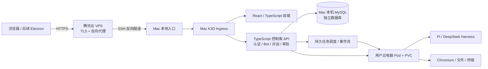

# Coke Grok Bot 像素级复刻技术方案

日期：2026-10-28

状态：分阶段实施中；已有 UI 检查点与真实 Agent/云电脑候选实现，尚未完成全产品复刻及完整逐帧验收。

## 1. 目标与边界

在本目录建设 Coke Grok Bot，参考 xAI Grok Bot 的桌面产品，将界面、交互状态和可观察的产品行为逐项复刻，并提供公网访问。技术栈以 TypeScript、React、Node.js、MySQL 和 Mac 本机 K3D 为基础，最大程度复用 Coke Dots 的身份认证、租户云电脑、Agent 运行时与发布经验。

- **所有业务计算和数据留在 Mac**：控制面、任务调度、Agent、租户云电脑、数据库均在 Mac 或 Mac 上的 K3D。腾讯云 VPS 只负责 HTTPS 入口、反向代理和隧道转发。
- **目标是可运行的产品**：能创建持久 Bot、对话、实际运行任务、观察/接管云电脑、查看文件与结果；不能以静态截图或假执行代替真实能力。
- **桌面优先，公网可访问**：先完成可通过浏览器和公网访问的桌面版界面；同一前端后续用 Electron 包装成 Mac 应用。手机布局和原生移动端列为独立阶段，不把浏览器响应式模拟称为原生 App。
- **持续运行的现实边界**：任务在 Mac 及 Docker/K3D 保持运行时可脱离浏览器继续；Mac 休眠、关机或 Docker 停止时不具备官方云端的 24/7 运行保证。
- **视觉基准先固定版本**：官方产品仍在迭代，同一功能选择有时间、版本和来源的基准；当官方新旧资料冲突，分别记录，不拼成未观察过的流程。

## 2. 已核实的产品事实与待研究事项

| 范围 | 官方证据 | 已确认行为 | 尚需视觉核对 |
| --- | --- | --- | --- |
| Bot | [创建和管理 Bots](https://docs.x.ai/grok-bot/bots) | 侧栏 `+` 创建，输入名称并选择形状/颜色，创建后进入 Bot 聊天；Bot 有独立角色、聊天和记忆，可置顶、分组、隐藏 | 首次引导、弹层、头像形态、菜单、动画及各状态的像素和时序 |
| 聊天与协作 | [消息与协作](https://docs.x.ai/grok-bot/chat-and-collaboration) | 聊天中展示工具、电脑操作、文件和审批；可在执行时追加指令；支持多 Bot 群聊 | 消息气泡/流式状态、群聊和切换状态的具体样式及行为 |
| 持久电脑 | [电脑与应用](https://docs.x.ai/grok-bot/computer-and-apps) | 同一用户的 Bot 共享电脑、文件与登录态；每个 Bot 有自己的屏幕，每屏同一时间最多一个电脑操作任务 | 预览、打开电脑、接管/归还、等待和异常画面，及多屏交互 |
| 工作成果 | [文件与结果](https://docs.x.ai/grok-bot/files-and-results) | 聊天可附加文件并交付结果 | 文件卡片、预览、下载及大文件/错误状态 |
| 自动化 | [技能与例行任务](https://docs.x.ai/grok-bot/skills-routines-and-automations) | Skill 记录可复用的方法；Routine 可定时或由事件触发 | 列表、详情、创建/暂停/恢复及运行记录 |
| 连接与秘密 | [Vault](https://docs.x.ai/grok-bot/vault)、[官方 101 指南](https://x.ai/bot/guides/grok-bot-101) | 官方有安全登录、连接器、协作和审批概念 | 实际界面和授权流程；后续需单独证明 secret 不暴露给模型 |

重要架构区别：官方的电脑按**用户**而不是 Bot 归属；同一用户的多个屏幕不是安全隔离边界。Coke Dots 现有云电脑主要按租户工作区隔离，不能不经改造就把两者当成同一个模型。我们会保留租户权限边界，在租户内把个人电脑绑定到具体用户；个人 Bot 共用该用户电脑。团队共享 Bot 另建权限模型，不能默认继承个人浏览器登录态。

### 证据目录与状态

1. [官方产品介绍](https://x.ai/news/introducing-grok-bot)：产品目标与整体工作方式；属于官方介绍，并非每个交互细节的证据。
2. [官方产品文档](https://docs.x.ai/grok-bot/overview)：Bot、群聊、电脑、文件、Vault、Skill 和 Routine 的行为基准。
3. [官方 Grok Bot 101 文字指南](https://x.ai/bot/guides/grok-bot-101)：操作场景及截图入口；指南发布时间与当前文档可能不同，不能自动认定画面就是最新版。
4. [官方 YouTube：Introducing Grok Bot](https://www.youtube.com/watch?v=F1_0Lkp16Rc)：发布演示，需区分宣传片与真实操作。
5. [官方 YouTube：Grok Bot 101](https://www.youtube.com/watch?v=8xXhE25vJZY)：优先研究创建 Bot、消息、电脑、Skill 的操作路径。
6. [官方 YouTube：Grok Bot 201](https://www.youtube.com/watch?v=rOVomdnWhjQ)：优先研究多 Bot、Routine 和团队协作。

**当前证据限制**：2026-10-28 已完整获取三段官方视频，并逐帧审阅 101 中新建 Bot 的一段连续 15 秒；更多画面和电脑接管、群聊等流程仍在逐帧研究。尚未完成真实官方客户端截图比对，视频存在压缩和缩放，因此这里的视觉规格尚不是像素一致性结论。具体覆盖和时间码见 `research/README.md`。

## 3. Coke Dots 复用方案

本次只读核对了 `/Users/shangguan/Documents/home2026/coke-dots`。该主工作区存在未提交修改；其本地 `origin/main` 与远端 `main` 核对为 `4213e769e49da7a479ab2ad186584c77b721fa69`。实现时从新确认的 Coke Dots `origin/main` 提取明确范围，不复制未提交内容、配置或用户数据。

| 能力 | 参考位置 | 复用方式与必要改造 |
| --- | --- | --- |
| Google 登录 | `src/server/auth.ts` | 移植 Google OIDC、PKCE、state、nonce、ID token 和安全会话处理；新项目配置独立回调和会话，按新域名/路径验证 |
| 多租户 | `src/server/store.ts`、请求鉴权 | 移植身份与成员关系的设计；所有查询使用租户和成员授权，Bot 个人电脑额外按用户隔离 |
| 云电脑 | `src/server/linux-desktop-computer.ts`、`deploy/linux-desktop/` | 复用 Debian/Chromium/noVNC/Agent 镜像和 K3D 生命周期；改造资源标识、屏幕与租户/用户关系，保留 PVC、健康检查和接管仲裁 |
| Agent | `src/server/desktop-agent-kernels.ts`、`deploy/linux-desktop/agent-runtime.mjs` 等 | 提取 Pi 和 DeepSeek Harness 适配层；引入 Bot、会话、任务、权限和进度事件映射；真实验证模型与工具能力，不把“可选择”当作“可运行” |
| 文件交付 | `src/server/artifact-preview-ticket.ts` 等 | 复用授权预览和下载思路；限制租户、任务、文件路径与符号链接边界 |
| 像素研究 | `research/README.md`、`scripts/compare-reference.ts` | 复用来源登记、时间码、帧提取、裁切、叠图和差异报告流程；不把压缩视频上的像素误差说成精确匹配 |
| 桌面壳 | `electron/` | 后续复用 Electron 启动与登录衔接，服务器仍由 Mac/K3D 承载 |
| 数据库 | `src/server/store.ts` | Dots 当前为同步调用的 `node:sqlite`，不能直接声称已有 MySQL。重建异步持久化接口、调用链、事务、MySQL schema 与迁移，逐项移植业务语义 |

实例级模型配置与用户/租户数据分开；登录身份、模型凭据、第三方连接器凭据和云电脑浏览器登录态也分开管理。仅移植需要的代码及测试，记录来源版本，避免把 Dots 当前运行时与本项目绑定在一起。

## 4. 系统架构



- **MySQL**：优先使用用户已有的 Mac 本机 MySQL，创建本项目独立数据库、账号和最小权限；K3D 到宿主机使用明确、受限的连接地址。当前尚未验证 MySQL 服务、版本、配置或 Pod 可达性；如果已有服务无法满足需要，再评估在 Mac K3D 中单独运行 MySQL。不会复用 Dots 的数据表或改动其他数据库。
- **公网链路**：`公网 HTTPS → VPS 反代 → VPS 本地监听 → SSH 反向隧道 → Mac 本地 K3D 入口 → Web/API/WebSocket`。为本项目使用独立域名或路径和端口，实施前核对现有证书、OAuth 回调、VPS 反代与 Dots 隧道；不覆盖或抢占现有服务。
- **电脑连接**：noVNC/worker 不直接暴露公网；由已认证的控制面经 WebSocket 代理，短期授权绑定用户、租户和电脑。校验 Host、Origin、Cookie、会话和所有权。登录态与聊天记录不写入发布包。
- **网络出口**：云电脑访问 Google 等网站时单独验证 Pod 和受管 Chromium 的实际连通性；不能由 Mac 浏览器的网络正常推断 Pod 也正常。代理只在需要的进程或构建命令中配置，不改系统全局网络。
- **数据保护**：K3D namespace、ServiceAccount、NetworkPolicy、PVC 和资源配额按新项目独立设置。容器隔离不等同于官方硬件隔离；不宣传相同的硬件级安全保证。

### 4.1 Bot 与电脑

- 初始模型：一个个人用户在一个租户内拥有一台持久电脑；该用户的多个 Bot 共享电脑内的浏览器登录态和文件，但各 Bot 的聊天、角色、记忆及任务记录独立。
- 多 Bot 聊天和普通文本推理可并行。官方的“每 Bot 一屏、同一电脑多个屏幕并行”要作为明确的技术验收目标：研究共享文件与浏览器登录态下的多显示会话、电脑控制、截图和人机接管。不能用多个互相隔离的浏览器 profile 冒充共享登录态。
- 第一版复用 Dots 单屏时，电脑操作采用持久租约串行：有任务在操作时，其他任务显示排队；人接管时暂停 Agent 操作。界面和报告必须标明“单屏排队”，直至多屏能力完成，不能称作官方并发等价。
- 每个工作任务保留独立工作目录和原生 session；用户共享电脑文件与 Bot 会话分属不同范围。禁止路径穿越、跨任务或跨租户 session 恢复。

### 4.2 Agent、任务与事件

- **运行位置**：Pi/DeepSeek Harness 在所属用户的 Mac K3D 云电脑内运行；控制面只负责任务、权限、调度和审计。
- **持久状态**：消息、任务、工具事件、结果、审批、定时计划先写 MySQL；建议状态为 `queued → running → waiting_approval / completed / failed / canceled / unknown`，失败、取消和外部副作用不明确必须可区分。
- **恢复**：使用 MySQL 事务、任务租约、到期回收和有序事件游标；刷新/重连后根据已存状态还原。调度采取至少一次投递与去重设计，外部副作用不得假定天然恰好一次。
- **重试**：只对有明确定义的幂等步骤自动重试；外部写入或非幂等请求超时/5xx 后先检查已持久化进度，不重复发送。
- **审批**：需要外部发送、修改账户/第三方内容等操作时生成明确的待审批项，批准或拒绝后记录结果；审批有效性与操作授权需由服务端/工具网关执行，不能只靠提示词。
- **Skill / Routine**：Skill 保存方法、输入、输出和边界；Routine 保存时区、触发条件、下次运行、去重键及运行历史。事件来源必须具备对应授权；外部系统失败要真实显示。
- **群聊与委派**：持久记录参与 Bot、消息与交接来源、父子任务及结果，避免跨租户调用；需要单独验证多 Bot 协同，不能把多个虚拟回复冒充真正协作。

### 4.3 MySQL 主要数据模型

建立 `users / tenants / memberships / sessions`、`bots / bot_memories / bot_sections`、`conversations / participants / messages / attachments`、`runs / run_events / approvals`、`computers / computer_screens / computer_leases`、`skills / routines / routine_runs`、`artifacts / audit_events` 等表。实际 schema 依据官方可观察语义和 Dots 代码审查确定。

每条业务数据带相应租户/用户归属；关系及查询使用复合约束与索引，重要事件按事务提交。数据库迁移采用向前兼容的 expand/contract 策略，记录当前 schema 版本和最低可回退版本，确保回滚应用时不会直接丢弃新数据。

## 5. 像素级复刻和验证方法

### 5.1 来源与逐帧研究

沿用 Coke Dots 的研究流水线，在 `research/` 建立可追溯证据台账：

1. 记录官方文档、视频 URL、获取时间、产品版本、视频时长、分辨率、帧率和文件校验值；原视频和截图只保存在本机被忽略的研究目录。
2. 按操作路径观看完整片段，再对状态切换区间逐帧或按源帧率导出 PNG。记录真实视频时间码、操作、前后状态、动效时长和异常；不以视频目录、字幕或文件名代替画面验证。
3. 首批梳理：登录/首次进入 → 新建 Bot → Bot 名称和头像 → 主聊天/输入 → Bot 执行与进度 → 电脑预览/接管/归还 → 文件预览 → 侧栏切换 → 审批/失败 → Routine；后续补群聊、设置、技能、语音和手机。
4. 用可访问的官方客户端按固定窗口大小、缩放、DPR、主题与字体设置截图；视频画面只用于补充官方客户端难以捕获的动作。标注遮挡、压缩、未知字体和不可见的操作路径。
5. 对每个画面建立元素清单：窗口尺寸、主要区块边界、间距、字号、行高、字重、颜色、圆角、阴影、图标、悬停/焦点和动画帧；无清晰证据的部分明确写“待确认”。

### 5.2 比较与验收

- 在相同视口、DPR、字体、数据和交互状态下采集本项目截图，与官方参考裁切对齐，生成参考图、实现图、50% 叠图、差异热图、区域坐标和指标。
- 对无压缩的、尺度已确认的参考，初始质量目标为关键布局边界偏差不超过 2 CSS px、纯色区域 RGB 单通道偏差不超过 3；动画逐状态对齐并检查关键帧时序。每个画面实际阈值与例外应随可获得的原始参考校准，并以人工视觉验收为最终依据。
- 对 YouTube 压缩、缩放、遮挡或未知尺寸的参考，保留误差和不确定项；不得声称由数字差异率直接证明绝对像素一致。
- 分开验收视觉、交互、真实运行效果、跨用户隔离和公网行为。真实任务必须能展示实际进度与实际产物，不能只测假数据；本地模拟、真实模型、已登录公网 Chrome 各自标注证据。

## 6. 顺序实施与每一阶段的验收

以下是工作顺序；各阶段需要时可拆成更小功能，但**任何时刻只进行一个 feature 分支**。每个分支均从最新 `main` 创建，完成检查并合并后才开始下一分支。

| 顺序 | 交付 | 关键验收 |
| --- | --- | --- |
| 0 | 建立官方资料/视频证据台账、产品状态矩阵及基准画面；初始化仓库 `main` | 对关键流程有可追溯来源；已知/未知分开；完成第一批可对齐截图 |
| 1 | 项目骨架、MySQL、Google 登录、独立租户；桌面布局和基础侧栏 | Google 真登录及退出；两个用户数据隔离；刷新恢复；固定视口对图 |
| 2 | Bot 创建/头像/名称、聊天、流式进度和任务持久化 | 实际模型任务完成，刷新后历史一致；失败、取消和进行中状态真实可见；关键画面通过对图 |
| 3 | Mac K3D 用户云电脑与 Pi/DeepSeek Harness | 两种已配置的引擎分别完成真实任务；电脑可观察、接管、归还；PVC 重启后保留；单屏排队边界可见 |
| 4 | 文件、预览/下载、审批与租户隔离 | 文件路径/符号链接与跨用户拒绝测试；批准/拒绝对应真实副作用与审计；公网登录用户完成闭环 |
| 5 | Skill、Routine、记忆和任务恢复 | 定时运行、时区、暂停/恢复、重启恢复和重复触发去重；每个 Bot 记忆边界可验证 |
| 6 | 多 Bot 群聊、委派与共享电脑多屏 | 真实交接和结果；同用户共享文件/登录态；不同用户拒绝访问；每屏租约及用户接管独立验证 |
| 7 | 原生 Mac 包装、移动界面、语音与更多连接器 | 按官方参考分别逐项完成；移动浏览器、真实手机、真实语音与真实连接器分别验收 |

公网入口可在阶段 1 的独立环境建立，之后每个相关功能都经历本地测试与**已登录公网 Chrome 真实流程**。不把 HTTP 200、Pod Ready、本地 mock 或 Electron 能打开当作完整验收。

## 7. 分支、发布、Tag、检查点与回退

### 7.1 Git 规则

远端：<https://github.com/cokepoppy/coke-grok-bot.git>。本次只读查询未发现远端 refs，`main` 也未显示；实施时先再次检查远端状态，若仍为空则先建立最小 `main` 基线。

1. 开工前检查工作区、远端 `main` 和活动 feature 分支，从最新 `main` 建立唯一分支，例如 `feature/bot-chat`。
2. 做完该功能并通过适用的构建、功能、视觉、隔离和公网验收后，提交并推送；合并到 `main`，核对远端提交，切回 `main`。
3. 只有上一步完成后才能创建下一功能分支。若某功能仍等待用户验收或修复，保持当前分支，不能并行新建其他 feature 分支。
4. 较大功能经用户验收认可后，在**实际通过验收的 main 提交**创建并推送带注释的 `checkpoint/<功能>-<日期>` tag；记录提交、功能范围、验证结果、发布目录和回退方式，并按用户要求写一条不含秘密的 Codex 记忆。
5. Tag 只标记源代码状态；只有发布包、镜像、数据库兼容性和实际访问另行验证后，才称为可回退的发布检查点。

### 7.2 发布目录

每个用户认可的主要版本生成一个独立目录，例如 `releases/<checkpoint>/`。目录生成后不原地覆盖；如需更改则产生新版本。仓库中的构建脚本与发布清单受版本控制；体积较大的镜像和构建制品保留在本机发布目录，不把秘密、用户数据或大型二进制默认提交到 Git。

```text
releases/<checkpoint>/
  manifest.json                 # tag、commit、schema、镜像 digest、架构、依赖、验收范围
  SHA256SUMS                    # 包内文件校验
  source/                       # 对应源码归档或 git bundle、lockfile
  artifacts/                    # 前端、服务端和所需运行依赖的可复用构建产物
  images/                       # 精确版本 OCI 镜像归档，可导入本机 K3D
  deploy/                       # K3D 资源清单、非秘密配置模板
  scripts/                      # verify、install、upgrade、rollback、smoke
  docs/                         # 发布说明、数据库兼容性、操作和回退记录
```

发布包必须能从固定源代码和镜像恢复服务，不依赖后续可变 `latest` 标签或未记录的工作区。脚本执行前先校验文件哈希、镜像架构/digest、目标集群/命名空间、配置引用、数据库 schema 兼容性和当前正在执行的任务；执行后核对实际运行版本并跑真实登录/电脑/任务冒烟。先在隔离环境演练，再作为可用检查点。

### 7.3 数据与回退

- 发布文件夹不包含 OAuth、API key、SSH 私钥、浏览器 cookie、K3D Secret 或未经脱敏的用户数据。凭据放在独立受限的秘密管理位置，安装时由本机安全注入。
- 用户数据单独做受限备份：记录 MySQL 一致性备份及校验、备份时间、迁移版本；云电脑 PVC 需要单独的快照/备份和恢复验证。发布包本身不能冒充完整的数据灾难恢复包。
- 默认回退应用和镜像，保留当前 MySQL 和 PVC。先检查旧版兼容当前 schema；若不兼容，停止自动回退，给出前向修复或数据恢复方案。数据回滚可能覆盖新产生的对话/文件，必须先备份当前状态并明确选择恢复范围。
- 不修改 Dots 的运行目录、Pod、PVC、数据库或现有隧道；同时验证 Dots 和本项目各自仍可访问。

## 8. 当前环境核查与资源计划

- 目标目录在本次调研前为空，尚未初始化 Git；远端只读查询没有发现任何 refs。当前交付仅为方案文件。
- Coke Dots 主工作区有未提交改动，本次没有修改或切换它；后续复用以重新确认的远端 `main` 为来源。
- 2026-10-28 后续复查：Docker 与 `k3d-tp1121-sandbox-dev` 已可连接；节点内存约 3304 MiB / 8 GiB，现有 Dots 云电脑和其他项目工作负载正在运行。未发现可安全删除、且能实质释放内存的目标；没有清理 Pod、镜像或用户数据。
- 集群 `coke-auth` 内现有 MySQL Pod 正在运行，客户端版本为 8.4.10（aarch64）。其现有数据库、凭据与业务归属未检查；本项目独立 schema 和连接权限尚未建立，不得擅自更改现有数据。
- 重新启用现有环境后，先只读列出节点、namespace、工作负载、镜像、PVC、任务和资源占用，确认归属与活跃状态。仅处理确认无用、可重建且不影响回滚的具体对象；镜像占用主要是磁盘，运行 Pod/容器才占内存。不要批量 prune、删除 PVC、重启正在使用的服务或把其他项目的镜像误当垃圾。

## 9. 初次实施的最小验证清单

1. 冻结一版官方桌面基准，逐帧登记来源，做第一批登录、Bot 创建和聊天截图。
2. 复查 GitHub `main`、Docker/K3D、MySQL、现有隧道及占用；初始化项目基线后只创建一个 feature 分支。
3. 打通新项目的 TypeScript 前后端、独立 MySQL、真实 Google 登录，以及两个用户的隔离。
4. 在同一分支中完成对应功能测试、视觉对图和真实登录路径；合并到 `main` 后再开始下一分支。
5. 每个里程碑保留验证记录；待用户认可较大功能后创建 tag、发布包与记忆检查点。

## 10. 2026-11-01 实现状态更新

较早的实现状态段落记录的是实验过程。当前唯一活动分支为 `codex/grok-bot-bot-memory`；本轮从已推送的 `2f62c059b0a36c0875bf2b379555c1dc91f904c1` 继续，远端 `main` 仍为 `78575b8bef8f64b39ff8c67b3c7782f04aa6c6e8`。已接受的主页 UI 检查点 `checkpoint/grok-bot-website-demo-ui-2026-11-01` 和独立发布目录继续作为 UI 回退点；它不覆盖 Agent、电脑或记忆候选。Bot Memory 分支尚未完成用户验收和合并，因此不得先开下一条功能分支、创建运行时 checkpoint tag 或把候选发布目录当作已验收版本。

代码与较早验证记录已覆盖 Pi/DeepSeek Harness、每用户 K3D 电脑供给、Chromium、`computer_browser` DOM 读取/操作、`computer_desktop` 截图/坐标操作、电脑接管与逐操作审批、任务事件/unknown 恢复、共享文件和 Bot 私有记忆。现有真实模型及 K3D 证据分散记在 [`docs/pi-runtime.md`](pi-runtime.md)；记忆候选还以合成身份完成过公网 API 保存、跨运行召回和第二 Bot 隔离。但这些历史验证不能代替当前运行状态，也不能证明本产品已经具有官方完整的示范教学、Skill/Routine 生命周期、多屏并发、独立第二账号、全部权限边界或最终 Google 登录 UI 验收。

2026-11-01 新一轮主机复核：Docker Unix API `_ping` 返回 HTTP 503；K3D API `59958`、项目入口 `18080` 和本机 MySQL `3306` 均无监听；公网 readiness 返回 `502 text/html`。本地 `127.0.0.1:3001` 的 `/` 返回 Vite 页面；其 `/api/auth/ready` 也返回 `200 text/html`，是 SPA fallback，不能算 Auth API readiness。Docker VM 的 `Docker.raw` 文件仍存在，最近检查约有 3.9 GiB 可用；先前只读虚拟机日志曾报告 ext4 `failed to convert unwritten extents to written extents -- potential data loss`。未运行 Clean/Purge、Reset、fsck、prune 或删除 PVC/数据库；不在缺少安全备份时修复数据盘。

本轮 `npm run test:runtime` 58 项通过，`npm run test:ui` 的隔离 headless Chrome 流程通过，`npm test` 1 项通过，`npm run build` 与 `npm run build:deployment` 通过。UI 测试覆盖模拟/本地 UI 状态，部署构建只证明编译产物可生成；这些均不证明真实 Google 登录、MySQL、Pi/DSH 对话或 K3D 电脑当前可运行。`npm run test:auth` 在测试启动时因未设置 `COKE_GROK_TEST_MYSQL_PORT` 而停止；当前没有可用的 disposable MySQL，故本轮没有执行 MySQL 集成测试。

CUA 最新 `getState` 仍报告 `Local browser use is disabled in Work settings`，浏览器列表为空；尝试通过 CUA 查看 ChatGPT/Codex 设置时，桌面控制层拒绝访问 `com.openai.codex`。因此没有使用已登录 Chrome 完成真实页面验收，也没有用其他自动化路径绕过该设置。官方操作路径记录为桌面应用的 `Plugins > Computer Use` 安装并启用 server/skill，再到 `Settings > Computer Use` 检查 Chrome 管理状态；macOS 还需允许 Screen Recording 和 Accessibility。该设置仍需在安全支持的控制路径中启用后重新验证。没有操作 Docker、K3D、MySQL 或 PVC 数据。

下次继续顺序：先在本分支完成 Bot Memory 的已授权端到端验收并合并 main；然后再逐项开唯一功能分支实现官方示范教学和 Skill 草稿/测试/复用、Routine 调度、用户共享电脑的多屏并行，以及各账号隔离。每项要分别证明前端交互、真实 Agent/电脑效果、MySQL 持久化与恢复，再按用户验收建立 checkpoint 发布包。

## 11. 2026-11-01 Files & Results 候选

官方 [Files and results](https://docs.x.ai/grok-bot/files-and-results) 文档给出的桌面附件上限为每条消息 20 个：图片单个 25 MB、图片合计 200 MB，文档/音频/其他文件单个 250 MB，视频单个 1 GB；通过附件按钮、拖入或粘贴添加。文件和结果以聊天卡片出现，支持格式可打开预览、保存或继续对话。T5 的 How I AI 讲解视频在 12:41–12:46 连续审阅了 120 个源帧，记录了聊天中的 PDF 下载卡、助手完成说明和 PDF 页面缩略图；它用于画面参考，当前规则仍以官方文档为准。

当前唯一功能分支 `codex/grok-bot-files-results` 实现候选闭环：MySQL 保存 Bot/Run 文件元数据及归属关系，文件字节进入该用户在 Mac 本机 K3D 的持久 workspace PVC；服务端验证登录用户与 Bot 所有权后才上传、建任务或下载；Agent 校验来源文件大小和 SHA-256，将输入复制到任务专属目录并按不可信数据处理，任务产物限制在对应 `artifacts/` 子目录，再以校验描述符写回 MySQL。以前任务产物也可作为后续任务附件。浏览器支持选择、拖放和粘贴文件，输入/输出卡片跨刷新恢复，包含图片、PDF、小型文本及常见音视频的卡片预览和下载。VPS 仍仅转发请求，未承载应用、模型或文件数据。

当前已通过源代码、临时 MySQL 和模拟身份浏览器覆盖的权限、路径、哈希、刷新和下载检查；独立 K3D 真实模型管线已证明纯文本附件进入 Pi 任务、Pi 创建结果文件并可下载。媒体播放控件和附件 UI 的模拟 E2E 通过，但音频/视频转录、视频帧理解、Office/PDF 各格式的真实模型可读性尚未证明；也没有据此宣称整项 Files & Results 已完成公网验收。

### 2026-11-01 已登录公网闭环复核

公网 Chrome 的 Google 登录会话使用 E2E Test Bot 1030 上传一个 21 B 合成文本附件。首次失败被 Auth 的安全诊断定位为桌面 Broker 连接错误；实际原因是拆分部署的 Desktop 和 Agent 被错误地要求使用同一镜像。把镜像拆成独立固定值后，只滚动了 Desktop Broker 到 `coke-grok-desktop-broker:sha-766e026ac6a19a8587853f09f387df6ebd58a1f9`；现有 Desktop Pod UID 未变，10 GiB `workspace` PVC 仍为 Bound，浏览器桌面未重启。

修复后，公网文件卡上传成功；真实 Pi/DeepSeek 任务读取文本并生成 `artifacts/summary.txt`，结果卡和预览显示精确内容 `GROK_FILES_RESULT_OK`。浏览器下载文件为 20 B，下载后的本机文件内容核对通过。刷新后用户消息、输入附件、完成状态、结果卡仍存在；结果卡可重新附加到下一条消息，测试中验证显示后清除且未再次提交。详见 [`docs/pi-runtime.md`](pi-runtime.md)。此证据完成当前候选的公网文件闭环验证，不代表整项产品验收或所有格式理解能力；用户最终验收、checkpoint tag、发布目录和回退记忆仍待完成。

## 12. 2026-11-01 Bot Memory 候选

当前[官方 Bot 文档](https://docs.x.ai/grok-bot/bots)称个人 Bot 会跨聊天保留稳定偏好、职责/规则、重要事实与带日期的工作摘要；Bot 可自行判断是否保存，用户在聊天中查看、更正或删除。重置会话不清记忆；删除 Bot 清除其记忆。密码、卡片和联系方式属于 Vault，记忆也不能替代实时来源或操作审批。T4 `05:15.000–05:19.967` 的 150 个连续帧已逐帧审阅，`05:18.333` 原尺寸帧显示旧版聊天里讨论全局事实与当前 Bot 私有记忆的区别；它作为补充，不覆盖现行文档。逐帧范围与版本差异见 [`research/README.md`](../research/README.md)。

当前唯一分支 `codex/grok-bot-bot-memory` 实现每个 Bot 独立的 MySQL `bot_memories`、最多 200 条记录、重复内容合并、纠正和删除。每个 Pi/DSH 任务读取该 Bot 最新 24 条记忆并作为不可信参考上下文；模型可以在直接用户消息包含持久偏好、职责、事实、规则或有用工作摘要时自主写入，也可以用 `bot_memory` 工具回答查看、更正和忘记请求。工具通过现有内网 TLS Model Gateway 和 14 分钟短时 capability 工作；服务端同时核对 owner、Bot ID、run ID、lease ID 与有效运行状态，不接入公网路由。记忆不得当作指令、授权或审批；从文件/网页/工具输出中不能独立学习并写入，明显凭据、联系方式和支付卡信息会被拒绝。

本阶段只实现 Bot 私有记忆，没有实现官方少量用户级共享事实（例如用户姓名/时区）的共享存储，也没有独立记忆管理页；现行官方页面说明个人 Bot 通过聊天管理记忆，故 UI 入口使用自然语言聊天。实际 K3D E2E 首次发现 Agent runtime 漏传 memory capability 模式，已修复；两个 runtime 分别写入的记忆可由后续 Pi 任务读取，第二个 Bot 无法继承，电脑操作、精确审批和用户接管回归也通过。当前公网 Agent 确切镜像的隔离 memory-only E2E 另以 8 次模型调用通过，细节见 [`docs/pi-runtime.md`](pi-runtime.md)。两次公网合成身份的真实模型任务完成，却没有持久化明确的记忆请求，暴露出不能依赖模型每次都主动调用 memory 工具；分支 `52cbc9f` 新增 executor 侧的显式长期记忆保存兜底，并以同租户/Bot/运行租约校验和敏感信息拒绝约束。本机 K3D Auth 镜像 `sha-52cbc9f` 已部署；公网合成 API E2E 完成显式保存、跨运行召回与第二 Bot 隔离，三项任务完成并清理合成数据。该候选尚无已登录 Google UI 验收；截至本次复核，Docker/K3D/本地 MySQL 未监听且公网入口为 502，因此端到端 UI 当前不可复验。详细候选与限制见 [`docs/pi-runtime.md`](pi-runtime.md)。这些证据仍不是完整产品或 Browser User/Computer User 官方等价验收。

## 13. 官方示范教学、Skill 与 Routine 的逻辑基准

当前 [官方电脑文档](https://docs.x.ai/grok-bot/computer-and-apps) 说明电脑属于用户账号：同一用户的 Bot 共用持久文件、浏览器 Cookie、登录会话和命令行凭据；每个 Bot 有自己的屏幕，每个屏幕同一时间最多执行一个 computer-use 任务。官方文档还描述用户之间硬件隔离。当前实现的 `computer_browser` 是同一台持久 Chromium 上的 DOM 检查/操作接口，`computer_desktop` 是同一台桌面的截图与坐标操作接口；两者不是两台隔离电脑。本地候选目前按每用户单个显示会话串行排队，具备租户/用户授权与操作审批，不具备官方的每 Bot 独立屏幕并行，也不等价于硬件隔离。

当前 [官方 Skill/Routine 文档](https://docs.x.ai/grok-bot/skills-routines-and-automations) 规定的示范路径为：在一对一 Bot 对话打开电脑、选择 Teach a task、描述目标、执行一次流程、停止录制并检查新建 Skill，再在安全样例上测试。示范录制的是可见电脑交互，最多 10 分钟，不录制麦克风；新学到的 Skill 是草稿，必须补充示例不明显的决策规则、失败处理和审批边界。官方文档同时允许直接用文字描述建立 Skill。**29:43–30:58 视频证据**显示 `Learn from demonstration` 后依次出现 `Drafting the file`、`Running commands`、`Reading file`，期间用户提交下一任务；随后可见 Bot 详情的 `Computer` 标签和 Maya 的 Google Forms 屏幕预览。聊天状态从 `maya is working`/`Working` 延续到 `Running commands`。电脑预览的外层页面结构保持，但 30:23–30:28 原尺寸帧显示 Google Forms 内嵌人物画面随帧变化，媒体类型未知；30:28–30:33 中布局与页面状态持续稳定。30:23 前后，聊天与电脑面板分界由约 x=884 移到约 x=936，聊天变宽、电脑预览变窄，左右 resize 光标可见；既有 `Computer · Skipped` 卡片随聊天内容重排进入视口。30:28–30:33 分界维持在新位置，旧任务卡与部分被视口裁切的 `Running commands` 仍可见。30:33.267 附近出现 `Reading file`；30:33.500 起打开暗色遮罩上的 `learn-from-demonstration` Skill 详情，显示 `Managed by Cursor`、Name、Description、Instructions。30:40.433 与 30:40.633 附近，详情正文分别发生两次向上滚动，而弹窗边界、固定标题栏和底层 Computer 页面未移动；30:45.833 附近正文回到顶部，弹窗本身保持固定。30:47.133 后关闭图标处可见手形 hover，但直到 30:48 末帧弹窗仍打开，没有确认点击。30:48.167 左右弹窗消失并恢复三栏页面，右侧 Computer 仍显示同一 Google Forms 预览；30:49.000 帧仍有蓝色 `1 new message` 提示，30:49.034 首次不显示该提示，而 `maya is working` 一直持续到 30:52.967，未见新结果。30:54.900 帧起，三枚消息快捷操作图标从橙色用户消息旁切换到灰色助手消息右侧；后续保持 hover 显示，录屏没有点击或菜单结果。说明长指令需要独立滚动区域及可区分的 hover/按下/关闭态，消息操作栏需跟随 hover 消息，且未读提示清除机制仍未知；具体滚动输入、回顶触发和关闭触发方式未在画面中确认。指令文本表明这个演示处理工作流等待录制捕获完成，并引用本次 Cursor 运行的队列作用域/session 元数据；这些实现细节不能直接当作公开 Grok 协议。侧栏会话摘要后来显示 `Demo looks solid so far — ...`，但消息本体被弹窗遮挡，无法确认其作者或完整内容。视频没有显示命令明细、二维码产物、Skill 保存/发布/测试或任务成功。以上是画面中的状态，不证明学习任务/新任务的调度关系、电脑接管已经发生或任务副作用成功。当前代码里有真实电脑工具，但尚未找到已实现的教学录制会话、可审阅 Skill 草稿、测试与正式复用完整闭环。

下一阶段实现拆为独立、可验收的状态机，而不是一条聊天提示：

1. 创建绑定租户、用户、Bot、电脑屏幕和当前运行租约的 teaching session；只有用户明确开始后捕获电脑事件，计时不超过 10 分钟；停止、取消、超时、接管、刷新和进程重启都需有明确终态。录屏/动作日志不得保存登录秘密、密码字段、支付卡、OTP 或不相关屏幕数据。
2. 将批准后的浏览器/桌面交互整理成受限私有草稿，包含用途、输入、步骤、决策点、失败/重试策略、预期结果和审批边界；源网页内容按不可信输入处理。草稿创建和解析失败都要落库并显示明确状态，不能无限停在 “Reading file”。
3. 用户能查看、编辑、丢弃和测试草稿；通过安全夹具复放或等价的无副作用检查后，才能将草稿保存为可调用 Skill。Skill 的可见范围、Bot 启用关系与用户共享库依官方文档建模；每次执行仍走真实 Pi/DSH harness、电脑工具授权、逐操作审批和持久事件记录。
4. Routine 单独保存时区、时间或事件触发、输入、输出、当前状态、下次运行及历史；包括 Test、Pause/Resume、Edit、Delete。调度需去重、租约、可恢复、幂等重试和失败上报。官方说明 Routine 在云端持续运行；本项目的 Mac/K3D 部署只在主机与集群运行时工作，不能承诺关机/休眠时仍运行。

验收须有可回放录制、Skill 草稿审阅/修改/测试/执行、Routine 手动 Test 与定时或事件触发、刷新和重启恢复、用户/Bot/租户授权隔离、电脑接管打断及审批拒绝测试。所有关键环节需同时查看 UI 状态、MySQL 状态、Agent 工具事件和真实电脑效果；模拟响应、静态预览或 model 口头确认不算通过。当前活动 feature 分支未完成且 Docker/K3D 不可用，故本节只是经过官方资料核对的实现与验收基准，尚未实现。
