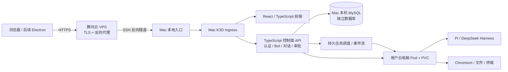

# Coke Grok Bot 像素级复刻技术方案

日期：2026-10-28

状态：分阶段实施中；已有 UI 检查点与真实 Agent/云电脑候选实现，尚未完成全产品复刻及完整逐帧验收。

## 1. 目标与边界

在本目录建设 Coke Grok Bot，参考 xAI Grok Bot 的桌面产品，将界面、交互状态和可观察的产品行为逐项复刻，并提供公网访问。技术栈以 TypeScript、React、Node.js、MySQL 和 Mac 本机 K3D 为基础，最大程度复用 Coke Dots 的身份认证、租户云电脑、Agent 运行时与发布经验。

- **所有业务计算和数据留在 Mac**：控制面、任务调度、Agent、租户云电脑、数据库均在 Mac 或 Mac 上的 K3D。腾讯云 VPS 只负责 HTTPS 入口、反向代理和隧道转发。
- **目标是可运行的产品**：能创建持久 Bot、对话、实际运行任务、观察/接管云电脑、查看文件与结果；不能以静态截图或假执行代替真实能力。
- **桌面优先，公网可访问**：先完成可通过浏览器和公网访问的桌面版界面；同一前端后续用 Electron 包装成 Mac 应用。手机布局和原生移动端列为独立阶段，不把浏览器响应式模拟称为原生 App。
- **持续运行的现实边界**：任务在 Mac 及 Docker/K3D 保持运行时可脱离浏览器继续；Mac 休眠、关机或 Docker 停止时不具备官方云端的 24/7 运行保证。
- **视觉基准先固定版本**：官方产品仍在迭代，同一功能选择有时间、版本和来源的基准；当官方新旧资料冲突，分别记录，不拼成未观察过的流程。

## 2. 已核实的产品事实与待研究事项

| 范围 | 官方证据 | 已确认行为 | 尚需视觉核对 |
| --- | --- | --- | --- |
| Bot | [创建和管理 Bots](https://docs.x.ai/grok-bot/bots) | 侧栏 `+` 创建，输入名称并选择形状/颜色，创建后进入 Bot 聊天；Bot 有独立角色、聊天和记忆，可置顶、分组、隐藏 | 首次引导、弹层、头像形态、菜单、动画及各状态的像素和时序 |
| 聊天与协作 | [消息与协作](https://docs.x.ai/grok-bot/chat-and-collaboration) | 聊天展示工具、电脑操作、文件和审批；可在执行时追加指令；支持 2–6 Bot 群聊、`@` 指定 Bot/群组/Routine/App、Bot 间异步交接；私聊中的新指令可重定向当前任务 | V1 已逐帧看到 Bot 候选、结构化 mention token、发送、Maya `is working`、Dex `Message from maya`/`Thinking`，33:42.400 的贴纸投票澄清卡（四个选项加自由输入），以及 33:42.500 从 `dex ↔ maya` 标题转为 `dex` 单聊；至 34:32.966 澄清卡已标为 Dismissed，Computer 仍是灰色占位；34:20.767 起出现草稿、34:29.767 显示已发送消息、34:30.200 显示 `dex is working`；34:34.233 出现 Dex 的 Figma 回复，34:34.300 显示 `Connecting to Figma`；34:42.900 打开 Marketplace，34:45.967 的 Figma 插件详情显示 `default` 账户为 `Connected` 且有 Figma connector/14 项 Skills；至 34:47.967 Computer 仍灰色，未见具体 Figma 文件内容或任务结果；群聊视觉和其余交互状态待核对 |
| 持久电脑 | [电脑与应用](https://docs.x.ai/grok-bot/computer-and-apps) | 同一用户的 Bot 共享电脑、文件与登录态；每个 Bot 有自己的屏幕，每屏同一时间最多一个电脑操作任务 | 预览、打开电脑、接管/归还、等待和异常画面，及多屏交互 |
| 工作成果 | [文件与结果](https://docs.x.ai/grok-bot/files-and-results) | 聊天可附加文件并交付结果 | 文件卡片、预览、下载及大文件/错误状态 |
| 自动化 | [技能与例行任务](https://docs.x.ai/grok-bot/skills-routines-and-automations) | Skill 记录可复用的方法；Routine 可定时或由事件触发 | 列表、详情、创建/暂停/恢复及运行记录 |
| 连接与秘密 | [Vault](https://docs.x.ai/grok-bot/vault)、[官方 101 指南](https://x.ai/bot/guides/grok-bot-101) | 官方有安全登录、连接器、协作和审批概念 | 实际界面和授权流程；后续需单独证明 secret 不暴露给模型 |

重要架构区别：官方的电脑按**用户**而不是 Bot 归属；同一用户的多个屏幕不是安全隔离边界。Coke Dots 现有云电脑主要按租户工作区隔离，不能不经改造就把两者当成同一个模型。我们会保留租户权限边界，在租户内把个人电脑绑定到具体用户；个人 Bot 共用该用户电脑。团队共享 Bot 另建权限模型，不能默认继承个人浏览器登录态。

### 证据目录与状态

1. [官方产品介绍](https://x.ai/news/introducing-grok-bot)：产品目标与整体工作方式；属于官方介绍，并非每个交互细节的证据。
2. [官方产品文档](https://docs.x.ai/grok-bot/overview)：Bot、群聊、电脑、文件、Vault、Skill 和 Routine 的行为基准。
3. [官方 Grok Bot 101 文字指南](https://x.ai/bot/guides/grok-bot-101)：操作场景及截图入口；指南发布时间与当前文档可能不同，不能自动认定画面就是最新版。
4. [官方 YouTube：Introducing Grok Bot](https://www.youtube.com/watch?v=F1_0Lkp16Rc)：发布演示，需区分宣传片与真实操作。
5. [官方 YouTube：Grok Bot 101](https://www.youtube.com/watch?v=8xXhE25vJZY)：优先研究创建 Bot、消息、电脑、Skill 的操作路径。
6. [官方 YouTube：Grok Bot 201](https://www.youtube.com/watch?v=rOVomdnWhjQ)：优先研究多 Bot、Routine 和团队协作。

**当前证据限制**：V1 官方 Grok Bot 101 的 27:53–36:18 已连续逐帧覆盖，共 15,150 个源帧。原先标注的 29:28–29:48 缺口已由 29:28–29:43 与 29:43–29:53 窗口覆盖，29:48–29:53 为重叠复核；26:48–27:53 另有连续 1,950 帧，22:08–22:28 有 600 帧。36:03–36:08 中，Dex 的 Figma 任务保持在聊天区，Computer 预览仍为灰色占位；原尺寸帧 30 显示 `Reading file`，帧 35 状态文字暂时消失，帧 40 起显示 `Running commands`。36:08–36:13 的 150 帧仍显示 `Running commands`，没有可见电脑画面或任务产物；36:13–36:18 继续显示该状态，右侧 Computer 仍为灰色占位，36:17.233 起输入框出现 8 个贴纸的未发送草稿。视频显示 `@dex` 候选与富 token、Maya 发信、Dex 会话的 `Message from maya` 和 `dex is working`，33:37.933 的完整来信与 `Thinking`，以及 33:42.400 的贴纸投票澄清卡、选项/自由输入和 33:42.500 回到 Dex 单聊；澄清卡至 34:27.967 保持未回答，34:29.767 后被标为 `Dismissed`。34:20.767 首次出现关于 8 个贴纸的完整 composer 草稿，34:29.767 首次显示为已发送消息，34:30.200 首次出现 `dex is working`；34:34.233 首次出现 Dex 对 Figma 的回复，34:34.300 首次显示 `Connecting to Figma`，34:42.900 首次打开 Marketplace，34:45.967 的 Figma 插件详情显示 `default` 账户为 `Connected`，并列出 Figma connector 和 14 项 Skills；34:52.967 首次清楚显示 `41 of 41 enabled`。34:53.000–34:57.967 继续停留在 Figma 插件详情和 Skill 列表；34:58.400 工具清单展开，画面可见 Get screenshot、Get design context、Get motion context 等开启状态的开关。35:09.133 起面板继续向下滚动，可读到 Weave list tools、Weave get tool inputs、Weave run tool 等条目，可见开关仍为开启状态；至 35:12.967 仍在工具配置页。35:21.167 Figma 详情关闭并露出 Dex 对话；35:30.333 仍显示 `Reading file`，下一帧 35:30.367 切为 `Thinking`，35:31.600 首次显示 `Running commands`，并持续到 35:42.967。35:43.467 起录屏构图切到 macOS 桌面与 Notes 窗口，Grok Bot 应用被裁切到画面右侧；这不是右栏 Computer 预览的画面，预览仍为灰色占位。35:46.667 应用重新完整入镜时可见状态为 `Connecting to Figma`，并持续到 35:52.967；35:55.967 首次出现助手称已取得 Figma 近景并在读取的更新，35:56.467 首次确认 `dex is working`，35:57.633 首次确认 `Running commands`。新增四窗 35:38–35:58 共 600 帧逐帧检查，联系图、关键帧及 PTS/SHA manifest 已核验；至 35:57.967 未见 Computer 预览变化、工具返回结果、Figma 文件内容或贴纸产物。33:56.167 起画面缩放/平移并露出 macOS 桌面，33:57.900 的 Dock hover 出现截断任务标题；之后 Notes 显示 8 个 GrokBot 贴纸的任务简报和设计参考，34:02.333 起录屏回切到 Grok Bot。切换原因和简报是否被 Bot 读取均未知；不能据此确认路由载荷已进入真实 runtime 或任务已完成。群聊交接、权限和 Routine 以现行官方文档为行为基准，视频补足可见交互。2026-11-02 复核现行官方文档，重申个人 Bots 共用持久电脑、文件和浏览器会话，各 Bot 有独立屏幕，可并行操作；同一屏幕同时最多执行一个电脑任务；Connected App 是结构化工具路径，已连接状态不证明具体调用成功。mention 支持在聊天中指定 Bot、群组、Routine 或 App。文档描述的是外部行为，没有公开私有 runtime 协议。尚未完成同视口的真实官方客户端截图比对；YouTube 视频经压缩/缩放，因此这不是像素一致性结论。本轮重新读取 [x.ai/bot](https://x.ai/bot) 与 [Computer/App 文档](https://docs.x.ai/grok-bot/computer-and-apps)：官网当前文案强调真实工具任务与多 Bot 并行，Computer 段展示 Zendesk 登录场景；公开页面抓取本身只提供文案。此前 CUA 标签读取曾超时；本轮通过可见 Chrome 实际打开、关闭官网演示的 Computer 侧栏与 `Open screen` 弹层。演示画面位于营销页面中央并有外层网页留白；这些是嵌入演示容器的视觉状态，不代表正式桌面客户端应有居中边距，也不是同视口客户端的几何测量。视频经压缩/缩放，以上仍不是像素一致性结论；逐帧证据和不确定项见 `research/README.md`。

## 3. Coke Dots 复用方案

本次只读核对了 `/Users/shangguan/Documents/home2026/coke-dots`。该主工作区存在未提交修改；其本地 `origin/main` 与远端 `main` 核对为 `4213e769e49da7a479ab2ad186584c77b721fa69`。实现时从新确认的 Coke Dots `origin/main` 提取明确范围，不复制未提交内容、配置或用户数据。

| 能力 | 参考位置 | 复用方式与必要改造 |
| --- | --- | --- |
| Google 登录 | `src/server/auth.ts` | 移植 Google OIDC、PKCE、state、nonce、ID token 和安全会话处理；新项目配置独立回调和会话，按新域名/路径验证 |
| 多租户 | `src/server/store.ts`、请求鉴权 | 移植身份与成员关系的设计；所有查询使用租户和成员授权，Bot 个人电脑额外按用户隔离 |
| 云电脑 | `src/server/linux-desktop-computer.ts`、`deploy/linux-desktop/` | 复用 Debian/Chromium/noVNC/Agent 镜像和 K3D 生命周期；改造资源标识、屏幕与租户/用户关系，保留 PVC、健康检查和接管仲裁 |
| Agent | `src/server/desktop-agent-kernels.ts`、`deploy/linux-desktop/agent-runtime.mjs` 等 | 提取 Pi 和 DeepSeek Harness 适配层；引入 Bot、会话、任务、权限和进度事件映射；真实验证模型与工具能力，不把“可选择”当作“可运行” |
| 文件交付 | `src/server/artifact-preview-ticket.ts` 等 | 复用授权预览和下载思路；限制租户、任务、文件路径与符号链接边界 |
| 像素研究 | `research/README.md`、`scripts/compare-reference.ts` | 复用来源登记、时间码、帧提取、裁切、叠图和差异报告流程；不把压缩视频上的像素误差说成精确匹配 |
| 桌面壳 | `electron/` | 后续复用 Electron 启动与登录衔接，服务器仍由 Mac/K3D 承载 |
| 数据库 | `src/server/store.ts` | Dots 当前为同步调用的 `node:sqlite`，不能直接声称已有 MySQL。重建异步持久化接口、调用链、事务、MySQL schema 与迁移，逐项移植业务语义 |

实例级模型配置与用户/租户数据分开；登录身份、模型凭据、第三方连接器凭据和云电脑浏览器登录态也分开管理。仅移植需要的代码及测试，记录来源版本，避免把 Dots 当前运行时与本项目绑定在一起。

## 4. 系统架构



- **MySQL**：优先使用用户已有的 Mac 本机 MySQL，创建本项目独立数据库、账号和最小权限；K3D 到宿主机使用明确、受限的连接地址。当前尚未验证 MySQL 服务、版本、配置或 Pod 可达性；如果已有服务无法满足需要，再评估在 Mac K3D 中单独运行 MySQL。不会复用 Dots 的数据表或改动其他数据库。
- **公网链路**：`公网 HTTPS → VPS 反代 → VPS 本地监听 → SSH 反向隧道 → Mac 本地 K3D 入口 → Web/API/WebSocket`。为本项目使用独立域名或路径和端口，实施前核对现有证书、OAuth 回调、VPS 反代与 Dots 隧道；不覆盖或抢占现有服务。
- **电脑连接**：noVNC/worker 不直接暴露公网；由已认证的控制面经 WebSocket 代理，短期授权绑定用户、租户和电脑。校验 Host、Origin、Cookie、会话和所有权。登录态与聊天记录不写入发布包。
- **网络出口**：云电脑访问 Google 等网站时单独验证 Pod 和受管 Chromium 的实际连通性；不能由 Mac 浏览器的网络正常推断 Pod 也正常。代理只在需要的进程或构建命令中配置，不改系统全局网络。
- **数据保护**：K3D namespace、ServiceAccount、NetworkPolicy、PVC 和资源配额按新项目独立设置。容器隔离不等同于官方硬件隔离；不宣传相同的硬件级安全保证。

### 4.1 Bot 与电脑

- 初始模型：一个个人用户在一个租户内拥有一台持久电脑；该用户的多个 Bot 共享电脑内的浏览器登录态和文件，但各 Bot 的聊天、角色、记忆及任务记录独立。
- 多 Bot 聊天和普通文本推理可并行。官方说明每个 Bot 在共享电脑上有自己的屏幕，可并行使用浏览器/桌面工具；同一个 Bot 同时最多执行一个 computer-use 任务。用户文件、浏览器登录态仍共享，屏幕不是安全隔离边界。
- 初版 Dots 复用实现是一名用户一套 Chromium/X11 屏幕，并把该用户所有 Bot 的运行串成队列。本候选把运行租约、浏览器页面、截图、电脑控制和人工接管按 Bot 绑定，并让不同 Bot 在全局资源上限内并行；同一 Bot 仍串行。Bot 页面使用同一个持久 Chromium context，以共享 Cookie/存储和用户 PVC。它是应用层的浏览器页面屏幕，不宣称等价于官方硬件隔离或独立完整 OS 桌面。
- 每个工作任务保留独立工作目录和原生 session；用户共享电脑文件与 Bot 会话分属不同范围。禁止路径穿越、跨任务或跨租户 session 恢复。

### 4.2 Agent、任务与事件

- **运行位置**：Pi/DeepSeek Harness 在所属用户的 Mac K3D 云电脑内运行；控制面只负责任务、权限、调度和审计。
- **持久状态**：消息、任务、工具事件、结果、审批、定时计划先写 MySQL；建议状态为 `queued → running → waiting_approval / completed / failed / canceled / unknown`，失败、取消和外部副作用不明确必须可区分。
- **恢复**：使用 MySQL 事务、任务租约、到期回收和有序事件游标；刷新/重连后根据已存状态还原。调度采取至少一次投递与去重设计，外部副作用不得假定天然恰好一次。
- **重试**：只对有明确定义的幂等步骤自动重试；外部写入或非幂等请求超时/5xx 后先检查已持久化进度，不重复发送。
- **审批**：需要外部发送、修改账户/第三方内容等操作时生成明确的待审批项，批准或拒绝后记录结果；审批有效性与操作授权需由服务端/工具网关执行，不能只靠提示词。
- **Skill / Routine**：Skill 保存方法、输入、输出和边界；Routine 保存时区、触发条件、下次运行、去重键及运行历史。事件来源必须具备对应授权；外部系统失败要真实显示。
- **群聊与委派**：持久记录参与 Bot、消息与交接来源、父子任务及结果，避免跨租户调用；需要单独验证多 Bot 协同，不能把多个虚拟回复冒充真正协作。

### 4.3 MySQL 主要数据模型

建立 `users / tenants / memberships / sessions`、`bots / bot_memories / bot_sections`、`conversations / participants / messages / attachments`、`runs / run_events / approvals`、`computers / computer_screens / computer_leases`、`skills / routines / routine_runs`、`artifacts / audit_events` 等表。实际 schema 依据官方可观察语义和 Dots 代码审查确定。

每条业务数据带相应租户/用户归属；关系及查询使用复合约束与索引，重要事件按事务提交。数据库迁移采用向前兼容的 expand/contract 策略，记录当前 schema 版本和最低可回退版本，确保回滚应用时不会直接丢弃新数据。

## 5. 像素级复刻和验证方法

### 5.1 来源与逐帧研究

沿用 Coke Dots 的研究流水线，在 `research/` 建立可追溯证据台账：

1. 记录官方文档、视频 URL、获取时间、产品版本、视频时长、分辨率、帧率和文件校验值；原视频和截图只保存在本机被忽略的研究目录。
2. 按操作路径观看完整片段，再对状态切换区间逐帧或按源帧率导出 PNG。记录真实视频时间码、操作、前后状态、动效时长和异常；不以视频目录、字幕或文件名代替画面验证。
3. 首批梳理：登录/首次进入 → 新建 Bot → Bot 名称和头像 → 主聊天/输入 → Bot 执行与进度 → 电脑预览/接管/归还 → 文件预览 → 侧栏切换 → 审批/失败 → Routine；后续补群聊、设置、技能、语音和手机。
4. 用可访问的官方客户端按固定窗口大小、缩放、DPR、主题与字体设置截图；视频画面只用于补充官方客户端难以捕获的动作。标注遮挡、压缩、未知字体和不可见的操作路径。
5. 对每个画面建立元素清单：窗口尺寸、主要区块边界、间距、字号、行高、字重、颜色、圆角、阴影、图标、悬停/焦点和动画帧；无清晰证据的部分明确写“待确认”。

### 5.2 比较与验收

- 在相同视口、DPR、字体、数据和交互状态下采集本项目截图，与官方参考裁切对齐，生成参考图、实现图、50% 叠图、差异热图、区域坐标和指标。
- 对无压缩的、尺度已确认的参考，初始质量目标为关键布局边界偏差不超过 2 CSS px、纯色区域 RGB 单通道偏差不超过 3；动画逐状态对齐并检查关键帧时序。每个画面实际阈值与例外应随可获得的原始参考校准，并以人工视觉验收为最终依据。
- 对 YouTube 压缩、缩放、遮挡或未知尺寸的参考，保留误差和不确定项；不得声称由数字差异率直接证明绝对像素一致。
- 分开验收视觉、交互、真实运行效果、跨用户隔离和公网行为。真实任务必须能展示实际进度与实际产物，不能只测假数据；本地模拟、真实模型、已登录公网 Chrome 各自标注证据。

## 6. 顺序实施与每一阶段的验收

以下是工作顺序；各阶段需要时可拆成更小功能，但**任何时刻只进行一个 feature 分支**。每个分支均从最新 `main` 创建，完成检查并合并后才开始下一分支。

| 顺序 | 交付 | 关键验收 |
| --- | --- | --- |
| 0 | 建立官方资料/视频证据台账、产品状态矩阵及基准画面；初始化仓库 `main` | 对关键流程有可追溯来源；已知/未知分开；完成第一批可对齐截图 |
| 1 | 项目骨架、MySQL、Google 登录、独立租户；桌面布局和基础侧栏 | Google 真登录及退出；两个用户数据隔离；刷新恢复；固定视口对图 |
| 2 | Bot 创建/头像/名称、聊天、流式进度和任务持久化 | 实际模型任务完成，刷新后历史一致；失败、取消和进行中状态真实可见；关键画面通过对图 |
| 3 | Mac K3D 用户云电脑与 Pi/DeepSeek Harness | Pi 与 DSH 各完成真实任务；Browser DOM 与 Computer 真实画面/键鼠均可用；同用户共享持久文件与登录态、各 Bot 页面与电脑 lease 独立；同 Bot 串行、不同 Bot 并行；接管/归还、PVC 重启恢复和跨租户拒绝均通过 |
| 4 | 文件、预览/下载、审批与租户隔离 | 文件路径/符号链接与跨用户拒绝测试；批准/拒绝对应真实副作用与审计；公网登录用户完成闭环 |
| 5 | Skill、Routine、记忆和任务恢复 | 定时运行、时区、暂停/恢复、重启恢复和重复触发去重；每个 Bot 记忆边界可验证 |
| 6 | 多 Bot 群聊、mention 与委派 | 2–6 Bot 群聊真实执行；mention 按 Bot ID 路由；Bot 间异步交接及聊天历史持久化；验证每项动作的 owner/tenant 授权和结果归属 |
| 7 | 原生 Mac 包装、移动界面、语音与更多连接器 | 按官方参考分别逐项完成；移动浏览器、真实手机、真实语音与真实连接器分别验收 |

公网入口可在阶段 1 的独立环境建立，之后每个适用功能都经历本地检查与**已登录公网 Chrome 的真实点击端到端**：从 `https://codex.cokeagent.com/grok-bot/` 实际点击或输入发起请求，沿 VPS 隧道进入 Mac 本机 K3D，并核对该功能涉及的 Pi/DeepSeek、Browser User 或 Computer User 的真实执行、状态与持久化结果，保留网页和运行证据。未走完实际链路的功能标为未完成；本地 mock、HTTP 200/204、Pod Ready 或 Electron 能打开均不能单独作为验收。

## 7. 分支、发布、Tag、检查点与回退

### 7.1 Git 规则

远端：<https://github.com/cokepoppy/coke-grok-bot.git>。本次只读查询未发现远端 refs，`main` 也未显示；实施时先再次检查远端状态，若仍为空则先建立最小 `main` 基线。

1. 开工前检查工作区、远端 `main` 和活动 feature 分支，从最新 `main` 建立唯一分支，例如 `feature/bot-chat`。
2. 做完该功能并通过适用的构建、功能、视觉、隔离和公网验收后，提交并推送；合并到 `main`，核对远端提交，切回 `main`。
3. 只有上一步完成后才能创建下一功能分支。若某功能仍等待用户验收或修复，保持当前分支，不能并行新建其他 feature 分支。
4. 较大功能经用户验收认可后，在**实际通过验收的 main 提交**创建并推送带注释的 `checkpoint/<功能>-<日期>` tag；记录提交、功能范围、验证结果、发布目录和回退方式，并按用户要求写一条不含秘密的 Codex 记忆。
5. Tag 只标记源代码状态；只有发布包、镜像、数据库兼容性和实际访问另行验证后，才称为可回退的发布检查点。

### 7.2 发布目录

每个用户认可的主要版本生成一个独立目录，例如 `releases/<checkpoint>/`。目录生成后不原地覆盖；如需更改则产生新版本。仓库中的构建脚本与发布清单受版本控制；体积较大的镜像和构建制品保留在本机发布目录，不把秘密、用户数据或大型二进制默认提交到 Git。

```text
releases/<checkpoint>/
  manifest.json                 # tag、commit、schema、镜像 digest、架构、依赖、验收范围
  SHA256SUMS                    # 包内文件校验
  source/                       # 对应源码归档或 git bundle、lockfile
  artifacts/                    # 前端、服务端和所需运行依赖的可复用构建产物
  images/                       # 精确版本 OCI 镜像归档，可导入本机 K3D
  deploy/                       # K3D 资源清单、非秘密配置模板
  scripts/                      # verify、install、upgrade、rollback、smoke
  docs/                         # 发布说明、数据库兼容性、操作和回退记录
```

发布包必须能从固定源代码和镜像恢复服务，不依赖后续可变 `latest` 标签或未记录的工作区。脚本执行前先校验文件哈希、镜像架构/digest、目标集群/命名空间、配置引用、数据库 schema 兼容性和当前正在执行的任务；执行后核对实际运行版本并跑真实登录/电脑/任务冒烟。先在隔离环境演练，再作为可用检查点。

### 7.3 数据与回退

- 发布文件夹不包含 OAuth、API key、SSH 私钥、浏览器 cookie、K3D Secret 或未经脱敏的用户数据。凭据放在独立受限的秘密管理位置，安装时由本机安全注入。
- 用户数据单独做受限备份：记录 MySQL 一致性备份及校验、备份时间、迁移版本；云电脑 PVC 需要单独的快照/备份和恢复验证。发布包本身不能冒充完整的数据灾难恢复包。
- 默认回退应用和镜像，保留当前 MySQL 和 PVC。先检查旧版兼容当前 schema；若不兼容，停止自动回退，给出前向修复或数据恢复方案。数据回滚可能覆盖新产生的对话/文件，必须先备份当前状态并明确选择恢复范围。
- 不修改 Dots 的运行目录、Pod、PVC、数据库或现有隧道；同时验证 Dots 和本项目各自仍可访问。

## 8. 当前环境核查与资源计划

- 目标目录在本次调研前为空，尚未初始化 Git；远端只读查询没有发现任何 refs。当前交付仅为方案文件。
- Coke Dots 主工作区有未提交改动，本次没有修改或切换它；后续复用以重新确认的远端 `main` 为来源。
- 2026-10-28 后续复查：Docker 与 `k3d-tp1121-sandbox-dev` 已可连接；节点内存约 3304 MiB / 8 GiB，现有 Dots 云电脑和其他项目工作负载正在运行。未发现可安全删除、且能实质释放内存的目标；没有清理 Pod、镜像或用户数据。
- 集群 `coke-auth` 内现有 MySQL Pod 正在运行，客户端版本为 8.4.10（aarch64）。其现有数据库、凭据与业务归属未检查；本项目独立 schema 和连接权限尚未建立，不得擅自更改现有数据。
- 重新启用现有环境后，先只读列出节点、namespace、工作负载、镜像、PVC、任务和资源占用，确认归属与活跃状态。仅处理确认无用、可重建且不影响回滚的具体对象；镜像占用主要是磁盘，运行 Pod/容器才占内存。不要批量 prune、删除 PVC、重启正在使用的服务或把其他项目的镜像误当垃圾。

## 9. 初次实施的最小验证清单

1. 冻结一版官方桌面基准，逐帧登记来源，做第一批登录、Bot 创建和聊天截图。
2. 复查 GitHub `main`、Docker/K3D、MySQL、现有隧道及占用；初始化项目基线后只创建一个 feature 分支。
3. 打通新项目的 TypeScript 前后端、独立 MySQL、真实 Google 登录，以及两个用户的隔离。
4. 在同一分支中完成对应功能测试、视觉对图和真实登录路径；合并到 `main` 后再开始下一分支。
5. 每个里程碑保留验证记录；待用户认可较大功能后创建 tag、发布包与记忆检查点。

## 10. 2026-11-01 Bot Memory 阶段快照

本节记录 Bot Memory 阶段的历史状态；后续每 Bot 屏幕分支见第 14 节，不能把下面的旧分支名和串行电脑描述当成当前状态。

上述分支名、`main` SHA 和未验收状态是 2026-11-01 较早一轮的历史快照，不能当作当前 Git 状态。Bot Memory 提交 `52cbc9f` 已并入当前 `main`（它是 `c7adadb361b36eb2edb8b292541be42d1128f883` 的祖先）。用户认可的 UI 与现有 main 源码由远端注释 Tag `checkpoint/grok-bot-accepted-ui-current-2026-11-01` 保护；当前唯一未完成 feature 分支、远端和运行环境以第 14 节为准。该 UI Tag 是源码检查点，不是本候选的固定镜像或部署回退包。

代码与较早验证记录已覆盖 Pi/DeepSeek Harness、每用户 K3D 电脑供给、Chromium、`computer_browser` DOM 读取/操作、`computer_desktop` 截图/坐标操作、电脑接管与逐操作审批、任务事件/unknown 恢复、共享文件和 Bot 私有记忆。现有真实模型及 K3D 证据分散记在 [`docs/pi-runtime.md`](pi-runtime.md)；记忆候选还以合成身份完成过公网 API 保存、跨运行召回和第二 Bot 隔离。但这些历史验证不能代替当前运行状态，也不能证明本产品已经具有官方完整的示范教学、Skill/Routine 生命周期、多屏并发、独立第二账号、全部权限边界或最终 Google 登录 UI 验收。

2026-11-01 新一轮主机复核：Docker Unix API `_ping` 返回 HTTP 503；K3D API `59958`、项目入口 `18080` 和本机 MySQL `3306` 均无监听；公网 readiness 返回 `502 text/html`。本地 `127.0.0.1:3001` 的 `/` 返回 Vite 页面；其 `/api/auth/ready` 也返回 `200 text/html`，是 SPA fallback，不能算 Auth API readiness。Docker VM 的 `Docker.raw` 文件仍存在，最近检查约有 3.9 GiB 可用；先前只读虚拟机日志曾报告 ext4 `failed to convert unwritten extents to written extents -- potential data loss`。未运行 Clean/Purge、Reset、fsck、prune 或删除 PVC/数据库；不在缺少安全备份时修复数据盘。

2026-11-01 本轮修复 Bot 页面关闭后仍占用屏幕槽位的问题：在同一 Bot 请求重新打开时先清除已关闭页面和槽位映射，避免容量已满时 Bot 无法恢复。回归用例、`npm run test:runtime` 的 73 项、`npm run build`、顺序执行的 `npm run build:deployment` 和 `git diff --check` 均通过。以上是代码/构建证据；不证明真实 Google 登录、MySQL、Pi/DSH 对话或 K3D 电脑当前可运行。此前 headless UI 流程通过，本轮未重跑。

本轮重新只读探测：Docker Unix API `_ping` 返回 `Docker Desktop is unable to start`，K3D API `127.0.0.1:59958` 和本机 MySQL `127.0.0.1:3306` 均拒绝连接；未运行 MySQL 集成测试或改动集群资源。CUA `getState` 仍报告 `Local browser use is disabled in Work settings` 且浏览器列表为空，因此本轮没有完成已登录 Chrome、真实 Browser User / Computer User 或公网 UI 验收。当前 feature 保持未提交、未验收；下一步须恢复本机 Docker/K3D/MySQL 和获准的浏览器控制，再实测 Pi/DSH、多 Bot 屏幕、接管/交还、持久化恢复与租户隔离。

前一轮的设置诊断记录：Codex 官方桌面设置分别在 `Settings > Browser`（浏览器插件、扩展与站点权限）和 `Settings > Computer Use`（本机应用控制）；`Settings > Browser > Developer mode > Enable full CDP access` 是额外调试能力，不等同于基础浏览器开关。CUA 返回禁用错误本身无法判定具体是工作区策略、会话能力还是开关状态。

当前唯一分支 codex/grok-bot-persistent-group-chat 已从包含官网风格 UI 与每 Bot 电脑能力的最新 main 开始，并增加 MySQL 持久群聊、2–6 Bot 独立任务扇出和逐 Bot 状态。2026-11-02 20:17–20:20（Asia/Shanghai）在签名态 Chrome 通过公网 VPS 域名完成六 Bot 的真实任务链路，具体证据与限制见本文件末尾及 docs/pi-runtime.md。该分支仍待用户最终验收，尚未合并/打 checkpoint tag；在它完成验收并并入 main 前不创建其他 feature 分支。后续优先项仍包括与官方同视口像素对比、Bot-to-Bot 异步交接、独立多屏并发、Routine 生命周期、Teach a task、Secure Form/Vault 及其他文档差距；逐项实现并验收，不能从六 Bot 扇出结果推断这些能力已完成。

## 11. 2026-11-01 Files & Results 候选

官方 [Files and results](https://docs.x.ai/grok-bot/files-and-results) 文档给出的桌面附件上限为每条消息 20 个：图片单个 25 MB、图片合计 200 MB，文档/音频/其他文件单个 250 MB，视频单个 1 GB；通过附件按钮、拖入或粘贴添加。文件和结果以聊天卡片出现，支持格式可打开预览、保存或继续对话。T5 的 How I AI 讲解视频在 12:41–12:46 连续审阅了 120 个源帧，记录了聊天中的 PDF 下载卡、助手完成说明和 PDF 页面缩略图；它用于画面参考，当前规则仍以官方文档为准。

当前唯一功能分支 `codex/grok-bot-files-results` 实现候选闭环：MySQL 保存 Bot/Run 文件元数据及归属关系，文件字节进入该用户在 Mac 本机 K3D 的持久 workspace PVC；服务端验证登录用户与 Bot 所有权后才上传、建任务或下载；Agent 校验来源文件大小和 SHA-256，将输入复制到任务专属目录并按不可信数据处理，任务产物限制在对应 `artifacts/` 子目录，再以校验描述符写回 MySQL。以前任务产物也可作为后续任务附件。浏览器支持选择、拖放和粘贴文件，输入/输出卡片跨刷新恢复，包含图片、PDF、小型文本及常见音视频的卡片预览和下载。VPS 仍仅转发请求，未承载应用、模型或文件数据。

当前已通过源代码、临时 MySQL 和模拟身份浏览器覆盖的权限、路径、哈希、刷新和下载检查；独立 K3D 真实模型管线已证明纯文本附件进入 Pi 任务、Pi 创建结果文件并可下载。媒体播放控件和附件 UI 的模拟 E2E 通过，但音频/视频转录、视频帧理解、Office/PDF 各格式的真实模型可读性尚未证明；也没有据此宣称整项 Files & Results 已完成公网验收。

### 2026-11-01 已登录公网闭环复核

公网 Chrome 的 Google 登录会话使用 E2E Test Bot 1030 上传一个 21 B 合成文本附件。首次失败被 Auth 的安全诊断定位为桌面 Broker 连接错误；实际原因是拆分部署的 Desktop 和 Agent 被错误地要求使用同一镜像。把镜像拆成独立固定值后，只滚动了 Desktop Broker 到 `coke-grok-desktop-broker:sha-766e026ac6a19a8587853f09f387df6ebd58a1f9`；现有 Desktop Pod UID 未变，10 GiB `workspace` PVC 仍为 Bound，浏览器桌面未重启。

修复后，公网文件卡上传成功；真实 Pi/DeepSeek 任务读取文本并生成 `artifacts/summary.txt`，结果卡和预览显示精确内容 `GROK_FILES_RESULT_OK`。浏览器下载文件为 20 B，下载后的本机文件内容核对通过。刷新后用户消息、输入附件、完成状态、结果卡仍存在；结果卡可重新附加到下一条消息，测试中验证显示后清除且未再次提交。详见 [`docs/pi-runtime.md`](pi-runtime.md)。此证据完成当前候选的公网文件闭环验证，不代表整项产品验收或所有格式理解能力；用户最终验收、checkpoint tag、发布目录和回退记忆仍待完成。

## 12. 2026-11-01 Bot Memory 候选

当前[官方 Bot 文档](https://docs.x.ai/grok-bot/bots)称个人 Bot 会跨聊天保留稳定偏好、职责/规则、重要事实与带日期的工作摘要；Bot 可自行判断是否保存，用户在聊天中查看、更正或删除。重置会话不清记忆；删除 Bot 清除其记忆。密码、卡片和联系方式属于 Vault，记忆也不能替代实时来源或操作审批。T4 `05:15.000–05:19.967` 的 150 个连续帧已逐帧审阅，`05:18.333` 原尺寸帧显示旧版聊天里讨论全局事实与当前 Bot 私有记忆的区别；它作为补充，不覆盖现行文档。逐帧范围与版本差异见 [`research/README.md`](../research/README.md)。

在 Bot Memory 候选阶段，分支 `codex/grok-bot-bot-memory` 实现每个 Bot 独立的 MySQL `bot_memories`、最多 200 条记录、重复内容合并、纠正和删除。每个 Pi/DSH 任务读取该 Bot 最新 24 条记忆并作为不可信参考上下文；模型可以在直接用户消息包含持久偏好、职责、事实、规则或有用工作摘要时自主写入，也可以用 `bot_memory` 工具回答查看、更正和忘记请求。工具通过内网 TLS Model Gateway 和 14 分钟短时 capability 工作；服务端同时核对 owner、Bot ID、run ID、lease ID 与有效运行状态，不接入公网路由。记忆不得当作指令、授权或审批；从文件/网页/工具输出中不能独立学习并写入，明显凭据、联系方式和支付卡信息会被拒绝。该代码已合并进当前 main；后文的公网合成用户及 K3D 证据是历史实测，不代表当前主机仍在运行。

本阶段只实现 Bot 私有记忆，没有实现官方少量用户级共享事实（例如用户姓名/时区）的共享存储，也没有独立记忆管理页；现行官方页面说明个人 Bot 通过聊天管理记忆，故 UI 入口使用自然语言聊天。实际 K3D E2E 首次发现 Agent runtime 漏传 memory capability 模式，已修复；两个 runtime 分别写入的记忆可由后续 Pi 任务读取，第二个 Bot 无法继承，电脑操作、精确审批和用户接管回归也通过。当前公网 Agent 确切镜像的隔离 memory-only E2E 另以 8 次模型调用通过，细节见 [`docs/pi-runtime.md`](pi-runtime.md)。两次公网合成身份的真实模型任务完成，却没有持久化明确的记忆请求，暴露出不能依赖模型每次都主动调用 memory 工具；分支 `52cbc9f` 新增 executor 侧的显式长期记忆保存兜底，并以同租户/Bot/运行租约校验和敏感信息拒绝约束。本机 K3D Auth 镜像 `sha-52cbc9f` 已部署；公网合成 API E2E 完成显式保存、跨运行召回与第二 Bot 隔离，三项任务完成并清理合成数据。该候选尚无已登录 Google UI 验收；截至本次复核，Docker/K3D/本地 MySQL 未监听且公网入口为 502，因此端到端 UI 当前不可复验。详细候选与限制见 [`docs/pi-runtime.md`](pi-runtime.md)。这些证据仍不是完整产品或 Browser User/Computer User 官方等价验收。

## 13. 官方示范教学、Skill 与 Routine 的逻辑基准

截至 2026-11-01 重读的[官方电脑文档](https://docs.x.ai/grok-bot/computer-and-apps)，电脑属于用户账号：同一用户的 Bot 共用持久文件、浏览器 Cookie、登录会话和命令行凭据；每个 Bot 有自己的屏幕，不同 Bot 可并行，但同一 Bot 每屏同一时间最多执行一个电脑任务。Bot 屏幕不是安全边界，不同用户之间官方提供专属硬件隔离。官方描述云电脑在用户关闭笔记本时继续工作；本项目运行在 Mac/K3D，Mac 休眠或 Docker/K3D 停止时不能承诺相同的 24/7 保证。历史上每用户单屏串行的候选和当前每 Bot 屏幕候选分别见第 14 节。

当前 [官方 Skill/Routine 文档](https://docs.x.ai/grok-bot/skills-routines-and-automations) 规定的示范路径为：在一对一 Bot 对话打开电脑、选择 Teach a task、描述目标、执行一次流程、停止录制并检查新建 Skill，再在安全样例上测试。示范录制的是可见电脑交互，最多 10 分钟，不录制麦克风；新学到的 Skill 是草稿，必须补充示例不明显的决策规则、失败处理和审批边界。官方文档同时允许直接用文字描述建立 Skill。**29:43–31:58 视频证据**显示 `Learn from demonstration` 后依次出现 `Drafting the file`、`Running commands`、`Reading file`，期间用户提交下一任务；随后可见 Bot 详情的 `Computer` 标签和 Maya 的 Google Forms 屏幕预览。聊天状态从 `maya is working`/`Working` 延续到 `Running commands`。电脑预览的外层页面结构保持，但 30:23–30:28 原尺寸帧显示 Google Forms 内嵌人物画面随帧变化，媒体类型未知；30:28–30:33 中布局与页面状态持续稳定。30:23 前后，聊天与电脑面板分界由约 x=884 移到约 x=936，聊天变宽、电脑预览变窄，左右 resize 光标可见；既有 `Computer · Skipped` 卡片随聊天内容重排进入视口。30:28–30:33 分界维持在新位置，旧任务卡与部分被视口裁切的 `Running commands` 仍可见。30:33.267 附近出现 `Reading file`；30:33.500 起打开暗色遮罩上的 `learn-from-demonstration` Skill 详情，显示 `Managed by Cursor`、Name、Description、Instructions。30:40.433 与 30:40.633 附近，详情正文分别发生两次向上滚动，而弹窗边界、固定标题栏和底层 Computer 页面未移动；30:45.833 附近正文回到顶部，弹窗本身保持固定。30:47.133 后关闭图标处可见手形 hover，但直到 30:48 末帧弹窗仍打开，没有确认点击。30:48.167 左右弹窗消失并恢复三栏页面，右侧 Computer 仍显示同一 Google Forms 预览；30:49.000 帧仍有蓝色 `1 new message` 提示，30:49.034 首次不显示该提示，而 `maya is working` 一直持续到 30:52.967，未见新结果。30:54.900 帧起，三枚消息快捷操作图标从橙色用户消息旁切换到灰色助手消息右侧；后续保持 hover 显示，录屏没有点击或菜单结果。31:02.166（源帧 125）附近，Computer 屏幕预览中央开始淡入深色 `Open` 圆角控件及斜向展开图标，31:02.333 后清晰并保持至片段末尾；没有展示点击或打开后的画面。31:03–31:08 又观察到预览 hover `Open`、分栏拖动、滚动后可见 `Open computer` 及消息 hover 工具栏；31:08–31:13 用户要求 Agent 从录制中学习 Google Forms 流程并补充二维码步骤，助手确认，Computer 仍停留在表单预览。31:15.966（源帧 89）首次出现 `Finished watching`，助手声称完成表单演示并开始保存 Skill；后续可见 `Reading file`、`Running commands`，31:30.267–31:30.300 状态从 `Working` 切到 `Running commands`。31:33.833（源帧 25）出现 `Learned and saved` 的 `Create and publish Google Form` 五步卡片，含发布、复制 responder link 和生成 QR code 步骤；31:41.700 起用户输入未发送草稿，到 31:42.167 可读到 `Can you mess…`。说明长指令需要独立滚动区域及可区分的 hover/按下/关闭态，消息操作栏需跟随 hover 消息，Computer 预览需实现 hover 后的 `Open` 入口，且未读提示清除机制仍未知；具体滚动输入、回顶触发、关闭/展开触发方式未在画面中确认。指令文本表明这个演示处理工作流等待录制捕获完成，并引用本次 Cursor 运行的队列作用域/session 元数据；这些实现细节不能直接当作公开 Grok 协议。侧栏会话摘要后来显示 `Demo looks solid so far — ...`，但消息本体被弹窗遮挡，无法确认其作者或完整内容。视频没有显示命令明细、可独立检查的 Skill 库条目或回放测试；虽然 Skill 卡片列出二维码步骤，但没有可独立验证的二维码/真实表单结果，也不能据此证明后台保存或任务副作用成功。以上是画面中的状态，不证明学习任务/新任务的调度关系、电脑接管已经发生或任务副作用成功。当前代码里有真实电脑工具，但尚未找到已实现的教学录制会话、可审阅 Skill 草稿、测试与正式复用完整闭环。

V1 31:45.400 首次键入 `@` 后，composer 上方出现按 Bot 名称筛选的候选行，包含头像、名称和右侧 `Bot` 类型；输入 `d`、`dex` 后候选减少。31:47.967 时仍只是光标悬停红色 `dex` 候选。31:48.000→31:48.033 菜单消失，composer 中出现红色 Bot 图标加 `dex` 的结构化 mention token，后续文本继续输入到 31:52.967，发送按钮虽可用但没有发送。录屏没有显示确切的选中输入事件、发送结果或 Bot 路由；实现必须把 token 绑定到授权 Bot ID，服务端重查会话成员与租户归属，再走持久化消息、Pi/DSH runtime 和对应 Bot 电脑 lease，不能把可编辑的 `@dex` 字符串当成身份或授权。

下一阶段实现拆为独立、可验收的状态机，而不是一条聊天提示：

1. 创建绑定租户、用户、Bot、电脑屏幕和当前运行租约的 teaching session；只有用户明确开始后捕获电脑事件，计时不超过 10 分钟；停止、取消、超时、接管、刷新和进程重启都需有明确终态。录屏/动作日志不得保存登录秘密、密码字段、支付卡、OTP 或不相关屏幕数据。
2. 将批准后的浏览器/桌面交互整理成受限私有草稿，包含用途、输入、步骤、决策点、失败/重试策略、预期结果和审批边界；源网页内容按不可信输入处理。草稿创建和解析失败都要落库并显示明确状态，不能无限停在 “Reading file”。
3. 用户能查看、编辑、丢弃和测试草稿；通过安全夹具复放或等价的无副作用检查后，才能将草稿保存为可调用 Skill。Skill 的可见范围、Bot 启用关系与用户共享库依官方文档建模；每次执行仍走真实 Pi/DSH harness、电脑工具授权、逐操作审批和持久事件记录。
4. Routine 单独保存时区、时间或事件触发、输入、输出、当前状态、下次运行及历史；包括 Test、Pause/Resume、Edit、Delete。调度需去重、租约、可恢复、幂等重试和失败上报。官方说明 Routine 在云端持续运行；本项目的 Mac/K3D 部署只在主机与集群运行时工作，不能承诺关机/休眠时仍运行。

验收须有可回放录制、Skill 草稿审阅/修改/测试/执行、Routine 手动 Test 与定时或事件触发、刷新和重启恢复、用户/Bot/租户授权隔离、电脑接管打断及审批拒绝测试。所有关键环节需同时查看 UI 状态、MySQL 状态、Agent 工具事件和真实电脑效果；模拟响应、静态预览或 model 口头确认不算通过。当前活动 feature 分支未完成且 Docker/K3D 不可用，故本节只是经过官方资料核对的实现与验收基准，尚未实现。

## 14. 每 Bot 屏幕与同用户并行电脑任务候选

官方 [电脑文档](https://docs.x.ai/grok-bot/computer-and-apps) 明确：一个用户账号持有一台共享持久电脑；Bot 共用文件、Cookie 和登录会话，但各有一屏；不同 Bot 可以同时操作自己的屏幕，同一 Bot 的屏幕一次只运行一个电脑任务；不同用户之间严格隔离。此前仓库已经有真实 Pi/DSH 执行器、Chromium DOM 工具、桌面截图/输入、用户接管和逐操作审批；本分支把 `RunStore.claimNext`、Agent runtime 与 Computer API 扩展到 Bot screen 作用域。

本候选使用数据库里的 Bot ID 作为 screen scope：同一个用户的持久 Chromium context 下按 Bot 取回独立 page，page 内的 `window.name` 记录稳定 screen ID；所有页面仍在同一用户 Chromium profile/PVC 中，保持网站 Cookie、同源 localStorage 和共享文件。Pi/DSH 每个任务显式携带 `botId`；MySQL 调度与 Agent runtime 对相同 Bot 排队、对不同 Bot 并行，现有全局并发上限仍约束总资源。电脑工具的实时截图、Browser DOM、桌面坐标动作、审批快照和用户 Take control/Return to Bot 均绑定到同一 Bot ID；HTTP API 先验证当前 session 确实拥有该 Bot。`unknown` 运行只冻结对应 Bot 的后续运行，不阻塞同一用户的其他 Bot。

屏幕模型是从官方外部行为推导的本地实现，不声称复刻其私有内部结构。只读对照 Coke Dots 固定 `origin/main` `4213e769e49da7a479ab2ad186584c77b721fa69`：Dots 的 `computer_desktop` 使用 `scrot` 读取 X11 桌面、用 `xdotool` 发送真实坐标与键盘输入。本分支现将该能力扩展为每用户一个共享持久 Chromium profile、每 Bot 一个 CDP 窗口和 X11 区域：默认 1440×900、8 个屏幕槽（`COKE_DESKTOP_SCREEN_SLOTS` 可配置 1–16），水平间距 32 px；Bot ID 的 `window.name` 标记把持久网页映射回固定区域。`scrot -a` 只捕获该 Bot 的 1440×900 桌面裁切；截图鼠标坐标加上区域偏移后由 `xdotool` 注入。键入内容通过 xdotool stdin 发送，不放入进程参数。一个 X11 指针/键盘只有一份，因此跨 Bot 的物理输入在焦点定位及输入期间串行；Pi/DSH 任务调度与 Browser DOM 工具仍可按 Bot 并行。超出屏幕槽数返回可恢复的 503 容量状态。不同 Bot 的屏幕是同一用户桌面上的工作区域，不是安全边界；用户隔离仍由每用户独立的 Namespace、Pod、PVC 和凭据实现。

Browser User 的 DOM/可访问名称操作仍是独立工具通道；Computer User 则读 X11 实际画面并以 X11 键鼠操作。K3D E2E 已扩展为截取 A/B 两个真实 1440×900 区域、从画面中定位彩色输入框并通过实际鼠标/键盘提交，同时核对 Cookie/localStorage 共享、每 Bot 页面隔离、接管边界和 Bot B 在 A 被接管时仍可工作。这个 E2E 在本机 K3D 恢复前尚未运行，故代码路径和离线单测不能当作真实 X11、Pi/DSH、MySQL 或公网验收。当前 `ComputerPanel` 仍以约两秒轮询截图并提供点击、文字输入和 Enter；官方预览打开、完整键盘/无障碍操作、不同 Linux 应用窗口和远程桌面焦点的逐项视觉验收仍需后续补证。此实现不等价于硬件级用户隔离或官方级 24/7 托管。Mac/K3D 不可用时，不创建或保留声称已部署的 screen，也不靠 mock 宣称通过。

验收：同用户两个 Bot 同时执行独立真实浏览器任务并各自在 MySQL 标记为 running；两 Bot 可看到相同用户登录态和共享文件，但页面导航互不串扰；同一 Bot 的第二任务排队；接管 Bot A 后其 Agent 动作停止而 Bot B 持续；不同用户无法读取或控制对方 screen；刷新后每个 Bot 仍显示对应实际页面。每个验证同时核对 Google 登录 API、MySQL run/lease 事件、模型 tool-call、Chrome 页面内容和所见画面。源码/单元通过而 K3D 不可用时保持此唯一功能分支，不继续创建下一 feature 分支。

### 2026-11-01 分支实现和验证状态

当前唯一 feature 分支 `codex/grok-bot-per-bot-computer-screens` 把 Bot ID 从 API、MySQL run lease 和调度器传到 Pi/DSH runtime、电脑工具、Browser 页面、截图、接管与 guarded approval。不同 Bot 在全局并发上限内运行；同一个 Bot 每次只有一个 active/unknown-pending computer run。`window.name` 用于在共享 Chromium profile 中找回各 Bot 窗口，主 frame 跨站导航时会重新写入含屏幕槽的标记。桌面输入聚焦记忆按 Bot 隔离，键鼠注入有全局短锁。K3D 用例现包含两个真实 X11 区域截图、色块定位、用户 takeover 后真实点击/键入/Enter、Cookie/localStorage 共享、不同页面和 Bot A 接管时 Bot B 仍能运行，以及 PVC 重启后的持久文件验证；本轮因集群不可达未执行这些 K3D 用例。

本轮离线验证：`npm run test:runtime`（71/71，覆盖 X11 布局/输入/截图契约）、`npm run test:ui`（通过）、`npm test`（1/1）、`npm run build:deployment`、`npx tsc --noEmit`、改动 Node 模块语法与 `bash -n deploy/desktop/start-desktop.sh`、`git diff --check` 均通过。UI 自动化使用本地测试浏览器/模拟身份；不代表 Google 登录、MySQL 或 K3D 验收。Docker Desktop API 命令持续挂起，K3D API `127.0.0.1:59958` 连接被拒绝，MySQL `127.0.0.1:3306` 连接被拒绝。直接访问 GitHub 时连接重置；使用单命令代理 `127.0.0.1:7890` 重新检查成功，`origin/main` 为 `c7adadb361b36eb2edb8b292541be42d1128f883`，远端 UI tag 对象为 `1decd89163e0d9836cd860a28ebe3535843a37a8`，与本地 annotated tag 一致。没有修改或停止 Docker/K3D、Pod、PVC、MySQL；没有运行多 Bot K3D、MySQL 集成或已登录公网 Chrome 验收，也没有推送/合并本分支。已验收 UI checkpoint tag 仍指向 `c7adadb361b36eb2edb8b292541be42d1128f883`；本候选未通过真实集群验收，继续留在唯一 feature 分支，不建新功能分支、不创建本功能 release/tag。

2026-11-01 主机复核：Docker Desktop 进程存在，但其 Unix API `/_ping` 返回 HTTP 503 和 `Docker Desktop is unable to start`；`k3d cluster list` 超时，当前 kube context `k3d-tp1121-sandbox-dev` 的 API server 连接被拒绝，MySQL `127.0.0.1:3306` 当前未监听，本机没有可发现的 mysql/mysqld 二进制或 Homebrew MySQL 服务。CUA 检测到 Chrome 正在运行，但返回 `Local browser use is disabled in Work settings`；尝试选中 Codex 应用时，Computer Use 因安全原因拒绝操作。官方 `codex://settings/computer-use/google-chrome` 设置链接已打开，但本轮无法核验或改变该开关。主机数据卷 460 GiB 已用 425 GiB、剩余 4.6 GiB（99%）；Docker.raw 显示 460 GiB 逻辑大小、占用约 157 GiB。Docker VM console.log 含 `EXT4-fs ... failed to convert unwritten extents ... potential data loss`；backend 日志最后记录 Docker 停在 `stopping`，并出现等待 VM 关机超时。此处视为数据完整性恢复风险，不能自行重启、修复或清理 Docker 虚拟盘。没有停止 K3D 集群，没有停止/清理任何 Pod、镜像、PVC 或数据库，也没有部署本分支镜像。待 Docker VM 安全恢复、MySQL 与授权浏览器控制可用后，再从当前唯一分支构建固定镜像并运行 K3D、MySQL 和已登录浏览器验收。验收和远端状态未完成前不合并 main、不建新的功能分支、不创建本功能 tag/发布目录。

### 2026-11-01 本轮运行环境与候选验证

用户重申完整目标包括实际 Pi/DeepSeek Harness 任务、持久云电脑、独立 Browser User 与 X11 Computer User，不接受静态 UI。当前唯一分支仍为 `codex/grok-bot-per-bot-computer-screens`；已有接受 UI 源码 tag `checkpoint/grok-bot-accepted-ui-current-2026-11-01` 指向 `c7adadb361b36eb2edb8b292541be42d1128f883`，本轮没有移动或重复创建 tag。该分支的 per-Bot 页面、X11 截图/键鼠、Bot 级调度和 Pi/DSH 屏幕路由仍为未验收候选；工作区改动未提交、未合并，也没有创建候选 release/tag。

本轮离线验证 `npm run test:runtime` 73/73 通过，`npm run build` 通过，`git diff --check` 通过；这些只说明现有源码、模块用例与前端构建通过。Chrome Computer Use 扩展现可用，浏览器内公网 `https://codex.cokeagent.com/grok-bot/` 返回 502；`127.0.0.1:3001` 拒绝连接，没有完成登录态 UI 或真实任务验收。Docker Desktop 图形界面仍显示 `Docker Engine stopped`；`docker desktop start` 仅报告桌面应用已运行，限时 status 无法取回引擎状态。尝试 `docker desktop restart --timeout 60` 在停止阶段失败，提示 Docker Desktop helper 仍存活；失败后图形界面仍显示 Engine stopped。没有强制结束 helper，没有 Reset/Purge，没有改动 Pod、PVC、镜像、MySQL 或隧道。K3D context 为 `k3d-tp1121-sandbox-dev`，API `127.0.0.1:59958` 拒绝连接；`127.0.0.1:3306` 拒绝连接，当前 PATH 与 Homebrew 清单中没有发现 MySQL CLI/服务。应结合此前 Docker VM ext4 潜在数据损坏记录谨慎处理，不再尝试重启、修复或清理虚拟盘；等待安全恢复后继续真实集群和 MySQL 验收。

目前代码层面有两个不同工具面：Browser User 走 Chromium/Playwright DOM，Computer User 走云电脑 X11 截图、坐标点击、键盘输入；它们已通过 73 项离线回归，但尚无当前集群内的真实 Pi/DSH 电脑任务、副作用、跨 Bot 并行/串行、用户接管和第二用户隔离证据。按第 7 节顺序，保留这个唯一功能分支，不能继续新建另一功能分支，直到当前候选适用测试及实际验收完成并合入 main。

### 2026-11-01 后续运行时复核与屏幕容量修复

目标仍是完整产品复刻：实际 Pi/DSH 任务、持久云电脑、Browser User 与 Computer User 两套实际控制通道、MySQL 持久化、授权和用户/租户隔离；当前 UI tag 只保护此前接受的源码，不替代这些运行时验收。

官方 Grok Bot 101 连续逐帧研究从 34:03 延伸到 34:08（自 27:53 起 11,250 帧）；Sticker 投票澄清卡仍未回答，Computer 预览仍是灰色占位，没有可见的任务副作用。证据和不确定项记于 [`research/README.md`](../research/README.md)。

对 Bot 屏幕页分配的代码复查发现，已关闭页面若所属 Bot 后续没有再次请求页面，其槽位会残留在 `pages` / `slots` 映射里，误阻塞其他 Bot。现于 `BotScreenPages.allocate()` 重查共享 browser context，将已关闭或不再属于该 context 的缓存页面连同槽位一并回收，并新增回归：Bot A 关闭页面后不再请求，Bot B 仍可分配唯一槽位。`node --test tests/bot-screen-pages.test.mjs` 5/5、`npm run test:runtime` 74/74、`npm run build`、`npm run build:deployment` 和 `git diff --check` 均通过。以上仍属离线代码验证，没有宣称真实浏览器或 K3D 运行通过。

同轮补强 Agent runtime 接管回归：一个可中断的 Pi 适配器夹具运行时，Bot A 的活跃任务经 `/v1/tasks/pause` 中断并返回 `waiting / pausedForControl`；A 在用户接管期间新提交的任务也返回 waiting 且不会启动适配器。Bot B 的活跃夹具任务在 A 接管时继续运行，并在释放后完成；Bot A 交还控制后可执行新任务。`npm run test:runtime` 全套 74/74 通过。此测试覆盖本机 runtime 进程与子进程中断契约，不是实际模型或 K3D 证明；真实 takeover、多 Bot 和 UI 行为仍待集群恢复后验收。

本轮实时环境复核：Docker Desktop 界面显示 `Docker Engine stopped`；K3D 当前 context `k3d-tp1121-sandbox-dev` 的 API `127.0.0.1:59958` 连接被拒绝；本机 `127.0.0.1:3306` 与 `127.0.0.1:3001` 均连接被拒绝。通过单命令代理重新核对远端：`origin/main` 仍为 `c7adadb361b36eb2edb8b292541be42d1128f883`，现有 annotated UI tag 仍解引用到该提交；当前候选工作树尚未提交。没有改动 Docker、集群、Pod、PVC、镜像、数据库或隧道。此前 Docker VM ext4 完整性风险仍然适用，因此不做强制退出或磁盘修复。功能分支继续保持唯一；真实 MySQL/K3D/授权 Chrome 端到端证据通过前，不提交候选、不合并 main、不创建候选 tag/release，也不开新功能分支。


### 2026-11-02 用户要求的候选代码检查点

用户明确要求保护当前工作状态。已接受的 UI 源码基线仍是 checkpoint/grok-bot-accepted-ui-current-2026-11-01，指向 main 上的 c7adadb361b36eb2edb8b292541be42d1128f883。当前唯一 feature 分支 codex/grok-bot-per-bot-computer-screens 上的每 Bot 页面、X11 输入/截图、Bot 级调度及 Pi/DSH 接管处理，加上相关回归与逐帧研究，按用户要求提交并建立单独的候选源码 tag checkpoint/grok-bot-per-bot-computer-screens-candidate-2026-11-02。该 tag 是本地代码回退点，不代表用户已验收整个运行时，也不包含固定镜像或可部署 release 目录。

最后一次主机只读复核显示 Docker Engine stopped，K3D API、MySQL 和本地项目服务不可达；没有为检查点操作重启 Docker、变更集群或清理资源。自动化 runtime 回归 npm run test:runtime 为 74/74；构建与部署构建在同一代码改动后通过，但未在当前不可达环境重跑。真实 Pi/DSH 任务、MySQL、K3D 多 Bot 并行、Browser User、X11 Computer User 与已登录公网 Chrome 验收仍未完成；不得将源码候选 tag 称作可发布或完整产品检查点。当前分支继续保持唯一，直到基础设施恢复并完成真实验收，再按约定合并 main。


### 2026-11-02 官方文档、官网演示与产品缺口复核

已重新读取 xAI 官方 Computer、Chat、Auto Review、Skills/Routines 与 Bots 文档，并在可见浏览器上操作 [x.ai/bot](https://x.ai/bot) 的 `Open screen` 演示。官网演示中可见 `Sales Outbound` 会话、CRM 与 Outreach queue 电脑屏幕弹层、52 个 accounts、36 个 contacts、36 个草稿以及 0 sent；演示提供隐藏应用窗口和关闭屏幕控件。四次约一秒间隔的画面采样未见演示状态变化。该页面只作为可见 UI/交互参考，不能证明真实 CRM 查询、邮件发送、Routine 触发或官方私有 runtime 行为。

现行逻辑基准补充：个人 Bot 共用用户级持久电脑与登录态，各 Bot 仅分屏；同一 Bot 同时只能执行一个电脑任务，屏幕不提供跨用户安全隔离。Computer User 的真人交接需覆盖 SSO、Passkey、CAPTCHA 等边界；敏感凭据通过 Secure Form/Vault 填入且不暴露给模型。Browser User 与 Computer User 必须分别落实并验收。聊天需支持任务中追加指令、Bot/群组/Routine/App mention、工具和电脑事件、文件及审批；Stop 不回滚副作用。Auto Review 不得把网页/邮件内容当用户授权，拒绝的动作不能自动重试。Skill 跨 Bot 复用，示范录制最多 10 分钟并先产出可审阅草稿；Routine 是 Bot 级、按时间或事件触发。

本次定向源码核对仍发现 Connect apps 控件只显示 notice，Bot Details 明确显示 `Routines and connections are not available in this preview.`；没有找到 Vault/Secure Form、Routine 数据和调度、Teach-by-demonstration 的录制/审阅闭环。当前分支实现的 Pi/DSH 和双电脑控制面仍只是候选：Docker Engine 停止、K3D API `127.0.0.1:59958` 连接被拒、MySQL `127.0.0.1:3306` 未监听，故不宣称真实 runtime 验收。继续保留唯一 feature 分支，先恢复本地运行环境并通过已计划的双 Bot、租户隔离、MySQL 持久化、Pi/DSH、Browser User、Computer User 和已登录公网 Chrome 测试；未通过前不合并 main 或创建下一 feature 分支。

### 2026-11-02 后续环境、真实运行时和三栏 UI 候选

以下状态更新并取代前面关于 Docker/K3D/MySQL 停止的历史快照：K3D `k3d-tp1121-sandbox-dev` 与 Docker 正常。隔离 `test:desktop-k3d` 使用候选电脑镜像 `coke-grok-desktop:sha-5e8db224c2da99ce7ec489d0a9cb73c6dfff20fa` 和真实 DeepSeek 完成 13 次模型请求，验证 Pi 写文件、Browser User 打开/点击、X11 截图与 Computer User 坐标点击、Bot 屏幕隔离/接管，以及测试 PVC 重启持久性。隔离 `test:mediated-agent-k3d` 完成 23 次模型请求，验证独立 Pi/DSH Agent 与电脑 Pod、实际 Browser/Computer/终端/共享文件工具、审批/接管、跨运行记忆和 Bot 间记忆隔离。二者创建的临时 namespace 已删除；第二项使用的临时 MySQL 容器及合成 schema 也已清除。项目 MySQL Pod、个人 Agent/Desktop Pod、workspace PVC、Broker 和 namespace-bootstrap 未改动。

同日 UI 反馈后，登录产品在桌面宽度默认展开 Bot Computer 侧栏；全屏 Authenticated 产品壳不再把聊天面板居中限制在旧的约 2/3 视口宽度。初版候选曾让右栏占主内容区约 43%；本轮判断这会在中等桌面视口下压缩聊天，已将产品壳改为响应式 `clamp(320px, 29vw, 440px)`，右栏由按钮控制，手机宽度继续使用覆盖面板。参考布局来自官网三栏 Bot 截图与官方演示视频的可见状态，栏宽不是官方页面逐像素测量结果。本地此前的 `npm run test:ui`、`npm run test:runtime`（77 项）和 `npm run build:deployment` 通过，但这些检查发生在本轮 CSS 调整之前，不能当作新布局的验证。候选包位于 [`releases/candidate-grok-bot-three-column-computer-2026-11-02/`](../releases/candidate-grok-bot-three-column-computer-2026-11-02/)。本机 K3D Auth 已更新到固定 ARM64 镜像 `coke-grok-auth:ui-three-column-20261102-a03e45677e92`；公网 readiness 204，已获取的 JS/CSS 哈希与包内一致。只滚动 Auth 与 `private-secrets` init；MySQL/PVC、个人电脑、其他控制面服务、Ingress 和 VPS 隧道保持原状。K3D 节点约 30% 内存。

真实运行时隔离 E2E、模拟身份 UI、构建和公网静态资源检查是不同证据。Computer Use 的 `getTab` 本轮超时，故没有已登录公网 Chrome 的截图或实际渲染像素验收，不能声称用户浏览器中已确认视觉完全一致。当前仍是唯一 feature 分支 `codex/grok-bot-per-bot-computer-screens` 上的候选，未提交/合并到 `main`，没有新建接受 Tag；用户最终视觉验收以及 Connect apps、Vault/Secure Form、Routine 和示范录制等产品缺口仍待完成。

### 2026-11-02 已登录公网布局复核

通过 CUA 检查当前已登录 Chrome 的 `https://codex.cokeagent.com/grok-bot/`：当前实页的认证产品外框覆盖整个浏览器内容区，两侧没有居中卡片式页边距；本地 `.app.product-shell` 对应 `position: fixed; inset: 0`。截图中的较空区域在左侧 Bot 列表下方和右侧 Computer 信息面板屏幕预览下方；对应内容只有两个 Bot 条目和一个屏幕预览/接管控件。中间聊天栏占据视口主要宽度并保持连续历史流，底部 composer 固定。这是该数据状态下的布局观察，不单独定义应保留或填充多少空间。用户明确“留白”仅作观察线索；实际尺寸由官网可见产品演示、连续视频帧、视口和各栏内容状态共同判断。视频中 Dex 执行时右侧 Computer 区仍保持可见，但屏幕预览是灰色占位；据此把它视为产品面板在该状态下的承载区域，不将空白直接推导为固定宽度，也不以占位内容填满。仍需取得同视口官方画面后再核对栏宽。用户提供的 x.ai/bot 截图、网页可读文案与视频帧属于不同证据；此前 CUA 读取官网标签曾超时；本轮已在 Chrome 可见窗口实际检查官网嵌入演示，并开关 Computer 栏与屏幕弹层。营销页外层留白和嵌入演示窗口不应直接转成正式工作区边距；这次观察仍不是同视口桌面客户端几何测量。本轮未改 UI 代码，也不构成与官方逐像素比对或全产品验收。独立布局判断：产品工作区应铺满浏览器内容区，Bot 列表、主聊天和 Computer/详情形成自适应三栏；聊天承担主要宽度，消息内容维持可读行宽，Computer 面板按屏幕宽度与产品状态展开或收起。此前 CSS 的 43% 右栏对中等桌面视口偏宽，所以本轮缩为 `clamp(320px, 29vw, 440px)`；后续还要在同视口实图上校准。左侧 Bot 少、右侧电脑画面为空时可以有较大空区，这是内容密度造成的状态，不应添加虚构内容填满，也不应因单张截图的空白压缩功能面板。官网营销页的边距属于外层网页排版。官方文档定义电脑和 Bot 的行为，演示视频提供可见界面状态，但当前视频画面经过缩放/合成且尚无同视口客户端几何测量；这个方向是基于证据的布局判断，不是像素级验证结论。
### 2026-11-02 官网最新双栏交互基线与本轮接入

用户本轮提供的 x.ai/bot 官网演示截图更新了视觉目标：默认是圆角桌面窗口内的双栏工作区，左栏为搜索与 Bot 列表（图标、最近活动时间、真实消息摘要），右侧主栏为连续聊天记录和固定底部输入框；Computer 从标题栏屏幕图标按需展开，电脑执行状态与实时屏幕以 Computer 活动卡片显示在聊天流内。截图里的网页外层、浏览器工具栏和红色标注不属于产品像素基线。该截图是本轮的主要布局参考，之前三栏默认展开的候选不再作为这张截图状态的目标；详情/Computer 仍可按用户操作打开。官方页面和文档用于校验功能行为，不能把营销演示或静态截图当作运行时证据。

本轮认证产品代码继续使用真实 Bot、聊天、Agent run 和电脑 API。MySQL 的 Bot 列表以最新消息及 run 状态计算侧栏摘要/活动时间；agent_runs.computer_used 在真实 Browser/Computer 工具成功访问电脑后写入，认证 UI 只为确实访问过电脑的任务展示活动卡，并从当前授权电脑 API 载入图像；不会保存截图副本。Run 状态与 MySQL 任务数据决定卡片状态，点击图像或标题栏屏幕按钮可打开原有电脑面板。computer_used 采用幂等 schema migration。产品窗口在 995×675 CSS 视口、2×缩放下生成 1990×1350 截图；E2E 核对 6px inset、280px 侧栏、默认两栏/不占右栏、15:33 活动时间、固定 composer、完成态以及任务运行态、屏幕图像加载和 Computer 面板开关。截图夹具使用合成测试账户、合成消息、合成 Bot 运行和合成 PNG，不能算真实模型/登录验收，也不能算与官网逐像素差分。当前 AgentRun 仍以单条用户 prompt、最终 result 和已访问电脑标记为核心；官网画面里同一任务的中途回复、重命名系统行及 Computer 子任务说明尚未建模，因此文本/事件时间线仍不完全一致。

本轮验证：npm run build、npm run test:runtime（77/77）、npm run test:ui 通过；独立临时 MySQL 8.4 上的 6 项 Bot/Run/HTTP/电脑网关测试通过；test:desktop-worker-k3d 使用固定本地电脑镜像在隔离临时 namespace 实测不同 Bot 屏幕隔离、共享浏览器 profile、Browser User 点击、X11 Computer User 输入和截图、用户接管及跨 Bot 隔离通过，测试 namespace 已清理。项目 MySQL、已有用户 Agent/Desktop、PVC 和其他 K3D 资源未清理。本轮没有用最新改动调用模型，也没有在已登录公网 Chrome 取得同视口截图；未部署这批候选到公网。公开浏览器的视觉验收、同视口官方差分、最新改动下真实 Pi/DSH 任务、多个租户隔离、Connect apps/OAuth、Vault/Secure Form、Voice/Realtime、Routine 和示范录制等仍需分别实现或验收。继续留在唯一分支 codex/grok-bot-per-bot-computer-screens；本轮未提交、合并或创建 release/tag，也不得另开 feature 分支。

### 2026-11-02 用户要求复用既有官网 UI 并完成真实功能链路

分支决策：昨天的 `website-demo-ui` 与 `real-agent-computer-flow` 已是当前 `main` 和唯一工作分支的祖先，不需要再 cherry-pick 或拼接。先收口当前 `codex/grok-bot-per-bot-computer-screens` 分支上的共享目录权限、`about:blank` 导航审批和固定诊断码修复；验证后合并到 `main`。随后只从最新 `main` 建一个持久化多 Bot 群聊/交接 feature 分支，再实现并验证官网示例的六个个人 Bot 与一个群组。群组必须有 MySQL 持久化的成员、消息、run 与交接关系，接入真实 Pi/DeepSeek 和每 Bot 的 K3D 屏幕；截图里静态绘制多个 Bot 不算实现。任何阶段均不并行开多个功能分支。

本轮按用户指示没有重新打开 x.ai 官网；使用既有双栏页面代码、仓库中的产品证据和用户已提供的官网截图。已登录公网 Chrome 以真实点击创建 `Grok Runtime E2E 20261102 B` 并提交实际任务。第一次任务的导航经审批成功，真实 K3D Chromium 显示 `https://example.com/`，随后模型提出额外 Desktop 点击且运行状态成为 `Outcome unknown`；我先复查实际云电脑，再标记 reviewed，没有重放该运行。之后通过公网聊天提交一个新的只读检查，明确限制为 Browser User inspect；UI 显示 `Done`，输出 `Document title: Example Domain. No visible h1 text was found.`。K3D Auth 日志安全汇总记录 DeepSeek 上游 HTTP 200。该实测证明该只读任务的公网 -> Pi/DeepSeek -> K3D Browser User -> MySQL run 状态链路；不能把上一条 unknown 运行说成成功，也不能据此声称群聊、Bot 间交接或六 Bot 示例已完成。

当前修复验证：`npm run test:runtime` 81/81，`node --test tests/shared-computer-root.test.mjs` 3/3，`git diff --check` 与 `VITE_BASE_PATH=/grok-bot/ VITE_REQUIRE_AUTH=true npm run build:deployment` 均通过。真人可见的公网工作区 UI 已是既有双栏版，但这轮没有对新版官网截图做同视口像素差分。候选发布目录中的现有 `releases/candidate-*` 未修改；MySQL/PVC、VPS 隧道及无关 K3D 资源未动。当前尚未建发布包或 checkpoint tag；等较大群组能力通过最终验收后再按约定打包与打 tag。


## 2026-11-02 当前持久群聊分支和公网 E2E 状态

当前唯一分支 codex/grok-bot-persistent-group-chat 基于最新 main（0fab4081c2f2fbe78e73640a93e17f788b8ce8fb）接入今天的持久群聊实现；已有官网风格认证 UI、MySQL、Pi/DeepSeek、K3D 电脑能力继续复用。群聊最多 6 Bot，成员、turn/message/run 关系由 MySQL 存储；每个 Bot fan-out 为各自的 Agent run，而电脑输入仍按现有共享屏幕槽位串行。

公网上的真实验收路径必须从已登录 Chrome 访问 https://codex.cokeagent.com/grok-bot/ 并实际点击页面。本轮 20:17–20:20 CST 通过 Offsite crew 对六个成员逐一运行只读网页任务，实际批准页面内的 https://example.com/ 导航；六张最新 Bot 结果卡全部为 Done，显示 Example Domain、无可见 H1，并返回云电脑截图。Pi/DeepSeek/K3D 服务侧证据及限制详见 docs/pi-runtime.md 与 release 候选记录。

该结果覆盖“官网示例六 Bot 群组 + 真实任务链路”当前候选，不代表当前状态下的多屏并发、Bot 间异步交接、租户隔离公网实测或完整像素级通过。此前计划中“群聊尚待实现”的第 14 节及随后分支描述是本次实现前快照；以当前段落及运行记录为准。当前分支仍未获用户最终验收，保持不合并、不打 checkpoint tag、不建立下一功能分支。

2026-11-02 后续候选修正：提交 `3e06801a7329fba9d390165d352b4e730a7df76b` 修复已复核/重试的群聊未知结果卡片。新 ARM64 Auth 候选镜像 `coke-grok-auth:group-recovery-ui-20261102-r1` 已部署至本机 K3D，发布包为 [`releases/candidate-grok-bot-group-recovery-ui-2026-11-02/`](../releases/candidate-grok-bot-group-recovery-ui-2026-11-02/)。已登录 Chrome 刷新公网 VPS 域名后，原确认卡显示 `Reviewed · outcome unknown`，说明队列已恢复且未把未知结果误报为成功。随后通过同一公网页面真实点击运行一条新六 Bot 任务，六个结果全部 Done；刷新后六条结果保持，Chief 电脑面板显示真实 Chromium 的 Example Domain 截图。该次真实任务带来一条群聊任务及六个 Bot 结果写入现有 MySQL 历史，未删除。Auth 日志同时间窗有 27 条模型上游 HTTP 200 事件作为聚合佐证，不能等同于一 Bot 一调用映射。仍有单屏串行限制；这不是多屏并发、Bot 间交接或像素级通过。当前唯一功能分支仍待用户最终验收；不合并、不打 checkpoint tag、不新开分支。

### 2026-11-02 公网点击式 Bot 交接 E2E 与用户验收口径

用户再次明确：产品端到端必须从 VPS 公网域名进入并通过网页实际点击/输入；本机 localhost 或直接请求 API 只能作为诊断，不能算 E2E。2026-11-02 22:48–22:49 CST 在已登录 Chrome 的 `https://codex.cokeagent.com/grok-bot/` 上完成一次新的可见点击验收；没有打开 localhost，也没有重放之前结果未知的非幂等任务。

从公网页面进入 `Offsite crew` 群聊的 Chief 对话，使用网页 composer 发出一条只读委派：Chief 通过 `bot_handoff` 交给 Sales Outbound，让其在自己的 K3D 云电脑上用 Browser User 打开 `https://example.com/`，读取 `document.title` 与可见 `h1`，不点链接、不登录、不提交表单、不修改网页。公网聊天随后可见 Chief 的真实异步状态“已委派，仍在执行，不提前声称结果”；Sales Outbound 的私有回复为 `document.title: "Example Domain"`、`visible h1: none`；Chief 收到私有回复后给出最终核验结果。点击 Sales Outbound 并打开 Computer 面板，屏幕缩略图显示 K3D Chromium 中的 Example Domain 页面，标记为 `Bot is in control`。再点击 Chief，网页可见委派过程、Sales 私信、完成态和最终结果。六 Bot 群组此前的公网点击任务结果仍在侧栏及群聊历史中，六个 Bot 各自均有 Browser User 结果和 Computer User 截图；本次没有再重复触发群聊任务。

本次对应的真实部署是 Mac 本机 K3D 上的 Auth 与 Agent；VPS 只转发公网 HTTPS 流量，没有在 VPS 部署应用或运行时。K3D Agent 中的 Pi 会话记录确认先有成功的 `bot_handoff` 调用/结果，再由 Sales 私有会话执行电脑浏览任务；本轮修复让“只有成功 handoff、下游仍运行”的合法运行状态作为 `delegating` 持久化，避免模型随后输出普通说明文本时把成功队列误判成 `Outcome unknown`。目标功能对应的运行时测试、MySQL 集成、TypeScript 构建、部署构建已在本机完成并通过；Auth 和 Agent 镜像在 K3D rollout 成功。MySQL 与既有 PVC 保持不变，VPS、其他 Pod 和无关数据没有清理。

边界：公网点击证据证明了这一条 Chief → Sales 异步交接、Pi/DeepSeek 任务、Sales 的真实 Browser User、K3D Computer 画面及刷新后持久化；它不证明六个物理屏幕并发、第二租户隔离、语音、Routine、Vault/Secure Form，也不代表与官方同视口像素差分通过。Chrome 当前可见页面已停在用户可直接体验的公网工作区。分支 `codex/grok-bot-persistent-group-chat` 仍为唯一候选；尚未得到用户最终验收，未提交、未合并 `main`、未打本功能 checkpoint tag，也未开启下一功能分支。

## 2026-11-03 最新公网六 Bot E2E 失败状态与电脑运行时修复候选

用户重申产品验收必须从 VPS 公网域名进入并以已登录浏览器实际点击开始，完整经过 DeepSeek Agent、Mac/K3D 电脑、Browser User 和 Computer User。localhost、直接 API、模型自述、Pod Ready 或 HTTP 200 均不能代替该验收。

更新后的只读 MySQL 聚合核实：最新六 Bot 群聊 turn 创建于 `2026-11-03 01:33:35 UTC`（09:33:35 CST），对应 6 个 Bot run：2 completed、1 failed、3 unknown，0 queued/running；其中 1 个 unknown 已 acknowledged。Auth 日志从 01:33:00 UTC 起有 13 条 `MODEL_UPSTREAM_OK`、0 条 `MODEL_UPSTREAM_REJECTED`，这是 DeepSeek 网关流量的聚合佐证，不能映射为六个 Bot 各自成功。该 turn 是部分失败，不能沿用前面历史 turn 的六个 Done 记录来声称最新 E2E 通过。上次已登录公网页面观察到 Account Manager 的 approved computer action 未确认，另有 Browser 结果报告 `Example Domain`/无 H1，但对应 Computer 截图仍是 `about:blank`；已确认不重试原来的非幂等任务。

当前唯一 feature 分支已包含两项修复：`af0fd66` 让已批准 Browser User `navigate` 在截图像素漂移时继续校验 owner 与源 URL；`6135ffc` 让 Browser User inspect 返回结构化可见 `h1`。点击和 Computer User 操作仍保持截图精确绑定。最新 `npm run test:runtime` 为 89/89；候选镜像的独立 K3D guarded-approval 和 desktop-worker 测试此前通过。ARM64 桌面镜像 `coke-grok-desktop:sha-6135ffcff26409a620bfee2d07a870f885f17701` 已部署到 Mac 本机 K3D 的既有个人 Desktop；Broker 的桌面镜像期望已同步。Agent、Auth、MySQL、VPS 隧道和 PVC 未修改。部署后 Desktop、Agent、Broker 均为 1/1 Ready，workspace PVC 仍 Bound/10 GiB，Chromium Preferences 仍在 `/workspace`，无 queued/running 任务，公网首页 HTTP 200。

这仍不是公网点击验收：2026-11-03 当前 Codex Computer Use 连续返回 `Local browser use is disabled in Work settings`，浏览器列表为空，也不允许控制 Codex 应用；没有用其他控制通道绕过。候选源码、固定镜像、部署/回退脚本、校验和与操作记录保存在 [`releases/candidate-grok-bot-public-group-runtime-2026-11-03/`](../releases/candidate-grok-bot-public-group-runtime-2026-11-03/)。待当前 Work 会话允许控制已登录 Chrome 后，继续从公网域名实际点击复测；在六 Bot 与全链路证据通过且用户最终验收前，保持唯一功能分支，不合并 `main`、不创建 checkpoint tag、不开始下一 feature 分支。

## 2026-11-03 公网点击验收口径与长任务传输候选

用户再次明确：本产品 E2E 必须从 VPS 公网域名 `https://codex.cokeagent.com/grok-bot/` 开始，在已登录浏览器中真实点击 UI，并沿真实网页会话经过 DeepSeek Pi/DSH、Mac 本机 K3D Agent、Browser User 和 Computer User。`localhost`、直接 API、HTTP 健康状态、模型日志或模拟浏览器都不计为该验收。

针对 2026-11-03 六 Bot turn 的部分 unknown 结果，发现 Auth 使用 Node `fetch` 等待 Agent `/v1/tasks/run` 完成响应，而 Undici 完整响应头的默认等待为 300 秒；该失败时间与约五分钟吻合，但仍是待公网点击验证的根因假设。当前唯一 feature 分支增加锁定版本的 Undici 7.30.1，并仅为 Pi/DSH -> Agent 请求配置 15 分钟 headers/body timeout、10 秒连接 timeout 和 20 MiB 响应限制；Auth 关闭时关闭 dispatcher，不改变副作用后的重试规则。生产依赖安全审计为 0 项漏洞。

`npm run test:runtime` 为 90/90，部署构建通过；Pi Executor 定向用例 7/7，包含经真实 Node `fetch` 与 Undici dispatcher 的延迟响应。2026-11-03 02:59 UTC 将固定 ARM64 Auth 镜像 `coke-grok-auth:long-task-transport-20261103-r1` 部署到 Mac 本机 K3D。变更仅滚动 `coke-grok-auth` 及其 `private-secrets` init；MySQL 容器/volume、Broker、namespace-bootstrap、个人 Agent/Desktop Pod 和 10 GiB workspace PVC 保持原 UID，VPS 仍只做 HTTPS 转发。滚动前后队列和运行中任务为 0；公网 `/grok-bot/` 返回 200、Auth readiness 返回 204。回退包及对应源码、镜像、部署/回退脚本和校验记录位于 [`releases/candidate-grok-bot-long-task-transport-2026-11-03/`](../releases/candidate-grok-bot-long-task-transport-2026-11-03/)。

该部署尚未完成用户要求的端到端验收。当前 CUA `getState` 仍报告 `Local browser use is disabled in Work settings` 且浏览器列表为空；未通过别的自动化途径绕过，也未从本轮公网网页点击提交任务。因此尚无这次部署后的 Google 登录、公网 UI 点击、DeepSeek 与实际 K3D Browser/Computer User 的完整链路证据。只要此设置仍阻止浏览器控制，就保持候选，不声称六 Bot 或长任务修复已验收；不合并 `main`、不打功能 checkpoint tag、不创建下一 feature 分支。面向用户的下次验收仍从公网 URL 的真实浏览器点击开始。

## 2026-11-03 Work 设置恢复后的浏览器控制复查

后续只读检查中，CUA 不再报告 Work 设置禁用；Chrome 扩展配置文件“可乐”及公网 Grok 页面可被枚举。扩展浏览器 API 能新建标签、打开公网 Grok 与 `https://example.com/`，并读取 URL/标题；但 Grok 页 `domSnapshot`、静态 example.com 页 `playwright.evaluate` 和页面截图调用均超时。原生 Chrome 窗口的可访问界面与截图可见。因此当前本机故障已从“Work 设置门禁”变化为“浏览器扩展的页面内容读取/截图通道无响应”；扩展内部具体故障点尚未查明。CUA 对 Codex 自身设置窗口的控制请求被安全策略拒绝，不能据此推断用户设置值或组织策略。

当前 K3D Docker 29.6.1 与 `k3d-tp1121-sandbox-dev` 在线；长任务 Auth 候选仍在运行。只读发布预检为 0 个 queued/running Agent runs；当前分支 `npm run test:runtime` 90/90、`npm run build:deployment` 与 `git diff --check` 通过。这些不等于公网产品验收。公网 Offsite crew 仍能看到结果 unknown/部分失败的旧执行，未重发该非幂等任务，也未提交新的群聊测试。继续保持当前唯一 feature 分支，待浏览器内容控制恢复后再从已登录公网 UI 运行新验收；通过并获用户认可前不合并 main、不打 checkpoint tag、不创建下一分支。

## 2026-11-03 电脑操作失败诊断补强

复查旧公网执行时，`Approved computer action was not confirmed` 的 UI 提示不足以定位失败阶段；本次查询当前 Auth、Agent 和 Desktop Pod 的近 24 小时日志，没有找到该旧执行对应的电脑错误事件。代码追踪发现 `HttpGuardedComputerWorker.performIfUnchanged` 曾把 Worker 传输异常、HTTP 拒绝和无效响应都抛为普通错误，使 Model Gateway 只能记录 `INTERNAL_FAILURE`。本候选将三类情况分别映射为固定的 `COMPUTER_WORKER_TRANSPORT_FAILED`、带 HTTP 状态的 `COMPUTER_WORKER_HTTP_ERROR`、`COMPUTER_WORKER_INVALID_RESPONSE`；不解析或记录 Worker 响应正文、URL 或令牌，也不改变执行后不自动重试的规则。

定向用例 3/3、`npm run test:runtime` 91/91、`npm run build:deployment` 与 `git diff --check` 通过。此诊断改动尚未部署，也没有用它重放旧执行或证明旧失败已修复；它只为后续独立的 K3D/公网验证补齐安全的失败分类。分支仍是唯一候选 `codex/grok-bot-persistent-group-chat`，等待已登录公网真实点击验收和用户认可后再提交/合并；当前没有新分支、checkpoint tag 或接受发布包。

## 2026-11-03 当前候选源码的真实 K3D Agent/电脑验收

使用原有固定 ARM64 桌面镜像 `coke-grok-desktop:sha-6135ffcff26409a620bfee2d07a870f885f17701` 与独立临时 MySQL/测试 namespace，运行 `npm run test:desktop-worker-k3d` 和 `npm run test:mediated-agent-k3d`。无模型 Worker 测试验证两屏 Chromium 页面隔离、共享浏览器 profile、Browser User 点击、1440x900 截图、Computer User 截图坐标点击/输入、Bot 级接管及跨 Bot 隔离。完整 Pi/DSH 测试对 DeepSeek `deepseek-v4.1-flash` 发起 26 次真实模型请求且均返回 HTTP 200，实际经过分离的 K3D Agent/Desktop Pod、Browser User 导航/检查/点击、Computer User 截图和坐标点击、精确审批、Pi/DSH 终端与共享文件、接管中断/无延迟副作用、跨运行 Bot 记忆及 Bot 间记忆隔离，全部断言通过。

测试创建的临时数据库、Docker MySQL 容器、namespace 和 10Gi 测试 PVC 均已删除；核对后项目 MySQL、个人 namespace、Agent/Desktop Pod 与 10Gi 用户 PVC 仍在，预检 `activeAgentRuns=0`。此证据证明当前源码的真实 K3D Agent/电脑工具链，不包含 Google 浏览器登录、已登录公网 UI 点击或 VPS 域名验收，也不证明像素级一致。公网验收仍受 Codex Chrome 扩展能列出标签但 DOM/截图读取超时的本机回传故障阻塞；不重放旧的 unknown 任务，不合并、不打 checkpoint tag。

## 2026-11-03 Chrome 扩展页面读取故障复查

本轮 `getState` 已不再返回 `Local browser use is disabled in Work settings`，而是列出正在运行的 Chrome、扩展实例及“可乐”配置文件；浏览器 API 可读取标签 ID、标题和 URL。对公开静态页 `https://example.com/` 的页面操作复核中，CUA `getAXState`、浏览器 `playwright.evaluate`、截图 API 和 CDP `Runtime.evaluate` 都在工具时限内无响应；纯标签枚举及元数据调用正常。因此现有证据把故障定位在 Chrome 扩展到页面内容的控制/回传通道，排除“当前 Work 开关仍明确禁用”、项目网站、Google 登录和 K3D 为这次读取失败的直接原因；扩展内部为何卡住仍未从诊断日志中证实，不能断言具体是 Chrome 扩展进程、会话桥接还是本机应用状态。

OpenAI 官方 Chrome 扩展排障建议依次核对网站 blocklist、更新 ChatGPT 桌面端、重启浏览器、确认 Settings > Computer Use 中 Chrome 显示 Manage 且使用安装扩展的配置文件、从新聊天复测、再重启桌面端并通过设置重新安装扩展；持续失败时用 `/feedback` 连同 chat ID 联系支持。当前没有更改 Work、浏览器或管理员策略，没有重启或重装任何应用，也没有绕过扩展控制。参考：[官方 Chrome 扩展排障](https://developers.openai.com/codex/app/chrome-extension)。

这仍阻塞已登录公网网页点击验收。继续保持当前唯一 feature 分支；在扩展页面读取恢复、从 VPS 公网域名通过真实 UI 完成 Pi/DSH 和 K3D Browser/Computer User 端到端验收并由用户认可前，不合并 main、不建 checkpoint tag、不开始下一 feature 分支。

## 2026-11-03 扩展重载、Chrome 重启与浏览器 ID 轮换复验

本轮确认 Chrome ChatGPT 扩展版本为 `1.26.1020.11845`，在“可乐”配置文件中已启用，Chrome 显示其可访问所有网站。通过 `extensionInstanceId` 选中正确的 Chrome 后，标签列表、新建标签、导航及标题/URL 元数据正常；页面 DOM snapshot 和只读 CDP `Runtime.evaluate` 仍超时。临时关闭再启用扩展、完整退出并重新打开 Chrome 和“可乐”配置文件后，复用一个新的 `https://example.com/` 标签重测，DOM snapshot 依旧超时；Chrome 原生辅助功能树可以正常读到该页面内容。这把浏览器渲染与页面内容桥接故障分开了。

另确认 CUA browser 数字 ID 会在连接重建后变化：同一扩展实例曾先后显示为 `1`、`2`、`4`；旧 ID `1` 一度指向 Codex MCP Apps。后续必须按稳定 `extensionInstanceId` 重新选择 Chrome，不能跨重连复用数字 ID。此误选可导致某些早先操作连到错误后端，但不能解释在稳定选中 Chrome 后持续发生的页面读取超时。因此最准确的当前判断是：Work 设置禁用提示已消失、Chrome 权限/配置文件正常，另有扩展到页面内容的控制/回传通道故障；扩展内部具体原因仍无日志证据，不能断言是服务工作线程、Codex 会话或扩展版本造成。

扩展重载与 Chrome 重启均未恢复页面读取。重启后从工具栏打开 ChatGPT，侧栏可以正常显示；这只证明扩展 UI 能启动，随后 DOM snapshot 仍超时。尚未重启 Codex/ChatGPT 桌面应用或重装扩展；继续前需保留当前 Codex 会话。该故障仍阻塞通过公网已登录 UI 的真实点击验收，不以原生辅助功能树读取代替验收。

## 2026-11-03 Chrome 隧道会话 403 根因定位

重新检查 Chrome 扩展 Service Worker 的 DevTools 日志后，确认当前 `[browser-tunnel] setup` 返回 `http_status=403`、`outcome=invalid_session`、`stage=session`、`trigger=startup`。本机 Chrome“可乐”配置文件的 ChatGPT 扩展 `1.26.1020.11845` 已启用，侧栏可显示；Chrome 原生辅助功能树能读到示例网页，而扩展标签内容读取请求超时。由此将当前直接故障点明确为浏览器隧道的会话初始化被服务端以 `invalid_session` 拒绝，页面内容控制通道因此不可用；不是当前 Work 设置仍关闭、扩展未启用或网页无法渲染。日志不含服务端拒绝会话的更深原因，过期/聊天绑定状态只是待验证可能性，不作为已证实结论。此前扩展开关重载和 Chrome 完整重启没有恢复。官方下一步包括新建 Work/Codex 聊天清除 chat-specific connection state、重启 ChatGPT 桌面端，再失败时从 Computer Use 设置重装扩展；持续失败提交 `/feedback` 并附 chat ID。尚未执行新建聊天、桌面端重启或重装，避免中断当前 Codex 工作会话。参考：[官方 Chrome 扩展排障](https://learn.chatgpt.com/docs/chrome-extension)。

## 2026-11-03 区分 Chrome 扩展隧道与 Grok Bot 云电脑浏览器故障

两条故障不能合并成一个“浏览器禁用”原因。Codex Chrome 扩展的页面控制隧道在启动会话时收到服务器 `403 invalid_session`，这是扩展 UI/DOM 内容通道的会话初始化拒绝；Work 开关、Chrome 启动和页面渲染均不是这次故障的直接原因。Chrome 原生可见界面控制仍可读公网 Grok Bot。

Grok Bot 自身 Browser User 是另一条链：公网任务中的 Browser navigate 审批卡显示已批准后，Agent 向私有 Model Gateway 发送 `/v1/computer/actions/{id}/execute`；旧实现收到非成功 HTTP 响应后丢弃响应细节，只抛出 `Approved computer action was not confirmed`。旧 Gateway 只向 Agent 返回通用失败正文，Auth 日志中该 run 仅留下 `INTERNAL_FAILURE`，因此已有证据只能把失败定位在“批准后执行未确认”，不能进一步断言是过期/屏幕不匹配审批、run lease、工作器 HTTP 拒绝或传输故障。当前公网页面可见群聊中 Sales Outbound 和 Inbox Manager 的电脑检查缩略图均为 Chromium `about:blank`，所以同一任务的 Browser 文本声称访问 Example Domain 时不能当作真实电脑成功。

唯一候选分支增加安全诊断链：审批消费不成功记为固定 `COMPUTER_APPROVAL_REJECTED`；Model Gateway 把 `safeDiagnosticMetadata` 作为受限结构返回；Pi adapter 仅接受固定错误码与 100–599 状态，忽略任意响应文字且限制响应大小。`npm run test:runtime` 92/92、隔离临时 MySQL 的 `COKE_GROK_TEST_MYSQL_PORT=13317 npm run test:runtime-mysql` 17/17、`npm run build:deployment` 和 `git diff --check` 均通过。临时 MySQL 容器已停止并自动移除；项目 MySQL 与 PVC 未动。

该诊断候选尚未部署；本机 K3D 当前 Auth 镜像为 `coke-grok-auth:long-task-transport-20261103-r1`，个人 Agent 仍为旧固定镜像 `coke-grok-desktop:sha-e3fd3c9422f4e7bbe4526c8be6f0321182739858`。测试通过只证明诊断回传代码，不证明线上 Browser User 已修复。保留所有旧 unknown 任务，不自动重试；下一次根因复验必须从已登录 VPS 公网 UI 发起一条新只读任务，并检查具体安全诊断码与对应 K3D 电脑画面。当前仍维持唯一分支，不提交/合并/打 checkpoint tag。

## 2026-11-03 公网六 Bot 复验与浏览器失败原因区分

本次需要把三个常被统称为“浏览器不能用”的故障分开。Codex Chrome 扩展页面隧道此前记录的 `403 invalid_session` 属于 Codex 自身的扩展页面内容回传通道；它和本产品的 Browser User 不共用执行链。本轮已通过签入用户的可见 Chrome 原生界面从 `https://codex.cokeagent.com/grok-bot/` 完成真实网页操作，因此扩展隧道故障没有阻止本次产品 E2E。

本产品 K3D 执行链确实出现过我在部署时造成的镜像版本不匹配：Auth candidate `coke-grok-auth:computer-diagnostics-20261103-r1` 已部署；随后尝试的 Agent candidate `coke-grok-desktop:computer-diagnostics-20261103-r1` 不符合 Desktop Broker 在 Auth runtime config 中固定的 Agent 镜像 `coke-grok-desktop:sha-e3fd3c9422f4e7bbe4526c8be6f0321182739858`。Broker 明确返回 `RESOURCE_MISMATCH`，Auth 安全诊断为 `desktop_connect_failed`，电脑没有接管任务。随后只恢复当前用户 Agent 到 Broker 固定镜像；没有改 Broker、Desktop、MySQL、PVC、其他 Pod 或 VPS。当前实际镜像为 Auth `computer-diagnostics-20261103-r1`、Agent `sha-e3fd3c9422f4e7bbe4526c8be6f0321182739858`、Desktop `sha-6135ffcff26409a620bfee2d07a870f885f17701`。

镜像恢复后，Chief 的第一条独立验证仍记录 `agent_result_unconfirmed`，电脑截图是 `about:blank` 且没有 Browser 导航审批。当前 `DesktopAgentExecutor` 会把 Agent 的 `waiting`/`pausedForControl`、不在预期集合内的状态、缺少结果消息等不同情况合并为这个诊断，因此旧执行没有足够记录判断确切子原因。检查画面后，我显式把 Chief 电脑交还 Bot、确认旧未知任务以继续队列，并发起新的只读任务；新任务在正常导航审批后成功。这个前后关联提示旧任务可能受电脑控制权/待确认队列影响，但不能把未保存的子原因说成已证实。

之后从公网群聊重新发起最终六 Bot 回合。Chief、Sales Outbound、Inbox Manager、Talent Scout、Account Manager、Expense Manager 均显示 `Done`；六个 Bot 分别通过各自 K3D 电脑的 Browser User 只读打开 `https://example.com/`，返回 `document.title = "Example Domain"`、没有可见 h1，并用 Computer User 完成桌面截图。导航审批出现时按页面审批流程逐项批准。实际画面可见 Chromium 地址为 `example.com`；未点链接、登录、填写表单或更改网页。Auth 在任务时间窗内记录 24 条 `MODEL_UPSTREAM_OK` 安全事件；这是模型网关已接受请求的聚合佐证，不能逐个映射到六个 Bot。页面刷新后重新打开该群聊，六个 Bot 的最终回合仍全部显示 `Done`，证明结果已持久化。此前旧的 `Outcome unknown` 记录仍保留在历史中，不作为此次完成证明，也没有重放旧请求。

因此当前根因结论是：没有证据表明存在统一的“浏览器禁用开关”；已证实的最近故障是 Agent 镜像固定版本不匹配，修复后又有 Chief 一次无法进一步细分的未确认结果；交还 Bot 控制权并清理未知队列后，六 Bot 公网只读 E2E 通过。候选包 [`releases/candidate-grok-bot-computer-diagnostics-2026-11-03/`](../releases/candidate-grok-bot-computer-diagnostics-2026-11-03/) 已补记部署与回退状态。本次验收只证明该六 Bot Browser/Computer 场景；不等于所有 Grok Bot 功能已完成或像素级 UI 已获最终验收。继续保持唯一 feature 分支，等用户验收前不合并 main、不打 checkpoint tag、不创建下一分支。

## 2026-11-03 浏览器暂停原因可见化（本地未发布）

继续定位后确认，K3D Agent 在电脑由用户接管时会明确返回 `status=waiting` 与 `pausedForControl=true`；`DesktopAgentExecutor` 原先把它与未知 status、空结果一起记录为 `agent_result_unconfirmed`，产品界面因此只能显示泛化的 `Outcome unknown`。每个 Browser User 变更动作仍按设计等待用户批准；用户接管电脑时任务会暂停，副作用不确定时继续保持人工检查，不自动重试。

本地源码已将暂停接管、未知结果状态、缺失结果消息分成固定诊断码；个人 Bot 历史和群聊消息从 `agent_run_events` 读取经过白名单校验的诊断码，并显示固定说明。此修改不改变审批、租户隔离、电脑控制权、未知结果保护或队列恢复策略。验证：`npm run build` 通过；`npm run test:runtime` 92/92 通过；`npm run test:runtime-mysql` 17/17 通过，后者使用只绑定 `127.0.0.1` 的独立临时 MySQL 8.4 Docker 容器，测试后已停止并自动移除，没有使用或修改项目 MySQL Pod。代码仍在唯一功能分支、未提交、未部署，尚未做这项 UI 诊断变更的公网验收；不得把源码构建/单元与 MySQL 测试描述为已发布。

## 2026-11-03 运行诊断候选部署与六 Bot 公网实测

后续 Auth-only 候选 `coke-grok-auth:run-outcome-diagnostics-20261103-r1` 已部署到本机 `k3d-tp1121-sandbox-dev`；这是对上一节“本地未发布”状态的更新。首次 rollout 因一次公网 readiness 请求 15 秒超时触发自动回退；随后加入有界重试，第二次 rollout 成功。当前公网应用 HTTP 200、Auth readiness HTTP 204。Auth Pod UID 为 `a0932fa5-da79-4424-ba80-c9334445db36`。Desktop Broker、namespace bootstrap、个人 Agent、Desktop、项目 MySQL、工作区/MySQL PVC 的 UID 与 rollout 前记录一致；仅 Auth 被替换。无 MySQL schema/data 变更、无 VPS 应用部署。

在已登录的可见 Chrome 中，从 `https://codex.cokeagent.com/grok-bot/` 对 `Coke Grok Browser Diagnostic E2E 20261103` 群组进行一次真实提交。Chief、Sales Outbound、Inbox Manager、Talent Scout、Account Manager、Expense Manager 六个 Bot 分别通过实际 Pi/DeepSeek 与分配的 K3D 电脑，用 Browser User 只读打开 `https://example.com/`，报告 `document.title = "Example Domain"`、无可见 h1，再由 Computer User 截取当前桌面。需要的导航审批在页面中逐项通过；没有点击站点链接、登录、输入/提交表单或更改网页；没有重试旧的 unknown 请求。六条新任务的 MySQL 状态均为 completed 且 `computer_used=yes`，刷新公网页面后仍显示完成结果。配置的模型 ID 是 `deepseek-v4.1-flash`；检查的 30 分钟 Auth 日志窗口有 31 条 `MODEL_UPSTREAM_OK` 聚合事件，但不能逐条映射到六个 Bot。

该实测证明此只读 Browser User + Computer User 场景从公网 UI 到 Pi/DeepSeek、K3D 和 MySQL 持久化的链路真实运行；不证明全部 Grok Bot 功能、Bot 交接/多屏并发、完整租户隔离或像素级 UI 已完成。候选发布包位于 `releases/candidate-grok-bot-run-outcome-diagnostics-2026-11-03/`，当前仍待用户最终验收；不得因此合并、打 checkpoint tag 或开启下一 feature 分支。回退脚本已改为不依赖候选 readiness/公网隧道，先校验固定回退镜像并导入 K3D，再只回退 Auth。

同日继续从已校验官方 Grok Bot 101 源视频逐帧研究 PTS 2268.000–2272.967 秒（37:48–37:53，150 帧）；新证据记录在 `research/README.md` 与 Git 忽略的 `research/frames/v1-2268-2273/`。Dex 文本宣称 Figma 文件已就绪且将打开电脑，但右侧 Computer 仍是灰白斜纹占位/`Open` 按钮，没有屏幕、Figma 内容或产物；实现时需将文字/状态与真实电脑证据分开，不能从演示状态标签推断任务成功。

随后同日逐帧检查官方视频 PTS 2273.000–2277.967 秒（37:53–37:58，150 帧）。Dex `On its computer` 持续显示；约 37:57.3，右侧灰斜纹 Computer 预览变为白屏并露出一条 Chromium 顶栏，仍覆盖 `Open`，没有可读网页或 Figma 画面。这个过渡适合作为连接中预览的参考，不能记为桌面操作已完成。

继续检查 PTS 2278.000–2282.967 秒（37:58–38:03，150 帧）。白色空白浏览器预览保持一段时间，约 38:02 内容区回到灰色占位，顶栏与 `Open` 按钮仍在；Dex 仍为 `On its computer`。没有看到 Figma 画面或贴纸产物，这一段记录连接预览反复切换，不代表成功状态。

本次 `git fetch origin main` 遭遇 GitHub `Recv failure: Connection reset by peer`，远端 main 引用没有刷新；当前工作仍在唯一分支 `codex/grok-bot-persistent-group-chat`，未提交、推送、合并或打 Tag。远端核对恢复后再刷新 main；本轮不新建分支。

继续逐帧检查同一官方视频 PTS 2283.000–2287.967 秒（38:03–38:08，150 帧）。Dex 仍显示 `On its computer`；Computer 预览保留浏览器栏和中央 `Open`，约 38:07 开始显出设计工具样式的网页工作区边栏/检查器，但画布仍为空。此段不证明 Figma 文件或贴纸产物已经创建。细节和逐帧清单见 `research/README.md` 与 Git 忽略的 `research/frames/v1-2283-2288/`。

继续检查官方视频 PTS 2288.000–2292.967 秒（38:08–38:13，150 帧）。Computer 预览的设计工具式工作区仍为空；约 38:11 `Open` 覆层消失，约 38:12 聊天列变窄、电脑预览列变宽，显示出可调分栏的参考。没有可见的贴纸产物或完成消息，故不能据此判定 Figma 文件创建完成。

随后逐帧检查 PTS 2293.000–2297.967 秒（38:13–38:18，150 帧）。约 38:15.900，灰色 Figma 画布右下首次显示黑底 `Grok Bot Stickers — 8 concepts (sing…` 设计页及青色/洋红色贴纸卡片；`Connecting to Figma` 状态仍可见至片段末尾，没有完成消息、结果文件卡或足以确认保存的证据。视频哈希、六张联系图和 150 帧清单记于 `research/README.md` 与 Git 忽略的 `research/frames/v1-2293-2298/`。这要求 Computer 截图和 Agent 状态能并行更新；屏幕出现内容不等于任务完成或已保存。

随后逐帧检查 PTS 2298.000–2302.967 秒（38:18–38:23，150 帧）。部分贴纸设计继续留在 Computer 预览中，没有保存确认或文件结果卡；源 PTS 2302.567 秒仍显示 `Working`，2302.600 秒切为 `Running commands`，至片段末尾未见完成消息。该段再次支持把运行状态和真实截图作为并行、独立的数据流；状态切换或截图变化都不能单独表示任务完成。`research/frames/v1-2298-2303/manifest.json` 保存了逐帧 PTS、SHA-256 和六张联系图校验。

## 2026-11-03 群聊 Bot 结果文件接入

最新[群聊官方文档](https://docs.x.ai/grok-bot/chat-and-collaboration)明确支持群消息附带用户文件，也支持 Bot 在群聊回复中发送文件、问题和表单；[文件与结果文档](https://docs.x.ai/grok-bot/files-and-results)说明对话中的文件以卡片呈现，可打开预览、保存或继续对话。这是比单聊附件更具体的群聊验收要求。

本地功能分支已让群聊历史从真实 `agent_run_files` / `bot_files` 关系读取每条 Bot run 的结果文件，并限制在已验证群聊的 Bot 成员及当前用户/租户范围；前端复用已有结果文件卡片，提供可预览格式的预览和现有授权下载链路。独立临时 MySQL 的群聊集成用例同时验证 run 产物元数据写入、按 Bot 归属读取和群聊 HTTP 历史返回。`npm run build`、`npm run test:runtime`（92 项）及 `npm run test:runtime-mysql`（17 项）通过。测试 MySQL 使用一次性容器，已停止并移除；项目 MySQL、K3D 和 PVC 未修改。

这只是本地候选源码与 MySQL 集成证据，尚未部署或通过公网可见 UI 验收。群聊用户上传附件及其多 Bot 文件归属/授权仍未实现；不能把本次结果文件卡片支持称为完整群聊文件功能。

### 2026-11-03 群聊结果文件候选部署与公网端到端验证

更新上一段的待部署状态：候选 `coke-grok-auth:group-result-files-20261103-r1` 已只替换 Mac 本机 K3D 的 Coke Grok Auth 与匹配的 `private-secrets` 初始化镜像。部署后 Auth readiness 为 204；Broker、namespace bootstrap、Agent、Desktop、项目 MySQL、两块 PVC 的 UID 与部署前一致。部署本身没有数据库结构/数据改动，也没有在 VPS 部署应用；VPS 仅继续提供 HTTPS 反向代理和隧道。

已登录 Chrome 从 `https://codex.cokeagent.com/grok-bot/` 通过可见页面点击，在现有 `Offsite crew` 六 Bot 群发送一条真实 Pi / `deepseek-v4.1-flash` K3D 文件任务。六个 Bot 运行卡都到达 `Done`；强制刷新后结果仍保留。Chief 的结果文件卡可预览，内容为 `GROK_GROUP_RESULT_FILES_OK`，下载后验证 26 字节及 SHA-256 `8b6fe9079b9dd280f8957b60b4c160dd87663c0b641afc264d01c169375a7b22`。六 Bot 群发把同一条任务交给全部成员：四个 Bot 各自创建了独立任务目录下的同名结果文件，两个只确认收到；因此本轮证明群聊结果卡、预览/下载和刷新持久化，不证明 `@Chief` 定向路由。本条文件任务按设计未调用 Browser User / Computer User，不作为云电脑验收。现有群聊中保留了这条测试消息、六次运行和四份结果文件，没有清理。

候选 `scripts/verify.sh` 在 E2E 后通过：活跃 Agent 运行数为 0、Auth 公网 readiness 204、Broker 固定 Agent 镜像未变、workspace PVC 仍 Bound。执行时可通过原生 Chrome 可见控制完成点击；本次没有遇到 Work 设置禁用提示。之前 Chrome 扩展隧道 `invalid_session` 记录属于 Codex 页面内容桥接，和这次原生 Chrome 页面交互及产品 Browser User 执行链不是同一个通道。

用户的最终验收仍待进行；当前唯一 feature 分支保持打开，未提交、未合并 main、未打 checkpoint tag，也未创建下一功能分支。群聊输入附件与按 `@Bot` 定向执行仍需后续单独实现；该场景的通过不代表完整 Grok Bot 功能或像素级 UI 最终验收。

### 2026-11-03 公网六 Bot Browser User / Computer User 全链路复验

随后在同一已登录公网 Chrome 会话中，通过可见 UI 向 `Offsite crew` 提交单独的只读任务，要求六个 Bot 各自使用真实 K3D 云电脑，经 Browser User 检查 `https://example.com/` 的标题和可见 h1，再用 Computer User 截取屏幕。Chief、Sales Outbound、Account Manager、Inbox Manager、Expense Manager、Talent Scout 六个 Bot 都返回 Browser/User 结果并完成 Computer/User 截图卡片，标题均为 `Example Domain`，且均报告无可见 h1。账户经理和 Inbox Manager 说明目标 URL 已经在各自 Chromium 中打开；它们检查当前页面并截图，没有重试冗余导航审批。

这次全链路应记为部分通过：六个 Computer/User 活动卡完成，但 Bot 回复只描述其中五个截图显示 `example.com`，我没有独立打开查看那五张图片；Talent Scout 的回复指出截图显示 Chromium 新标签页，`Example Domain` 标签在后台。其切换标签请求未获批准，因此没有继续点击，也没有重试。E2E 后打开 Talent Scout 与 Chief 的网页 Computer 面板时，两个 Bot 都立即显示 `Computer not connected / Waiting for computer`；未等待足够时间判断这是延迟连接还是持续故障。故 Computer 活动卡完成不等于持久 Computer 面板已连接。没有访问链接、登录、填写/提交表单、发送消息或修改网页。六条运行与活动卡保留在公网群聊中。该结果与之前的文件产物 E2E 分开记录：文件产物任务本身没有调用 Browser User 或 Computer User。

运行时当前配置为 Pi / `deepseek-v4.1-flash`，所有业务服务仍在 Mac 本机 K3D，VPS 只负责 HTTPS 反代和隧道；这次公网可见任务卡是全链路直接证据，但不据此宣称像素级 UI、并发多屏或整个官方功能集已验收。候选仍等用户最终验收；不合并、不打 checkpoint tag、不新开 feature 分支。

## 2026-11-03 群聊 @Bot 定向路由本地候选

对照[官方群聊文档](https://docs.x.ai/grok-bot/chat-and-collaboration)，新增群聊输入中的 Bot 候选列表和键盘选择；只有明确选中候选后才会携带结构化 Bot ID。服务端将任务只排给该群成员，并把定向意图传给对应的 Pi/DeepSeek run；普通群消息继续按群成员全员派发。群历史为用户消息返回本轮实际 Bot 列表，并将目标 Bot 的 @ 文本显示为提及。编辑 token 内文字会撤销绑定，编辑 token 之外则保留；同一 request ID 复用时校验正文与收件人，不能借幂等重放改投目标。

验证结果：mention 单测 2/2；`npm run build` 和 `npm run build:deployment` 成功；`npm run test:runtime` 92/92；`COKE_GROK_TEST_MYSQL_PORT=13317 npm run test:runtime-mysql` 17/17。MySQL 集成覆盖单 Bot 路由、群历史收件人、相同收件人的幂等重放、收件人改变时 409、异租户 Bot 目标拒绝。MySQL 使用只绑定 loopback 的一次性 8.4 Docker 容器；测试后已停止移除。项目 MySQL `coke-grok-local-auth-mysql` 与 K3D 集群未停止或清理。

这仍是当前唯一功能分支上的本地候选，没有部署、提交、合并或打 Tag。当前已登录 Chrome 标签能从 CUA 清单看到；本轮使用稳定 Chrome 扩展实例重选后，绑定公网标签仍在 15 秒内超时，未完成这项新改动的可见网页验收，也没有尝试另一条 UI 控制通道。此前出现的扩展隧道 `403 invalid_session` 是 Codex 控制页面内容的链路，和 Coke Grok Bot K3D Browser User 是两条独立路径；当前扩展内部拒绝原因尚未确认。由于公网 `@Bot` 点击验收尚缺，不据本地测试宣称已部署、全链路通过或产品验收完成。

下一步先按获准的浏览器控制路径恢复 Codex 到已登录 Chrome 的页面控制，再从 VPS 公网 UI 验收群聊 @ 指定单 Bot，核对真实 DeepSeek run、K3D 屏幕/审批、刷新持久化与租户隔离；另测无 @ 时仍派发全体 Bot。通过后再制作包含固定镜像、部署/回退脚本、校验和操作记录的精确发布候选，等待用户最终验收；随后按单分支约定提交、推送并合并 main。大功能经用户认可并进入已验收 main 后，再创建注释 checkpoint tag 和回退记忆。GitHub `git ls-remote origin refs/heads/main` 本轮仍返回 `Recv failure: Connection reset by peer`，因此合并前还需成功核对远端 main。

## 2026-11-03 群聊输入附件和定向 Bot 文件分发本地候选

2026-11-03 重新核对[官方群聊文档](https://docs.x.ai/grok-bot/chat-and-collaboration)与[文件文档](https://docs.x.ai/grok-bot/files-and-results)：群聊用户消息可以带附件，Bot 可在群内回复文件；附件通过按钮、拖拽或粘贴加入，桌面端上限为每条 20 个、图片每个 25 MB 且合计 200 MB、一般文件 250 MB、视频 1 GB。前端现在将附件按钮、粘贴和拖放接到群聊 composer，支持纯附件发送；用户消息继续用正式文件卡片提供预览/下载。

后端使用现有 `WorkspaceFileTransport` 把字节写进该用户 K3D workspace 的持久文件区；MySQL 群文件关系授权给拥有者，上传目标是群成员顺序中的首个 Bot。发送时会在同一事务校验附件确属该群并属于本租户，为每个实际参与的 Bot 创建/复用其 `bot_files` 元数据关系，再关联 `agent_run_files` 并写入与 Pi/DSH RunStore 一致的附件哈希。无 `@` 时参与 Bot 收到文件并分别创建任务；选中 `@Bot` 时仅该 Bot 收到。本地集成还覆盖附件顺序、刷新历史卡片、下载原始字节、相同请求重放和文件列表变化冲突。集成测试注入了假的 workspace transport 和任务执行器，因而证明 MySQL/API/授权/调度关系；它本身不是 K3D 文件字节或真实模型执行证据。

本轮 `npm run build`、`npm run build:deployment`、`npm run test:runtime`（92/92）、`npm run test:runtime-mysql`（17/17）、`tests/group-mentions.test.ts`（2/2）和群聊 MySQL 集成（1/1）通过，`git diff --check` 通过。MySQL 测试使用 loopback 一次性 MySQL 8.4 Docker 容器，已停止；项目 MySQL、K3D 集群及工作负载未停止或清理。Docker、K3D 和项目 MySQL 当前仍运行。

公网控制检查：CUA 清单可以发现 Chrome 扩展、已登录公网产品标签和两个选择器路径；按标签 ID 与 Chrome `getTab` 超时 30 秒，按 URL 与 Chrome 名称也超时 30 秒。此时没有返回“Work 设置禁用本地浏览器”的提示，但页面桥仍无法绑定；确切内部原因尚未证实，不能把此现象断言成 OAuth、xAI Browser User 或 K3D 浏览器故障，也不能用另一条浏览器控制路线替代用户要求的可见点击验收。GitHub `git ls-remote origin refs/heads/main` 仍以 `Recv failure: Connection reset by peer` 失败。

仍在唯一分支 `codex/grok-bot-persistent-group-chat`；该功能尚未部署、未通过公网可见 UI、Pi/DeepSeek + K3D 文件字节的端到端验收，未提交/推送/合并/打 Tag。当前分支已有群聊 @Bot 与群聊结果文件等先前未提交工作，勿重置或新建第二个分支。后续恢复获准 Chrome 控制桥后，先在公网真实群聊验证附件、无 @ 全体派发、@ 单 Bot 派发、文件预览/下载/刷新，然后做 K3D Pi/DeepSeek 真实执行和租户隔离验收；通过验收前不称其完成、不合并和不打功能 checkpoint。

## 2026-11-03 Pi/DSH 本机 K3D 运行与群聊上传字节往返验证

在唯一 feature 分支上运行 `npm run test:mediated-agent-k3d`，使用独立 loopback MySQL、测试 API key 文件、已固定并预加载到本机 K3D 的 `coke-grok-desktop:sha-e3fd3c9422f4e7bbe4526c8be6f0321182739858` 镜像。Pi 与 DSH 都真实请求 DeepSeek；26 次模型调用后完整回归通过，覆盖隔离的 Agent/Desktop Pods、Browser/Computer/Terminal/共享文件工具、审批与用户接管中断、两种 Harness 跨任务持久记忆及 Bot 间隔离。随后扩展 `tests/mediated-pi-k3d.e2e.ts`：`npm run test:bot-memory-k3d` 通过，7 次真实模型调用，并通过带真实会话/Origin 的 Auth HTTP server、独立 MySQL、真实 K3D Agent 完成创建群、上传附件、按 SHA-256 与字节读回、跨群附件引用拒绝、对单一目标 Bot 排入带附件任务，最后删除 workspace 上传字节。`npm run build` 和 `git diff --check` 通过。

范围限制：本次 K3D 测试使用 Broker 固定的既有镜像 `sha-e3fd…`，验证当前 Auth HTTP/数据库源码调用该 Agent 上传接口，但没有构建或验证工作区里修改过的 `deploy/desktop/cloud-kernel-adapter.mjs` 候选镜像；临时 Auth server 也不是已部署 K3D Auth Pod。附件 API/群关系/定向排队有真实 K3D Agent 和临时 MySQL 支持，但尚未从公网 UI 点击，也未验证正式 Auth 候选部署、附件预览/下载/刷新与完整租户公网流程。

两次回归分别使用 loopback 临时 MySQL 容器，已停止并自动移除；测试专用用户命名空间及其 10Gi workspace PVC 已等待清除。本机 K3D 集群 Ready、MemoryPressure/DiskPressure 均为 False；业务 Auth、Broker、namespace bootstrap 与既有用户 Agent/Desktop 仍 Running，既有 workspace PVC 仍 Bound，项目 MySQL 仍运行。本次没有部署 Auth 或 Broker，没有修改 VPS、业务 MySQL 或现有用户 PVC；测试密钥内容未输出或写入仓库。

这证明 Pi/DSH、DeepSeek、K3D 工具、Auth HTTP 群附件授权/定向排队和 Agent workspace 字节传输的本机集成路径真实工作，不等于新群聊附件 UI 已完成公网验收。附件与 `@Bot` 改动仍未部署、提交、合并或打 Tag。当前公开页面可由 CUA 清单发现，Chrome 扩展浏览器可选；但已有标签绑定调用超时，且新开标签后绑定仍超时。本轮没有再次出现 Work 设置禁用提示。故障已缩小到 Codex 与 Chrome 扩展的标签绑定/响应路径，内部具体组件仍未证实；未使用 Playwright/CDP/其他 UI 通道代替公网点击验收。GitHub `git ls-remote origin refs/heads/main` 仍因 `Recv failure: Connection reset by peer` 失败。

### 2026-11-03 群聊上传候选部署与公网六 Bot 复验

群聊输入附件候选 `coke-grok-auth:group-input-files-20261103-r1` 已部署到 Mac 本机 K3D，仅替换 Coke Grok Auth 和匹配的 `private-secrets` init 镜像。Rollout 为 1/1，Pod imageID 为 `sha256:0633519fb5809e9d46b6733e5d86c7021a761110a5d806993d2d80de3fb4dd64`。`scripts/verify.sh` 通过：Auth readiness 204、运行中的 Agent run 为 0、Broker 固定 Agent 镜像和既有 workspace PVC 保持一致；VPS 仍仅提供反向代理/隧道。

已登录 Chrome 在公网 `https://codex.cokeagent.com/grok-bot/` 上，通过可见 UI 在 `Coke Grok Browser Diagnostic E2E 20261103` 六 Bot 群提交当前部署版本的验收任务。Chief、Sales Outbound、Inbox Manager、Talent Scout、Account Manager、Expense Manager 六个回复均为 `Done`，都报告 `document.title = Example Domain`、无可见 h1，并包含 Computer User 截图活动卡。刷新公网页面后，六条回复和活动卡仍显示，证明这条群消息与结果可从服务端恢复。

该轮记录为**部分通过，仍有观察项**：Talent Scout 的真实截图显示 Chromium 新标签页被选中，而 Example Domain 在后台标签；一个 Bot 请求额外点击 `Example Domain`，按只读任务边界拒绝；Account Manager 报告一次可选 Home 键操作被审批诊断拦截且未重试。其余站点未被点击、填表、登录或修改。屏幕结果需要继续核对与修复，不能把六条 `Done` 单独视为 Computer User 与 Browser User 画面完全一致或最终验收。

Chrome 扩展浏览器的 `getTab` 绑定返回 `Debugger unattached`；同一已登录 Chrome 通过 CUA 原生应用可访问性树及可见点击/粘贴仍可操作，因此这次真实公网 UI 验收通过该原生 CUA 控制完成。当前证据没有定位扩展调试器未附着的内部原因，也没有显示 “Local browser use is disabled” 提示；不能推断出具体 Work 设置或配置根因。没有改用 Playwright、CDP 或其他 UI 控制通道。

这轮使用已存在的唯一分支 `codex/grok-bot-persistent-group-chat`，仍未提交、推送或合并；公网 UI 结果有观察项，用户验收未完成，因此不打 checkpoint tag，不创建新功能分支。下一步先查清 Browser User 与 Computer User 的活动标签/截图不一致和审批边界，再从公网 UI 验收群聊附件上传、Bot 路由与刷新持久化；之后才提交该唯一分支、核对远端 main、合并并等用户最终验收。

## 2026-11-04 @Bot 定向公网任务与浏览器控制状态

在已登录 Chrome 的公网 `https://codex.cokeagent.com/grok-bot/` 群聊里，可见选择 `@Chief` 后发送了一条只读 `https://example.com/` 任务。群内仅出现 Chief 的一条回复；Browser User 返回标题 `Example Domain`、没有可见 h1，Computer User 截屏卡显示成功。刷新公网页面后该消息与结果仍存在，旁边五个 Bot 的历史摘要恢复为先前值。这是公网可见的单 Bot 路由、Pi/DeepSeek 任务、K3D Browser/Computer 与持久历史证据；该站点没有被点击、登录、提交或修改。

同次发送后侧栏曾短暂把六个 Bot 的摘要和时间都设为这条群消息。原因是前端提交成功后，按 `view.group.members` 更新所有成员；服务端返回的本轮 `targetBotIds` 已精确到实际收件人。已改为只更新服务端返回的收件 Bot，并补充纯函数和浏览器回归：选择成员候选、键盘确认、尾随输入、断言 POST 的 `targetBotIds`、服务端只建立一个 Bot 消息、非目标侧栏不变以及刷新恢复。`tests/group-mentions.test.ts` 3/3、`npm run test:run-browser` 通过，后者在隔离临时 MySQL 上运行；临时数据库容器已停止并移除。`npm run build` 与 `npm run build:deployment`、`git diff --check` 通过。

目前不是 Chrome 完全不可用：本机原生可见 Chrome 的窗口、可访问性树、点击和截图可工作；公网 Grok Bot 页本身也能完成可见交互。失败的是 Codex Chrome 扩展的 DOM 标签绑定/响应通道（如 `getTab`/`domSnapshot` 超时或 `Debugger unattached`），不是当前 Work 设置禁用提示；具体扩展内部原因尚未定位。产品里的 K3D Browser User 属于另一条执行路径，这次 @Chief 任务成功，不应把两条故障混为一谈。

Auth `group-mention-ui-20261104-r1` 仍运行于 Mac 本机 K3D；Broker、Agent、Desktop、MySQL、PVC 与 VPS 隧道未改动。r1 候选中刚发现的短暂侧栏问题已在当前唯一分支修正，准备构建 r2 Auth 候选并做可回退的 Auth-only 滚动更新，再从公网 Chrome 验证新版本的 @ 单 Bot、Computer 截图、刷新持久化及无 @ 全员派发。远端 main 本轮 `git ls-remote` 仍返回 `Recv failure: Connection reset by peer`；当前分支不提交、合并、打 Tag，直到这项候选测试和用户最终验收都完成。

## 2026-11-04 r2 公网六 Bot Browser/Computer 全链路验收

Auth-only 镜像 `coke-grok-auth:group-mention-ui-20261104-r2` 已部署到 Mac 本机 K3D，腾讯云 VPS 继续只承担 HTTPS 反代与隧道。候选 `scripts/verify.sh` 通过：公网 Auth readiness 为 204、活跃 Agent run 为 0、Broker 固定 Agent 镜像保持不变、workspace PVC 为 Bound；MySQL、Agent、Desktop、Broker、其他 Pod、PVC 与 VPS 隧道均未替换或清理。

在已登录 Chrome 的公网 `https://codex.cokeagent.com/grok-bot/` 页面中，使用可见点击创建了 `R2 Mention E2E 2026-11-04` 六 Bot 测试群。第一条消息通过 composer 选择结构化 `@Chief`。只有 Chief 返回实际群聊回复与任务卡：Pi/DeepSeek 执行 Browser User 只读打开 `https://example.com/`，报告 `document.title = Example Domain`、无可见 h1；Computer User 截图成功。刷新后消息、结果和截图活动卡恢复，个人 Bot 侧栏的持久预览只有 Chief 更新。

即时状态仍有问题：`@Chief` 发送后、刷新前，可见六个个人 Bot 侧栏行都短暂显示同一条群消息与时间。任务实际只派发给 Chief，刷新后其他五个个人 Bot 预览恢复原记录；因此单 Bot 运行、回复与刷新持久化通过，但发送后的即时侧栏状态尚未通过。虽然本地模拟浏览器测试验证了本地响应携带目标收件人时的状态更新，这次公网证据说明线上路径仍需修正或进一步定位，不能宣称此侧栏问题已解决。

第二条消息不带 @。Chief、Sales Outbound、Inbox Manager、Talent Scout、Account Manager、Expense Manager 六个 Bot 均各自完成真实 Browser User 与 Computer User 工作；每个 Bot 报告精确标题 `Example Domain`、无可见 h1，并显示电脑截图成功。导航审批按产品 UI 逐项批准；没有点击网页链接、登录、填表、发送站外消息或修改页面。刷新后六条各自结果、六个 Computer 活动卡和 Bot 侧栏预览均保留。这证明所测六 Bot 全员派发和持久化链路真实可用，不据此宣称像素级视觉验收、并发多屏或整套 Grok Bot 功能已完成。

因此 r2 为公网**部分通过**：真实模型、K3D Browser/Computer、单 Bot 最终路由、无 @ 全员执行与刷新持久化有实际页面证据；`@Chief` 发送后的跨 Bot 短暂预览仍需修复并再次通过公网可见 UI 验收。Chrome 原生可见界面本轮可以点击与读取；扩展 DOM 绑定通道的已知超时不影响这次原生 Chrome 验收，也不等于 Coke Grok Bot 的 K3D Browser User 被禁用。

继续留在唯一 `codex/grok-bot-persistent-group-chat` 分支。修复和重新验收前不提交、合并 main 或打 checkpoint tag；最终用户验收仍待进行。

## 2026-11-04 r3 单 Bot 侧栏修复公网验收

Auth-only 镜像 `coke-grok-auth:group-mention-ui-20261104-r3` 已替换 Mac 本机 K3D 上的 Auth 与匹配 `private-secrets` init image；`scripts/verify.sh` 确认 Auth readiness 204、活跃 Agent run 为零、Broker 固定 Agent 镜像不变、workspace PVC Bound。MySQL、Agent、Desktop、Broker、其他 Pod、PVC 与 VPS 隧道没有改动。

在已登录的可见 Chrome 中打开公网 `https://codex.cokeagent.com/grok-bot/`，进入 `R2 Mention E2E 2026-11-04` 群，通过可见 UI 明确选中 `@Chief` 并发送只读任务。发送后立即查看个人 Bot 侧栏，只有 Chief 的预览和时间更新，其余五个 Bot 保持原预览。Chief 的 Pi/DeepSeek 运行使用 Browser User 只读打开 `https://example.com/`，报告 `document.title = "Example Domain"`、无可见 h1，并由 Computer User 完成桌面截图活动。刷新页面后群消息、结果和截图活动仍保留，侧栏仍只有 Chief 预览更新。

因此 r3 的单 Bot 即时侧栏串扰修复已通过该条真实公网链路验收。随后在相同群通过可见 UI 发送一条无 @ 只读任务；发送后六个个人 Bot 预览均立即更新，Chief、Sales Outbound、Talent Scout、Account Manager、Inbox Manager、Expense Manager 均完成 Browser User 与 Computer User，报告标题 `Example Domain`、无可见 h1 和成功截图活动；刷新后六条结果、截图活动和六个预览均保留。r3 的单 Bot 定向和全员派发都已做公网端到端验证，但没有逐像素比较 r3 截图。当前结果不是完整功能或像素 UI 验收；用户最终验收仍待进行。

当前仍只保留 `codex/grok-bot-persistent-group-chat` 功能分支。先保留 r3 发布候选和回退包，待用户最终验收通过后再提交/推送/合并 main 并建立 checkpoint tag；在此之前不打 tag、不创建新功能分支。候选文件见 [`releases/candidate-grok-bot-group-mention-ui-2026-11-04-r3/`](../releases/candidate-grok-bot-group-mention-ui-2026-11-04-r3/)。

## 2026-11-04 Routine runtime 与浏览器通道诊断

根据[官方 Skills/Routines 文档](https://docs.x.ai/grok-bot/skills-routines-and-automations)，Routine 通过 Bot 对话创建和编辑；Computer 详情用于列出、暂停/恢复、Test、查看运行记录和删除。本地候选已移除右栏直接创建表单：详情的 Edit 会把 `Edit your routine: <name>` 放回当前 Bot 的聊天输入框；Pi 与 DSH 都提供受限的 `bot_routines` Agent 工具，经内部 Model Gateway 调用 Routine Bridge。服务端每次操作都校验当前用户、租户、Bot、运行 ID 和有效 lease；MySQL 以 `bot_routines`、`routine_runs` 保存规则和调度结果。当前只支持每周与间隔调度，官方事件触发器仍未实现。

本地证据更新为 `npm run build` 通过、`npm run test:runtime` 100/100、`npm run test:ui` 通过、隔离临时 MySQL 上 `npm run test:runtime-mysql -- --test-concurrency=1` 18/18，含改序重试幂等与跨租户/过期 lease 拒绝。临时测试容器已自动停止。公网 Auth 仍是 r3；当前 feature 分支候选尚未部署，因此 Routine 的公网真实模型执行、K3D Agent/桌面联动和 MySQL 刷新持久化仍待可见网页点击验收。

浏览器控制要分成两条通道。Codex 的扩展标签页绑定曾在 `cua.getTab` 超时；扩展 service worker 日志记录 `403 invalid_session`。这不是 Work 设置关闭，也不是 Grok Bot 的 Browser User 禁用。本轮通过 Chrome 原生辅助功能读取和可见点击仍可使用登录态公网 Chrome。Grok Bot 自己的 Computer action 错误则另由产品审批状态决定：`denied`、`expired` 或 `consumed` 会报未批准；批准后 execute 未确认属于另一条失败路径。后续产品验收从 `https://codex.cokeagent.com/grok-bot/` 使用原生 Chrome 点击，并在产品内处理精确任务审批。

发布前预检确认当前 K3D 上 Auth r3、固定 Agent/Desktop 镜像可回退、公网 readiness 204、没有 queued/running Agent run、workspace PVC 为 Bound。Routine 候选需要 Auth、Agent、Desktop 与 Broker 读取的新镜像 pin 一起更新；计划只重启当前测试用户的 Agent/Desktop 和控制面的 Broker，不碰 MySQL 数据、PVC、其他 Pod 或 VPS。候选包建立后先复核校验和及自动回退脚本，再执行公网点击验收；用户验收通过前不合并 main、不建 checkpoint tag，也不创建另一 feature 分支。

## 2026-11-04 公网云电脑 503 根因与修复

本轮候选首次滚动后，已登录公网 Chrome 本身可由原生辅助功能正常点击；但六 Bot 群 E2E 的运行状态变成 `Outcome unknown`，Computer 面板逐 Bot 返回 HTTP 503 `Computer not connected`。没有重试这些不确定运行。只读检查确认 Auth、Broker、Agent、Desktop Pod 均 Ready、公网 readiness 204、MySQL/PVC 保留。Broker safe log 为 `INTERNAL_FAILURE`，Auth safe log 为 `BROKER_REJECTED`。

定位到真正根因：`src/server/desktop-resources.ts` 的个人云电脑 Provisioner 只接受 `coke-grok-desktop:sha-<40位十六进制>` 镜像标签。首次候选误用了可读版本标签 `coke-grok-desktop:full-stack-routines-20261104-r1`；动态电脑资源创建因此抛出 `Invalid desktop configuration`，上层被安全地映射为 Broker 503。Pod Ready 只证明当前静态 Deployment 健康，不证明 Provisioner 能创建或连接个人电脑。

修复方式是在不改镜像内容的前提下，将同一个 Docker Image ID 再标记为 `coke-grok-desktop:sha-<该 Image ID 前40位>`，导入 K3D，并同步 runtime ConfigMap、Agent、Desktop 与 Broker；发布脚本必须从实际镜像 ID 自动生成该标签并断言匹配 Provisioner 契约。修复后须经公网可见 Chrome 重查每个 Bot 的 Computer 状态与截图，再发起新的、唯一一次只读 E2E；旧 `Outcome unknown` 任务不自动重试，先由 UI 查看电脑并人工记录状态。修复和新 E2E 前不清理 Pod、MySQL、PVC 或其他工作负载。

## 2026-11-04 r1 候选后的公网六 Bot 闭环复核

公网候选 Auth 为 `coke-grok-auth:group-retry-visibility-20261104-r1`；本轮 owner Agent/Desktop 都是固定的 `coke-grok-desktop:sha-e0c080d63ccfb405d4ce162ce084b5b865aae2fa`，Auth runtime 配置为 `engine=pi`、`model=deepseek-v4.1-flash`。在登录态 Chrome 通过可见 UI 新建 `Public Runtime Acceptance 2026-11-04` 六 Bot 群，对 Chief、Talent Scout、Sales Outbound、Inbox Manager、Account Manager、Expense Manager 各提交一项独立、只读的 example.com Browser User 任务，并依产品 UI 逐项批准精确导航。六个 Bot 都返回 `document.title = Example Domain`、无可见 h1，Computer User 截图活动均为 Done；另打开 Chief 的 Computer 面板，实际可见 1440×900 K3D Chromium 画面显示 example.com。刷新公网页面后六份结果和六个截图活动仍保留。

同一任务时间窗的脱敏 Auth 运行记录有 28 条 `MODEL_UPSTREAM_OK` HTTP 200。发布包 `candidate-grok-bot-group-retry-visibility-2026-11-04-r1` 的 `verify.sh` 随后通过：公网 Auth readiness 204、活跃任务 0、Agent/Desktop/Broker 镜像 pin 一致、workspace PVC Bound；MySQL Pod Running、MySQL PVC Bound。此次没有重试旧的未知任务、没有变更 MySQL/PVC、其他 Pod 或 VPS 隧道。

该运行证明本次六 Bot 浏览器/电脑任务和群聊刷新持久化链路，不证明同屏并发、Routine 创建/测试/调度、Skill、Secure Form/Vault、事件触发或逐像素 UI 等价。下一项在同一功能分支验证 Routine 的公网真实模型与 MySQL 闭环；扩展标签绑定故障继续使用原生 Chrome 可见控制完成验收，不能描述为 Work 设置禁用。

## 2026-11-04 Pi Routine capability forwarding fix

公网 Routine 创建请求确实失败且没有写入。Bot 1030 的 Routine 面板仍显示空状态；没有重发请求、没有运行 Test、没有新增日程。源码核对定位到明确原因：Auth 的 Pi executor 已向 owner Agent 请求发送 `routines: { mode: "mediated" }`，Pi cloud-kernel adapter 已定义 `bot_routines` 工具，但 `deploy/desktop/agent-runtime.mjs` 只校验并转发 `memory` 和 `handoffs`，构造 kernel 子进程输入时遗漏 `routines`。因此 Agent 没有把 Routine 工具注册给模型，模型回复称当前 session 无 Routine 管理工具。

修复增加同样严格的 mediated-mode 校验，仅向 Pi/DSH kernel 子进程转发 `{ mode: "mediated" }`；不信任或转发调用方附带的 bridge URL/token。Pi 与 DSH runtime regression、三项 Pi/DSH Routine adapter tests 和 `npm run build:deployment` 通过。ARM64 Agent/Desktop 修复镜像已构建并固定为 `coke-grok-desktop:sha-e2d3755840f8e897d2563aff970a533de8b89b05`，Docker image ID `sha256:e2d3755840f8e897d2563aff970a533de8b89b0524de9c606331bc9d79e458aa`。

只读预检通过：当前 Auth 保留 `group-retry-visibility-20261104-r1`，旧 Agent/Desktop 为 `sha-e0c080d63ccfb405d4ce162ce084b5b865aae2fa`，K3D context 为 `k3d-tp1121-sandbox-dev`，公网 Auth readiness 204，任务队列空闲，workspace PVC Bound，MySQL 与相关数据仍在。候选只替换 runtime pins、当前 owner 的 Agent/Desktop 镜像并重启 Broker；不改 Auth 镜像、MySQL/PVC、其他 Pod 或 VPS 隧道。公网 Routine 创建/Test/刷新后结果目前仍待部署后验收；唯一功能分支和用户验收边界保持不变。
## 2026-11-04 Routine 真实公网闭环复核

本机 K3D 已滚动到固定 Agent/Desktop 镜像 `coke-grok-desktop:sha-e2d3755840f8e897d2563aff970a533de8b89b05`；Auth 继续使用已验证的 `group-retry-visibility-20261104-r1`，Broker Ready，MySQL 与 workspace PVC 保持原状，VPS 仍仅转发公网流量。

通过已登录 Chrome 的公网 UI，在 E2E Test Bot 1030 的聊天里真实创建每周日 04:00、`Asia/Shanghai` 的临时 Routine。创建后立即暂停，再手动 Test 一次；没有让每周计划运行。产品弹出对 `https://example.com/` 的 Browser User 导航审批后，批准了这条精确的只读导航。Pi/DeepSeek 执行成功，Routine 历史显示 `Succeeded`，回答的标题为 `Example Domain`，页面没有可见 h1；Computer User 返回真实 K3D Chromium 截图，截图里目标页打开。刷新公网页面后，Routine 运行记录、回答和截图卡仍在，Routine 当前仍为暂停。没有点击站点链接、登录、填表、写文件或联系他人。

原因分析：Routine 失败并非模型不支持，也非产品浏览器不可用。Auth 曾发送 `routines: { mode: "mediated" }`，但 `deploy/desktop/agent-runtime.mjs` 组装 Pi/DSH 子进程输入时漏传该 capability，因此内核没有 `bot_routines` 工具。现已仅允许并转发 `{ mode: "mediated" }`，不转发调用方提供的 URL/token；Pi/DSH forwarding 回归、Routine adapter 3/3 与 deployment build 通过。首次部署因发布 verifier 还期望旧 Auth 镜像而自动回滚；修正 verifier 后第二次部署成功，没有清理 MySQL、PVC、无关 Pod 或 VPS 隧道。

浏览器控制要分两条路径看：Codex Chrome 扩展的标签页绑定/DOM 读取通道此前出现 `invalid_session` 403、超时或 `Browser is not available`；本机 CUA 原生 Chrome 可见操作正常。扩展服务端/会话桥更深层根因仍未证实。Grok Bot 产品内的 K3D Browser User 与 Computer User 是另外的运行路径，本次 Routine 和先前六 Bot 只读 E2E 都实际成功，不能把扩展绑定失败说成 Work 设置禁用或 K3D 浏览器故障。

此证据只完成一个 Bot Routine 的可见公网创建、暂停、手动 Test 与刷新持久化验收；不代表 Routine 事件触发、像素级 UI、并发多屏或完整官方产品等价。当前仍在唯一功能分支 `codex/grok-bot-persistent-group-chat`；用户最终验收、提交/合并 main 与 checkpoint tag 尚未完成。

## 2026-11-04 K3D 双屏 Worker 与公网 Browser/Computer 复核

在当前固定桌面镜像 `coke-grok-desktop:sha-e2d3755840f8e897d2563aff970a533de8b89b05` 上运行 `npm run test:desktop-worker-k3d`，通过。测试使用独立临时 namespace，不调用模型；真实 K3D Chromium/X11 验证 Bot A/B 各自标题与页面内容、同一用户共享 cookie/localStorage、Browser User 点击、两张 1440×900 Computer User 截图、X11 坐标输入/提交、Bot A 接管时 Bot B 仍可用，以及跨 Bot 屏幕隔离。测试的临时 namespace 在结束时由测试自身删除；复核集群后只看到原有用户 namespace，没有遗留测试 namespace。

随后在登录态 Chrome 的公网 `https://codex.cokeagent.com/grok-bot/` 通过可见 UI 给 Chief 和 Sales Outbound 各提交一条只读任务：Chief 打开 `https://example.com/`，Sales Outbound 打开 `https://example.org/`；按 UI 展示的精确 URL 审批。两条运行均以 `Done` 完成，Bot 报告 `document.title = "Example Domain"`、无可见 h1，并完成 Computer User 截图。刷新公网页面后，两条各自的任务结果和 Computer 活动仍可见；Chief 的 1440×900 K3D Chromium 截图显示 example.com。该次公网任务是分 Bot 排队执行的证据，不把它写成并行 Agent 运行验收；同时它不替代六 Bot 全员链路记录。

测试后检查 `k3d-tp1121-sandbox-dev`：节点 Ready、约 2931 MiB 内存（36%），11 个现存 Pod 均 Running，MySQL Pod Running，56 个 PVC 仍在且此前均为 Bound；没有停止或清理任何现有服务、PVC 或镜像。公网 VPS 仍仅承担 HTTPS 反向代理和隧道。`git ls-remote origin refs/heads/main` 本次仍以 `Recv failure: Connection reset by peer` 失败；保留唯一功能分支和未提交工作，不合并、不打 checkpoint tag。该候选依然等待用户最终验收。

## 2026-11-04 Chrome 原生控制与扩展绑定复查

在稳定选择当前 Chrome 扩展实例并命名本次会话后，绑定已打开的公网标签页仍于 30 秒超时；超时后重新建立 CUA 状态，扩展依旧能枚举公网 Grok Bot 与 x.ai 标签。直接通过 `cua.getApp("com.google.Chrome")` 读取原生窗口，则成功取得完整可访问性树，并能读到已登录公网产品页。

该页面中可见 `Public Runtime Acceptance 2026-11-04` 六 Bot 群，Chief、Sales Outbound、Inbox Manager、Talent Scout、Account Manager、Expense Manager 各有一条 Done 结果，Browser/Computer 活动卡均显示完成。通过原生 Chrome 可见点击打开 Chief 的 Computer 面板后，右侧显示 `Chief's screen · Bot is in control`；屏幕图像实际呈现 1440×900 Chromium 的 Example Domain 页面。此处是对既有公网运行结果的只读检查，没有提交新任务，不能把它记为本轮重跑了 DeepSeek/K3D 端到端。

再次现场复查时，Chrome 进程、扩展实例及两个标签仍可枚举；对当前公网产品标签调用扩展 `getTab` 后仍在 30 秒超时。超时后原生 Chrome AX 树成功显示已登录的六 Bot 群聊、六条完成结果和 Computer activity 卡。此证据复现“标签元数据通、页面绑定/内容回传不通”，与之前 Service Worker 的 `403 invalid_session` 相符；Codex 暴露的错误没有指出该会话为何被拒绝，因此根因仍只能定位到扩展会话桥，不能推断具体是聊天绑定、令牌过期或服务器状态问题。

只读查看 Chrome 工具栏的 ChatGPT 侧栏时，它显示 `ChatGPT couldn't load`，内嵌 `chatgpt.com` 页面报连接被拒绝。这个是另一个可见故障，可能涉及 ChatGPT 页面连接，但没有证据表明它导致 browser-tunnel 的 `invalid_session`；检查后关闭了侧栏，未修改权限或设置。

所以“浏览器完全不能用”不是准确描述：本机可见 Chrome 的读取、点击和截图正常；失败仍限定在 Codex 扩展标签绑定/页面回传路径，具体内部原因未证实。本产品里的 K3D Browser User/Computer User 是独立执行链，不应与这个扩展故障混称。当前 Chrome 停留在 Chief Computer 展开态，供后续复查该公网页面。

## 2026-11-04 公网群聊刷新持久化与当前分支回归

从当前已登录 Chrome 的 `https://codex.cokeagent.com/grok-bot/` 通过原生可见界面刷新后，`Public Runtime Acceptance 2026-11-04` 群聊仍恢复，六个 Bot 的完成结果和各自 Computer activity 卡仍显示 `Done`。这次只验证既有结果在页面完整刷新后的恢复，没有重新发送任务，因此不记作新一轮模型/K3D E2E。

只读核对当前 K3D context `k3d-tp1121-sandbox-dev`：Auth 为 `coke-grok-auth:group-retry-visibility-20261104-r1`，Broker 为 `coke-grok-desktop-broker:diag-20261102-01`，测试用户 Agent 与 Desktop 均为 `coke-grok-desktop:sha-e2d3755840f8e897d2563aff970a533de8b89b05`；Auth runtime 配置读取到 `engine=pi`、`model=deepseek-v4.1-flash`。过去 6 小时脱敏的 Auth 模型日志中有 88 条上游 HTTP 200、0 条拒绝；该日志不含 run ID，因此只能确认这段时间有真实模型响应，不能把 88 条归到这组六 Bot 任务。MySQL Pod 和用户 workspace PVC 仍在，PVC 为 Bound。Docker 仍只有本地 MySQL 与 K3D 节点/负载均衡容器。此次没有修改或停止任何 Pod、PVC、镜像、数据库或 VPS 隧道。

当前分支源码回归：`npm run build:deployment` 通过；`npm run test:runtime -- --test-concurrency=1` 为 100/100；`npm run test:ui` 通过，覆盖本地 UI、刷新持久化和演示动画等检查。UI suite 是支持性验证，不代替公网真模型、真实 K3D 电脑或像素对图验收。

用单命令 GitHub 代理 `git -c http.proxy=http://127.0.0.1:7890 fetch origin main codex/grok-bot-persistent-group-chat` 后，远端 `main` 可读且为 `0fab408`；唯一 feature 分支 `codex/grok-bot-persistent-group-chat` 的已提交 HEAD `bd49515` 比 `origin/main` 前 10 个提交、没有落后提交。工作区仍有未提交源码与多个候选发布目录，所以这不是可合并状态：保持唯一分支，不提交、不合并、不创建 tag，待适用验证和用户验收完成后再推进。Codex Chrome 扩展的 `getTab`/页面内容回传故障仍未恢复；原生 Chrome 的网页刷新和可访问性读取可用，两者不可混为一谈。

## 2026-11-04 群运行上下文候选与六 Bot 公网验收

群聊运行的内部 `You are <Bot>...` 路由包装此前被写进 `agent_runs.prompt`，Bot 历史把它误显示成用户文字。修复后用户原始文本继续作为运行 prompt，租户、群组、Bot 与路由上下文放入服务端私有 `runtime_context`；Agent ingress 对字段进行白名单校验，再分别加入 Pi/DSH 的 system context。旧群记录由只读历史适配器映射回原始群聊消息，不重写数据库记录。部署版 build、runtime 102/102、隔离 MySQL 18/18、Pi/DSH 与 executor 定向测试 13/13、UI E2E 均通过。

发布候选 `releases/candidate-grok-bot-group-context-2026-11-04/` 已保存源码快照、构建制品、固定 ARM64 镜像、镜像 ID、部署与回退脚本、校验和及运行日志。第一次候选发布因 verifier 把 `SHOW COLUMNS` 完整输出误比成字段名而自动回退；确认数据库新 nullable 字段仍存在且原镜像恢复后，将校验改为 `INFORMATION_SCHEMA.COLUMNS` 精确计数。第二次受控发布成功。当前本机 K3D Auth 为 `coke-grok-auth:group-context-20261104-r1`，用户 Agent/Desktop 为 `coke-grok-desktop:sha-a3e31a11586dba4f205c1d340b4fd1128b004aa0`，Broker 保持 `diag-20261102-01`；发布后 Auth readiness 204、Schema 存在、活跃运行数为 0、workspace PVC Bound。MySQL/PVC、无关 Pods 和 VPS 隧道均保留，业务服务仍在 Mac/K3D。

在签名态 Chrome 通过公网 `https://codex.cokeagent.com/grok-bot/` 可见界面创建 `Group Context E2E 2026-11-04` 群组并发送单条只读任务给 Chief、Sales Outbound、Expense Manager、Account Manager、Inbox Manager、Talent Scout。六个真实 Pi/DeepSeek Bot 运行均在各自 Mac 本机 K3D 电脑上完成 Browser User 与 Computer User；逐项批准对 `https://example.com/` 的精确只读导航后，六个结果全部显示 Done、标题 `Example Domain`、无可见 h1，并各自有 Computer 活动截图。右侧 Chief Computer 实际画面显示 Chromium 已打开目标站点，页面当前确实是图标与解释文字，没有 h1。未点网页链接、登录、填表、外发消息或修改站点。整页刷新后群消息、六个 Bot 结果和六张 Computer 活动卡仍恢复；Bot 历史中出现的是用户原始任务，不再出现内部编排包装。

Chrome 控制故障仍需精确表述：扩展能列出公网页签，但 `getTab` 的标签绑定/DOM 回传超时；Codex 原生 Chrome 可见界面可以读取、点击和刷新，故本次公网验收使用原生界面完成。Computer Use 不允许检查 Codex 应用设置，所以 Work setting 是否相关未知，不能称为开关未打开。产品内 K3D Browser User/Computer User 是独立链路，本次六 Bot 已成功运行。该验收覆盖所测的六 Bot 串行扇出、真实模型/电脑活动与刷新持久化，不代表并发多屏、全部官方功能或像素级对图通过。

仍在唯一 `codex/grok-bot-persistent-group-chat` 功能分支，工作区尚有未提交内容。候选和真实运行证据已记录，但用户最终验收尚待完成；此时不提交、合并 main、打 checkpoint tag 或创建下一功能分支。下一步先交付可体验的公网候选供用户最终验收；验收后再按项目约定提交、合并并建立可回退 checkpoint。

## 2026-11-05 Chrome 扩展标签通道间歇性超时复查

Chrome 扩展实例仍能由 CUA 枚举，公网预览和 `x.ai/bot` 标签元数据可读；本轮首次绑定公网预览成功读取已登录群聊 DOM，首次绑定官网演示也成功读取完整页面状态。对官网演示做一次可逆的电脑面板切换后，扩展标签状态读取挂起 30 秒；后续重新绑定官网标签与另一条公网预览标签也各挂起 30 秒。两次超时后 `cua.getState()` 仍可枚举同一扩展实例和全部标签；原生 Chrome 窗口的可访问性树与截图仍可读取。没有出现 `Local browser use is disabled` 提示，也没有尝试修改 Work 设置。

本轮把直接故障进一步限定为 Codex Chrome 扩展的标签内容/操作会话在一次交互后失去响应，符合先前 `403 invalid_session`、`Debugger unattached` 和绑定超时的扩展会话桥表现；尚无服务端会话诊断或扩展内部状态能证明它为何失效，不能断言为某个设置、聊天绑定、令牌过期或网页自身故障。产品内 K3D Browser User/Computer User 是独立通道，已有真实公网 E2E 记录通过；本轮没有重新提交 Grok Bot 任务。

后续若继续查 Codex 本地浏览器控制，保留原生 Chrome 可见控制作为验收通道，不要把扩展桥故障归为产品浏览器不可用；先获取扩展会话桥的可诊断拒绝/断连原因，再决定是否需要官方设置页中的重连操作。当前仍保留唯一功能分支，不提交、合并或打 checkpoint tag。

## 2026-11-05 navigation approval 修复与公网六 Bot 真实运行

Auth-only 候选 `coke-grok-auth:navigation-approval-20261105-r1` 已部署到 Mac 本机 K3D；候选发布包的只读验证通过，公网 Auth readiness 为 204。运行时 Auth 配置是 Pi + `deepseek-v4.1-flash`；当前 owner Agent/Desktop 使用固定镜像 `coke-grok-desktop:sha-7f256b731219515517905be73ad32512b411de3a`，workspace PVC Bound。VPS 仍只转发流量，本轮未更改 MySQL/PVC、Agent、Desktop、Broker、其他 Pod 或隧道。

09:51 CST 从已登录公网 Chrome 群聊发起的只读六 Bot 任务已由 MySQL 与逐 run 审计核实：六个独立 Bot run 全部完成，均访问了 K3D 电脑；审计中 Pi/DeepSeek 模型执行完成，Browser User navigate 和 Computer User screenshot 成功；六个精确 `https://example.com/` 审批全部消费。该运行通过本次 Browser/Computer 全链路验收。29 条同时间窗 `MODEL_UPSTREAM_OK` 只作聚合上游佐证，不能当作逐 run 模型请求数。

Codex Chrome 扩展附着仍不稳定；原生 Chrome 可访问性读取成功，但在一次新标签页复核时出现 Chrome 已由用户切换的信号，随后显示旧 Bot 对话，故停止后续浏览器输入。不要将扩展附着故障归因为 Work 设置被禁用或产品内 Browser User 不可用。此前 UI 树短暂显示 09:58/09:59 任务卡，但对应 MySQL turn 不存在，已排除在验收证据之外。完整像素级 UI、用户最终验收、功能分支合并和 checkpoint 均未完成；继续只在当前唯一 feature 分支工作。

## 2026-11-05 候选 r2 Routine 手动测试与 Grok Bot 201 帧补档

当前候选 `releases/candidate-grok-bot-current-source-2026-11-05-r2/` 已通过已登录公网 Chrome 的 Routine 手动 Test：Sales Outbound 的 `Candidate r2 manual-only browser smoke 2026-11-05` 在运行前通过详情 UI 暂停；精确只读导航审批后，Pi `deepseek-v4.1-flash` 的 Browser User inspect/navigate/inspect 与 Computer User screenshot 全部成功。刷新后 Routine 仍为 Paused，Succeeded 记录和结果保留。聊天在 Routine 创建时将“缺少暂停工具”报告为整体 Failed，但资源实际创建成功；此状态差异已保留在候选操作日志，不能把它归类为定时调度验证。MySQL、PVC 与 VPS 隧道未变。候选 manifest 和校验文件已更新，SHA 校验及 Docker 镜像 ID 核验通过。

官方 Grok Bot 201 源视频 `rOVomdnWhjQ` 的 14:35.000–14:39.960 之前未覆盖区间现已逐帧检查，补足 125 帧。观察为 New Bot 首次引导卡片和未发送自由输入草稿从 `you are a` 增长到 `you are a ui/ux`；布局和四条建议稳定，没有看到提交或 Bot 回复。PTS、逐帧 SHA-256 和五张联系图位于忽略的 `research/frames/grok-201-onboarding-875-880/`，结果写入 `research/README.md`。这只关闭一个 201 视频时间缺口，不代表完整视频或官网首页动效已逐帧完成。

仍在 `codex/grok-bot-persistent-group-chat`；这轮没有改应用代码、提交、合并或创建 tag。视觉对图、完整官方来源逐帧范围、用户最终验收和全目标复刻仍未完成。下一项继续基于已记录的同尺寸官方截图找出明确 UI 差异，并在当前唯一分支验证；不因本次 Routine 通过而把全产品标记为已验收。

## 2026-11-05 公网 502、Chrome 控制与本机恢复状态

本轮在 CUA 初始枚举中未见 Chrome extension provider，Chrome 原生应用显示配置选择页；打开用户的“可乐”配置后，扩展 provider 出现，绑定新标签成功。故这次的首次浏览器不可用来自目标 Chrome/profile 尚未打开，不能归因于 Work 设置。继续导航时 CUA 页面内核又超时；原生 Chrome 可见页面显示 nginx `502 Bad Gateway`。这说明 Chrome 控制桥当前仍有间歇性问题，和服务器 502 是不同故障；没有检查或修改 Work 安全设置。

公网只读探测得到 nginx 502。当前 Mac LaunchAgent `com.coke.grok-bot.tunnel` 为 running，SSH reverse mapping 是 VPS `127.0.0.1:14329` → Mac `127.0.0.1:18080`；只读 VPS 检查确认 `14329` 正在监听，但访问该端口返回 HTTP 000。Mac 本机 `18080`、K3D API `59958`、MySQL `3306` 和应用 `3001` 均拒绝连接。因此目前可证实的直接故障是 Mac 本机 K3D Ingress/应用上游不可用；远端 tunnel bind 当前有 listener，但其历史 stderr 有 14329 remote-forward 失败重试记录，待本机上游恢复后再次检查。没有对 Pod、PVC、MySQL 数据或 VPS 路由做改动。

Docker Desktop GUI/backend 进程存在，但 Docker Unix socket 返回 `Docker Desktop is unable to start`，Docker CLI 无法取得健康 Engine。`Docker.raw` 逻辑大小约 460 GiB、当前实际分配约 146 GiB，Mac 数据盘剩约 19 GiB。Docker VM 日志有 disk-full 写入失败及 ext4 `failed to convert unwritten extents to written extents -- potential data loss`。没有挂载可用的外接备份卷。依据 [Docker 官方备份/恢复说明](https://docs.docker.com/desktop/settings-and-maintenance/backup-and-restore/)，备份 Mac 的 `Docker.raw` 前需完全停止 Docker Desktop；官方 Troubleshoot 的 Clean/Reset 会销毁本机容器和镜像。因此遵守保留 K3D/MySQL/PVC 的约定，本轮没有停止 Docker/K3D、重置、修复文件系统、prune 或清理数据。需要先建立安全的 Docker 数据盘备份/恢复路径，再尝试恢复 Engine；恢复后重新确认 MySQL、K3D、专属 tunnel 与公网路由。

本轮代码侧支持性验证：`npm run build`、`npm run build:deployment` 通过；`npm run test:runtime` 112/112、`npm run test:ui` 通过（API 被测试路由模拟，不是 Agent/K3D 验收）、`npm test` 参考帧测试 1/1。`npm run test:auth` 在加载时因未设置 `COKE_GROK_TEST_MYSQL_PORT` 而退出，未连接数据库；不要指向未识别的本机 MySQL。公网真实模型、Pi/DSH、K3D Browser/Computer User 和 MySQL 持久化的本轮端到端验收因本机 Engine/Ingress 未运行而未完成。当前仍是原唯一功能分支，没有提交、合并 main 或创建 tag。

## 2026-11-05 下一轮恢复与公网验收顺序

后续只读复查发现：磁盘当前可用空间约 18 GiB（数据盘使用率约 96%）；Docker GUI/backend 与 socket 文件仍存在，但 Docker CLI `docker info` 持续挂起。最新 backend 日志明确记录向 Docker VM `Data/log/vm/init.log` 写入时 `no space left on device`，并报告 Docker Desktop 因磁盘满而无法继续。`Docker.raw` 和 ext4 之前另有潜在数据损坏告警，因此不能把“Mac 主机还剩 18 GiB”当成容器数据盘健康证明。Mac 本地 K3D API `59958`、MySQL `3306`、应用 `3001` 和 tunnel origin `18080` 仍拒绝连接；已登录 Chrome 的公网 `/grok-bot/` 当前显示 `502 Bad Gateway`。

当前浏览器问题要分开处理：公网 502 对应本机服务上游没有监听；Codex Chrome 扩展/标签附着另有间歇性会话桥挂起。Chrome 的可见原生窗口和扩展实例均已枚举，故没有证据说明是 Work 设置关闭了浏览器控制，也没有证据支持将这两个故障合并成同一根因。此轮没有重启/修复 Docker、停止 K3D、改动 Pods/PVC/MySQL 或 tunnel，也没有执行 prune、reset、删除镜像或其他数据清理。

执行顺序：先做只读盘点并确定可验证、不会覆盖现有 Docker/K3D/MySQL 数据的备份或恢复路径；再恢复本机 Docker Engine/K3D 后核验项目服务和 MySQL，仅按用户已授权范围停止确认不属于现有项目/MySQL 的 Pod，不停止 K3D 集群、不清理资源；随后检查 Mac `18080`、VPS 转发、签名态公网页面依次恢复；最后在公网 Chrome 通过实际 UI 发起六 Bot/群聊任务，核对 Pi/DeepSeek、K3D Browser User、Computer User、运行记录和刷新后的持久化。没有完成真实可见 UI E2E 前不宣布通过。期间保持唯一功能分支；验收过后才提交/合并，获得用户对较大功能的认可后再打注释 checkpoint tag 和完善发布回退目录。

官方 Grok Bot 101 的逐帧审阅在本轮从 41:28 延续到 41:53，逐段证据写入 `research/README.md`。41:33–41:48 的 Dex 状态文案先称将截取 Figma 并发给 Maya，之后显示 `On its computer`，但 Computer 画面未变；41:48–41:53 首次可见 `Messaging maya`（41:51.300）和 `Messaged maya` 事件（41:52.033），但未见截图附件、Maya 回复、表单或投票结果。后一事件证明界面呈现了消息交接记录，不证明截图或所述外部操作成功。连续抽帧与 SHA-256 清单保存在被忽略的 `research/frames/v1-2493-2498-audit-20261105/`、`research/frames/v1-2498-2503-audit-20261105/`、`research/frames/v1-2503-2508-audit-20261105/` 与 `research/frames/v1-2508-2513-audit-20261105/`。

2026-11-05 支持性代码验证：当前候选分支 `npm run test:runtime` 112/112 通过，`npm run build` 通过，`npm test` 参考帧测试 1/1 通过，`npm run test:ui` 通过。UI 测试通过其 Playwright 路由桩提供 `/api/**` 数据与电脑截图，属于 UI/交互回归，不能证明真实 MySQL、模型 API、Pi/DSH、K3D 云电脑或公网链路可用。相同时间的只读环境核对显示 Docker Engine 查询 8 秒超时；本机 K3D API `59958`、MySQL `3306`、应用 `3001`、隧道源 `18080` 均拒绝连接，数据盘可用 19 GiB（96% 使用），公网 `/grok-bot/` 返回 HTTP 502。故真实公网 Chrome E2E 仍未运行；未对 Docker、K3D、Pod、PVC、MySQL 或隧道做任何变更，须先建立数据保护路径再恢复运行环境。

## 2026-11-05 官方演示逐帧续审（41:53–41:58）

继续检查 `research/videos/grok-101-8xXhE25vJZY.mkv` 的 PTS 2513.000–2517.967 秒；本段 150 帧以 30 fps 连续抽取，逐张查看六张 5×5 联系图，并对状态变化附近关键帧作 1920×1080 原尺寸复核。帧哈希与源视频哈希记录在 `research/frames/v1-2513-2518-audit-20261105/manifest.json`，视觉说明在 `research/README.md`。

该片段首次显示 Dex 将状态从 `Messaging maya` 改为 `dex is working`，随后出现声称截图及投票选项已发给 Maya 的进度消息；Figma 截图附件从灰色占位加载为可见图片。视频仍未展示 Maya 自己会话里的收件证据、Google Form responder URL 或任何投票结果。只把此证据用于 UI 状态/附件呈现参考，不认定完整交接或表单业务已经完成。

当前功能代码仍处于唯一活动分支并包含大量未提交改动；Docker/K3D/MySQL及本机隧道的不可用状态和公网 502 仍阻止本轮真实公网验收。Docker 数据盘先前出现磁盘写满和文件系统完整性告警，未找到可验证的备份路径；保持 Docker/K3D/MySQL/PVC/Pod 原样，不做 restart、repair、reset、prune 或删除。恢复顺序仍是先只读盘点并建立可验证的数据保护路径，再恢复本机运行时、确认 VPS 隧道链路，最后通过登录态公网 Chrome 完整运行六 Bot/群聊的 Pi/DeepSeek 与 K3D Browser/Computer User E2E；mock UI 和离线测试只作支持性证据。

## 2026-11-05 官方演示逐帧续审（41:58–42:03）

继续检查官方源视频 PTS 2518.000–2522.966 秒，30 fps 连续 150 帧；六张 5×5 联系图逐帧审阅，并在侧栏变化附近查看原尺寸帧 103–110。`research/frames/v1-2518-2523-audit-20261105/manifest.json` 保存视频 SHA-256、逐帧 PTS/哈希和联系图哈希；逐帧观察记录在 `research/README.md`。

Maya 的侧栏预览从 `Done — reached the right D...` 变为 `Building the sticker vote for...`，并从 Dex 下方移动到 Dex 上方。帧 104（42:01.467）仍为旧预览/顺序，帧 105（42:01.500）已显示新预览/顺序。此处只证明官网演示画面中的 Bot 活动状态反馈发生改变；Dex 报告已发送截图仍未在 Maya 的会话中独立核实，本段未显示 Maya 回复、Google Form URL 或投票结果。下一段应继续从 42:03 开始逐帧核对。

## 2026-11-05 官方演示逐帧续审（42:03–42:08）

对 PTS 2523.000–2527.967 秒继续逐帧核对，共 150 帧；六张 5×5 联系图逐帧审阅，并在原尺寸核对状态帧。逐帧和联系图 SHA-256 清单为 `research/frames/v1-2523-2528-audit-20261105/manifest.json`，视频 SHA-256 与前段一致。

Maya 侧栏保持活跃预览 `Building the sticker vote for...`；鼠标悬停时，至帧 89（42:05.967）出现完整提示，称正在根据 Dex 的六个选项制作表单，之后会发布并发送链接及二维码。此提示属于 Bot 的进度文字，不能当成表单或链接已生成。到本段末帧仍没有 Maya 自己的回复、Google Form URL/二维码或投票结果。继续从 42:08 逐帧检查。

## 2026-11-05 官方演示逐帧续审（42:08–42:13）

连续审阅官方源视频 PTS 2528.000–2532.967 秒的 150 帧（30 fps、1920×1080），六张 5×5 联系图逐张查看，状态转换附近帧另以原尺寸复核。逐帧 PTS、源视频/图像 SHA-256 与联系图校验见 `research/frames/v1-2528-2533-audit-20261105/manifest.json`，具体画面观察见 `research/README.md`。

Maya 行先显示 `Approval required`，随后变为 `Waiting for you`；帧 105 切入 Maya 对话后出现 `Review an action / Needs approval` 电脑任务卡，可选 `Always allow`、`Allow once` 和 `Deny`。帧 146 显示 `Action approved / Always allowed`，并说明已经把“使用 sand_subagent computerUse 工具创建并发布 Google Forms”的规则写入 Auto-review settings。产品实现应把当前动作审批和会持续影响后续动作的自动审核规则作为两个可辨别状态呈现；“Always allow”产生的规则必须明确反馈并有持久化语义，不应伪装成仅批准当前一次。此处是本段录屏可见交互的复刻要求，适用范围还应以当前官方文档和实时产品复核为准。

审批后右侧电脑画面仍覆盖 `Connecting`；虽然 Google Forms 编辑器标题和 `Copy responder link` 弹窗可见，但没有聊天中的 responder URL/二维码、发布确认、投票提交或结果。故审批完成只代表授权状态变化；任务完成状态必须由 Agent/Browser/Computer 的真实执行结果单独支撑，不能从审批卡或模型进度文本推断。下一段从 42:13 继续逐帧审阅；本记录不改变当前唯一功能分支或本机运行环境状态。

## 2026-11-05 官方演示逐帧续审（42:13–42:18）

继续检查官方源视频 PTS 2533.000–2537.967 秒的连续 150 帧；逐帧联系图和关键帧哈希记录于 `research/frames/v1-2533-2538-audit-20261105/manifest.json`，画面证据详见 `research/README.md`。

本段电脑状态依次可见 `maya is working`、`On its computer`、黑屏占位和 Google Forms 编辑器；帧 41→42（42:14.367→42:14.400）显示状态标签变化，帧 48→49（42:14.600→42:14.633）显示表单预览恢复。表单编辑器截图可见配置尚不符合审批卡所示六选项、无额外问题/图片的要求；右上角虽有 `Publish` 控件，视频没有证明它被点击或发布完成。到本段末尾仍无 responder URL/二维码、发布确认或投票结果。

实现层应分别记录 Agent 活动状态、Computer 画面可用性和工具动作结果；断连/恢复时保留最后一张真实帧但明确标记陈旧状态，重新连接后再刷新预览。只有 Computer/Browser 动作审计、表单实际配置、发布结果与聊天回传的真实 URL 均可核验时，才把相应任务标为完成。下一段从 42:18 继续；本次文档研究不修改运行环境或当前功能分支。

## 2026-11-05 官方演示逐帧续审（42:18–42:23）

检查 PTS 2538.000–2542.967 秒的连续 150 帧；逐帧清单与 SHA-256 见 `research/frames/v1-2538-2543-audit-20261105/manifest.json`，画面观察见 `research/README.md`。

帧 35→36（42:19.167→42:19.200）新增消息 `Form is going up on my computer — link and QR next.`，并同步成为 Maya 的侧栏活动摘要。消息显示的是进度，不是结果。直到帧 149，状态仍为 `maya is working`，Google Form 草稿仍包含只列 Blue/Red 的颜色题和额外图像题；鼠标停在 `Publish` 附近也没有可见确认动作。聊天没有收到 responder URL/QR。

验收需要分别验证状态消息、Computer 工具调用/点击记录、Google Form 实际配置及发布回执、聊天返回链接/二维码；单独出现“next”或“working”不得标作完成。下一段从 42:23 继续。

## 2026-11-05 官方演示逐帧续审（42:23–42:28）

连续审阅 PTS 2543.000–2547.967 秒的 150 帧，来源视频、帧和联系图哈希见 `research/frames/v1-2543-2548-audit-20261105/manifest.json`。

帧 44→45（42:24.467→42:24.500）电脑画面从 Google Forms 编辑器切到 Forms 首页模板库。帧 74 至末帧能看到 `Recent forms` 中五张 `Untitled form` 卡片，部分缩略图含贴纸图案或人物图；没有证据表明这些卡片就是本任务创建，也没有打开核实。整个片段聊天仍停留在“link and QR next”，Maya 仍为 `maya is working`。因此不能将主页导航或近期表单列表误记为发布/回传完成。

E2E 验收还须对目标表单建立可追溯身份（标题/URL/内容），核实符合要求后确认发布，并检查 responder URL/二维码确实返回到对应 Bot 会话。下一段从 42:28 继续。

## 2026-11-05 官方演示逐帧续审（42:28–42:33）

检查 PTS 2548.000–2552.967 秒连续 150 帧；逐帧清单和哈希见 `research/frames/v1-2548-2553-audit-20261105/manifest.json`，画面观察见 `research/README.md`。Maya 仍显示 `maya is working` 并称表单链接/二维码“next”；右侧 Computer 维持 Google Forms 首页和五张近期表单卡片。帧 0 与 149 的电脑区相同，未见目标表单被核验、发布或回传 responder URL/二维码。审批卡中的“Always allowed”和进度文案都不能代替工具调用、发布回执和结果验证。下一段从 42:33 继续。

## 2026-11-05 官方演示逐帧续审（42:38–42:43）

检查 PTS 2558.000–2562.967 秒的连续 150 帧；逐帧哈希与六张联系图见 `research/frames/v1-2558-2563-audit-20261105/manifest.json`。Maya 仍为 `maya is working`，电脑继续显示 Google Forms 首页和五张近期表单卡片；未见目标表单核验、发布、链接/二维码回传或完成答复。下一段从 42:43 继续。

## 2026-11-05 官方演示逐帧续审（42:43–42:48）

检查 PTS 2563.000–2567.967 秒连续 150 帧；逐帧哈希和六张联系图见 `research/frames/v1-2563-2568-audit-20261105/manifest.json`。Maya 仍显示工作中，聊天称表单链接/二维码稍后提供；Computer 仍在 Google Forms 首页/近期表单区域。未见发布完成、responder URL/二维码或可核验答复。下一段从 42:48 继续。

## 2026-11-05 官方演示逐帧续审（42:48–42:53）

检查 PTS 2568.000–2572.967 秒连续 150 帧；逐帧哈希与六张联系图见 `research/frames/v1-2568-2573-audit-20261105/manifest.json`。Maya 仍为 `maya is working`，消息仍是表单链接/二维码“next”；Computer 仍显示 Google Forms 首页和五张近期表单卡片。未见目标表单核实、发布回执或 responder URL/二维码。下一段从 42:53 继续。

## 2026-11-05 官方演示逐帧续审（42:53–42:58）

检查 PTS 2573.000–2577.967 秒连续 150 帧；逐帧哈希与六张联系图见 `research/frames/v1-2573-2578-audit-20261105/manifest.json`。帧 86（42:55.867）仍为 Google Forms 首页；帧 87（42:55.900）首次显示新建表单编辑页，至末帧可见 `Untitled form`、`Untitled Question`、仅一个默认 `Option 1` 和 `Publish`。审批要求六个选项，因此当前画面不能证明表单配置完成；Maya 仍在工作，未见发布回执或 responder URL/二维码。下一段从 42:58 继续。

## 2026-11-05 官方演示逐帧续审（42:58–43:03）

检查 PTS 2578.000–2582.967 秒连续 150 帧；逐帧哈希与六张联系图见 `research/frames/v1-2578-2583-audit-20261105/manifest.json`。帧 117（43:01.900）Computer 从聊天侧的小预览变为深色放大视图，顶部可见 `Teach a task` 和展开图标；帧 131（43:02.367）全屏浏览器窗口恢复，显示 Google Forms 编辑器。末帧仍只有 `Untitled form`、`Untitled Question`、一个默认选项，`Required` 关闭，`Publish` 尚在；Maya 仍显示工作中，聊天无发布结果或链接/二维码。下一段从 43:03 继续。

## 2026-11-05 本机运行与浏览器控制诊断

截至 23:15（Asia/Shanghai）的只读核查：Docker Desktop 的 Mac 进程仍在，但 Docker CLI 查询服务端超时；当前 K3D context `k3d-tp1121-sandbox-dev` 的 API `127.0.0.1:59958` 拒绝连接，项目端口 3001、MySQL 3306、隧道源端口 18080 均无监听；公网 `https://codex.cokeagent.com/grok-bot/` 返回 HTTP 502。Docker VM 的 `console.log` 有 10 条 ext4 写入转换错误，均提示 `potential data loss` 并带 `error -5`。这证明 VM 文件系统有严重 I/O 错误迹象，但还不足以确定根因或数据库实际损坏程度。

Docker.raw 逻辑容量约 460 GiB、当前实际占用约 146 GiB；Mac 数据卷仅余约 19 GiB（96% 已用）。未发现 Time Machine 本地快照；在 `home2026` 范围找到的 `coke-grok-local-auth-20261102T094250.sql.gz` 仅 5,441 字节且 gzip 校验通过，范围是 local auth，不能作为 MySQL/K3D/PVC 的完整备份。因此不复制 Docker.raw（空间不足），不运行 fsck/repair、不重启 VM、不 prune 或删除镜像、容器、Pod、卷。后续须先找到足够容量的独立备份位置并建立可验证的 Docker/K3D/MySQL/PVC 恢复点，再决定修复路径。

浏览器控制证据需要与服务状态分开记录：Chrome 扩展 inventory 能列出该公网标签，但 `getTab` 控制桥超时；随后 `cua.getApp("Google Chrome")` 的原生 AX 控制成功，页面明确显示 `502 Bad Gateway`。所以本次浏览器自动化失败点是扩展标签绑定超时，不能据此归因为 Work 设置关闭；当前公网验收也被本机后端未响应阻断。服务恢复后可用原生 Chrome 控制继续公开域名的真实点击 E2E。GitHub `ls-remote` 本次因 DNS 无法解析 github.com 而失败；确认远端 main 前不创建/切换分支、不提交或推送。

## 2026-11-05 官方演示逐帧续审（43:03–43:08）

检查 PTS 2583.000–2587.967 秒连续 150 帧；六张 5×5 联系图和全尺寸关键帧见 `research/frames/v1-2583-2588-audit-20261105/manifest.json`。画面中直接出现 Google Forms 编辑器的表单命名和描述输入：帧 129（43:07.300）开始显示 `Grok Bot Sticker Vote`，帧 136（43:07.534）起显示描述输入和 `Saving...`；末帧 149 仍只有默认问题和一个 `Option 1`，工具栏仍显示 `Untitled form` / `Saving...`，`Publish` 可见。没有六个选项、发布回执、responder URL/二维码或聊天结果。该段的 Computer 放大画面不显示 Grok 聊天，不能判断 Bot 状态或声称完整任务通过。下一段从 43:08 继续。

## 2026-11-05 23:42 公网入口与浏览器控制复查

本轮 `cua.getState()` 显示 Chrome 正在运行，扩展 inventory 能列出 `https://codex.cokeagent.com/grok-bot/` 标签，标签标题为 `502 Bad Gateway`；独立只读 `curl` 也收到 nginx `HTTP/1.1 502 Bad Gateway`。Docker Desktop 的 GUI/backend 进程存在，但 `docker info` 在 6 秒后超时，说明 Docker 容器 API 当前没有及时响应；本机 3001、3306、18080、59958 端口没有监听；数据卷 460 GiB 中已用 414 GiB、可用 19 GiB（96%）。这些证据表明公网 Nginx 的上游目前没有可用的本机服务，Docker Engine API 也未正常响应；磁盘紧张可能相关，但本轮未证明它是 Docker 超时的根因。扩展的 tab inventory 成功只证明可发现标签，不证明 DOM 控制桥正常；历史 `getTab` 绑定有超时，精确桥接根因未确认，也没有证据可归因为 Work 设置。GitHub `ls-remote origin main` 再次因 `github.com` DNS 解析失败；远端 main 未核验前继续留在唯一现有功能分支，不新建分支、不提交或推送。Docker/K3D 数据不可清理；必须先有独立且经过验证的恢复点，再进行引擎或集群恢复。

## 2026-11-05 官方演示逐帧续审（43:08–43:13）

检查 PTS 2588.000–2592.966 秒连续 150 帧；逐帧 PTS、图像哈希和六张联系图哈希见 `research/frames/v1-2588-2593-audit-20261105/manifest.json`。本段可见表单单选题变成 `Which sticker should we print?`，并从一项逐步增加为六项：Hello Blob、Cloud Nap、Whoa Wedge、Stack of Three、Looking at You、Piggyback。帧 74 已显示六项，末帧仍为六项；`Required` 关闭，工具栏仍显示 `Untitled form` / `Saving...`，`Publish` 尚可见。没有发布确认、responder URL/二维码或聊天回执。下一段从 43:13 继续。

## 2026-11-05 官方演示逐帧续审（43:13–43:18）

检查 PTS 2593.000–2597.967 秒连续 150 帧，六张联系图逐张审阅、复核关键全尺寸帧；逐帧和联系图校验见 `research/frames/v1-2593-2598-audit-20261105/manifest.json`。帧 71（43:15.367）可见必填开关开启且发布界面加载中；帧 80（43:15.667）显示 `Publish form` 对话框及 `Anyone with the link` 响应者范围，允许改为 `Restrict to 'xAI'`，并说明发布不会通知任何人。末帧背景显示 `All changes saved in Drive`，对话框仍等待显式点击 `Publish`；尚无发布确认、responder URL/二维码或聊天结果。实现/验收时必须区分保存、发布设置与最终确认。下一段从 43:18 继续。

## 2026-11-05 官方演示逐帧续审（43:18–43:23）

检查 PTS 2598.000–2602.966 秒连续 150 帧，六张联系图逐张审阅，原尺寸复核帧 125、135、140–149；校验数据见 `research/frames/v1-2598-2603-audit-20261105/manifest.json`。发布确认框持续至帧 147，未见最终确认或回执。帧 148 突然切回 `Grok Bot Sticker Team` 群聊：maya（community）、dex（designer）、penny（sourcing）；聊天显示 Maya 找到正确 Dex，Dex称将用六项创建投票并发送链接/QR。`Action approved` / `Always allowed` 卡中，任务正文有 1910 字符折叠，可见约束包括六项、必填、不加额外题目/图片、复制 responder link 后停止。Maya 随后仍显示 `Form is going up on my computer — link and QR next` / `maya is working`，右侧 Computer 预览则显示默认 `Untitled form`、默认问题和 `Option 1`。这里的进度文本不等于已验证的电脑操作；片段结束时没有发布确认、链接/QR 或完成状态。下一段从 43:23 继续。

## 2026-11-06 官方演示逐帧续审（43:23–43:28）

检查 PTS 2603.000–2607.966 秒的连续 150 帧，审阅全部六张联系图并以全尺寸复核关键帧；manifest 记录并核验源视频、150 帧及六张联系图的哈希。Computer 预览第 0 帧仍为默认表单，第 5 帧（43:23.167）已显示六个候选项、必填已开启和 `Publish form` 对话框，后续一直停在待确认发布界面。未见最终 `Publish` 确认、发布成功提示或 responder URL/QR。聊天输入框从帧 99 显示未发送的 `Can you`，末帧为 `Can you put the`；没有发送后的新消息，Maya 仍处于工作中并称链接/QR 随后给出。下一段从 43:28 继续。

## 2026-11-06 本机服务与公网入口只读复查（00:03）

Docker Desktop 的 `docker info --format '{{.ServerVersion}}'` 再次 6 秒超时；本机应用 3001、MySQL 3306、VPS 隧道来源 18080、K3D API 59958 都没有 TCP listener。`https://codex.cokeagent.com/grok-bot/` 仍由 nginx 返回 `HTTP/1.1 502 Bad Gateway`。数据卷剩余 18 GiB（96% 已用）；`diskutil list external physical` 没有列出外接物理磁盘。当前没有可确认的独立备份目标，不能恢复 Docker/K3D/MySQL/PVC 或执行修复/重置/清理；公网真实 E2E 仍被运行时不可用阻断。此前的 Chrome tab 绑定问题是另一层，本轮未重新尝试浏览器控制桥。

## 2026-11-06 官方演示逐帧续审（43:28–43:33）

检查源视频 PTS 2608.000–2612.966 秒连续 150 帧，审阅六张 5×5 联系图，并以全尺寸复核关键帧；源视频、150 帧和六张联系图的哈希见 `research/frames/v1-2608-2613-audit-20261106/manifest.json`，156 个图像文件哈希均匹配。帧 0 仍有 `Publish form` 确认框；帧 5 起显示 responder-link 复制弹层，帧 49 可见链接、`Copy` 与 `Shorten URL`。没有成功 toast，也没有证据表明复制按钮被按下，因此不能据此声称链接已发到聊天或任务完整成功。Maya 仍显示工作中并称链接/QR 随后提供，输入框里的请求草稿仍未发送，未见 QR 或新回复。下一段从 43:33 继续。

## 2026-11-06 浏览器控制与公网状态复查（00:13）

本轮 Chrome 扩展标签可被 `cua.getState()` 发现，`cua.getTab("841109300", { browser: "chrome" })` 成功读取页面无障碍树；页面显示 `502 Bad Gateway` 和 `nginx/1.24.0 (Ubuntu)`。这说明当前控制入口可用，当前故障不在 Work 设置禁用浏览器，而在公网应用响应层。Docker Desktop 进程仍存在，但 Docker Engine CLI 查询持续挂起；`k3d cluster list` 5 秒未返回；本机 3001、3306、18080、59958 均无监听。Docker/K3D 根因未查明。结合数据盘空间紧张、尚无验证过的独立备份，本轮不重启、不修复、不清理 Docker、K3D、MySQL 或 PVC。后续先做只读诊断并建立安全恢复路径，服务恢复后再从登录态公网 Chrome 执行真正端到端。

## 2026-11-06 官方演示逐帧续审（43:33–43:38）

检查 PTS 2613.000–2617.966 秒连续 150 帧，全部六张 5×5 联系图已审阅，关键帧全尺寸复核；源视频、150 帧与联系图校验见 `research/frames/v1-2613-2618-audit-20261106/manifest.json`，156 个图像文件哈希均匹配。帧 0–48 的输入框仍保留上一段的截图请求草稿；帧 49（43:34.633）橙色消息气泡显示 `Can you put the screenshot of the different stocker options in that questions`，输入框清空。到帧 149 没有 Maya 的新回复，仍显示 `maya is working`。右侧 Computer 画面持续显示含六项的 Google Form 与 responder-link 复制弹层，未见复制完成提示、QR 或最终聊天结果。仅能确认群聊出现已发送消息，不代表任务链路成功。下一段从 43:38 继续。

## 2026-11-06 官方演示逐帧续审（43:38–43:43）

检查 PTS 2618.000–2622.966 秒连续 150 帧；六张联系图逐张审阅，帧 18–25 及末帧全尺寸复核，源视频、150 帧和六张联系图哈希见 `research/frames/v1-2618-2623-audit-20261106/manifest.json`，156 个图像文件均通过校验。帧 21（43:38.700）出现 Maya 回复 `On it — I’ll add the sticker concept screenshot into that vote question.`；Maya 随后仍处于工作中。右侧 Computer 预览直到末帧仍显示六选项 Google Form 和 responder-link 复制弹层，未见截图插入、复制成功提示、QR 或最终聊天交付。故只确认有文字确认回复，不能据此判定 Computer User 动作或完整任务成功。下一段从 43:43 继续。

## 2026-11-06 00:28 本机 Docker/K3D 只读诊断

只读筛查 Docker Desktop 主机与 VM 日志：backend 在 `2026-11-05T09:59:34Z` 记录 `EngineStoppedState`，并报告写入 Docker VM 的 `Data/log/vm/init.log` 遇到 `no space left on device`；VM `console.log` 仍有多条 ext4 `failed to convert unwritten extents to written extents -- potential data loss`（`error -5`）。这是已记录的写入空间不足及文件系统完整性风险，不足以确定 Docker.raw 或数据库的实际损坏范围。再次以 3 秒限时只读查询 `docker desktop status` 与 `k3d cluster list`，两者均无响应；本机 3001、3306、18080、59958 都连接被拒绝。公网仍处于 nginx 502。当前没有经验证的独立备份目标，所以不重启、不修复、不清理 Docker、K3D、MySQL、PVC 或其他 Pod；先准备足够容量的独立恢复点，再决定引擎恢复操作。此环境未通过真实公网 E2E。

## 2026-11-06 官方演示逐帧续审（43:43–43:48）

连续检查 PTS 2623.000–2627.966 秒的 150 帧；逐帧、六张联系图和源视频哈希见 `research/frames/v1-2623-2628-audit-20261106/manifest.json`，156 个图像文件全部通过 SHA-256 校验。Maya 已在群聊回复会加入贴纸概念截图，界面仍显示 `Working`。帧 28 和 117 短暂显示 `Connecting to Figma`，帧 69 和 149 显示 `Working`；但 Computer 面板全段仍显示 Google Forms 六选项和 responder-link 复制弹层，没有可见 Figma 页面/调用结果、截图插入、复制回执、QR 或最终交付。状态文案不构成实际工具调用证据。下一段从 43:48 续看。

### 后续执行顺序

1. 保持当前唯一功能分支，不创建并行 feature 分支；先保全当前工作区和未提交改动。
2. 当前环境的近期记录显示 Docker Engine/K3D 无响应、本机应用与 MySQL 端口未监听、公网返回 nginx 502；Docker VM 还有 ENOSPC 与 ext4 完整性警告。先继续只读盘点可用备份目标和 Docker/K3D 数据边界，确认安全恢复路径后再恢复服务。
3. 服务恢复后从已登录 Chrome 打开公网域名，实际点击完成官网多 Bot + 群聊流程；沿 VPS 隧道验证本机 Pi/DeepSeek runtime、Browser User、Computer User、K3D 云电脑、数据库持久化和文件结果。当前浏览器控制本身已成功读取公网 502 页，不能把本次故障归因于 Work 设置关闭。
4. 继续逐帧审阅官方视频 44:13 之后的片段；所有官方参考、模型/电脑运行和公网验收证据分开记录。当前功能分支只有在对应验收完成并合并到 main 后，才开始下一项功能。

## 2026-11-06 官方演示逐帧续审（43:48–43:53）

连续检查 PTS 2628.000–2632.966 秒的 150 帧，六张联系图逐张审阅并全尺寸复核关键帧；帧和联系图哈希见 `research/frames/v1-2628-2633-audit-20261106/manifest.json`，156 个图像文件均通过校验。Maya 持续显示 `Working`；Computer 持续显示六选项 Google Form 与 responder-link 弹层。未见截图插入、复制成功提示、QR 或新聊天结果。下一段从 43:53 续看。

## 2026-11-06 Chrome 控制与服务故障分层复查

只读调用 `cua.getState()` 能枚举 Chrome 扩展浏览器和公网标签，标签标题为 `502 Bad Gateway`，URL 为 `https://codex.cokeagent.com/grok-bot/`；随后通过扩展标签调用 `cua.getTab(...).snapshot()` 等待 30 秒超时并重置 CUA 内核。本次证明 Chrome/扩展清单可见，但当前 DOM/页面快照控制桥存在超时；这不是 Work 设置被关闭的证据。此前同日一次原生 Chrome 辅助功能树读取成功并显示 nginx 502，因此浏览器控制可用性与公网后端不可用是两个不同问题。当前公网应用仍被 502 阻断；浏览器桥超时的更具体原因尚未确定。服务恢复后继续通过登录态公网 Chrome 实际操作验收。

## 2026-11-06 官方演示逐帧续审（43:53–43:58）

连续检查 PTS 2633.000–2637.966 秒 150 帧；六张联系图逐张审阅并全尺寸复核关键帧，图像 SHA-256 见 `research/frames/v1-2633-2638-audit-20261106/manifest.json`，156 个文件全部通过校验。聊天仍显示 Maya `Working`，Computer 仍为六选项投票表单和 responder-link 弹层。帧 137 短暂出现预览中的 `Open` 悬浮控件，随后消失，未显示离开表单或执行结果。没有截图插入、复制回执、QR 或新聊天结果；下一段从 43:58 续看。

## 2026-11-06 运行环境与远端状态复核

当前唯一分支仍为 `codex/grok-bot-persistent-group-chat`，工作区包含大量未提交代码与候选发布目录；远端 `main` 的只读 `git ls-remote` 12 秒超时，本轮未能核实远端 main，不切换分支、不提交或推送。`docker info` 和 `k3d cluster list` 的 8 秒只读查询均超时。`/System/Volumes/Data` 当前约有 15 GiB 可用；没有挂载外接物理盘，`tmutil listlocalsnapshots /` 没有列出本地快照，在 `home2026` 搜索常见 SQL/archive 备份扩展名也未找到可验证的数据库备份。Docker.raw 位于 `/Users/shangguan/Library/Containers/com.docker.docker/Data/vms/0/data/Docker.raw`，逻辑大小约 460.5 GiB、当前分配约 145.6 GiB；无法在当前空间内制作独立副本。结合既有 ENOSPC 与 ext4 错误记录，继续只读诊断，不重启/修复 Docker，不 prune 或删除镜像、Pod、PVC，不修改 MySQL 数据。安全恢复需要一个足够容量且独立的备份目标，或其他经验证的恢复来源。

## 2026-11-06 本地 runtime 单测与构建复核

在当前唯一功能分支运行 `npm run test:runtime`：112 项通过、0 失败（约 3.5 秒）。随后运行 `npm run build`：TypeScript `tsc --noEmit` 与 Vite 生产构建成功。两项结果仅覆盖当前脚本中的离线 runtime 单测和构建；不覆盖真实 MySQL 连接、K3D 电脑、真实 DeepSeek 上游执行或登录态公网 Chrome 流程。由于本机 Docker/K3D/MySQL 不可连接且公网仍返回 502，完整端到端验收仍待运行时安全恢复后完成。

## 2026-11-06 官方演示逐帧续审（43:58–44:03）

连续检查 PTS 2638.000–2642.966 秒 150 帧；六张联系图已逐张审阅，关键帧 0、24、49、78、80、119、149 全尺寸复核。源视频、逐帧和联系图哈希在 `research/frames/v1-2638-2643-audit-20261106/manifest.json`，156 个图像文件均校验通过。片段开头 Maya 已回复会把贴纸概念截图加入投票题，并表示表单内容已就绪、正在下载 Figma 贴纸板；帧 24 仍为 `maya is working`，帧 49 显示 `Running commands`。Computer 全段仍是六选项 Google Form 编辑页与 responder-link 弹层；末帧仍无可见截图、发布回执、复制成功提示、二维码或 Maya 最终交付。只能确认聊天/运行状态变化，不能确认电脑操作或任务完成。下一段从 44:03 续看。

## 当前 UI 自动化脚本的证据范围

只读检查 `package.json` 的 `test:ui` 命令和 `tests/ui.e2e.mjs`：脚本启动本地 Vite 与无头 Chrome，通过 Playwright 路由拦截 `**/api/**`，返回预置 Bot、群、消息、任务和固定电脑截图，并通过 `localStorage` 注入示例状态。它适用于本地布局、键盘操作和交互回归，但不连真实后端或 K3D，也不调用真实 DeepSeek；本次只审阅脚本，没有运行它。公网产品验收仍必须在已登录 Chrome 里实际点击，并观察 Pi/DeepSeek、Mac-local K3D、Browser User、Computer User 和持久化结果。

## 2026-11-06 官方演示逐帧续审（44:03–44:08）

连续检查 PTS 2643.000–2647.966 秒 150 帧；六张联系图逐张审阅，帧 0、124–125、128–132、134、136、138、140、142–149 全尺寸复核。`research/frames/v1-2643-2648-audit-20261106/manifest.json` 保存源视频、逐帧和联系图哈希，全部 156 个图像文件通过校验。帧 143（44:07.767）还没有第三条 Maya 回复；帧 144（44:07.800）首次显示 `Got the sticker board image ready for upload — the form builder is attaching it to the vote question now.`，帧 149 仍显示 `Running commands`。Computer 从首帧到末帧均停留在同一六选项 Google Form 和 responder-link 弹层，未见截图实际附加、发布确认、复制回执、QR 或最终交付。该段证明进度消息出现，不证明所称上传已完成。下一段从 44:08 续看。

## 2026-11-06 运行时恢复安全边界复查

本轮 `/System/Volumes/Data` 约剩 13 GiB 可用；既有记录没有可验证的外置备份目标，Docker VM 有 ENOSPC/ext4 完整性告警。继续只读工作时，不触碰 Docker.raw、MySQL、K3D、Pod 或 PVC；安全恢复仍需先有可用的独立恢复目标。远端 `main` 和本机运行时状态均尚未确认，当前唯一功能分支与工作区改动保持不变。

## 2026-11-06 官方演示逐帧续审（44:08–44:13）

连续检查 PTS 2648.000–2652.966 秒 150 帧；六张联系图逐张审阅，帧 0、24、49、74、99、124、149 全尺寸复核。`research/frames/v1-2648-2653-audit-20261106/manifest.json` 中全部 150 帧与六张联系图哈希校验通过。帧 0 的 Maya 状态为 `Running commands`，帧 24（44:08.800）显示 `maya is working`，之后保持该状态。聊天无新任务或结果；Computer 一直显示同一六选项 Google Form 和 responder-link 弹层，未见贴纸图像、发布回执、复制成功、二维码或最终交付。只确认状态文案变化，不确认实际电脑动作。下一段从 44:13 续看。

## 2026-11-06 Docker Engine 停止根因与恢复边界复核

通过 Docker Desktop 4.98.0 的 Dashboard 明确看到 `Docker Engine stopped`；Troubleshoot 页中的 `Restart` 按钮当前禁用，未操作 `Clean / Purge data`、Reset Kubernetes 或 Factory reset。backend 日志在 2026-11-05 17:59（UTC+8）记录 Engine 因写入 Docker VM 的 `Data/log/vm/init.log` 遇到 `no space left on device` 而停止；VM console 日志另有 ext4 `error -5 / potential data loss` 记录。当前 Data 卷剩余约 13 GiB；Docker.raw 逻辑大小 494,332,280,832 字节，`du` 显示约 146 GiB；未发现可用外接备份目标（外接设备列表仅有 Docker 安装器磁盘映像，剩余 171 MiB）。`docker info`、`k3d cluster list` 只读查询超时，本机 3001、3306、18080、59958 无监听，公网仍为 VPS Nginx 502。该证据把当前阻断定位到 Docker Engine/本机服务层，不能证明 MySQL/PVC 已损坏或健康；在取得容量足够的独立恢复目标前，不启动/修复引擎、不清理/重置数据。Chrome 原生控制可读取页面，因此不把 502 归因于 Work 浏览器设置。

## 2026-11-06 官方演示逐帧续审（44:13–44:18）

检查 PTS 2653.000–2657.966 秒的连续 150 帧（30 fps、1920×1080）；六张 5×5 联系图逐张审阅，帧 0、24、49、74、99、124、149 全尺寸复核。`research/frames/v1-2653-2658-audit-20261106/manifest.json` 的 150 帧及六张联系图共 156 个 SHA-256 均校验通过，源视频 SHA-256 仍为 `270123c76fb7f9a4818f7770d4e5754f3097d06770ad95b817ed0825dbce9231`。聊天持续显示 Maya `maya is working`，沿用“图片已准备、表单正在附加”的进度消息；Computer 仍显示同一六选项 Google Form 与 responder-link 弹层，150 帧中没有可见图片附加、发布成功、复制回执、QR 或最终交付。只确认该状态持续，没有可见的电脑侧完成证据。下一段从 44:18 继续。

### 参考帧清单哈希完整性修正

本轮校验发现当前抽帧脚本为新生成联系图写哈希，但清单序列化时没有包含该字段。已修正 `scripts/extract-reference-frames.mjs`，使清单记录每张联系图 SHA-256，并在 `tests/reference-frames.test.mjs` 增加实际字节校验；同时补齐 44:13–44:18 清单。对截至 44:28 的 2026-11-06 全部十二个 V1 分段（1,800 帧、72 张联系图）重算后无哈希不匹配。`npm test` 1/1 通过。

## 2026-11-06 官方演示逐帧续审（44:18–44:23）

检查 PTS 2658.000–2662.966 秒连续 150 帧（30 fps、1920×1080）；六张联系图逐张审阅，全尺寸复核帧 0 与 149。`research/frames/v1-2658-2663-audit-20261106/manifest.json` 内 150 帧与 6 张联系图 SHA-256 均通过校验，源视频 SHA-256 为 `270123c76fb7f9a4818f7770d4e5754f3097d06770ad95b817ed0825dbce9231`。首尾画面一致：聊天仍是 Maya `maya is working`，右侧仍是同一 Google Form 编辑器和 responder-link 弹层；本段没有可见贴纸图片上传、发布、复制回执、二维码或任务完成消息。只有视频中的人物和 Bot 头像动效持续变化，不能据此推断电脑任务完成。下一段从 44:23 继续。

## 2026-11-06 远端分支只读复核

通过单条 Git 命令的代理确认 `origin/main` 为 `0fab4081c2f2fbe78e73640a93e17f788b8ce8fb`；当前 feature 分支远端 `origin/codex/grok-bot-persistent-group-chat` 为 `bd495150b766e4de412d7798f31b35f8d1e54367`，与本地 HEAD 一致。工作区仍有大量未提交改动；未切换分支、提交或推送，真实公网/模型/K3D/MySQL 验收未通过前不进入合并、tag 或下一功能分支。

## 2026-11-06 官方演示逐帧续审（44:23–44:28）

检查 V1 源视频 PTS 2663.000–2667.966 秒的连续 150 帧（30 fps、1920×1080），逐张审阅六张 5×5 联系图，并全尺寸核对帧 49、74、99、124、149。`research/frames/v1-2663-2668-audit-20261106/manifest.json` 中 150 帧和六张联系图共 156 个 SHA-256 全部匹配；源视频 SHA-256 为 `270123c76fb7f9a4818f7770d4e5754f3097d06770ad95b817ed0825dbce9231`。

Computer 预览里的深灰区域并非空白加载页：Google Forms 的 `Insert image` 弹窗已打开，随后选中 `Upload`，出现拖放区域、云朵图标和 `Browse` 按钮。聊天可见 Maya 先表示表单要上线并提供链接/二维码，用户又要求把不同贴纸选项截图放进题目；Maya 回复会加入贴纸概念图，并说正在下载 Figma 贴纸板。到末帧，上传选择器仍为空，没有文件名、已插入图片、表单发布回执、二维码或任务完成消息。因此这段能证明电脑进入表单图片上传界面，不能证明图片已上传或任务完成。下一段从 44:28 继续。

## 2026-11-06 官方演示逐帧续审（44:28–44:33）

检查 V1 源视频 PTS 2668.000–2672.966 秒的连续 150 帧（30 fps、1920×1080）；六张 5×5 联系图逐张审阅，并全尺寸核对帧 74、99、104、109、119、120、124、149。`research/frames/v1-2668-2673-audit-20261106/manifest.json` 中 150 帧和六张联系图共 156 个 SHA-256 全部匹配；源视频 SHA-256 为 `270123c76fb7f9a4818f7770d4e5754f3097d06770ad95b817ed0825dbce9231`。

帧 0–119 的 Computer 画面仍处于 Google Forms 图片上传流程：先显示空的 `Upload` 拖放区，随后出现上传进度线；帧 120 仍在表单编辑区，帧 124（44:32.133）已显示贴纸拼图图片出现在投票题内。帧 149 仍能看到该图片和表单选项，顶栏仍有 `Publish` 控件；没有发布确认、可分享链接、二维码或完成消息。因此本段提供了电脑已把贴纸图片插入 Google Form 题目的视觉证据，但没有证明表单已发布或链接已交付。下一段从 44:33 继续。

截至 44:33，2026-11-06 连续 V1 逐帧覆盖 13 段、1,950 帧及 78 张联系图。本轮重算这 2,028 个图像文件的 SHA-256，无缺失哈希或不匹配。

## 2026-11-06 官方演示逐帧续审（44:33–44:38）

检查 V1 源视频 PTS 2673.000–2677.966 秒连续 150 帧（30 fps、1920×1080）；六张联系图逐张审阅，全尺寸复核帧 0、74、99、110、120、124、125 和 149。`research/frames/v1-2673-2678-audit-20261106/manifest.json` 的 150 帧与六张联系图共 156 个 SHA-256 全部匹配；源视频 SHA-256 为 `270123c76fb7f9a4818f7770d4e5754f3097d06770ad95b817ed0825dbce9231`。

片段开头仍选中 Maya，电脑画面显示已插入贴纸拼图的 Google Form，用户输入框开始出现尚未发送的 `Use the…` 草稿。约 44:37.1（帧 124）页面切到 Bobo 的既有会话，Computer 显示 Google Hotels 的 Atlanta 搜索结果与地图；帧 149 已切到 Dex，Computer 显示 Figma 六种贴纸设计。Dex 聊天可见用户要求把 Figma 截图发给 Maya、Dex 表示正在获取并发送截图，随后界面显示 `Messaged maya` 和“已发送截图、六个选项及文件链接”的回复。以上是录屏中的可见状态与消息，不能单凭消息文案独立验证 Maya 实际收到文件；本段没有 Google Form 发布完成或 responder URL 的画面。它展示了从 Maya 表单到其他 Bot 会话/电脑屏幕的快速切换，以及可见的 Bot 间交接提示。下一段从 44:38 继续。

截至 44:38，2026-11-06 连续 V1 逐帧覆盖 14 段、2,100 帧、84 张联系图；本轮对 2,184 个图像文件重算 SHA-256，无缺失哈希或不匹配。

## 2026-11-06 官方演示逐帧续审（44:38–44:43）

检查 V1 源视频 PTS 2678.000–2682.966 秒连续 150 帧（30 fps、1920×1080）；六张联系图逐张审阅，全尺寸复核帧 0、49、74、99、124、140 和 149。`research/frames/v1-2678-2683-audit-20261106/manifest.json` 内 150 帧及六张联系图共 156 个 SHA-256 均匹配；源视频 SHA-256 为 `270123c76fb7f9a4818f7770d4e5754f3097d06770ad95b817ed0825dbce9231`。

片段从 Dex 的 Figma 贴纸设计屏幕开始。帧 49 显示 `Connecting` 覆层，帧 74 的 Computer 预览暂时全黑，帧 99 恢复为 Figma 画面；这只是连续的可见状态切换，不能断言黑屏原因。约帧 124 切回 Maya 的 Google Form，左侧仍有 `Use the…` 未发送草稿，右下出现 Dex 设计图缩略图。帧 140–149 可见缩略图正被拖向 Maya 的输入框，提示 `Drop files to add to chat`；末帧仍是拖放提示，没有发送后的消息气泡或 Maya 收到文件的画面。结合前一段 Dex 聊天中的 `Messaged maya` 和“已发送”文字，实际交接是否已完成仍无法确认。Google Form 仍显示题目和图片，没有发布回执、responder URL 或二维码。下一段从 44:43 继续。

截至 44:43，2026-11-06 连续 V1 逐帧覆盖 15 段、2,250 帧和 90 张联系图；本轮重算 2,340 个 PNG/JPEG 文件的 SHA-256，无缺失哈希或不匹配。

## 2026-11-06 官方演示逐帧续审（44:43–44:48）

检查 V1 源视频 PTS 2683.000–2687.966 秒的连续 150 帧（30 fps、1920×1080）；六张联系图逐张审阅，并全尺寸复核帧 0、49、74、99、119、124 和 149。`research/frames/v1-2683-2688-audit-20261106/manifest.json` 记录源视频、逐帧和联系图哈希，156 个文件全部通过校验；源视频 SHA-256 为 `270123c76fb7f9a4818f7770d4e5754f3097d06770ad95b817ed0825dbce9231`。

片段开始时，Maya 聊天输入框仍显示 `Drop files to add to chat`，贴纸图缩略图正被拖向输入框。帧 49 起，缩略图作为附件出现在输入框中；到帧 119–149，文字草稿逐步输入，末帧可辨内容为 `Use this one ple…`，发送箭头仍在输入框，未出现发送后的消息气泡或接收回执。因此本段把“附件已进入 Maya 的未发送聊天草稿”从上一段的拖放状态进一步确认，但不能说消息已经发送或文件已交付。右侧 Computer 仍显示包含贴纸拼图的六选项 Google Form；`Publish` 仍可见，没有发布确认、responder URL、二维码或最终任务完成消息。下一段从 44:48 继续。

截至 44:48，2026-11-06 连续 V1 逐帧覆盖 16 段、2,400 帧和 96 张联系图；本轮对 2,496 个 PNG/JPEG 文件重算 SHA-256，全部与各自 manifest 一致。

## 2026-11-06 官方演示逐帧续审（44:48–44:53）

检查 V1 源视频 PTS 2688.000–2692.967 秒的连续 150 帧（30 fps、1920×1080）；六张联系图逐张审阅，并全尺寸复核帧 0、10、16–20、49、74、99、124 和 149。`research/frames/v1-2688-2693-audit-20261106/manifest.json` 记录源视频、逐帧和联系图哈希，156 个文件全部通过校验；源视频 SHA-256 为 `270123c76fb7f9a4818f7770d4e5754f3097d06770ad95b817ed0825dbce9231`。

帧 0–17 中，Figma 截图和 `Use this one please` 仍在 Maya 聊天输入框的未发送草稿里；帧 18（44:48.600）首次显示截图及文字成为已发送消息，且输入框恢复为空。右侧 Computer 仍显示已插入贴纸拼图的六选项 Google Form，顶栏 `Publish` 可见。Maya 在整段末尾仍显示 `maya is working`；未见 Maya 的确认回复、发布成功回执、responder URL、二维码或任务完成结果。因此可确认截图已经发到 Maya 会话，但不能确认她已处理该附件或完成表单发布。下一段从 44:53 继续。

截至 44:53，2026-11-06 连续 V1 逐帧覆盖 17 段、2,550 帧和 102 张联系图；本轮对 2,652 个 PNG/JPEG 文件重算 SHA-256，全部与各自 manifest 一致。

## 2026-11-06 官方演示逐帧续审（44:53–44:58）

检查 V1 源视频 PTS 2693.000–2697.967 秒的连续 150 帧（30 fps、1920×1080）；六张联系图逐张审阅，并全尺寸复核帧 0、74 和 149。`research/frames/v1-2693-2698-audit-20261106/manifest.json` 记录源视频、逐帧和联系图哈希，156 个文件全部通过校验；源视频 SHA-256 为 `270123c76fb7f9a4818f7770d4e5754f3097d06770ad95b817ed0825dbce9231`。

整段延续上一段的状态：Maya 聊天中保留了带截图的 `Use this one please` 已发送消息，Maya 仍显示 `maya is working`；Computer 仍显示带贴纸拼图的六选项 Google Form，`Publish` 可见。聊天没有新回复，电脑画面没有发布、链接或二维码变化，也没有任务完成结果。因此只能确认已发送附件后的等待状态持续，不能确认 Maya 已处理或完成表单。下一段从 44:58 继续。

截至 44:58，2026-11-06 连续 V1 逐帧覆盖 18 段、2,700 帧和 108 张联系图；本轮对 2,808 个 PNG/JPEG 文件重算 SHA-256，全部与各自 manifest 一致。

## 2026-11-06 官方演示逐帧续审（44:58–45:03）

检查 V1 源视频 PTS 2698.000–2702.967 秒的连续 150 帧（30 fps、1920×1080）；六张联系图逐张审阅，并全尺寸复核帧 0、1、10、20、25、30、35、40、44–48、49、74、89、99、109、124 和 149。`research/frames/v1-2698-2703-audit-20261106/manifest.json` 记录源视频、逐帧和联系图哈希，156 个文件全部校验通过；源视频 SHA-256 为 `270123c76fb7f9a4818f7770d4e5754f3097d06770ad95b817ed0825dbce9231`。

帧 0–46 仍没有新的聊天进度消息；帧 47（44:59.567）首次出现灰色回复 `Using your screenshot — swapping that into the vote question now.`。这确认 Maya 会话在截图发送后给出了新的进度更新，但不是表单已修改或任务完成的证明。Computer 仍显示含贴纸拼图的六选项 Google Form，顶栏 `Publish` 可见；本段没有表单画面更新、发布回执、responder URL、二维码或最终交付。末尾状态仍为 `Working`，因此只能记录可见进度，不能推断表单编辑已成功。

截至 45:03，2026-11-06 连续 V1 逐帧覆盖 19 段、2,850 帧和 114 张联系图；对 2,964 个 PNG/JPEG 文件重算 SHA-256，均与各自 manifest 一致。下一段从 45:03 继续。

## 2026-11-06 官方演示逐帧续审（45:03–45:08）

检查 V1 源视频 PTS 2703.000–2707.967 秒的连续 150 帧（30 fps、1920×1080）；六张联系图逐张审阅，并全尺寸复核帧 0、24、49、74、99、124、125–134 和 149。`research/frames/v1-2703-2708-audit-20261106/manifest.json` 中 150 帧和六张联系图的 SHA-256 均通过校验；源视频 SHA-256 为 `270123c76fb7f9a4818f7770d4e5754f3097d06770ad95b817ed0825dbce9231`。

聊天持续保留 Maya 的 `Using your screenshot — swapping that into the vote question now.` 进度回复。帧 125–133 显示 `Working`，帧 134（45:07.467）首次显示 `On its computer`。Computer 预览仍是同一份带贴纸拼图的六选项 Google Form，`Publish` 可见；本段没有可见表单改动、发布回执、responder URL、二维码或完成消息。因此确认任务状态进入电脑操作阶段，不确认其已修改或发布表单。

截至 45:08，2026-11-06 连续 V1 逐帧覆盖 20 段、3,000 帧和 120 张联系图；对 3,120 个 PNG/JPEG 文件重算 SHA-256，均与各自 manifest 一致。下一段从 45:08 继续。

## 2026-11-06 官方演示逐帧续审（45:08–45:13）

检查 V1 源视频 PTS 2708.000–2712.967 秒的连续 150 帧（30 fps、1920×1080）；六张联系图逐张审阅，并全尺寸复核帧 0、24、39–43、49、50、74、99、100、124 和 149。`research/frames/v1-2708-2713-audit-20261106/manifest.json` 中 150 帧和六张联系图哈希均校验通过；源视频 SHA-256 为 `270123c76fb7f9a4818f7770d4e5754f3097d06770ad95b817ed0825dbce9231`。

帧 42（45:09.400）首次出现 Maya 的灰色进度回复 `Your screenshot is queued for the form — I'll confirm once it's on the question and send the vote link.`；帧 39–41 尚未出现。右侧仍显示相同的六选项 Google Form，`Publish` 可见；没有表单已更新、发布回执、responder URL、二维码或最终完成消息，聊天状态仍是 `Working`。因此仅能确认截图排队及 Maya 给出的进度说明，不能确认截图已放入问题或表单已发布。

截至 45:13，2026-11-06 连续 V1 逐帧覆盖 21 段、3,150 帧和 126 张联系图；对 3,276 个 PNG/JPEG 文件重算 SHA-256，均与各自 manifest 一致。下一段从 45:13 继续。

## 2026-11-06 02:49（Asia/Shanghai）本机运行时与浏览器控制复查

公网 `https://codex.cokeagent.com/grok-bot/` 的只读 GET 返回 HTTP 502；本机 `http://127.0.0.1:3001/` 连接被拒。CUA 首次 `getState()` 能列出 Chrome 扩展标签，标题为 `502 Bad Gateway`；随后 `getTab("841109300", { browser: "chrome" })` 超时 30 秒，重置后 `getState()` 也超时 30 秒。没有出现 Work 设置关闭本地浏览器控制的提示，因此目前只能确认 CUA 控制桥响应不稳定，不能断言是某个设置导致。

CUA 应用清单显示 Docker Desktop 进程正在运行，但只读 `docker info` 和 `k3d cluster list` 各等待 10 秒仍无响应，之后中断；因此不能据应用进程状态认定 Docker Engine 或 K3D 可用。数据卷只剩约 12 GiB（98% 已用）。本轮未停止 K3D、未重启/修复 Docker、未清理镜像/POD/PVC、未改动 MySQL 或 VPS。公网 502 与本机 Auth 不可达已有直接证据；浏览器控制桥是另一项并存问题，仍需分别诊断。

当前仍在唯一功能分支 `codex/grok-bot-persistent-group-chat`（HEAD `bd49515`），相对本地 `origin/main` 有 10 个已提交提交；工作区另有 56 个已修改跟踪文件和 29 个候选发布目录，未提交。下一步先在安全只读范围内核对 Docker Desktop/K3D 错误和本机隧道端口，找出可靠的恢复/备份路径；运行时恢复后再按固定顺序验证 Auth、VPS 隧道、公网登录 Chrome 控制桥，最后继续真实 DeepSeek、K3D Browser/Computer、六 Bot/群聊和刷新持久化验收。恢复前不做候选部署或产品成功宣称，验收前也不创建新分支、合并或打功能 checkpoint。

## 2026-11-06 02:56（Asia/Shanghai）Docker 故障证据及候选代码回归

通过 Docker Desktop Troubleshoot 页面确认状态为 `Engine stopped`；Restart 和 Reset Kubernetes 控件均禁用，`Clean / Purge data` 可用但未点击。backend 日志在 2026-11-05 17:59（Asia/Shanghai）将 Engine 停止原因明确记录为写入 VM `init.log` 时 `no space left on device`；VM `console.log` 有 10 条 ext4 `failed to convert unwritten extents to written extents -- potential data loss`，均为 `error -5`。本轮还确认 Time Machine 没有配置目标、没有本地快照、没有外接物理备份盘；当前数据卷仅剩约 12 GiB，98% 已用。不要启动/修复 Docker、重置集群或清理数据盘；错误日志和 UI 状态构成了明确的数据完整性风险。

隧道客户端 SSH 进程仍在运行，命令映射为 VPS `127.0.0.1:14329` → Mac `127.0.0.1:18080`；项目 Nginx location 配置把 `/grok-bot/` 转给 VPS `127.0.0.1:14329`，但 Mac 当前没有 18080、3001、3306 或 K3D API 监听。因此本机 K3D/Ingress 上游不可达可解释当前公网 502；隧道远端 bind 与 VPS 到 14329 的连通状态仍待本机恢复后复查。

未依赖运行服务的支持性回归已在当前工作区通过：`npm run build` 成功，`npm run test:runtime` 112/112 通过，`npm run test:ui` 通过。UI E2E 使用 Playwright 本地模拟 API 和固定截图，验证布局/交互回归，不是登录态公网点击、真实 MySQL、DeepSeek、Pi/DSH 或 K3D 证据。由于 Docker Engine、K3D 和 MySQL 当前不可用，没有运行依赖这些服务的测试或进行部署。当前唯一 feature 分支与大量未提交工作保持原样。

## 2026-11-06 官方演示逐帧续审（45:13–45:18）

检查 V1 源视频 PTS 2713.000–2717.967 秒连续 150 帧（30 fps、1920×1080）；六张联系图逐张审阅，并全尺寸复核帧 0、24、49、50、74、75、99、100、124、125 和 149。`research/frames/v1-2713-2718-audit-20261106/manifest.json` 保存逐帧及联系图哈希；源视频 SHA-256 为 `270123c76fb7f9a4818f7770d4e5754f3097d06770ad95b817ed0825dbce9231`。

全段持续显示 Maya 的 `Your screenshot is queued for the form — I'll confirm once it's on the question and send the vote link.` 进度消息及 `maya is working` 状态。右侧仍为同一份贴纸拼图和六选项 Google Form，`Publish` 可见；150 帧内没有新回复、表单画面更新、发布回执、responder URL、二维码或完成消息。故这一段没有可证实的任务推进，不能把先前的排队回复当成电脑执行成功。

截至 45:18，2026-11-06 连续 V1 逐帧覆盖 22 段、3,300 帧和 132 张联系图；对 3,432 个 PNG/JPEG 文件重算 SHA-256，均与 manifest 一致。下一段从 45:18 继续。

## 2026-11-06 03:05（Asia/Shanghai）官方演示逐帧续审（45:18–45:23）

检查 V1 源视频 PTS 2718.000–2722.967 秒连续 150 帧（30 fps、1920×1080），逐张审阅六张 5×5 联系图，并全尺寸复核帧 134–149。`research/frames/v1-2718-2723-audit-20261106/manifest.json` 保存逐帧与联系图 SHA-256；本段 150 帧、6 张联系图共 156 个文件，逐项重算哈希均匹配。源视频 SHA-256 为 `270123c76fb7f9a4818f7770d4e5754f3097d06770ad95b817ed0825dbce9231`。

帧 134–137（45:22.467–45:22.567）右侧电脑预览中的 Google Form 投票题还显示贴纸拼图；帧 138（45:22.600）起，拼图不再显示，问题和六个选项仍在。此后直到帧 149（45:22.967）画面保持纯选项列表。聊天仍显示 `Your screenshot is queued for the form — I'll confirm once it's on the question and send the vote link.` 及 `maya is working`；未见后续回复、发布回执、responder URL、二维码或任务完成消息。只能记录电脑画面发生变化，不能据此推断截图已成功替换、表单已发布或任务已完成。

截至 45:23，2026-11-06 连续 V1 逐帧覆盖 23 段、3,450 帧和 138 张联系图；对 3,588 个 PNG/JPEG 文件重算 SHA-256，均与各自 manifest 一致。下一段从 45:23 继续。

## 2026-11-06 03:21（Asia/Shanghai）官方演示逐帧续审（45:23–45:28）

检查 V1 源视频 PTS 2723.000–2727.967 秒连续 150 帧（30 fps、1920×1080），逐张审阅六张 5×5 联系图，并全尺寸复核帧 20、23–35、39–55、74–75、99–100、124–125 和 149。`research/frames/v1-2723-2728-audit-20261106/manifest.json` 保存逐帧与联系图 SHA-256；本段 150 帧、6 张联系图共 156 个文件，逐项重算哈希均匹配。源视频 SHA-256 为 `270123c76fb7f9a4818f7770d4e5754f3097d06770ad95b817ed0825dbce9231`。

帧 30–34（45:24.000–45:24.133）电脑预览中的 Google Form 仍没有贴纸拼图；帧 35（45:24.167）起拼图重新显示，并保持到帧 149（45:27.967）。聊天仍停留在截图排队确认消息和 `maya is working`；没有新回复、表单发布回执、responder URL、二维码或任务完成消息。因此只能确认电脑画面中的图像再次出现，不能确认它已被发布或任务完成。

截至 45:28，2026-11-06 连续 V1 逐帧覆盖 24 段、3,600 帧和 144 张联系图；对 3,744 个 PNG/JPEG 文件重算 SHA-256，均与各自 manifest 一致。下一段从 45:28 继续。

## 2026-11-06 03:21（Asia/Shanghai）公网 Chrome 控制与上游状态复核

CUA `getState()` 和 `getTab("841109300", { browser: "chrome" })` 本次成功，读到 Chrome 标签 `https://codex.cokeagent.com/grok-bot/` 的可访问性内容为 `502 Bad Gateway` / `nginx/1.24.0 (Ubuntu)`。因此这次浏览器控制可用，产品页面失败发生在公网入口转发后的服务上游；没有出现 Work 设置禁用本地浏览器控制的提示。这修正了 02:49 的 CUA 超时观察，但不代表上游或浏览器端到端功能已恢复。

最近一次本机只读监听检查中 `18080`、`3001`、`3306` 和 K3D API 均无服务监听。Docker Desktop 曾明确显示 Engine stopped，且日志包含 `no space left on device` 与 ext4 `error -5 / potential data loss`；没有独立恢复副本。尚未重启、修复、重置或清理 Docker/K3D，也未修改 MySQL、PVC、隧道或 VPS。恢复公网验收前，先建立可验证的安全恢复路径并恢复 Mac 本机上游，再从已登录 Chrome 走真实交互。

## 2026-11-06 03:23（Asia/Shanghai）官方演示逐帧续审（45:28–45:33）

检查 V1 源视频 PTS 2728.000–2732.967 秒连续 150 帧（30 fps、1920×1080），逐张审阅六张 5×5 联系图，并全尺寸复核帧 0、29–35、49–50、74、99、124–125、130、134–135、139 和 149。`research/frames/v1-2728-2733-audit-20261106/manifest.json` 保存逐帧与联系图 SHA-256；本段 150 帧、6 张联系图共 156 个文件，逐项重算哈希均匹配。源视频 SHA-256 为 `270123c76fb7f9a4818f7770d4e5754f3097d06770ad95b817ed0825dbce9231`。

电脑预览一直显示 Google Form 的贴纸拼图及投票选项；约 45:31.300（帧 99）出现图片编辑上下文菜单，约 45:32.133（帧 124）鼠标悬停显示 `Open`。画面没有显示发布状态、链接或表单成功提示；聊天仍显示截图排队消息及 `maya is working`。所以这段只能证明图片控件被操作/悬停，不能确认图片改动或发布已完成。

截至 45:33，2026-11-06 连续 V1 逐帧覆盖 25 段、3,750 帧和 150 张联系图；对 3,900 个 PNG/JPEG 文件重算 SHA-256，均与各自 manifest 一致。下一段从 45:33 继续。

## 2026-11-06 03:37（Asia/Shanghai）分支基线、浏览器与支持性回归复核

通过单条命令代理 `127.0.0.1:7890` 现场查询 GitHub，远端 `main` 为 `0fab4081c2f2fbe78e73640a93e17f788b8ce8fb`，与本地 `origin/main` 一致。已接受的应用 UI 源码检查点 `c7adadb361b36eb2edb8b292541be42d1128f883` 是该 `main` 的祖先；`origin/main` 也是当前唯一功能分支 `codex/grok-bot-persistent-group-chat` 的祖先，HEAD 为 `bd495150b766e4de412d7798f31b35f8d1e54367`。因此当前分支已经以被接受的应用 UI 为基线；单独的 `website-demo-ui` 是营销演示壳，不能替换已认证会话或实际 Agent 路由。当前 `git status --porcelain` 有 95 个路径项未提交；未切换、提交、推送、合并或打 tag。

本轮支持性验证：`npm run build` 成功；`npm run test:runtime -- --test-concurrency=1` 为 112/112；`npm run test:ui` 通过；`git diff --check` 通过。`tests/ui.e2e.mjs` 启动本地 Vite 和本机 Playwright Chrome，明确测试 Local UI preview 和本地浏览器状态；其结果只证明当前源码的构建、运行时单元回归及本地 UI 交互，不证明公网登录、真实模型请求、MySQL、K3D 电脑或正式像素验收。

公网浏览器路径需分层记录：扩展标签 `getTab(...).getPageText()` 本轮 30 秒超时；原生 `cua.getApp("Google Chrome")` 正常返回窗口及页面无障碍树，当前 Chrome 标签访问 `/grok-bot/`，内容为 `502 Bad Gateway` / `nginx/1.24.0 (Ubuntu)`。所以原生 Chrome 可控，扩展标签内容桥仍不稳定，服务端上游错误是另一项故障；没有观察到 Work 设置禁用本地浏览器控制的提示。本机 18080、3001、3306、59958 仍无监听，真实公网页面任务无法进行。

只读容量复查：`research/frames/` 当前占用约 21 GiB，数据卷可用约 11 GiB。为避免继续占满磁盘，先暂停新增的大批全尺寸 PNG 窗口；原有研究素材未移动或删除。后续先设计无损、流式哈希且只保留必要全尺寸关键帧的抽帧方案，再继续视频区间。Docker VM 的 no-space/ext4 potential-data-loss 风险及缺少独立备份目标仍然存在；不重启、修复或清理 Docker/K3D/MySQL/PVC。运行时恢复前继续审查当前唯一分支，恢复后用公网已登录 Chrome 做真实 Pi/DeepSeek、K3D Browser/Computer、群聊与刷新持久化验收。

## 2026-11-06 03:06（Asia/Shanghai）Docker 恢复前容量只读盘点

本机数据卷仍约有 12 GiB 可用（98% 已用）。只读统计了用户目录一级占用，没有发现可直接认定为可删或可覆盖的目录；现有空间远小于此前记录的 Docker VM 数据占用，不能据此建立可验证的本地恢复副本。本轮没有删除、移动或清理文件。继续只读核对缓存/构建副本的归属；在找到充足且独立的备份目标前，不启动、修复、重置 Docker/K3D，也不清理任何容器数据。

## 2026-11-06 03:50（Asia/Shanghai）下一步：继续视频证据并恢复真实验收条件

V1 的 45:33–45:38 连续 150 帧已用紧凑模式逐帧生成解码像素 SHA-256，并逐张检查六张联系图；联系图显示末尾 Computer 预览从图像选择浮层切回 Google Forms 问题编辑器，但没有发布回执或完成消息。此段和抽帧空间改进记录见 `research/README.md` 与 `research/frames/v1-2733-2738-compact-audit-20261106/manifest.json`。

执行顺序：官方 Grok Bot 101 连续逐帧记录已推进至 47:38（43:28–47:38，共 50 个五秒窗口、7,500 帧和 300 张联系图）；下一段从 47:38–47:43 继续，详见 `research/README.md`。Docker Desktop 界面进程在运行，但 Docker 引擎已停止；日志明确报 `init.log: no space left on device` 和 “Docker Desktop - Disk full”，VM 的 EXT4 同时报告潜在数据丢失。`Docker.raw` 逻辑长度约 494 GB、宿主分配约 146 GB；数据卷约有 9.7 GiB 可用。没有独立 Docker.raw 备份目的地，故不重启、修复、重置、缩容或清理 Docker/K3D/MySQL/PVC/项目制品。Chrome 标签清单可返回公网 502 页面，但标签绑定超时；没有出现 Work 设置拒绝提示，不把桥接超时归因于权限。运行环境安全恢复后，重新确认 Docker/K3D/MySQL、应用服务与 VPS 隧道，再用已登录公网 Chrome 点击完整流程，检查六个 Bot/群聊、真实 Pi/DeepSeek 调用、K3D 云电脑、Browser/Computer User 操作与刷新持久化。当前单一功能分支保持不变，真实端到端验收前不创建新分支、不提交/合并、不打标签或发布。

## 2026-11-06 03:55（Asia/Shanghai）Docker/K3D 当前只读状态复核

本轮 `docker info` 和 `k3d cluster list` 各等待 10 秒后超时；这不证明 Docker Engine 已运行，也不证明集群可用。数据卷仍约剩 11 GiB、使用率 98%；`tmutil destinationinfo` 返回没有配置备份目的地。没有重启、修复、重置或清理 Docker/K3D/MySQL/PVC。故下一步仍是只读确认是否有足够且独立的恢复目标和 Docker VM 备份路径；在此之前不尝试启动或修改 VM。近期视频的 45:38–45:43 紧凑逐帧记录见 `research/README.md`。

## 2026-11-06 04:02（Asia/Shanghai）官方演示连续帧续审（45:43–45:48）

45:43–45:48 的 150 帧紧凑逐帧哈希和六张联系图已检查；45:46.500 原尺寸画面显示贴纸板已插入 Google Forms 投票题，仍在编辑状态。45:48–45:53、45:53–45:58、45:58–46:03 和 46:03–46:08 的连续帧均已检查：前三段保持 Google Forms 编辑状态，没有发布回执、公开答题链接或 Maya 完成消息；最后一段约 46:07.9 切到 Penny 的首次对话引导，选项可见而 Computer 预览为空，没有看到用户选择或任务执行。46:08–46:18 中引导卡、空白 Computer 预览和语音控件浮层继续显示；46:18–46:28 中这些状态继续，46:22.900 时侧栏 Maya 显示 `Sent 1 image` 与未读点，但没有在当前会话打开该图片，也没有表单发布凭据。46:28–46:58 中 Penny 的首次引导卡、语音浮层和空白 Computer 预览保持可见；46:42.800 与 46:47.867 原尺寸帧均显示五个未选择选项（Work & projects、Email & messages、Calendar & planning、Research & answers、Something else）及自定义输入框。语音浮层有波形、设置、消息、麦克风和关闭控件，但没有转写或用户选择。46:53.167 首次出现绿色 Penny 状态图标，46:53.333 显示 `penny is working` 并持续至 46:58；47:02.800 原尺寸帧显示 `Working`；47:07.967 原尺寸帧显示问候语、`sourcing` 和 `Searching the web`。47:12.600（PTS 2832.600）开始不再显示浮动语音控件，改为 `Voice chat · 00:59` 与赞/踩反馈行；47:12.967 该行和 composer 的麦克风/语音按钮仍可见。首次引导选项仍未选择，Computer 仍为空白占位；没有可见用户输入、搜索页面或电脑操作，不推断状态触发原因或执行结果。Maya 仍显示 `Sent 1 image` 和未读点，Dex 显示 `Sent Maya the desktop ...`。此视频状态不等于本项目真实 Browser/Computer 用户验收。下一段继续 47:13–47:18。

## 2026-11-06 04:20（Asia/Shanghai）当前运行时故障的只读证据

本机 Docker Desktop 页面显示 `Engine stopped`；向 `/Users/shangguan/.docker/run/docker.sock` 发送只读 `GET /_ping` 返回 `Docker Desktop is unable to start`。`docker info` 和 `k3d cluster list` 两个只读探测超过 50 秒仍挂起，之后因已确认 Docker Engine 未启动而中断诊断进程。Docker Desktop Troubleshoot 页的 Restart 与 Reset Kubernetes 按钮禁用；Clean / Purge Data 可用，但它会清除 Docker 数据，未点击。数据卷约剩 11 GiB，Time Machine 无目标，Docker VM 没有可验证的独立备份路径。原生 Chrome 页面无障碍树当前明确显示公网 `/grok-bot/` 为 `502 Bad Gateway` / `nginx/1.24.0 (Ubuntu)`；没有 Work 设置拒绝本地浏览器控制。保持只读，不重启/清理 Docker、K3D、MySQL 或 PVC。

从视频对应到当前产品实现时发现一项明确的后续缺口：`src/web/main.tsx` 的聊天麦克风按钮与 Start voice chat 按钮当前都只触发本地提示状态 `setNotice(true)`，没有接通 ASR/TTS/实时音频交互。记录为后续语音功能，不把画面上的语音控件当成已有能力；应在当前唯一功能分支完成真实 E2E、验收并合并后，再按单分支规则开展语音实现。

## 2026-11-06 05:00（Asia/Shanghai）Docker 启动根因与公网浏览器证据

本轮只读提取 Docker 日志后，确认 `com.docker.backend.log` 于 2026-11-05 17:59（本地时间）记录 Linux VM 启动失败：写入 `Data/log/vm/init.log` 时 `no space left on device`；Electron 日志同时记录 `ENOSPC` 写入桌面通知文件。当前数据卷约 10 GiB 可用、98% 已用；`Docker.raw` 表观/最大长度为 494,332,280,832 字节；按 Docker 官方建议执行的只读 `ls -klsh` 显示实际已分配 152,655,036 KiB（约 145.5 GiB）；`tmutil destinationinfo` 显示无备份目的地，`diskutil list external physical` 未列出外接物理盘。Docker socket 返回 `Docker Desktop is unable to start`，本机 `127.0.0.1:3001` 无监听，公网 `/grok-bot/` 返回 502。证据表明当前服务不可达的直接链路是主机空间不足导致 Docker VM 未启动、应用端口未监听、公网 Nginx 返回 502。

Computer Use 的一次状态快照能枚举到已登录 Chrome 及公网 502 页；随后按 URL 获取标签页和再次读取状态分别超时 30 秒，没有出现 Work 设置禁用的明确提示。记录为独立的浏览器控制桥超时，不据此断言权限设置被关闭。未清理、重启或重置 Docker/K3D/PVC/MySQL。恢复 Docker 前继续只读诊断和官方逐帧审阅；恢复须先有足够可用空间与安全数据保护路径。


## 2026-11-06 05:03（Asia/Shanghai）官方演示连续帧续审（46:43–46:48）

源视频 PTS 2803.000–2807.967 秒连续 150 帧（30 fps、1920×1080）；逐张审阅六张 5×5 联系图，manifest 的 PTS 单调递增、联系图 SHA-256 匹配。46:47.867 原尺寸帧确认首次引导五个选项仍未选择，Penny 语音浮层波形继续显示而没有转写，右侧 Computer 预览为空白。此段不包含真实产品的 Browser/Computer 执行证据。研究记录见 `research/README.md` 与 `research/frames/v1-2803-2808-compact-audit-20261106/manifest.json`。下一段从 46:48 继续。

## 2026-11-06 05:05（Asia/Shanghai）官方演示连续帧续审（46:48–46:53）

源视频 PTS 2808.000–2812.967 秒连续 150 帧（30 fps、1920×1080）；六张 5×5 联系图已逐张检查，manifest 的 PTS 递增、联系图 SHA-256 匹配。Penny 引导、未选择选项、空白 Computer 和语音浮层保持同一状态；没有可见语音转写、用户回答或新任务。见 `research/README.md` 与 `research/frames/v1-2808-2813-compact-audit-20261106/manifest.json`。Docker `Docker.raw` 的表观最大长度与实际磁盘分配不同；本机 11 GiB 可用，Time Machine 无目的地且无外接盘。Docker 官方文档要求停稳后将 macOS 的 `Docker.raw` 复制到安全位置，减少磁盘镜像上限会删除所有容器和镜像，因此当前不重置、不调小镜像、不清理对象或重启。下一段从 46:53 继续。

## 2026-11-06 05:13（Asia/Shanghai）官方演示连续帧续审（46:53–46:58）

源视频 PTS 2813.000–2817.967 秒连续 150 帧（30 fps、1920×1080）；逐张检查六张 5×5 联系图，manifest 的 PTS 单调递增、联系图 SHA-256 匹配。46:53.167 首次出现绿色 Penny 状态图标，46:53.333 起文字显示 `penny is working` 并持续至本段结束；引导选项仍未选择，Computer 预览仍空白，未见用户消息、转写或电脑动作。不能从视频画面判断任务触发来源或完成结果。记录见 `research/README.md` 与 `research/frames/v1-2813-2818-compact-audit-20261106/manifest.json`。下一段从 46:58 继续。

## 2026-11-06 05:20（Asia/Shanghai）官方演示连续帧续审（47:03–47:08）

源视频 PTS 2823.000–2827.967 秒连续 150 帧（30 fps、1920×1080）；逐张检查六张 5×5 联系图，manifest 的 PTS 单调递增、联系图 SHA-256 匹配。47:07.967 原尺寸帧可见 Penny 的问候语、`sourcing` 状态与 `Searching the web`；首次引导选项仍未选择，Computer 屏幕为空白占位，没有可见用户回答、搜索页面或电脑动作。由此不能确定搜索的触发原因或完成情况。完整观察和关键帧 manifest 见 `research/README.md` 及 `research/frames/v1-2823-2828-compact-audit-20261106/manifest.json`、`research/frames/v1-2827-8-2828-keyframes-20261106/manifest.json`。下一段从 47:08 继续。

## 2026-11-06 05:32（Asia/Shanghai）官方演示连续帧续审（47:08–47:13）

源视频 PTS 2828.000–2832.967 秒连续 150 帧（30 fps、1920×1080）；逐张检查六张 5×5 联系图，manifest 的 PTS 单调递增、联系图 SHA-256 匹配。`Searching the web`、未选择的引导卡和空白 Computer 预览持续。47:12.567 原尺寸帧仍显示浮动语音控件；47:12.600 首次改为 `Voice chat · 00:59` 与赞/踩图标，composer 显示麦克风和黑色语音按钮。没有搜索结果或电脑动作，不据状态推断任务完成。记录与帧证据见 `research/README.md` 和 `research/frames/v1-2828-2833-compact-audit-20261106/manifest.json`、`research/frames/v1-2832-533-2832-600-keyframes-20261106/manifest.json`。下一段从 47:13 继续。

## 2026-11-06 05:32（Asia/Shanghai）当前运行时复核与候选回归

只读复核：Docker socket 返回 `Docker Desktop is unable to start`，本机 `127.0.0.1:3001` 无监听，公网 `/grok-bot/` 返回 502。数据盘 9.9 GiB 可用、98% 已用；APFS 显示 11.8 GB 未分配容量，没有 Time Machine 目标、外接卷或 Data 卷本地快照。目录占用中 `.platformio` 约 6.2 GiB、`.cache/codex-runtimes` 约 1.8 GiB、`Downloads` 约 1.9 GiB；包含已安装工具链、Codex 运行时或用户下载内容，未删除或移动。

当前唯一功能分支的候选代码辅助回归：`npm run test:runtime` 112/112 通过；`npm run build:deployment` 通过；`npm run test:ui` 通过。UI 套件使用本机合成身份和演示/静态状态，三项结果都不能证明公网登录、生产 MySQL、K3D 电脑或真实 DeepSeek 的完整验收。CUA `getState` 本轮再次在 30 秒后超时，没有返回 Work 设置拒绝提示；这是浏览器控制桥证据，不代替公网页面测试。保持无提交、无合并、无标签/发布；真实公网端到端仍待运行时安全恢复。

Docker 官方的 [Mac 备份恢复说明](https://docs.docker.com/desktop/settings-and-maintenance/backup-and-restore/)要求 Docker Desktop 完全停止后，将 `Docker.raw` 复制到安全位置；[Mac 常见问题](https://docs.docker.com/desktop/troubleshoot-and-support/faqs/macfaqs/)指出缩小磁盘镜像上限会删除全部容器和镜像。当前没有外接盘或 Time Machine 目标，因而不能安全备份现有 K3D/MySQL 数据，也不执行镜像缩容、Prune、Clean/Purge 或重启。日志根因仍为 `ENOSPC`；可用空间约 11 GiB且本项目的 57 GiB（含 19 GiB releases、22 GiB research、15 GiB .git）均需保留。下一步继续只读研究和定位可恢复空间；真实 E2E 等运行时安全恢复后进行。

## 2026-11-06 05:44（Asia/Shanghai）官方演示连续帧续审（47:13–47:18）

源视频 PTS 2833.000–2837.967 秒连续 150 帧（30 fps、1920×1080）；逐张检查六张 5×5 联系图，manifest 中 PTS 单调递增，六张联系图 SHA-256 与文件匹配。47:17.867 原尺寸关键帧仍显示 Penny 的首次引导问题及五个未选选项、`penny is working`，Computer 面板为无屏幕内容的占位预览；`Voice chat · 00:59` 与反馈图标仍显示。该五秒段没有可见的用户回答、搜索结果、浏览器页面或电脑操作，不能将 `working` 状态视为完成证据。帧证据见 `research/frames/v1-2833-2838-compact-audit-20261106/manifest.json` 与 `research/frames/v1-2837-7-2837-9-keyframes-20261106/manifest.json`。下一段从 47:18 继续。

## 2026-11-06 05:59（Asia/Shanghai）官方演示连续帧续审与 Docker 故障根因（47:18–47:28）

47:18–47:23 的源视频 PTS 2838.000–2842.967 秒、47:23–47:28 的 PTS 2843.000–2847.967 秒，各检查连续 150 帧（30 fps、1920×1080）和六张联系图；两段 manifest 的 PTS 单调递增，12 张联系图 SHA-256 均匹配。47:21.333 起显示 Voice chat 用户语音转写：介绍 101 演示、已做的贴纸投票流程，并要求 Penny 在线查找纽约地区贴纸印刷商；47:22.967 起 Penny 的回复开始露出。`penny is working` 状态持续，未见研究结果。

在 PTS 2843.500（47:23.500）指针停在左侧 Maya Bot 行，2843.533 下一帧主会话切到 Maya。该会话显示此前的截图投票任务；随后有 `NEW` 分隔线、`Messaged dex` 事件、投票表单链接、二维码和截图附件。至 2847.967 原尺寸帧，右侧 Computer 预览显示 Google Forms 的 “Grok Bot Sticker Vote” 表单。此为 Maya/Dex 投票表单流程的可见结果，不是 Penny 的纽约印刷商研究结果。完整帧证据见 `research/frames/v1-2838-2843-compact-audit-20261106/manifest.json`、`v1-2841-2842-keyframes-20261106/manifest.json`、`v1-2842-8-2843-keyframes-20261106/manifest.json`、`v1-2843-2848-compact-audit-20261106/manifest.json`、`v1-2843-5-2843-8-keyframes-20261106/manifest.json` 和 `v1-2847-8-2848-keyframes-20261106/manifest.json`。下一段从 47:28 继续。

只读运行时复核显示：Docker Desktop UI 在运行，但后端于 2026-11-05 17:59:34（Asia/Shanghai）报告 engine stopped。后端明确把 `write …/Data/log/vm/init.log: no space left on device` 报为引擎启动失败，并显示 “Docker Desktop cannot continue because the disk is full”；同一时刻 VM `console.log` 出现多个 EXT4 `failed to convert unwritten extents … potential data loss`（error -5）。`Docker.raw` 文件长度为 494,332,280,832 字节，宿主分配约 146 GiB；数据卷空闲 9.7 GiB（98% 已用）。Docker socket 返回 `Docker Desktop is unable to start`，本机 3001 无监听，公网 URL 返回 502。Chrome 标签清单成功返回该公网 502 页；`getTab` 绑定超时，CUA 内核重置后再次读取状态也超时，均未见 Work 设置拒绝信息。考虑 VM 潜在数据丢失且没有足够的独立备份目的地，本轮只读调查，不重启、修复、缩容、重置或清理容器数据。`git diff --check` 通过；没有跑产品测试、提交、合并、打标签或发布。下一步继续 47:28–47:33 帧审阅，并只读评估可安全恢复的主机存储路径。

## 2026-11-06 06:04（Asia/Shanghai）官方演示连续帧续审（47:28–47:38）

47:28–47:33 的源视频 PTS 2848.000–2852.967 秒、47:33–47:38 的 PTS 2853.000–2857.967 秒，各逐帧抽取并检查连续 150 帧（30 fps、1920×1080）和六张联系图；两个 manifest 的 PTS 单调递增，12 张联系图 SHA-256 匹配。两段里 Maya 的贴纸投票对话、表单链接/二维码和右侧 Google Forms 电脑屏幕保持不变；没有新增消息或可见电脑操作。47:37.967 原尺寸关键帧再次确认同一状态，见 `research/frames/v1-2857-8-2858-keyframes-20261106/manifest.json`。连续 V1 审阅现在为 43:28–47:38，共 50 个五秒窗口、7,500 帧及 300 张联系图；下一段从 47:38 继续。

## 2026-11-06 06:09（Asia/Shanghai）官方演示连续帧续审（47:38–47:43）

检查官方 Grok Bot 101 V1 的 PTS 2858.000–2862.967 秒连续 150 帧（30 fps、1920×1080），逐张审阅六张 5×5 联系图；manifest 中 150 个 PTS 严格递增，六张联系图 SHA-256 全部匹配。Maya 的贴纸投票消息、二维码、表单截图与 Google Forms Computer 预览持续显示；此段没有新消息或可见电脑操作。连续审阅达到 43:28–47:43，共 51 个五秒窗口、7,650 帧和 306 张联系图。证据见 `research/frames/v1-2858-2863-compact-audit-20261106/manifest.json`。下一段从 47:43 继续。

Docker 可恢复性仍未解决：Engine 因 Docker VM 日志写入时磁盘耗尽而停止，并有 ext4 `potential data loss` 记录；当前没有足够且可验证的独立备份目的地。保持 Docker/K3D/MySQL/PVC 只读，不重启、修复、重置或清理。公网 `/grok-bot/` 返回 502，本机 3001 无监听；CUA tab 绑定和状态读取超时，但没有 Work 设置拒绝提示。下一步继续视频帧审阅并只读评估安全恢复路径；运行时恢复后再做已登录公网 Chrome 的真实 Agent/电脑端到端验收。

## 2026-11-06 06:10（Asia/Shanghai）官方演示连续帧续审（47:43–47:48）

源视频 PTS 2863.000–2867.967 秒连续 150 帧（30 fps、1920×1080）；六张联系图逐张检查，PTS 严格递增且 SHA-256 匹配。PTS 2864.167（47:44.167）截图附件没有悬停提示；PTS 2864.200（47:44.200）首次显示：“Google Form editor showing the sticker vote question with all six options and the concepts image”。这是附件描述，不代表新消息或真实电脑动作。关键帧证据在 `research/frames/v1-2864-1-2864-4-keyframes-20261106/manifest.json`。连续审阅已达到 43:28–47:48，共 52 个五秒窗口、7,800 帧和 312 张联系图；下一段从 47:48 继续。

运行环境阻塞保持不变：Docker Engine 因 `no space left on device` 停止且 VM 有 ext4 `potential data loss` 记录，没有足够的独立备份路径；公网返回 502，本机 3001 无监听，CUA 调用超时但无 Work 设置拒绝提示。只做只读排查，等待安全恢复后再进行真实公网 Agent/云电脑端到端验收。

## 2026-11-06 06:21（Asia/Shanghai）候选离线验证与连续帧续审（47:48–47:53）

当前唯一分支 `codex/grok-bot-persistent-group-chat` 对远端 `main` 超前 10 个提交；现有工作区仍有 56 个跟踪文件修改和多个未跟踪候选发布目录，本轮未改功能代码、未提交、未切分支。`npm run test:runtime` 112/112 通过，`npm run build:deployment` 通过；`npm run test:ui` 输出本地 UI E2E 全项通过并以退出码 0 结束，覆盖本地预览/模拟认证与静态演示状态，不等同公网、MySQL、K3D 或真实 DeepSeek 验收。`npm run test:auth` 在测试启动时因缺少 `COKE_GROK_TEST_MYSQL_PORT` 退出；本机 `127.0.0.1:3306` 连接拒绝，没有访问或改写未知数据库。`git diff --check` 通过。

当前服务证据仍为 Docker socket `Docker Desktop is unable to start`、本机 3001 连接拒绝和公网 `/grok-bot/` 502。CUA `getState` 与按公网 URL 连接浏览器分别超时，均没有 Work 设置拒绝提示；本地 UI 自动化不能替代所需的已登录公网 Chrome 可见操作。

官方 Grok Bot 101 V1 PTS 2868.000–2872.967 秒连续 150 帧已逐张检查六张联系图；PTS 单调递增、联系图 SHA-256 匹配。Maya 贴纸投票聊天、二维码和 Forms 电脑预览继续保持，未见新消息或可见电脑操作。连续审阅达到 43:28–47:53，共 53 个五秒窗口、7,950 帧和 318 张联系图；下一段从 47:53 继续。记录见 `research/frames/v1-2868-2873-compact-audit-20261106/manifest.json`。

## 2026-11-06 06:22（Asia/Shanghai）官方演示连续帧续审（47:53–47:58）

源视频 PTS 2873.000–2877.967 秒连续 150 帧（30 fps、1920×1080）；六张 5×5 联系图逐张审阅，PTS 严格递增，SHA-256 匹配。Maya 贴纸投票聊天、二维码和 Google Forms Computer 预览保持同一状态；没有新消息或可见电脑动作。连续审阅达到 43:28–47:58，共 54 个五秒窗口、8,100 帧和 324 张联系图；下一段从 47:58 继续，证据见 `research/frames/v1-2873-2878-compact-audit-20261106/manifest.json`。

## 2026-11-06 06:30（Asia/Shanghai）官方演示连续帧续审（47:58–48:03）

源视频 PTS 2878.000–2882.967 秒连续 150 帧（30 fps、1920×1080）；六张联系图逐张检查，PTS 严格递增且 SHA-256 匹配。Maya 的投票表单聊天、二维码和 Google Forms Computer 预览保持不变，没有新消息或可见电脑操作。连续审阅现在达到 43:28–48:03，共 55 个五秒窗口、8,250 帧和 330 张联系图；下一段从 48:03 继续。证据见 `research/frames/v1-2878-2883-compact-audit-20261106/manifest.json`。

## 2026-11-06 06:35（Asia/Shanghai）官方演示连续帧续审（48:03–48:08）

源视频 PTS 2883.000–2887.967 秒连续 150 帧（30 fps、1920×1080）；六张联系图已逐张审阅，PTS 严格递增且 SHA-256 匹配。全尺寸帧 PTS 2885.000 显示指针位于 Computer 预览的 Google Forms 画面上，但页面没有变化；Maya 聊天与二维码保持不变，没有观察到点击、新消息或电脑操作。连续审阅达到 43:28–48:08，共 56 个五秒窗口、8,400 帧和 336 张联系图；下一段从 48:08 继续。证据见 `research/frames/v1-2883-2888-compact-audit-20261106/manifest.json` 和 `research/frames/v1-2884-8-2885-4-keyframes-20261106/manifest.json`。

## 2026-11-06 06:41（Asia/Shanghai）官方演示连续帧续审（48:08–48:18）

连续审阅 48:08–48:13 和 48:13–48:18 两段；每段均为源视频连续 150 帧（30 fps、1920×1080），六张 5×5 联系图逐张检查，PTS 单调递增且 SHA-256 匹配。两段中 Maya 贴纸投票聊天、二维码及 Google Forms Computer 预览保持不变，没有新消息或可见电脑操作。连续审阅达到 43:28–48:18，共 58 个五秒窗口、8,700 帧和 348 张联系图；下一段从 48:18 继续。证据见 `research/frames/v1-2888-2893-compact-audit-20261106/manifest.json` 和 `research/frames/v1-2893-2898-compact-audit-20261106/manifest.json`。

## 2026-11-06 06:46（Asia/Shanghai）运行环境复核与官方演示续审（48:18–48:23）

当前分支仍为 `codex/grok-bot-persistent-group-chat`，相对 `origin/main` 为 10 个提交 ahead；大量既有功能改动和候选 release 目录仍未提交，本轮不切分支、不提交、不合并。数据卷可用约 12 GiB（98% 已用），`/Volumes` 只有系统盘，`tmutil destinationinfo` 没有备份目标。Docker CLI 的 `info` 请求持续卡在 daemon 通信，本轮只中断了自己的只读 CLI 探测；未操作 Docker Desktop、K3D、MySQL、Pod、PVC 或镜像。本机 `127.0.0.1:3001` 连接拒绝，公网 `/grok-bot/` 返回 502。

官方 V1 视频 PTS 2898.000–2902.967 秒连续 150 帧（30 fps、1920×1080）；六张联系图逐张审阅，PTS 单调递增且 SHA-256 匹配。Maya 贴纸投票聊天、二维码与 Google Forms Computer 预览保持不变，没有新消息或可见电脑操作。连续审阅达到 43:28–48:23，共 59 个五秒窗口、8,850 帧和 354 张联系图；下一段从 48:23 继续。证据见 `research/frames/v1-2898-2903-compact-audit-20261106/manifest.json`。

## 2026-11-06 07:07（Asia/Shanghai）官方演示交互转场逐帧确认（48:23–48:38）

连续审阅 PTS 2903.000–2917.966 秒的三段源视频，每段 150 帧；18 张联系图逐张检查，全部 PTS 单调且 SHA-256 匹配。48:23–28 中，PTS 2905.134 的六贴纸/二维码请求还在 composer，2905.167 首次成为已发送金色气泡；2905.700 尚未出现运行状态，2905.734 首次显示 `maya is working`。48:28–33 未见回复或 Computer 预览变化。

48:33–38 中，PTS 2915.300 仍为聊天与右侧 Computer 预览；2915.333 首次出现全屏 Computer 窗口，顶栏有 `Teach a task` 和展开图标，电脑区域先呈空白；2916.000 仍为空白，2916.033 出现 Google Forms 的 “Grok Bot Sticker Vote” 编辑页，展示贴纸图与六个选项，并有 `Copy responder link` 弹层。2917.866 仍在题目页，2917.900 切至 Responses，显示 `415 responses` 与 `Loading responses…`；此前 2917.5 的徽标读作 400。该计数变化的触发原因未知，加载状态尚不能证明结果已全部呈现。请求的合成截图也尚未在本段中交付。全尺寸证据及 PTS 在 `research/frames/v1-2905-2906-keyframes-20261106/manifest.json`、`v1-2915-2917-keyframes-20261106/manifest.json`、`v1-2917-8-2918-keyframes-20261106/manifest.json`；连续段 manifest 在 `v1-2903-2908-compact-audit-20261106/manifest.json`、`v1-2908-2913-compact-audit-20261106/manifest.json`、`v1-2913-2918-compact-audit-20261106/manifest.json`。

本轮重新核对：唯一分支仍为 `codex/grok-bot-persistent-group-chat`，`origin/main...HEAD` 为 `0 10`，工作区有 95 个未提交路径；数据盘约 12 GiB 可用且无备份目的地；本机 3001 拒绝连接、公网仍为 502。没有触碰 Docker/K3D/MySQL/PVC/镜像，也未运行产品测试或提交代码；真实公网端到端验收仍未完成。


## 2026-11-06 07:16（Asia/Shanghai）官方演示逐帧续审与环境复核（48:38–48:43）

V1 官方 Grok Bot 101 连续检查源视频 PTS 2918.000–2922.966 秒的 150 帧及六张联系图；PTS、逐帧像素哈希和联系图文件哈希均通过 manifest 校验。PTS 2918.366 仍见 `415 responses` 和 `Loading responses…`；2918.400 首次出现响应饼图，页面顶栏显示 `415 responses`，问题卡片显示 `419 responses`。这只是视频中可见的不一致，不推断原因；本段没有看到 Maya 在聊天中交付所请求的六贴纸/二维码合成图。连续逐帧范围现为 43:28–48:43，共 63 个五秒窗口、9,450 帧、378 张联系图；下一段从 48:43 开始。详见 `research/README.md` 及 `research/frames/v1-2918-2923-compact-audit-20261106/manifest.json`。

当前分支仍是 `codex/grok-bot-persistent-group-chat`，工作区包含该分支尚未提交的功能改动，不能另开功能分支；本轮只补研究和计划记录，不提交、不合并。安全只读探测显示 Docker daemon 请求 12 秒超时，本机 `127.0.0.1:3001` 拒绝连接，公网 `https://codex.cokeagent.com/grok-bot/` 返回 502；数据盘约 12.21 GiB 可用（97.3% 已用），Time Machine 未配置目的地。保留 Docker/K3D/MySQL/Pod/PVC/镜像与用户数据，不尝试重启或清理。下一步先继续逐帧到后续五秒窗口并审查当前分支；运行环境恢复必须先有安全恢复路径，再做实际部署和已登录公网 Chrome 全链路验收。


## 2026-11-06 07:21（Asia/Shanghai）官方演示逐帧续审（48:43–48:53）

连续审阅 V1 官方 Grok Bot 101 的 48:43–48:48、48:48–48:53 两段，每段 150 个连续源帧，分别逐张查看六张联系图；PTS 严格递增，manifest 的帧像素 SHA-256 和联系图 SHA-256 均通过。另保留 2924.300–2925.266 秒的 30 张全尺寸帧及两张联系图并校验哈希。Responses 图表在 PTS 2924.566 仍显示 442 responses；2924.600 首次切回 `Grok Bot Sticker Vote` 的 `Questions` 编辑页，可见六款贴纸概念和选项。之后至 2932.966 秒页面持续停留在编辑页，没有新的聊天回复或页面转场。完整逐帧覆盖现达 43:28–48:53，共 65 个五秒窗口、9,750 帧和 390 张联系图，下一段从 48:53 继续。

证据目录：`research/frames/v1-2923-2928-compact-audit-20261106/`、`research/frames/v1-2924-3-2925-3-keyframes-20261106/`、`research/frames/v1-2928-2933-compact-audit-20261106/`。仅修改研究记录；未运行产品测试、部署、提交或切换分支。


## 2026-11-06 07:27（Asia/Shanghai）官方演示逐帧续审：群聊结果交付（48:53–49:03）

继续审阅 V1 的 48:53–48:58 与 48:58–49:03 两段，每段 150 帧、六张联系图；另核对 2936–2937、2936.8–2937.8、2940.8–2941.8 三组全尺寸关键帧。所有 manifest 中的源 PTS 递增，像素/图片哈希匹配。PTS 2936.500 仍为 Google Forms 编辑页；2936.533 返回 `Grok Bot Sticker Team` 聊天，侧栏有 Maya、Dex、Penny，右侧仍展示 Computer 表单。Maya 说明表单已发布、二维码在下方并把链接发给 Dex；她先显示合成工作状态，随后交付一张含六款贴纸与投票 QR 的结果图片，回复 “Here you go — stickers + scan-to-vote QR in one board.”。用户请求发于 PTS 2905.167，结果于 2936.533 首次可见，间隔约 31.366 秒。PTS 2940.900 仍为聊天结果卡，2940.933 首次打开暗色全屏图片预览，显示合成图并提供下载/关闭控件。

连续逐帧覆盖现为 43:28–49:03：67 个五秒窗口、10,050 帧、402 张联系图；下一段从 49:03 继续。视频演示仅作为 UI/交互证据，不视为本项目的真实 Agent 或公网验收。相关证据和关键帧路径见 `research/README.md` 的 48:53–49:03 记录。本轮仅更新研究/方案记录，未运行产品测试、部署、提交或切换分支。


## 2026-11-06 07:32（Asia/Shanghai）官方演示逐帧续审：图片预览关闭（49:03–49:13）

连续逐帧审阅 V1 的 49:03–49:08、49:08–49:13 两段，各 150 帧、六张联系图；另检查 PTS 2952.000–2952.966 的 30 张全尺寸帧。所有审阅段均为递增源 PTS，帧像素/文件和联系图 SHA-256 与 manifest 匹配。49:03–08 中全屏暗色图片预览保持显示。49:08–13 中 PTS 2952.500 仍为预览且指针位于右上关闭控件附近，2952.533 返回 Maya 聊天，合成图卡片和 Computer 面板重新可见。连续逐帧覆盖现达 43:28–49:13，共 69 个五秒窗口、10,350 帧、414 张联系图；下一段从 49:13 开始。详见 `research/README.md` 和相应 `research/frames/` manifest。

本轮只增加官方演示证据，不表示本项目通过真实 Agent/公网验收；未运行产品测试、部署、提交或切换分支。


## 2026-11-06 07:35（Asia/Shanghai）官方演示逐帧续审与浏览器控制状态探测（49:13–49:18）

V1 源视频 PTS 2953.000–2957.966 秒连续 150 帧，六张联系图均已审阅；PTS 单调递增，像素帧和联系图哈希通过 manifest。暗色预览已关闭，Maya 对话的合成图片卡片与右侧 Computer 面板持续可见，没有新消息或转场。连续逐帧覆盖达到 43:28–49:18，共 70 个五秒窗口、10,500 帧和 420 张联系图；下一段从 49:18 继续。

另外进行了一次只读的 `cua.getState()`：CUA 调用在约 30 秒后超时并重置内核，没有返回状态。因此本次无法确认 Work 设置开关、Chrome 标签或页面内容通道；不能把该超时等同于“浏览器已禁用”或某个站点故障。未通过其他 UI 自动化路径绕过。下次应先在受支持的 Computer Use 通道再次获得有效状态，再判断是否可做已登录公网 UI 操作；本轮没有提交页面动作。

研究证据见 `research/frames/v1-2953-2958-compact-audit-20261106/manifest.json`。未运行产品测试、部署或 Git 提交。


## 2026-11-06 07:41（Asia/Shanghai）只读环境复核与官方演示续帧（49:18–49:23）

本轮只读核对：Docker Desktop UI/backend 进程存在，但 `docker info` 在 8 秒后超时；当前 kubectl context `k3d-tp1121-sandbox-dev` 的 API 地址 `127.0.0.1:59958` 连接拒绝；Mac 本机 3001 无监听且 curl 立即连接拒绝；公网 `https://codex.cokeagent.com/grok-bot/` 返回 502。此前运行记录中的 Docker VM 日志包含磁盘写满和 ext4 潜在数据损坏提示，当前也没有核验到独立备份路径。因此本轮不重启、修复、重置或清理 Docker/K3D/MySQL/Pod/PVC/镜像；当前证据说明产品服务未运行，与 CUA 页面控制通道的超时是两个独立问题。CUA 先前 `getState` 超时没有返回 Work 设置拒绝提示，不能据此归因为设置关闭。

官方 V1 继续逐帧覆盖 49:18–49:23。源视频 PTS 2958.000–2962.966 的 150 帧、六张联系图经过独立重提比较，PTS/逐帧像素哈希及联系图哈希一致。PTS 2960.533 仍选中 Maya；2960.600 首次显示 Penny 会话和首次用途引导卡，列出 Work & projects、Email & messages、Calendar & planning、Research & answers、Something else 及自定义回答框，右侧 Computer tab 是空白屏幕区域。完整记录在 `research/README.md` 与相应 manifest。

分支仍为 `codex/grok-bot-persistent-group-chat`，工作区有既存功能改动，保持单分支；本轮只更新研究/技术计划，没有改产品代码、运行产品测试、部署或提交。下一步继续从 49:23 逐帧审阅；并继续只读评估 Docker 的安全恢复路径。服务恢复后才做用户已要求的公网可见点击端到端：六个 Bot 和群聊、真实 DeepSeek Agent runtime、Mac/K3D 云电脑、Browser/Computer 操作和持久化结果。之后再完成当前分支的适用测试和验收，提交合并到 main 并做公网核验；未完成前不创建新功能分支。


## 2026-11-06 07:48（Asia/Shanghai）官方演示续帧（49:23–49:28）

继续 V1 官方 Grok Bot 101 逐帧审阅：PTS 2963.000–2967.966 共 150 帧、六张联系图；独立重提得到完全一致的 PTS/像素哈希与联系图哈希，关键帧组的 30 张全尺寸图及两张联系图哈希也匹配。Penny 会话的首次用途引导卡和空白 Computer 面板持续存在；演示者开始在 composer 输入 `Can you get the sticker winner f…`，至 PTS 2967.966 仍未发送，也未出现回复。逐帧覆盖更新为 43:28–49:28，共 72 个五秒窗口、10,800 帧、432 张联系图；下一段从 49:28 继续。

没有产品代码改动、产品测试、部署或 Git 操作；继续保持当前唯一功能分支。运行环境仍以 07:41 只读证据为准：Docker CLI 超时，K3D API/本机 3001 不可达，公网 502；不得在未验证安全恢复路径前重启或清理 Docker/K3D 数据。下一项先逐帧确认这条 Penny 草稿是否发送及其后续交互，同时评估无损恢复条件。


## 2026-11-06 07:53（Asia/Shanghai）官方演示复刻细节：Bot 提及候选与草稿（49:28–49:38）

逐帧审阅 V1 的 49:28–49:33 和 49:33–49:38，均为 150 帧/窗口、六张联系图；第二段独立重提后 150 个 PTS/像素哈希与六张联系图哈希一致，关键帧组 2969–2970、2977–2978 的 PNG 和联系图哈希匹配。PTS 2969.000 已显示用户在输入 `@D` 后弹出的 Bot 候选面板；继续键入时候选按前缀过滤，菜单行带 Bot 图标、名称和类型标签，Dex 近似/重名条目同时可见。选中后 composer 使用带图标的 Dex 提及 token。用户草稿扩展为 `Can you get the sticker winner from [dex] and then have maya give you the actual i…`，PTS 2977.966 仍未发送；Bot 用途引导卡和空白 Computer 面板不变，没有响应或电脑活动。该连续窗口把参考进度推进到 43:28–49:38（74 窗口、11,100 帧、444 张联系图）；下一段从 49:38。

这是视频观察，不代表本地 UI 实现或 Agent 行为已经验收。没有更改产品代码、运行产品测试、部署或执行 Git 操作；Docker/K3D 数据仍保持只读等待安全恢复条件。

## 2026-11-06 08:04（Asia/Shanghai）官方演示续帧与单聊 Bot 提及差距（49:38–49:43）

继续逐帧审阅 V1 官方 Grok Bot 101：PTS 2978.000–2982.966 的 150 帧和六张联系图逐张检查；从同一视频独立重提后，150 个 PTS、逐帧像素哈希、六张联系图哈希及源视频 SHA-256 均匹配。Penny 用途引导卡、右侧空白 Computer 区域和包含 Dex 提及的未发送草稿保持不变，没有发送、回复或电脑操作。连续逐帧范围现为 43:28–49:43，共 75 个五秒窗口、11,250 帧、450 张联系图；下一段从 49:43 开始。证据见 `research/frames/v1-2978-2983-compact-audit-20261106/manifest.json`。

代码核对发现，当前提及候选、token 和键盘选择只在群聊上下文启用；官方画面展示的是 Penny 单聊中的 `@D` / `@De` Bot 候选菜单和 Dex 提及。后端已有面向当前租户/用户的 `BotHandoffStore.listTargets/send`，并通过 Pi/DSH mediated handoff 工具排入目标 Bot 的普通运行队列；此前已有独立 handoff 运行记录，但这不证明当前单聊提及 UI 已实现。下一实现切片应在当前唯一功能分支上复用现有候选/token 交互，并让所选 Bot 的稳定 ID 能到达 handoff 选择（不能只依赖可能重名的显示名称）；完成对应 UI/运行时测试后，再待服务安全恢复做公网可见点击验收。

本轮没有改产品代码、运行产品测试、部署或提交。当前分支仍是 `codex/grok-bot-persistent-group-chat`；本机服务不可达、公网入口返回 502，浏览器控制工具超时。由于现存 Docker VM 磁盘/ext4 风险且没有确认独立备份，不重启、修复或清理 Docker/K3D/MySQL/PVC/镜像；不要把浏览器控制通道超时归因于 Work 设置已关闭。

## 2026-11-06 单聊 @Bot 稳定 ID 路由实现与本地回归

实现把单聊 composer 选中的 Bot ID 保留在 queued run 的 runtime context 中，并在 Pi executor 的内部提示中加入 ID 路由要求；对外可见用户 prompt 不变。Pi 和 DeepSeek Harness 的 `bot_handoff` 工具现在都公开稳定 `targetBotId`，执行前只从 owner-scoped roster 按 ID 解析；保留唯一名称或名称加 label 的兼容入口，遇到重名明确报歧义，未列入 roster 的 ID 拒绝。单聊提及上下文不再作为未知类型透传给只认识 group-chat context 的 Agent runtime，只有群聊上下文继续作为 runtime context 下发。

验证：`npm run build`、`npm run build:server`、`npm run test:runtime`（113/113）、Pi/DSH handoff 专项（6/6）、Pi executor 专项（9/9）、`npm run test:ui` 和 `git diff --check` 通过。浏览器回归包含单聊候选菜单、选中后请求提交 Bot ID；这只是本地 UI fixture 回归，不是已登录公网产品验收。未配置一次性 MySQL 测试端口，本轮没有运行依赖 MySQL 的集成断言。

运行环境只读复核：127.0.0.1:3001 未监听；当前 K3D API `127.0.0.1:59958` 连接拒绝；`https://codex.cokeagent.com/grok-bot/` 返回 502。此前 CUA 状态调用超时也未返回设置拒绝提示，不能据此归因为 Work 设置。由于 Docker VM 磁盘/ext4 风险与独立备份路径仍未解决，不重启或清理 Docker/K3D/PVC/镜像。当前仍在唯一功能分支 `codex/grok-bot-persistent-group-chat`，所有工作尚未提交；不要在此分支达到测试与真实公网验收前另开功能分支。

## 2026-11-06 Docker 磁盘风险复核与官方演示续帧（49:43–49:48）

只读核对本机数据卷：可用空间约 11 GiB、占用 98%；Docker Desktop 的 `Docker.raw` 表观容量约 460 GiB、宿主文件已分配约 146 GiB。Time Machine 无备份目的地，`/Volumes` 只有系统盘。Docker backend 日志确认 2026-11-05 写 VM `init.log` 时 `no space left on device` 并尝试恢复；VM console 日志多次记录 ext4 unwritten extent 转换失败与 `potential data loss`。Docker Desktop 进程及 socket 存在，但 `docker info` 5 秒超时；因此不重启、不修复、不删除 VM 磁盘，不清理 K3D/Pod/PVC/镜像。MySQL 常用本机端口 3306/3307/33060/33061 均未监听。当前 K3D API 59958 和产品端口 3001 均不可达，公网返回 502；GitHub DNS 解析失败使本次 `ls-remote` 无法验证远端最新 main。此前本机只读状态未证明可用独立备份。

V1 官方视频 PTS 2983.000–2987.966 秒（49:43–49:47.966）连续 150 帧、30 fps、1920×1080。六张联系图逐张审阅；以同一源 MKV 独立重提后，manifest 完全一致、150 个 PTS 与逐帧像素 hash 一致，六张联系图逐张 SHA-256 一致。原尺寸抽样帧显示 Penny 的首次用途问答卡和空白 Computer 面板持续可见；用户继续输入已有 Dex 提及草稿，文本延长到 `...pull all of the different vendors we can use here and I will`，窗口末仍在 composer 中，没有发送气泡、Penny 回复或电脑操作。逐帧证据目录为 `research/frames/v1-2983-2988-compact-audit-20261106/`。

当前仍是 `codex/grok-bot-persistent-group-chat`，工作区有 98 个变更路径；本地跟踪分支显示该分支比缓存的 `origin/main` 超前 10 个提交，但本次 GitHub 远端查询因 DNS 失败未能确认实时状态。没有提交、合并、发布或运行时变更。Docker 恢复安全路径明确前，继续不触碰 VM/K3D 数据；可并行继续官方帧审阅与代码级验证。

## 2026-11-06 单聊委派演示逐帧续看（49:48–49:53）

V1 源视频 PTS 2988.000–2992.966 秒的 150 帧及六张联系图已经逐张审阅；独立提取的 manifest 与 150 个 PTS/像素 hash、六张联系图完全一致。原尺寸关键帧 PTS 2988.600 仍没有已发送气泡；2988.633 首次显示 Penny 单聊中一条带 Dex 提及的绿色用户消息，请 Dex 找出获胜贴纸，再让 Maya 提供获胜贴纸原图并整理供应商候选。PTS 2989.000 显示 `penny is working`。PTS 2992.000 仍只有用户消息和工作状态；2992.100 输入框出现 `@` 后打开候选列表，含 Maya、两个大小写不同的 Dex、bobo、Sample support bot、Grok Bot 和 New Bot 候选；2992.966 菜单仍开着。Penny 的聊天回复、其他 Bot 的结果和 Computer 操作都尚未出现，电脑预览持续为空。联系图和证据索引见 `research/frames/v1-2988-2993-compact-audit-20261106/manifest.json`、`research/frames/v1-2988-keyframes-20261106/manifest.json`，研究日志和总体连续覆盖同步更新到 `research/README.md`。

本轮再核对 Docker Engine 的实际恢复风险：`Docker.raw` 表观约 460 GiB、宿主已分配 146 GiB；数据卷约 11 GiB 可用、98% 使用，Time Machine 没有目的地且无外接卷。Docker backend 于 2026-11-05 的 `no space left on device` 错误与 VM console 的 ext4 `potential data loss` 记录均可从当前日志重新读取。Docker Engine、MySQL、K3D API、本机 Web 均不可服务；公网 502，GitHub DNS 失败。未重启、修复、清理或改动运行时。保留当前唯一 feature 分支与未提交工作。

## 2026-11-06 官方演示续帧（49:53–49:58）

V1 的 PTS 2993.000–2997.966 秒共连续 150 帧，1920×1080、30 fps。六张 5×5 联系图逐张检查；从同一 MKV 独立重提后，manifest 的 PTS 和逐帧像素 SHA-256 完全一致，六张联系图逐字节匹配。七张全尺寸关键帧（2993.000、2993.500、2994.000、2995.000、2996.000、2997.000、2997.966）独立重提后 PNG 字节一致。证据保存在 `research/frames/v1-2993-2998-compact-audit-20261106/` 与 `research/frames/v1-2993-keyframes-20261106/`。

观察到左侧 “Grok Bot Sticker Team” 分组标题下列出 Penny、Maya、Dex；当前选中 Penny 单聊，右侧 Computer 为空。`@may` 菜单出现多个同名 Maya Bot 候选，带图标区分。用户选择 Maya 后继续在 composer 输入 `maya is this one`，截至 49:57.966 未发送。Penny 已回复将去找 Dex 的贴纸赢家、再找 Maya 要原图并整理供应商列表，状态显示工作中；但这一窗口没有 Dex/Maya 的独立回复、该任务的交付结果或 Computer 操作。侧栏的 “Maya Sent 1 image” 与 Dex 旧消息摘要不能归为本任务结果。这是录屏证据，不证明本地 runtime 已完成委派。

本轮只提取/审阅官方帧并更新研究文档；未改产品逻辑、未跑产品测试、未部署或提交。当前仍是唯一未验收 feature 分支。下一步以这条完整的 `@Bot` 委派链作为代码与官方资料对照点；本机 Docker/K3D 恢复仍需先找到可验证的无损恢复路径，真实公网 Chrome E2E 尚未通过。

## 2026-11-06 官方资料复核：提及、委派、Computer 与 Routine

于 2026-11-06 重新读取三篇官方资料：[Message and collaborate](https://docs.x.ai/grok-bot/chat-and-collaboration)、[Use the computer and apps](https://docs.x.ai/grok-bot/computer-and-apps)、[Skills and routines](https://docs.x.ai/grok-bot/skills-routines-and-automations)。这些页面检索时没有标出客户端 build 号，因此记作当前文档基准，不推断产品版本。

资料明确说明：Composer 可用 `@` 提及 Bot、group、routine 或 app；用户可在任务进行中再发一条指令；聊天记录会显示工具活动、Computer 使用、文件、问题和审批。群聊用于多个 Bot 共享一个结果并展示交接，创建时加入 2–6 个 Bot；Bot 可异步给其他 Bot 发消息，接收方稍后响应，交接会显示在对话中。连接的 app 可在 `@` 菜单附加到当前任务，且同一账号下的 Bot 共用连接；Routine 属于一个 Bot，可按计划/事件触发，支持 Test 与运行记录。

Computer 文档说明同一用户的 Bot 共用持久云电脑、文件、浏览器登录态；每个 Bot 有独立屏幕，同一 Bot 同时只执行一个 Computer-use 任务，不同 Bot 可并行。浏览器用于没有结构化 app 的场景，已有 app 时优先使用 app 工具。

与当前候选分支对照：Bot 单聊及群聊的 `@Bot` 已有 stable-ID mention/handoff 路由；群聊和 Routine 的后端已有部分实现，但 composer 候选目前只枚举 Bot；仓库还没有可用的 connected-app/connector store 或执行工具。这意味着官方的完整 `@` 菜单和 app 能力尚未实现，不能把 Bot-only 菜单说成完整复刻。后续须从已存在的 Group/Routine API 及实际 connector/runtime 能力建统一的 typed mention model，逐种实体验证选择后对应的真实动作；对资料没有明确的转发语义继续查视频，不用静态菜单代替运行能力。

官方录屏 V1 49:53–49:58 佐证其中的单聊 Bot 委派交互，但只见 Penny 确认工作，未见 Dex/Maya 结果或 Computer 动作。具体帧证据已记于 `research/README.md` 与 `research/frames/v1-2993-2998-compact-audit-20261106/`。当前 Docker/K3D 不可用，公网 502；完整公网 E2E 仍待服务安全恢复。


## 2026-11-06 09:28（Asia/Shanghai）官方委派流程续帧与浏览器/运行环境复核（49:58–50:08）

官方 V1 Grok Bot 101 的 PTS 2998.000–3007.966 秒按两个相邻五秒窗口连续审阅，共 300 源帧及 12 张联系图；两个窗口各自从同一 MKV 独立重提后，帧 PTS 与像素哈希 manifest 匹配，联系图字节匹配。50:03–50:08 的六张全尺寸 PNG 再次独立提取并逐字节比较，SHA-256 和 PTS 保存在 `research/frames/v1-3003-keyframes-20261106/manifest.json`。累计连续逐帧覆盖为 43:28–50:08，共 80 个五秒窗口、12,000 帧和 480 张联系图；其中最近 48 个窗口均有逐帧像素哈希和联系图视觉复核。

视频显示：PTS 2998.000–3000.000 的 `maya is this one` 仍在 composer；3001.000 首次显示为发送后的 Maya mention 消息，Penny 仍 `Working`。3007.000 首次显示 `Running commands`，状态到 3007.966 仍在继续。该请求仍未出现 Dex/Maya 对当前任务的结果，右侧 Computer 仍是空白预览。

浏览器控制诊断：Codex Computer Use 可枚举并打开 Chrome 的“可乐”配置文件，读取原生 Chrome 可访问性树；`listTabs` 和新标签页 `getTab` 成功。将标签页导航至公网地址时，浏览器工具调用超时并重置内核；之后标签清单确认目标 URL 和标题 `502 Bad Gateway`，原生 Chrome 可访问性树读到 Nginx 1.24.0 的 502 页面。此次没有出现 Work 设置禁用提示，因此证据不支持“本地浏览器控制开关关闭”这一判断；页面绑定/控制桥接对该站点仍不稳定。

本机只读运行检查：Docker Desktop backend、virtualization 和 VM 进程均存在，但 `docker info` 与 `k3d cluster list` 因 Docker daemon socket 不可连接而失败；3001 未监听，公网站点返回 502。数据卷约 11 GiB 可用、98% 使用，`Docker.raw` 文件长度约 494 GB。没有执行重启、修复、清理或删除 Pod/PVC/镜像；当前分支仍是唯一功能分支，未提交、未合并。该恢复阻塞不影响继续视频与代码审查，但真实运行时和已登录公网 Chrome 全链路验收尚不能通过。


## 2026-11-06 09:42（Asia/Shanghai）官方委派流程继续逐帧（50:08–50:13）

V1 官方 Grok Bot 101 源视频 PTS 3008.000–3012.966 秒的 150 个连续帧和六张联系图已完成视觉检查。以同一源 MKV 独立重提后，manifest 中 150 个 PTS/像素 SHA-256 与六张联系图的文件字节完全匹配。另保存 PTS 3008.000、3009.000、3010.000、3011.000、3012.000、3012.966 六个全尺寸 PNG；从原视频再次抽样并逐字节比对全部相同。文件清单在 `research/frames/v1-3008-keyframes-20261106/manifest.json`。整体逐帧连续覆盖现为 43:28–50:13，共 81 个五秒窗口、12,150 帧和 486 张联系图；最近 49 个窗口均做了逐帧像素哈希和联系图视觉复核。

关键帧 PTS 3008.000、3009.000 显示 `Running commands`；3010.000、3011.000、3012.000、3012.966 显示 `penny is working`。这些抽样只把状态变化约束在 3009.000–3010.000 之间，不确定精确切换帧。请求内容及 Maya mention 保持不变；本段没有观察到 Dex/Maya 对当前任务的结果，也没有 Computer 画面变化。


## 2026-11-06 容器与测试资源复用约定

用户明确要求所有服务遵循复用逻辑，不为每次测试重复创建 Docker/MySQL/K3D 服务。长期运行的应用、数据库、Agent broker 和集群固定复用；MySQL 集成测试连接预先确认的专用测试数据库服务，在该服务内使用每次运行随机命名的测试 schema，并只删除本次 schema。测试不得连接业务 schema，也不得为单测或单条 E2E 新建 MySQL 容器。

K3D E2E 可以为租户隔离创建短命测试 namespace/Pod，但必须在 `finally` 中删除、串行执行并确认测试镜像使用固定标签；每次运行不得生成新镜像标签。已发现并修正的累积点：认证 K3D E2E 原先只缩容 Deployment、留下随机测试 namespace；现改为测试结束删除整个自建 namespace。三个构建测试镜像的 K3D E2E 原先使用随机标签；现统一为稳定的 `current` 测试标签。动态用户的 Agent/Desktop Pod 是产品的持久租户运行时资源，不应误当成每次测试容器；清理仍需核对租户、活跃任务与 PVC。

修复前 Docker 清单有一个持续重启的固定 Grok MySQL 容器和四个已退出的 Grok MySQL 容器；旧 crashloop 容器与固定容器挂载同一卷，不是备份。用户授权先备份、再一对一替换。数据卷当时计量约 247.6 MB；Mac 数据卷剩余 28 GB，没有 Time Machine 或外接目标。先停止仅这个失败的 MySQL 容器，再从其同卷的停止态旧容器导出原始目录到仓库外 `/Users/shangguan/Documents/home2026/coke-grok-bot-recovery/mysql-backup-20261106T1101/mysql-volume.tar.gz`。gzip/tar 可完整读取，含 404 项、396 个普通文件并包含 `auto.cnf` 与 `ibdata1`；归档 SHA-256 为 `36b81271fed2fefbc5b9dedffe5ebc7517bdde2b70dd34250450a07e6ff5f874`，权限 0600、目录权限 0700。备份在 Docker.raw 外，但与其处于同一 Mac APFS 磁盘，不是异地/独立硬件备份；这次未进行恢复演练。

随后只替换固定 MySQL 容器：使用原 MySQL 镜像摘要、原数据卷、只读密码文件挂载、原宿主端口 `127.0.0.1:13316`、原 K3D 静态地址 `172.18.0.4` 和原重启策略；没有重启 K3D 集群，也没有启动额外测试数据库。新实例稳定运行且重启次数为 0；经受保护密码文件执行的只读查询确认 MySQL 8.4.10 和 `coke_grok_local` 中 24 张表。K3D Auth Pod 已恢复 `1/1 Ready`，公网首页 HTTP 200；匿名 `/api/auth/me` HTTP 401 为预期，不能当成登录验收。停止态旧 crashloop 容器仍保留且挂载同卷；其他历史 MySQL 容器/卷、镜像、K3D Pods/PVC 均未清理。

Chrome CUA 的 `getState` 与新建公网 Chrome 标签两次均超时；没有发生页面点击，尚未完成已登录公网 UI 端到端验收。资源复用脚本修改尚未运行 K3D 测试。

## 2026-11-06 测试资源收尾与本机容器盘点

本轮没有创建、启动或删除 Docker 容器，也没有执行 MySQL/K3D 测试。当前 Docker 有 8 个容器（3 个运行、5 个停止）；项目 MySQL 是唯一运行中的 MySQL 容器，专用测试 MySQL `coke-grok-test-mysql-cf95778` 绑定本机 13317 但目前停止。其他历史停止的 MySQL 容器各自可能保留独立卷，均未触碰。`docker system df` 显示 236 个镜像、74.19 GB，其中 32.62 GB 标记为可回收；本轮没有 prune，以免误删回退镜像。镜像空间而非运行容器数量是当前 Docker 盘点中更显著的占用项。

K3D 有 12 个 8 天前遗留的 `coke-grok-auth-test-*` namespace 和一个 `coke-grok-ingress-check-20261029` namespace。只读检查显示其中 Deployment 均为 0/0、没有 Pod、PVC 或 Ingress；对应的 Service、ReplicaSet 和可能的测试 Secret 仍在。由于用户之前明确要求保留资源，本轮未删除这些 namespace 或对象。

为防止新的测试残留，本分支里自建 K3D E2E namespace 的清理已从 `kubectl delete --wait=false` 改为等待删除完成（最长 90 秒，命令上限 100 秒），涵盖 Broker、Provisioner、网络策略、Guarded Computer、Pi/DSH、Kube client、动态 provisioning 和 namespace bootstrap 用例；固定测试镜像标签及共享测试 MySQL 契约保持不变。`tests/bundled-auth.e2e.ts` 仅在显式设置 `COKE_GROK_TEST_IMAGE` 时以 `docker run --rm` 启动一次短命认证镜像测试进程，默认走本机 Node；它不会留下容器。改动尚未运行测试，也未提交或部署。
