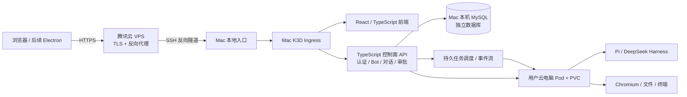

# Coke Grok Bot 像素级复刻技术方案

日期：2026-10-28

状态：分阶段实施中；已有 UI 检查点与真实 Agent/云电脑候选实现，尚未完成全产品复刻及完整逐帧验收。

## 1. 目标与边界

在本目录建设 Coke Grok Bot，参考 xAI Grok Bot 的桌面产品，将界面、交互状态和可观察的产品行为逐项复刻，并提供公网访问。技术栈以 TypeScript、React、Node.js、MySQL 和 Mac 本机 K3D 为基础，最大程度复用 Coke Dots 的身份认证、租户云电脑、Agent 运行时与发布经验。

- **所有业务计算和数据留在 Mac**：控制面、任务调度、Agent、租户云电脑、数据库均在 Mac 或 Mac 上的 K3D。腾讯云 VPS 只负责 HTTPS 入口、反向代理和隧道转发。
- **目标是可运行的产品**：能创建持久 Bot、对话、实际运行任务、观察/接管云电脑、查看文件与结果；不能以静态截图或假执行代替真实能力。
- **桌面优先，公网可访问**：先完成可通过浏览器和公网访问的桌面版界面；同一前端后续用 Electron 包装成 Mac 应用。手机布局和原生移动端列为独立阶段，不把浏览器响应式模拟称为原生 App。
- **持续运行的现实边界**：任务在 Mac 及 Docker/K3D 保持运行时可脱离浏览器继续；Mac 休眠、关机或 Docker 停止时不具备官方云端的 24/7 运行保证。
- **视觉基准先固定版本**：官方产品仍在迭代，同一功能选择有时间、版本和来源的基准；当官方新旧资料冲突，分别记录，不拼成未观察过的流程。

## 2. 已核实的产品事实与待研究事项

| 范围 | 官方证据 | 已确认行为 | 尚需视觉核对 |
| --- | --- | --- | --- |
| Bot | [创建和管理 Bots](https://docs.x.ai/grok-bot/bots) | 侧栏 `+` 创建，输入名称并选择形状/颜色，创建后进入 Bot 聊天；Bot 有独立角色、聊天和记忆，可置顶、分组、隐藏 | 首次引导、弹层、头像形态、菜单、动画及各状态的像素和时序 |
| 聊天与协作 | [消息与协作](https://docs.x.ai/grok-bot/chat-and-collaboration) | 聊天展示工具、电脑操作、文件和审批；可在执行时追加指令；支持 2–6 Bot 群聊、`@` 指定 Bot/群组/Routine/App、Bot 间异步交接；私聊中的新指令可重定向当前任务 | V1 已逐帧看到 Bot 候选、结构化 mention token、发送、Maya `is working`、Dex `Message from maya`/`Thinking`，33:42.400 的贴纸投票澄清卡（四个选项加自由输入），以及 33:42.500 从 `dex ↔ maya` 标题转为 `dex` 单聊；至 34:32.966 澄清卡已标为 Dismissed，Computer 仍是灰色占位；34:20.767 起出现草稿、34:29.767 显示已发送消息、34:30.200 显示 `dex is working`；34:34.233 出现 Dex 的 Figma 回复，34:34.300 显示 `Connecting to Figma`；34:42.900 打开 Marketplace，34:45.967 的 Figma 插件详情显示 `default` 账户为 `Connected` 且有 Figma connector/14 项 Skills；至 34:47.967 Computer 仍灰色，未见具体 Figma 文件内容或任务结果；群聊视觉和其余交互状态待核对 |
| 持久电脑 | [电脑与应用](https://docs.x.ai/grok-bot/computer-and-apps) | 同一用户的 Bot 共享电脑、文件与登录态；每个 Bot 有自己的屏幕，每屏同一时间最多一个电脑操作任务 | 预览、打开电脑、接管/归还、等待和异常画面，及多屏交互 |
| 工作成果 | [文件与结果](https://docs.x.ai/grok-bot/files-and-results) | 聊天可附加文件并交付结果 | 文件卡片、预览、下载及大文件/错误状态 |
| 自动化 | [技能与例行任务](https://docs.x.ai/grok-bot/skills-routines-and-automations) | Skill 记录可复用的方法；Routine 可定时或由事件触发 | 列表、详情、创建/暂停/恢复及运行记录 |
| 连接与秘密 | [Vault](https://docs.x.ai/grok-bot/vault)、[官方 101 指南](https://x.ai/bot/guides/grok-bot-101) | 官方有安全登录、连接器、协作和审批概念 | 实际界面和授权流程；后续需单独证明 secret 不暴露给模型 |

重要架构区别：官方的电脑按**用户**而不是 Bot 归属；同一用户的多个屏幕不是安全隔离边界。Coke Dots 现有云电脑主要按租户工作区隔离，不能不经改造就把两者当成同一个模型。我们会保留租户权限边界，在租户内把个人电脑绑定到具体用户；个人 Bot 共用该用户电脑。团队共享 Bot 另建权限模型，不能默认继承个人浏览器登录态。

### 证据目录与状态

1. [官方产品介绍](https://x.ai/news/introducing-grok-bot)：产品目标与整体工作方式；属于官方介绍，并非每个交互细节的证据。
2. [官方产品文档](https://docs.x.ai/grok-bot/overview)：Bot、群聊、电脑、文件、Vault、Skill 和 Routine 的行为基准。
3. [官方 Grok Bot 101 文字指南](https://x.ai/bot/guides/grok-bot-101)：操作场景及截图入口；指南发布时间与当前文档可能不同，不能自动认定画面就是最新版。
4. [官方 YouTube：Introducing Grok Bot](https://www.youtube.com/watch?v=F1_0Lkp16Rc)：发布演示，需区分宣传片与真实操作。
5. [官方 YouTube：Grok Bot 101](https://www.youtube.com/watch?v=8xXhE25vJZY)：优先研究创建 Bot、消息、电脑、Skill 的操作路径。
6. [官方 YouTube：Grok Bot 201](https://www.youtube.com/watch?v=rOVomdnWhjQ)：优先研究多 Bot、Routine 和团队协作。

**当前证据限制**：V1 官方 Grok Bot 101 已逐帧覆盖两个连续片段：27:53–29:28（2,850 帧）与 29:48–35:58（11,100 帧），共 13,950 帧；29:28–29:48 的 20 秒未逐帧覆盖。视频显示 `@dex` 候选与富 token、Maya 发信、Dex 会话的 `Message from maya` 和 `dex is working`，33:37.933 的完整来信与 `Thinking`，以及 33:42.400 的贴纸投票澄清卡、选项/自由输入和 33:42.500 回到 Dex 单聊；澄清卡至 34:27.967 保持未回答，34:29.767 后被标为 `Dismissed`。34:20.767 首次出现关于 8 个贴纸的完整 composer 草稿，34:29.767 首次显示为已发送消息，34:30.200 首次出现 `dex is working`；34:34.233 首次出现 Dex 对 Figma 的回复，34:34.300 首次显示 `Connecting to Figma`，34:42.900 首次打开 Marketplace，34:45.967 的 Figma 插件详情显示 `default` 账户为 `Connected`，并列出 Figma connector 和 14 项 Skills；34:52.967 首次清楚显示 `41 of 41 enabled`。34:53.000–34:57.967 继续停留在 Figma 插件详情和 Skill 列表；34:58.400 工具清单展开，画面可见 Get screenshot、Get design context、Get motion context 等开启状态的开关。35:09.133 起面板继续向下滚动，可读到 Weave list tools、Weave get tool inputs、Weave run tool 等条目，可见开关仍为开启状态；至 35:12.967 仍在工具配置页。35:21.167 Figma 详情关闭并露出 Dex 对话；35:30.333 仍显示 `Reading file`，下一帧 35:30.367 切为 `Thinking`，35:31.600 首次显示 `Running commands`，并持续到 35:42.967。35:43.467 起录屏构图切到 macOS 桌面与 Notes 窗口，Grok Bot 应用被裁切到画面右侧；这不是右栏 Computer 预览的画面，预览仍为灰色占位。35:46.667 应用重新完整入镜时可见状态为 `Connecting to Figma`，并持续到 35:52.967；35:55.967 首次出现助手称已取得 Figma 近景并在读取的更新，35:56.467 首次确认 `dex is working`，35:57.633 首次确认 `Running commands`。新增四窗 35:38–35:58 共 600 帧逐帧检查，联系图、关键帧及 PTS/SHA manifest 已核验；至 35:57.967 未见 Computer 预览变化、工具返回结果、Figma 文件内容或贴纸产物。33:56.167 起画面缩放/平移并露出 macOS 桌面，33:57.900 的 Dock hover 出现截断任务标题；之后 Notes 显示 8 个 GrokBot 贴纸的任务简报和设计参考，34:02.333 起录屏回切到 Grok Bot。切换原因和简报是否被 Bot 读取均未知；不能据此确认路由载荷已进入真实 runtime 或任务已完成。群聊交接、权限和 Routine 以现行官方文档为行为基准，视频补足可见交互。2026-11-02 复核现行官方文档，重申个人 Bots 共用持久电脑、文件和浏览器会话，各 Bot 有独立屏幕，可并行操作；同一屏幕同时最多执行一个电脑任务；Connected App 是结构化工具路径，已连接状态不证明具体调用成功。mention 支持在聊天中指定 Bot、群组、Routine 或 App。文档描述的是外部行为，没有公开私有 runtime 协议。尚未完成同视口的真实官方客户端截图比对；YouTube 视频经压缩/缩放，因此这不是像素一致性结论。本轮重新读取 [x.ai/bot](https://x.ai/bot) 与 [Computer/App 文档](https://docs.x.ai/grok-bot/computer-and-apps)：官网当前文案强调真实工具任务与多 Bot 并行，Computer 段展示 Zendesk 登录场景；公开页面抓取本身只提供文案。此前 CUA 标签读取曾超时；本轮通过可见 Chrome 实际打开、关闭官网演示的 Computer 侧栏与 `Open screen` 弹层。演示画面位于营销页面中央并有外层网页留白；这些是嵌入演示容器的视觉状态，不代表正式桌面客户端应有居中边距，也不是同视口客户端的几何测量。视频经压缩/缩放，以上仍不是像素一致性结论；逐帧证据和不确定项见 `research/README.md`。

## 3. Coke Dots 复用方案

本次只读核对了 `/Users/shangguan/Documents/home2026/coke-dots`。该主工作区存在未提交修改；其本地 `origin/main` 与远端 `main` 核对为 `4213e769e49da7a479ab2ad186584c77b721fa69`。实现时从新确认的 Coke Dots `origin/main` 提取明确范围，不复制未提交内容、配置或用户数据。

| 能力 | 参考位置 | 复用方式与必要改造 |
| --- | --- | --- |
| Google 登录 | `src/server/auth.ts` | 移植 Google OIDC、PKCE、state、nonce、ID token 和安全会话处理；新项目配置独立回调和会话，按新域名/路径验证 |
| 多租户 | `src/server/store.ts`、请求鉴权 | 移植身份与成员关系的设计；所有查询使用租户和成员授权，Bot 个人电脑额外按用户隔离 |
| 云电脑 | `src/server/linux-desktop-computer.ts`、`deploy/linux-desktop/` | 复用 Debian/Chromium/noVNC/Agent 镜像和 K3D 生命周期；改造资源标识、屏幕与租户/用户关系，保留 PVC、健康检查和接管仲裁 |
| Agent | `src/server/desktop-agent-kernels.ts`、`deploy/linux-desktop/agent-runtime.mjs` 等 | 提取 Pi 和 DeepSeek Harness 适配层；引入 Bot、会话、任务、权限和进度事件映射；真实验证模型与工具能力，不把“可选择”当作“可运行” |
| 文件交付 | `src/server/artifact-preview-ticket.ts` 等 | 复用授权预览和下载思路；限制租户、任务、文件路径与符号链接边界 |
| 像素研究 | `research/README.md`、`scripts/compare-reference.ts` | 复用来源登记、时间码、帧提取、裁切、叠图和差异报告流程；不把压缩视频上的像素误差说成精确匹配 |
| 桌面壳 | `electron/` | 后续复用 Electron 启动与登录衔接，服务器仍由 Mac/K3D 承载 |
| 数据库 | `src/server/store.ts` | Dots 当前为同步调用的 `node:sqlite`，不能直接声称已有 MySQL。重建异步持久化接口、调用链、事务、MySQL schema 与迁移，逐项移植业务语义 |

实例级模型配置与用户/租户数据分开；登录身份、模型凭据、第三方连接器凭据和云电脑浏览器登录态也分开管理。仅移植需要的代码及测试，记录来源版本，避免把 Dots 当前运行时与本项目绑定在一起。

## 4. 系统架构



- **MySQL**：优先使用用户已有的 Mac 本机 MySQL，创建本项目独立数据库、账号和最小权限；K3D 到宿主机使用明确、受限的连接地址。当前尚未验证 MySQL 服务、版本、配置或 Pod 可达性；如果已有服务无法满足需要，再评估在 Mac K3D 中单独运行 MySQL。不会复用 Dots 的数据表或改动其他数据库。
- **公网链路**：`公网 HTTPS → VPS 反代 → VPS 本地监听 → SSH 反向隧道 → Mac 本地 K3D 入口 → Web/API/WebSocket`。为本项目使用独立域名或路径和端口，实施前核对现有证书、OAuth 回调、VPS 反代与 Dots 隧道；不覆盖或抢占现有服务。
- **电脑连接**：noVNC/worker 不直接暴露公网；由已认证的控制面经 WebSocket 代理，短期授权绑定用户、租户和电脑。校验 Host、Origin、Cookie、会话和所有权。登录态与聊天记录不写入发布包。
- **网络出口**：云电脑访问 Google 等网站时单独验证 Pod 和受管 Chromium 的实际连通性；不能由 Mac 浏览器的网络正常推断 Pod 也正常。代理只在需要的进程或构建命令中配置，不改系统全局网络。
- **数据保护**：K3D namespace、ServiceAccount、NetworkPolicy、PVC 和资源配额按新项目独立设置。容器隔离不等同于官方硬件隔离；不宣传相同的硬件级安全保证。

### 4.1 Bot 与电脑

- 初始模型：一个个人用户在一个租户内拥有一台持久电脑；该用户的多个 Bot 共享电脑内的浏览器登录态和文件，但各 Bot 的聊天、角色、记忆及任务记录独立。
- 多 Bot 聊天和普通文本推理可并行。官方说明每个 Bot 在共享电脑上有自己的屏幕，可并行使用浏览器/桌面工具；同一个 Bot 同时最多执行一个 computer-use 任务。用户文件、浏览器登录态仍共享，屏幕不是安全隔离边界。
- 初版 Dots 复用实现是一名用户一套 Chromium/X11 屏幕，并把该用户所有 Bot 的运行串成队列。本候选把运行租约、浏览器页面、截图、电脑控制和人工接管按 Bot 绑定，并让不同 Bot 在全局资源上限内并行；同一 Bot 仍串行。Bot 页面使用同一个持久 Chromium context，以共享 Cookie/存储和用户 PVC。它是应用层的浏览器页面屏幕，不宣称等价于官方硬件隔离或独立完整 OS 桌面。
- 每个工作任务保留独立工作目录和原生 session；用户共享电脑文件与 Bot 会话分属不同范围。禁止路径穿越、跨任务或跨租户 session 恢复。

### 4.2 Agent、任务与事件

- **运行位置**：Pi/DeepSeek Harness 在所属用户的 Mac K3D 云电脑内运行；控制面只负责任务、权限、调度和审计。
- **持久状态**：消息、任务、工具事件、结果、审批、定时计划先写 MySQL；建议状态为 `queued → running → waiting_approval / completed / failed / canceled / unknown`，失败、取消和外部副作用不明确必须可区分。
- **恢复**：使用 MySQL 事务、任务租约、到期回收和有序事件游标；刷新/重连后根据已存状态还原。调度采取至少一次投递与去重设计，外部副作用不得假定天然恰好一次。
- **重试**：只对有明确定义的幂等步骤自动重试；外部写入或非幂等请求超时/5xx 后先检查已持久化进度，不重复发送。
- **审批**：需要外部发送、修改账户/第三方内容等操作时生成明确的待审批项，批准或拒绝后记录结果；审批有效性与操作授权需由服务端/工具网关执行，不能只靠提示词。
- **Skill / Routine**：Skill 保存方法、输入、输出和边界；Routine 保存时区、触发条件、下次运行、去重键及运行历史。事件来源必须具备对应授权；外部系统失败要真实显示。
- **群聊与委派**：持久记录参与 Bot、消息与交接来源、父子任务及结果，避免跨租户调用；需要单独验证多 Bot 协同，不能把多个虚拟回复冒充真正协作。

### 4.3 MySQL 主要数据模型

建立 `users / tenants / memberships / sessions`、`bots / bot_memories / bot_sections`、`conversations / participants / messages / attachments`、`runs / run_events / approvals`、`computers / computer_screens / computer_leases`、`skills / routines / routine_runs`、`artifacts / audit_events` 等表。实际 schema 依据官方可观察语义和 Dots 代码审查确定。

每条业务数据带相应租户/用户归属；关系及查询使用复合约束与索引，重要事件按事务提交。数据库迁移采用向前兼容的 expand/contract 策略，记录当前 schema 版本和最低可回退版本，确保回滚应用时不会直接丢弃新数据。

## 5. 像素级复刻和验证方法

### 5.1 来源与逐帧研究

沿用 Coke Dots 的研究流水线，在 `research/` 建立可追溯证据台账：

1. 记录官方文档、视频 URL、获取时间、产品版本、视频时长、分辨率、帧率和文件校验值；原视频和截图只保存在本机被忽略的研究目录。
2. 按操作路径观看完整片段，再对状态切换区间逐帧或按源帧率导出 PNG。记录真实视频时间码、操作、前后状态、动效时长和异常；不以视频目录、字幕或文件名代替画面验证。
3. 首批梳理：登录/首次进入 → 新建 Bot → Bot 名称和头像 → 主聊天/输入 → Bot 执行与进度 → 电脑预览/接管/归还 → 文件预览 → 侧栏切换 → 审批/失败 → Routine；后续补群聊、设置、技能、语音和手机。
4. 用可访问的官方客户端按固定窗口大小、缩放、DPR、主题与字体设置截图；视频画面只用于补充官方客户端难以捕获的动作。标注遮挡、压缩、未知字体和不可见的操作路径。
5. 对每个画面建立元素清单：窗口尺寸、主要区块边界、间距、字号、行高、字重、颜色、圆角、阴影、图标、悬停/焦点和动画帧；无清晰证据的部分明确写“待确认”。

### 5.2 比较与验收

- 在相同视口、DPR、字体、数据和交互状态下采集本项目截图，与官方参考裁切对齐，生成参考图、实现图、50% 叠图、差异热图、区域坐标和指标。
- 对无压缩的、尺度已确认的参考，初始质量目标为关键布局边界偏差不超过 2 CSS px、纯色区域 RGB 单通道偏差不超过 3；动画逐状态对齐并检查关键帧时序。每个画面实际阈值与例外应随可获得的原始参考校准，并以人工视觉验收为最终依据。
- 对 YouTube 压缩、缩放、遮挡或未知尺寸的参考，保留误差和不确定项；不得声称由数字差异率直接证明绝对像素一致。
- 分开验收视觉、交互、真实运行效果、跨用户隔离和公网行为。真实任务必须能展示实际进度与实际产物，不能只测假数据；本地模拟、真实模型、已登录公网 Chrome 各自标注证据。

## 6. 顺序实施与每一阶段的验收

以下是工作顺序；各阶段需要时可拆成更小功能，但**任何时刻只进行一个 feature 分支**。每个分支均从最新 `main` 创建，完成检查并合并后才开始下一分支。

| 顺序 | 交付 | 关键验收 |
| --- | --- | --- |
| 0 | 建立官方资料/视频证据台账、产品状态矩阵及基准画面；初始化仓库 `main` | 对关键流程有可追溯来源；已知/未知分开；完成第一批可对齐截图 |
| 1 | 项目骨架、MySQL、Google 登录、独立租户；桌面布局和基础侧栏 | Google 真登录及退出；两个用户数据隔离；刷新恢复；固定视口对图 |
| 2 | Bot 创建/头像/名称、聊天、流式进度和任务持久化 | 实际模型任务完成，刷新后历史一致；失败、取消和进行中状态真实可见；关键画面通过对图 |
| 3 | Mac K3D 用户云电脑与 Pi/DeepSeek Harness | Pi 与 DSH 各完成真实任务；Browser DOM 与 Computer 真实画面/键鼠均可用；同用户共享持久文件与登录态、各 Bot 页面与电脑 lease 独立；同 Bot 串行、不同 Bot 并行；接管/归还、PVC 重启恢复和跨租户拒绝均通过 |
| 4 | 文件、预览/下载、审批与租户隔离 | 文件路径/符号链接与跨用户拒绝测试；批准/拒绝对应真实副作用与审计；公网登录用户完成闭环 |
| 5 | Skill、Routine、记忆和任务恢复 | 定时运行、时区、暂停/恢复、重启恢复和重复触发去重；每个 Bot 记忆边界可验证 |
| 6 | 多 Bot 群聊、mention 与委派 | 2–6 Bot 群聊真实执行；mention 按 Bot ID 路由；Bot 间异步交接及聊天历史持久化；验证每项动作的 owner/tenant 授权和结果归属 |
| 7 | 原生 Mac 包装、移动界面、语音与更多连接器 | 按官方参考分别逐项完成；移动浏览器、真实手机、真实语音与真实连接器分别验收 |

公网入口可在阶段 1 的独立环境建立，之后每个相关功能都经历本地测试与**已登录公网 Chrome 真实流程**。不把 HTTP 200、Pod Ready、本地 mock 或 Electron 能打开当作完整验收。

## 7. 分支、发布、Tag、检查点与回退

### 7.1 Git 规则

远端：<https://github.com/cokepoppy/coke-grok-bot.git>。本次只读查询未发现远端 refs，`main` 也未显示；实施时先再次检查远端状态，若仍为空则先建立最小 `main` 基线。

1. 开工前检查工作区、远端 `main` 和活动 feature 分支，从最新 `main` 建立唯一分支，例如 `feature/bot-chat`。
2. 做完该功能并通过适用的构建、功能、视觉、隔离和公网验收后，提交并推送；合并到 `main`，核对远端提交，切回 `main`。
3. 只有上一步完成后才能创建下一功能分支。若某功能仍等待用户验收或修复，保持当前分支，不能并行新建其他 feature 分支。
4. 较大功能经用户验收认可后，在**实际通过验收的 main 提交**创建并推送带注释的 `checkpoint/<功能>-<日期>` tag；记录提交、功能范围、验证结果、发布目录和回退方式，并按用户要求写一条不含秘密的 Codex 记忆。
5. Tag 只标记源代码状态；只有发布包、镜像、数据库兼容性和实际访问另行验证后，才称为可回退的发布检查点。

### 7.2 发布目录

每个用户认可的主要版本生成一个独立目录，例如 `releases/<checkpoint>/`。目录生成后不原地覆盖；如需更改则产生新版本。仓库中的构建脚本与发布清单受版本控制；体积较大的镜像和构建制品保留在本机发布目录，不把秘密、用户数据或大型二进制默认提交到 Git。

```text
releases/<checkpoint>/
  manifest.json                 # tag、commit、schema、镜像 digest、架构、依赖、验收范围
  SHA256SUMS                    # 包内文件校验
  source/                       # 对应源码归档或 git bundle、lockfile
  artifacts/                    # 前端、服务端和所需运行依赖的可复用构建产物
  images/                       # 精确版本 OCI 镜像归档，可导入本机 K3D
  deploy/                       # K3D 资源清单、非秘密配置模板
  scripts/                      # verify、install、upgrade、rollback、smoke
  docs/                         # 发布说明、数据库兼容性、操作和回退记录
```

发布包必须能从固定源代码和镜像恢复服务，不依赖后续可变 `latest` 标签或未记录的工作区。脚本执行前先校验文件哈希、镜像架构/digest、目标集群/命名空间、配置引用、数据库 schema 兼容性和当前正在执行的任务；执行后核对实际运行版本并跑真实登录/电脑/任务冒烟。先在隔离环境演练，再作为可用检查点。

### 7.3 数据与回退

- 发布文件夹不包含 OAuth、API key、SSH 私钥、浏览器 cookie、K3D Secret 或未经脱敏的用户数据。凭据放在独立受限的秘密管理位置，安装时由本机安全注入。
- 用户数据单独做受限备份：记录 MySQL 一致性备份及校验、备份时间、迁移版本；云电脑 PVC 需要单独的快照/备份和恢复验证。发布包本身不能冒充完整的数据灾难恢复包。
- 默认回退应用和镜像，保留当前 MySQL 和 PVC。先检查旧版兼容当前 schema；若不兼容，停止自动回退，给出前向修复或数据恢复方案。数据回滚可能覆盖新产生的对话/文件，必须先备份当前状态并明确选择恢复范围。
- 不修改 Dots 的运行目录、Pod、PVC、数据库或现有隧道；同时验证 Dots 和本项目各自仍可访问。

## 8. 当前环境核查与资源计划

- 目标目录在本次调研前为空，尚未初始化 Git；远端只读查询没有发现任何 refs。当前交付仅为方案文件。
- Coke Dots 主工作区有未提交改动，本次没有修改或切换它；后续复用以重新确认的远端 `main` 为来源。
- 2026-10-28 后续复查：Docker 与 `k3d-tp1121-sandbox-dev` 已可连接；节点内存约 3304 MiB / 8 GiB，现有 Dots 云电脑和其他项目工作负载正在运行。未发现可安全删除、且能实质释放内存的目标；没有清理 Pod、镜像或用户数据。
- 集群 `coke-auth` 内现有 MySQL Pod 正在运行，客户端版本为 8.4.10（aarch64）。其现有数据库、凭据与业务归属未检查；本项目独立 schema 和连接权限尚未建立，不得擅自更改现有数据。
- 重新启用现有环境后，先只读列出节点、namespace、工作负载、镜像、PVC、任务和资源占用，确认归属与活跃状态。仅处理确认无用、可重建且不影响回滚的具体对象；镜像占用主要是磁盘，运行 Pod/容器才占内存。不要批量 prune、删除 PVC、重启正在使用的服务或把其他项目的镜像误当垃圾。

## 9. 初次实施的最小验证清单

1. 冻结一版官方桌面基准，逐帧登记来源，做第一批登录、Bot 创建和聊天截图。
2. 复查 GitHub `main`、Docker/K3D、MySQL、现有隧道及占用；初始化项目基线后只创建一个 feature 分支。
3. 打通新项目的 TypeScript 前后端、独立 MySQL、真实 Google 登录，以及两个用户的隔离。
4. 在同一分支中完成对应功能测试、视觉对图和真实登录路径；合并到 `main` 后再开始下一分支。
5. 每个里程碑保留验证记录；待用户认可较大功能后创建 tag、发布包与记忆检查点。

## 10. 2026-11-01 Bot Memory 阶段快照

本节记录 Bot Memory 阶段的历史状态；后续每 Bot 屏幕分支见第 14 节，不能把下面的旧分支名和串行电脑描述当成当前状态。

上述分支名、`main` SHA 和未验收状态是 2026-11-01 较早一轮的历史快照，不能当作当前 Git 状态。Bot Memory 提交 `52cbc9f` 已并入当前 `main`（它是 `c7adadb361b36eb2edb8b292541be42d1128f883` 的祖先）。用户认可的 UI 与现有 main 源码由远端注释 Tag `checkpoint/grok-bot-accepted-ui-current-2026-11-01` 保护；当前唯一未完成 feature 分支、远端和运行环境以第 14 节为准。该 UI Tag 是源码检查点，不是本候选的固定镜像或部署回退包。

代码与较早验证记录已覆盖 Pi/DeepSeek Harness、每用户 K3D 电脑供给、Chromium、`computer_browser` DOM 读取/操作、`computer_desktop` 截图/坐标操作、电脑接管与逐操作审批、任务事件/unknown 恢复、共享文件和 Bot 私有记忆。现有真实模型及 K3D 证据分散记在 [`docs/pi-runtime.md`](pi-runtime.md)；记忆候选还以合成身份完成过公网 API 保存、跨运行召回和第二 Bot 隔离。但这些历史验证不能代替当前运行状态，也不能证明本产品已经具有官方完整的示范教学、Skill/Routine 生命周期、多屏并发、独立第二账号、全部权限边界或最终 Google 登录 UI 验收。

2026-11-01 新一轮主机复核：Docker Unix API `_ping` 返回 HTTP 503；K3D API `59958`、项目入口 `18080` 和本机 MySQL `3306` 均无监听；公网 readiness 返回 `502 text/html`。本地 `127.0.0.1:3001` 的 `/` 返回 Vite 页面；其 `/api/auth/ready` 也返回 `200 text/html`，是 SPA fallback，不能算 Auth API readiness。Docker VM 的 `Docker.raw` 文件仍存在，最近检查约有 3.9 GiB 可用；先前只读虚拟机日志曾报告 ext4 `failed to convert unwritten extents to written extents -- potential data loss`。未运行 Clean/Purge、Reset、fsck、prune 或删除 PVC/数据库；不在缺少安全备份时修复数据盘。

2026-11-01 本轮修复 Bot 页面关闭后仍占用屏幕槽位的问题：在同一 Bot 请求重新打开时先清除已关闭页面和槽位映射，避免容量已满时 Bot 无法恢复。回归用例、`npm run test:runtime` 的 73 项、`npm run build`、顺序执行的 `npm run build:deployment` 和 `git diff --check` 均通过。以上是代码/构建证据；不证明真实 Google 登录、MySQL、Pi/DSH 对话或 K3D 电脑当前可运行。此前 headless UI 流程通过，本轮未重跑。

本轮重新只读探测：Docker Unix API `_ping` 返回 `Docker Desktop is unable to start`，K3D API `127.0.0.1:59958` 和本机 MySQL `127.0.0.1:3306` 均拒绝连接；未运行 MySQL 集成测试或改动集群资源。CUA `getState` 仍报告 `Local browser use is disabled in Work settings` 且浏览器列表为空，因此本轮没有完成已登录 Chrome、真实 Browser User / Computer User 或公网 UI 验收。当前 feature 保持未提交、未验收；下一步须恢复本机 Docker/K3D/MySQL 和获准的浏览器控制，再实测 Pi/DSH、多 Bot 屏幕、接管/交还、持久化恢复与租户隔离。

前一轮的设置诊断记录：Codex 官方桌面设置分别在 `Settings > Browser`（浏览器插件、扩展与站点权限）和 `Settings > Computer Use`（本机应用控制）；`Settings > Browser > Developer mode > Enable full CDP access` 是额外调试能力，不等同于基础浏览器开关。CUA 返回禁用错误本身无法判定具体是工作区策略、会话能力还是开关状态。

后续按单分支顺序推进：先完成第 14 节每 Bot 屏幕候选的真实 MySQL、K3D、Pi/DSH、Browser User、Computer User、持久电脑和账号隔离验收，再合并 main；之后从最新 main 单独实现视频观察到的 `@Bot` 提及/群聊路由与官方异步交接，再评估教学/Skill 生命周期和 Routine 调度。每项均须核对 UI、真实 Agent/电脑副作用、MySQL 持久化/恢复与授权；满足用户验收后才做该项发布包和 checkpoint。Mac/K3D 不可用时保留当前唯一分支，不并行开工。

## 11. 2026-11-01 Files & Results 候选

官方 [Files and results](https://docs.x.ai/grok-bot/files-and-results) 文档给出的桌面附件上限为每条消息 20 个：图片单个 25 MB、图片合计 200 MB，文档/音频/其他文件单个 250 MB，视频单个 1 GB；通过附件按钮、拖入或粘贴添加。文件和结果以聊天卡片出现，支持格式可打开预览、保存或继续对话。T5 的 How I AI 讲解视频在 12:41–12:46 连续审阅了 120 个源帧，记录了聊天中的 PDF 下载卡、助手完成说明和 PDF 页面缩略图；它用于画面参考，当前规则仍以官方文档为准。

当前唯一功能分支 `codex/grok-bot-files-results` 实现候选闭环：MySQL 保存 Bot/Run 文件元数据及归属关系，文件字节进入该用户在 Mac 本机 K3D 的持久 workspace PVC；服务端验证登录用户与 Bot 所有权后才上传、建任务或下载；Agent 校验来源文件大小和 SHA-256，将输入复制到任务专属目录并按不可信数据处理，任务产物限制在对应 `artifacts/` 子目录，再以校验描述符写回 MySQL。以前任务产物也可作为后续任务附件。浏览器支持选择、拖放和粘贴文件，输入/输出卡片跨刷新恢复，包含图片、PDF、小型文本及常见音视频的卡片预览和下载。VPS 仍仅转发请求，未承载应用、模型或文件数据。

当前已通过源代码、临时 MySQL 和模拟身份浏览器覆盖的权限、路径、哈希、刷新和下载检查；独立 K3D 真实模型管线已证明纯文本附件进入 Pi 任务、Pi 创建结果文件并可下载。媒体播放控件和附件 UI 的模拟 E2E 通过，但音频/视频转录、视频帧理解、Office/PDF 各格式的真实模型可读性尚未证明；也没有据此宣称整项 Files & Results 已完成公网验收。

### 2026-11-01 已登录公网闭环复核

公网 Chrome 的 Google 登录会话使用 E2E Test Bot 1030 上传一个 21 B 合成文本附件。首次失败被 Auth 的安全诊断定位为桌面 Broker 连接错误；实际原因是拆分部署的 Desktop 和 Agent 被错误地要求使用同一镜像。把镜像拆成独立固定值后，只滚动了 Desktop Broker 到 `coke-grok-desktop-broker:sha-766e026ac6a19a8587853f09f387df6ebd58a1f9`；现有 Desktop Pod UID 未变，10 GiB `workspace` PVC 仍为 Bound，浏览器桌面未重启。

修复后，公网文件卡上传成功；真实 Pi/DeepSeek 任务读取文本并生成 `artifacts/summary.txt`，结果卡和预览显示精确内容 `GROK_FILES_RESULT_OK`。浏览器下载文件为 20 B，下载后的本机文件内容核对通过。刷新后用户消息、输入附件、完成状态、结果卡仍存在；结果卡可重新附加到下一条消息，测试中验证显示后清除且未再次提交。详见 [`docs/pi-runtime.md`](pi-runtime.md)。此证据完成当前候选的公网文件闭环验证，不代表整项产品验收或所有格式理解能力；用户最终验收、checkpoint tag、发布目录和回退记忆仍待完成。

## 12. 2026-11-01 Bot Memory 候选

当前[官方 Bot 文档](https://docs.x.ai/grok-bot/bots)称个人 Bot 会跨聊天保留稳定偏好、职责/规则、重要事实与带日期的工作摘要；Bot 可自行判断是否保存，用户在聊天中查看、更正或删除。重置会话不清记忆；删除 Bot 清除其记忆。密码、卡片和联系方式属于 Vault，记忆也不能替代实时来源或操作审批。T4 `05:15.000–05:19.967` 的 150 个连续帧已逐帧审阅，`05:18.333` 原尺寸帧显示旧版聊天里讨论全局事实与当前 Bot 私有记忆的区别；它作为补充，不覆盖现行文档。逐帧范围与版本差异见 [`research/README.md`](../research/README.md)。

在 Bot Memory 候选阶段，分支 `codex/grok-bot-bot-memory` 实现每个 Bot 独立的 MySQL `bot_memories`、最多 200 条记录、重复内容合并、纠正和删除。每个 Pi/DSH 任务读取该 Bot 最新 24 条记忆并作为不可信参考上下文；模型可以在直接用户消息包含持久偏好、职责、事实、规则或有用工作摘要时自主写入，也可以用 `bot_memory` 工具回答查看、更正和忘记请求。工具通过内网 TLS Model Gateway 和 14 分钟短时 capability 工作；服务端同时核对 owner、Bot ID、run ID、lease ID 与有效运行状态，不接入公网路由。记忆不得当作指令、授权或审批；从文件/网页/工具输出中不能独立学习并写入，明显凭据、联系方式和支付卡信息会被拒绝。该代码已合并进当前 main；后文的公网合成用户及 K3D 证据是历史实测，不代表当前主机仍在运行。

本阶段只实现 Bot 私有记忆，没有实现官方少量用户级共享事实（例如用户姓名/时区）的共享存储，也没有独立记忆管理页；现行官方页面说明个人 Bot 通过聊天管理记忆，故 UI 入口使用自然语言聊天。实际 K3D E2E 首次发现 Agent runtime 漏传 memory capability 模式，已修复；两个 runtime 分别写入的记忆可由后续 Pi 任务读取，第二个 Bot 无法继承，电脑操作、精确审批和用户接管回归也通过。当前公网 Agent 确切镜像的隔离 memory-only E2E 另以 8 次模型调用通过，细节见 [`docs/pi-runtime.md`](pi-runtime.md)。两次公网合成身份的真实模型任务完成，却没有持久化明确的记忆请求，暴露出不能依赖模型每次都主动调用 memory 工具；分支 `52cbc9f` 新增 executor 侧的显式长期记忆保存兜底，并以同租户/Bot/运行租约校验和敏感信息拒绝约束。本机 K3D Auth 镜像 `sha-52cbc9f` 已部署；公网合成 API E2E 完成显式保存、跨运行召回与第二 Bot 隔离，三项任务完成并清理合成数据。该候选尚无已登录 Google UI 验收；截至本次复核，Docker/K3D/本地 MySQL 未监听且公网入口为 502，因此端到端 UI 当前不可复验。详细候选与限制见 [`docs/pi-runtime.md`](pi-runtime.md)。这些证据仍不是完整产品或 Browser User/Computer User 官方等价验收。

## 13. 官方示范教学、Skill 与 Routine 的逻辑基准

截至 2026-11-01 重读的[官方电脑文档](https://docs.x.ai/grok-bot/computer-and-apps)，电脑属于用户账号：同一用户的 Bot 共用持久文件、浏览器 Cookie、登录会话和命令行凭据；每个 Bot 有自己的屏幕，不同 Bot 可并行，但同一 Bot 每屏同一时间最多执行一个电脑任务。Bot 屏幕不是安全边界，不同用户之间官方提供专属硬件隔离。官方描述云电脑在用户关闭笔记本时继续工作；本项目运行在 Mac/K3D，Mac 休眠或 Docker/K3D 停止时不能承诺相同的 24/7 保证。历史上每用户单屏串行的候选和当前每 Bot 屏幕候选分别见第 14 节。

当前 [官方 Skill/Routine 文档](https://docs.x.ai/grok-bot/skills-routines-and-automations) 规定的示范路径为：在一对一 Bot 对话打开电脑、选择 Teach a task、描述目标、执行一次流程、停止录制并检查新建 Skill，再在安全样例上测试。示范录制的是可见电脑交互，最多 10 分钟，不录制麦克风；新学到的 Skill 是草稿，必须补充示例不明显的决策规则、失败处理和审批边界。官方文档同时允许直接用文字描述建立 Skill。**29:43–31:58 视频证据**显示 `Learn from demonstration` 后依次出现 `Drafting the file`、`Running commands`、`Reading file`，期间用户提交下一任务；随后可见 Bot 详情的 `Computer` 标签和 Maya 的 Google Forms 屏幕预览。聊天状态从 `maya is working`/`Working` 延续到 `Running commands`。电脑预览的外层页面结构保持，但 30:23–30:28 原尺寸帧显示 Google Forms 内嵌人物画面随帧变化，媒体类型未知；30:28–30:33 中布局与页面状态持续稳定。30:23 前后，聊天与电脑面板分界由约 x=884 移到约 x=936，聊天变宽、电脑预览变窄，左右 resize 光标可见；既有 `Computer · Skipped` 卡片随聊天内容重排进入视口。30:28–30:33 分界维持在新位置，旧任务卡与部分被视口裁切的 `Running commands` 仍可见。30:33.267 附近出现 `Reading file`；30:33.500 起打开暗色遮罩上的 `learn-from-demonstration` Skill 详情，显示 `Managed by Cursor`、Name、Description、Instructions。30:40.433 与 30:40.633 附近，详情正文分别发生两次向上滚动，而弹窗边界、固定标题栏和底层 Computer 页面未移动；30:45.833 附近正文回到顶部，弹窗本身保持固定。30:47.133 后关闭图标处可见手形 hover，但直到 30:48 末帧弹窗仍打开，没有确认点击。30:48.167 左右弹窗消失并恢复三栏页面，右侧 Computer 仍显示同一 Google Forms 预览；30:49.000 帧仍有蓝色 `1 new message` 提示，30:49.034 首次不显示该提示，而 `maya is working` 一直持续到 30:52.967，未见新结果。30:54.900 帧起，三枚消息快捷操作图标从橙色用户消息旁切换到灰色助手消息右侧；后续保持 hover 显示，录屏没有点击或菜单结果。31:02.166（源帧 125）附近，Computer 屏幕预览中央开始淡入深色 `Open` 圆角控件及斜向展开图标，31:02.333 后清晰并保持至片段末尾；没有展示点击或打开后的画面。31:03–31:08 又观察到预览 hover `Open`、分栏拖动、滚动后可见 `Open computer` 及消息 hover 工具栏；31:08–31:13 用户要求 Agent 从录制中学习 Google Forms 流程并补充二维码步骤，助手确认，Computer 仍停留在表单预览。31:15.966（源帧 89）首次出现 `Finished watching`，助手声称完成表单演示并开始保存 Skill；后续可见 `Reading file`、`Running commands`，31:30.267–31:30.300 状态从 `Working` 切到 `Running commands`。31:33.833（源帧 25）出现 `Learned and saved` 的 `Create and publish Google Form` 五步卡片，含发布、复制 responder link 和生成 QR code 步骤；31:41.700 起用户输入未发送草稿，到 31:42.167 可读到 `Can you mess…`。说明长指令需要独立滚动区域及可区分的 hover/按下/关闭态，消息操作栏需跟随 hover 消息，Computer 预览需实现 hover 后的 `Open` 入口，且未读提示清除机制仍未知；具体滚动输入、回顶触发、关闭/展开触发方式未在画面中确认。指令文本表明这个演示处理工作流等待录制捕获完成，并引用本次 Cursor 运行的队列作用域/session 元数据；这些实现细节不能直接当作公开 Grok 协议。侧栏会话摘要后来显示 `Demo looks solid so far — ...`，但消息本体被弹窗遮挡，无法确认其作者或完整内容。视频没有显示命令明细、可独立检查的 Skill 库条目或回放测试；虽然 Skill 卡片列出二维码步骤，但没有可独立验证的二维码/真实表单结果，也不能据此证明后台保存或任务副作用成功。以上是画面中的状态，不证明学习任务/新任务的调度关系、电脑接管已经发生或任务副作用成功。当前代码里有真实电脑工具，但尚未找到已实现的教学录制会话、可审阅 Skill 草稿、测试与正式复用完整闭环。

V1 31:45.400 首次键入 `@` 后，composer 上方出现按 Bot 名称筛选的候选行，包含头像、名称和右侧 `Bot` 类型；输入 `d`、`dex` 后候选减少。31:47.967 时仍只是光标悬停红色 `dex` 候选。31:48.000→31:48.033 菜单消失，composer 中出现红色 Bot 图标加 `dex` 的结构化 mention token，后续文本继续输入到 31:52.967，发送按钮虽可用但没有发送。录屏没有显示确切的选中输入事件、发送结果或 Bot 路由；实现必须把 token 绑定到授权 Bot ID，服务端重查会话成员与租户归属，再走持久化消息、Pi/DSH runtime 和对应 Bot 电脑 lease，不能把可编辑的 `@dex` 字符串当成身份或授权。

下一阶段实现拆为独立、可验收的状态机，而不是一条聊天提示：

1. 创建绑定租户、用户、Bot、电脑屏幕和当前运行租约的 teaching session；只有用户明确开始后捕获电脑事件，计时不超过 10 分钟；停止、取消、超时、接管、刷新和进程重启都需有明确终态。录屏/动作日志不得保存登录秘密、密码字段、支付卡、OTP 或不相关屏幕数据。
2. 将批准后的浏览器/桌面交互整理成受限私有草稿，包含用途、输入、步骤、决策点、失败/重试策略、预期结果和审批边界；源网页内容按不可信输入处理。草稿创建和解析失败都要落库并显示明确状态，不能无限停在 “Reading file”。
3. 用户能查看、编辑、丢弃和测试草稿；通过安全夹具复放或等价的无副作用检查后，才能将草稿保存为可调用 Skill。Skill 的可见范围、Bot 启用关系与用户共享库依官方文档建模；每次执行仍走真实 Pi/DSH harness、电脑工具授权、逐操作审批和持久事件记录。
4. Routine 单独保存时区、时间或事件触发、输入、输出、当前状态、下次运行及历史；包括 Test、Pause/Resume、Edit、Delete。调度需去重、租约、可恢复、幂等重试和失败上报。官方说明 Routine 在云端持续运行；本项目的 Mac/K3D 部署只在主机与集群运行时工作，不能承诺关机/休眠时仍运行。

验收须有可回放录制、Skill 草稿审阅/修改/测试/执行、Routine 手动 Test 与定时或事件触发、刷新和重启恢复、用户/Bot/租户授权隔离、电脑接管打断及审批拒绝测试。所有关键环节需同时查看 UI 状态、MySQL 状态、Agent 工具事件和真实电脑效果；模拟响应、静态预览或 model 口头确认不算通过。当前活动 feature 分支未完成且 Docker/K3D 不可用，故本节只是经过官方资料核对的实现与验收基准，尚未实现。

## 14. 每 Bot 屏幕与同用户并行电脑任务候选

官方 [电脑文档](https://docs.x.ai/grok-bot/computer-and-apps) 明确：一个用户账号持有一台共享持久电脑；Bot 共用文件、Cookie 和登录会话，但各有一屏；不同 Bot 可以同时操作自己的屏幕，同一 Bot 的屏幕一次只运行一个电脑任务；不同用户之间严格隔离。此前仓库已经有真实 Pi/DSH 执行器、Chromium DOM 工具、桌面截图/输入、用户接管和逐操作审批；本分支把 `RunStore.claimNext`、Agent runtime 与 Computer API 扩展到 Bot screen 作用域。

本候选使用数据库里的 Bot ID 作为 screen scope：同一个用户的持久 Chromium context 下按 Bot 取回独立 page，page 内的 `window.name` 记录稳定 screen ID；所有页面仍在同一用户 Chromium profile/PVC 中，保持网站 Cookie、同源 localStorage 和共享文件。Pi/DSH 每个任务显式携带 `botId`；MySQL 调度与 Agent runtime 对相同 Bot 排队、对不同 Bot 并行，现有全局并发上限仍约束总资源。电脑工具的实时截图、Browser DOM、桌面坐标动作、审批快照和用户 Take control/Return to Bot 均绑定到同一 Bot ID；HTTP API 先验证当前 session 确实拥有该 Bot。`unknown` 运行只冻结对应 Bot 的后续运行，不阻塞同一用户的其他 Bot。

屏幕模型是从官方外部行为推导的本地实现，不声称复刻其私有内部结构。只读对照 Coke Dots 固定 `origin/main` `4213e769e49da7a479ab2ad186584c77b721fa69`：Dots 的 `computer_desktop` 使用 `scrot` 读取 X11 桌面、用 `xdotool` 发送真实坐标与键盘输入。本分支现将该能力扩展为每用户一个共享持久 Chromium profile、每 Bot 一个 CDP 窗口和 X11 区域：默认 1440×900、8 个屏幕槽（`COKE_DESKTOP_SCREEN_SLOTS` 可配置 1–16），水平间距 32 px；Bot ID 的 `window.name` 标记把持久网页映射回固定区域。`scrot -a` 只捕获该 Bot 的 1440×900 桌面裁切；截图鼠标坐标加上区域偏移后由 `xdotool` 注入。键入内容通过 xdotool stdin 发送，不放入进程参数。一个 X11 指针/键盘只有一份，因此跨 Bot 的物理输入在焦点定位及输入期间串行；Pi/DSH 任务调度与 Browser DOM 工具仍可按 Bot 并行。超出屏幕槽数返回可恢复的 503 容量状态。不同 Bot 的屏幕是同一用户桌面上的工作区域，不是安全边界；用户隔离仍由每用户独立的 Namespace、Pod、PVC 和凭据实现。

Browser User 的 DOM/可访问名称操作仍是独立工具通道；Computer User 则读 X11 实际画面并以 X11 键鼠操作。K3D E2E 已扩展为截取 A/B 两个真实 1440×900 区域、从画面中定位彩色输入框并通过实际鼠标/键盘提交，同时核对 Cookie/localStorage 共享、每 Bot 页面隔离、接管边界和 Bot B 在 A 被接管时仍可工作。这个 E2E 在本机 K3D 恢复前尚未运行，故代码路径和离线单测不能当作真实 X11、Pi/DSH、MySQL 或公网验收。当前 `ComputerPanel` 仍以约两秒轮询截图并提供点击、文字输入和 Enter；官方预览打开、完整键盘/无障碍操作、不同 Linux 应用窗口和远程桌面焦点的逐项视觉验收仍需后续补证。此实现不等价于硬件级用户隔离或官方级 24/7 托管。Mac/K3D 不可用时，不创建或保留声称已部署的 screen，也不靠 mock 宣称通过。

验收：同用户两个 Bot 同时执行独立真实浏览器任务并各自在 MySQL 标记为 running；两 Bot 可看到相同用户登录态和共享文件，但页面导航互不串扰；同一 Bot 的第二任务排队；接管 Bot A 后其 Agent 动作停止而 Bot B 持续；不同用户无法读取或控制对方 screen；刷新后每个 Bot 仍显示对应实际页面。每个验证同时核对 Google 登录 API、MySQL run/lease 事件、模型 tool-call、Chrome 页面内容和所见画面。源码/单元通过而 K3D 不可用时保持此唯一功能分支，不继续创建下一 feature 分支。

### 2026-11-01 分支实现和验证状态

当前唯一 feature 分支 `codex/grok-bot-per-bot-computer-screens` 把 Bot ID 从 API、MySQL run lease 和调度器传到 Pi/DSH runtime、电脑工具、Browser 页面、截图、接管与 guarded approval。不同 Bot 在全局并发上限内运行；同一个 Bot 每次只有一个 active/unknown-pending computer run。`window.name` 用于在共享 Chromium profile 中找回各 Bot 窗口，主 frame 跨站导航时会重新写入含屏幕槽的标记。桌面输入聚焦记忆按 Bot 隔离，键鼠注入有全局短锁。K3D 用例现包含两个真实 X11 区域截图、色块定位、用户 takeover 后真实点击/键入/Enter、Cookie/localStorage 共享、不同页面和 Bot A 接管时 Bot B 仍能运行，以及 PVC 重启后的持久文件验证；本轮因集群不可达未执行这些 K3D 用例。

本轮离线验证：`npm run test:runtime`（71/71，覆盖 X11 布局/输入/截图契约）、`npm run test:ui`（通过）、`npm test`（1/1）、`npm run build:deployment`、`npx tsc --noEmit`、改动 Node 模块语法与 `bash -n deploy/desktop/start-desktop.sh`、`git diff --check` 均通过。UI 自动化使用本地测试浏览器/模拟身份；不代表 Google 登录、MySQL 或 K3D 验收。Docker Desktop API 命令持续挂起，K3D API `127.0.0.1:59958` 连接被拒绝，MySQL `127.0.0.1:3306` 连接被拒绝。直接访问 GitHub 时连接重置；使用单命令代理 `127.0.0.1:7890` 重新检查成功，`origin/main` 为 `c7adadb361b36eb2edb8b292541be42d1128f883`，远端 UI tag 对象为 `1decd89163e0d9836cd860a28ebe3535843a37a8`，与本地 annotated tag 一致。没有修改或停止 Docker/K3D、Pod、PVC、MySQL；没有运行多 Bot K3D、MySQL 集成或已登录公网 Chrome 验收，也没有推送/合并本分支。已验收 UI checkpoint tag 仍指向 `c7adadb361b36eb2edb8b292541be42d1128f883`；本候选未通过真实集群验收，继续留在唯一 feature 分支，不建新功能分支、不创建本功能 release/tag。

2026-11-01 主机复核：Docker Desktop 进程存在，但其 Unix API `/_ping` 返回 HTTP 503 和 `Docker Desktop is unable to start`；`k3d cluster list` 超时，当前 kube context `k3d-tp1121-sandbox-dev` 的 API server 连接被拒绝，MySQL `127.0.0.1:3306` 当前未监听，本机没有可发现的 mysql/mysqld 二进制或 Homebrew MySQL 服务。CUA 检测到 Chrome 正在运行，但返回 `Local browser use is disabled in Work settings`；尝试选中 Codex 应用时，Computer Use 因安全原因拒绝操作。官方 `codex://settings/computer-use/google-chrome` 设置链接已打开，但本轮无法核验或改变该开关。主机数据卷 460 GiB 已用 425 GiB、剩余 4.6 GiB（99%）；Docker.raw 显示 460 GiB 逻辑大小、占用约 157 GiB。Docker VM console.log 含 `EXT4-fs ... failed to convert unwritten extents ... potential data loss`；backend 日志最后记录 Docker 停在 `stopping`，并出现等待 VM 关机超时。此处视为数据完整性恢复风险，不能自行重启、修复或清理 Docker 虚拟盘。没有停止 K3D 集群，没有停止/清理任何 Pod、镜像、PVC 或数据库，也没有部署本分支镜像。待 Docker VM 安全恢复、MySQL 与授权浏览器控制可用后，再从当前唯一分支构建固定镜像并运行 K3D、MySQL 和已登录浏览器验收。验收和远端状态未完成前不合并 main、不建新的功能分支、不创建本功能 tag/发布目录。

### 2026-11-01 本轮运行环境与候选验证

用户重申完整目标包括实际 Pi/DeepSeek Harness 任务、持久云电脑、独立 Browser User 与 X11 Computer User，不接受静态 UI。当前唯一分支仍为 `codex/grok-bot-per-bot-computer-screens`；已有接受 UI 源码 tag `checkpoint/grok-bot-accepted-ui-current-2026-11-01` 指向 `c7adadb361b36eb2edb8b292541be42d1128f883`，本轮没有移动或重复创建 tag。该分支的 per-Bot 页面、X11 截图/键鼠、Bot 级调度和 Pi/DSH 屏幕路由仍为未验收候选；工作区改动未提交、未合并，也没有创建候选 release/tag。

本轮离线验证 `npm run test:runtime` 73/73 通过，`npm run build` 通过，`git diff --check` 通过；这些只说明现有源码、模块用例与前端构建通过。Chrome Computer Use 扩展现可用，浏览器内公网 `https://codex.cokeagent.com/grok-bot/` 返回 502；`127.0.0.1:3001` 拒绝连接，没有完成登录态 UI 或真实任务验收。Docker Desktop 图形界面仍显示 `Docker Engine stopped`；`docker desktop start` 仅报告桌面应用已运行，限时 status 无法取回引擎状态。尝试 `docker desktop restart --timeout 60` 在停止阶段失败，提示 Docker Desktop helper 仍存活；失败后图形界面仍显示 Engine stopped。没有强制结束 helper，没有 Reset/Purge，没有改动 Pod、PVC、镜像、MySQL 或隧道。K3D context 为 `k3d-tp1121-sandbox-dev`，API `127.0.0.1:59958` 拒绝连接；`127.0.0.1:3306` 拒绝连接，当前 PATH 与 Homebrew 清单中没有发现 MySQL CLI/服务。应结合此前 Docker VM ext4 潜在数据损坏记录谨慎处理，不再尝试重启、修复或清理虚拟盘；等待安全恢复后继续真实集群和 MySQL 验收。

目前代码层面有两个不同工具面：Browser User 走 Chromium/Playwright DOM，Computer User 走云电脑 X11 截图、坐标点击、键盘输入；它们已通过 73 项离线回归，但尚无当前集群内的真实 Pi/DSH 电脑任务、副作用、跨 Bot 并行/串行、用户接管和第二用户隔离证据。按第 7 节顺序，保留这个唯一功能分支，不能继续新建另一功能分支，直到当前候选适用测试及实际验收完成并合入 main。

### 2026-11-01 后续运行时复核与屏幕容量修复

目标仍是完整产品复刻：实际 Pi/DSH 任务、持久云电脑、Browser User 与 Computer User 两套实际控制通道、MySQL 持久化、授权和用户/租户隔离；当前 UI tag 只保护此前接受的源码，不替代这些运行时验收。

官方 Grok Bot 101 连续逐帧研究从 34:03 延伸到 34:08（自 27:53 起 11,250 帧）；Sticker 投票澄清卡仍未回答，Computer 预览仍是灰色占位，没有可见的任务副作用。证据和不确定项记于 [`research/README.md`](../research/README.md)。

对 Bot 屏幕页分配的代码复查发现，已关闭页面若所属 Bot 后续没有再次请求页面，其槽位会残留在 `pages` / `slots` 映射里，误阻塞其他 Bot。现于 `BotScreenPages.allocate()` 重查共享 browser context，将已关闭或不再属于该 context 的缓存页面连同槽位一并回收，并新增回归：Bot A 关闭页面后不再请求，Bot B 仍可分配唯一槽位。`node --test tests/bot-screen-pages.test.mjs` 5/5、`npm run test:runtime` 74/74、`npm run build`、`npm run build:deployment` 和 `git diff --check` 均通过。以上仍属离线代码验证，没有宣称真实浏览器或 K3D 运行通过。

同轮补强 Agent runtime 接管回归：一个可中断的 Pi 适配器夹具运行时，Bot A 的活跃任务经 `/v1/tasks/pause` 中断并返回 `waiting / pausedForControl`；A 在用户接管期间新提交的任务也返回 waiting 且不会启动适配器。Bot B 的活跃夹具任务在 A 接管时继续运行，并在释放后完成；Bot A 交还控制后可执行新任务。`npm run test:runtime` 全套 74/74 通过。此测试覆盖本机 runtime 进程与子进程中断契约，不是实际模型或 K3D 证明；真实 takeover、多 Bot 和 UI 行为仍待集群恢复后验收。

本轮实时环境复核：Docker Desktop 界面显示 `Docker Engine stopped`；K3D 当前 context `k3d-tp1121-sandbox-dev` 的 API `127.0.0.1:59958` 连接被拒绝；本机 `127.0.0.1:3306` 与 `127.0.0.1:3001` 均连接被拒绝。通过单命令代理重新核对远端：`origin/main` 仍为 `c7adadb361b36eb2edb8b292541be42d1128f883`，现有 annotated UI tag 仍解引用到该提交；当前候选工作树尚未提交。没有改动 Docker、集群、Pod、PVC、镜像、数据库或隧道。此前 Docker VM ext4 完整性风险仍然适用，因此不做强制退出或磁盘修复。功能分支继续保持唯一；真实 MySQL/K3D/授权 Chrome 端到端证据通过前，不提交候选、不合并 main、不创建候选 tag/release，也不开新功能分支。


### 2026-11-02 用户要求的候选代码检查点

用户明确要求保护当前工作状态。已接受的 UI 源码基线仍是 checkpoint/grok-bot-accepted-ui-current-2026-11-01，指向 main 上的 c7adadb361b36eb2edb8b292541be42d1128f883。当前唯一 feature 分支 codex/grok-bot-per-bot-computer-screens 上的每 Bot 页面、X11 输入/截图、Bot 级调度及 Pi/DSH 接管处理，加上相关回归与逐帧研究，按用户要求提交并建立单独的候选源码 tag checkpoint/grok-bot-per-bot-computer-screens-candidate-2026-11-02。该 tag 是本地代码回退点，不代表用户已验收整个运行时，也不包含固定镜像或可部署 release 目录。

最后一次主机只读复核显示 Docker Engine stopped，K3D API、MySQL 和本地项目服务不可达；没有为检查点操作重启 Docker、变更集群或清理资源。自动化 runtime 回归 npm run test:runtime 为 74/74；构建与部署构建在同一代码改动后通过，但未在当前不可达环境重跑。真实 Pi/DSH 任务、MySQL、K3D 多 Bot 并行、Browser User、X11 Computer User 与已登录公网 Chrome 验收仍未完成；不得将源码候选 tag 称作可发布或完整产品检查点。当前分支继续保持唯一，直到基础设施恢复并完成真实验收，再按约定合并 main。


### 2026-11-02 官方文档、官网演示与产品缺口复核

已重新读取 xAI 官方 Computer、Chat、Auto Review、Skills/Routines 与 Bots 文档，并在可见浏览器上操作 [x.ai/bot](https://x.ai/bot) 的 `Open screen` 演示。官网演示中可见 `Sales Outbound` 会话、CRM 与 Outreach queue 电脑屏幕弹层、52 个 accounts、36 个 contacts、36 个草稿以及 0 sent；演示提供隐藏应用窗口和关闭屏幕控件。四次约一秒间隔的画面采样未见演示状态变化。该页面只作为可见 UI/交互参考，不能证明真实 CRM 查询、邮件发送、Routine 触发或官方私有 runtime 行为。

现行逻辑基准补充：个人 Bot 共用用户级持久电脑与登录态，各 Bot 仅分屏；同一 Bot 同时只能执行一个电脑任务，屏幕不提供跨用户安全隔离。Computer User 的真人交接需覆盖 SSO、Passkey、CAPTCHA 等边界；敏感凭据通过 Secure Form/Vault 填入且不暴露给模型。Browser User 与 Computer User 必须分别落实并验收。聊天需支持任务中追加指令、Bot/群组/Routine/App mention、工具和电脑事件、文件及审批；Stop 不回滚副作用。Auto Review 不得把网页/邮件内容当用户授权，拒绝的动作不能自动重试。Skill 跨 Bot 复用，示范录制最多 10 分钟并先产出可审阅草稿；Routine 是 Bot 级、按时间或事件触发。

本次定向源码核对仍发现 Connect apps 控件只显示 notice，Bot Details 明确显示 `Routines and connections are not available in this preview.`；没有找到 Vault/Secure Form、Routine 数据和调度、Teach-by-demonstration 的录制/审阅闭环。当前分支实现的 Pi/DSH 和双电脑控制面仍只是候选：Docker Engine 停止、K3D API `127.0.0.1:59958` 连接被拒、MySQL `127.0.0.1:3306` 未监听，故不宣称真实 runtime 验收。继续保留唯一 feature 分支，先恢复本地运行环境并通过已计划的双 Bot、租户隔离、MySQL 持久化、Pi/DSH、Browser User、Computer User 和已登录公网 Chrome 测试；未通过前不合并 main 或创建下一 feature 分支。

### 2026-11-02 后续环境、真实运行时和三栏 UI 候选

以下状态更新并取代前面关于 Docker/K3D/MySQL 停止的历史快照：K3D `k3d-tp1121-sandbox-dev` 与 Docker 正常。隔离 `test:desktop-k3d` 使用候选电脑镜像 `coke-grok-desktop:sha-5e8db224c2da99ce7ec489d0a9cb73c6dfff20fa` 和真实 DeepSeek 完成 13 次模型请求，验证 Pi 写文件、Browser User 打开/点击、X11 截图与 Computer User 坐标点击、Bot 屏幕隔离/接管，以及测试 PVC 重启持久性。隔离 `test:mediated-agent-k3d` 完成 23 次模型请求，验证独立 Pi/DSH Agent 与电脑 Pod、实际 Browser/Computer/终端/共享文件工具、审批/接管、跨运行记忆和 Bot 间记忆隔离。二者创建的临时 namespace 已删除；第二项使用的临时 MySQL 容器及合成 schema 也已清除。项目 MySQL Pod、个人 Agent/Desktop Pod、workspace PVC、Broker 和 namespace-bootstrap 未改动。

同日 UI 反馈后，登录产品在桌面宽度默认展开 Bot Computer 侧栏；全屏 Authenticated 产品壳不再把聊天面板居中限制在旧的约 2/3 视口宽度。初版候选曾让右栏占主内容区约 43%；本轮判断这会在中等桌面视口下压缩聊天，已将产品壳改为响应式 `clamp(320px, 29vw, 440px)`，右栏由按钮控制，手机宽度继续使用覆盖面板。参考布局来自官网三栏 Bot 截图与官方演示视频的可见状态，栏宽不是官方页面逐像素测量结果。本地此前的 `npm run test:ui`、`npm run test:runtime`（77 项）和 `npm run build:deployment` 通过，但这些检查发生在本轮 CSS 调整之前，不能当作新布局的验证。候选包位于 [`releases/candidate-grok-bot-three-column-computer-2026-11-02/`](../releases/candidate-grok-bot-three-column-computer-2026-11-02/)。本机 K3D Auth 已更新到固定 ARM64 镜像 `coke-grok-auth:ui-three-column-20261102-a03e45677e92`；公网 readiness 204，已获取的 JS/CSS 哈希与包内一致。只滚动 Auth 与 `private-secrets` init；MySQL/PVC、个人电脑、其他控制面服务、Ingress 和 VPS 隧道保持原状。K3D 节点约 30% 内存。

真实运行时隔离 E2E、模拟身份 UI、构建和公网静态资源检查是不同证据。Computer Use 的 `getTab` 本轮超时，故没有已登录公网 Chrome 的截图或实际渲染像素验收，不能声称用户浏览器中已确认视觉完全一致。当前仍是唯一 feature 分支 `codex/grok-bot-per-bot-computer-screens` 上的候选，未提交/合并到 `main`，没有新建接受 Tag；用户最终视觉验收以及 Connect apps、Vault/Secure Form、Routine 和示范录制等产品缺口仍待完成。

### 2026-11-02 已登录公网布局复核

通过 CUA 检查当前已登录 Chrome 的 `https://codex.cokeagent.com/grok-bot/`：当前实页的认证产品外框覆盖整个浏览器内容区，两侧没有居中卡片式页边距；本地 `.app.product-shell` 对应 `position: fixed; inset: 0`。截图中的较空区域在左侧 Bot 列表下方和右侧 Computer 信息面板屏幕预览下方；对应内容只有两个 Bot 条目和一个屏幕预览/接管控件。中间聊天栏占据视口主要宽度并保持连续历史流，底部 composer 固定。这是该数据状态下的布局观察，不单独定义应保留或填充多少空间。用户明确“留白”仅作观察线索；实际尺寸由官网可见产品演示、连续视频帧、视口和各栏内容状态共同判断。视频中 Dex 执行时右侧 Computer 区仍保持可见，但屏幕预览是灰色占位；据此把它视为产品面板在该状态下的承载区域，不将空白直接推导为固定宽度，也不以占位内容填满。仍需取得同视口官方画面后再核对栏宽。用户提供的 x.ai/bot 截图、网页可读文案与视频帧属于不同证据；此前 CUA 读取官网标签曾超时；本轮已在 Chrome 可见窗口实际检查官网嵌入演示，并开关 Computer 栏与屏幕弹层。营销页外层留白和嵌入演示窗口不应直接转成正式工作区边距；这次观察仍不是同视口桌面客户端几何测量。本轮未改 UI 代码，也不构成与官方逐像素比对或全产品验收。独立布局判断：产品工作区应铺满浏览器内容区，Bot 列表、主聊天和 Computer/详情形成自适应三栏；聊天承担主要宽度，消息内容维持可读行宽，Computer 面板按屏幕宽度与产品状态展开或收起。此前 CSS 的 43% 右栏对中等桌面视口偏宽，所以本轮缩为 `clamp(320px, 29vw, 440px)`；后续还要在同视口实图上校准。左侧 Bot 少、右侧电脑画面为空时可以有较大空区，这是内容密度造成的状态，不应添加虚构内容填满，也不应因单张截图的空白压缩功能面板。官网营销页的边距属于外层网页排版。官方文档定义电脑和 Bot 的行为，演示视频提供可见界面状态，但当前视频画面经过缩放/合成且尚无同视口客户端几何测量；这个方向是基于证据的布局判断，不是像素级验证结论。
### 2026-11-02 官网最新双栏交互基线与本轮接入

用户本轮提供的 x.ai/bot 官网演示截图更新了视觉目标：默认是圆角桌面窗口内的双栏工作区，左栏为搜索与 Bot 列表（图标、最近活动时间、真实消息摘要），右侧主栏为连续聊天记录和固定底部输入框；Computer 从标题栏屏幕图标按需展开，电脑执行状态与实时屏幕以 Computer 活动卡片显示在聊天流内。截图里的网页外层、浏览器工具栏和红色标注不属于产品像素基线。该截图是本轮的主要布局参考，之前三栏默认展开的候选不再作为这张截图状态的目标；详情/Computer 仍可按用户操作打开。官方页面和文档用于校验功能行为，不能把营销演示或静态截图当作运行时证据。

本轮认证产品代码继续使用真实 Bot、聊天、Agent run 和电脑 API。MySQL 的 Bot 列表以最新消息及 run 状态计算侧栏摘要/活动时间；agent_runs.computer_used 在真实 Browser/Computer 工具成功访问电脑后写入，认证 UI 只为确实访问过电脑的任务展示活动卡，并从当前授权电脑 API 载入图像；不会保存截图副本。Run 状态与 MySQL 任务数据决定卡片状态，点击图像或标题栏屏幕按钮可打开原有电脑面板。computer_used 采用幂等 schema migration。产品窗口在 995×675 CSS 视口、2×缩放下生成 1990×1350 截图；E2E 核对 6px inset、280px 侧栏、默认两栏/不占右栏、15:33 活动时间、固定 composer、完成态以及任务运行态、屏幕图像加载和 Computer 面板开关。截图夹具使用合成测试账户、合成消息、合成 Bot 运行和合成 PNG，不能算真实模型/登录验收，也不能算与官网逐像素差分。当前 AgentRun 仍以单条用户 prompt、最终 result 和已访问电脑标记为核心；官网画面里同一任务的中途回复、重命名系统行及 Computer 子任务说明尚未建模，因此文本/事件时间线仍不完全一致。

本轮验证：npm run build、npm run test:runtime（77/77）、npm run test:ui 通过；独立临时 MySQL 8.4 上的 6 项 Bot/Run/HTTP/电脑网关测试通过；test:desktop-worker-k3d 使用固定本地电脑镜像在隔离临时 namespace 实测不同 Bot 屏幕隔离、共享浏览器 profile、Browser User 点击、X11 Computer User 输入和截图、用户接管及跨 Bot 隔离通过，测试 namespace 已清理。项目 MySQL、已有用户 Agent/Desktop、PVC 和其他 K3D 资源未清理。本轮没有用最新改动调用模型，也没有在已登录公网 Chrome 取得同视口截图；未部署这批候选到公网。公开浏览器的视觉验收、同视口官方差分、最新改动下真实 Pi/DSH 任务、多个租户隔离、Connect apps/OAuth、Vault/Secure Form、Voice/Realtime、Routine 和示范录制等仍需分别实现或验收。继续留在唯一分支 codex/grok-bot-per-bot-computer-screens；本轮未提交、合并或创建 release/tag，也不得另开 feature 分支。
